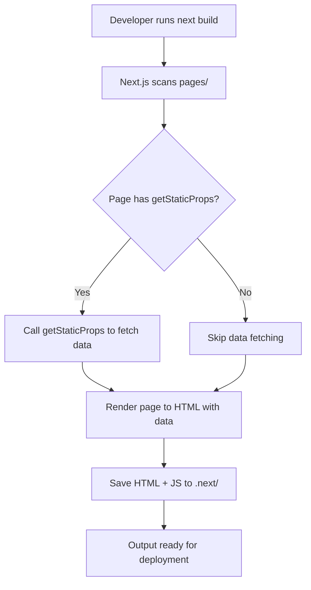

# Static Generation (SSG)

## Introduction
Static Generation (SSG) is a rendering strategy in Next.js where HTML is generated at build time and reused for every request. This approach provides excellent performance, SEO benefits, and low hosting costs since the HTML can be served directly from a CDN.

## Why do we need this?
Not all web content needs to be generated on every request. For content that doesn't change frequently (like blog posts, documentation, or marketing pages), generating HTML at build time and serving it statically is much more efficient than computing it on each request.

## Problem Statement
Generating the same HTML content on every request wastes server resources, increases latency, and increases hosting costs. For static or infrequently changing content, this approach is inefficient and unnecessary.

## Real World Story
Imagine you're publishing a blog with 100 posts. Instead of generating the HTML for each post every time someone visits (which would require querying a database and rendering React components on every request), you generate all 100 posts' HTML once when you deploy the blog. Then, every visitor gets the pre-generated HTML instantly from a CDN.

## Real World Analogy
Think of Static Generation like printing a book:
- You write the content once (at build time)
- You print many copies (the HTML files)
- Each reader gets an identical copy instantly
- If you need to update the content, you reprint the book (regenerate)
- Just as you wouldn't rewrite the entire book for every reader, you don't regenerate HTML for every request when the content is static

## Visual Explanation
```
Build Time:
-----------
[React Components] + [Data] → [HTML Files] → [CDN]

Request Time:
-------------
User Request → [CDN] → [Browser] → [HTML] → [Interactive Page]
```

## Internal Working
When you use `getStaticProps` in a Next.js page:
1. During `next build`, Next.js calls `getStaticProps` to fetch data
2. It renders the page to HTML using the fetched data
3. The HTML is saved as a static file (along with necessary JavaScript for hydration)
4. On request, Next.js serves the pre-built HTML from the CDN (or file server)
5. The browser hydrates the HTML to make it interactive

## Mermaid Diagram 1: SSG Build Time Flow


## Mermaid Diagram 2: SSG Request Time Flow


## Technical Explanation
### How SSG Works in Next.js
1. **Build-time Data Fetching**: `getStaticProps` runs at build time, not on each request
2. **HTML Generation**: The page component is rendered to HTML with the fetched data
3. **Static File Output**: The resulting HTML (and associated JavaScript) is stored as a static asset
4. **CDN Delivery**: Static assets are served via CDN for global low-latency access
5. **Client-side Hydration**: Browser loads the JavaScript and attaches event listeners to make the page interactive

### Key Characteristics
- **No server execution at request time**: HTML is already generated
- **Cacheable**: CDN can cache the HTML indefinitely (or until next build)
- **Fast TTFB**: Time to First Byte is minimal since it's just serving a static file
- **SEO-friendly**: Search engines see fully rendered content immediately
- **Cost-effective**: Serving static files is cheaper than running server instances

## Example: Basic SSG Page
1. Create `pages/blog/[slug].js`:
```jsx
import { notFound } from 'next/navigation';

export default function Post({ post }) {
  if (!post) {
    notFound();
  }
  
  return (
    <article>
      <h1>{post.title}</h1>
      <time>{post.date}</time>
      <div dangerouslySetInnerHTML={{ __html: post.content }} />
    </article>
  );
}

export async function getStaticProps({ params }) {
  const { slug } = params;
  
  // Fetch data from external source (API, CMS, filesystem)
  const res = await fetch(`https://api.example.com/posts/${slug}`);
  
  if (!res.ok) {
    return { notFound: true };
  }
  
  const post = await res.json();
  
  return {
    props: {
      post
    },
    // Optional: Revalidate every hour for ISR
    // revalidate: 3600
  };
}

export async function getStaticPaths() {
  // Get all possible slugs from your data source
  const res = await fetch('https://api.example.com/posts');
  const posts = await res.json();
  
  return {
    paths: posts.map(post => ({
      params: { slug: post.slug }
    })),
    fallback: false // or 'blocking' or true for ISR
  };
}
```

## Example: SSG with Markdown Files
1. Create `pages/blog/[slug].js`:
```jsx
import { notFound } from 'next/navigation';
import { remark } from 'remark';
import html from 'remark-html';

export default function Post({ title, date, contentHtml }) {
  if (!title) {
    notFound();
  }
  
  return (
    <article>
      <h1>{title}</h1>
      <time>{date}</time>
      <div dangerouslySetInnerHTML={{ __html: contentHtml }} />
    </article>
  );
}

export async function getStaticProps({ params }) {
  const { slug } = params;
  
  // Read markdown file from filesystem
  const filePath = `posts/${slug}.md`;
  const fileContents = await fs.promises.readFile(filePath, 'utf8');
  
  // Convert markdown to HTML
  const processed = await remark()
    .use(html)
    .process(fileContents);
  const contentHtml = processed.toString();
  
  // Extract metadata (simplified - in real app use gray-matter)
  const title = fileContents.match(/^# (.+)/m)?.[1] || 'Untitled';
  const date = fileContents.match(/^Date: (.+)/m)?.[1] || new Date().toISOString();
  
  return {
    props: {
      title,
      date,
      contentHtml
    }
  };
}

export async function getStaticPaths() {
  const files = await fs.promises.readdir('posts');
  
  return {
    paths: files.map(file => ({
      params: { slug: file.replace('.md', '') }
    })),
    fallback: false
  };
}
```

## Example: SSG with Fallback (ISR)
1. Create `pages/products/[id].js`:
```jsx
import { notFound } from 'next/navigation';

export default function Product({ product }) {
  if (!product) {
    notFound();
  }
  
  return (
    <div>
      <h1>{product.name}</h1>
      <p>Price: ${product.price}</p>
      <p>{product.description}</p>
    </div>
  );
}

export async function getStaticProps({ params }) {
  const { id } = params;
  
  // Fetch product data
  const res = await fetch(`https://api.example.com/products/${id}`);
  
  if (!res.ok) {
    return { notFound: true };
  }
  
  const product = await res.json();
  
  return {
    props: {
      product
    },
    // Regenerate at most once every 10 minutes
    revalidate: 600
  };
}

export async function getStaticPaths() {
  // Get all possible product IDs from your data source
  const res = await fetch('https://api.example.com/products');
  const products = await res.json();
  
  return {
    paths: products.map(p => ({
      params: { id: p.id.toString() }
    })),
    fallback: 'blocking' // Show fallback while generating
  };
}
```

## Production Example
In production, SSG pages are optimized:
- **Build Time**: `next build` pre-generates all HTML for pages with `getStaticProps`
- **Deployment**: Static HTML files are deployed to a CDN (like Vercel's Edge Network)
- **Request Handling**: CDN serves the HTML directly with minimal latency
- **Updates**: To update content, rebuild and redeploy (or use ISR with `revalidate`)
- **Cost**: Serving static HTML is extremely cheap - often free on CDNs
- **Scalability**: CDN handles traffic spikes effortlessly

## Folder Structure Context
SSG pages exist alongside other page types in the `pages/` directory:
```
pages/
├── index.js                  # SSG (if no data fetching or getStaticProps)
├── about.js                  # SSG
├── blog/
│   ├── [slug].js             # SSG with getStaticProps
│   └── index.js              # SSG (blog listing)
├── products/
│   ├── [id].js               # SSG with getStaticProps (ISR)
│   └── index.js              # SSG
└── api/
    └── ...                   # API routes (not SSG)
```

## Best Practices
1. **Use SSG for static content**: Blogs, documentation, marketing pages
2. **Leverage ISR for semi-static content**: Content that updates periodically
3. **Prefetch data efficiently**: Use `getStaticProps` to fetch all needed data at once
4. **Optimize build time**: For large numbers of static paths, consider incremental builds
5. **Use correct caching headers**: Let CDNs cache SSG responses appropriately
6. **Handle errors gracefully**: Return `{ notFound: true }` for missing data
7. **Validate data at build time**: Catch issues before deployment
8. **Consider preview modes**: Use Next.js preview mode for draft content
9. **Minimize client-side JavaScript**: Hydration is faster with less JS
10. **Use next/image**: Optimize images in SSG pages for better performance

## Common Mistakes
1. **Using SSG for frequently changing data**: Leads to stale content
2. **Forgetting to implement getStaticPaths for dynamic routes**: Causes build errors
3. **Not handling missing data**: Results in undefined props or runtime errors
4. **Using getStaticProps for user-specific data**: Should use SSR or CSR instead
5. **Ignoring build time increases**: Large numbers of static paths can slow builds
6. **Not using ISR when appropriate**: Missing opportunity for background updates
7. **Over-fetching in getStaticProps**: Requesting more data than needed
8. **Forgetting to revalidate**: Content never updates in ISR
9. **Setting revalidate too low**: Negates benefits of static generation
10. **Not testing build process**: Issues only appear during `next build`

## Performance Notes
- **TTFB**: Typically <50ms for CDN-served static HTML
- **FCP**: Fast since HTML is immediately available
- **LCP**: Depends on content optimization (images, fonts, etc.)
- **FID**: Low since minimal JavaScript is needed for hydration
- **CLS**: Minimal if dimensions are known upfront
- **Build Time**: Increases with number of static paths, but parallelizable
- **Cache Hit Ratio**: Near 100% for SSG content on CDN
- **Cost**: Orders of magnitude cheaper than SSR for equivalent traffic

## Security Notes
- **No server exposure**: No server execution at request time reduces attack surface
- **Data safety**: Ensure build-time data fetching doesn't expose secrets
- **Content integrity**: Static HTML cannot be tampered with without redeploying
- **Dependency scanning**: Keep build-time dependencies updated
- **Environment variables**: Only `NEXT_PUBLIC_*` variables are available to `getStaticProps`
- **Headers**: Can set security headers via `_headers` file or middleware
- **File system access**: Be cautious when reading files during build (path traversal)

## SEO Considerations
- **Fully rendered HTML**: Search engines see complete content immediately
- **Fast loading**: Improves Core Web Vitals (LCP, FID, CLS)
- **No JavaScript dependency**: Content is available even if JavaScript fails
- **Structured data**: Easy to include JSON-LD in static HTML
- **Meta tags**: Use `<Head>` to set dynamic titles and descriptions
- **Canonical URLs**: Prevent duplicate content issues
- **Sitemap generation**: Easy to generate sitemap from static paths
- **Internationalization**: Compatible with Next.js i18n routing
- **Core Web Vitals**: SSG excels at LCP and FID; CLS depends on layout stability

## Interview Questions
1. What is Static Generation (SSG) in Next.js?
2. When would you choose SSG over Server-Side Rendering (SSR)?
3. How does `getStaticProps` work in Next.js?
4. What is the purpose of `getStaticPaths` in dynamic routes?
5. How do you implement Incremental Static Regeneration (ISR)?
6. What happens if you don't provide a `fallback` in `getStaticPaths`?
7. How does SSG affect build time and deployment?
8. What are the performance benefits of SSG?
9. How do you handle errors in SSG data fetching?
10. How does SSG compare to SSG with ISR in terms of freshness and performance?

## MCQs
1. Which data fetching method is used for Static Generation in Next.js?
   a) `getServerSideProps`
   b) `getStaticProps`
   c) `getInitialProps`
   d) `useEffect`
   <details>
   <summary>Answer</b) `getStaticProps`
   </details>

2. What does the `revalidate` option in `getStaticProps` do?
   a) Disables static generation
   b) Enables Incremental Static Regeneration
   c) Forces a rebuild on every request
   d) Sets the client-side cache duration
   <details>
   <summary>Answer</b) Enables Incremental Static Regeneration
   </details>

3. Which file creates a statically generated blog post page?
   a) `pages/blog.js`
   b) `pages/blog/[slug].js` with `getStaticProps`
   c) `pages/blog/index.js`
   d) `pages/blog/[slug].js` without any data fetching
   <details>
   <summary>Answer</b) `pages/blog/[slug].js` with `getStaticProps`
   </details>

4. What is the default value of `fallback` in `getStaticPaths`?
   a) `true`
   b) `false`
   c) `'blocking'`
   d) `undefined`
   <details>
   <summary>Answer</b) `false`
   </details>

5. How does Next.js handle a request for a statically generated page?
   a) Executes `getStaticProps` on every request
   b) Serves pre-built HTML from the `.next/` directory
   c) Redirects to the client-side rendering version
   d) Returns a 404 if the page isn't in `getStaticPaths`
   <details>
   <summary>Answer</b) Serves pre-built HTML from the `.next/` directory
   </details>

## Practice Exercise
1. Create a new Next.js project called `ssg-exercise`
2. Create a static blog with:
   - Homepage listing all blog posts (`/`)
   - Individual blog post pages (`/posts/[slug]`)
3. Fetch blog post data from a JSON file in the `public/` directory
4. Implement `getStaticProps` and `getStaticPaths` for the post pages
5. Add metadata (title, description) to each post using the `<Head>` component
6. Style the blog using CSS Modules
7. Run `next build` to generate the static HTML
8. Verify the generated HTML in the `.next/` directory
9. Start the production server and verify the blog works

## Mini Project
Build a documentation website with Static Generation:
1. Create a Next.js project for documentation
2. Organize content in Markdown files in a `docs/` directory
3. Create a dynamic route `docs/[slug].js` that:
   - Reads the Markdown file from `docs/`
   - Converts Markdown to HTML using `remark`
   - Displays the documentation with proper styling
4. Implement `getStaticProps` to fetch and convert the Markdown content
5. Implement `getStaticPaths` to return all possible documentation pages
6. Add a sidebar navigation that lists all documentation pages
7. Implement search functionality that filters documentation titles (client-side)
8. Add versioning support (e.g., `/docs/v1/[slug]`, `/docs/v2/[slug]`)
9. Deploy to Vercel and verify the documentation loads instantly
10. Add a sitemap.xml generator that runs during build

## Summary
In this topic, you learned about Static Generation (SSG) in Next.js, how it works at build time, its benefits for performance and SEO, and how to implement it using `getStaticProps` and `getStaticPaths`. You also learned about Incremental Static Regeneration (ISR) as an extension of SSG for content that needs periodic updates.

## Cheat Sheet
```
# Basic SSG Page
export async function getStaticProps({ params }) {
  const data = await fetchData(params.id)
  return { props: { data } }
}

export async function getStaticPaths() {
  return {
    paths: [{ params: { id: '1' } }, { params: { id: '2' } }],
    fallback: false // or true / 'blocking'
  }
}

# SSG with ISR
export async function getStaticProps({ params }) {
  const data = await fetchData(params.id)
  return {
    props: { data },
    revalidate: 60 // seconds
  }
}

# Error Handling in SSG
export async function getStaticProps({ params }) {
  const res = await fetchData(params.id)
  if (!res.ok) {
    return { notFound: true }
  }
  const data = await res.json()
  return { props: { data } }
}

# Markdown to HTML SSG
import { remark } from 'remark'
import html from 'remark-html'

export async function getStaticProps({ params }) {
  const markdown = await fs.readFile(`posts/${params.slug}.md`, 'utf8')
  const processed = await remark().use(html).process(markdown)
  return { props: { content: processed.toString() } }
}
```

## Related Topics
- Server-Side Rendering (SSR)
- Incremental Static Regeneration (ISR)
- Client-Side Data Fetching
- Data Fetching with getStaticProps and getStaticPaths
- Data Fetching with getServerSideProps
- Choosing the Right Data Fetching Method
- Preview Mode
- Incremental Static Regeneration

## Further Reading
- [Next.js Documentation - Static Generation](https://nextjs.org/docs/rendering/static-generation)
- [Next.js Documentation - getStaticProps](https://nextjs.org/docs/data-fetching/get-static-props)
- [Next.js Documentation - getStaticPaths](https://nextjs.org/docs/data-fetching/get-static-paths)
- [Next.js Documentation - Incremental Static Regeneration](https://nextjs.org/docs/rendering/incremental-static-regeneration)