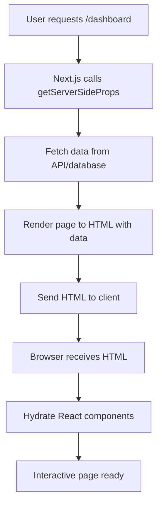
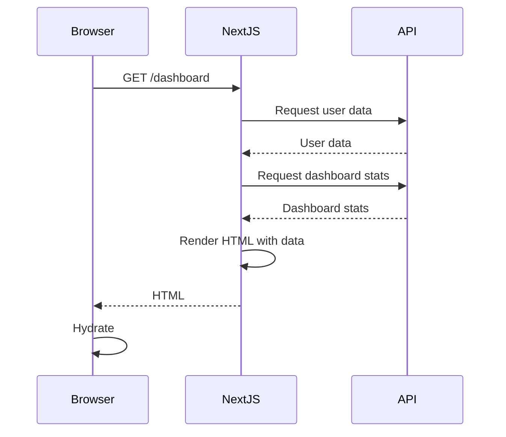

# Server-Side Rendering (SSR)

## Introduction
Server-Side Rendering (SSR) is a rendering strategy in Next.js where HTML is generated on each request. This approach ensures that the content is always up-to-date and is ideal for pages that require frequently changing data, user-specific content, or data that depends on the request context (like cookies or headers).

## Why do we need this?
Not all web content can be pre-generated at build time. For content that changes frequently (like stock prices, user dashboards, or personalized recommendations), generating HTML on each request ensures that users always see the most current data.

## Problem Statement
Using Static Generation for frequently changing data results in stale content being served to users. Conversely, using Client-Side Rendering for SEO-critical content can lead to poor search engine rankings and slow initial load times.

## Real World Story
Imagine you're building a financial dashboard that displays real-time stock prices. If you used Static Generation, the prices would be outdated as soon as the page is built. By using Server-Side Rendering, the dashboard fetches the latest stock prices on every request, ensuring users always see current data.

## Real World Analogy
Think of Server-Side Rendering like ordering a made-to-order meal:
- You place your request (visit the URL)
- The kitchen (server) prepares your meal (generates HTML) fresh to order
- You receive a meal that's exactly what you wanted at that moment
- Just as you wouldn't want a pre-made meal that's been sitting out for hours, you don't want stale data on frequently changing pages

## Visual Explanation
```
Request Time:
-------------
User Request → [Node.js Server] → [Fetch Data] → [Render React] → [HTML] → [CDN/Browser] → [Hydration] → [Interactive Page]
```

## Internal Working
When you use `getServerSideProps` in a Next.js page:
1. On every request, Next.js calls `getServerSideProps` to fetch data
2. It renders the page to HTML using the fetched data
3. The HTML is sent to the client (via CDN or directly)
4. The browser hydrates the HTML to make it interactive

## Mermaid Diagram 1: SSR Request Time Flow


## Mermaid Diagram 2: SSR with Data Fetching


## Technical Explanation
### How SSR Works in Next.js
1. **Request-time Data Fetching**: `getServerSideProps` runs on every request, not at build time
2. **HTML Generation**: The page component is rendered to HTML with the fetched data on the server
3. **Response Delivery**: The resulting HTML (and associated JavaScript) is sent as the response
4. **Client-side Hydration**: Browser loads the JavaScript and attaches event listeners to make the page interactive

### Key Characteristics
- **Fresh data on every request**: HTML is generated with the latest data
- **Server execution required**: Requires a Node.js server to run (unlike SSG which can be served from CDN)
- **Higher TTFB**: Time to First Byte includes server processing time
- **SEO-friendly**: Search engines see fully rendered content immediately
- **Flexible**: Can access request-specific data (cookies, headers, query parameters)

## Example: Basic SSR Page
1. Create `pages/dashboard.js`:
```jsx
import { useRouter } from 'next/router';

export default function Dashboard({ user, stats }) {
  if (!user) {
    // Redirect to login if not authenticated
    const router = useRouter();
    router.replace('/login');
    return null;
  }
  
  return (
    <div>
      <h1>Welcome, {user.name}</h1>
      <div className="stats-grid">
        <div className="stat-card">
          <h3>Orders Today</h3>
          <p>{stats.ordersToday}</p>
        </div>
        <div className="stat-card">
          <h3>Revenue</h3>
          <p>${stats.revenue.toFixed(2)}</p>
        </div>
        <div className="stat-card">
          <h3>Conversion Rate</h3>
          <p>{stats.conversionRate}%</p>
        </div>
      </div>
    </div>
  );
}

export async function getServerSideProps({ req, res }) {
  // Get token from cookies
  const token = req.headers.cookie
    .split('; ')
    .find(row => row.startsWith('token='))
    ?.split('=')[1];
  
  if (!token) {
    return {
      redirect: {
        destination: '/login',
        permanent: false
      }
    };
  }
  
  try {
    // Fetch user data
    const userRes = await fetch(`${process.env.API_URL}/users/me`, {
      headers: { Authorization: `Bearer ${token}` }
    });
    
    if (!userRes.ok) {
      return {
        redirect: {
          destination: '/login',
          permanent: false
        }
      };
    }
    
    const user = await userRes.json();
    
    // Fetch dashboard stats
    const statsRes = await fetch(`${process.env.API_URL}/dashboard/stats`, {
      headers: { Authorization: `Bearer ${token}` }
    });
    
    if (!statsRes.ok) {
      return { notFound: true };
    }
    
    const stats = await statsRes.json();
    
    return {
      props: {
        user,
        stats
      }
    };
  } catch (error) {
    console.error('Error fetching dashboard data:', error);
    return {
      redirect: {
        destination: '/error',
        permanent: false
      }
    };
  }
}
```

## Example: SSR with Query Parameters
1. Create `pages/search.js`:
```jsx
export default function SearchResults({ results, query }) {
  return (
    <div>
      <h1>Search Results for "{query}"</h1>
      {results.length === 0 ? (
        <p>No results found.</p>
      ) : (
        <ul>
          {results.map(result => (
            <li key={result.id}>
              <h2>{result.title}</h2>
              <p>{result.snippet}</p>
              <a href={result.url}>Read more</a>
            </li>
          ))}
        </ul>
      )}
    </div>
  );
}

export async function getServerSideProps({ req, res }) {
  const { query } = req.query;
  
  if (!query) {
    return {
      redirect: {
        destination: '/',
        permanent: false
      }
    };
  }
  
  try {
    const res = await fetch(
      `${process.env.SEARCH_API_URL}?q=${encodeURIComponent(query)}`
    );
    
    if (!res.ok) {
      return { notFound: true };
    }
    
    const results = await res.json();
    
    return {
      props: {
        results,
        query
      }
    };
  } catch (error) {
    console.error('Error fetching search results:', error);
    return {
      redirect: {
        destination: '/error',
        permanent: false
      }
    };
  }
}
```

## Example: SSR with Request Headers (i18n)
1. Create `pages/[lang]/index.js`:
```jsx
export default function Home({ translations }) {
  return (
    <div>
      <h1>{translations.welcome}</h1>
      <p>{translations.description}</p>
      <a href="/about">{translations.about}</a>
    </div>
  );
}

export async function getServerSideProps({ params, req, res }) {
  const { lang } = params;
  
  // Default to English if lang not supported
  const supportedLanguages = ['en', 'es', 'fr'];
  const language = supportedLanguages.includes(lang) ? lang : 'en';
  
  try {
    const res = await fetch(
      `${process.env.TRANSLATION_API_URL}/${language}.json`
    );
    
    if (!res.ok) {
      return { notFound: true };
    }
    
    const translations = await res.json();
    
    return {
      props: {
        translations
      }
    };
  } catch (error) {
    console.error('Error fetching translations:', error);
    return {
      notFound: true
    };
  }
}
```

## Example: SSR with Authentication and Authorization
1. Create `pages/admin/users.js`:
```jsx
export default function AdminUsers({ users, user }) {
  if (!user || user.role !== 'admin') {
    // Redirect to home if not authenticated or not admin
    const router = useRouter();
    router.push('/');
    return null;
  }
  
  return (
    <div>
      <h1>User Management</h1>
      <table>
        <thead>
          <tr>
            <th>ID</th>
            <th>Name</th>
            <th>Email</th>
            <th>Role</th>
          </tr>
        </thead>
        <tbody>
          {users.map(user => (
            <tr key={user.id}>
              <td>{user.id}</td>
              <td>{user.name}</td>
              <td>{user.email}</td>
              <td>{user.role}</td>
            </tr>
          ))}
        </tbody>
      </table>
    </div>
  );
}

export async function getServerSideProps({ req, res }) {
  // Get session token from cookie
  const token = req.headers.cookie
    .split('; ')
    .find(row => row.startsWith('session='))
    ?.split('=')[1];
  
  if (!token) {
    return {
      redirect: {
        destination: '/login',
        permanent: false
      }
    };
  }
  
  try {
    // Verify session and get user data
    const sessionRes = await fetch(`${process.env.API_URL}/sessions/verify`, {
      headers: { Cookie: `session=${token}` }
    });
    
    if (!sessionRes.ok) {
      return {
        redirect: {
          destination: '/login',
          permanent: false
        }
      };
    }
    
    const session = await sessionRes.json();
    const user = session.user;
    
    // Check if user is admin
    if (user.role !== 'admin') {
      return {
        redirect: {
          destination: '/',
          permanent: false
        }
      };
    }
    
    // Fetch all users
    const usersRes = await fetch(`${process.env.API_URL}/users`, {
      headers: { Authorization: `Bearer ${token}` }
    });
    
    if (!usersRes.ok) {
      return { notFound: true };
    }
    
    const users = await usersRes.json();
    
    return {
      props: {
        users,
        user
      }
    };
  } catch (error) {
    console.error('Error fetching admin data:', error);
    return {
      redirect: {
        destination: '/error',
        permanent: false
      }
    };
  }
}
```

## Production Example
In production, SSR pages are handled as follows:
- **Request Handling**: Each request is processed by a Node.js server (or serverless function)
- **Data Fetching**: Occurs on the server at request time
- **HTML Generation**: Server renders React to HTML
- **Response**: HTML is sent to client, then hydrated
- **Caching**: Typically not cached (or cached for very short durations) since data changes frequently
- **Scaling**: Requires sufficient server capacity to handle request load
- **Cost**: Higher than SSG due to server execution on every request
- **Optimization**: Use caching layers (Redis, CDN) for frequently accessed data
- **Edge Computing**: Consider deploying to edge networks for lower latency

## Folder Structure Context
SSR pages exist alongside other page types in the `pages/` directory:
```
pages/
├── index.js                  # Could be SSG or SSR
├── dashboard.js              # SSR (getServerSideProps)
├── search.js                 # SSR (getServerSideProps)
├── admin/
│   └── users.js              # SSR with auth
├── api/
│   └── ...                   # API routes (server-only)
└── _middleware.js            # Applies to all pages and API routes
```

## Best Practices
1. **Use SSR for frequently changing data**: Stock prices, live scores, user dashboards
2. **Leverage SSR for user-specific content**: Personalized recommendations, account pages
3. **Optimize database queries**: Use indexing and query optimization to reduce response time
4. **Implement caching layers**: Cache frequently accessed data to reduce database load
5. **Use HTTP caching headers**: For data that changes infrequently within SSR
6. **Handle errors gracefully**: Provide fallback content or error pages
7. **Secure sensitive data**: Never expose secrets in SSR (use environment variables)
8. **Validate request data**: Sanitize query parameters, headers, and cookies
9. **Consider streaming**: With React 18, use streaming SSR for better TTFB
10. **Monitor performance**: Track TTFB, CPU usage, and memory consumption

## Common Mistakes
1. **Using SSR for static content**: Wastes server resources and increases costs
2. **Forgetting to handle authentication**: Leads to unauthorized access to sensitive data
3. **Blocking the event loop**: Using synchronous operations in `getServerSideProps`
4. **Over-fetching data**: Requesting more data than needed increases latency and cost
5. **Not validating input**: Leads to security vulnerabilities (injection, etc.)
6. **Ignoring request size limits**: Large payloads can cause issues
7. **Using SSR for user-specific data that could be CSR**: Increases server load unnecessarily
8. **Not setting appropriate headers**: Missing caching, security, or CORS headers
9. **Forgetting to handle errors**: Results in 500 errors or hanging requests
10. **Not considering scalability**: SSR requires more server resources than SSG

## Performance Notes
- **TTFB**: Higher than SSG due to server processing (aim for <200ms)
- **FCP**: Depends on TTFB and HTML size
- **LCP**: Affected by how quickly the main content appears in the HTML
- **FID**: Low since hydration is similar to SSG
- **CLS**: Minimal if dimensions are known upfront
- **Server Load**: Increases with request rate; horizontal scaling helps
- **Database Pressure**: Each request may trigger database queries
- **Caching**: Can mitigate performance issues with proper caching strategies
- **Edge Computing**: Reduces latency by deploying closer to users

## Security Notes
- **Authentication**: Verify user identity before granting access to sensitive data
- **Authorization**: Check if authenticated user has permission for the requested action
- **Input validation**: Validate all inputs (query, body, params) against expected schema
- **Output encoding**: If returning user-generated content, prevent XSS
- **SQL/NoSQL injection**: Use parameterized queries or ORM protections
- **Request size limits**: Configure maximum body size to prevent DoS
- **Rate limiting**: Implement to prevent abuse and brute force attacks
- **CORS**: Configure appropriately if serving to different origins
- **Security headers**: Set headers like:
  - `Content-Security-Policy`
  - `X-Frame-Options`
  - `X-Content-Type-Options`
  - `Strict-Transport-Security` (HTTPS only)
  - `Referrer-Policy`
  - `X-XSS-Protection`
- **Dependencies**: Keep updated to avoid known vulnerabilities
- **Secrets management**: Never hardcode secrets; use environment variables
- **Error handling**: Don't leak internal details in error responses
- **File uploads**: Validate file types, scan for malware, store securely
- **Timeouts**: Set appropriate timeouts to prevent resource exhaustion

## SEO Considerations
- **Fully rendered HTML**: Search engines see complete content immediately
- **Dynamic content**: SSR ensures searchers see the same content as users
- **No JavaScript dependency**: Content is available even if JavaScript fails
- **Meta tags**: Use `<Head>` to set dynamic titles and descriptions
- **Structured data**: Include JSON-LD in SSR for rich snippets
- **Canonical URLs**: Prevent duplicate content issues
- **Pagination**: Use `rel="next"` and `rel="prev"` for paginated content
- **Internationalization**: Compatible with Next.js i18n routing
- **Core Web Vitals**: SSR impacts TTFB and FCP; optimize server response time
- **Crawling frequency**: Search engines may crawl less frequently if content changes often

## Interview Questions
1. What is Server-Side Rendering (SSR) in Next.js?
2. When would you choose SSR over Static Generation (SSG)?
3. How does `getServerSideProps` work in Next.js?
4. What data is available in `getServerSideProps`?
5. How do you handle authentication in SSR pages?
6. How does SSR affect performance compared to SSG and CSR?
7. What are the scaling considerations for SSR?
8. How do you handle errors in `getServerSideProps`?
9. How does SSR compare to SSG with ISR in terms of freshness and performance?
10. How can you optimize database queries for SSR endpoints?

## MCQs
1. Which data fetching method is used for Server-Side Rendering in Next.js?
   a) `getStaticProps`
   b) `getServerSideProps`
   c) `getInitialProps`
   d) `useEffect`
   <details>
   <summary>Answer</b) `getServerSideProps`
   </details>

2. Which object in `getServerSideProps` contains the HTTP request details?
   a) `params`
   b) `req`
   c) `res`
   d) `context`
   <details>
   <summary>Answer</b) `req`
   </details>

3. Which object in `getServerSideProps` is used to send the response?
   a) `params`
   b) `req`
   c) `res`
   d) `context`
   <details>
   <summary>Answer</c) `res`
   </details>

4. How do you redirect in `getServerSideProps`?
   a) Return `{ redirect: { destination: '/login', permanent: false } }`
   b) Call `res.redirect('/login')`
   c) Throw a redirect error
   d) Set `window.location.href` in the page component
   <details>
   <summary>Answer</a) Return `{ redirect: { destination: '/login', permanent: false } }`
   </details>

5. What happens if you throw an error in `getServerSideProps`?
   a) Next.js returns a 500 error page
   b) Next.js returns a 404 error page
   c) Next.js retries the request
   d) The error is ignored and the page renders with empty props
   <details>
   <summary>Answer</a) Next.js returns a 500 error page
   </details>

## Practice Exercise
1. Create a new Next.js project called `ssr-exercise`
2. Create an SSR page for user profile (`/profile/[id]`):
   - Fetch user data from an API on every request
   - Display user information (name, email, bio)
   - Handle loading and error states
3. Implement authentication check: redirect to login if not authenticated
4. Create a logout endpoint (`/api/logout`) that clears the session
5. Add a button to refresh the profile data (which triggers a new request)
6. Style the profile page using CSS Modules
7. Test the page in development mode
8. Build for production and verify the SSR behavior

## Mini Project
Build a real-time chat application with Server-Side Rendering:
1. Create a Next.js project for chat
2. Implement user authentication (login/logout) with JWT stored in HTTP-only cookies
3. Create an SSR page for the chat lobby (`/chat`):
   - Fetch list of chat rooms on every request
   - Show room names, participant counts, and last message time
4. Create an SSR page for a specific chat room (`/chat/[roomId]`):
   - Fetch room details and messages on every request
   - Display messages with timestamps and sender names
   - Include a form to send new messages (submit to API route)
5. Create API routes for:
   - Authentication (`/api/auth/login`, `/api/auth/logout`)
   - Fetching chat rooms (`/api/rooms`)
   - Fetching messages for a room (`/api/rooms/[roomId]/messages`)
   - Sending a new message (`/api/rooms/[roomId]/messages` - POST)
6. Implement pagination for chat messages (load more messages (client-side or SSR with pagination params)
7. Add real-time updates using WebSocket (optional, for bonus points)
8. Style the chat application using CSS Modules or Tailwind CSS
9. Test the application thoroughly in development mode
10. Build for production and verify the SSR behavior

## Summary
In this topic, you learned about Server-Side Rendering (SSR) in Next.js, how it works on each request, its benefits for fresh and personalized content, and how to implement it using `getServerSideProps`. You also learned about handling authentication, errors, and performance considerations for SSR.

## Cheat Sheet
```
# Basic SSR Page
export async function getServerSideProps({ req, res }) {
  const data = await fetchData()
  return { props: { data } }
}

# SSR with Redirect
export async function getServerSideProps({ req, res }) {
  if (!isAuthenticated(req)) {
    return {
      redirect: {
        destination: '/login',
        permanent: false
      }
    }
  }
  const data = await fetchData()
  return { props: { data } }
}

# SSR with Error Handling
export async function getServerSideProps({ req, res }) {
  try {
    const data = await fetchData()
    return { props: { data } }
  } catch (error) {
    return {
      redirect: {
        destination: '/error',
        permanent: false
      }
    }
  }
}

# SSR with Query Parameters
export async function getServerSideProps({ req, res, query }) {
  const { id } = query
  const data = await fetchData(id)
  return { props: { data } }
}
```

## Related Topics
- Static Generation (SSG)
- Incremental Static Regeneration (ISR)
- Client-Side Data Fetching
- Data Fetching with getStaticProps and getStaticPaths
- Data Fetching with getServerSideProps
- Choosing the Right Data Fetching Method
- Authentication and Authorization
- API Routes and Middleware
- Preview Mode
- Incremental Static Regeneration

## Further Reading
- [Next.js Documentation - Server-Side Rendering](https://nextjs.org/docs/rendering/server-side-rendering)
- [Next.js Documentation - getServerSideProps](https://nextjs.org/docs/data-fetching/get-server-side-props)
- [Next.js Documentation - Data Fetching](https://nextjs.org/docs/data-fetching)
- [Next.js Documentation - Authentication](https://nextjs.org/docs/authentication)
- [Next.js Documentation - API Routes](https://nextjs.org/docs/api-routes/introduction)