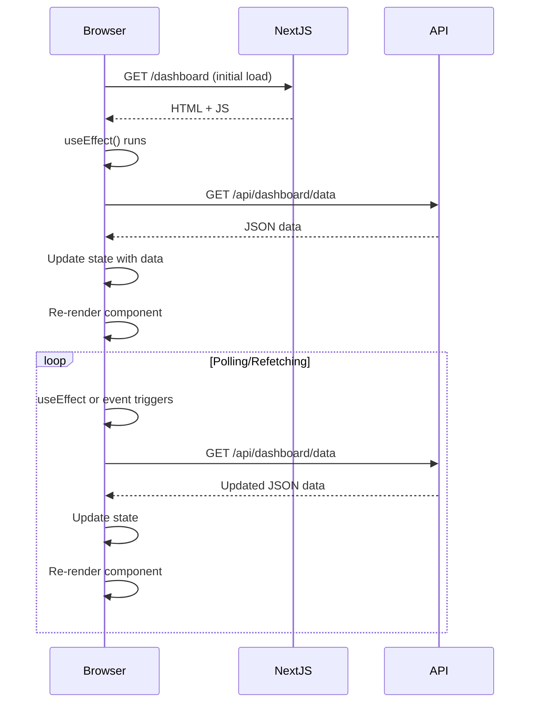
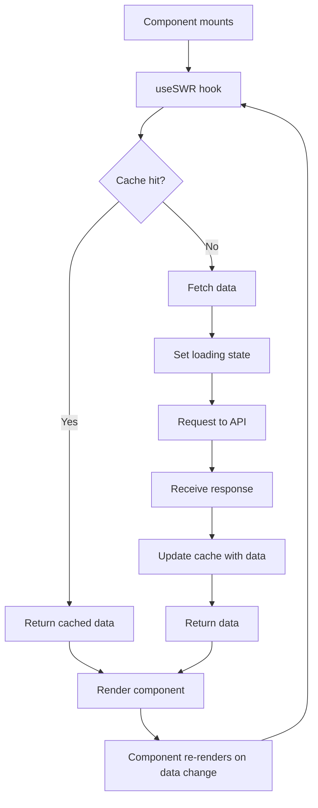

# Client-Side Data Fetching

## Introduction
Client-Side Data Fetching is a strategy where data is retrieved in the browser after the initial HTML has been loaded. In Next.js, this is typically done using React hooks like `useEffect` and `useState`, or data fetching libraries like SWR or React Query. This approach is ideal for data that is user-specific, frequently changing, or doesn't need to be indexed by search engines.

## Why do we need this?
Not all data requires server-side rendering or static generation. For interactive dashboards, user-specific settings, or data that changes very frequently, fetching data on the client reduces server load and provides a more interactive experience. It also allows for richer user interactions like polling, WebSocket updates, and optimistic UI updates.

## Problem Statement
Using server-side rendering for frequently changing user-specific data can lead to:
- Unnecessary server load
- Stale data if not revalidated frequently
- Poor user experience due to full page refreshes
- Inability to leverage client-side caching and interaction patterns

## Real World Story
Imagine you're building a social media feed where users see real-time updates from their friends. If you used Server-Side Rendering, each refresh would require a round-trip to the server, and the data would be stale by the time it reaches the user. By fetching data on the client, you can:
- Show a loading state immediately
- Fetch the latest data in the background
- Update the feed without refreshing the page
- Implement infinite scroll or pull-to-refresh
- Use WebSockets for real-time updates

## Real World Analogy
Think of client-side data fetching like ordering food at a restaurant with a digital menu:
- You receive a static menu (initial HTML) when you sit down
- You browse the menu and decide what you want
- You place your order (client-side request) directly with the kitchen
- The kitchen prepares your order and sends it to your table
- You can modify your order, ask for refills, or check on status without getting a new menu

## Visual Explanation
```
Initial Load:
-------------
[Browser] → Request /dashboard → [Next.js Server] → [Initial HTML + JS] → [Browser]

Client-Side Fetching:
---------------------
[Browser] → [useEffect triggers] → [Fetch API] → [API Server] → [Data] 
                                    → [Browser] → [setState] → [Re-render] → [Updated UI]
```

## Internal Working
When you use client-side data fetching in a Next.js page:
1. Next.js sends the initial HTML and JavaScript to the browser (can be SSG, SSR, or ISR)
2. React components mount and `useEffect` hooks run
3. Data fetching functions (like `fetch` or SWR) are called
4. Requests are made to API endpoints (can be Next.js API routes or external services)
5. Responses are processed and state is updated with `useState` or similar
6. Component re-renders with the new data
7. Subsequent interactions can trigger additional data fetches (polling, refetching, etc.)

## Mermaid Diagram 1: Client-Side Data Fetching Flow


## Mermaid Diagram 2: Client-Side Fetching with SWR


## Technical Explanation
### How Client-Side Data Fetching Works
1. **Initial Render**: Page loads with initial HTML (from SSG, SSR, or ISR)
2. **Effect Hooks**: `useEffect` runs after component mounts
3. **Data Fetching**: Use `fetch`, `axios`, SWR, React Query, etc.
4. **State Management**: Update React state with fetched data
5. **Re-render**: Component re-renders with new data
6. **Additional Fetches**: Triggered by events, intervals, or mutations

### Key Characteristics
- **No server data fetching at request time**: Initial load doesn't wait for data
- **Waterfall potential**: Multiple sequential requests can increase latency
- **Client caching**: Libraries like SWR and React Query provide caching, deduplication, and background updates
- **Interactive**: Enables polling, WebSockets, optimistic updates, and infinite scroll
- **SEO limitations**: Content fetched client-side may not be indexed by search engines
- **User control**: Easy to implement refresh, retry, and error handling

## Example: Basic Client-Side Fetching with useEffect
1. Create `pages/dashboard.js`:
```jsx
import { useState, useEffect } from 'react';

export default function Dashboard() {
  const [user, setUser] = useState(null);
  const [stats, setStats] = useState(null);
  const [loading, setLoading] = useState(true);
  const [error, setError] = useState(null);

  useEffect(() => {
    let isMounted = true; // Prevent state updates on unmounted component
    
    async function fetchData() {
      try {
        setLoading(true);
        // Fetch user data
        const userRes = await fetch('/api/user');
        if (!userRes.ok) throw new Error('Failed to fetch user');
        const userData = await userRes.json();
        
        // Fetch stats data
        const statsRes = await fetch('/api/stats');
        if (!statsRes.ok) throw new Error('Failed to fetch stats');
        const statsData = await statsRes.json();
        
        if (isMounted) {
          setUser(userData);
          setStats(statsData);
          setLoading(false);
        }
      } catch (err) {
        if (isMounted) {
          setError(err.message);
          setLoading(false);
        }
      }
    }
    
    fetchData();
    
    return () => {
      isMounted = false;
    };
  }, []); // Empty deps means run once on mount
  
  if (loading) return <div>Loading...</div>;
  if (error) return <div>Error: {error}</div>;
  
  return (
    <div>
      <h1>Welcome, {user.name}</h1>
      <div className="stats-grid">
        <div className="stat-card">
          <h3>Orders Today</h3>
          <p>{stats.ordersToday}</p>
        </div>
        <div className="stat-card">
          <h3>Revenue</h3>
          <p>${stats.revenue.toFixed(2)}</p>
        </div>
        <div className="stat-card">
          <h3>Conversion Rate</h3>
          <p>{stats.conversionRate}%</p>
        </div>
      </div>
    </div>
  );
}
```

## Example: Client-Side Fetching with SWR
1. First, install SWR: `npm install swr`
2. Create `pages/posts.js`:
```jsx
import useSWR from 'swr';

const fetcher = (url) => fetch(url).then(res => {
  if (!res.ok) throw new Error('Failed to fetch');
  return res.json();
});

export default function Posts() {
  const { data, error, isLoading, mutate } = useSWR(
    '/api/posts',
    fetcher,
    {
      refreshInterval: 5000, // Refetch every 5 seconds
      revalidateOnFocus: true, // Refetch when window refocuses
      revalidateIfStale: true,
      dedupingInterval: 2 * 60 * 60 * 1000, // 2 hours
    }
  );
  
  if (isLoading) return <div>Loading posts...</div>;
  if (error) return <div>Failed to load posts: {error.message}</div>;
  
  return (
    <div>
      <h1>Posts</h1>
      <button on_click={() => mutate()}>Refresh</button>
      <ul>
        {data.map(post => (
          <li key={post.id}>
            <h2>{post.title}</h2>
            <p>{post.excerpt}</p>
            <small>By {post.author} on {new Date(post.date).toLocaleDateString()}</small>
          </li>
        ))}
      </ul>
    </div>
  );
}
```

## Example: Client-Side Fetching with React Query
1. First, install React Query: `npm install @tanstack/react-query`
2. Create `_app.js` to set up React Query:
```jsx
import { QueryClient, QueryClientProvider } from '@tanstack/react-query';
import '../styles/globals.css';

const queryClient = new QueryClient();

export default function MyApp({ Component, pageProps }) {
  return (
    <QueryClientProvider client={queryClient}>
      <Component {...pageProps} />
    </QueryClientProvider>
  );
}
```
3. Create `pages/user/[id].js`:
```jsx
import { useQuery } from '@tanstack/react-query';

const fetchUser = async (id) => {
  const res = await fetch(`/api/users/${id}`);
  if (!res.ok) throw new Error('User not found');
  return res.json();
};

export default function UserProfile({ params }) {
  const { id } = params;
  
  const { data, error, isLoading, isFetching, refetch } = useQuery({
    queryKey: ['user', id],
    queryFn: () => fetchUser(id),
    staleTime: 1000 * 60 * 5, // Consider data stale after 5 minutes
    cacheTime: 1000 * 60 * 60, // Keep in cache for 1 hour
    refetchOnWindowFocus: false,
    refetchOnReconnect: true,
  });
  
  if (isLoading) return <div>Loading user...</div>;
  if (error) return <div>Error: {error.message}</div>;
  
  return (
    <div>
      <h1>{data.name}</h1>
      <p>Email: {data.email}</p>
      <p>Bio: {data.bio}</p>
      <div className="metadata">
        <p>Joined: {new Date(data.joinedAt).toLocaleDateString()}</p>
        <p>Posts: {data.postCount}</p>
      </div>
      <button on_click={() => refetch()}>
        {isFetching ? 'Refreshing...' : 'Refresh'}
      </button>
    </div>
  );
}
```

## Example: Client-Side Fetching with Polling
1. Create `pages/live-stats.js`:
```jsx
import { useState, useEffect } from 'react';

export default function LiveStats() {
  const [stats, setStats] = useState(null);
  const [loading, setLoading] = useState(false);
  
  useEffect(() => {
    let isMounted = true;
    let timerId = null;
    
    const fetchStats = async () => {
      if (!isMounted) return;
      
      setLoading(true);
      try {
        const res = await fetch('/api/live-stats');
        if (!res.ok) throw new Error('Failed to fetch stats');
        const data = await res.json();
        if (isMounted) setStats(data);
      } catch (err) {
        if (isMounted) console.error('Error fetching stats:', err);
      } finally {
        if (isMounted) setLoading(false);
      }
    };
    
    // Initial fetch
    fetchStats();
    
    // Set up polling every 5 seconds
    timerId = setInterval(fetchStats, 5000);
    
    return () => {
      isMounted = false;
      clearInterval(timerId);
    };
  }, []);
  
  if (loading) return <div>Loading stats...</div>;
  
  return (
    <div>
      <h1>Live Statistics</h1>
      {stats ? (
        <div>
          <p>Active Users: {stats.activeUsers}</p>
          <p>Requests/sec: {stats.requestsPerSec}</p>
          <p>Error Rate: {stats.errorRate}%</p>
          <p>Last Updated: {new Date(stats.timestamp).toLocaleTimeString()}</p>
        </div>
      ) : (
        <div>No stats available</div>
      )}
    </div>
  );
}
```

## Example: Client-Side Fetching with Optimistic Update
1. Create `pages/todos.js`:
```jsx
import { useState, useEffect } from 'react';

export default function Todos() {
  const [todos, setTodos] = useState([]);
  const [inputValue, setInputValue] = useState('');
  const [loading, setLoading] = useState(false);
  const [error, setError] = useState(null);
  
  // Fetch todos on mount
  useEffect(() => {
    let isMounted = true;
    
    const fetchTodos = async () => {
      try {
        setLoading(true);
        const res = await fetch('/api/todos');
        if (!res.ok) throw new Error('Failed to fetch todos');
        const data = await res.json();
        if (isMounted) setTodos(data);
      } catch (err) {
        if (isMounted) setError(err.message);
      } finally {
        if (isMounted) setLoading(false);
      }
    };
    
    fetchTodos();
    
    return () => {
      isMounted = false;
    };
  }, []);
  
  const addTodo = async (text) => {
    if (!text.trim()) return;
    
    // Optimistic update: add to UI immediately
    const newTodo = {
      id: Date.now(), // Temporary ID
      text,
      completed: false
    };
    
    setTodos(prev => [...prev, newTodo]);
    setInputValue('');
    
    try {
      const res = await fetch('/api/todos', {
        method: 'POST',
        headers: { 'Content-Type': 'application/json' },
        body: JSON.stringify({ text })
      });
      
      if (!res.ok) throw new Error('Failed to add todo');
      
      // Replace temporary ID with real ID from server
      const savedTodo = await res.json();
      setTodos(prev => 
        prev.map(todo => 
          todo.id === newTodo.id ? savedTodo : todo
        )
      );
    } catch (err) {
      // Rollback optimistic update on error
      setTodos(prev => prev.filter(todo => todo.id !== newTodo.id));
      setError(err.message);
      console.error('Failed to add todo:', err);
    }
  };
  
  const toggleTodo = async (id) => {
    // Optimistic update: toggle immediately
    setTodos(prev => 
      prev.map(todo => 
        todo.id === id 
          ? { ...todo, completed: !todo.completed } 
          : todo
      )
    );
    
    try {
      const res = await fetch(`/api/todos/${id}`, {
        method: 'PATCH',
        headers: { 'Content-Type': 'application/json' },
        body: JSON.stringify({ completed: !todos.find(t => t.id === id).completed })
      });
      
      if (!res.ok) throw new Error('Failed to toggle todo');
    } catch (err) {
      // Rollback optimistic update on error
      setTodos(prev => 
        prev.map(todo => 
          todo.id === id 
            ? { ...todo, completed: !todo.completed } 
            : todo
        )
      );
      setError(err.message);
      console.error('Failed to toggle todo:', err);
    }
  };
  
  if (loading) return <div>Loading todos...</div>;
  if (error) return <div>Error: {error}</div>;
  
  return (
    <div>
      <h1>Todos</h1>
      <div>
        <input
          type="text"
          value={inputValue}
          onChange={(e) => setInputValue(e.target.value)}
          onKeyPress={(e) => e.key === 'Enter' && addTodo(e.target.value)}
          placeholder="Add a new todo"
        />
        <button onClick={() => addTodo(inputValue)} disabled={!inputValue.trim()}>
          Add
        </button>
      </div>
      <ul>
        {todos.map(todo => (
          <li key={todo.id} style={{ textDecoration: todo.completed ? 'line-through' : 'none' }}>
            <span onClick={() => toggleTodo(todo.id)} style={{ cursor: 'pointer' }}>
              {todo.text}
            </span>
          </li>
        ))}
      </ul>
    </div>
  );
}
```

## Production Example
In production, client-side data fetching is handled as follows:
- **Initial Load**: HTML is served quickly (via SSG, SSR, or ISR)
- **JavaScript Bundle**: Contains fetching logic and state management
- **API Requests**: Made from browser to API endpoints (Next.js API routes or external services)
- **Caching**: Libraries like SWR and React Query provide request deduplication, caching, and background updates
- **Error Handling**: Network errors, timeouts, and server errors are caught and displayed
- **Loading States**: UI shows skeletons, spinners, or placeholder content
- **SEO Considerations**: Client-fetched content may not be indexed; use SSG/SSR for SEO-critical content
- **Performance**: 
  - Reduces server load by moving data fetching to client
  - Increases client-side processing and memory usage
  - Can lead to waterfalls if not managed properly
- **Scaling**: 
  - Better horizontal scaling for read-heavy applications
  - API services can be scaled independently
  - Consider using CDN for API responses
- **Monitoring**: Track API latency, error rates, and client-side performance metrics

## Folder Structure Context
Pages that use client-side data fetching exist alongside other page types in the `pages/` directory:
```
pages/
├── index.js                  # Could use client-side fetching for non-SEO content
├── dashboard.js              # Client-side fetching (useEffect)
├── posts.js                  # Client-side fetching with SWR
├── user/
│   └── [id].js               # Client-side fetching with React Query
├── live-stats.js             # Client-side polling
├── todos.js                  # Client-side fetching with optimistic updates
├── api/
│   └── ...                   # API routes serving data to clients
└── _app.js                   # Global setup for libraries like React Query
```

## Best Practices
1. **Choose the right tool**: Use SWR or React Query for advanced features (caching, deduplication, refetching)
2. **Handle loading states**: Always show loading indicators for better UX
3. **Implement error handling**: Catch and display errors gracefully
4. **Prevent race conditions**: Use cleanup functions in `useEffect` to avoid state updates on unmounted components
5. **Leverage caching**: Use SWR/React Query to avoid redundant requests
6. **Consider stale-while-revalidate**: Show cached data while fetching fresh data in background
7. **Implement pagination**: For large datasets, use cursor-based or offset pagination
8. **Use optimistic updates**: For better UX on mutations
9. **Polling alternatives**: Consider WebSockets or Server-Sent Events for real-time data
10. **Environment variables**: Use `NEXT_PUBLIC_` prefix for client-exposed variables
11. **Request deduplication**: Avoid multiple identical requests in short time
12. **Abort requests**: Cancel stale requests when component unmounts or props change

## Common Mistakes
1. **Fetching in render**: Causes infinite loops and performance issues
2. **Forgetting cleanup in useEffect**: Leads to memory leaks and state updates on unmounted components
3. **Not handling loading states**: Results in blank or broken UI
4. **Ignoring error handling**: Leads to unusable features when API fails
5. **Over-fetching data**: Requesting more data than needed increases latency and cost
6. **Under-fetching data**: Causes additional round trips for related data
7. **Not using keys in lists**: Leads to React warnings and inefficient re-renders
8. **Mutating state directly**: Causes unpredictable behavior and missed updates
9. **Not considering SEO**: Using client-side fetching for content that needs indexing
10. **Ignoring request waterfalls**: Sequential requests increase latency unnecessarily
11. **Not debouncing search inputs**: Causes excessive requests on every keystroke
12. **Forgetting to sanitize user input**: Leads to XSS vulnerabilities

## Performance Notes
- **TTFB**: Fast for initial HTML (especially with SSG/ISR)
- **FCP**: Depends on how quickly initial HTML appears
- **LCP**: Affected by when the main content appears in the DOM
- **FID**: Can be high if JavaScript bundle is large or if long-running tasks block main thread
- **CLS**: Minimal if dimensions are known or placeholders used
- **Data Fetching Latency**: Adds to time-to-interactive
- **Caching Benefits**: Reduces redundant requests and improves perceived performance
- **Bundle Size**: Data fetching libraries add to JavaScript payload
- **Request Optimization**: 
  - Combine related requests where possible
  - Use GraphQL or API aggregation to reduce round trips
  - Implement request deduplication
- **Memory Usage**: Client-side state management increases memory footprint
- **Garbage Collection**: Proper cleanup prevents memory leaks

## Security Notes
- **Input validation**: Validate and sanitize all data before displaying
- **XSS prevention**: Escape user-generated content or use safe innerHTML alternatives
- **CSRF protection**: Use same-site cookies or tokens for API mutations
- **Authentication**: Protect API endpoints with proper authentication
- **Authorization**: Check user permissions before returning sensitive data
- **API exposure**: Never expose secrets in client-side code
- **Rate limiting**: Implement on API endpoints to prevent abuse
- **CORS**: Configure appropriately for API endpoints
- **Content Security Policy**: Set appropriate headers to mitigate XSS
- **Dependency security**: Keep data fetching libraries updated
- **Error messages**: Don't leak stack traces or internal details in error responses
- **Secure headers**: Use HTTPS and set security headers (HSTS, CSP, etc.)

## SEO Considerations
- **Content visibility**: Search engines may not see client-fetched content
- **Initial HTML**: Ensure critical content is in initial HTML (use SSG/SSR/ISR for SEO)
- **Meta tags**: Set in initial HTML, not via client-side JavaScript
- **Structured data**: Include in initial HTML for rich snippets
- **Progressive enhancement**: Ensure basic functionality works without JavaScript
- **Core Web Vitals**: 
  - LCP: May be delayed if main content is client-fetched
  - FID: Affected by JavaScript execution time
  - CLS: Can be improved with placeholders
- **Dynamic rendering**: Consider using prerender.io or similar for crawlers
- **Internal linking**: Ensure links are in initial HTML for crawlability
- **Pagination**: Implement server-side pagination for SEO-critical lists
- **Internationalization**: Use next-i18next or similar for server-side translated content

## Interview Questions
1. What is client-side data fetching in Next.js?
2. When would you choose client-side data fetching over SSR or SSG?
3. How do you fetch data on the client in Next.js?
4. What are the advantages of using SWR or React Query over plain `useEffect`?
5. How do you handle loading and error states in client-side data fetching?
6. What is stale-while-revalidate and how does it improve UX?
7. How do you implement optimistic updates in client-side data fetching?
8. How do you prevent race conditions in client-side data fetching?
9. What are the SEO implications of client-side data fetching?
10. How do you optimize performance for client-side data fetching?

## MCQs
1. Which hook is commonly used for client-side data fetching in React?
   a) `useLayoutEffect`
   b) `useEffect`
   c) `useContext`
   d) `useReducer`
   <details>
   <summary>Answer</b) `useEffect`
   </details>

2. Which library provides built-in caching, deduplication, and background updates for client-side data fetching?
   a) Redux
   b) SWR
   c) MobX
   d) Zustand
   <details>
   <summary>Answer</b) SWR
   </details>

3. What does the `refreshInterval` option do in SWR?
   a) Sets how often to revalidate data in the background
   b) Sets the cache expiration time
   c) Sets the debounce time for mutations
   d) Sets the polling interval for manual refetches
   <details>
   <summary>Answer</a) Sets how often to revalidate data in the background
   </details>

4. How do you prevent state updates on unmounted components in `useEffect`?
   a) Use `useLayoutEffect` instead
   b) Return a cleanup function that sets a mounted flag to false
   c) Use `useCallback` to memoize the fetch function
   d) Wrap the state setter in a try/catch block
   <details>
   <summary>Answer</b) Return a cleanup function that sets a mounted flag to false
   </details>

5. What is an optimistic update in client-side data fetching?
   a) Updating the UI immediately assuming the request will succeed
   b) Delaying UI update until the request confirms success
   c) Showing a loading state while waiting for the request
   d) Retrying failed requests automatically
   <details>
   <summary>Answer</a) Updating the UI immediately assuming the request will succeed
   </details>

## Practice Exercise
1. Create a new Next.js project called `client-fetch-exercise`
2. Create a page that displays a list of users (`/users`):
   - Fetch user data from `/api/users` on client-side using `useEffect`
   - Show loading and error states
   - Display users in a list with name and email
3. Implement a search bar that filters users by name:
   - Debounce the search input to prevent excessive requests
   - Fetch filtered results from `/api/users?q=${searchTerm}`
4. Create a user detail page (`/users/[id]`):
   - Fetch user data from `/api/users/${id}` on client-side
   - Implement a button to refresh the user data
   - Show loading and error states
5. Style the pages using CSS Modules
6. Test the application in development mode
7. Build for production and verify the client-side fetching behavior

## Mini Project
Build a real-time analytics dashboard with client-side data fetching:
1. Create a Next.js project for analytics
2. Implement authentication (login/logout) with JWT stored in HTTP-only cookies
3. Create a dashboard page (`/dashboard`) that:
   - Shows real-time metrics (active users, requests per second, error rate)
   - Uses client-side polling every 5 seconds to fetch latest metrics
   - Implements error handling and loading states
   - Uses SWR for caching and background updates
4. Create a live chart component that:
   - Displays metrics over time (last hour)
   - Updates with new data points from polling
   - Uses a charting library like Chart.js or Recharts
5. Create an API route (`/api/metrics`) that:
   - Returns simulated or real-time metrics
   - Implements rate limiting to prevent abuse
6. Add a time range selector (1h, 6h, 24h) that:
   - Changes the polling endpoint or parameters
   - Updates the chart accordingly
7. Implement a notifications panel that:
   - Shows recent alerts and warnings
   - Uses WebSocket or Server-Sent Events for real-time updates
8. Style the dashboard using CSS Modules or Tailwind CSS
9. Test the dashboard thoroughly in development mode
10. Build for production and verify the client-side fetching and real-time behavior

## Summary
In this topic, you learned about Client-Side Data Fetching in Next.js, how it works in the browser after initial load, and how to implement it using React hooks and data fetching libraries. You also learned about handling loading and error states, implementing optimistic updates, and performance considerations for client-side data fetching.

## Cheat Sheet
```
# Basic Client-Side Fetching with useEffect
import { useState, useEffect } from 'react';

export default function DataComponent() {
  const [data, setData] = useState(null);
  const [loading, setLoading] = useState(true);
  const [error, setError] = useState(null);
  
  useEffect(() => {
    let isMounted = true;
    
    const fetchData = async () => {
      try {
        setLoading(true);
        const res = await fetch('/api/data');
        if (!res.ok) throw new Error('Failed to fetch');
        const result = await res.json();
        if (isMounted) setData(result);
      } catch (err) {
        if (isMounted) setError(err.message);
      } finally {
        if (isMounted) setLoading(false);
      }
    };
    
    fetchData();
    
    return () => {
      isMounted = false;
    };
  }, []);
  
  if (loading) return <div>Loading...</div>;
  if (error) return <div>Error: {error}</div>;
  
  return <div>{/* Render data */}</div>;
}

# Client-Side Fetching with SWR
import useSWR from 'swr';

const fetcher = (url) => fetch(url).then(res => res.json());

export default function SwrComponent() {
  const { data, error, isLoading } = useSWR('/api/data', fetcher);
  
  if (isLoading) return <div>Loading...</div>;
  if (error) return <div>Error: {error}</div>;
  
  return <div>{/* Render data */}</div>;
}

# Client-Side Fetching with React Query
import { useQuery } from '@tanstack/react-query';

export default function QueryComponent() {
  const { data, error, isLoading, refetch } = useQuery({
    queryKey: ['data'],
    queryFn: () => fetch('/api/data').then(res => res.json()),
  });
  
  if (isLoading) return <div>Loading...</div>;
  if (error) return <div>Error: {error}</div>;
  
  return <div>{/* Render data */}</div>;
}
```

## Related Topics
- Static Generation (SSG)
- Server-Side Rendering (SSR)
- Incremental Static Regeneration (ISR)
- Data Fetching with getStaticProps and getStaticPaths
- Data Fetching with getServerSideProps
- Choosing the Right Data Fetching Method
- Preview Mode
- Authentication and Authorization
- API Routes and Middleware
- Incremental Static Regeneration

## Further Reading
- [Next.js Documentation - Data Fetching](https://nextjs.org/docs/data-fetching)
- [React Documentation - useEffect](https://reactjs.org/docs/hooks-effect.html)
- [SWR Documentation](https://swr.vercel.app/)
- [React Query Documentation](https://tanstack.com/query/latest)
- [Next.js Documentation - API Routes](https://nextjs.org/docs/api-routes/introduction)
- [Next.js Documentation - Client Components](https://nextjs.org/docs/rendering/client-components)