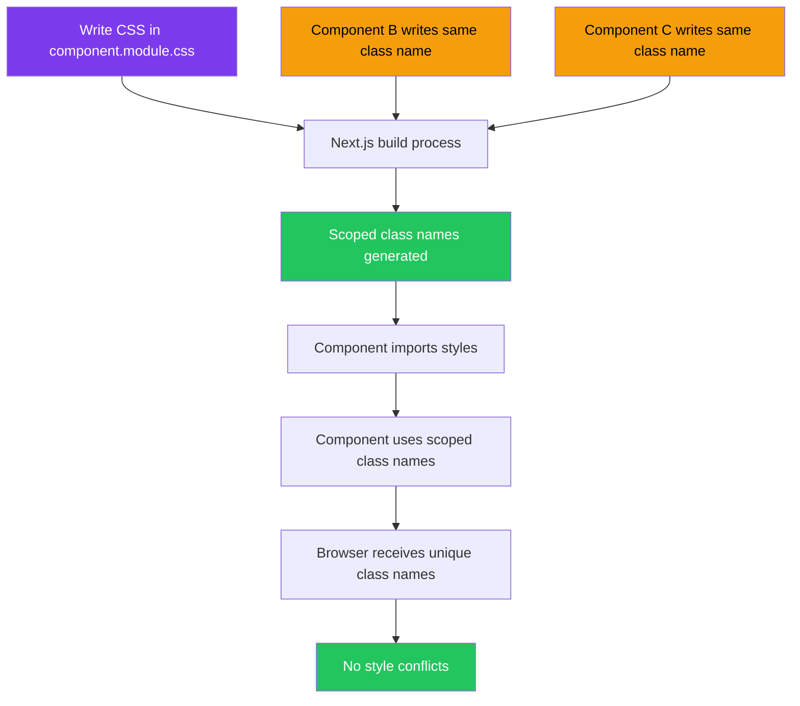
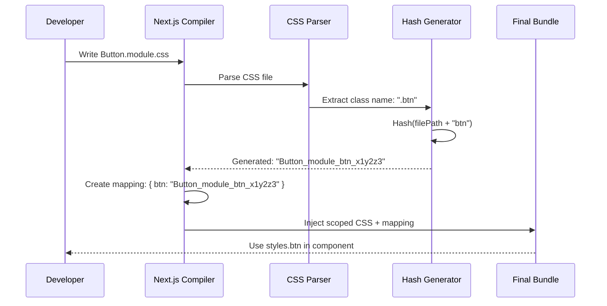
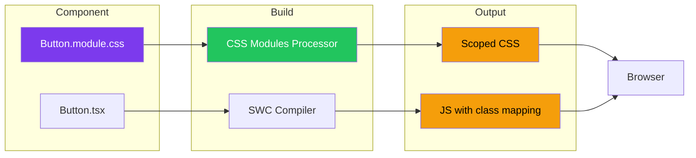
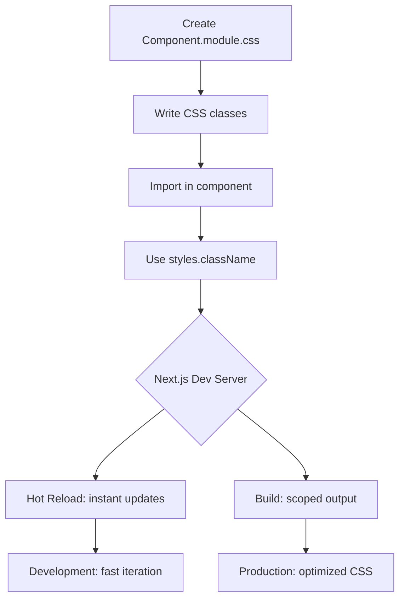

# CSS Modules in Next.js

## Introduction
CSS Modules are a CSS file format where all class names and animation names are scoped locally by default. In Next.js, any CSS file ending with `.module.css` is automatically treated as a CSS Module. This means the styles you write in one component will never leak into another component — solving one of the most frustrating problems in CSS at scale.

## Why do we need this?
In traditional CSS, all class names exist in a global namespace. As your application grows, it becomes increasingly difficult to avoid class name collisions. You end up with naming conventions like `.btn-primary`, `.btn--primary`, `btnPrimary`, `.button-primary` — and even then, conflicts happen. CSS Modules eliminate this problem entirely by generating unique class names at build time.

## Problem Statement
As a developer building a large Next.js application with multiple developers, you need a way to write CSS that:
- Never conflicts with other components' styles
- Makes it clear which styles belong to which component
- Can be composed and extended easily
- Works with the component-based architecture of React
- Doesn't require you to learn a new styling paradigm

## Real World Story
Imagine you're working on a team of 10 developers building a SaaS dashboard. Sarah styles a `.card` class for the user profile component. Meanwhile, John styles a `.card` class for the billing section. When both components render on the same page, the styles clash — the border-radius from Sarah's card overwrites John's, or the padding from John's card applies to Sarah's. Debugging this takes hours.

With CSS Modules, Sarah names her file `ProfileCard.module.css` and John names his `BillingCard.module.css`. The generated class names become `.ProfileCard_module_card_abc123` and `.BillingCard_module_card_def456` — completely isolated, completely predictable.

## Real World Analogy
Think of CSS Modules like having separate rooms in a house:
- **Global CSS** is like the living room — furniture (styles) affects everyone who enters
- **CSS Modules** are like individual bedrooms — you can arrange your furniture however you want without affecting anyone else's room

In your bedroom, you can put a "desk" in the corner. In my bedroom, I can also put a "desk" in the corner. They're both called "desk" but they're in different rooms — just like CSS Module classes are both called `.card` but in different `.module.css` files.

## Visual Explanation
```
Component A (UserProfile.js)     Component B (BillingInfo.js)
         │                                │
         ▼                                ▼
user.module.css                     billing.module.css
  .card { ... }                       .card { ... }
  .title { ... }                      .amount { ... }
         │                                │
         ▼                                ▼
 Compile Time                      Compile Time
         │                                │
         ▼                                ▼
.user_module_card_1a2b3c          .billing_module_card_4d5e6f
.user_module_title_7g8h9i         .billing_module_amount_0j1k2l
```

## Mermaid Diagram 1: CSS Module Scoping Flow



## Internal Working
When Next.js processes a `.module.css` file, it:

1. **Detects the `.module.css` extension** — Files ending in `.module.css` are flagged for CSS Module processing
2. **Parses the CSS** — The CSS is parsed into an abstract syntax tree (AST)
3. **Generates unique class names** — Each class name is hashed based on its content and file path
4. **Creates a mapping** — A JavaScript object mapping original class names to their hashed versions is generated
5. **Injects styles** — The scoped CSS is injected into the document head with a unique identifier
6. **Returns the mapping** — The import returns the mapping object that you use in your component

The hashing algorithm produces different outputs for the same class name in different files, guaranteeing uniqueness.

## Mermaid Diagram 2: Internal Build Process



## Architecture
CSS Modules in Next.js follow this architectural pattern:

```
Component Layer
     │
     ▼
Import Layer → import styles from './Component.module.css'
     │
     ▼
Usage Layer → className={styles.container}
     │
     ▼
Build Layer → Next.js SWC Compiler
     │
     ▼
Output Layer → Scoped CSS + Class Name Mapping
```

The key architectural insight: **CSS Modules are a compile-time feature, not a runtime one**. Everything happens during the build, meaning there's zero runtime overhead for the scoping.

## Mermaid Diagram 3: Component-Style Architecture



## Step-by-Step Flow

1. **Create a CSS Module file** — Name it `ComponentName.module.css`
2. **Write scoped styles** — Use regular CSS syntax with class names
3. **Import in component** — `import styles from './ComponentName.module.css'`
4. **Apply styles** — Use `className={styles.className}` in JSX
5. **Build process** — Next.js automatically scopes all class names
6. **Verify** — Open browser DevTools and inspect the unique generated class names

## Mermaid Diagram 4: Developer Workflow



## Syntax

```css
/* Button.module.css — This is a CSS Module file */
.button {
  background-color: #0070f3;
  color: white;
  padding: 0.5rem 1rem;
  border-radius: 4px;
  border: none;
  cursor: pointer;
  font-size: 1rem;
  transition: background-color 0.2s ease;
}

.button:hover {
  background-color: #0051a2;
}

.button:disabled {
  opacity: 0.5;
  cursor: not-allowed;
}
```

```tsx
// Button.tsx — Component consuming the CSS Module
import styles from './Button.module.css'

interface ButtonProps {
  children: React.ReactNode
  disabled?: boolean
  onClick?: () => void
}

export default function Button({ children, disabled, onClick }: ButtonProps) {
  return (
    <button
      className={styles.button}
      disabled={disabled}
      onClick={onClick}
    >
      {children}
    </button>
  )
}
```

**What's happening:**
- `styles` is a JavaScript object where keys are your original class names
- `styles.button` resolves to the generated unique class name like `Button_module_button_x1y2z3`
- The scoped CSS is automatically injected into the page

## Basic Example

A simple Card component with scoped styles:

```css
/* Card.module.css */
.card {
  border: 1px solid #e2e8f0;
  border-radius: 8px;
  padding: 1.5rem;
  background: white;
  box-shadow: 0 1px 3px rgba(0, 0, 0, 0.1);
}

.title {
  font-size: 1.25rem;
  font-weight: 600;
  margin-bottom: 0.5rem;
  color: #1a202c;
}

.description {
  font-size: 0.875rem;
  color: #718096;
  line-height: 1.5;
}
```

```tsx
// Card.tsx
import styles from './Card.module.css'

interface CardProps {
  title: string
  description: string
}

export default function Card({ title, description }: CardProps) {
  return (
    <div className={styles.card}>
      <h2 className={styles.title}>{title}</h2>
      <p className={styles.description}>{description}</p>
    </div>
  )
}
```

```tsx
// App.tsx — Using the Card component
import Card from './Card'

export default function App() {
  return (
    <div>
      <Card 
        title="Getting Started"
        description="Learn how to set up your Next.js project"
      />
      <Card 
        title="Advanced Topics"
        description="Dive deep into Next.js features"
      />
    </div>
  )
}
```

**What's happening:**
- Each Card gets its own scoped styles
- If another component also has a `.card` class, it won't conflict
- The class names in the browser will look like `Card_module_card_abc123` and `Card_module_title_def456`

## Intermediate Example

Composing multiple classes and using conditional styles:

```css
/* Alert.module.css */
.alert {
  padding: 1rem;
  border-radius: 6px;
  border: 1px solid;
  display: flex;
  align-items: center;
  gap: 0.75rem;
  font-size: 0.875rem;
}

/* Style variants */
.info {
  background-color: #eff6ff;
  border-color: #93c5fd;
  color: #1e40af;
}

.success {
  background-color: #f0fdf4;
  border-color: #86efac;
  color: #166534;
}

.warning {
  background-color: #fffbeb;
  border-color: #fcd34d;
  color: #92400e;
}

.error {
  background-color: #fef2f2;
  border-color: #fca5a5;
  color: #991b1b;
}

/* Animation */
.fadeIn {
  animation: fadeIn 0.3s ease-in;
}

@keyframes fadeIn {
  from {
    opacity: 0;
    transform: translateY(-10px);
  }
  to {
    opacity: 1;
    transform: translateY(0);
  }
}
```

```tsx
// Alert.tsx
import styles from './Alert.module.css'

type AlertType = 'info' | 'success' | 'warning' | 'error'

interface AlertProps {
  type: AlertType
  children: React.ReactNode
  show?: boolean
}

export default function Alert({ type, children, show = true }: AlertProps) {
  if (!show) return null

  return (
    <div 
      className={`${styles.alert} ${styles[type]} ${styles.fadeIn}`}
      role="alert"
    >
      {children}
    </div>
  )
}
```

**What's happening:**
- `styles[type]` dynamically accesses the variant class based on the `type` prop
- Multiple classes are composed using template literals
- CSS animations work within modules using scoped `@keyframes`
- The `role="alert"` attribute improves accessibility

## Advanced Example

Using CSS Modules with TypeScript, composition, and global styles:

```css
/* Button.module.css */
@value vars: './vars.module.css';
@value primary-color, secondary-color from vars;

/* Base button styles */
.base {
  display: inline-flex;
  align-items: center;
  justify-content: center;
  gap: 0.5rem;
  padding: 0.625rem 1.25rem;
  border-radius: 6px;
  font-weight: 500;
  font-size: 0.875rem;
  line-height: 1.25rem;
  transition: all 0.15s ease;
  cursor: pointer;
  border: 1px solid transparent;
}

/* Compose base into variants */
.primary {
  composes: base;
  background-color: primary-color;
  color: white;
}

.primary:hover {
  background-color: #005bb5;
}

.secondary {
  composes: base;
  background-color: transparent;
  border-color: #d1d5db;
  color: #374151;
}

.secondary:hover {
  background-color: #f9fafb;
}

/* Sizes */
.small {
  padding: 0.375rem 0.75rem;
  font-size: 0.75rem;
}

.large {
  padding: 0.75rem 1.5rem;
  font-size: 1rem;
}

/* Icon support */
.iconOnly {
  padding: 0.625rem;
  aspect-ratio: 1;
}

/* Loading state */
.loading {
  opacity: 0.7;
  pointer-events: none;
}

@keyframes spin {
  to {
    transform: rotate(360deg);
  }
}

.spinner {
  animation: spin 1s linear infinite;
  width: 1rem;
  height: 1rem;
  border: 2px solid currentColor;
  border-top-color: transparent;
  border-radius: 50%;
}
```

```tsx
// Button.tsx — Production-ready button with TypeScript
import styles from './Button.module.css'

type ButtonVariant = 'primary' | 'secondary'
type ButtonSize = 'small' | 'medium' | 'large'

interface ButtonProps extends React.ButtonHTMLAttributes<HTMLButtonElement> {
  variant?: ButtonVariant
  size?: ButtonSize
  isLoading?: boolean
  icon?: React.ReactNode
  iconOnly?: boolean
  children: React.ReactNode
}

export default function Button({
  variant = 'primary',
  size = 'medium',
  isLoading = false,
  icon,
  iconOnly = false,
  children,
  className,
  disabled,
  ...props
}: ButtonProps) {
  const classNames = [
    styles[variant],          // 'primary' or 'secondary'
    size !== 'medium' ? styles[size] : '',  // optional size modifier
    iconOnly ? styles.iconOnly : '',
    isLoading ? styles.loading : '',
    className,                // allow parent to pass extra classes
  ]
    .filter(Boolean)
    .join(' ')

  return (
    <button
      className={classNames}
      disabled={disabled || isLoading}
      {...props}
    >
      {isLoading ? (
        <>
          <span className={styles.spinner} />
          Loading...
        </>
      ) : (
        <>
          {icon && <span>{icon}</span>}
          {!iconOnly && children}
        </>
      )}
    </button>
  )
}
```

**What's happening:**
- `composes: base` inherits styles from another class within the same module
- `@value` imports shared CSS custom properties from another module
- Conditional class names are built with array filtering
- The component extends native button HTML attributes via TypeScript generics

## Production Example

A production e-commerce application using CSS Modules at scale:

```css
/* ProductCard.module.css */
.card {
  border-radius: 12px;
  overflow: hidden;
  background: white;
  transition: transform 0.2s ease, box-shadow 0.2s ease;
  cursor: pointer;
  position: relative;
}

.card:hover {
  transform: translateY(-2px);
  box-shadow: 0 12px 24px rgba(0, 0, 0, 0.1);
}

.imageWrapper {
  position: relative;
  width: 100%;
  height: 200px;
  overflow: hidden;
}

.image {
  object-fit: cover;
  transition: transform 0.3s ease;
}

.card:hover .image {
  transform: scale(1.05);
}

.badge {
  position: absolute;
  top: 0.5rem;
  left: 0.5rem;
  background-color: #ef4444;
  color: white;
  padding: 0.25rem 0.5rem;
  border-radius: 4px;
  font-size: 0.75rem;
  font-weight: 600;
  z-index: 1;
}

.content {
  padding: 1rem;
}

.title {
  font-size: 1rem;
  font-weight: 600;
  color: #111827;
  margin-bottom: 0.25rem;
  /* Truncate long titles */
  display: -webkit-box;
  -webkit-line-clamp: 2;
  -webkit-box-orient: vertical;
  overflow: hidden;
}

.price {
  font-size: 1.25rem;
  font-weight: 700;
  color: #059669;
}

.originalPrice {
  font-size: 0.875rem;
  color: #9ca3af;
  text-decoration: line-through;
  margin-left: 0.5rem;
}

.rating {
  display: flex;
  align-items: center;
  gap: 0.25rem;
  margin-top: 0.5rem;
  color: #f59e0b;
}

.reviewCount {
  font-size: 0.75rem;
  color: #6b7280;
  margin-left: 0.25rem;
}

.addToCartBtn {
  width: 100%;
  margin-top: 1rem;
  padding: 0.75rem;
  background-color: #111827;
  color: white;
  border: none;
  border-radius: 8px;
  font-weight: 600;
  cursor: pointer;
  transition: background-color 0.2s ease;
}

.addToCartBtn:hover {
  background-color: #1f2937;
}

.addToCartBtn:active {
  transform: scale(0.98);
}
```

```tsx
// ProductCard.tsx
import Image from 'next/image'
import styles from './ProductCard.module.css'

interface Product {
  id: string
  title: string
  price: number
  originalPrice?: number
  image: string
  rating: number
  reviewCount: number
  badge?: string
}

interface ProductCardProps {
  product: Product
  onAddToCart: (productId: string) => void
}

export default function ProductCard({ product, onAddToCart }: ProductCardProps) {
  const hasDiscount = product.originalPrice && product.originalPrice > product.price
  const discountPercent = hasDiscount
    ? Math.round(((product.originalPrice! - product.price) / product.originalPrice!) * 100)
    : 0

  return (
    <div className={styles.card}>
      <div className={styles.imageWrapper}>
        <Image
          src={product.image}
          alt={product.title}
          fill
          className={styles.image}
          sizes="(max-width: 768px) 100vw, 33vw"
        />
        {product.badge && (
          <span className={styles.badge}>{product.badge}</span>
        )}
      </div>

      <div className={styles.content}>
        <h3 className={styles.title}>{product.title}</h3>

        <div>
          <span className={styles.price}>${product.price.toFixed(2)}</span>
          {hasDiscount && (
            <>
              <span className={styles.originalPrice}>
                ${product.originalPrice!.toFixed(2)}
              </span>
              <span className={styles.badge}>-{discountPercent}%</span>
            </>
          )}
        </div>

        <div className={styles.rating}>
          {'★'.repeat(Math.floor(product.rating))}
          {'☆'.repeat(5 - Math.floor(product.rating))}
          <span className={styles.reviewCount}>({product.reviewCount})</span>
        </div>

        <button
          className={styles.addToCartBtn}
          onClick={() => onAddToCart(product.id)}
          aria-label={`Add ${product.title} to cart`}
        >
          Add to Cart
        </button>
      </div>
    </div>
  )
}
```

```tsx
// ProductGrid.tsx — Parent component
import ProductCard from './ProductCard'
import styles from './ProductGrid.module.css'

const products: Product[] = [
  {
    id: '1',
    title: 'Wireless Noise-Cancelling Headphones',
    price: 249.99,
    originalPrice: 349.99,
    image: '/images/headphones.jpg',
    rating: 4.5,
    reviewCount: 2341,
    badge: 'Best Seller',
  },
  // ... more products
]

export default function ProductGrid() {
  return (
    <div className={styles.grid}>
      {products.map((product) => (
        <ProductCard
          key={product.id}
          product={product}
          onAddToCart={(id) => console.log('Add to cart:', id)}
        />
      ))}
    </div>
  )
}
```

**What's happening:**
- Each component has its own `.module.css` file
- ProductCard styles are completely isolated from ProductGrid styles
- The `badge` class in `ProductCard.module.css` won't conflict with a `badge` class elsewhere
- CSS transitions, hover states, and active states are all scoped properly

## Folder Structure

```
src/
├── components/
│   ├── Button/
│   │   ├── Button.tsx
│   │   ├── Button.module.css
│   │   └── Button.test.tsx
│   ├── Card/
│   │   ├── Card.tsx
│   │   ├── Card.module.css
│   │   └── Card.test.tsx
│   ├── Alert/
│   │   ├── Alert.tsx
│   │   ├── Alert.module.css
│   │   └── Alert.test.tsx
│   └── ProductCard/
│       ├── ProductCard.tsx
│       ├── ProductCard.module.css
│       └── ProductCard.test.tsx
├── styles/
│   └── vars.module.css           # Shared CSS variables
└── pages/
    ├── _app.tsx
    └── index.tsx
```

## Best Practices

1. **One CSS Module per component** — Each component should have its own `.module.css` file
2. **Use descriptive class names** — Since modules scope the names, use clear semantic names like `.card`, `.title`, `.button` without worrying about conflicts
3. **Keep styles colocated** — Place `.module.css` files next to their component files
4. **Use composition over inheritance** — Use `composes:` to share styles between classes within a module
5. **Avoid nesting deeply** — CSS Modules work best with flat class structures; avoid preprocessor-like deep nesting
6. **Use CSS custom properties** — Define shared values in a `vars.module.css` and import them with `@value`
7. **Combine with global CSS** — Use global CSS for reset, typography, and CSS custom properties; use modules for component styles

## Common Mistakes

1. **Forgetting the `.module` in the filename** — `styles.css` is global, `styles.module.css` is scoped — the difference is just `.module`
2. **Using tag selectors** — CSS Modules only scope class names, not tag selectors like `h1` or `div`
3. **Trying to use `composes` from different files** — `composes` only works within the same module
4. **Importing CSS Module into `_app.js`** — `_app.js` imports should be global CSS files, not modules
5. **Overusing `:global`** — While you can opt out of scoping with `:global(.classname)`, overusing it defeats the purpose of CSS Modules

## Performance Notes

- **Zero runtime cost** — CSS Modules are resolved at build time, adding no runtime JavaScript
- **Automatic code splitting** — Next.js automatically extracts critical CSS for each page
- **Smaller CSS bundles** — Scoped class names are typically shorter than BEM-style class names
- **Dead code elimination** — Unused CSS classes can be detected and removed (with tools like PurgeCSS)

## Security Notes

- **No injection vulnerabilities** — CSS Modules prevent CSS injection attacks through class name manipulation
- **Content Security Policy** — CSS Modules work with CSP without `unsafe-inline` style-src (since styles are hashed)
- **No user data in class names** — Never put user-generated content in class names, even with CSS Modules

## SEO Considerations

- CSS Modules don't affect SEO directly since class names aren't used by search engines
- However, scoped styles help maintain consistent styling across the site, which improves user experience metrics (Core Web Vitals)
- CSS Modules enable efficient critical CSS extraction, improving Largest Contentful Paint (LCP)

## Interview Questions

1. What distinguishes a CSS Module from a regular CSS file in Next.js?
2. How does CSS Module class name scoping work under the hood?
3. Can you use CSS Modules with dynamic class names?
4. How do you share variables between CSS Modules?
5. What happens if you import a `.module.css` file in `_app.js`?

## MCQs

1. What file extension indicates a CSS Module in Next.js?
   a) `.css`
   b) `.module.css`
   c) `.scoped.css`
   d) `.local.css`
   <details>
   <summary>Answer</summary>
   b) `.module.css` — The `.module` prefix is what Next.js uses to identify CSS Modules.
   </details>

2. What does `composes: base` do in a CSS Module?
   a) Imports base styles from another file
   b) Inherits styles from the `base` class within the same module
   c) Creates a new base class
   d) Overrides the base class
   <details>
   <summary>Answer</summary>
   b) Inherits styles from the `base` class within the same module — `composes` is a CSS Modules feature that allows style inheritance within a module.
   </details>

3. How do you apply multiple CSS Module classes to an element?
   a) `className={styles.class1 + styles.class2}`
   b) `className={`${styles.class1} ${styles.class2}`}`
   c) `className={[styles.class1, styles.class2]}`
   d) Both b and c work
   <details>
   <summary>Answer</summary>
   d) Both b and c work — Template literals and array join both produce valid class strings.
   </details>

4. What is a key benefit of CSS Modules over global CSS?
   a) Faster runtime performance
   b) Automatic class name scoping prevents conflicts
   c) Smaller file sizes
   d) Better browser support
   <details>
   <summary>Answer</summary>
   b) Automatic class name scoping prevents conflicts — The main purpose of CSS Modules is eliminating style conflicts through scoping.
   </details>

5. Can you use CSS Modules with the App Router?
   a) No, CSS Modules only work with Pages Router
   b) Yes, CSS Modules work with both Pages and App Router
   c) Only with Client Components
   d) Only with Server Components
   <details>
   <summary>Answer</summary>
   b) Yes, CSS Modules work with both Pages and App Router — CSS Modules are framework-agnostic within Next.js.
   </details>

## Practice Exercise

1. Create a `ProfileCard.module.css` file with styles for a profile card component
2. Build a `ProfileCard.tsx` component that uses the CSS Module
3. Include styles for: avatar (circle crop), name, bio, and social links
4. Add a hover effect that elevates the card
5. Create a second component `ProfileList.tsx` that renders multiple ProfileCards
6. Verify in DevTools that both components have unique class names

## Debugging Exercise

The following code has a bug. Find and fix it:

```tsx
// Header.tsx
import styles from './Header.css'  // Bug here

export default function Header() {
  return (
    <header className={styles.header}>
      <h1 className={styles.title}>My App</h1>
    </header>
  )
}
```

```css
/* Header.css */
.header {
  background: #333;
  color: white;
  padding: 1rem;
}
```

**Bug:** The file is named `Header.css` instead of `Header.module.css`. CSS Modules require the `.module.css` extension.

**Fix:** Rename the file to `Header.module.css` and update the import to `import styles from './Header.module.css'`.

## Real-world Scenario

**Problem:** You're building a design system with 50+ components. Multiple developers are working simultaneously. You need to ensure that styles from one component never leak into another, and that the design system can be consumed by multiple projects.

**Solution:** Use CSS Modules for every component. Create a shared `tokens.module.css` file for design tokens (colors, spacing, typography). Each component imports only the tokens it needs and defines its own scoped styles. The design system is published as an npm package, and consuming projects get scoped styles without any configuration.

## Interview Coding Question

Build a `Tabs` component using CSS Modules:

```css
/* Tabs.module.css */
.container {
  width: 100%;
}

.tabList {
  display: flex;
  border-bottom: 2px solid #e2e8f0;
  list-style: none;
  padding: 0;
  margin: 0;
}

.tab {
  padding: 0.75rem 1.5rem;
  cursor: pointer;
  border: none;
  background: none;
  font-size: 0.875rem;
  font-weight: 500;
  color: #64748b;
  position: relative;
  transition: color 0.2s ease;
}

.tab:hover {
  color: #334155;
}

.tabActive {
  color: #3b82f6;
}

.tabActive::after {
  content: '';
  position: absolute;
  bottom: -2px;
  left: 0;
  right: 0;
  height: 2px;
  background-color: #3b82f6;
}

.panel {
  padding: 1.5rem 0;
  animation: fadeIn 0.2s ease;
}

@keyframes fadeIn {
  from {
    opacity: 0;
    transform: translateY(4px);
  }
  to {
    opacity: 1;
    transform: translateY(0);
  }
}
```

```tsx
// Tabs.tsx
'use client'

import { useState } from 'react'
import styles from './Tabs.module.css'

interface Tab {
  id: string
  label: string
  content: React.ReactNode
}

interface TabsProps {
  tabs: Tab[]
  defaultTab?: string
}

export default function Tabs({ tabs, defaultTab }: TabsProps) {
  const [activeTab, setActiveTab] = useState(defaultTab || tabs[0]?.id)

  return (
    <div className={styles.container}>
      <div className={styles.tabList} role="tablist">
        {tabs.map((tab) => (
          <button
            key={tab.id}
            className={`${styles.tab} ${activeTab === tab.id ? styles.tabActive : ''}`}
            onClick={() => setActiveTab(tab.id)}
            role="tab"
            aria-selected={activeTab === tab.id}
            aria-controls={`panel-${tab.id}`}
          >
            {tab.label}
          </button>
        ))}
      </div>
      {tabs.map((tab) => (
        <div
          key={tab.id}
          id={`panel-${tab.id}`}
          className={styles.panel}
          role="tabpanel"
          hidden={activeTab !== tab.id}
        >
          {tab.content}
        </div>
      ))}
    </div>
  )
}
```

## Mini Project

**Build a Blog Post Card Component Library**

Create the following components using CSS Modules:

1. **BlogCard** — Displays post thumbnail, title, excerpt, author avatar, date, and reading time
2. **TagBadge** — Styled tag/badge with different color variants (tech, design, business)
3. **AuthorAvatar** — Circular avatar with fallback initials
4. **CardGrid** — Responsive grid layout (1 column on mobile, 2 on tablet, 3 on desktop)

Requirements:
- Each component has its own `.module.css` file
- Shared design tokens in a `tokens.module.css` file (colors, spacing, breakpoints)
- Hover effects on cards (elevation and image zoom)
- Responsive styles using CSS Modules
- Dark mode support using CSS custom properties

## Summary

CSS Modules in Next.js provide a powerful, zero-cost abstraction for component-scoped styling. By appending `.module` to your CSS filename, you get automatic class name scoping that prevents style conflicts in large applications. CSS Modules compile at build time with no runtime overhead, support composition, work with TypeScript, and integrate seamlessly with both the Pages Router and App Router. They are the recommended styling approach for component-level styles in Next.js applications.

## Cheat Sheet

```css
/* ✅ Correct: CSS Module file */
/* Component.module.css */

.className { }          /* Scoped class */
@value primary from vars;  /* Import variables */
.composed { composes: base; }  /* Compose classes */
:global(.global-class) { }  /* Escape hatch to global */
```

```tsx
// ✅ Correct: Using CSS Modules
import styles from './Component.module.css'
<div className={styles.container}>

// ✅ Multiple classes
<div className={`${styles.base} ${styles.variant}`}>

// ✅ Conditional classes
<div className={`${styles.base} ${isActive ? styles.active : ''}`}>

// ✅ Dynamic class access
<div className={styles[variant]}>
```

## Related Topics
- Global Styles and Custom CSS
- Tailwind CSS Integration
- CSS-in-JS with styled-jsx
- Sass and CSS Preprocessors
- React Component Patterns

## Further Reading
- [Next.js Documentation: CSS Modules](https://nextjs.org/docs/basic-features/built-in-css-support#adding-component-level-css)
- [CSS Modules Specification](https://github.com/css-modules/css-modules)
- [Using CSS Modules in Next.js](https://nextjs.org/learn/foundations/styling/css-modules)
