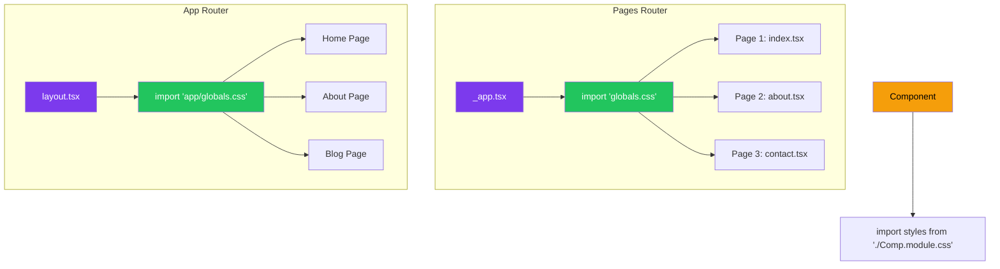
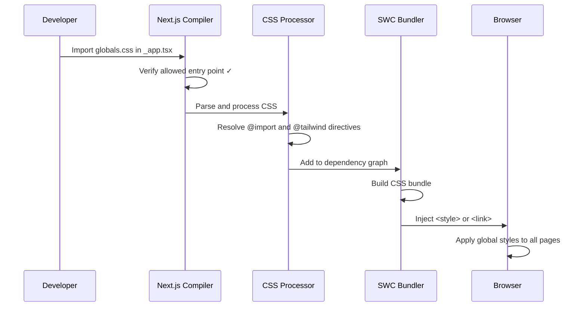
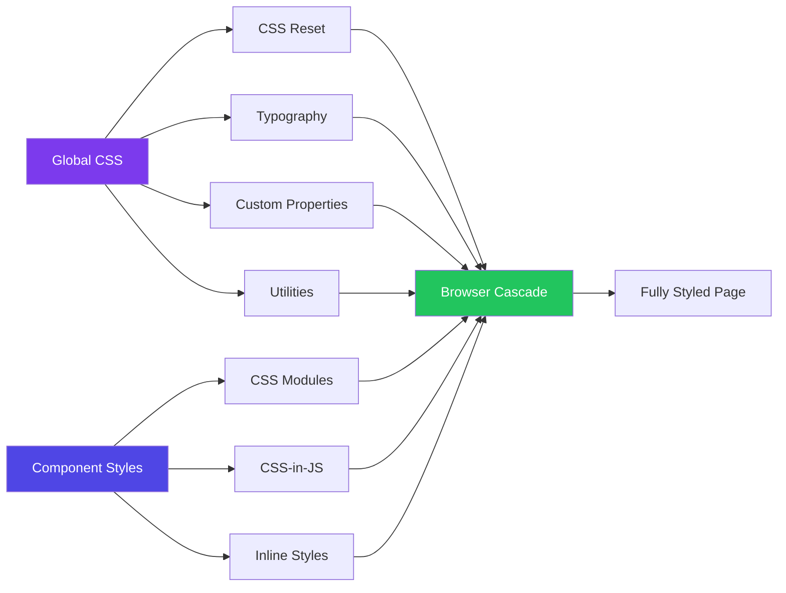
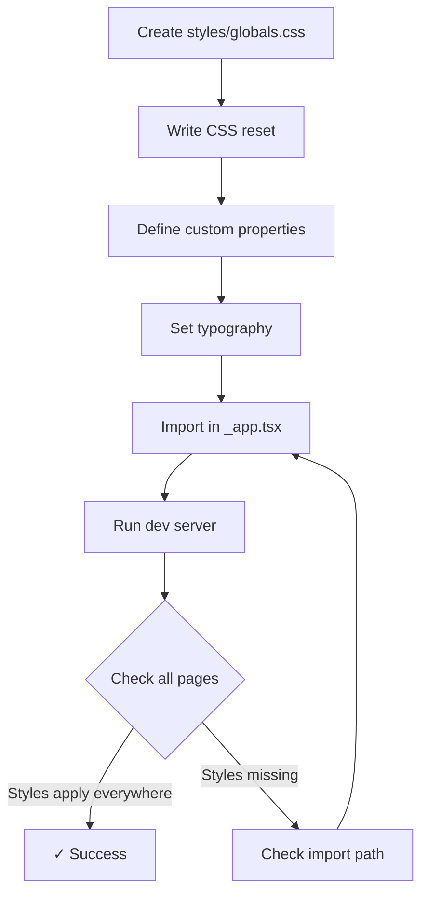

# Global Styles and Custom CSS

## Introduction
Global styles are CSS rules that apply to the entire Next.js application. Unlike CSS Modules (which are scoped to individual components), global styles affect every element on every page. In Next.js, global CSS can only be imported in specific entry points — `pages/_app.js` for the Pages Router or `app/layout.tsx` for the App Router. This restriction ensures predictable style loading and prevents accidental global style imports from components.

## Why do we need this?
While component-scoped styles (CSS Modules) handle individual component styling, every application needs global styles for:
- **CSS reset or normalize** — Ensuring consistent default styling across browsers
- **Typography** — Setting base font family, size, line-height, and color
- **CSS custom properties** — Defining design tokens (colors, spacing, breakpoints)
- **Utility classes** — Creating reusable helper classes (text-center, sr-only, etc.)
- **Animations and keyframes** — Defining reusable animations @keyframes
- **Third-party CSS** — Importing CSS from libraries like Font Awesome, Swiper, or React Toastify

## Problem Statement
As a developer, you need a mechanism to apply base styles that affect the entire application while preventing accidental global styles from leaking out of components. You also need to configure where and how global CSS is imported to maintain a predictable style loading order.

## Real World Story
Sarah is building a marketing website for a startup. She imports a CSS reset to normalize browser styles, defines font families for headings and body text, and sets up CSS custom properties for the brand colors. She imports this global CSS in `_app.js`. Later, when she adds a component library, she imports its CSS in the same file. The global styles load first, then the library styles, then component-specific styles — creating a predictable cascade that's easy to debug.

## Real World Analogy
Think of global styles as the foundational layer of a building:
- **Global CSS reset** is the concrete foundation — it makes the ground level and stable
- **Typography styles** are the framing — they define the structure
- **CSS custom properties** are the electrical and plumbing systems — they provide the underlying infrastructure
- **Component styles (CSS Modules)** are the interior design — they customize each room

## Visual Explanation
```
Global CSS Import Flow in Next.js:

Pages Router:
  pages/_app.js → imports global.css → applies to ALL pages

App Router:
  app/layout.tsx → imports globals.css → applies to ALL routes
  
Both:
  Components → import CSS Modules → scoped to component only
  Components → CANNOT import global CSS (Next.js throws error)
```

## Mermaid Diagram 1: Global CSS Import Flow



## Internal Working
When Next.js processes global CSS:

1. **Restriction check** — Next.js verifies that global CSS is only imported from allowed entry points (`_app.js` or `layout.tsx`)
2. **Dependency graph** — The imported CSS is added to the dependency graph at the application root
3. **Order preservation** — The order of imports in the entry point determines the order styles appear in the compiled output
4. **Critical CSS extraction** — In production, Next.js extracts critical CSS for each page route
5. **Minification** — CSS is minified and cache-busted with content hashes
6. **Injection** — In the browser, styles are injected into the document head

## Mermaid Diagram 2: Internal Processing



## Architecture
The global CSS architecture in Next.js follows a hierarchical model:

```
Entry Point (_app.tsx / layout.tsx)
├── CSS Reset (normalize.css or custom)
│   └── Removes browser inconsistencies
├── Base Typography
│   └── html, body, headings, paragraphs
├── CSS Custom Properties
│   └── --color-primary, --spacing-md, --font-sans
├── Utility Classes
│   └── .container, .sr-only, .text-center
├── Third-party CSS
│   └── Library stylesheets
└── Print Styles
    └── @media print rules
```

## Mermaid Diagram 3: Style Cascade in Next.js



## Step-by-Step Flow

1. **Create a global CSS file** — Create `styles/globals.css` in your project
2. **Write base styles** — Add CSS reset, typography, and custom properties
3. **Import in entry point** — For Pages Router: `import '../styles/globals.css'` in `_app.js`
4. **Verify in browser** — All pages should reflect the global styles
5. **Add more global styles** — Import additional CSS files or use `@import` in the main global file
6. **Add component styles** — Use CSS Modules for component-specific styles

## Mermaid Diagram 4: Developer Workflow



## Syntax

```css
/* styles/globals.css — Global styles for entire application */

/* 1. CSS Reset */
*,
*::before,
*::after {
  box-sizing: border-box;
  margin: 0;
  padding: 0;
}

/* 2. Base Typography */
html {
  font-size: 16px;
  -webkit-font-smoothing: antialiased;
  -moz-osx-font-smoothing: grayscale;
}

body {
  font-family: -apple-system, BlinkMacSystemFont, 'Segoe UI', Roboto, Oxygen,
    Ubuntu, Cantarell, 'Fira Sans', 'Droid Sans', 'Helvetica Neue', sans-serif;
  line-height: 1.6;
  color: #1a202c;
  background-color: #ffffff;
}

/* 3. CSS Custom Properties (Design Tokens) */
:root {
  /* Colors */
  --color-primary: #0070f3;
  --color-primary-dark: #0051a2;
  --color-secondary: #7928ca;
  --color-accent: #ff0080;
  --color-success: #22c55e;
  --color-warning: #f59e0b;
  --color-error: #ef4444;
  --color-background: #ffffff;
  --color-surface: #f7fafc;
  --color-text: #1a202c;
  --color-text-muted: #718096;

  /* Spacing */
  --spacing-xs: 0.25rem;
  --spacing-sm: 0.5rem;
  --spacing-md: 1rem;
  --spacing-lg: 1.5rem;
  --spacing-xl: 2rem;
  --spacing-2xl: 3rem;

  /* Typography */
  --font-sans: -apple-system, BlinkMacSystemFont, 'Segoe UI', Roboto, sans-serif;
  --font-mono: 'SF Mono', 'Fira Code', 'Fira Mono', 'Roboto Mono', monospace;
  --font-size-xs: 0.75rem;
  --font-size-sm: 0.875rem;
  --font-size-base: 1rem;
  --font-size-lg: 1.125rem;
  --font-size-xl: 1.25rem;
  --font-size-2xl: 1.5rem;
  --font-size-3xl: 1.875rem;
  --font-size-4xl: 2.25rem;

  /* Borders */
  --radius-sm: 4px;
  --radius-md: 8px;
  --radius-lg: 12px;
  --radius-full: 9999px;

  /* Shadows */
  --shadow-sm: 0 1px 2px rgba(0, 0, 0, 0.05);
  --shadow-md: 0 4px 6px rgba(0, 0, 0, 0.1);
  --shadow-lg: 0 10px 15px rgba(0, 0, 0, 0.1);

  /* Transitions */
  --transition-fast: 150ms ease;
  --transition-base: 200ms ease;
  --transition-slow: 300ms ease;

  /* Breakpoints (for reference, not usable in CSS) */
  /* --bp-sm: 640px; */
  /* --bp-md: 768px; */
  /* --bp-lg: 1024px; */
  /* --bp-xl: 1280px; */
}

/* 4. Utility Classes */
.container {
  width: 100%;
  max-width: 1200px;
  margin: 0 auto;
  padding: 0 var(--spacing-md);
}

.sr-only {
  position: absolute;
  width: 1px;
  height: 1px;
  padding: 0;
  margin: -1px;
  overflow: hidden;
  clip: rect(0, 0, 0, 0);
  white-space: nowrap;
  border: 0;
}

.text-center {
  text-align: center;
}

/* 5. Focus styles for accessibility */
:focus-visible {
  outline: 2px solid var(--color-primary);
  outline-offset: 2px;
}

/* 6. Link styles */
a {
  color: var(--color-primary);
  text-decoration: none;
  transition: color var(--transition-fast);
}

a:hover {
  color: var(--color-primary-dark);
  text-decoration: underline;
}

/* 7. Dark mode */
@media (prefers-color-scheme: dark) {
  :root {
    --color-background: #0f172a;
    --color-surface: #1e293b;
    --color-text: #f1f5f9;
    --color-text-muted: #94a3b8;
  }

  body {
    color: var(--color-text);
    background-color: var(--color-background);
  }
}
```

```tsx
// pages/_app.tsx — Pages Router: Import global CSS here
import type { AppProps } from 'next/app'
import '../styles/globals.css'

export default function App({ Component, pageProps }: AppProps) {
  return <Component {...pageProps} />
}
```

```tsx
// app/layout.tsx — App Router: Import global CSS here
import type { Metadata } from 'next'
import './globals.css'

export const metadata: Metadata = {
  title: 'My App',
  description: 'Generated by create next app',
}

export default function RootLayout({
  children,
}: {
  children: React.ReactNode
}) {
  return (
    <html lang="en">
      <body>{children}</body>
    </html>
  )
}
```

**What's happening:**
- `globals.css` is imported only in the root entry point
- All CSS custom properties are defined in `:root` and available globally
- The dark mode media query automatically switches colors based on user preference
- Utility classes like `.container` and `.sr-only` are available on every page

## Basic Example

Simple global styles for a blog:

```css
/* styles/blog-globals.css */
body {
  font-family: 'Georgia', 'Times New Roman', serif;
  line-height: 1.8;
  color: #334155;
  max-width: 720px;
  margin: 0 auto;
  padding: 2rem;
}

h1, h2, h3, h4, h5, h6 {
  font-family: -apple-system, BlinkMacSystemFont, 'Segoe UI', sans-serif;
  color: #0f172a;
  margin-top: 2rem;
  margin-bottom: 1rem;
  line-height: 1.3;
}

h1 { font-size: 2.5rem; }
h2 { font-size: 2rem; }
h3 { font-size: 1.5rem; }

p {
  margin-bottom: 1.5rem;
}

img {
  max-width: 100%;
  height: auto;
  border-radius: 8px;
  margin: 2rem 0;
}

blockquote {
  border-left: 4px solid #3b82f6;
  margin: 2rem 0;
  padding: 1rem 1.5rem;
  background: #f8fafc;
  font-style: italic;
}

code {
  font-family: 'Fira Code', 'Courier New', monospace;
  background: #f1f5f9;
  padding: 0.2rem 0.4rem;
  border-radius: 4px;
  font-size: 0.875em;
}

pre code {
  display: block;
  padding: 1rem;
  overflow-x: auto;
  background: #0f172a;
  color: #e2e8f0;
  border-radius: 8px;
}
```

## Intermediate Example

Using multiple global stylesheets and `@import`:

```css
/* styles/globals.css */

/* Import order matters — later imports override earlier ones */
@import './reset.css';
@import './typography.css';
@import './tokens.css';

/* Custom properties */
:root {
  --header-height: 64px;
  --sidebar-width: 280px;
}

/* Global scrollbar styles */
::-webkit-scrollbar {
  width: 8px;
}

::-webkit-scrollbar-track {
  background: var(--color-surface);
}

::-webkit-scrollbar-thumb {
  background: #cbd5e1;
  border-radius: 4px;
}

::-webkit-scrollbar-thumb:hover {
  background: #94a3b8;
}

/* Selection color */
::selection {
  background-color: var(--color-primary);
  color: white;
}
```

```tsx
// app/layout.tsx — App Router with multiple imports
import type { Metadata } from 'next'
import { Inter } from 'next/font/google'
import './globals.css'

const inter = Inter({ subsets: ['latin'] })

export const metadata: Metadata = {
  title: 'My SaaS App',
  description: 'A full-stack SaaS application',
}

export default function RootLayout({
  children,
}: {
  children: React.ReactNode
}) {
  return (
    <html lang="en">
      <body className={inter.className}>
        <header style={{ height: 'var(--header-height)' }}>
          {/* Navigation */}
        </header>
        <main>{children}</main>
      </body>
    </html>
  )
}
```

## Advanced Example

Global styles with dark mode toggle, multiple themes, and print styles:

```css
/* styles/globals.css */

/* 1. CSS Custom Properties — Light Theme (default) */
:root {
  /* Brand */
  --color-brand: #6366f1;
  --color-brand-light: #818cf8;
  --color-brand-dark: #4f46e5;

  /* Surfaces */
  --bg-primary: #ffffff;
  --bg-secondary: #f8fafc;
  --bg-tertiary: #f1f5f9;
  --bg-code: #0f172a;

  /* Text */
  --text-primary: #0f172a;
  --text-secondary: #475569;
  --text-tertiary: #94a3b8;
  --text-inverse: #ffffff;

  /* Borders */
  --border-light: #e2e8f0;
  --border-medium: #cbd5e1;
  --border-focus: var(--color-brand);

  /* Shadows */
  --shadow-card: 0 1px 3px rgba(0, 0, 0, 0.1), 0 1px 2px rgba(0, 0, 0, 0.06);
  --shadow-dropdown: 0 10px 15px rgba(0, 0, 0, 0.1);
}

/* 2. Dark Theme — via class toggle */
[data-theme='dark'] {
  --bg-primary: #0f172a;
  --bg-secondary: #1e293b;
  --bg-tertiary: #334155;
  --bg-code: #1e293b;

  --text-primary: #f1f5f9;
  --text-secondary: #cbd5e1;
  --text-tertiary: #64748b;
  --text-inverse: #0f172a;

  --border-light: #334155;
  --border-medium: #475569;

  --shadow-card: 0 1px 3px rgba(0, 0, 0, 0.3);
  --shadow-dropdown: 0 10px 15px rgba(0, 0, 0, 0.4);
}

/* 3. System preference dark mode */
@media (prefers-color-scheme: dark) {
  :root:not([data-theme='light']) {
    --bg-primary: #0f172a;
    --bg-secondary: #1e293b;
    --bg-tertiary: #334155;
    --bg-code: #1e293b;

    --text-primary: #f1f5f9;
    --text-secondary: #cbd5e1;
    --text-tertiary: #64748b;
    --text-inverse: #0f172a;

    --border-light: #334155;
    --border-medium: #475569;

    --shadow-card: 0 1px 3px rgba(0, 0, 0, 0.3);
    --shadow-dropdown: 0 10px 15px rgba(0, 0, 0, 0.4);
  }
}

/* 4. Base element styles */
* {
  box-sizing: border-box;
  margin: 0;
  padding: 0;
}

html {
  scroll-behavior: smooth;
}

body {
  font-family: 'Inter', -apple-system, sans-serif;
  background-color: var(--bg-primary);
  color: var(--text-primary);
  transition: background-color 0.3s ease, color 0.3s ease;
  min-height: 100vh;
}

/* 5. Typography */
h1, h2, h3, h4 {
  color: var(--text-primary);
  line-height: 1.3;
  font-weight: 700;
}

p {
  color: var(--text-secondary);
  line-height: 1.7;
}

/* 6. Focus styles */
*:focus-visible {
  outline: 2px solid var(--border-focus);
  outline-offset: 2px;
  border-radius: 2px;
}

/* 7. Print styles */
@media print {
  body {
    background: white;
    color: black;
    font-size: 12pt;
  }

  nav, footer, .no-print {
    display: none !important;
  }

  a[href]::after {
    content: ' (' attr(href) ')';
    font-size: 0.8em;
    color: #666;
  }
}

/* 8. Utility classes */
.fade-in {
  animation: fadeIn 0.3s ease;
}

@keyframes fadeIn {
  from { opacity: 0; }
  to { opacity: 1; }
}

.skeleton {
  background: linear-gradient(
    90deg,
    var(--bg-tertiary) 25%,
    var(--bg-secondary) 50%,
    var(--bg-tertiary) 75%
  );
  background-size: 200% 100%;
  animation: shimmer 1.5s infinite;
  border-radius: 4px;
}

@keyframes shimmer {
  0% { background-position: 200% 0; }
  100% { background-position: -200% 0; }
}
```

```tsx
// components/ThemeToggle.tsx — Using CSS custom properties for theming
'use client'

import { useEffect, useState } from 'react'

type Theme = 'light' | 'dark' | 'system'

export default function ThemeToggle() {
  const [theme, setTheme] = useState<Theme>('system')

  useEffect(() => {
    const stored = localStorage.getItem('theme') as Theme | null
    if (stored) {
      setTheme(stored)
      document.documentElement.setAttribute('data-theme', stored === 'system' 
        ? (window.matchMedia('(prefers-color-scheme: dark)').matches ? 'dark' : 'light')
        : stored
      )
    }
  }, [])

  const handleChange = (newTheme: Theme) => {
    setTheme(newTheme)
    localStorage.setItem('theme', newTheme)
    
    if (newTheme === 'system') {
      const isDark = window.matchMedia('(prefers-color-scheme: dark)').matches
      document.documentElement.setAttribute('data-theme', isDark ? 'dark' : 'light')
    } else {
      document.documentElement.setAttribute('data-theme', newTheme)
    }
  }

  return (
    <div className="theme-toggle">
      <button onClick={() => handleChange('light')} data-active={theme === 'light'}>
        ☀️ Light
      </button>
      <button onClick={() => handleChange('dark')} data-active={theme === 'dark'}>
        🌙 Dark
      </button>
      <button onClick={() => handleChange('system')} data-active={theme === 'system'}>
        💻 System
      </button>
    </div>
  )
}
```

## Production Example

A production Next.js application with proper global styles organization:

```css
/* styles/globals.css — Production-grade global styles */

/* Vendors — Third-party CSS */
@import 'react-toastify/dist/ReactToastify.css';
@import 'swiper/css';

/* Base — Foundation layers */
@import './base/reset.css';
@import './base/typography.css';
@import './base/tokens.css';

/* Layout — Structural styles */
@import './layout/grid.css';
@import './layout/header.css';
@import './layout/footer.css';

/* Utilities — Helper classes */
@import './utilities/accessibility.css';
@import './utilities/animations.css';
@import './utilities/spacing.css';

/* Critical performance: Load critical CSS inline, defer non-critical */
@media print {
  @import './print.css';
}

/* Motion preference: Reduce animations for accessibility */
@media (prefers-reduced-motion: reduce) {
  *,
  *::before,
  *::after {
    animation-duration: 0.01ms !important;
    animation-iteration-count: 1 !important;
    transition-duration: 0.01ms !important;
    scroll-behavior: auto !important;
  }
}

/* High contrast mode support */
@media (prefers-contrast: high) {
  :root {
    --text-primary: #000000;
    --text-secondary: #1a1a1a;
    --border-light: #666666;
  }
}
```

```tsx
// pages/_app.tsx — Organized imports
import type { AppProps } from 'next/app'
import { Analytics } from '@vercel/analytics/react'

// Global styles — MUST be imported here
import '@/styles/globals.css'

// Fonts — Google Fonts via next/font
import { Inter } from 'next/font/google'
const inter = Inter({ 
  subsets: ['latin'],
  variable: '--font-inter',  // Use as CSS variable
})

// SEO metadata
import { DefaultSeo } from 'next-seo'
import SEO from '../next-seo.config'

export default function App({ Component, pageProps }: AppProps) {
  return (
    <>
      <DefaultSeo {...SEO} />
      <div className={inter.variable}>
        <Component {...pageProps} />
      </div>
      <Analytics />
    </>
  )
}
```

```tsx
// components/GlobalStyleProvider.tsx — Optional wrapper for App Router
'use client'

import { useEffect } from 'react'

export default function GlobalStyleProvider({
  children,
}: {
  children: React.ReactNode
}) {
  useEffect(() => {
    // Apply saved theme on mount
    const theme = localStorage.getItem('theme') || 'system'
    document.documentElement.setAttribute('data-theme', theme)
    
    // Listen for system theme changes
    const mq = window.matchMedia('(prefers-color-scheme: dark)')
    const handler = (e: MediaQueryListEvent) => {
      if (localStorage.getItem('theme') === 'system') {
        document.documentElement.setAttribute('data-theme', e.matches ? 'dark' : 'light')
      }
    }
    mq.addEventListener('change', handler)
    return () => mq.removeEventListener('change', handler)
  }, [])

  return <>{children}</>
}
```

## Folder Structure

```
styles/
├── globals.css              # Main entry point — imports all partials
├── base/
│   ├── reset.css            # CSS reset/normalize
│   ├── typography.css       # Font families, headings, paragraphs
│   └── tokens.css           # CSS custom properties (design tokens)
├── layout/
│   ├── grid.css             # Grid system
│   ├── header.css           # Header/ Nav styles
│   └── footer.css           # Footer styles
├── components/
│   ├── buttons.css          # Global button styles (overridable by modules)
│   ├── forms.css            # Form element styles
│   └── cards.css            # Card layout styles
├── utilities/
│   ├── accessibility.css    # .sr-only, focus styles, reduced motion
│   ├── animations.css       # Shared @keyframes definitions
│   └── spacing.css          # Margin/padding utility classes
├── vendors/
│   └── third-party.css      # Third-party library overrides
└── print.css                # Print-specific styles
```

## Best Practices

1. **Import global CSS only in entry points** — `_app.tsx` for Pages Router, `layout.tsx` for App Router
2. **Use CSS custom properties for theming** — Define design tokens in `:root` for consistency
3. **Organize global CSS into partials** — Split by concern (reset, typography, layout, utilities)
4. **Keep global styles minimal** — Only put truly global styles here; component styles should be in CSS Modules
5. **Use CSS layers** — `@layer` helps manage cascade priority
6. **Respect user preferences** — Use `prefers-color-scheme`, `prefers-reduced-motion`, `prefers-contrast`
7. **Avoid !important** — Global styles shouldn't need to override component styles
8. **Document your design tokens** — Keep a reference of all CSS custom properties

## Common Mistakes

1. **Importing global CSS in a component** — Next.js throws an error: "Global CSS cannot be imported from within a component file"
2. **Duplicating imports** — Multiple entry points importing the same global CSS can cause duplication
3. **Overwriting component styles** — Using high-specificity selectors in global CSS that compete with component styles
4. **Not scoping third-party CSS** — Library CSS can leak and affect your components
5. **Forgetting mobile-first** — Write global responsive styles with mobile-first media queries
6. **No dark mode** — Not preparing for dark mode from the start leads to massive refactoring later

## Performance Notes

- **Critical CSS extraction** — Next.js automatically inlines critical CSS for the first paint
- **CSS file splitting** — Global CSS is extracted into separate files per page in production
- **Minimize global CSS** — Each byte of global CSS is loaded on every page; keep it lean
- **Use `next/font`** — Instead of importing fonts via CSS `@import`, use `next/font` for optimized font loading
- **Defer non-critical CSS** — Use `@media` queries or dynamic imports for styles not needed on first paint
- **Avoid large CSS libraries** — Import only the parts you need from UI libraries

## Security Notes

- **Content Security Policy** — Inline styles from global CSS may require `style-src 'unsafe-inline'` or nonce-based CSP
- **User-generated content** — Never embed user content in style tags or `style` attributes
- **CSS injection** — Be cautious with dynamic CSS custom property values from user input
- **Third-party CSS** — Audit vendor CSS for any network requests or data exfiltration attempts

## SEO Considerations

- **CSS block rendering** — Global CSS is a render-blocking resource; keep it small
- **Inline critical CSS** — Next.js automatically inlines critical CSS above-the-fold
- **CSS and CLS** — Reserve space for dynamic content with `aspect-ratio`, `min-height` to prevent Cumulative Layout Shift
- **Print styles** — Include print stylesheets for better printed page SEO (PDF versions)
- **Font loading** — Use `next/font` with `display: swap` to prevent invisible text during font load

## Interview Questions

1. Where should you import global CSS in a Next.js Pages Router app?
2. Why does Next.js restrict where global CSS can be imported?
3. How do CSS custom properties help with theming?
4. How would you implement dark mode using global CSS?
5. What's the difference between importing CSS in `_app.js` vs `layout.tsx`?

## MCQs

1. Where must global CSS be imported in the Pages Router?
   a) In any component file
   b) In `pages/_app.tsx` only
   c) In `next.config.js`
   d) In `pages/index.tsx`
   <details>
   <summary>Answer</summary>
   b) In `pages/_app.tsx` only — Next.js restricts global CSS imports to the application entry point.
   </details>

2. What happens if you try to import global CSS in a component?
   a) It works fine
   b) Next.js throws a build error
   c) The styles are scoped automatically
   d) Only the first class is applied
   <details>
   <summary>Answer</summary>
   b) Next.js throws a build error — Global CSS cannot be imported from component files.
   </details>

3. Which CSS feature allows you to define reusable design tokens?
   a) CSS Variables (custom properties)
   b) CSS Modules
   c) CSS Grid
   d) CSS Animations
   <details>
   <summary>Answer</summary>
   a) CSS Variables (custom properties) — Variables defined in `:root` are available globally.
   </details>

4. What does `prefers-color-scheme: dark` detect?
   a) The user's browser theme
   b) The user's operating system color scheme preference
   c) The website's color scheme
   d) The monitor's color calibration
   <details>
   <summary>Answer</summary>
   b) The user's operating system color scheme preference — It respects the OS-level dark mode setting.
   </details>

5. How does Next.js optimize global CSS in production?
   a) It removes unused CSS
   b) It inlines critical CSS and extracts the rest
   c) It converts CSS to inline styles
   d) It combines all CSS into one file
   <details>
   <summary>Answer</summary>
   b) It inlines critical CSS and extracts the rest — Critical CSS is inlined for first paint, remaining CSS is loaded asynchronously.
   </details>

## Practice Exercise

1. Create a `styles/globals.css` file with:
   - A CSS reset (box-sizing, margin, padding)
   - CSS custom properties for brand colors (primary, secondary, accent)
   - Typography styles for body and headings
   - A `.container` utility class for max-width centering
   - Basic responsive breakpoints
2. Import the file in `pages/_app.tsx`
3. Create two pages and verify the global styles apply to both
4. Add dark mode support using `prefers-color-scheme`
5. Create a theme toggle component that switches between light/dark using `data-theme` attribute

## Debugging Exercise

The following code has a bug. Find and fix it:

```tsx
// components/Header.tsx — This file has a bug
import '../styles/globals.css'  // Bug: importing global CSS in a component

export default function Header() {
  return (
    <header className="header">
      <h1>My App</h1>
    </header>
  )
}
```

**Bug:** Global CSS is imported inside a component file (`components/Header.tsx`), which Next.js does not allow. Global CSS can only be imported in `pages/_app.tsx` or `app/layout.tsx`.

**Fix:** Remove the import from `Header.tsx` and import `globals.css` only in `pages/_app.tsx` or `app/layout.tsx`.

## Real-world Scenario

**Problem:** You're building a multi-tenant SaaS application where each tenant has its own brand colors. You need to dynamically apply different themes based on the subdomain.

**Solution:** Use CSS custom properties for all brand-specific styles. Set the custom properties dynamically based on the tenant's configuration:

```css
/* styles/base/tokens.css */
:root {
  --brand-primary: #6366f1;     /* Default */
  --brand-secondary: #818cf8;
  --brand-accent: #a5b4fc;
}
```

```tsx
// middleware.ts — Set tenant theme based on subdomain
import { NextResponse } from 'next/server'
import type { NextRequest } from 'next/server'

export function middleware(request: NextRequest) {
  const hostname = request.headers.get('host') || ''
  const subdomain = hostname.split('.')[0]

  // Map subdomain to theme
  const themes: Record<string, Record<string, string>> = {
    acme: {
      primary: '#2563eb',
      secondary: '#3b82f6',
      accent: '#60a5fa',
    },
    globex: {
      primary: '#059669',
      secondary: '#10b981',
      accent: '#34d399',
    },
  }

  const theme = themes[subdomain] || themes.acme

  // Set theme via response header
  const response = NextResponse.next()
  Object.entries(theme).forEach(([key, value]) => {
    response.headers.set(`X-Theme-${key}`, value)
  })

  return response
}
```

## Interview Coding Question

Build a theme system using CSS custom properties and JavaScript:

```css
/* styles/themes.css */
:root {
  /* Light theme (default) */
  --surface: #ffffff;
  --surface-secondary: #f8fafc;
  --text: #0f172a;
  --text-secondary: #475569;
  --border: #e2e8f0;
  --primary: #6366f1;
  --primary-hover: #4f46e5;
}

[data-theme='dark'] {
  --surface: #0f172a;
  --surface-secondary: #1e293b;
  --text: #f1f5f9;
  --text-secondary: #94a3b8;
  --border: #334155;
  --primary: #818cf8;
  --primary-hover: #6366f1;
}

[data-theme='solarized'] {
  --surface: #fdf6e3;
  --surface-secondary: #eee8d5;
  --text: #586e75;
  --text-secondary: #657b83;
  --border: #d5c4a1;
  --primary: #268bd2;
  --primary-hover: #2aa198;
}
```

```tsx
'use client'

import { useEffect, useState } from 'react'

type Theme = 'light' | 'dark' | 'solarized'

export default function useTheme() {
  const [theme, setTheme] = useState<Theme>('light')

  useEffect(() => {
    const saved = localStorage.getItem('app-theme') as Theme | null
    if (saved) {
      setTheme(saved)
      document.documentElement.setAttribute('data-theme', saved)
    }
  }, [])

  const changeTheme = (newTheme: Theme) => {
    setTheme(newTheme)
    localStorage.setItem('app-theme', newTheme)
    document.documentElement.setAttribute('data-theme', newTheme)
  }

  return { theme, changeTheme }
}
```

## Mini Project

**Build a Themed Documentation Site**

Create a documentation site with:

1. **Global CSS Architecture:**
   - CSS reset
   - Design tokens via CSS custom properties (colors, spacing, typography, shadows)
   - Dark mode support (system preference + manual toggle)
   - Responsive typography with `clamp()`
   - Print stylesheet

2. **Components that use the theme:**
   - Navigation sidebar using custom properties for colors
   - Content area with responsive typography
   - Code blocks with themed backgrounds
   - Theme toggle button

3. **Features:**
   - Dark mode toggle persists in localStorage
   - Respects `prefers-color-scheme` by default
   - Smooth transitions when switching themes (use `transition` on body)
   - Reduced motion support for accessibility

## Summary

Global styles in Next.js provide the foundation for your application's visual identity. They are imported exclusively in `_app.tsx` (Pages Router) or `layout.tsx` (App Router). Use global styles for CSS resets, design tokens via custom properties, typography, utility classes, third-party CSS, and print styles. CSS custom properties are particularly powerful for theming — they enable dynamic theme switching, dark mode, and multi-tenant branding without any JavaScript runtime overhead.

## Cheat Sheet

```css
/* Global CSS — Only importable in _app.tsx or layout.tsx */

/* Design Tokens */
:root {
  --color-primary: #0070f3;
  --spacing-md: 1rem;
}

/* Dark Mode */
@media (prefers-color-scheme: dark) {
  :root { --bg: #0f172a; }
}

/* Theme Toggle */
[data-theme='dark'] { --bg: #0f172a; }

/* Accessibility */
@media (prefers-reduced-motion: reduce) {
  * { animation-duration: 0.01ms !important; }
}

/* Utility Classes */
.sr-only { /* Screen reader only */ }
.container { /* Max-width centering */ }
```

```tsx
// ✅ Correct: Import in _app.tsx
import '../styles/globals.css'

// ❌ Wrong: Import in component
// import '../styles/globals.css'  // ERROR!
```

## Related Topics
- CSS Modules in Next.js
- Tailwind CSS Integration
- CSS-in-JS with styled-jsx
- Sass and CSS Preprocessors
- Design Systems

## Further Reading
- [Next.js Documentation: Built-in CSS Support](https://nextjs.org/docs/basic-features/built-in-css-support)
- [CSS Custom Properties (MDN)](https://developer.mozilla.org/en-US/docs/Web/CSS/Using_CSS_custom_properties)
- [prefers-color-scheme (MDN)](https://developer.mozilla.org/en-US/docs/Web/CSS/@media/prefers-color-scheme)
- [The 7-1 CSS Architecture Pattern](https://www.learnhowtoprogram.com/user-interfaces/building-layouts-preprocessors/7-1-sass-architecture)
