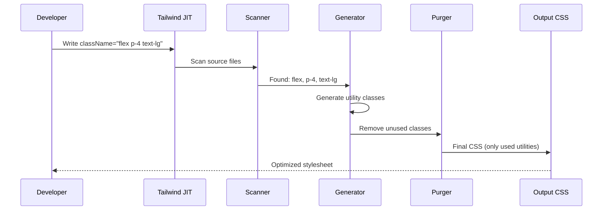
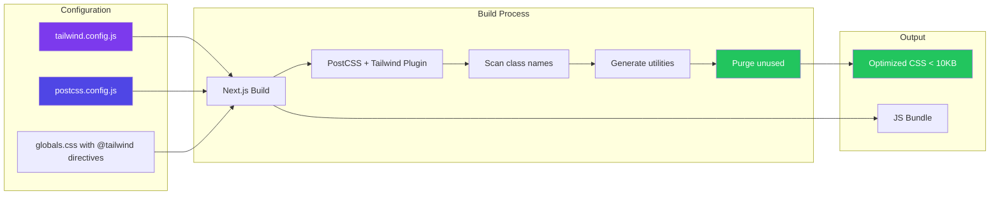
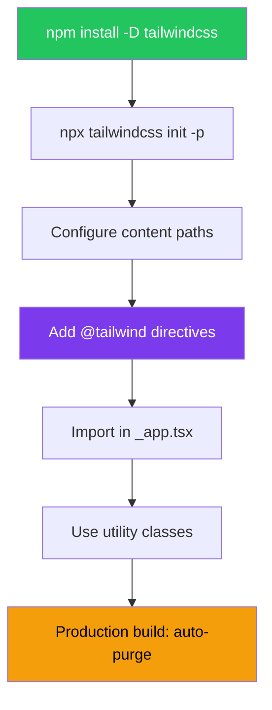

# Tailwind CSS Integration

## Introduction
Tailwind CSS is a utility-first CSS framework that provides low-level utility classes for building custom designs without writing custom CSS. Instead of writing CSS rules like `.card { padding: 1rem; border-radius: 8px; }`, you compose utility classes directly in your JSX: `<div className="p-4 rounded-lg">`. Next.js has first-class support for Tailwind CSS — you can install it with a single command, and it works seamlessly with both the Pages Router and App Router.

## Why do we need this?
Writing custom CSS for every component is time-consuming. As your application grows, you end up with thousands of lines of custom CSS that need to be maintained. Tailwind CSS solves this by providing a comprehensive set of pre-built utility classes that you compose together. This approach:
- **Speeds up development** — You style elements without leaving your JSX
- **Reduces CSS file size** — No redundant custom CSS
- **Eliminates naming conventions** — No more BEM, SMACSS, or naming debates
- **Enforces consistency** — Uses a predefined design system (spacing scale, color palette)
- **Optimizes production builds** — Purges unused CSS automatically

## Problem Statement
As a developer building a Next.js application, you need a styling approach that:
- Allows rapid prototyping without context-switching to CSS files
- Produces consistent designs with a predefined design system
- Results in minimal production CSS (only what's used)
- Works with component-based architecture
- Has excellent developer experience with autocomplete and validation

## Real World Story
Jane is a frontend developer building a SaaS dashboard. With traditional CSS, she'd write HTML and CSS in separate files, constantly switching context. With Tailwind CSS, she writes `<div className="flex items-center gap-4 p-6 bg-white rounded-xl shadow-sm">` directly in her component. The design is consistent because she's using Tailwind's predefined spacing scale, color palette, and shadow system. When she builds for production, Tailwind's purging removes all unused classes, resulting in a CSS file that's often less than 10KB.

## Real World Analogy
Think of Tailwind CSS as a **Lego set**:
- **Traditional CSS** is like sculpting from clay — you have complete freedom but must create everything from scratch
- **Tailwind CSS** is like building with Lego bricks — each brick (utility class) has a specific purpose, and you combine them to build complex structures

Lego bricks are small, reusable, and predictable. You don't need to carve each brick — you just snap them together. Similarly, Tailwind utilities like `flex`, `p-4`, `text-lg`, and `rounded-lg` are pre-made building blocks that you compose to create any design.

## Visual Explanation
```
Traditional CSS Approach:
  <div className="card">          CSS File: .card {
    <h2 className="title">                padding: 1rem;
    </h2>                                 border-radius: 0.5rem;
  </div>                                  background: white; }
                                          .title {
                                            font-size: 1.25rem;
                                            font-weight: 600; }

Tailwind CSS Approach:
  <div className="p-4 rounded-lg bg-white">
    <h2 className="text-xl font-semibold">
    </h2>
  </div>
```

## Mermaid Diagram 1: Utility-First vs Traditional CSS

```mermaid
flowchart TD
    subgraph "Traditional CSS"
        A1[Write HTML] --> A2[Create CSS file]
        A2 --> A3[Write class names]
        A3 --> A4[Name conflict?]
        A4 --> A5[Use BEM/SMACSS]
        A5 --> A6[Build: all CSS included]
    end
    
    subgraph "Tailwind CSS"
        B1[Write JSX] --> B2[Add utility classes]
        B2 --> B3[No naming needed]
        B3 --> B4[Build: purge unused]
        B4 --> B5[Small CSS output]
    end
    
    style A2 fill:#ef4444,color:#fff
    style B2 fill:#22c55e,color:#fff
    style A6 fill:#f59e0b,color:#000
    style B5 fill:#22c55e,color:#fff
```



## Internal Working
Tailwind CSS works through the following process:

1. **Configuration** — `tailwind.config.js` defines the design system (colors, spacing, breakpoints)
2. **Scanning** — Tailwind scans your source files for class names using regex
3. **Generation** — It generates all possible utility classes based on your config
4. **Purification** — In production, it removes any generated class not found in your source files
5. **Output** — The final CSS file contains only the utilities you actually used

In Next.js, Tailwind is integrated as a PostCSS plugin (`postcss.config.js`), which processes your CSS during the build.

## Mermaid Diagram 2: Internal Processing



## Architecture
Tailwind CSS in Next.js follows this architectural pattern:

```
next.config.js → postcss.config.js → tailwind.config.js → globals.css → Final CSS
```

```
Configuration Layer:
├── tailwind.config.js (design tokens)
├── postcss.config.js (plugin setup)
└── globals.css (Tailwind directives)

Build Process:
├── Scan source files for class names
├── Generate matching utilities
├── Purge unused utilities
└── Output optimized CSS
```

## Mermaid Diagram 3: Architecture



## Step-by-Step Flow

1. **Install Tailwind CSS** — `npm install -D tailwindcss postcss autoprefixer`
2. **Initialize config** — `npx tailwindcss init -p` creates `tailwind.config.js` and `postcss.config.js`
3. **Configure content paths** — Tell Tailwind where to scan for class names
4. **Add Tailwind directives** — Add `@tailwind base/components/utilities` to `globals.css`
5. **Import globals.css** — Import in `_app.tsx` or `layout.tsx`
6. **Use Tailwind classes** — Start adding utility classes to your components
7. **Build for production** — Tailwind automatically purges unused styles

## Mermaid Diagram 4: Setup Flow



## Syntax

```bash
# Install Tailwind CSS and dependencies
npm install -D tailwindcss postcss autoprefixer

# Generate config files
npx tailwindcss init -p
```

```js
// tailwind.config.js — Design system configuration
/** @type {import('tailwindcss').Config} */
module.exports = {
  // Tell Tailwind where to scan for class names
  content: [
    './pages/**/*.{js,ts,jsx,tsx,mdx}',
    './components/**/*.{js,ts,jsx,tsx,mdx}',
    './app/**/*.{js,ts,jsx,tsx,mdx}',
  ],
  theme: {
    extend: {
      // Extend the default Tailwind theme
      colors: {
        brand: {
          50: '#eef2ff',
          100: '#e0e7ff',
          200: '#c7d2fe',
          300: '#a5b4fc',
          400: '#818cf8',
          500: '#6366f1',
          600: '#4f46e5',
          700: '#4338ca',
          800: '#3730a3',
          900: '#312e81',
          950: '#1e1b4b',
        },
      },
      fontFamily: {
        sans: ['Inter', 'system-ui', 'sans-serif'],
        mono: ['JetBrains Mono', 'monospace'],
      },
    },
  },
  plugins: [],
}
```

```css
/* styles/globals.css — Import Tailwind directives */
@tailwind base;
@tailwind components;
@tailwind utilities;

/* Custom global styles below */
@layer base {
  body {
    @apply bg-white text-gray-900 dark:bg-gray-950 dark:text-gray-100;
  }
}
```

```tsx
// pages/_app.tsx — Import Tailwind CSS
import '@/styles/globals.css'
import type { AppProps } from 'next/app'

export default function App({ Component, pageProps }: AppProps) {
  return <Component {...pageProps} />
}
```

**What's happening:**
- `@tailwind base` — Injects Tailwind's base styles (resets, normalize)
- `@tailwind components` — Injects component classes (buttons, forms, etc.)
- `@tailwind utilities` — Injects all utility classes (flex, p-4, text-lg, etc.)
- `content` array tells Tailwind which files to scan for class names
- The JIT (Just-In-Time) engine generates only the classes you use

## Basic Example

A simple card component using Tailwind utility classes:

```tsx
// components/Card.tsx
export default function Card() {
  return (
    <div className="max-w-sm rounded-xl border border-gray-200 bg-white p-6 shadow-sm">
      <div className="mb-4 h-48 w-full rounded-lg bg-gradient-to-br from-blue-500 to-purple-600" />
      <h2 className="mb-2 text-xl font-semibold text-gray-900">
        Getting Started with Next.js
      </h2>
      <p className="mb-4 text-sm leading-relaxed text-gray-600">
        Learn how to build modern web applications with Next.js and Tailwind CSS.
        This guide covers everything from setup to deployment.
      </p>
      <div className="flex items-center justify-between">
        <span className="inline-flex items-center rounded-full bg-blue-50 px-3 py-1 text-xs font-medium text-blue-700">
          Tutorial
        </span>
        <button className="rounded-lg bg-gray-900 px-4 py-2 text-sm font-medium text-white transition hover:bg-gray-800">
          Read More
        </button>
      </div>
    </div>
  )
}
```

**What's happening:**
- `max-w-sm` — Maximum width: 24rem
- `rounded-xl` — Border radius: 0.75rem
- `shadow-sm` — Small shadow effect
- `p-6` — Padding: 1.5rem on all sides
- `text-xl` — Font size: 1.25rem
- `font-semibold` — Font weight: 600
- `transition` — Enable transition on all changeable properties

## Intermediate Example

A responsive dashboard layout with dark mode:

```tsx
// components/Dashboard.tsx
'use client'

import { useState } from 'react'

export default function Dashboard() {
  const [sidebarOpen, setSidebarOpen] = useState(false)

  return (
    <div className="min-h-screen bg-gray-50 dark:bg-gray-950">
      {/* Header */}
      <header className="sticky top-0 z-40 border-b border-gray-200 bg-white/80 backdrop-blur-lg dark:border-gray-800 dark:bg-gray-950/80">
        <div className="mx-auto flex h-16 max-w-7xl items-center justify-between px-4 sm:px-6 lg:px-8">
          <div className="flex items-center gap-4">
            <button
              onClick={() => setSidebarOpen(!sidebarOpen)}
              className="rounded-lg p-2 text-gray-500 hover:bg-gray-100 hover:text-gray-900 dark:text-gray-400 dark:hover:bg-gray-800 dark:hover:text-gray-100 lg:hidden"
            >
              <svg className="h-6 w-6" fill="none" viewBox="0 0 24 24" strokeWidth={1.5} stroke="currentColor">
                <path strokeLinecap="round" strokeLinejoin="round" d="M3.75 6.75h16.5M3.75 12h16.5m-16.5 5.25h16.5" />
              </svg>
            </button>
            <h1 className="text-lg font-semibold text-gray-900 dark:text-gray-100">
              Dashboard
            </h1>
          </div>
          <div className="flex items-center gap-4">
            <button className="rounded-full bg-gray-100 p-2 text-gray-500 hover:bg-gray-200 dark:bg-gray-800 dark:text-gray-400 dark:hover:bg-gray-700">
              <svg className="h-5 w-5" fill="none" viewBox="0 0 24 24" strokeWidth={1.5} stroke="currentColor">
                <path strokeLinecap="round" strokeLinejoin="round" d="M14.857 17.082a23.848 23.848 0 005.454-1.31A8.967 8.967 0 0118 9.75v-.7V9A6 6 0 006 9v.75a8.967 8.967 0 01-2.312 6.022c1.733.64 3.56 1.085 5.455 1.31m5.714 0a24.255 24.255 0 01-5.714 0m5.714 0a3 3 0 11-5.714 0" />
              </svg>
            </button>
            
          </div>
        </div>
      </header>

      {/* Main Content */}
      <main className="mx-auto max-w-7xl px-4 py-8 sm:px-6 lg:px-8">
        {/* Stats Grid */}
        <div className="mb-8 grid gap-6 sm:grid-cols-2 lg:grid-cols-4">
          {[
            { label: 'Total Revenue', value: '$45,231', change: '+20.1%', positive: true },
            { label: 'Subscriptions', value: '2,350', change: '+180.1%', positive: true },
            { label: 'Active Users', value: '1,482', change: '+19.0%', positive: true },
            { label: 'Bounce Rate', value: '24.5%', change: '-4.5%', positive: false },
          ].map((stat) => (
            <div
              key={stat.label}
              className="rounded-xl border border-gray-200 bg-white p-6 shadow-sm dark:border-gray-800 dark:bg-gray-900"
            >
              <p className="text-sm font-medium text-gray-500 dark:text-gray-400">
                {stat.label}
              </p>
              <div className="mt-2 flex items-baseline gap-2">
                <p className="text-3xl font-bold text-gray-900 dark:text-gray-100">
                  {stat.value}
                </p>
                <span className={`text-sm font-medium ${
                  stat.positive ? 'text-green-600 dark:text-green-400' : 'text-red-600 dark:text-red-400'
                }`}>
                  {stat.change}
                </span>
              </div>
            </div>
          ))}
        </div>

        {/* Chart Area */}
        <div className="rounded-xl border border-gray-200 bg-white p-6 shadow-sm dark:border-gray-800 dark:bg-gray-900">
          <h2 className="text-lg font-semibold text-gray-900 dark:text-gray-100">
            Revenue Overview
          </h2>
          <div className="mt-4 h-64 rounded-lg bg-gray-100 dark:bg-gray-800" />
        </div>
      </main>
    </div>
  )
}
```

**What's happening:**
- Responsive prefixes: `sm:`, `lg:` — apply styles at breakpoints
- Dark mode: `dark:` prefix for dark theme styles
- `backdrop-blur-lg` — Blur effect for glassmorphism
- Conditional classes: `positive ? 'text-green-600' : 'text-red-600'`
- `fill="none"` with SVG icons — Tailwind works with SVG elements

## Advanced Example

Custom component using Tailwind's `@apply` directive and custom theme:

```css
/* styles/components.css — Custom component styles */
@tailwind base;
@tailwind components;
@tailwind utilities;

@layer components {
  .btn {
    @apply inline-flex items-center justify-center gap-2 rounded-lg px-4 py-2.5 
           text-sm font-medium transition-all duration-150 
           focus:outline-none focus:ring-2 focus:ring-offset-2 
           disabled:pointer-events-none disabled:opacity-50;
  }

  .btn-primary {
    @apply btn bg-brand-500 text-white hover:bg-brand-600 
           focus:ring-brand-500 active:bg-brand-700;
  }

  .btn-secondary {
    @apply btn border border-gray-300 bg-white text-gray-700 
           hover:bg-gray-50 focus:ring-brand-500 
           dark:border-gray-600 dark:bg-gray-800 dark:text-gray-200 
           dark:hover:bg-gray-700;
  }

  .card {
    @apply rounded-xl border border-gray-200 bg-white p-6 shadow-sm 
           dark:border-gray-800 dark:bg-gray-900;
  }

  .input {
    @apply block w-full rounded-lg border border-gray-300 bg-white px-3 py-2 
           text-sm text-gray-900 placeholder-gray-400 shadow-sm 
           focus:border-brand-500 focus:outline-none focus:ring-1 focus:ring-brand-500 
           dark:border-gray-600 dark:bg-gray-800 dark:text-gray-100 
           dark:placeholder-gray-500;
  }
}

@layer utilities {
  .text-balance {
    text-wrap: balance;
  }
  
  .scrollbar-hide {
    -ms-overflow-style: none;
    scrollbar-width: none;
  }
  
  .scrollbar-hide::-webkit-scrollbar {
    display: none;
  }
}
```

```tsx
// components/Form.tsx — Using custom components
export default function Form() {
  return (
    <div className="card mx-auto max-w-md">
      <h2 className="mb-6 text-2xl font-bold text-gray-900 dark:text-gray-100">
        Sign In
      </h2>
      
      <form onSubmit={(e) => e.preventDefault()} className="space-y-4">
        <div>
          <label
            htmlFor="email"
            className="mb-1.5 block text-sm font-medium text-gray-700 dark:text-gray-300"
          >
            Email
          </label>
          <input
            id="email"
            type="email"
            placeholder="you@example.com"
            className="input"
          />
        </div>

        <div>
          <label
            htmlFor="password"
            className="mb-1.5 block text-sm font-medium text-gray-700 dark:text-gray-300"
          >
            Password
          </label>
          <input
            id="password"
            type="password"
            className="input"
          />
        </div>

        <div className="flex items-center justify-between">
          <label className="flex items-center gap-2">
            <input
              type="checkbox"
              className="h-4 w-4 rounded border-gray-300 text-brand-500 focus:ring-brand-500"
            />
            <span className="text-sm text-gray-600 dark:text-gray-400">
              Remember me
            </span>
          </label>
          <a href="#" className="text-sm font-medium text-brand-500 hover:text-brand-600">
            Forgot password?
          </a>
        </div>

        <button type="submit" className="btn-primary w-full">
          Sign In
        </button>
      </form>

      <p className="mt-6 text-center text-sm text-gray-500 dark:text-gray-400">
        Don't have an account?{' '}
        <a href="#" className="font-medium text-brand-500 hover:text-brand-600">
          Sign up
        </a>
      </p>
    </div>
  )
}
```

**What's happening:**
- `@layer components` — Groups custom component classes
- `@apply` — Compiles multiple utilities into one class
- `btn` is a base class, `btn-primary` extends it with `composes`-like behavior
- Custom `input` class encapsulates all form input styling
- `text-balance` utility improves text wrapping

## Production Example

A production e-commerce product page with Tailwind:

```tsx
// app/products/[slug]/page.tsx
import Image from 'next/image'
import { notFound } from 'next/navigation'

interface Product {
  id: string
  name: string
  price: number
  originalPrice?: number
  description: string
  images: string[]
  colors: string[]
  sizes: string[]
  rating: number
  reviewCount: number
  inStock: boolean
}

async function getProduct(slug: string): Promise<Product | null> {
  // Fetch from API or database
  return {
    id: '1',
    name: 'Wireless Noise-Cancelling Headphones',
    price: 249.99,
    originalPrice: 349.99,
    description: 'Premium wireless headphones with active noise cancellation, 30-hour battery life, and comfortable over-ear design.',
    images: ['/product-1.jpg'],
    colors: ['Midnight Black', 'Silver', 'Rose Gold'],
    sizes: ['Standard'],
    rating: 4.5,
    reviewCount: 2341,
    inStock: true,
  }
}

export default async function ProductPage({ params }: { params: { slug: string } }) {
  const product = await getProduct(params.slug)

  if (!product) {
    notFound()
  }

  const discountPercent = product.originalPrice
    ? Math.round(((product.originalPrice - product.price) / product.originalPrice) * 100)
    : 0

  return (
    <div className="mx-auto max-w-7xl px-4 py-8 sm:px-6 lg:px-8">
      {/* Breadcrumb */}
      <nav className="mb-8 flex items-center gap-2 text-sm text-gray-500">
        <a href="/" className="hover:text-gray-700">Home</a>
        <span>/</span>
        <a href="/products" className="hover:text-gray-700">Products</a>
        <span>/</span>
        <span className="text-gray-900">{product.name}</span>
      </nav>

      <div className="grid gap-12 lg:grid-cols-2">
        {/* Image Gallery */}
        <div className="space-y-4">
          <div className="relative aspect-square overflow-hidden rounded-2xl bg-gray-100">
            <Image
              src={product.images[0]}
              alt={product.name}
              fill
              className="object-cover"
              priority
              sizes="(max-width: 1024px) 100vw, 50vw"
            />
          </div>
        </div>

        {/* Product Details */}
        <div>
          {product.inStock && (
            <span className="inline-flex items-center gap-1.5 rounded-full bg-green-50 px-3 py-1 text-xs font-medium text-green-700 dark:bg-green-950 dark:text-green-400">
              <span className="h-1.5 w-1.5 rounded-full bg-green-500" />
              In Stock
            </span>
          )}

          <h1 className="mt-4 text-3xl font-bold tracking-tight text-gray-900">
            {product.name}
          </h1>

          {/* Rating */}
          <div className="mt-4 flex items-center gap-2">
            <div className="flex text-yellow-400">
              {[...Array(5)].map((_, i) => (
                <svg
                  key={i}
                  className={`h-5 w-5 ${i < Math.floor(product.rating) ? 'text-yellow-400' : 'text-gray-200'}`}
                  fill="currentColor"
                  viewBox="0 0 20 20"
                >
                  <path d="M9.049 2.927c.3-.921 1.603-.921 1.902 0l1.07 3.292a1 1 0 00.95.69h3.462c.969 0 1.371 1.24.588 1.81l-2.8 2.034a1 1 0 00-.364 1.118l1.07 3.292c.3.921-.755 1.688-1.54 1.118l-2.8-2.034a1 1 0 00-1.175 0l-2.8 2.034c-.784.57-1.838-.197-1.539-1.118l1.07-3.292a1 1 0 00-.364-1.118L2.98 8.72c-.783-.57-.38-1.81.588-1.81h3.461a1 1 0 00.951-.69l1.07-3.292z" />
                </svg>
              ))}
            </div>
            <span className="text-sm text-gray-500">
              {product.rating} ({product.reviewCount} reviews)
            </span>
          </div>

          {/* Price */}
          <div className="mt-6 flex items-baseline gap-3">
            <span className="text-4xl font-bold text-gray-900">
              ${product.price.toFixed(2)}
            </span>
            {product.originalPrice && (
              <>
                <span className="text-xl text-gray-400 line-through">
                  ${product.originalPrice.toFixed(2)}
                </span>
                <span className="rounded-full bg-red-50 px-2.5 py-0.5 text-sm font-medium text-red-600">
                  -{discountPercent}%
                </span>
              </>
            )}
          </div>

          <p className="mt-6 text-base leading-relaxed text-gray-600">
            {product.description}
          </p>

          {/* Color Selection */}
          <div className="mt-8">
            <h3 className="text-sm font-medium text-gray-900">Color</h3>
            <div className="mt-3 flex gap-3">
              {product.colors.map((color) => (
                <button
                  key={color}
                  className="rounded-lg border border-gray-200 px-4 py-2 text-sm font-medium text-gray-900 transition hover:border-gray-400 aria-selected:border-indigo-600 aria-selected:ring-1 aria-selected:ring-indigo-600"
                  aria-selected={color === product.colors[0]}
                >
                  {color}
                </button>
              ))}
            </div>
          </div>

          {/* Add to Cart */}
          <div className="mt-8 flex gap-4">
            <div className="flex items-center rounded-lg border border-gray-200">
              <button className="px-4 py-2.5 text-gray-500 hover:text-gray-700">-</button>
              <span className="px-4 py-2.5 font-medium text-gray-900">1</span>
              <button className="px-4 py-2.5 text-gray-500 hover:text-gray-700">+</button>
            </div>
            <button className="flex-1 rounded-lg bg-gray-900 px-8 py-2.5 text-sm font-semibold text-white shadow-sm transition hover:bg-gray-800 focus:outline-none focus:ring-2 focus:ring-gray-900 focus:ring-offset-2">
              Add to Cart
            </button>
          </div>

          {/* Shipping Info */}
          <div className="mt-8 rounded-xl border border-gray-200 bg-gray-50 p-4 dark:border-gray-800 dark:bg-gray-900">
            <div className="flex items-center gap-3 text-sm text-gray-600 dark:text-gray-400">
              <svg className="h-5 w-5 text-green-500" fill="none" viewBox="0 0 24 24" strokeWidth={1.5} stroke="currentColor">
                <path strokeLinecap="round" strokeLinejoin="round" d="M8.25 18.75a1.5 1.5 0 01-3 0m3 0a1.5 1.5 0 00-3 0m3 0h6m-9 0H3.375a1.125 1.125 0 01-1.125-1.125V14.25m17.25 4.5a1.5 1.5 0 01-3 0m3 0a1.5 1.5 0 00-3 0m3 0h1.125c.621 0 1.129-.504 1.09-1.124a17.902 17.902 0 00-3.213-9.193 2.056 2.056 0 00-1.58-.86H14.25M16.5 18.75h-2.25m0-11.177v-.958c0-.568-.422-1.048-.987-1.106a48.554 48.554 0 00-10.026 0 1.106 1.106 0 00-.987 1.106v7.635m12-6.677v6.677m0 4.5v-4.5m0 0h-12" />
              </svg>
              <span>Free shipping on orders over $50</span>
            </div>
            <div className="mt-2 flex items-center gap-3 text-sm text-gray-600 dark:text-gray-400">
              <svg className="h-5 w-5 text-green-500" fill="none" viewBox="0 0 24 24" strokeWidth={1.5} stroke="currentColor">
                <path strokeLinecap="round" strokeLinejoin="round" d="M9 12.75L11.25 15 15 9.75m-3-7.036A11.959 11.959 0 013.598 6 11.99 11.99 0 003 9.749c0 5.592 3.824 10.29 9 11.623 5.176-1.332 9-6.03 9-11.622 0-1.31-.21-2.571-.598-3.751h-.152c-3.196 0-6.1-1.248-8.25-3.285z" />
              </svg>
              <span>30-day return policy</span>
            </div>
          </div>
        </div>
      </div>
    </div>
  )
}
```

**What's happening:**
- Tracking classes like `tracking-tight` for letter spacing
- `aspect-square` for responsive image containers
- `bg-gradient-to-br` for gradient backgrounds
- Semantic HTML + Tailwind utilities create rich, accessible components
- Dark mode all handled with `dark:` prefix
- Responsive layout with `grid`, `lg:grid-cols-2`

## Folder Structure

```
src/
├── styles/
│   ├── globals.css           # Tailwind directives + custom styles
│   └── components.css         # Optional: custom component classes
├── tailwind.config.js        # Design system configuration
├── postcss.config.js         # PostCSS with Tailwind plugin
├── components/
│   ├── ui/
│   │   ├── Button.tsx
│   │   ├── Card.tsx
│   │   └── Input.tsx
│   └── layout/
│       ├── Header.tsx
│       └── Footer.tsx
├── pages/
│   ├── _app.tsx              # Import globals.css
│   └── index.tsx
└── app/                      # App Router version
    ├── layout.tsx             # Import globals.css
    └── page.tsx
```

## Best Practices

1. **Use the JIT engine** — Tailwind v3+ uses Just-In-Time compilation which generates classes on-demand
2. **Customize, don't override** — Extend the default theme in `tailwind.config.js` rather than overriding
3. **Use `@apply` sparingly** — Prefer utility classes in JSX; use `@apply` only for repeated patterns
4. **Extract components early** — When you see the same utility pattern repeated, extract it into a component
5. **Use the design system** — Stick to Tailwind's spacing scale (p-1, p-2, p-4...) for consistency
6. **Dark mode from day one** — Use `dark:` variants from the start for easier maintenance
7. **Responsive first** — Start with mobile styles, then add `sm:`, `md:`, `lg:` variants
8. **Use `gap` for spacing** — Prefer `gap-*` on flex/grid containers over margin utilities on children

## Common Mistakes

1. **Not configuring `content` paths** — If Tailwind doesn't scan your files, classes won't be generated
2. **Overusing `@apply`** — Creates CSS bloat and defeats the purpose of utility-first
3. **Using arbitrary values unnecessarily** — `p-[13px]` is usually wrong; use the spacing scale
4. **Not enabling dark mode** — Dark mode is opt-in; configure it in `tailwind.config.js`
5. **Forgetting `postcss.config.js`** — Tailwind won't work without PostCSS configured
6. **Mixing with CSS Modules poorly** — They can coexist, but avoid conflicting approaches

## Performance Notes

- **Auto-purging in production** — Tailwind removes unused classes, resulting in <10KB CSS typically
- **JIT engine** — Generates only the classes you use; no bloated CSS files
- **Zero runtime** — Tailwind classes are compiled to static CSS, no JavaScript overhead
- **Code splitting** — Works with Next.js automatic code splitting
- **CSS file caching** — Small, purged CSS files are cacheable and fast to download
- **Avoid arbitrary values** — Each arbitrary value creates a new CSS rule; prefer the design system

## Security Notes

- **No runtime CSS injection** — All styles are compiled at build time
- **Works with CSP** — No inline styles needed; Tailwind works with strict CSP
- **Avoid dynamic class construction** — Don't build class strings from user input (security + purging issues)
- **Safe by default** — Tailwind doesn't evaluate user input

## SEO Considerations

- **Critical CSS inlining** — Tailwind + Next.js automatically inlines critical CSS
- **Small CSS bundles** — Faster page loads improve Core Web Vitals
- **Responsive images** — Tailwind's responsive utilities help build performant layouts
- **Dark mode** — Works with `prefers-color-scheme` media query for user preference

## Interview Questions

1. How does Tailwind CSS differ from traditional CSS frameworks?
2. What is the JIT engine and how does it work?
3. How do you configure custom colors in Tailwind?
4. How does Tailwind handle unused CSS in production?
5. Can you use Tailwind CSS with CSS Modules in the same project?

## MCQs

1. What PostCSS plugin is required for Tailwind CSS?
   a) autoprefixer
   b) postcss-import
   c) cssnano
   d) postcss-nesting
   <details>
   <summary>Answer</summary>
   a) autoprefixer — Required for adding vendor prefixes to CSS properties.
   </details>

2. What does `dark:` prefix do in Tailwind?
   a) Makes colors darker
   b) Applies styles in dark mode
   c) Sets dark background
   d) Toggles dark filter
   <details>
   <summary>Answer</summary>
   b) Applies styles in dark mode — The `dark:` variant applies when dark mode is active.
   </details>

3. How does Tailwind know which classes you're using in production?
   a) It scans your source files for class names
   b) You manually list classes in config
   c) It uses a machine learning model
   d) It keeps all classes
   <details>
   <summary>Answer</summary>
   a) It scans your source files for class names — The `content` array tells Tailwind which files to scan.
   </details>

4. What does `@apply` do in Tailwind?
   a) Applies a utility to an element
   b) Creates a custom CSS class from utilities
   c) Applies global styles
   d) Imports external CSS
   <details>
   <summary>Answer</summary>
   b) Creates a custom CSS class from utilities — `@apply` compiles multiple utilities into one class.
   </details>

5. What is the benefit of utility-first CSS?
   a) No need to write custom CSS
   b) Consistent design system
   c) Smaller production CSS
   d) All of the above
   <details>
   <summary>Answer</summary>
   d) All of the above — Utility-first CSS provides all these benefits.
   </details>

## Practice Exercise

1. Create a new Next.js project and install Tailwind CSS
2. Configure `tailwind.config.js` with custom brand colors
3. Create a responsive navigation bar with:
   - Logo on the left
   - Nav links in the center (hidden on mobile)
   - Hamburger menu on mobile
   - User avatar on the right
4. Add dark mode support using `class` strategy
5. Create a button component with `primary`, `secondary`, and `ghost` variants

## Debugging Exercise

The following Tailwind setup has a bug. Find and fix it:

```css
/* styles/globals.css */
@tailwind base;
@tailwind components;
@tailwind utilities;
```

```tsx
// components/Button.tsx
export default function Button() {
  return (
    <button className="bg-brand-500 text-white px-4 py-2 rounded-lg">
      Click me
    </button>
  )
}
```

```js
// tailwind.config.js
module.exports = {
  content: [],
  theme: {
    extend: {},
  },
  plugins: [],
}
```

**Bug:** The `content` array is empty, so Tailwind doesn't scan any files and won't generate any classes.

**Fix:** Add the file paths to `content`:
```js
content: [
  './pages/**/*.{js,ts,jsx,tsx}',
  './components/**/*.{js,ts,jsx,tsx}',
]
```

## Real-world Scenario

**Problem:** Your Next.js app loads slowly because the CSS file is too large. You need to optimize Tailwind for production.

**Solution:** Tailwind automatically purges unused CSS in production via the `content` configuration. Ensure your `content` paths are precise:
```js
// ❌ Too broad — scans unnecessary files
content: ['./src/**/*.{js,ts,jsx,tsx}']

// ✅ Precise — only scans files that use Tailwind classes
content: [
  './src/components/**/*.{js,ts,jsx,tsx}',
  './src/app/**/*.{js,ts,jsx,tsx}',
  './src/pages/**/*.{js,ts,jsx,tsx}',
]
```

## Interview Coding Question

Build a responsive pricing table with Tailwind CSS:

```tsx
// components/Pricing.tsx
interface PricingTier {
  name: string
  price: string
  description: string
  features: string[]
  highlighted?: boolean
  buttonText: string
}

const tiers: PricingTier[] = [
  {
    name: 'Starter',
    price: '$19',
    description: 'Perfect for individuals getting started',
    features: ['3 projects', '10GB storage', 'Basic analytics', 'Email support'],
    buttonText: 'Get Started',
  },
  {
    name: 'Professional',
    price: '$49',
    description: 'Best for growing teams',
    features: ['Unlimited projects', '100GB storage', 'Advanced analytics', 'Priority support', 'Custom domains'],
    highlighted: true,
    buttonText: 'Start Free Trial',
  },
  {
    name: 'Enterprise',
    price: '$199',
    description: 'For large organizations',
    features: ['Everything in Pro', 'Unlimited storage', 'Dedicated support', 'SLA guarantee', 'Custom integrations'],
    buttonText: 'Contact Sales',
  },
]

export default function Pricing() {
  return (
    <div className="mx-auto max-w-7xl px-4 py-16 sm:px-6 lg:px-8">
      <div className="mx-auto max-w-4xl text-center">
        <h2 className="text-3xl font-bold tracking-tight text-gray-900 sm:text-4xl">
          Simple, transparent pricing
        </h2>
        <p className="mt-4 text-lg leading-8 text-gray-600">
          Choose the plan that's right for you
        </p>
      </div>

      <div className="mt-16 grid gap-8 lg:grid-cols-3">
        {tiers.map((tier) => (
          <div
            key={tier.name}
            className={`relative rounded-2xl border p-8 shadow-sm ${
              tier.highlighted
                ? 'border-indigo-600 ring-2 ring-indigo-600'
                : 'border-gray-200'
            }`}
          >
            {tier.highlighted && (
              <span className="absolute -top-3 left-1/2 -translate-x-1/2 rounded-full bg-indigo-600 px-4 py-1 text-xs font-semibold text-white">
                Most Popular
              </span>
            )}

            <h3 className="text-lg font-semibold text-gray-900">{tier.name}</h3>
            <p className="mt-1 text-sm text-gray-500">{tier.description}</p>

            <p className="mt-6">
              <span className="text-4xl font-bold text-gray-900">{tier.price}</span>
              <span className="text-sm text-gray-500">/month</span>
            </p>

            <ul className={`mt-8 space-y-3 ${tier.highlighted ? 'text-indigo-700' : 'text-gray-600'}`}>
              {tier.features.map((feature) => (
                <li key={feature} className="flex items-center gap-3 text-sm">
                  <svg className="h-5 w-5 flex-shrink-0 text-indigo-500" fill="none" viewBox="0 0 24 24" strokeWidth={2} stroke="currentColor">
                    <path strokeLinecap="round" strokeLinejoin="round" d="M4.5 12.75l6 6 9-13.5" />
                  </svg>
                  {feature}
                </li>
              ))}
            </ul>

            <button
              className={`mt-8 w-full rounded-lg px-4 py-2.5 text-sm font-semibold shadow-sm transition ${
                tier.highlighted
                  ? 'bg-indigo-600 text-white hover:bg-indigo-500'
                  : 'bg-gray-50 text-gray-900 hover:bg-gray-100'
              }`}
            >
              {tier.buttonText}
            </button>
          </div>
        ))}
      </div>
    </div>
  )
}
```

## Mini Project

**Build a SaaS Landing Page with Tailwind CSS**

Create a complete landing page with:

1. **Hero Section:** Headline, subtext, CTA buttons, and illustration
2. **Features Grid:** 3x3 grid of feature cards with icons
3. **Testimonials:** Carousel of customer testimonials
4. **Pricing Table:** 3-tier pricing with most popular highlighted
5. **FAQ Section:** Accordion-style frequently asked questions
6. **Footer:** Links, social icons, and copyright

Requirements:
- Fully responsive (mobile, tablet, desktop)
- Dark mode support
- Smooth animations on scroll (use Tailwind's `animate-*` utilities)
- Accessible (proper heading hierarchy, ARIA labels, focus styles)
- Performance optimized (Next.js Image component for images)

## Summary

Tailwind CSS is a utility-first framework that integrates seamlessly with Next.js. It provides a comprehensive design system through utility classes that you compose directly in JSX. The JIT engine generates only the classes you use, resulting in tiny production CSS bundles. Tailwind supports responsive design, dark mode, custom themes, and works with both Pages Router and App Router. Its combination with Next.js provides one of the most productive development experiences for building modern web applications.

## Cheat Sheet

```bash
# Installation
npm install -D tailwindcss postcss autoprefixer
npx tailwindcss init -p
```

```js
// tailwind.config.js
module.exports = {
  content: ['./pages/**/*.tsx', './components/**/*.tsx'],
  darkMode: 'class',      // Enable dark mode
  theme: { extend: {} },
  plugins: [],
}
```

```css
/* globals.css */
@tailwind base;
@tailwind components;
@tailwind utilities;
```

```tsx
// Common utility patterns
<div className="flex items-center justify-between p-4">
<div className="grid grid-cols-1 gap-4 sm:grid-cols-2 lg:grid-cols-3">
<button className="rounded-lg bg-blue-500 px-4 py-2 text-white hover:bg-blue-600">
<div className="dark:bg-gray-900 dark:text-white">
<div className="animate-pulse">   {/* Loading skeleton */}
<div className="transition-all duration-300">  {/* Hover transition */}
```

## Related Topics
- CSS Modules in Next.js
- Global Styles and Custom CSS
- Design Systems with Tailwind
- Responsive Design Patterns
- Dark Mode Implementation

## Further Reading
- [Tailwind CSS Documentation](https://tailwindcss.com/docs)
- [Tailwind CSS with Next.js](https://tailwindcss.com/docs/guides/nextjs)
- [Tailwind CSS Dark Mode](https://tailwindcss.com/docs/dark-mode)
- [Optimizing for Production](https://tailwindcss.com/docs/optimizing-for-production)
