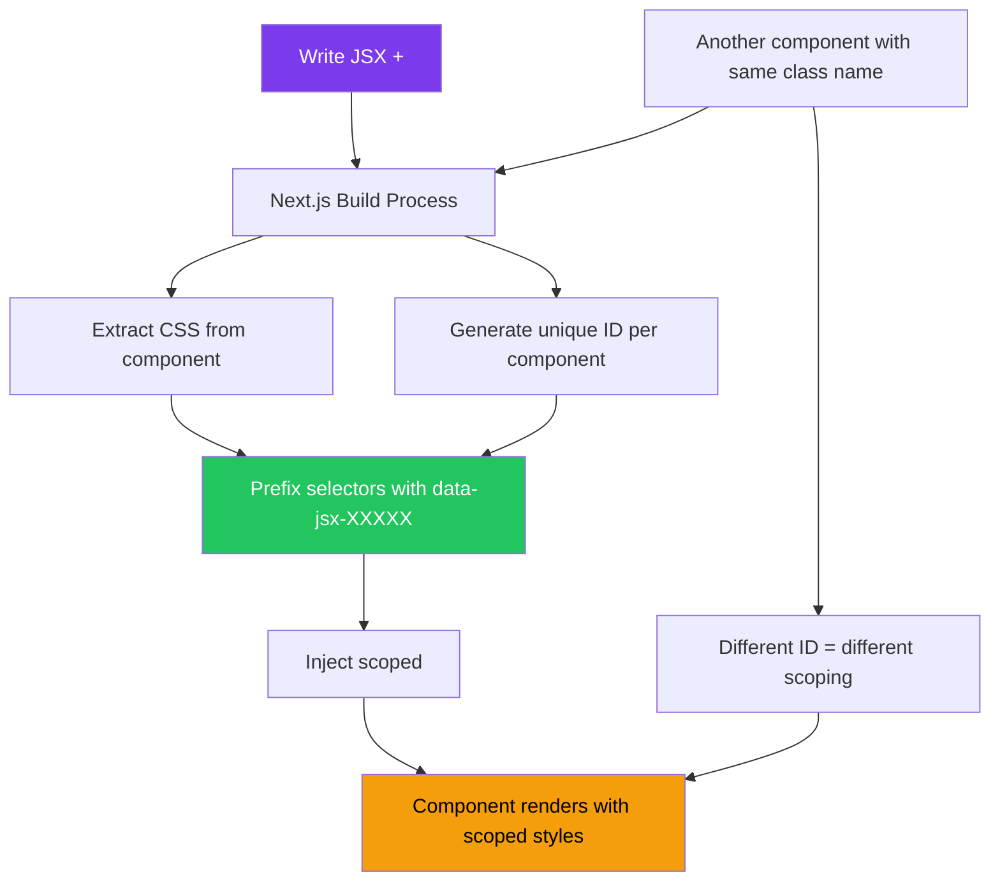
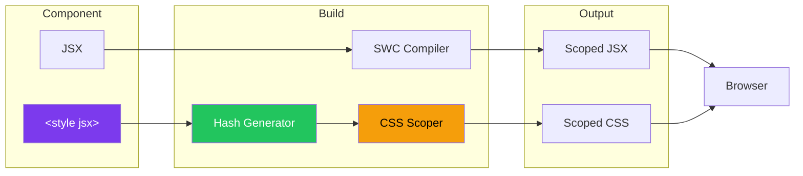
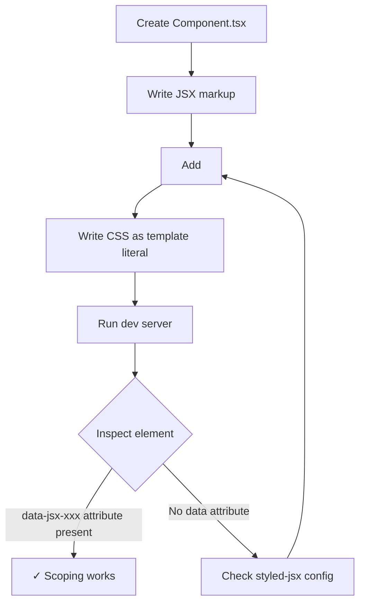

# CSS-in-JS with styled-jsx

## Introduction
styled-jsx is a CSS-in-JS library built directly into Next.js. It allows you to write CSS that is scoped to the component, with the styles written directly in the component file using a custom `<style jsx>` tag. Unlike CSS Modules (which require a separate `.module.css` file), styled-jsx keeps styles and markup together in the same file while still providing full scoping and no runtime overhead.

## Why do we need this?
While CSS Modules and Tailwind CSS are excellent styling solutions, some developers prefer the colocation of styles and markup that CSS-in-JS provides. styled-jsx offers this without requiring any additional dependencies (it's included with Next.js) and with zero runtime cost — the styles are extracted at build time.

## Problem Statement
As a React developer, you want to write styles close to your component logic without juggling multiple files. You need:
- Scoped styles that don't leak to other components
- Dynamic styling based on props or state
- Familiar CSS syntax (not a JavaScript object like inline styles)
- Zero configuration (should work out of the box)
- Good performance with no runtime overhead

## Real World Story
Maria is building a component library for her startup. She wants to keep each component's styles close to its logic. With styled-jsx, she writes the styles right inside her component file using `<style jsx>{`...`}</style>`. The styles are automatically scoped to the component with a unique data attribute. When she ships the library, consumers don't need to configure any CSS loaders or import separate stylesheets.

## Real World Analogy
Think of styled-jsx like a **food tray** at a cafeteria:
- **Global CSS** is like a buffet — food (styles) is shared and accessible to everyone
- **CSS Modules** is like a takeout box — each dish has its own container, but you need separate containers
- **styled-jsx** is like a compartmentalized food tray — everything is in one tray but separated (styles and markup in one file, but isolated from other files)

## Visual Explanation
```
Component File With styled-jsx:

MyComponent.jsx
┌─────────────────────────────────────┐
│  export default function Component { │
│    return (                          │
│      <div>                           │
│        <p>Hello</p>                  │
│        <style jsx>{`                 │
│          div {                       │
│            padding: 1rem;            │
│          }                           │
│          p {                         │
│            color: blue;              │
│          }                           │
│        `}</style>                    │
│      </div>                          │
│    )                                 │
│  }                                   │
└─────────────────────────────────────┘
                    ↓
Compiled Output:
<div data-jsx-abc123>
  <p data-jsx-abc123>Hello</p>
</div>
<style>
  div[data-jsx-abc123] { padding: 1rem; }
  p[data-jsx-abc123] { color: blue; }
</style>
```

## Mermaid Diagram 1: How styled-jsx Scoping Works



## Internal Working
When Next.js processes a file with `<style jsx>`:

1. **Babel/SWC transformation** — The styled-jsx plugin scans for `<style jsx>` tags
2. **CSS extraction** — The CSS content is extracted from the JSX
3. **ID generation** — A unique hash is generated based on the file path and content
4. **Selector scoping** — All selectors are prefixed with `[data-jsx-{hash}]`
5. **Attribute injection** — The `data-jsx-{hash}` attribute is added to the component's elements
6. **Style injection** — The scoped CSS is injected as a `<style>` tag in the document head (or inline in the component for SSR)

The key insight: **styled-jsx uses data attributes for scoping, not class name mangling** like CSS Modules.

## Mermaid Diagram 2: Internal Build Process

```mermaid
sequenceDiagram
    participant Dev as Developer
    participant Next as Next.js Compiler
    participant SWC as SWC/Styled-jsx
    participant DOM as Browser DOM

    Dev->>Next: Write <style jsx>{` .btn { color: red; } `}</style>
    Next->>SWC: Process JSX
    SWC->>SWC: Generate hash: "abc123"
    SWC->>SWC: Transform selector: [data-jsx-abc123] .btn
    SWC->>Next: Return transformed component
    Next->>DOM: Render <div data-jsx-abc123>
    Next->>DOM: Inject <style>[data-jsx-abc123] .btn { color: red; }</style>
    DOM->>DOM: Apply scoped styles
```

## Architecture
styled-jsx follows a hybrid approach:

```
Component File
├── JSX Markup
├── <style jsx>       → Scoped to this component
└── <style jsx global> → Not scoped (use sparingly)

Build Time:
├── Extract CSS from JS
├── Scope with data attributes
└── Inject into DOM

Runtime:
└── Zero runtime cost (styles are static)
```

## Mermaid Diagram 3: Architecture Overview



## Step-by-Step Flow

1. **Create a component** — Create a Next.js component (Pages or App Router)
2. **Write JSX** — Add your component's markup
3. **Add `<style jsx>`** — Insert a `<style jsx>` tag inside your JSX
4. **Write CSS** — Write regular CSS inside the template literal
5. **Build** — Next.js compiles the component, scoping all styles
6. **Render** — The browser shows scoped styles with no conflicts

## Mermaid Diagram 4: Developer Workflow



## Syntax

```tsx
// Basic styled-jsx usage
export default function Card() {
  return (
    <div className="card">
      <h2 className="title">Hello World</h2>
      <p className="description">This is a card component.</p>

      <style jsx>{`
        .card {
          border-radius: 8px;
          padding: 1.5rem;
          background: white;
          box-shadow: 0 1px 3px rgba(0, 0, 0, 0.1);
        }

        .title {
          font-size: 1.25rem;
          font-weight: 600;
          color: #1a202c;
        }

        .description {
          font-size: 0.875rem;
          color: #718096;
          line-height: 1.5;
        }
      `}</style>
    </div>
  )
}
```

**What's happening:**
- The `<style jsx>` tag tells styled-jsx to process the CSS inside
- All CSS selectors are automatically scoped to this component
- The component's elements get a `data-jsx-{hash}` attribute for scoping
- The CSS is regular CSS (not a JavaScript object like inline styles)

## Basic Example

A button component with styled-jsx:

```tsx
// components/StyledButton.tsx
export default function StyledButton({
  children,
  variant = 'primary',
}: {
  children: React.ReactNode
  variant?: 'primary' | 'secondary'
}) {
  return (
    <>
      <button className={`btn btn-${variant}`}>
        {children}
      </button>

      <style jsx>{`
        .btn {
          padding: 0.5rem 1rem;
          border-radius: 6px;
          font-weight: 500;
          font-size: 0.875rem;
          cursor: pointer;
          transition: all 0.2s ease;
          border: 1px solid transparent;
        }

        .btn-primary {
          background-color: #6366f1;
          color: white;
        }

        .btn-primary:hover {
          background-color: #4f46e5;
        }

        .btn-secondary {
          background-color: transparent;
          border-color: #d1d5db;
          color: #374151;
        }

        .btn-secondary:hover {
          background-color: #f9fafb;
        }
      `}</style>
    </>
  )
}
```

```tsx
// Usage
export default function Page() {
  return (
    <div>
      <StyledButton variant="primary">Submit</StyledButton>
      <StyledButton variant="secondary">Cancel</StyledButton>
    </div>
  )
}
```

**What's happening:**
- The `<style jsx>` tag must be a child of the component's return
- The `<>` fragment wrapper allows the button and style tag to coexist
- Class-based selectors work the same as regular CSS
- Dynamic classes (`btn-${variant}`) work by accessing the variant prop

## Intermediate Example

Dynamic styles with props and the `jsx` template literal:

```tsx
// components/Alert.tsx
type AlertType = 'info' | 'success' | 'warning' | 'error'

const alertColors: Record<AlertType, { bg: string; border: string; text: string }> = {
  info:    { bg: '#eff6ff', border: '#93c5fd', text: '#1e40af' },
  success: { bg: '#f0fdf4', border: '#86efac', text: '#166534' },
  warning: { bg: '#fffbeb', border: '#fcd34d', text: '#92400e' },
  error:   { bg: '#fef2f2', border: '#fca5a5', text: '#991b1b' },
}

export default function Alert({
  type = 'info',
  children,
  show = true,
}: {
  type?: AlertType
  children: React.ReactNode
  show?: boolean
}) {
  if (!show) return null

  const colors = alertColors[type]

  return (
    <div className="alert" role="alert">
      <span className="icon">
        {type === 'info' && 'ℹ️'}
        {type === 'success' && '✅'}
        {type === 'warning' && '⚠️'}
        {type === 'error' && '❌'}
      </span>
      <span className="message">{children}</span>

      <style jsx>{`
        .alert {
          display: flex;
          align-items: center;
          gap: 0.75rem;
          padding: 1rem;
          border-radius: 8px;
          border: 1px solid ${colors.border};
          background: ${colors.bg};
          color: ${colors.text};
          font-size: 0.875rem;
          animation: slideIn 0.3s ease;
        }

        .icon {
          font-size: 1.25rem;
          flex-shrink: 0;
        }

        .message {
          flex: 1;
        }

        @keyframes slideIn {
          from {
            opacity: 0;
            transform: translateY(-8px);
          }
          to {
            opacity: 1;
            transform: translateY(0);
          }
        }
      `}</style>
    </div>
  )
}
```

**What's happening:**
- Dynamic CSS values via template literals (`${colors.border}`)
- CSS animations (`@keyframes`) work within styled-jsx
- The `role="alert"` attribute improves accessibility
- Props control both the content and the styling

## Advanced Example

Using `<style jsx global>` for global styles, external CSS resolution with `resolve`, and composition:

```tsx
// components/Dialog.tsx
import { useState } from 'react'

export default function Dialog({
  title,
  children,
  isOpen: controlledOpen,
  onClose,
}: {
  title: string
  children: React.ReactNode
  isOpen?: boolean
  onClose?: () => void
}) {
  const [internalOpen, setInternalOpen] = useState(false)
  const isOpen = controlledOpen ?? internalOpen

  const close = () => {
    if (onClose) onClose()
    else setInternalOpen(false)
  }

  // Use resolve for conditional styles
  const { className, styles } = useResolvedStyles()

  if (!isOpen) return null

  return (
    <div className="overlay" onClick={close}>
      <div className="dialog" onClick={(e) => e.stopPropagation()}>
        <div className="header">
          <h2 className="title">{title}</h2>
          <button className="closeBtn" onClick={close} aria-label="Close dialog">
            ✕
          </button>
        </div>
        <div className="content">{children}</div>
      </div>

      {/* Scoped styles */}
      <style jsx>{`
        .overlay {
          position: fixed;
          inset: 0;
          background: rgba(0, 0, 0, 0.5);
          display: flex;
          align-items: center;
          justify-content: center;
          z-index: 50;
          animation: fadeIn 0.2s ease;
        }

        .dialog {
          background: white;
          border-radius: 12px;
          padding: 0;
          max-width: 480px;
          width: 90%;
          max-height: 80vh;
          overflow-y: auto;
          box-shadow: 0 20px 60px rgba(0, 0, 0, 0.3);
          animation: scaleIn 0.2s ease;
        }

        .header {
          display: flex;
          align-items: center;
          justify-content: space-between;
          padding: 1.25rem 1.5rem;
          border-bottom: 1px solid #e2e8f0;
        }

        .title {
          font-size: 1.125rem;
          font-weight: 600;
          color: #0f172a;
          margin: 0;
        }

        .closeBtn {
          background: none;
          border: none;
          font-size: 1.25rem;
          cursor: pointer;
          color: #64748b;
          padding: 0.25rem;
          border-radius: 4px;
          transition: color 0.2s;
        }

        .closeBtn:hover {
          color: #0f172a;
        }

        .content {
          padding: 1.5rem;
        }

        @keyframes fadeIn {
          from { opacity: 0; }
          to { opacity: 1; }
        }

        @keyframes scaleIn {
          from {
            opacity: 0;
            transform: scale(0.95);
          }
          to {
            opacity: 1;
            transform: scale(1);
          }
        }
      `}</style>

      {/* Global styles — applies to body outside this component */}
      <style jsx global>{`
        body.dialog-open {
          overflow: hidden;
        }
      `}</style>
    </div>
  )
}
```

```tsx
// Example using resolve() for shared styles: components/useResolvedStyles.ts
import { resolve } from 'styled-jsx/css'

// Shared styles resolved once and reused
const sharedButtonStyles = resolve`
  .btn-base {
    display: inline-flex;
    align-items: center;
    gap: 0.5rem;
    padding: 0.625rem 1.25rem;
    border-radius: 6px;
    font-weight: 500;
    font-size: 0.875rem;
    cursor: pointer;
    transition: all 0.15s ease;
    border: 1px solid transparent;
  }
`

export function useResolvedStyles() {
  return sharedButtonStyles
}
```

**What's happening:**
- `resolve` from `styled-jsx/css` creates reusable static stylesheets
- `<style jsx global>` applies styles outside the component's scope (like body scroll lock)
- Multiple `<style jsx>` blocks can coexist in the same component
- CSS animations are scoped just like regular selectors

## Production Example

A production form component with styled-jsx for a SaaS application:

```tsx
// components/CheckoutForm.tsx
'use client'

import { useState } from 'react'

interface FormData {
  name: string
  email: string
  cardNumber: string
  expiry: string
  cvc: string
}

export default function CheckoutForm() {
  const [formData, setFormData] = useState<FormData>({
    name: '',
    email: '',
    cardNumber: '',
    expiry: '',
    cvc: '',
  })
  const [isSubmitting, setIsSubmitting] = useState(false)
  const [error, setError] = useState<string | null>(null)

  const handleSubmit = async (e: React.FormEvent) => {
    e.preventDefault()
    setIsSubmitting(true)
    setError(null)
    // Simulate API call
    await new Promise((r) => setTimeout(r, 2000))
    setIsSubmitting(false)
  }

  const updateField = (field: keyof FormData) => (
    e: React.ChangeEvent<HTMLInputElement>
  ) => {
    setFormData((prev) => ({ ...prev, [field]: e.target.value }))
  }

  return (
    <form className="form" onSubmit={handleSubmit}>
      <h2 className="formTitle">Payment Details</h2>
      <p className="formSubtitle">Complete your purchase securely</p>

      {error && (
        <div className="error">
          <span>⚠️</span>
          <span>{error}</span>
        </div>
      )}

      <div className="fieldGroup">
        <label className="label" htmlFor="name">Full Name</label>
        <input
          id="name"
          className="input"
          type="text"
          value={formData.name}
          onChange={updateField('name')}
          placeholder="John Doe"
          required
        />
      </div>

      <div className="fieldGroup">
        <label className="label" htmlFor="email">Email</label>
        <input
          id="email"
          className="input"
          type="email"
          value={formData.email}
          onChange={updateField('email')}
          placeholder="john@example.com"
          required
        />
      </div>

      <div className="fieldGroup">
        <label className="label" htmlFor="cardNumber">Card Number</label>
        <input
          id="cardNumber"
          className="input cardInput"
          type="text"
          value={formData.cardNumber}
          onChange={updateField('cardNumber')}
          placeholder="4242 4242 4242 4242"
          maxLength={19}
          required
        />
      </div>

      <div className="row">
        <div className="fieldGroup">
          <label className="label" htmlFor="expiry">Expiry</label>
          <input
            id="expiry"
            className="input"
            type="text"
            value={formData.expiry}
            onChange={updateField('expiry')}
            placeholder="MM/YY"
            maxLength={5}
            required
          />
        </div>
        <div className="fieldGroup">
          <label className="label" htmlFor="cvc">CVC</label>
          <input
            id="cvc"
            className="input"
            type="text"
            value={formData.cvc}
            onChange={updateField('cvc')}
            placeholder="123"
            maxLength={4}
            required
          />
        </div>
      </div>

      <button className="submitBtn" type="submit" disabled={isSubmitting}>
        {isSubmitting ? 'Processing...' : `Pay $49.99`}
      </button>

      <style jsx>{`
        .form {
          max-width: 440px;
          margin: 0 auto;
          padding: 2rem;
          background: white;
          border-radius: 12px;
          box-shadow: 0 1px 3px rgba(0, 0, 0, 0.1);
        }

        .formTitle {
          font-size: 1.5rem;
          font-weight: 700;
          color: #0f172a;
          margin: 0 0 0.25rem;
        }

        .formSubtitle {
          color: #64748b;
          font-size: 0.875rem;
          margin: 0 0 1.5rem;
        }

        .error {
          display: flex;
          align-items: center;
          gap: 0.5rem;
          padding: 0.75rem;
          background: #fef2f2;
          border: 1px solid #fecaca;
          border-radius: 8px;
          color: #991b1b;
          font-size: 0.875rem;
          margin-bottom: 1rem;
        }

        .fieldGroup {
          margin-bottom: 1.25rem;
          flex: 1;
        }

        .row {
          display: flex;
          gap: 1rem;
        }

        .label {
          display: block;
          font-size: 0.875rem;
          font-weight: 500;
          color: #374151;
          margin-bottom: 0.375rem;
        }

        .input {
          width: 100%;
          padding: 0.625rem 0.875rem;
          border: 1px solid #d1d5db;
          border-radius: 8px;
          font-size: 0.875rem;
          color: #0f172a;
          background: white;
          transition: border-color 0.15s ease, box-shadow 0.15s ease;
          box-sizing: border-box;
        }

        .input:focus {
          outline: none;
          border-color: #6366f1;
          box-shadow: 0 0 0 3px rgba(99, 102, 241, 0.15);
        }

        .input::placeholder {
          color: #9ca3af;
        }

        .cardInput {
          font-family: 'Courier New', monospace;
          letter-spacing: 1px;
        }

        .submitBtn {
          width: 100%;
          padding: 0.75rem;
          background: linear-gradient(135deg, #6366f1, #4f46e5);
          color: white;
          border: none;
          border-radius: 8px;
          font-weight: 600;
          font-size: 1rem;
          cursor: pointer;
          transition: opacity 0.2s ease, transform 0.1s ease;
          margin-top: 0.5rem;
        }

        .submitBtn:hover:not(:disabled) {
          opacity: 0.9;
        }

        .submitBtn:active:not(:disabled) {
          transform: scale(0.98);
        }

        .submitBtn:disabled {
          opacity: 0.6;
          cursor: not-allowed;
        }
      `}</style>
    </form>
  )
}
```

**What's happening:**
- Complete production form with styled-jsx
- Pseudo-classes (`:focus`, `:hover`, `:disabled`) work normally
- Gradients in CSS (`linear-gradient`) are fully supported
- Placeholder styling with `::placeholder`
- Transition effects for interactive states

## Folder Structure

```
components/
├── Button/
│   ├── Button.tsx          # Has <style jsx> inside
│   └── Button.test.tsx
├── Card/
│   ├── Card.tsx            # Has <style jsx> inside
│   └── Card.test.tsx
├── Dialog/
│   ├── Dialog.tsx          # Has <style jsx> + <style jsx global>
│   └── Dialog.test.tsx
└── shared/
    └── styles.ts           # styled-jsx/css resolve() for shared styles

pages/
└── index.tsx               # Imports components with embedded styles
```

**Note:** Unlike CSS Modules, styled-jsx doesn't create separate `.module.css` files. All styles live inside the component file itself.

## Best Practices

1. **One `<style jsx>` per component** — Keep all component styles in one block for maintainability
2. **Use `resolve()` for shared styles** — Extract repeated CSS patterns into resolved stylesheets
3. **Prefer class selectors over tag selectors** — Tag selectors (like `input {}`) can conflict with nested components
4. **Use `<style jsx global>` sparingly** — Only for true global needs like body scroll lock
5. **Keep animation names unique** — While scoped, animation names can still conflict globally
6. **Avoid inline styles when possible** — styled-jsx scoped CSS is more maintainable
7. **Use CSS custom properties** — Pass dynamic values through CSS variables for cleaner code

## Common Mistakes

1. **Placing `<style jsx>` outside the component's JSX** — It must be a child of the returned JSX tree
2. **Using tag selectors expecting full scoping** — Tag selectors inside child components are NOT scoped by parent
3. **Forgetting backticks** — `<style jsx>{`...`}</style>` requires template literal syntax
4. **Overusing `:global`** — It defeats the purpose of scoped styles
5. **Using styled-jsx with Global CSS imports** — They can coexist but be mindful of cascade

## Performance Notes

- **Zero runtime cost** — Styles are extracted at build time
- **No JavaScript overhead** — Unlike runtime CSS-in-JS libraries (styled-components, Emotion)
- **Automatic critical CSS** — Works with Next.js critical CSS extraction
- **Small CSS files** — Only the styles you write (no framework overhead)
- **Caching** — Scoped CSS is cacheable since it's based on file content

## Security Notes

- **No injection vulnerabilities** — Since styles are extracted at build time, there's no runtime CSS injection
- **CSP friendly** — Works with strict Content Security Policy
- **Avoid user input in styles** — Never interpolate user input into CSS values

## SEO Considerations

- styled-jsx doesn't affect SEO directly since styles are server-side rendered
- Server Components with styled-jsx include styles in the initial HTML
- Works with Next.js streaming for progressive HTML delivery

## Interview Questions

1. How does styled-jsx differ from CSS Modules?
2. What `data-` attribute does styled-jsx use for scoping?
3. How do you create global styles with styled-jsx?
4. What is `resolve()` in styled-jsx and when would you use it?
5. Does styled-jsx have any runtime performance cost?

## MCQs

1. What syntax is used to write styles in styled-jsx?
   a) JavaScript object notation
   b) Template literal with backticks
   c) JSON format
   d) YAML format
   <details>
   <summary>Answer</summary>
   b) Template literal with backticks — `<style jsx>{`css...`}</style>`.
   </details>

2. How does styled-jsx scope styles to a component?
   a) By mangling class names
   b) By adding unique data attributes to elements
   c) By using Shadow DOM
   d) By inline styles
   <details>
   <summary>Answer</summary>
   b) By adding unique data attributes to elements — each element gets a `data-jsx-{hash}` attribute.
   </details>

3. What tag applies styles globally with styled-jsx?
   a) `<style jsx global>`
   b) `<style global>`
   c) `<style jsx={false}>`
   d) `<style global jsx>`
   <details>
   <summary>Answer</summary>
   a) `<style jsx global>` — The `global` prop makes styles apply globally.
   </details>

4. Is styled-jsx built into Next.js or is it a third-party library?
   a) Third-party library
   b) Built into Next.js
   c) Part of React core
   d) Deprecated
   <details>
   <summary>Answer</summary>
   b) Built into Next.js — styled-jsx comes bundled with Next.js, no installation needed.
   </details>

5. What does `resolve()` from `styled-jsx/css` do?
   a) Creates a global stylesheet
   b) Resolves dynamic CSS values at runtime
   c) Creates reusable, pre-compiled stylesheets
   d) Resolves CSS imports
   <details>
   <summary>Answer</summary>
   c) Creates reusable, pre-compiled stylesheets — `resolve()` extracts CSS at build time for reuse.
   </details>

## Practice Exercise

1. Create a `ProfileCard` component using styled-jsx with:
   - Avatar (circle image)
   - Name (bold, large)
   - Bio (smaller, muted color)
   - Stats (followers, following, posts)
   - Follow button that changes color on hover
2. Style it entirely within the component file using `<style jsx>`
3. Add a hover effect that elevates the card
4. Use a CSS animation for the card entrance
5. Create a second styled-jsx component and verify no style conflicts

## Debugging Exercise

The following styled-jsx code has bugs. Find and fix them:

```tsx
// components/Header.tsx
export default function Header() {
  return (
    <header className="header">
      <h1>My App</h1>
      <style jsx>          // Bug 1: Missing template literal
        .header {
          background: #333;
          color: white;
          padding: 1rem;
        }
      </style>
    </header>
  )
}
```

**Bug 1:** Missing template literal backticks and curly braces.

**Fix:**
```tsx
<style jsx>{`
  .header {
    background: #333;
    color: white;
    padding: 1rem;
  }
`}</style>
```

## Real-world Scenario

**Problem:** You're building a component library with 30+ components. Each component needs its own styles, and consumers should not need to configure any CSS loaders or import separate style files.

**Solution:** Use styled-jsx for all component styles. Each component has its styles embedded, scoped, and self-contained. When a consumer installs your library via npm, all styles come bundled with the components. No additional CSS imports or configuration needed. The styles are automatically scoped to prevent conflicts with the consumer's own styles.

## Interview Coding Question

Build an accordion component with styled-jsx:

```tsx
// components/Accordion.tsx
'use client'

import { useState } from 'react'

interface AccordionItem {
  title: string
  content: string
}

interface AccordionProps {
  items: AccordionItem[]
  allowMultiple?: boolean
}

export default function Accordion({ items, allowMultiple = false }: AccordionProps) {
  const [openItems, setOpenItems] = useState<Set<number>>(new Set())

  const toggle = (index: number) => {
    setOpenItems((prev) => {
      const next = new Set(prev)
      if (next.has(index)) {
        next.delete(index)
      } else {
        if (!allowMultiple) {
          next.clear()
        }
        next.add(index)
      }
      return next
    })
  }

  return (
    <div className="accordion">
      {items.map((item, index) => {
        const isOpen = openItems.has(index)
        return (
          <div key={index} className={`item ${isOpen ? 'open' : ''}`}>
            <button
              className="trigger"
              onClick={() => toggle(index)}
              aria-expanded={isOpen}
              aria-controls={`content-${index}`}
            >
              <span>{item.title}</span>
              <span className="chevron">{isOpen ? '−' : '+'}</span>
            </button>
            <div
              id={`content-${index}`}
              className="content"
              role="region"
              hidden={!isOpen}
            >
              {item.content}
            </div>
          </div>
        )
      })}

      <style jsx>{`
        .accordion {
          border: 1px solid #e2e8f0;
          border-radius: 8px;
          overflow: hidden;
        }

        .item {
          border-bottom: 1px solid #e2e8f0;
        }

        .item:last-child {
          border-bottom: none;
        }

        .trigger {
          width: 100%;
          display: flex;
          justify-content: space-between;
          align-items: center;
          padding: 1rem 1.25rem;
          background: white;
          border: none;
          cursor: pointer;
          font-size: 1rem;
          font-weight: 500;
          color: #0f172a;
          text-align: left;
          transition: background 0.15s ease;
        }

        .trigger:hover {
          background: #f8fafc;
        }

        .chevron {
          font-size: 1.25rem;
          color: #64748b;
          transition: transform 0.2s ease;
        }

        .open .chevron {
          transform: rotate(180deg);
        }

        .content {
          padding: 0 1.25rem 1rem;
          color: #475569;
          line-height: 1.6;
          animation: slideDown 0.2s ease;
        }

        @keyframes slideDown {
          from {
            opacity: 0;
            transform: translateY(-8px);
          }
          to {
            opacity: 1;
            transform: translateY(0);
          }
        }
      `}</style>
    </div>
  )
}
```

## Mini Project

**Build a Fully Styled Blog Post Editor**

Create a blog post editor component using styled-jsx:

1. **Toolbar** — Bold, Italic, Underline, Heading, List buttons with active states
2. **Editor Area** — Styled contenteditable div with proper typography
3. **Publish Button** — Gradient background, hover effect, loading state
4. **Word Count** — Display live word count below the editor
5. **Character Limit** — Progress bar showing character usage (max 5000)

Requirements:
- All styles must use `<style jsx>` within the component
- Use CSS custom properties for the color scheme
- Include smooth transitions on all interactive elements
- Add focus styles for accessibility
- Use animations for loading states

## Summary
styled-jsx is a CSS-in-JS solution built directly into Next.js with zero configuration required. It allows you to write scoped CSS directly in your component files using `<style jsx>` tags. Styles are scoped using unique data attributes and extracted at build time, resulting in zero runtime overhead. styled-jsx supports dynamic styles via template literals and provides `<style jsx global>` for unscoped global styles. It's an excellent choice for developers who prefer colocating styles with their component logic without adding extra dependencies.

## Cheat Sheet

```tsx
// Basic scoped styles
<style jsx>{`
  .container { padding: 1rem; }
`}</style>

// Global styles (use sparingly)
<style jsx global>{`
  body { overflow: hidden; }
`}</style>

// Dynamic values with template literals
<style jsx>{`
  .btn { background: ${props.color}; }
`}</style>

// Shared styles with resolve()
import { resolve } from 'styled-jsx/css'
const { className, styles } = resolve`
  .base { padding: 1rem; }
`

// Key benefits
// ✅ Zero runtime cost
// ✅ Built into Next.js
// ✅ Scoped by default
// ✅ Familiar CSS syntax
// ✅ CSP compatible
```

## Related Topics
- CSS Modules in Next.js
- Global Styles and Custom CSS
- Tailwind CSS Integration
- React Component Patterns
- Design Systems

## Further Reading
- [styled-jsx GitHub Repository](https://github.com/vercel/styled-jsx)
- [Next.js Documentation: CSS-in-JS](https://nextjs.org/docs/basic-features/built-in-css-support#css-in-js)
- [Using styled-jsx in Next.js](https://nextjs.org/learn/foundations/styling/styled-jsx)
