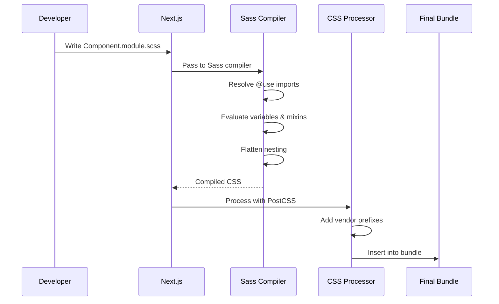
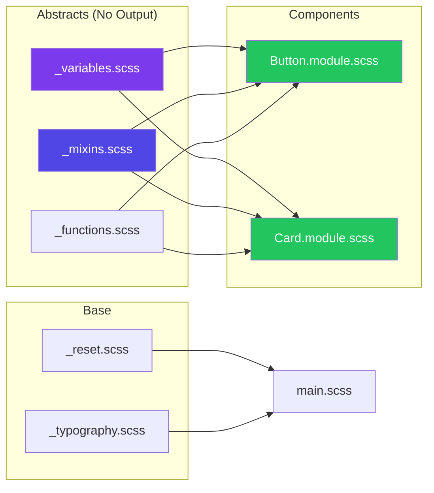
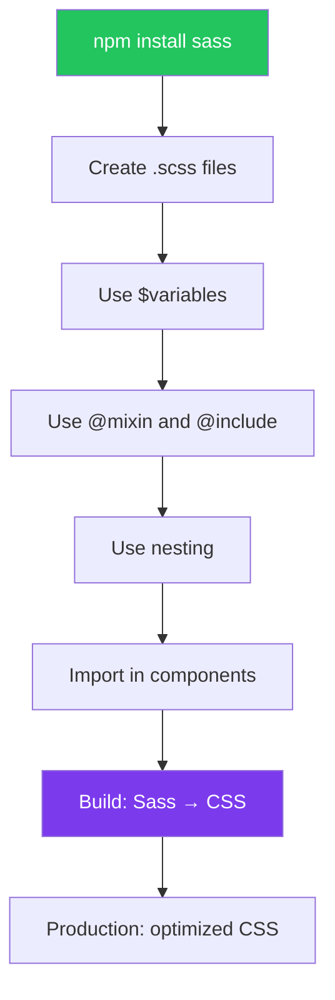

# Sass and CSS Preprocessors

## Introduction
Sass (Syntactically Awesome Style Sheets) is a CSS preprocessor that extends CSS with powerful features like variables, nesting, mixins, functions, and inheritance. Next.js has built-in support for Sass — simply install the `sass` package and you can use `.scss` or `.sass` files throughout your application, including CSS Module-style scoped Sass files (`.module.scss`).

## Why do we need this?
While modern CSS has caught up with features like custom properties and nesting (in some browsers), Sass still offers advantages for large-scale applications:
- **Variables** — Unlike CSS custom properties, Sass variables are compile-time constants, perfect for design tokens
- **Nesting** — Write nested selectors that mirror your HTML structure
- **Mixins** — Reusable blocks of styles that accept parameters
- **Functions** — Compute values with built-in functions (lighten, darken, mix)
- **Partial files** — Split CSS into logical files with `_partial` naming convention
- **Extend/Inheritance** — Share sets of styles between selectors

## Problem Statement
As your Next.js application grows, you might find yourself:
- Repeating the same vendor prefixes across multiple files
- Writing deeply nested selectors manually
- Copy-pasting color values and computations
- Wanting to organize CSS into logical files without HTTP request overhead
- Needing programmatic CSS value manipulation (lightening, darkening colors)

## Real World Story
Alex is the lead developer for a large e-commerce platform with 100+ CSS files. The team uses Sass to organize styles: `_variables.scss` for design tokens, `_mixins.scss` for responsive breakpoints, `_buttons.scss` for button styles. Each component's `.module.scss` file imports only what it needs from these partials. When the brand color changes from blue to green, Alex updates one variable in `_variables.scss`, and the entire application updates automatically.

## Real World Analogy
Think of Sass as a **power tool** compared to regular CSS (a hand tool):
- **Regular CSS** is like a hand saw — it works, but requires more effort for complex cuts
- **Sass** is like a circular saw — it has features (mixins, functions) that make complex tasks faster and more precise

With a hand saw, you measure and cut each piece. With a power saw, you set the guide (variable/mixin) and cut many pieces identically.

## Visual Explanation
```
Sass Compilation Process:

.scss Source Files               Compiled .css Output
┌─────────────────┐             ┌────────────────────┐
│ _variables.scss │             │ styles.css         │
│ $primary: blue  │────┐        │ .header {          │
└─────────────────┘    │        │   background: blue; │
┌─────────────────┐    ├───────▶│ }                  │
│ header.scss     │    │        │ .button {          │
│ .header {       │────┘        │   background: blue; │
│ @import vars    │             │   border-radius: 4; │
│ background:     │             │ }                  │
│   $primary; }   │             └────────────────────┘
└─────────────────┘
```

## Mermaid Diagram 1: Sass Compilation Flow

```mermaid
flowchart TD
    A[_variables.scss] --> D[Sass Compiler (Dart Sass)]
    B[_mixins.scss] --> D
    C[Component.module.scss] --> D
    D --> E[Compiled component.css]
    D --> F[Source Map]
    
    G[Partials] --> H[Not compiled individually]
    H --> D
    
    style D fill:#7c3aed,color:#fff
    style A fill:#22c55e,color:#fff
    style B fill:#22c55e,color:#fff
    style C fill:#f59e0b,color:#000
```

## Internal Working
When Next.js processes Sass files:

1. **File detection** — Files with `.scss` or `.sass` extensions are detected
2. **Dependency resolution** — `@use` and `@forward` statements are resolved
3. **Variable substitution** — All Sass variables are replaced with their values
4. **Mixin and function evaluation** — Mixins and functions are expanded inline
5. **Nesting flattening** — Nested selectors are flattened to standard CSS
6. **Module scoping** — For `.module.scss` files, class names are hashed (same as CSS Modules)
7. **Output** — Final compiled CSS is passed to the Next.js build pipeline

## Mermaid Diagram 2: Internal Processing



## Architecture
Sass in a Next.js project follows this structure:

```
Styles Directory:
├── abstracts/          # No output — only imported
│   ├── _variables.scss
│   ├── _mixins.scss
│   └── _functions.scss
├── base/
│   ├── _reset.scss
│   └── _typography.scss
├── components/
│   └── Button.module.scss  # CSS Module scoped
└── main.scss           # Entry point

Component Layer:
└── Component.tsx
    └── imports Component.module.scss
        └── @use 'abstracts/variables' as vars
```

## Mermaid Diagram 3: Architecture Overview



## Step-by-Step Flow

1. **Install Sass** — `npm install sass`
2. **Create Sass partial** — Create `_variables.scss` with design tokens
3. **Create module** — Create `Button.module.scss` that imports variables
4. **Write styles** — Use nesting, variables, mixins in the Sass file
5. **Import in component** — `import styles from './Button.module.scss'`
6. **Build** — Next.js compiles Sass → CSS → scoped output

## Mermaid Diagram 4: Developer Workflow



## Syntax

```scss
// styles/abstracts/_variables.scss
// 1. Colors
$brand-primary: #6366f1;
$brand-secondary: #818cf8;
$brand-accent: #a5b4fc;

// 2. Neutral colors
$neutral-50: #f8fafc;
$neutral-100: #f1f5f9;
$neutral-200: #e2e8f0;
$neutral-300: #cbd5e1;
$neutral-400: #94a3b8;
$neutral-500: #64748b;
$neutral-600: #475569;
$neutral-700: #334155;
$neutral-800: #1e293b;
$neutral-900: #0f172a;

// 3. Typography
$font-sans: 'Inter', -apple-system, BlinkMacSystemFont, sans-serif;
$font-mono: 'JetBrains Mono', 'Fira Code', monospace;

$font-size-xs: 0.75rem;
$font-size-sm: 0.875rem;
$font-size-base: 1rem;
$font-size-lg: 1.125rem;
$font-size-xl: 1.25rem;
$font-size-2xl: 1.5rem;
$font-size-3xl: 1.875rem;
$font-size-4xl: 2.25rem;

// 4. Spacing
$spacing-xs: 0.25rem;
$spacing-sm: 0.5rem;
$spacing-md: 1rem;
$spacing-lg: 1.5rem;
$spacing-xl: 2rem;
$spacing-2xl: 3rem;
$spacing-3xl: 4rem;

// 5. Breakpoints
$breakpoint-sm: 640px;
$breakpoint-md: 768px;
$breakpoint-lg: 1024px;
$breakpoint-xl: 1280px;

// 6. Shadows
$shadow-sm: 0 1px 2px rgba(0, 0, 0, 0.05);
$shadow-md: 0 4px 6px -1px rgba(0, 0, 0, 0.1);
$shadow-lg: 0 10px 15px -3px rgba(0, 0, 0, 0.1);
$shadow-xl: 0 20px 25px -5px rgba(0, 0, 0, 0.1);

// 7. Border radius
$radius-sm: 4px;
$radius-md: 8px;
$radius-lg: 12px;
$radius-xl: 16px;
$radius-full: 9999px;

// 8. Transitions
$transition-fast: 150ms ease;
$transition-base: 200ms ease;
$transition-slow: 300ms ease;
```

```scss
// styles/abstracts/_mixins.scss
@use 'variables' as *;

// Responsive breakpoints
@mixin respond-sm {
  @media (min-width: $breakpoint-sm) {
    @content;
  }
}

@mixin respond-md {
  @media (min-width: $breakpoint-md) {
    @content;
  }
}

@mixin respond-lg {
  @media (min-width: $breakpoint-lg) {
    @content;
  }
}

@mixin respond-xl {
  @media (min-width: $breakpoint-xl) {
    @content;
  }
}

// Flexbox shortcuts
@mixin flex-center {
  display: flex;
  align-items: center;
  justify-content: center;
}

@mixin flex-between {
  display: flex;
  align-items: center;
  justify-content: space-between;
}

// Text truncation
@mixin text-truncate($lines: 1) {
  @if $lines == 1 {
    white-space: nowrap;
    overflow: hidden;
    text-overflow: ellipsis;
  } @else {
    display: -webkit-box;
    -webkit-line-clamp: $lines;
    -webkit-box-orient: vertical;
    overflow: hidden;
  }
}

// Focus ring
@mixin focus-ring {
  outline: none;
  
  &:focus-visible {
    outline: 2px solid $brand-primary;
    outline-offset: 2px;
  }
}

// Button variant
@mixin button-variant($bg, $hover-bg, $color: white) {
  background-color: $bg;
  color: $color;
  
  &:hover {
    background-color: $hover-bg;
  }
  
  &:active {
    background-color: darken($hover-bg, 5%);
  }
}
```

```scss
// components/Button.module.scss
@use '../styles/abstracts/variables' as *;
@use '../styles/abstracts/mixins' as *;

.button {
  display: inline-flex;
  align-items: center;
  justify-content: center;
  gap: $spacing-sm;
  padding: $spacing-sm $spacing-lg;
  border-radius: $radius-md;
  font-weight: 500;
  font-size: $font-size-sm;
  border: 1px solid transparent;
  cursor: pointer;
  transition: all $transition-fast;
  @include focus-ring;

  &.primary {
    @include button-variant($brand-primary, darken($brand-primary, 10%));
  }

  &.secondary {
    background-color: transparent;
    border-color: $neutral-300;
    color: $neutral-700;

    &:hover {
      background-color: $neutral-100;
    }
  }

  &.large {
    padding: $spacing-md $spacing-xl;
    font-size: $font-size-base;
  }

  &.small {
    padding: $spacing-xs $spacing-sm;
    font-size: $font-size-xs;
  }

  &:disabled {
    opacity: 0.5;
    cursor: not-allowed;
    pointer-events: none;
  }
}
```

```tsx
// components/Button.tsx
import styles from './Button.module.scss'

interface ButtonProps {
  variant?: 'primary' | 'secondary'
  size?: 'small' | 'medium' | 'large'
  children: React.ReactNode
  disabled?: boolean
}

export default function Button({
  variant = 'primary',
  size = 'medium',
  children,
  disabled,
}: ButtonProps) {
  return (
    <button
      className={`${styles.button} ${styles[variant]} ${size !== 'medium' ? styles[size] : ''}`}
      disabled={disabled}
    >
      {children}
    </button>
  )
}
```

**What's happening:**
- `$variables` are compile-time constants
- `@use` imports other Sass files (replaces old `@import`)
- `@mixin` / `@include` creates reusable style blocks
- `.module.scss` provides CSS Module scoping
- Nesting (`.button { &.primary {} }`) mirrors component structure

## Basic Example

A card component with Sass:

```scss
// Card.module.scss
@use '../styles/abstracts/variables' as *;
@use '../styles/abstracts/mixins' as *;

.card {
  border: 1px solid $neutral-200;
  border-radius: $radius-lg;
  padding: $spacing-lg;
  background: white;
  box-shadow: $shadow-sm;
  transition: all $transition-base;

  &:hover {
    box-shadow: $shadow-md;
    transform: translateY(-2px);
  }

  .header {
    display: flex;
    align-items: center;
    gap: $spacing-md;
    margin-bottom: $spacing-md;

    .avatar {
      width: 48px;
      height: 48px;
      border-radius: $radius-full;
      object-fit: cover;
    }

    .name {
      font-size: $font-size-lg;
      font-weight: 600;
      color: $neutral-900;
    }

    .role {
      font-size: $font-size-sm;
      color: $neutral-500;
    }
  }

  .content {
    color: $neutral-600;
    line-height: 1.6;
    font-size: $font-size-sm;
  }

  .footer {
    margin-top: $spacing-lg;
    padding-top: $spacing-md;
    border-top: 1px solid $neutral-100;
    @include flex-between;
  }
}
```

```tsx
// Card.tsx
import styles from './Card.module.scss'

export default function Card() {
  return (
    <div className={styles.card}>
      <div className={styles.header}>
        
        <div>
          <div className={styles.name}>Jane Doe</div>
          <div className={styles.role}>Senior Developer</div>
        </div>
      </div>
      <div className={styles.content}>
        Sass makes CSS more powerful with variables, nesting, and mixins.
        It's a game-changer for large-scale applications.
      </div>
      <div className={styles.footer}>
        <span>2 min ago</span>
        <button>Read More</button>
      </div>
    </div>
  )
}
```

**What's happening:**
- Nesting mirrors the HTML structure (`.card > .header > .avatar`)
- Variables ensure consistent spacing, colors, and shadows
- The `&` parent selector creates `.card:hover` from nesting
- `@include flex-between` reuses the mixin

## Intermediate Example

Sass functions and advanced mixins:

```scss
// styles/abstracts/_functions.scss
@use 'variables' as *;

// Convert px to rem
@function rem($px) {
  @return calc($px / 16) * 1rem;
}

// Get a color from the brand palette with opacity
@function brand-color($shade: 500, $opacity: 1) {
  $colors: (
    50: #eef2ff,
    100: #e0e7ff,
    200: #c7d2fe,
    300: #a5b4fc,
    400: #818cf8,
    500: #6366f1,
    600: #4f46e5,
    700: #4338ca,
    800: #3730a3,
    900: #312e81,
  );

  @if map-has-key($colors, $shade) {
    @return rgba(map-get($colors, $shade), $opacity);
  } @else {
    @error "Invalid brand color shade: #{$shade}";
  }
}

// Responsive container width
@function container-width($breakpoint) {
  @if $breakpoint == 'sm' { @return 640px; }
  @if $breakpoint == 'md' { @return 768px; }
  @if $breakpoint == 'lg' { @return 1024px; }
  @if $breakpoint == 'xl' { @return 1280px; }
  @return 100%;
}
```

```scss
// styles/abstracts/_mixins.scss (extended)
@use 'variables' as *;
@use 'functions' as *;

// Generate responsive font sizes
@mixin responsive-font($min-size, $max-size) {
  font-size: clamp(#{$min-size}, #{$min-size} + 2vw, #{$max-size});
}

// Create a grid layout
@mixin grid($columns: 1, $gap: $spacing-md) {
  display: grid;
  grid-template-columns: repeat($columns, 1fr);
  gap: $gap;
}

// Card hover elevation
@mixin card-hover($elevation: 2) {
  transition: transform $transition-base, box-shadow $transition-base;
  
  &:hover {
    transform: translateY(-($elevation * 1px));
    box-shadow: $shadow-lg;
  }
}

// Skeleton loading
@mixin skeleton-loading {
  background: linear-gradient(
    90deg,
    $neutral-200 25%,
    $neutral-100 50%,
    $neutral-200 75%
  );
  background-size: 200% 100%;
  animation: shimmer 1.5s infinite;
  border-radius: $radius-sm;

  @keyframes shimmer {
    0% { background-position: 200% 0; }
    100% { background-position: -200% 0; }
  }
}
```

```scss
// components/ProductCard.module.scss
@use '../styles/abstracts/variables' as *;
@use '../styles/abstracts/mixins' as *;
@use '../styles/abstracts/functions' as *;

.card {
  border: 1px solid $neutral-200;
  border-radius: $radius-lg;
  overflow: hidden;
  background: white;
  @include card-hover(4);

  .imageWrapper {
    position: relative;
    width: 100%;
    height: rem(200);
    overflow: hidden;

    img {
      transition: transform $transition-slow;
    }
  }

  &:hover .imageWrapper img {
    transform: scale(1.05);
  }

  .content {
    padding: $spacing-lg;

    .badge {
      display: inline-block;
      padding: $spacing-xs $spacing-sm;
      background: brand-color(500, 0.1);
      color: brand-color(500);
      border-radius: $radius-sm;
      font-size: $font-size-xs;
      font-weight: 600;
      margin-bottom: $spacing-sm;
    }

    .title {
      font-size: $font-size-lg;
      font-weight: 600;
      color: $neutral-900;
      @include text-truncate(2);
    }

    .price {
      font-size: $font-size-2xl;
      font-weight: 700;
      color: $brand-primary;
      margin-top: $spacing-sm;

      .original {
        font-size: $font-size-sm;
        color: $neutral-400;
        text-decoration: line-through;
        margin-left: $spacing-sm;
        font-weight: 400;
      }
    }

    .rating {
      display: flex;
      align-items: center;
      gap: $spacing-xs;
      margin-top: $spacing-sm;
      color: #f59e0b;
    }
  }
}
```

## Advanced Example

Sass with CSS Modules, theming, and complex logic:

```scss
// styles/themes/_light.scss
$bg-primary: #ffffff;
$bg-secondary: #f8fafc;
$text-primary: #0f172a;
$text-secondary: #475569;
$border-color: #e2e8f0;
```

```scss
// styles/themes/_dark.scss
$bg-primary: #0f172a;
$bg-secondary: #1e293b;
$text-primary: #f1f5f9;
$text-secondary: #94a3b8;
$border-color: #334155;
```

```scss
// styles/themes/_index.scss
@forward 'light';
@forward 'dark';
```

```scss
// components/Dashboard.module.scss
@use 'sass:color';
@use '../styles/abstracts/variables' as *;
@use '../styles/abstracts/mixins' as *;
@use '../styles/themes' as theme;

// Generate multiple button variants with a loop
$button-variants: (
  'primary': $brand-primary,
  'success': #22c55e,
  'warning': #f59e0b,
  'error': #ef4444,
);

.dashboard {
  min-height: 100vh;
  background-color: theme.$bg-secondary;

  .header {
    @include flex-between;
    padding: $spacing-md $spacing-xl;
    background: theme.$bg-primary;
    border-bottom: 1px solid theme.$border-color;

    .title {
      font-size: $font-size-xl;
      font-weight: 700;
      color: theme.$text-primary;
    }
  }

  .statsGrid {
    @include grid(4, $spacing-md);
    padding: $spacing-xl;

    @include respond-md {
      @include grid(2, $spacing-md);
    }

    @include respond-sm {
      @include grid(1, $spacing-md);
    }
  }

  .statCard {
    padding: $spacing-lg;
    background: theme.$bg-primary;
    border: 1px solid theme.$border-color;
    border-radius: $radius-lg;

    .label {
      font-size: $font-size-sm;
      color: theme.$text-secondary;
    }

    .value {
      font-size: $font-size-3xl;
      font-weight: 700;
      color: theme.$text-primary;
      margin-top: $spacing-xs;
    }

    .change {
      font-size: $font-size-sm;
      margin-top: $spacing-xs;
      
      &.up { color: #22c55e; }
      &.down { color: #ef4444; }
    }
  }

  // Generate button variants with @each loop
  @each $name, $color in $button-variants {
    .btn-#{$name} {
      background-color: $color;
      color: white;
      border: none;
      padding: $spacing-sm $spacing-lg;
      border-radius: $radius-md;
      font-weight: 500;
      cursor: pointer;
      transition: all $transition-fast;

      &:hover {
        background-color: color.adjust($color, $lightness: -10%);
      }

      &:active {
        background-color: color.adjust($color, $lightness: -15%);
      }
    }
  }

  // Responsive table
  .table {
    width: 100%;
    border-collapse: collapse;
    
    th, td {
      padding: $spacing-sm $spacing-md;
      text-align: left;
      border-bottom: 1px solid theme.$border-color;
    }

    th {
      font-weight: 600;
      color: theme.$text-secondary;
      font-size: $font-size-sm;
    }

    td {
      color: theme.$text-primary;
      font-size: $font-size-sm;
    }

    // Hide certain columns on mobile
    @include respond-sm {
      .hide-mobile {
        display: none;
      }
    }
  }
}
```

```tsx
// components/Dashboard.tsx
import styles from './Dashboard.module.scss'

export default function Dashboard() {
  return (
    <div className={styles.dashboard}>
      <header className={styles.header}>
        <h1 className={styles.title}>Dashboard</h1>
      </header>

      <div className={styles.statsGrid}>
        <div className={styles.statCard}>
          <p className={styles.label}>Revenue</p>
          <p className={styles.value}>$45,231</p>
          <p className={`${styles.change} ${styles.up}`}>+20.1%</p>
        </div>
        {/* ... more stat cards */}
      </div>

      <div style={{ padding: '0 1.5rem' }}>
        <button className={styles['btn-primary']}>Primary</button>
        <button className={styles['btn-success']}>Success</button>
        <button className={styles['btn-error']}>Error</button>
      </div>
    </div>
  )
}
```

## Production Example

Enterprise Sass architecture for a large application:

```scss
// styles/abstracts/_variables.scss
// Design tokens — single source of truth
$brand-colors: (
  'primary': #6366f1,
  'secondary': #ec4899,
  'accent': #f59e0b,
  'success': #22c55e,
  'error': #ef4444,
);

$breakpoints: (
  'sm': 640px,
  'md': 768px,
  'lg': 1024px,
  'xl': 1280px,
  '2xl': 1536px,
);

$spacing-scale: (
  '0': 0,
  '1': 0.25rem,
  '2': 0.5rem,
  '3': 0.75rem,
  '4': 1rem,
  '5': 1.25rem,
  '6': 1.5rem,
  '8': 2rem,
  '10': 2.5rem,
  '12': 3rem,
  '16': 4rem,
  '20': 5rem,
);

$font-sizes: (
  'xs': 0.75rem,
  'sm': 0.875rem,
  'base': 1rem,
  'lg': 1.125rem,
  'xl': 1.25rem,
  '2xl': 1.5rem,
  '3xl': 1.875rem,
  '4xl': 2.25rem,
);

// Z-index scale
$z-index: (
  'dropdown': 100,
  'sticky': 200,
  'modal': 300,
  'toast': 400,
);
```

```scss
// styles/main.scss
// 1. Vendors/Third-party
@use 'vendors/normalize';

// 2. Abstracts
@use 'abstracts/variables' as *;
@use 'abstracts/mixins' as *;
@use 'abstracts/functions' as *;

// 3. Base
@use 'base/reset';
@use 'base/typography';

// 4. Layout
@use 'layout/grid';
@use 'layout/header';
@use 'layout/footer';

// 5. Global component styles (non-module)
@use 'components/buttons';
@use 'components/forms';
```

```scss
// styles/layout/_grid.scss
@use '../abstracts/variables' as *;
@use '../abstracts/mixins' as *;

.container {
  width: 100%;
  margin: 0 auto;
  padding: 0 1rem;
  
  @each $name, $width in $breakpoints {
    @if $name == 'xl' {
      @media (min-width: $width) {
        max-width: $width - 2rem;
      }
    }
  }
}

.row {
  display: flex;
  flex-wrap: wrap;
  margin: 0 -0.5rem;
}

@for $i from 1 through 12 {
  .col-#{$i} {
    flex: 0 0 calc(#{$i} / 12 * 100%);
    padding: 0 0.5rem;
  }
}
```

## Folder Structure

```
styles/
├── abstracts/                      # No CSS output
│   ├── _variables.scss            # Design tokens
│   ├── _mixins.scss               # Reusable mixins
│   ├── _functions.scss            # Helper functions
│   └── _placeholders.scss         # %placeholder selectors
├── base/                          # Base styles
│   ├── _reset.scss                # CSS reset
│   ├── _typography.scss           # Typography defaults
│   └── _animations.scss           # @keyframes definitions
├── components/                    # Component styles
│   └── _buttons.scss              # Global button styles
├── layout/                        # Layout styles
│   ├── _header.scss
│   ├── _footer.scss
│   └── _grid.scss
├── themes/                        # Theme files
│   ├── _light.scss
│   └── _dark.scss
├── vendors/                       # Third-party overrides
│   └── _normalize.scss
└── main.scss                      # Entry point

components/                        # Component-scoped Sass
├── Button/
│   ├── Button.tsx
│   └── Button.module.scss         # Sass + CSS Module
├── Card/
│   ├── Card.tsx
│   └── Card.module.scss           # Sass + CSS Module
└── Dashboard/
    ├── Dashboard.tsx
    └── Dashboard.module.scss      # Sass + CSS Module
```

## Best Practices

1. **Use `@use` instead of `@import`** — `@import` is deprecated in modern Sass; `@use` provides proper namespacing
2. **Organize with the 7-1 pattern** — 7 folders, 1 entry file for large projects
3. **Prefix partials with underscore** — `_variables.scss` won't be compiled independently
4. **Keep nesting 3 levels deep maximum** — Deeper nesting creates overly specific selectors
5. **Use maps and loops** — Iterate over value maps to generate repetitive styles
6. **Prefer CSS custom properties for runtime theming** — Use Sass variables for compile-time values, CSS custom properties for dynamic theming
7. **Use `.module.scss` for component styles** — Get both Sass features and CSS Module scoping
8. **Avoid `@extend` in component styles** — It can cause unexpected selector grouping

## Common Mistakes

1. **Using `@import` instead of `@use`** — `@import` makes everything global and is deprecated
2. **Deep nesting (4+ levels)** — Creates overly specific selectors like `html body div.container .wrapper .content p`
3. **Overusing `@extend`** — Can generate unexpected selector combinations
4. **Not using partials** — Compiling everything into one bloated file
5. **Confusing Sass variables with CSS custom properties** — Sass variables are compile-time, CSS custom properties are runtime
6. **Forgetting the `sass` dependency** — Next.js has built-in support but requires the `sass` package to be installed

## Performance Notes

- **Compile-time only** — Sass is fully compiled to CSS, adding zero runtime overhead
- **No JavaScript cost** — Unlike CSS-in-JS, Sass produces static CSS files
- **Source maps** — Enable source maps in development for easier debugging
- **File size** — Sass output is typically smaller due to nesting compression and variable reuse
- **Critical CSS** — Works seamlessly with Next.js critical CSS extraction

## Security Notes

- **No runtime evaluation** — Sass compiles to static CSS, no injection risk
- **Avoid user input** — Never pass user input into Sass functions that could be evaluated
- **CSP compatible** — Compiled CSS works with all Content Security Policy configurations

## SEO Considerations

- Sass produces standard CSS that search engines parse normally
- Organized Sass architecture enables better critical CSS extraction
- Smaller compiled CSS files improve page load times, benefiting Core Web Vitals

## Interview Questions

1. What is the difference between `@use` and `@import` in Sass?
2. How do Sass variables differ from CSS custom properties?
3. What is the `&` selector in Sass and how is it used?
4. How would you create a responsive grid system using Sass?
5. Can you use Sass with CSS Modules in Next.js?

## MCQs

1. What command installs Sass in a Next.js project?
   a) `npm install sass-loader`
   b) `npm install sass`
   c) `npm install node-sass`
   d) `npm install dart-sass`
   <details>
   <summary>Answer</summary>
   b) `npm install sass` — Next.js uses the `sass` package (Dart Sass).
   </details>

2. What does the underscore prefix in `_variables.scss` indicate?
   a) It's a private file that can't be imported
   b) It's a partial file that won't be compiled to CSS independently
   c) It's deprecated
   d) It's a CSS Module
   <details>
   <summary>Answer</summary>
   b) It's a partial file that won't be compiled to CSS independently — Partials are meant to be imported into other files.
   </details>

3. What Sass syntax creates reusable style blocks that accept arguments?
   a) `@function`
   b) `@mixin`
   c) `@extend`
   d) `@include`
   <details>
   <summary>Answer</summary>
   b) `@mixin` creates reusable style blocks; `@include` applies them.
   </details>

4. How do you create a scoped Sass file that works like a CSS Module?
   a) Name it `Component.scss`
   b) Name it `Component.module.scss`
   c) Name it `_Component.scss`
   d) Name it `Component.css`
   <details>
   <summary>Answer</summary>
   b) `Component.module.scss` — The `.module` extension triggers CSS Module processing.
   </details>

5. What does the `@content` directive do in a Sass mixin?
   a) Outputs the mixin's content
   b) Allows the mixin to accept additional style blocks
   c) Returns a value
   d) Imports content from another file
   <details>
   <summary>Answer</summary>
   b) Allows the mixin to accept additional style blocks — `@content` is used in mixins for block composition.
   </details>

## Practice Exercise

1. Install the `sass` package in your Next.js project
2. Create `_variables.scss` with: brand colors, spacing scale, font settings
3. Create `_mixins.scss` with: `respond-to($breakpoint)` mixin, `flex-center` mixin, `text-truncate` mixin
4. Create `Button.module.scss` that:
   - Imports variables and mixins
   - Defines button styles with primary/secondary variants
   - Uses a `@each` loop to generate variant styles
   - Includes responsive styles using the mixin
5. Create a `Button.tsx` component that imports and uses the styles
6. Verify the component renders with proper scoped styles

## Debugging Exercise

The following Sass code has bugs. Find and fix them:

```scss
// Card.module.scss
@import 'variables';  // Bug 1: Using deprecated @import
@import 'mixins';

.card {
  padding: $spacing-lg;
  border-radius: $radius;

  .header {
    display: flex;
    
    // Bug 2: Missing property value
    align-items: ;
    
    @include respond-to(mobile) {  // Bug 3: Mixin doesn't exist
      flex-direction: column;
    }
  }
}
```

**Fix:**
```scss
@use '../styles/abstracts/variables' as *;  // Use @use instead
@use '../styles/abstracts/mixins' as *;

.card {
  padding: $spacing-lg;
  border-radius: $radius-md;  // Use existing variable

  .header {
    display: flex;
    align-items: center;  // Add missing value
    gap: $spacing-md;

    @include respond-sm {  // Use the mixin that exists
      flex-direction: column;
    }
  }
}
```

## Real-world Scenario

**Problem:** Your Next.js app has 50+ SCSS files and the compilation is getting slow. You need to optimize your Sass architecture.

**Solution:**
- Use `@use` with `as *` to avoid duplicate compilation
- Organize with the 7-1 pattern for modularity
- Use Dart Sass (the `sass` package) which is faster than Node Sass
- Enable `sourceMap: false` in production for faster builds
- Use CSS Modules for component styles to enable tree-shaking

## Interview Coding Question

Build a responsive card grid with Sass:

```scss
// CardGrid.module.scss
@use '../styles/abstracts/variables' as *;
@use '../styles/abstracts/mixins' as *;

.grid {
  display: grid;
  gap: $spacing-lg;
  padding: $spacing-xl;
  
  // Responsive: 1 column on mobile, 2 on tablet, 4 on desktop
  @include respond-sm {
    grid-template-columns: repeat(1, 1fr);
  }
  
  @include respond-md {
    grid-template-columns: repeat(2, 1fr);
  }
  
  @include respond-lg {
    grid-template-columns: repeat(3, 1fr);
  }
  
  @include respond-xl {
    grid-template-columns: repeat(4, 1fr);
  }
}

.card {
  background: white;
  border-radius: $radius-lg;
  overflow: hidden;
  box-shadow: $shadow-sm;
  transition: all $transition-base;

  &:hover {
    transform: translateY(-4px);
    box-shadow: $shadow-lg;
  }

  .image {
    width: 100%;
    height: 200px;
    object-fit: cover;
  }

  .body {
    padding: $spacing-lg;

    .tag {
      display: inline-block;
      padding: $spacing-xs $spacing-sm;
      background: brand-color(500, 0.1);
      color: brand-color(500);
      border-radius: $radius-full;
      font-size: $font-size-xs;
      font-weight: 600;
      margin-bottom: $spacing-sm;
    }

    .title {
      font-size: $font-size-lg;
      font-weight: 600;
      color: $neutral-900;
      margin-bottom: $spacing-xs;
    }

    .description {
      font-size: $font-size-sm;
      color: $neutral-500;
      line-height: 1.6;
    }
  }
}
```

```tsx
// CardGrid.tsx
import styles from './CardGrid.module.scss'

const posts = [
  { id: 1, title: 'Getting Started with Next.js', tag: 'Tutorial', image: '/img-1.jpg' },
  { id: 2, title: 'Advanced Sass Patterns', tag: 'CSS', image: '/img-2.jpg' },
  // ... more posts
]

export default function CardGrid() {
  return (
    <div className={styles.grid}>
      {posts.map((post) => (
        <article key={post.id} className={styles.card}>
          
          <div className={styles.body}>
            <span className={styles.tag}>{post.tag}</span>
            <h2 className={styles.title}>{post.title}</h2>
          </div>
        </article>
      ))}
    </div>
  )
}
```

## Mini Project

**Build a Component Library with Sass Architecture**

Create a mini component library using the 7-1 Sass architecture:

1. **Abstracts:**
   - `_variables.scss` — Design tokens (colors, spacing, typography, breakpoints)
   - `_mixins.scss` — Responsive breakpoints, flex helpers, focus ring, text truncation
   - `_functions.scss` — Color helpers, rem conversion, z-index getter

2. **Components (using `.module.scss`):**
   - `Button.module.scss` — Primary, secondary, ghost, danger variants with sizes
   - `Card.module.scss` — Base card with image, header, body, footer sections
   - `Badge.module.scss` — Color variants, pill shape, dot indicator
   - `Input.module.scss` — Text input with label, error state, disabled state

3. **Integration:**
   - Each component imported in its respective `.tsx` file
   - Theme switching via CSS custom properties sourced from Sass variables
   - Responsive design using the mixins

## Summary
Sass is a CSS preprocessor that extends CSS with variables, nesting, mixins, functions, and inheritance. Next.js has built-in support — install the `sass` package and use `.scss` or `.module.scss` files throughout your project. For component-scoped styles, use `.module.scss` to combine Sass features with CSS Module scoping. For global styles, use regular `.scss` files imported in your entry point. The modern 7-1 architecture pattern with `@use` (not `@import`) keeps large stylesheets organized and maintainable.

## Cheat Sheet

```bash
# Install
npm install sass
```

```scss
// _variables.scss — Design tokens
$primary: #6366f1;
$spacing-md: 1rem;
$breakpoint-lg: 1024px;

// _mixins.scss — Reusable blocks
@mixin respond-lg {
  @media (min-width: $breakpoint-lg) { @content; }
}

@mixin flex-center {
  display: flex;
  align-items: center;
  justify-content: center;
}

// Component.module.scss — Scoped styles
@use 'abstracts/variables' as *;
@use 'abstracts/mixins' as *;

.button {
  padding: $spacing-md;
  @include flex-center;
  @include respond-lg { padding: $spacing-lg; }
  
  &:hover { background: darken($primary, 10%); }
}
```

```tsx
// ✅ Correct
import styles from './Component.module.scss'
<div className={styles.container}>
```

## Related Topics
- CSS Modules in Next.js
- Global Styles and Custom CSS
- CSS Architecture (BEM, 7-1 Pattern)
- Design Systems
- CSS Custom Properties

## Further Reading
- [Sass Documentation](https://sass-lang.com/documentation)
- [Next.js: Built-in CSS Support (Sass)](https://nextjs.org/docs/basic-features/built-in-css-support#sass-support)
- [Sass with CSS Modules](https://nextjs.org/docs/basic-features/built-in-css-support#sass-support)
- [7-1 CSS Architecture Pattern](https://www.learnhowtoprogram.com/user-interfaces/building-layouts-preprocessors/7-1-sass-architecture)
