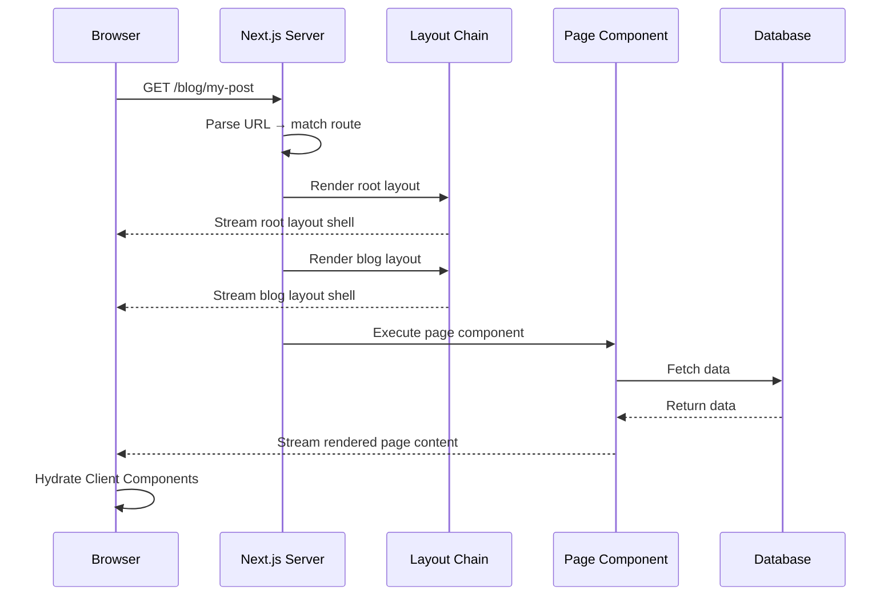
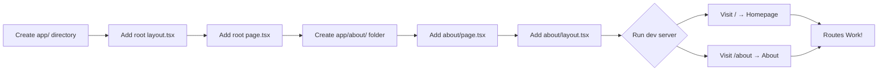

# What is the App Router?

## Introduction
The App Router is Next.js's modern routing paradigm, introduced as stable in Next.js 13.4. It is built on top of React Server Components and provides a file-system based routing system using an `app/` directory. The App Router fundamentally changes how Next.js applications are structured by introducing a new set of file conventions, nested layouts, streaming, and built-in support for loading and error states.

## Why do we need this?
The Pages Router, while powerful, had limitations that became apparent as applications grew. Developers had to manually implement layouts, handle loading states with custom solutions, and manage error boundaries. The App Router solves these problems by providing a convention-based approach that makes these features first-class citizens.

## Problem Statement
As a developer building complex Next.js applications, you need a routing system that:
- Supports nested layouts without manual composition
- Provides built-in loading and error states
- Leverages React Server Components for better performance
- Enables streaming for faster page loads
- Maintains intuitive file-system based routing

## Real World Story
Consider building a large SaaS platform like Notion or Figma. The application has a marketing site (public), a dashboard (authenticated), and a settings page (with its own sidebar). Each section needs its own layout, loading state, and error handling. With the Pages Router, you'd need to implement this manually. With the App Router, you simply create folders and files following the convention.

## Real World Analogy
Think of the App Router as a modular home construction system:
- The **Pages Router** is like building a house from scratch — you pour the foundation, frame the walls, install plumbing, and add electrical wiring manually
- The **App Router** is like using prefabricated room modules — each room comes with its own walls, floor, ceiling, and connections. You just stack them together

The `layout.tsx` file is the floor plan that stays the same across rooms. The `page.tsx` is the furniture you change for each room. The `loading.tsx` is the "under construction" sign.

## Visual Explanation
```
App Router Directory Structure:

app/
├── layout.tsx        ← Root layout (wraps everything)
├── page.tsx          ← Homepage (/)
├── about/
│   ├── layout.tsx    ← About section layout
│   └── page.tsx      ← About page (/about)
├── blog/
│   ├── layout.tsx    ← Blog layout (sidebar + content)
│   ├── page.tsx      ← Blog listing (/blog)
│   └── [slug]/
│       └── page.tsx  ← Blog post (/blog/my-post)
└── dashboard/
    ├── layout.tsx    ← Dashboard layout (requires auth)
    ├── page.tsx      ← Dashboard home (/dashboard)
    ├── loading.tsx   ← Loading spinner for dashboard
    └── error.tsx     ← Error boundary for dashboard
```

## Mermaid Diagram 1: App Router vs Pages Router

```mermaid
flowchart TD
    subgraph "Pages Router (pages/)"
        P[_app.tsx] --> P1[pages/index.tsx]
        P --> P2[pages/about.tsx]
        P --> P3[pages/blog/[slug].tsx]
        P1 --> L1[Manual Layout Wrapping]
        P2 --> L1
        P3 --> L1
    end

    subgraph "App Router (app/)"
        A[app/layout.tsx] --> A1[app/page.tsx]
        A --> A2[app/about/page.tsx]
        A --> A3[app/blog/[slug]/page.tsx]
        A2 --> A4[app/about/layout.tsx]
        A4 --> A5[Nested Layout Auto]
    end

    style P fill:#f59e0b,color:#000
    style A fill:#7c3aed,color:#fff
    style L1 fill:#ef4444,color:#fff
    style A5 fill:#22c55e,color:#fff
```

## Internal Working

When a request hits a Next.js App Router application:

1. **Request arrives** — The server receives the incoming URL
2. **Route Resolution** — Next.js parses the URL and matches it against the file system structure in `app/`
3. **Layout Chain** — All parent layouts above the matched route are collected and nested
4. **Component Tree** — The page component is wrapped in its layout chain
5. **Rendering** — Server Components render on the server, producing HTML and a stream of RSC payload
6. **Streaming** — HTML is streamed to the client as it's ready, starting with the shell (layouts) and progressively filling in content
7. **Hydration** — Client Components are hydrated on the client to add interactivity

## Mermaid Diagram 2: Request Lifecycle in App Router



## Architecture

The App Router architecture follows a **hierarchical component tree** pattern:

```
RootLayout
├── Header (shared)
├── BlogLayout
│   ├── Sidebar (shared within /blog)
│   └── BlogPostPage
│       ├── PostContent
│       └── CommentsSection
└── Footer (shared)
```

Key architectural principles:
- **File-based routing** — Folders define route segments, files define UI
- **Colocation** — Place components, styles, tests, and data fetching near the routes they belong to
- **Server-first** — Components are Server Components by default, only sending JavaScript to the client when needed
- **Progressive enhancement** — Pages work without JavaScript and progressively gain interactivity

## Mermaid Diagram 3: App Router Component Hierarchy

```mermaid
flowchart TD
    RL[app/layout.tsx<br/>Root Layout] --> HP[app/page.tsx<br/>Homepage]
    RL --> AL[app/about/layout.tsx<br/>About Layout]
    RL --> BL[app/blog/layout.tsx<br/>Blog Layout]
    AL --> AP[app/about/page.tsx<br/>About Page]
    BL --> BP[app/blog/page.tsx<br/>Blog Listing]
    BL --> BD[app/blog/[slug]/page.tsx<br/>Blog Post]
    BL --> BS[app/blog/loading.tsx<br/>Blog Loading]
    BL --> BE[app/blog/error.tsx<br/>Blog Error]

    style RL fill:#7c3aed,color:#fff
    style AL fill:#4f46e5,color:#fff
    style BL fill:#4f46e5,color:#fff
    style HP fill:#22c55e,color:#fff
    style AP fill:#22c55e,color:#fff
    style BP fill:#22c55e,color:#fff
    style BD fill:#22c55e,color:#fff
    style BS fill:#f59e0b,color:#000
    style BE fill:#ef4444,color:#fff
```

## Step-by-Step Flow

Creating your first App Router route:

1. Create an `app/` directory in your project root
2. Add a `layout.tsx` file — this becomes the root layout
3. Add a `page.tsx` file — this becomes the homepage at `/`
4. Create a folder `app/about/`
5. Add `page.tsx` inside `about/` — this becomes `/about`
6. Add `layout.tsx` inside `about/` — this nests inside the root layout
7. Run `npm run dev` and visit `/` and `/about`

## Mermaid Diagram 4: Route Creation Flow



## Syntax

**Basic App Router structure:**
```
my-app/
├── app/
│   ├── layout.tsx      # Required — Root layout
│   ├── page.tsx        # Homepage at /
│   ├── about/
│   │   └── page.tsx    # /about
│   └── blog/
│       ├── page.tsx    # /blog
│       └── [slug]/
│           └── page.tsx # /blog/my-post-slug
```

## Basic Example

A simple App Router setup with two pages:

```tsx
// app/layout.tsx — Root layout wraps all pages
export default function RootLayout({
  children,
}: {
  children: React.ReactNode
}) {
  return (
    <html lang="en">
      <body>
        <header>
          <nav>
            <a href="/">Home</a>
            <a href="/about">About</a>
          </nav>
        </header>
        <main>{children}</main>
        <footer>© 2024 My App</footer>
      </body>
    </html>
  )
}
```

```tsx
// app/page.tsx — Homepage
export default function HomePage() {
  return (
    <div>
      <h1>Welcome to My App</h1>
      <p>This is the homepage built with the App Router.</p>
    </div>
  )
}
```

```tsx
// app/about/page.tsx — About page
export default function AboutPage() {
  return (
    <div>
      <h1>About Us</h1>
      <p>Learn more about our company and mission.</p>
    </div>
  )
}
```

**What's happening:**
- `layout.tsx` wraps every page inside it with the `<html>`, `<body>`, `<header>`, and `<footer>`
- `page.tsx` inside `app/` becomes the route `/`
- `page.tsx` inside `app/about/` becomes the route `/about`
- The layout persists across navigation — only the page content changes

## Intermediate Example

Adding a nested layout for the blog section:

```tsx
// app/blog/layout.tsx — Blog layout with sidebar
export default function BlogLayout({
  children,
}: {
  children: React.ReactNode
}) {
  return (
    <div className="blog-container">
      <aside className="blog-sidebar">
        <h2>Categories</h2>
        <ul>
          <li><a href="/blog?category=tech">Tech</a></li>
          <li><a href="/blog?category=design">Design</a></li>
          <li><a href="/blog?category=business">Business</a></li>
        </ul>
      </aside>
      <article className="blog-content">
        {children}
      </article>
    </div>
  )
}
```

```tsx
// app/blog/page.tsx — Blog listing
export default function BlogPage() {
  return (
    <div>
      <h1>Blog Posts</h1>
      <div className="posts-grid">
        <article>
          <h2>Getting Started with Next.js</h2>
          <p>Learn the basics of Next.js App Router...</p>
        </article>
        <article>
          <h2>Understanding Server Components</h2>
          <p>Deep dive into React Server Components...</p>
        </article>
      </div>
    </div>
  )
}
```

**What's happening:**
- The blog layout provides a sidebar that persists when navigating between blog posts
- The `<aside>` with categories stays mounted during navigation
- Only the content inside `<article>` changes when navigating between `/blog` and `/blog/my-post`

## Advanced Example

Using the App Router with parallel routes and intercepting routes:

```tsx
// app/layout.tsx — Root layout with parallel route slots
export default function RootLayout({
  children,
  modal,
}: {
  children: React.ReactNode
  modal: React.ReactNode
}) {
  return (
    <html lang="en">
      <body>
        {children}
        {modal} {/* Renders in parallel */}
        <div id="modal-root" />
      </body>
    </html>
  )
}
```

```tsx
// app/@modal/default.tsx — Default modal state
export default function DefaultModal() {
  return null // No modal by default
}
```

**Parallel routes** (using `@modal` folder convention) allow rendering multiple pages in the same layout simultaneously — perfect for modals, side panels, and dashboards.

## Production Example

Production App Router project structure:

```
my-saas-app/
├── app/
│   ├── layout.tsx              # Root layout (analytics, fonts, metadata)
│   ├── page.tsx                # Landing page
│   ├── loading.tsx             # Global loading state
│   ├── error.tsx               # Global error boundary
│   ├── not-found.tsx           # Custom 404 page
│   ├── (marketing)/            # Route group — no layout change
│   │   ├── page.tsx            # /marketing
│   │   ├── features/
│   │   │   └── page.tsx        # /marketing/features
│   │   └── pricing/
│   │       └── page.tsx        # /marketing/pricing
│   ├── (dashboard)/            # Route group — dashboard layout
│   │   ├── layout.tsx           # Dashboard layout (auth required)
│   │   ├── dashboard/
│   │   │   └── page.tsx        # /dashboard
│   │   └── settings/
│   │       └── page.tsx        # /dashboard/settings
│   └── api/
│       └── auth/
│           └── route.ts        # API route: /api/auth
```

## Folder Structure

```
my-nextjs-app/
├── app/
│   ├── layout.tsx         # Root layout (required)
│   ├── page.tsx           # Homepage
│   ├── loading.tsx        # Global loading UI
│   ├── error.tsx          # Global error boundary
│   ├── not-found.tsx      # 404 page
│   ├── globals.css        # Global styles
│   ├── favicon.ico        # Site favicon
│   ├── about/
│   │   └── page.tsx       # /about
│   ├── blog/
│   │   ├── layout.tsx     # Blog layout with sidebar
│   │   ├── page.tsx       # /blog
│   │   └── [slug]/
│   │       └── page.tsx   # /blog/hello-world
│   └── api/
│       └── hello/
│           └── route.ts   # API route: /api/hello
├── components/            # Shared components
│   ├── Header.tsx
│   ├── Footer.tsx
│   └── Sidebar.tsx
├── lib/                   # Utility functions
│   ├── db.ts
│   └── api.ts
├── public/                # Static assets
├── next.config.js         # Next.js configuration
└── package.json           # Dependencies and scripts
```

## Best Practices

1. **Use route groups for organization** — Wrap related routes in `(groupName)` to organize without affecting the URL
2. **Colocate components** — Place route-specific components next to their route files
3. **Leverage nested layouts** — Create layouts at each level of nesting for proper separation
4. **Default to Server Components** — Only add `"use client"` when you need interactivity, event handlers, or hooks
5. **Keep layouts focused** — Each layout should have a single responsibility (navigation, sidebar, footer)
6. **Use private folders** — Prefix with `_folderName` to exclude from routing (for internal components)

## Common Mistakes

1. **Forgetting the root layout** — Every App Router app needs at least `app/layout.tsx` with `<html>` and `<body>` tags
2. **Putting `"use client"` on layouts unnecessarily** — Layouts can be Server Components and share data without client-side JavaScript
3. **Not using the `children` prop** — Layouts must accept and render `{children}` to display nested pages
4. **Mixing Pages and App Router in the same route** — You can use both, but not for the same path
5. **Missing `default.tsx` for parallel routes** — When using `@modal` or other parallel routes, provide a default fallback

## Performance Notes

- **Server Components by default** — Reduces client-side JavaScript bundle size
- **Automatic code splitting** — Each route segment is automatically code-split
- **Streaming** — The App Router streams HTML from the server, improving perceived performance
- **Partial rendering** — Only the segment that changes re-renders during navigation (layouts persist)
- **Prefetching** — Links in the viewport are automatically prefetched for instant navigation

## Security Notes

- **Server Components never reach the client** — Sensitive logic and data stay on the server
- **Automatic XSS protection** — React's built-in escaping protects against XSS attacks
- **Route protection** — Use middleware to protect routes at the edge before they render
- **Environment variables** — Use `NEXT_PUBLIC_` prefix only for client-accessible variables

## SEO Considerations

- The App Router produces server-rendered HTML that search engines can crawl
- Use the `metadata` API (not `next/head`) for SEO tags in App Router
- Nested layouts enable consistent meta tag inheritance
- Streaming improves Largest Contentful Paint (LCP) metrics
- Use `generateMetadata` for dynamic SEO based on route params

## Interview Questions

1. What is the App Router and how does it differ from the Pages Router?
2. What are the special files in the App Router and what does each do?
3. How does layout nesting work in the App Router?
4. What advantage does the App Router have for performance?
5. Can you use Pages Router and App Router in the same project?

## MCQs

1. Which file is required in every App Router project?
   a) `page.tsx`
   b) `layout.tsx`
   c) `loading.tsx`
   d) `error.tsx`
   <details>
   <summary>Answer</summary>
   b) `layout.tsx` — Every app needs a root layout with `<html>` and `<body>` tags.
   </details>

2. What does the `app/blog/[slug]/page.tsx` file represent?
   a) A blog listing page at /blog
   b) A dynamic blog post at /blog/:slug
   c) A blog category page
   d) An API endpoint
   <details>
   <summary>Answer</summary>
   b) A dynamic blog post at /blog/:slug — the `[slug]` folder creates a dynamic route segment.
   </details>

3. What is the default rendering behavior in the App Router?
   a) Client Components
   b) Server Components
   c) Static Site Generation
   d) Incremental Static Regeneration
   <details>
   <summary>Answer</summary>
   b) Server Components — All components in the App Router are Server Components by default.
   </details>

4. How do you share a layout across multiple pages?
   a) Create a shared component and import it
   b) Use `layout.tsx` in a common parent folder
   c) Use `useLayout` hook
   d) Configure it in next.config.js
   <details>
   <summary>Answer</summary>
   b) Create `layout.tsx` in the parent folder — nested layouts automatically wrap child pages.
   </details>

5. What feature enables progressive HTML loading in the App Router?
   a) Static Generation
   b) Incremental Static Regeneration
   c) Streaming
   d) Client-side rendering
   <details>
   <summary>Answer</summary>
   c) Streaming — The App Router streams HTML from the server as it becomes ready.
   </details>

## Practice Exercise

1. Create a new Next.js project with the App Router (`npx create-next-app@latest my-app`)
2. Replace the default `pages/` directory with an `app/` directory
3. Create a root `layout.tsx` with: `<html>`, `<body>`, a `<nav>` with links, and a `<footer>`
4. Create pages for: `/`, `/about`, `/contact`
5. Create a nested layout for `/blog` with a sidebar
6. Create a blog listing page at `/blog` and a dynamic post page at `/blog/[slug]`
7. Run the dev server and verify all routes work

## Mini Project

Build a small company website with the App Router:
1. **Root layout**: Header with logo + navigation, main content area, footer with copyright
2. **Homepage** (`/`): Hero section, featured services, call-to-action
3. **About page** (`/about`): Company story, team section
4. **Blog section** (`/blog`): Blog layout with category sidebar
   - Blog listing page showing post previews
   - Blog post pages with dynamic slugs
5. **Contact page** (`/contact`): Contact form, address, map placeholder
6. **Loading state**: Add `loading.tsx` for the blog section
7. **Error state**: Add `error.tsx` for the blog section

## Summary

The App Router is Next.js's modern routing system built on React Server Components. It uses file-system based routing with special files (`layout.tsx`, `page.tsx`, `loading.tsx`, `error.tsx`, `not-found.tsx`) to define the UI for each route segment. Key benefits include automatic nested layouts, built-in loading and error states, streaming, and Server Components by default. The App Router represents the future of Next.js development and is the recommended approach for new projects.

## Cheat Sheet

```
# App Router File Conventions
app/layout.tsx         → Root layout (required)
app/page.tsx           → Homepage (/)
app/about/page.tsx     → /about
app/blog/[slug]/page.tsx → /blog/any-slug

# Key Benefits
✅ Server Components by default
✅ Nested layouts (auto-persist)
✅ Built-in loading.tsx (Suspense)
✅ Built-in error.tsx (Error Boundaries)
✅ Streaming (progressive HTML)
✅ Code splitting (per route)

# Route Groups
app/(marketing)/page.tsx  → / (URL unaffected)
app/(dashboard)/page.tsx  → / (URL unaffected)

# Private Folders
app/_components/Header.tsx → Not a route
```

## Related Topics
- Layouts and Templates (Next Topic)
- Dynamic Routes (Module 2)
- Route Groups (Module 2)
- Data Fetching (Phase 3)
- Streaming and Suspense

## Further Reading
- [Next.js App Router Documentation](https://nextjs.org/docs/app)
- [Next.js Project Structure](https://nextjs.org/docs/getting-started/project-structure)
- [Defining Routes](https://nextjs.org/docs/app/building-your-application/routing/defining-routes)
