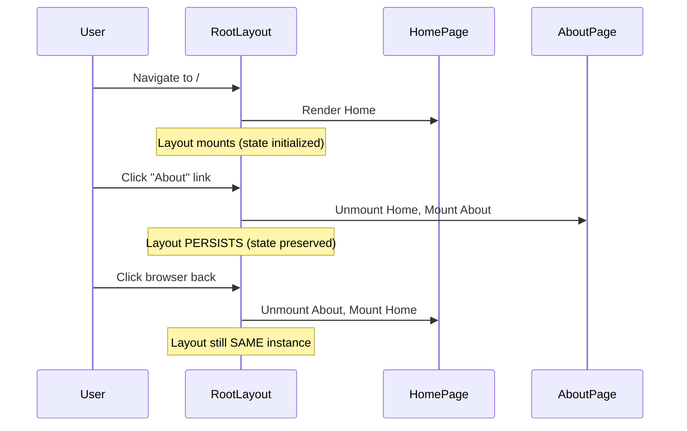
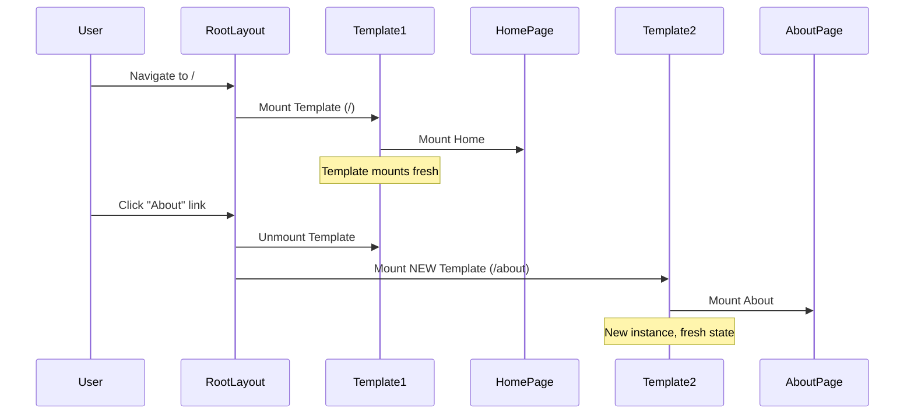

# Layouts and Templates

## Introduction
Layouts and templates are two special types of components in the Next.js App Router that wrap your pages. While they may seem similar, they serve different purposes. A **layout** persists across navigations and maintains state, while a **template** re-mounts on every navigation. Understanding when to use each is crucial for building efficient Next.js applications.

## Why do we need this?
In real-world applications, many pages share common UI elements like headers, footers, sidebars, and navigation menus. Without layouts, you would have to repeat these elements on every page, leading to code duplication and inconsistent user experience. Layouts provide a way to share UI across routes while maintaining React state and avoiding unnecessary re-renders.

## Problem Statement
As a developer building multi-page applications, you need a way to:
- Share common UI (headers, footers, navigation) across multiple pages
- Maintain component state when navigating between pages
- Create section-specific layouts for different parts of your application
- Handle cases where you need a fresh component instance on each navigation

## Real World Story
Imagine you're building an e-learning platform like Udemy or Coursera. A student browsing courses sees:
- **Marketing pages**: Header with logo, search bar, and sign-in button (shared across all marketing pages)
- **Course viewing**: Different layout with progress bar, video player, and sidebar navigation
- **Dashboard**: Another layout with statistics, enrolled courses, and account settings

Each of these sections needs its own layout that persists as the user navigates within that section. When the student opens a course, a new layout mounts. When they navigate between course lessons, the layout stays, preserving the video player state and scroll position.

## Real World Analogy
Think of layouts and templates in terms of a theater:

- **Layout** is the **stage setup** — the backdrop, props, and lighting rig remain the same throughout the performance. Actors (pages) enter and exit, but the stage stays. If an actor leaves and comes back, everything is just as they left it.

- **Template** is like a **changing room** — each time you enter, everything is fresh and reset. The room has the same structure, but nothing from your previous visit is preserved.

## Visual Explanation
```
Layout — Persists across navigations:

/home  →  /about  →  /contact
   │         │          │
   └───── Layout ───────┘      ← Same instance, state preserved
         (Header + Footer)

Template — Re-mounts on each navigation:

/home  →  /about  →  /contact
   │         │          │
  Temp1    Temp2      Temp3    ← New instance each time
```

## Mermaid Diagram 1: Layout Persistence



## Mermaid Diagram 2: Template Re-mounting



## Internal Working

Next.js handles layouts and templates differently during navigation:

**Layout behavior:**
- When Next.js detects navigation to a page within the same layout segment
- It keeps the layout component mounted
- Only the `page.tsx` component (or nested segment) unmounts and remounts
- Layout's React state, scroll position, and DOM elements are preserved
- Layout's `useEffect` and other hooks are NOT re-run

**Template behavior:**
- When Next.js detects navigation to a page within the same template segment
- It unmounts the entire template and all its children
- A new template instance mounts with a fresh state
- Template's `useEffect` hooks run on every navigation
- DOM elements are completely replaced

## Architecture

The layout hierarchy in the App Router follows a nested structure:

```
Root Layout (app/layout.tsx)
├── Homepage Layout (app/(home)/layout.tsx) — Optional
│   └── Homepage (app/(home)/page.tsx)
├── Blog Layout (app/blog/layout.tsx)
│   ├── Blog Listing (app/blog/page.tsx)
│   └── Blog Post Layout (app/blog/[slug]/layout.tsx)
│       └── Blog Post (app/blog/[slug]/page.tsx)
├── Dashboard Layout (app/dashboard/layout.tsx)
│   └── Settings Page (app/dashboard/settings/page.tsx)
└── About Page (app/about/page.tsx) — Uses root layout only
```

Each layout wraps all pages within its folder and child folders. Layouts are composable — a child layout nests inside its parent layout automatically.

## Mermaid Diagram 3: Layout Nesting Architecture

```mermaid
flowchart TD
    RL[Root Layout<br/>html, body, fonts] --> HP[Homepage<br/>app/page.tsx]
    RL --> BL[Blog Layout<br/>app/blog/layout.tsx<br/>Sidebar + Content]
    RL --> DL[Dashboard Layout<br/>app/dashboard/layout.tsx<br/>Auth check + Nav]
    
    BL --> BLP[Blog Listing<br/>app/blog/page.tsx]
    BL --> BPL[Blog Post Layout<br/>app/blog/[slug]/layout.tsx<br/>Table of Contents]
    BPL --> BPP[Blog Post<br/>app/blog/[slug]/page.tsx]
    
    DL --> DP[Dashboard Home<br/>app/dashboard/page.tsx]
    DL --> DS[Dashboard Settings<br/>app/dashboard/settings/page.tsx]

    style RL fill:#7c3aed,color:#fff
    style BL fill:#4f46e5,color:#fff
    style DL fill:#4f46e5,color:#fff
    style BPL fill:#f59e0b,color:#000
```

## Step-by-Step Flow

**Creating a nested layout:**

1. Create `app/layout.tsx` — root layout with `<html>` and `<body>`
2. Add a `header` and `footer` to the root layout
3. Create `app/blog/layout.tsx` — blog-specific layout with a sidebar
4. Add blog pages inside `app/blog/`
5. When visiting `/blog/post-1`:
   - Root layout renders first (header + footer)
   - Blog layout renders inside root layout's `{children}` (sidebar + content area)
   - Blog post page renders inside blog layout's `{children}`

## Syntax

**Layout file:**
```tsx
// app/layout.tsx
export default function RootLayout({
  children,
}: {
  children: React.ReactNode
}) {
  return (
    <html lang="en">
      <body>
        <header>Shared Header</header>
        <main>{children}</main>
        <footer>Shared Footer</footer>
      </body>
    </html>
  )
}
```

**Template file:**
```tsx
// app/posts/template.tsx
export default function PostTemplate({
  children,
}: {
  children: React.ReactNode
}) {
  return (
    <div className="post-template">
      <nav>Breadcrumb: Posts > Current</nav>
      {children}
    </div>
  )
}
```

**Key difference in file naming:**
- Layout: `layout.tsx`
- Template: `template.tsx`

## Basic Example

Creating a root layout and a blog layout:

```tsx
// app/layout.tsx — Root layout wraps everything
export default function RootLayout({
  children,
}: {
  children: React.ReactNode
}) {
  return (
    <html lang="en">
      <body>
        <header>
          <nav>
            <a href="/">🏠 Home</a>
            <a href="/blog">📝 Blog</a>
            <a href="/about">ℹ️ About</a>
          </nav>
        </header>
        <main>{children}</main>
        <footer>© 2024 My App</footer>
      </body>
    </html>
  )
}
```

```tsx
// app/blog/layout.tsx — Blog layout with sidebar
export default function BlogLayout({
  children,
}: {
  children: React.ReactNode
}) {
  return (
    <div className="blog-container">
      <aside className="sidebar">
        <h2>Categories</h2>
        <ul>
          <li><a href="/blog?cat=react">React</a></li>
          <li><a href="/blog?cat=nextjs">Next.js</a></li>
          <li><a href="/blog?cat=typescript">TypeScript</a></li>
        </ul>
        <div className="search-box">
          <input type="text" placeholder="Search posts..." />
        </div>
      </aside>
      <section className="content">
        {children}
      </section>
    </div>
  )
}
```

**What's happening:**
- The root layout provides the page structure (HTML shell, navigation, footer)
- The blog layout adds a sidebar with categories and a search box
- When navigating between blog posts, the sidebar stays mounted
- The search box input state is preserved — if you typed something, it stays

## Intermediate Example

Using template for pages that need fresh state:

```tsx
// app/posts/template.tsx — Template for tracking page views
export default function PostTemplate({
  children,
}: {
  children: React.ReactNode
}) {
  useEffect(() => {
    // Track page view — runs on every navigation
    analytics.trackPageView(window.location.pathname)
    
    // Reset scroll position to top
    window.scrollTo(0, 0)
  }, [])

  return (
    <div className="post">
      <div className="breadcrumb">
        <a href="/posts">Posts</a> &gt; <span>Current</span>
      </div>
      {children}
    </div>
  )
}
```

```tsx
// app/posts/[id]/page.tsx — Individual post page
export default function PostPage({ params }: { params: { id: string } }) {
  return (
    <article>
      <h1>Post #{params.id}</h1>
      <p>This is the content of post {params.id}.</p>
    </article>
  )
}
```

**What's happening:**
- The template re-mounts on every navigation, so page view tracking fires correctly
- Scroll position resets to top each time (if you scrolled down, you return to top)
- The breadcrumb updates correctly for each post
- Without a template, the layout would persist and `useEffect` wouldn't re-run

## Advanced Example

Combining layouts with data fetching and authentication:

```tsx
// app/dashboard/layout.tsx — Protected dashboard layout
import { redirect } from 'next/navigation'
import { getServerSession } from 'next-auth'
import DashboardNav from './_components/DashboardNav'

export default async function DashboardLayout({
  children,
}: {
  children: React.ReactNode
}) {
  // Fetch session on the server — layout is async
  const session = await getServerSession()
  
  if (!session) {
    redirect('/login')
  }

  return (
    <div className="dashboard">
      <aside className="sidebar">
        <div className="user-info">
          
          <span>{session.user.name}</span>
        </div>
        <DashboardNav />
      </aside>
      <main className="content">
        <header className="page-header">
          Welcome back, {session.user.name}!
        </header>
        {children}
      </main>
    </div>
  )
}
```

**What's happening:**
- The layout is an async Server Component that fetches data before rendering
- Authentication check happens at the layout level — protecting ALL dashboard routes
- User session data is fetched once and shared across all dashboard pages
- Navigation between dashboard pages doesn't re-fetch session data

## Production Example

Real-world enterprise app layout structure:

```tsx
// app/layout.tsx — Enterprise root layout
import { Analytics } from '@vercel/analytics/react'
import { Inter } from 'next/font/google'
import { Toaster } from 'sonner'
import { Providers } from './providers'
import './globals.css'

const inter = Inter({ subsets: ['latin'] })

export const metadata = {
  title: {
    default: 'My SaaS Platform',
    template: '%s | My SaaS Platform',
  },
  description: 'Enterprise SaaS platform built with Next.js',
}

export default function RootLayout({
  children,
}: {
  children: React.ReactNode
}) {
  return (
    <html lang="en" suppressHydrationWarning>
      <body className={inter.className}>
        <Providers>
          {children}
          <Toaster position="top-right" />
          <Analytics />
        </Providers>
      </body>
    </html>
  )
}
```

## Folder Structure

```
app/
├── layout.tsx                  # Root layout (required)
├── template.tsx                # Root template (optional, rare)
├── page.tsx                    # Homepage
├── (marketing)/
│   ├── layout.tsx              # Marketing layout (header, hero)
│   └── page.tsx                # Marketing page
├── blog/
│   ├── layout.tsx              # Blog layout (sidebar)
│   ├── template.tsx            # Blog template (breadcrumb, scroll reset)
│   ├── page.tsx                # Blog listing
│   └── [slug]/
│       └── page.tsx            # Blog post
├── dashboard/
│   ├── layout.tsx              # Dashboard layout (auth-protected)
│   └── settings/
│       └── page.tsx            # Dashboard settings
└── _components/
    ├── Header.tsx
    ├── Footer.tsx
    └── DashboardNav.tsx
```

## Best Practices

1. **Use layouts for persistent UI** — Headers, footers, sidebars, navigation menus
2. **Use templates for ephemeral UI** — Page view tracking, breadcrumbs, scroll-to-top behavior
3. **Keep root layout minimal** — Only include truly global elements
4. **Leverage nested layouts** — Create section-specific layouts for different app areas
5. **Don't put `"use client"` on layouts unnecessarily** — Layouts work great as Server Components
6. **Use `async` layouts for data fetching** — Fetch data at the layout level for route segments

## Common Mistakes

1. **Using `template.tsx` when `layout.tsx` is sufficient** — Templates re-mount, causing unnecessary re-renders
2. **Modifying the root layout's `<html>` or `<body>` tags** — These can cause hydration issues
3. **Putting `"use client"` on the root layout** — The root layout should be a Server Component
4. **Not accepting `children` prop** — Layouts and templates must render `{children}`
5. **Fetching the same data in both layout and page** — Fetch at the layout level and pass down

## Performance Notes

- Layouts persist across navigations — no re-renders, no re-fetches
- Templates re-mount on each navigation — use sparingly
- Nested layouts are more efficient than wrapping components manually
- Layout data fetching happens once per segment, not per page
- Use `React.memo` on expensive layout components if needed

## Security Notes

- Use layouts for route protection (auth checks) at the segment level
- Async layouts can check authentication before rendering children
- Never put sensitive data in layout metadata that reaches the client

## SEO Considerations

- Metadata defined in layouts applies to all child routes
- Use metadata templates for consistent title/description patterns
- Nested layout metadata merges with page-level metadata
- The root layout is the best place for global SEO configuration

## Interview Questions

1. What is the difference between a layout and a template?
2. When would you use a template instead of a layout?
3. How do nested layouts work in the App Router?
4. Can a layout be an async component? Why would you want that?
5. How does Next.js decide whether to persist or re-mount a layout?

## MCQs

1. What file creates a layout in the App Router?
   a) `layout.jsx`
   b) `page.jsx`
   c) `template.jsx`
   d) `shell.jsx`
   <details>
   <summary>Answer</summary>
   a) `layout.jsx`
   </details>

2. When does a template re-render?
   a) Only on full page load
   b) On every navigation to a page within the template scope
   c) Never
   d) Only when the user refreshes the page
   <details>
   <summary>Answer</summary>
   b) On every navigation to a page within the template scope — templates re-mount on each navigation.
   </details>

3. What prop must every layout accept?
   a) `page`
   b) `children`
   c) `layout`
   d) `content`
   <details>
   <summary>Answer</summary>
   b) `children` — Layouts must render `{children}` to display nested routes.
   </details>

4. Can you have both `layout.tsx` and `template.tsx` in the same folder?
   a) No, only one is allowed
   b) Yes, the template renders inside the layout
   c) Yes, the layout renders inside the template
   d) No, they conflict
   <details>
   <summary>Answer</summary>
   b) Yes, the template renders inside the layout — the template is wrapped by the layout.
   </details>

5. What happens to layout state when navigating between pages in the same route segment?
   a) State is preserved
   b) State is reset
   c) State is persisted to localStorage
   d) State is frozen
   <details>
   <summary>Answer</summary>
   a) State is preserved — layouts persist their state across navigations within the same segment.
   </details>

## Practice Exercise

1. Create a root layout with: `<html>`, `<body>`, a `<header>` with navigation links, and a `<footer>` with copyright
2. Create an `app/blog/` section with its own layout that includes a sidebar with categories
3. Create a `template.tsx` for the blog section that tracks page views with `useEffect`
4. Add 3 blog post pages and verify the layout persists while the template re-mounts
5. Create a nested layout inside `app/blog/[slug]/` with a table of contents

## Mini Project

Build a documentation site with layouts:
1. **Root layout**: Site header with logo, search bar, and theme toggle
2. **Docs section layout**: Two-column layout with sidebar navigation on left and content on right
3. **Blog section layout**: Single column with breadcrumb navigation
4. **Template**: Blog section uses a template that scrolls to top and tracks page views
5. **Auth-protected layout**: Dashboard section with auth check redirecting unauthenticated users

## Summary

Layouts (`layout.tsx`) persist across navigations and maintain state, while templates (`template.tsx`) re-mount on each navigation for fresh state. Layouts are ideal for headers, footers, and sidebar navigation. Templates should only be used when you need side effects like page view tracking, scroll reset, or breadcrumb updates on every navigation. Use layouts by default, templates only when necessary.

## Cheat Sheet

```
# Layout (persists)
layout.tsx → wraps children, maintains state across navigations
Best for: headers, footers, sidebars, navigation, auth-protected sections

# Template (re-mounts)
template.tsx → wraps children, creates new instance on each navigation
Best for: page view tracking, scroll reset, breadcrumbs, animation triggers

# Rules
- Every layout must accept and render {children}
- Templates render INSIDE layouts (layout > template > page)
- Can mix layout.tsx + template.tsx in the same folder
- Both can be async Server Components for data fetching
```

## Related Topics
- Page, Loading, Error & Not Found Files (Next Topic)
- Dynamic Routes (Module 2)
- Route Groups (Module 2)
- Data Fetching Patterns

## Further Reading
- [Next.js Layouts Documentation](https://nextjs.org/docs/app/building-your-application/routing/pages-and-layouts)
- [Next.js Templates Documentation](https://nextjs.org/docs/app/building-your-application/routing/pages-and-layouts#templates)
- [Route Groups](https://nextjs.org/docs/app/building-your-application/routing/route-groups)
