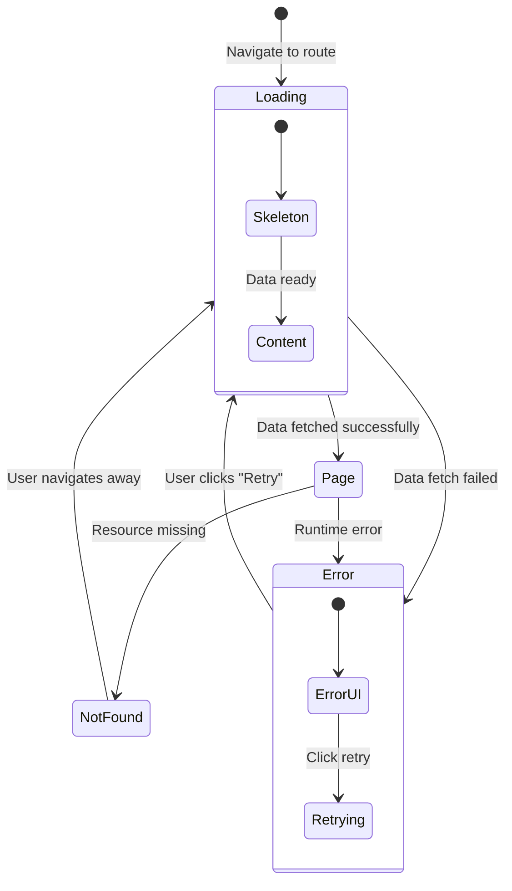
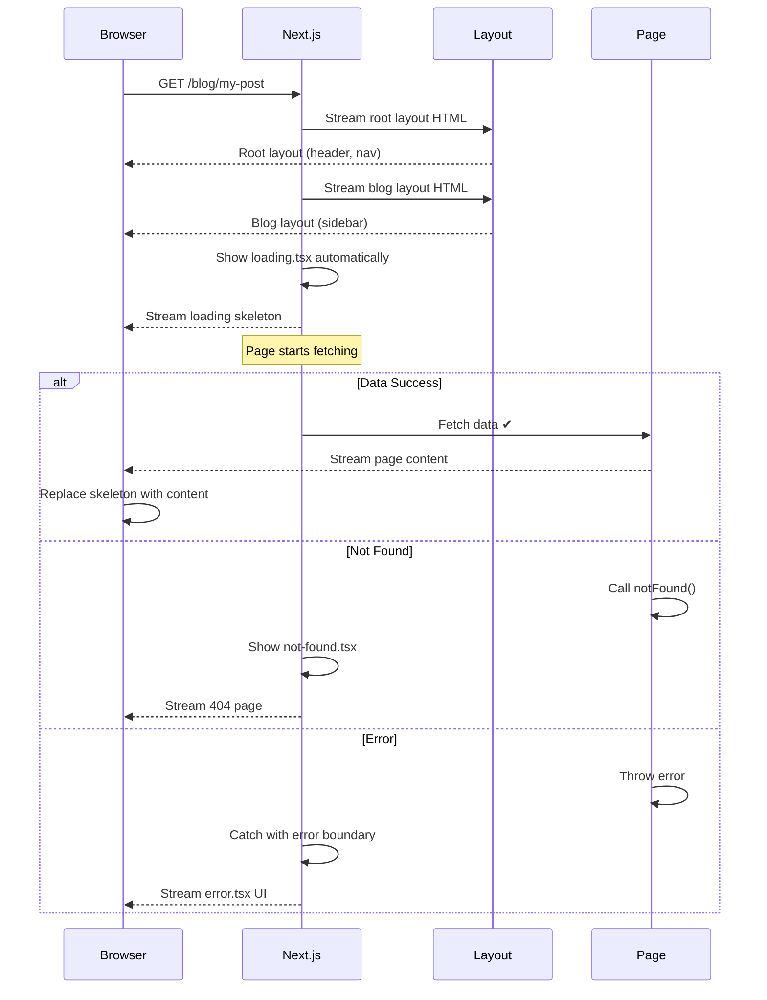

# Page, Loading, Error & Not Found Files

## Introduction
The App Router introduces four special files that define the UI for different states of a route: `page.tsx` (success), `loading.tsx` (loading), `error.tsx` (error), and `not-found.tsx` (missing). Together, they provide a complete user experience for every possible state your application can be in, making your app feel polished and professional.

## Why do we need this?
Every web application has different states: loading data, displaying content, handling errors, or showing missing pages. Without built-in support for these states, developers would need to manage them manually with conditional rendering, state variables, and effect cleanup. The App Router's special files handle all of this automatically, letting you focus on building features.

## Problem Statement
As a developer, you need to handle four distinct states for every route:
- **Success**: The happy path — data loaded, UI rendered
- **Loading**: Data is being fetched — show a spinner or skeleton
- **Error**: Something went wrong — show a friendly error with retry
- **Not Found**: The resource doesn't exist — show a 404 page

## Real World Story
Consider an e-commerce site like Amazon. When you visit a product page:
1. **Loading**: You see a skeleton layout with gray rectangles where the product image and description will be
2. **Success**: The product loads with price, reviews, and "Add to Cart" button
3. **Error**: If the product service is down, you see a "Something went wrong" message with a "Try Again" button
4. **Not Found**: If the product ID doesn't exist, you see a "Product not found" page with related products

Each state provides a smooth, informative experience instead of a blank screen or confusing error.

## Real World Analogy
Think of these special files as a restaurant experience:
- **page.tsx** — The main course being served
- **loading.tsx** — The "Your order is being prepared" wait
- **error.tsx** — The waiter apologizing and offering to fix the issue
- **not-found.tsx** — Realizing the restaurant doesn't serve what you're looking for

## Visual Explanation
```
                    Route Request
                         │
                         ▼
                   ┌─────────────┐
                   │ loading.tsx │ ← Shows immediately while data loads
                   └──────┬──────┘
                          │ Data ready?
                     ┌────┴────┐
                     │         │
                     ▼         ▼
              ┌──────────┐  ┌───────────┐
              │ page.tsx │  │ error.tsx │
              │ (success)│  │  (error)  │
              └──────────┘  └───────────┘
                     │
                     │ Resource exists?
                ┌────┴────┐
                │         │
                ▼         ▼
         ┌──────────┐  ┌──────────────┐
         │ Continue │  │not-found.tsx │
         │          │  │   (404)      │
         └──────────┘  └──────────────┘
```

## Mermaid Diagram 1: Route Segment State Machine



## Internal Working

**Page (`page.tsx`):**
- The main UI component for a route
- Renders when data is successfully fetched
- Can be a Server Component (default) or Client Component
- Receives route parameters and search params

**Loading (`loading.tsx`):**
- Wrapped in React's `<Suspense>` boundary automatically
- Shows immediately while the page component is loading
- Renders on the server for instant first paint
- Can include skeleton screens, spinners, or progress bars

**Error (`error.tsx`):**
- Wrapped in React's `<ErrorBoundary>` automatically
- Catches errors thrown during rendering or data fetching
- Receives `error` object and `reset()` function
- Must be a Client Component (`"use client"`)
- Can render different content based on error type

**Not Found (`not-found.tsx`):**
- Triggered by calling `notFound()` function from `next/navigation`
- Shows when a resource is not available (404)
- Can be customized per route segment
- Both Server and Client Components work

## Mermaid Diagram 2: Component Hierarchy with Special Files

```mermaid
flowchart TD
    L[layout.tsx] --> S[Suspense Boundary]
    S --> LD[loading.tsx]
    S --> EB[Error Boundary]
    EB --> ER[error.tsx]
    EB --> P[page.tsx]
    P --> NF{notFound() called?}
    NF -->|Yes| NFUI[not-found.tsx]
    NF -->|No| Content[Render Page Content]

    style L fill:#7c3aed,color:#fff
    style LD fill:#f59e0b,color:#000
    style ER fill:#ef4444,color:#fff
    style NFUI fill:#6b7280,color:#fff
    style Content fill:#22c55e,color:#fff
```

## Architecture

```
app/
├── blog/
│   ├── layout.tsx       ─┐
│   ├── loading.tsx      ─┤─ Wraps all blog pages
│   ├── error.tsx        ─┤
│   ├── not-found.tsx    ─┘
│   ├── page.tsx         → /blog
│   └── [slug]/
│       ├── page.tsx     → /blog/my-post
│       └── not-found.tsx → Custom 404 for posts
```

Each special file operates at its route segment level:
- `loading.tsx` wraps the segment and all children with Suspense
- `error.tsx` wraps the segment and all children with ErrorBoundary
- `not-found.tsx` is triggered by the `notFound()` call or unmatched routes

## Step-by-Step Flow

**Flow when visiting `/blog/my-post`:**

1. Server matches the route and begins rendering from the root layout
2. Root layout streams its content (header, footer shell)
3. Blog layout starts streaming its content (sidebar shell)
4. Loading component from `app/blog/` shows immediately
5. Page component `app/blog/[slug]/page.tsx` starts fetching data
6. If data fetch succeeds → loading replaces with page content
7. If `notFound()` is called → loading replaces with not-found UI
8. If error is thrown → error boundary catches it and shows error UI

## Mermaid Diagram 3: Streaming and State Flow



## Mermaid Diagram 4: Error Boundary Hierarchy

```mermaid
flowchart TD
    subgraph "Layout Hierarchy"
        RL[Root Layout] --> BL[Blog Layout]
        BL --> PSL[Post Layout]
    end

    subgraph "Error Boundaries"
        GEB[Global Error<br/>app/error.tsx] --> BEB[Blog Error<br/>app/blog/error.tsx]
        BEB --> PEB[Post Error<br/>app/blog/[slug]/error.tsx]
    end

    subgraph "Error Bubbling"
        E1[Error in Post] --> PEB
        PEB -->|Bubble up| BEB
        BEB -->|Bubble up| GEB
    end

    style E1 fill:#ef4444,color:#fff
    style GEB fill:#f59e0b,color:#000
    style BEB fill:#f59e0b,color:#000
    style PEB fill:#f59e0b,color:#000
```

## Syntax

**Page:**
```tsx
// app/blog/[slug]/page.tsx
export default async function BlogPost({
  params,
}: {
  params: { slug: string }
}) {
  const post = await getPost(params.slug)
  return <article>{/* post content */}</article>
}
```

**Loading:**
```tsx
// app/blog/loading.tsx
export default function BlogLoading() {
  return (
    <div className="animate-pulse space-y-4">
      <div className="h-8 bg-gray-200 rounded w-3/4" />
      <div className="h-4 bg-gray-200 rounded w-1/2" />
      <div className="h-64 bg-gray-200 rounded" />
    </div>
  )
}
```

**Error:**
```tsx
// app/blog/error.tsx — MUST be a Client Component
'use client'

export default function BlogError({
  error,
  reset,
}: {
  error: Error & { digest?: string }
  reset: () => void
}) {
  return (
    <div className="error-container">
      <h2>Something went wrong!</h2>
      <p>{error.message}</p>
      <button onClick={reset}>Try again</button>
    </div>
  )
}
```

**Not Found:**
```tsx
// app/blog/[slug]/not-found.tsx
export default function PostNotFound() {
  return (
    <div className="not-found">
      <h2>Post not found</h2>
      <p>The blog post you're looking for doesn't exist.</p>
      <a href="/blog">← Back to blog</a>
    </div>
  )
}
```

## Basic Example

A simple blog with all four states:

```tsx
// app/blog/[slug]/page.tsx — The main page
import { notFound } from 'next/navigation'

async function getPost(slug: string) {
  const res = await fetch(`https://api.example.com/posts/${slug}`)
  if (!res.ok) return null // Resource not found
  return res.json()
}

export default async function BlogPost({
  params,
}: {
  params: { slug: string }
}) {
  const post = await getPost(params.slug)

  if (!post) {
    notFound() // Triggers not-found.tsx
  }

  return (
    <article>
      <h1>{post.title}</h1>
      <p>{post.content}</p>
    </article>
  )
}
```

```tsx
// app/blog/[slug]/loading.tsx — Loading state
export default function PostLoading() {
  return (
    <div className="post-skeleton">
      <div className="skeleton-title" />
      <div className="skeleton-body" />
      <div className="skeleton-body short" />
    </div>
  )
}
```

```tsx
// app/blog/[slug]/error.tsx — Error state
'use client'

export default function PostError({
  error,
  reset,
}: {
  error: Error
  reset: () => void
}) {
  return (
    <div className="post-error">
      <h2>Failed to load post</h2>
      <p>{error.message}</p>
      <button onClick={reset}>Retry</button>
    </div>
  )
}
```

```tsx
// app/blog/[slug]/not-found.tsx — 404 state
export default function PostNotFound() {
  return (
    <div className="post-not-found">
      <h2>Post not found</h2>
      <p>This post may have been removed or the link is broken.</p>
      <a href="/blog">Browse all posts</a>
    </div>
  )
}
```

**What's happening:**
- `page.tsx` fetches data and either renders or calls `notFound()`
- `loading.tsx` shows a skeleton layout while data is being fetched
- `error.tsx` catches any runtime errors with a retry button
- `not-found.tsx` shows when the specific post doesn't exist

## Intermediate Example

Error boundary with multiple error types and recovery:

```tsx
// app/dashboard/error.tsx
'use client'

import { useEffect } from 'react'

export default function DashboardError({
  error,
  reset,
}: {
  error: Error & { digest?: string }
  reset: () => void
}) {
  useEffect(() => {
    // Log the error to an error reporting service
    console.error('Dashboard error:', error)
  }, [error])

  return (
    <div className="dashboard-error">
      <div className="error-icon">⚠️</div>
      <h2>Dashboard Error</h2>
      <p className="error-message">
        {error.message.includes('fetch')
          ? 'We couldn\'t load your dashboard data. Please check your connection.'
          : 'An unexpected error occurred.'}
      </p>
      <div className="error-actions">
        <button onClick={reset} className="btn-primary">
          Try Again
        </button>
        <a href="/dashboard" className="btn-secondary">
          Go to Dashboard Home
        </a>
      </div>
    </div>
  )
}
```

## Advanced Example

Nested error boundaries with specific error handling:

```tsx
// app/error.tsx — Global error boundary (catches all uncaught errors)
'use client'

export default function GlobalError({
  error,
  reset,
}: {
  error: Error & { digest?: string }
  reset: () => void
}) {
  return (
    // Global error must include <html> and <body>
    <html>
      <body>
        <div className="global-error">
          <h1>Critical Error</h1>
          <p>Something went very wrong.</p>
          <button onClick={() => reset()}>Reload</button>
        </div>
      </body>
    </html>
  )
}
```

```tsx
// app/dashboard/analytics/error.tsx — Specific error for analytics
'use client'

export default function AnalyticsError({
  error,
  reset,
}: {
  error: Error
  reset: () => void
}) {
  return (
    // Only the analytics section shows this error
    <div className="analytics-error">
      <h3>Analytics Error</h3>
      <p>Analytics data is temporarily unavailable.</p>
      <button onClick={reset}>Retry</button>
    </div>
  )
}
```

**Error boundary nesting hierarchy:**
```
Global error (app/error.tsx) — Catches everything
  └── Blog error (app/blog/error.tsx) — Catches blog errors
      └── Post error (app/blog/[slug]/error.tsx) — Catches individual post errors
```

Errors bubble up to the nearest error boundary. A post error won't crash the entire blog.

## Production Example

Enterprise-grade error handling with monitoring:

```tsx
// app/error.tsx — With error monitoring service
'use client'

import { useEffect } from 'react'
import * as Sentry from '@sentry/nextjs'

export default function ErrorBoundary({
  error,
  reset,
}: {
  error: Error & { digest?: string }
  reset: () => void
}) {
  useEffect(() => {
    // Send error to monitoring service
    Sentry.captureException(error)
  }, [error])

  return (
    <div className="min-h-screen flex items-center justify-center">
      <div className="text-center p-8">
        <h1 className="text-4xl font-bold text-gray-900 mb-4">
          Something went wrong
        </h1>
        <p className="text-gray-600 mb-8">
          Our team has been notified. Please try again.
        </p>
        <button
          onClick={reset}
          className="bg-blue-600 text-white px-6 py-2 rounded-lg hover:bg-blue-700"
        >
          Try again
        </button>
      </div>
    </div>
  )
}
```

## Folder Structure

```
app/
├── layout.tsx                # Root layout
├── loading.tsx               # Global loading (entire app)
├── error.tsx                 # Global error boundary
├── not-found.tsx             # Global 404 page
├── page.tsx                  # Homepage
├── blog/
│   ├── layout.tsx            # Blog layout
│   ├── loading.tsx           # Blog loading (shown during blog navigation)
│   ├── error.tsx             # Blog error boundary
│   ├── page.tsx              # /blog
│   └── [slug]/
│       ├── page.tsx          # /blog/hello-world
│       ├── loading.tsx       # Post-specific loading
│       ├── error.tsx         # Post-specific error
│       └── not-found.tsx     # Custom 404 for posts
└── dashboard/
    ├── loading.tsx           # Dashboard loading
    ├── error.tsx             # Dashboard error
    └── page.tsx              # /dashboard
```

## Best Practices

1. **Always provide a loading state** — Skeleton screens improve perceived performance
2. **Use nested error boundaries** — An error in one section shouldn't crash the whole app
3. **Make error pages actionable** — Always include a retry or back-to-home button
4. **Customize not-found for each section** — A blog 404 is different from a dashboard 404
5. **Log errors to a monitoring service** — Use Sentry, LogRocket, or similar
6. **Keep loading.tsx lightweight** — Avoid data fetching in loading components

## Common Mistakes

1. **Forgetting `"use client"` on error.tsx** — Error boundaries must be Client Components
2. **Only having a global error boundary** — Nested error boundaries provide better UX
3. **Not calling `notFound()` for missing resources** — Returns incorrect 200 status
4. **Empty loading state** — Show meaningful skeletons, not blank pages
5. **Not resetting error state** — The `reset()` function is essential for recovery

## Performance Notes

- `loading.tsx` is part of the initial HTML stream — no extra round trip
- Error boundaries don't add bundle size overhead
- Skeleton animations should use CSS transforms for GPU acceleration
- Avoid large imports in `loading.tsx` — it should render instantly

## Security Notes

- Don't expose sensitive error details in the UI (database queries, stack traces)
- Log full error details server-side, show user-friendly messages client-side
- Use `error.digest` for correlating errors with server logs
- Sanitize error messages to prevent XSS in error boundaries

## SEO Considerations

- `not-found.tsx` properly returns a 404 status code
- `error.tsx` returns a 500 status code
- Loading states don't affect SEO (search engines don't wait for JavaScript)
- Provide meaningful content in not-found pages with links to valid pages
- Use metadata in not-found pages with appropriate titles

## Interview Questions

1. What are the four special files in the App Router and what states do they handle?
2. Why must `error.tsx` be a Client Component?
3. How does the `notFound()` function work with `not-found.tsx`?
4. What happens if an error is thrown in a child segment but there's no error boundary?
5. How does `loading.tsx` integrate with React Suspense?

## MCQs

1. Which file handles the loading state in the App Router?
   a) `load.tsx`
   b) `loading.tsx`
   c) `suspense.tsx`
   d) `loader.tsx`
   <details>
   <summary>Answer</summary>
   b) `loading.tsx`
   </details>

2. What directive must `error.tsx` include?
   a) `'use server'`
   b) `'use client'`
   c) `'use effect'`
   d) No directive needed
   <details>
   <summary>Answer</summary>
   b) `'use client'` — Error boundaries must be Client Components.
   </details>

3. Which function triggers the `not-found.tsx` UI?
   a) `redirect()`
   b) `notFound()`
   c) `missing()`
   d) `error()`
   <details>
   <summary>Answer</summary>
   b) `notFound()` — imported from `next/navigation`.
   </details>

4. What prop does `error.tsx` receive for recovery?
   a) `reload`
   b) `retry`
   c) `reset`
   d) `recover`
   <details>
   <summary>Answer</summary>
   c) `reset` — calling `reset()` re-renders the page component.
   </details>

5. Can you have both `loading.tsx` and `error.tsx` in the same folder?
   a) No, they conflict
   b) Yes, they handle different states
   c) Yes, but loading takes priority
   d) No, error replaces loading
   <details>
   <summary>Answer</summary>
   b) Yes, they handle different states — loading shows during fetch, error shows on failure.
   </details>

## Practice Exercise

1. Create a blog route with `app/blog/[slug]/` structure
2. Add all four special files: `page.tsx`, `loading.tsx`, `error.tsx`, `not-found.tsx`
3. In `page.tsx`, simulate a data fetch with a 2-second delay
4. In `page.tsx`, call `notFound()` if the slug is "invalid-post"
5. In `page.tsx`, throw an error if the slug is "error-post"
6. Verify that loading, error, and not-found states all display correctly

## Mini Project

Build a user profile page with all states:
1. **Success**: Display user avatar, name, bio, and recent activity
2. **Loading**: Show skeleton cards with pulsing animation
3. **Error**: Show "Failed to load profile" with retry button
4. **Not Found**: Show "User not found" with a search bar and back to users link
5. **Nested error boundaries**: Profile activity section has its own error boundary

## Summary

The App Router provides four special files for handling different UI states: `page.tsx` (success), `loading.tsx` (loading with Suspense), `error.tsx` (error with ErrorBoundary), and `not-found.tsx` (404). These files create a complete user experience for every possible state. Loading states improve perceived performance, error boundaries prevent crashes from breaking the entire app, and not-found pages provide helpful feedback for missing resources.

## Cheat Sheet

```
# Special Files
page.tsx      → Main page UI (success state)
loading.tsx   → Loading UI (Suspense fallback)
error.tsx     → Error UI (ErrorBoundary) — must be 'use client'
not-found.tsx → 404 UI (triggered by notFound() function)

# Error Boundary Nesting
app/error.tsx              → Catches all uncaught errors
app/blog/error.tsx         → Catches blog errors
app/blog/[slug]/error.tsx  → Catches post errors

# Pattern
page.tsx          → Main content
if(!data) notFound() → Shows not-found.tsx
throw error       → Shows nearest error.tsx
await fetch       → Shows loading.tsx while waiting
```

## Related Topics
- Linking and Navigation (Next Topic)
- Dynamic Routes (Module 2)
- Data Fetching (Phase 3)
- React Suspense and Error Boundaries

## Further Reading
- [Next.js Pages Documentation](https://nextjs.org/docs/app/building-your-application/routing/pages)
- [Next.js Loading UI](https://nextjs.org/docs/app/building-your-application/routing/loading-ui-and-streaming)
- [Next.js Error Handling](https://nextjs.org/docs/app/building-your-application/routing/error-handling)
- [Next.js Not Found Page](https://nextjs.org/docs/app/api-reference/functions/not-found)
