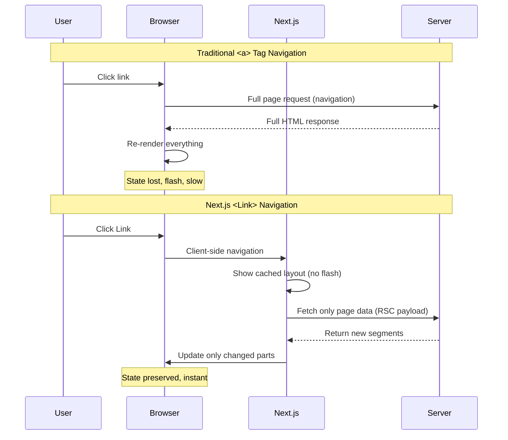
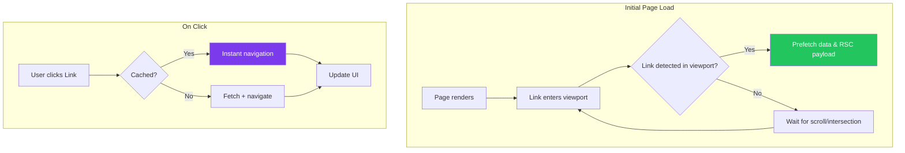
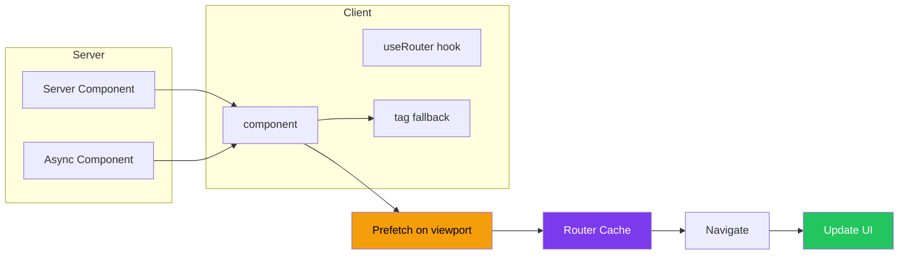

# Linking and Navigation

## Introduction
Navigation is how users move between pages in your Next.js application. The App Router provides two primary ways to navigate: the `<Link>` component for declarative navigation and the `useRouter` hook for programmatic navigation. Understanding when and how to use each is essential for building fast, accessible, and user-friendly applications.

## Why do we need this?
Traditional `<a>` tags cause full page reloads, which defeats the purpose of a single-page application. Next.js provides client-side navigation that prefetches linked pages, caches route segments, and updates only the content that changes — resulting in instant navigation without flickering or full page reloads.

## Problem Statement
As a developer building multi-page applications, you need navigation that:
- Works without full page reloads (preserving application state)
- Prefetches pages for instant navigation
- Handles loading states, scroll restoration, and focus management
- Works with JavaScript disabled (progressive enhancement)
- Integrates with the App Router's layout system

## Real World Story
Imagine you're building a news website like The New York Times. When a user clicks on an article:
1. With a full page reload, they'd see a white flash, lose their position, and wait for the entire page to load again
2. With Next.js navigation, the layout stays, only the article content changes, the page appears instantly (prefetched), and scroll position is preserved when navigating back

The difference is the difference between a slow, jarring experience and a smooth, app-like feel.

## Real World Analogy
Think of navigation like moving between rooms in a house:

- **Traditional `<a>` tag** — Exiting the house, going outside, and re-entering through a different door. You lose everything inside.
- **Next.js `<Link>` component** — Walking through an interior door. The house structure (layout) stays the same, you just move to a different room.

## Visual Explanation
```
Traditional Navigation (Full Page Reload):

[Click Link] → Server sends full HTML → Browser re-renders everything
    │                                              │
    └────────── ❌ State lost, flash, slow ──────────┘

Next.js Client-Side Navigation:

[Click Link] → Next.js intercepts → Update only changed segments
    │                                      │
    └────────── ✅ State preserved, instant ──┘
```

## Mermaid Diagram 1: Navigation Flow Comparison



## Mermaid Diagram 2: Link Prefetching Strategy



## Internal Working

**Link Component (`next/link`):**
- Renders an `<a>` element with proper accessibility
- Listens for the link entering the viewport (IntersectionObserver)
- Prefetches the linked page's RSC (React Server Components) payload
- On click, intercepts the default navigation and performs client-side routing
- Updates only the route segments that changed (layouts stay mounted)

**useRouter Hook:**
- Provides programmatic navigation methods: `push`, `replace`, `back`, `forward`, `refresh`
- `push()` adds to browser history (user can go back)
- `replace()` replaces current history entry (user cannot go back to current page)
- `refresh()` re-renders the current route without full page reload
- Must be used in a Client Component (`"use client"`)

## Architecture

```
Navigation Decision Tree:

User wants to navigate
│
├─ Declarative (user clicks a link)?
│   └─ Use <Link> component from next/link
│       ├─ Same page? → <Link scroll={false}>
│       ├─ External URL? → Use <a> tag (no prefetch)
│       └─ Dynamic route? → <Link href={`/post/${id}`}>
│
└─ Programmatic (after an action)?
    └─ Use useRouter() from next/navigation
        ├─ After form submit? → router.push()
        ├─ Redirect after auth? → router.replace()
        ├─ After data mutation? → router.refresh()
        └─ Go back? → router.back()
```

## Step-by-Step Flow

**When a user clicks a `<Link>`:**

1. **Viewport detection** — When the link scrolls into view, Next.js checks if it should prefetch
2. **Prefetch** — Next.js fetches the RSC payload for the linked route (only static data)
3. **Cache** — The payload is stored in the router cache
4. **Click** — User clicks the link
5. **Intercept** — Next.js intercepts the click event and prevents full page navigation
6. **Update** — The changed route segment(s) update with cached data (instant)
7. **Scroll** — If `scroll={true}` (default), scrolls to top of new page
8. **Focus** — Focus moves to the new page for accessibility

## Mermaid Diagram 3: Link Rendering and Prefetching



## Mermaid Diagram 4: Scroll Restoration and Focus Management

```mermaid
stateDiagram-v2
    [*] --> Viewport: Page loads
    Viewport --> Prefetch: Link in viewport
    Prefetch --> Cached: RSC payload stored
    
    [*] --> Click: User clicks Link
    Click --> Intercept: Next.js intercepts event
    Intercept --> Update: DOM patch changed segments
    
    Update --> Scroll: scroll=true?
    Scroll --> Yes: Scroll to top of new page
    Scroll --> No: Preserve scroll position
    
    Yes --> Focus: Move focus to new content
    No --> Focus
    Focus --> Complete: Navigation finished
    
    state Complete {
        [*] --> Waiting: User may navigate back
        Waiting --> Restore: Scroll restoration on back
    }
```

## Syntax

**Link Component:**
```tsx
import Link from 'next/link'

// Basic
<Link href="/about">About</Link>

// With params
<Link href={`/post/${id}`}>Read post</Link>

// With query string
<Link href={{ pathname: '/search', query: { q: 'nextjs' } }}>
  Search results
</Link>

// Replace instead of push
<Link href="/dashboard" replace>Dashboard</Link>

// Prevent scroll to top
<Link href="/blog" scroll={false}>Blog</Link>
```

**useRouter Hook:**
```tsx
'use client'
import { useRouter } from 'next/navigation'

export default function NavigationButtons() {
  const router = useRouter()

  return (
    <div>
      <button onClick={() => router.push('/about')}>Go to About</button>
      <button onClick={() => router.replace('/login')}>Login (no back)</button>
      <button onClick={() => router.back()}>Go Back</button>
      <button onClick={() => router.forward()}>Go Forward</button>
      <button onClick={() => router.refresh()}>Refresh current</button>
      <button onClick={() => router.prefetch('/dashboard')}>
        Prefetch dashboard
      </button>
    </div>
  )
}
```

## Basic Example

Simple navigation with the Link component:

```tsx
// app/layout.tsx — Navigation in root layout
import Link from 'next/link'

export default function RootLayout({
  children,
}: {
  children: React.ReactNode
}) {
  return (
    <html lang="en">
      <body>
        <nav>
          <Link href="/">Home</Link>
          <Link href="/about">About</Link>
          <Link href="/blog">Blog</Link>
          <Link href="/contact">Contact</Link>
        </nav>
        <main>{children}</main>
      </body>
    </html>
  )
}
```

```tsx
// app/blog/page.tsx — Blog listing with dynamic links
import Link from 'next/link'

const posts = [
  { id: '1', title: 'Getting Started' },
  { id: '2', title: 'Advanced Topics' },
  { id: '3', title: 'Best Practices' },
]

export default function BlogPage() {
  return (
    <div>
      <h1>Blog Posts</h1>
      <ul>
        {posts.map((post) => (
          <li key={post.id}>
            <Link href={`/blog/${post.id}`}>
              {post.title}
            </Link>
          </li>
        ))}
      </ul>
    </div>
  )
}
```

**What's happening:**
- The `<Link>` component prefetches `/about`, `/blog`, `/contact` when they're in the viewport
- Clicking any link navigates instantly without a full page reload
- The layout (nav) stays mounted, only the `<main>` content changes
- Each blog post link prefetches the individual blog post page

## Intermediate Example

Navigation with active link styling and programmatic navigation:

```tsx
'use client'

import { usePathname } from 'next/navigation'
import Link from 'next/link'

const navItems = [
  { href: '/', label: 'Home' },
  { href: '/about', label: 'About' },
  { href: '/blog', label: 'Blog' },
  { href: '/dashboard', label: 'Dashboard' },
]

export default function NavBar() {
  const pathname = usePathname()

  return (
    <nav className="navbar">
      <Link href="/" className="logo">
        MyApp
      </Link>

      <div className="nav-links">
        {navItems.map((item) => {
          const isActive = pathname === item.href ||
            pathname.startsWith(item.href + '/')

          return (
            <Link
              key={item.href}
              href={item.href}
              className={isActive ? 'active' : ''}
            >
              {item.label}
            </Link>
          )
        })}
      </div>

      <form action="/search" className="search-form">
        <input name="q" placeholder="Search..." />
        <button type="submit">🔍</button>
      </form>
    </nav>
  )
}
```

```tsx
// app/components/LoginForm.tsx — Programmatic navigation after action
'use client'

import { useRouter } from 'next/navigation'
import { useState } from 'react'

export default function LoginForm() {
  const router = useRouter()
  const [error, setError] = useState<string | null>(null)

  async function handleSubmit(e: React.FormEvent<HTMLFormElement>) {
    e.preventDefault()
    const formData = new FormData(e.currentTarget)

    try {
      const res = await fetch('/api/auth/login', {
        method: 'POST',
        body: JSON.stringify({
          email: formData.get('email'),
          password: formData.get('password'),
        }),
      })

      if (res.ok) {
        router.push('/dashboard') // Navigate to dashboard
        router.refresh() // Re-fetch server data
      } else {
        setError('Invalid credentials')
      }
    } catch {
      setError('Network error')
    }
  }

  return (
    <form onSubmit={handleSubmit}>
      <input name="email" type="email" placeholder="Email" required />
      <input name="password" type="password" placeholder="Password" required />
      {error && <p className="error">{error}</p>}
      <button type="submit">Login</button>
    </form>
  )
}
```

**What's happening:**
- `usePathname()` detects the current route for active link styling
- `router.push('/dashboard')` navigates after login
- `router.refresh()` re-fetches server data (e.g., to update the auth state in the layout)

## Advanced Example

Navigation with shallow routing and search params:

```tsx
// app/search/page.tsx — Search with URL params
'use client'

import { useSearchParams, useRouter, usePathname } from 'next/navigation'
import { useState, useCallback } from 'react'

export default function SearchPage() {
  const router = useRouter()
  const pathname = usePathname()
  const searchParams = useSearchParams()

  const [search, setSearch] = useState(searchParams.get('q') ?? '')

  // Update URL without navigation (shallow routing equivalent)
  const updateFilters = useCallback(
    (filters: Record<string, string>) => {
      const params = new URLSearchParams(searchParams.toString())
      Object.entries(filters).forEach(([key, value]) => {
        if (value) params.set(key, value)
        else params.delete(key)
      })
      // Replace URL without triggering navigation or scroll
      router.replace(`${pathname}?${params.toString()}`, { scroll: false })
    },
    [pathname, router, searchParams]
  )

  return (
    <div>
      <input
        value={search}
        onChange={(e) => {
          setSearch(e.target.value)
          updateFilters({ q: e.target.value })
        }}
        placeholder="Search..."
        className="search-input"
      />

      <div className="filters">
        <select onChange={(e) => updateFilters({ category: e.target.value })}>
          <option value="">All Categories</option>
          <option value="tech">Tech</option>
          <option value="design">Design</option>
        </select>

        <select onChange={(e) => updateFilters({ sort: e.target.value })}>
          <option value="newest">Newest</option>
          <option value="oldest">Oldest</option>
        </select>
      </div>
    </div>
  )
}
```

## Production Example

Navigation with prefetching management and performance:

```tsx
// app/components/ProductCard.tsx — Conditional prefetching
import Link from 'next/link'

export default function ProductCard({ product }: { product: Product }) {
  return (
    <Link
      href={`/products/${product.id}`}
      prefetch={false} // Don't prefetch — product pages are dynamic
      className="product-card"
    >
      
      <h3>{product.name}</h3>
      <p>${product.price}</p>
    </Link>
  )
}
```

```tsx
// app/components/Header.tsx — Prioritized prefetching
import Link from 'next/link'

export default function Header() {
  return (
    <header>
      <Link href="/" prefetch={true}>Home</Link>
      <Link href="/products" prefetch={true}>Products</Link>
      <Link href="/pricing" prefetch={true}>Pricing</Link>
      {/* Don't prefetch auth pages */}
      <Link href="/login" prefetch={false}>Login</Link>
      <Link href="/signup" prefetch={false}>Sign Up</Link>
    </header>
  )
}
```

## Folder Structure

```
components/
├── Navigation.tsx        # Main navigation with Link components
├── Sidebar.tsx           # Sidebar with navigation links
├── Pagination.tsx        # Pagination with next/prev links
├── Breadcrumbs.tsx       # Breadcrumb navigation
└── MobileNav.tsx         # Mobile hamburger menu with navigation
```

## Best Practices

1. **Use `<Link>` for declarative navigation** — It handles prefetching and accessibility
2. **Use `useRouter` for programmatic navigation** — After form submissions, auth redirects, etc.
3. **Enable prefetching for important pages** — Home, products, blog (static or heavily visited)
4. **Disable prefetching for auth pages** — Login, signup (dynamic, user-specific)
5. **Use `scroll={false}` for modals/tabs** — Prevent scroll-to-top when opening side panels
6. **Use `replace` for redirects** — Don't let users navigate back to a login page
7. **Add active link styling** — Use `usePathname()` for current route detection

## Common Mistakes

1. **Using `<a>` instead of `<Link>` for internal navigation** — Loses client-side routing benefits
2. **Using `useRouter` in Server Components** — `useRouter` only works in Client Components
3. **Over-prefetching dynamic routes** — Prefetching auth pages or user-specific pages wastes bandwidth
4. **Not handling scroll restoration** — Next.js handles scroll restoration, but `scroll={false}` should be intentional
5. **Wrapping `<Link>` in another component incorrectly** — `<Link>` should directly contain the clickable element

## Performance Notes

- Links prefetch from the viewport (IntersectionObserver) — no wasted prefetches
- Stale prefetched data is revalidated automatically
- Router cache stores recently visited routes for instant back/forward navigation
- Partial rendering means only changed segments re-render
- Use `prefetch={false}` for rarely-visited or user-specific pages

## Security Notes

- Always validate access on the server — client-side navigation can be manipulated
- Don't expose sensitive URLs in the client bundle
- Use middleware for route protection before navigation completes
- `router.push()` to a protected route still requires server-side auth check

## SEO Considerations

- `<Link>` components are crawled by search engines (they render as `<a>` tags)
- Client-side navigation doesn't affect SEO — search engines see server-rendered HTML
- Use descriptive link text for better SEO and accessibility
- Breadcrumb navigation improves site structure for search engines

## Interview Questions

1. What is the difference between `<Link>` and `useRouter`?
2. How does Next.js prefetch linked pages?
3. When would you use `router.replace()` instead of `router.push()`?
4. How do you add active link styling in the App Router?
5. What does `router.refresh()` do and when should you use it?

## MCQs

1. Which library exports the `Link` component?
   a) `react`
   b) `next/link`
   c) `next/navigation`
   d) `next-router`
   <details>
   <summary>Answer</summary>
   b) `next/link`
   </details>

2. What happens when a `<Link>` enters the viewport?
   a) Nothing
   b) It prefetches the route's RSC payload
   c) It navigates immediately
   d) It scrolls to the link
   <details>
   <summary>Answer</summary>
   b) It prefetches the route's RSC payload.
   </details>

3. Which hook provides programmatic navigation?
   a) `useNavigate`
   b) `useRouter`
   c) `useLink`
   d) `usePathname`
   <details>
   <summary>Answer</summary>
   b) `useRouter`
   </details>

4. How do you prevent a `<Link>` from scrolling to the top?
   a) `scroll={false}`
   b) `noScroll={true}`
   c) `preventScroll={true}`
   d) Disabled by default
   <details>
   <summary>Answer</summary>
   a) `scroll={false}`
   </details>

5. What does `router.refresh()` do?
   a) Page reload
   b) Re-renders current route Server Components without full page reload
   c) Clears browser cache
   d) Re-fetches all CSS
   <details>
   <summary>Answer</summary>
   b) Re-renders current route Server Components without full page reload.
   </details>

## Practice Exercise

1. Create a layout with navigation using `<Link>` for: Home, Products, Blog, About
2. Use `usePathname()` to highlight the active link
3. Create a search form that navigates to `/search?q=...` using `router.push()`
4. Add a back button using `router.back()`
5. Create a product listing page with dynamic links to individual products
6. Add a pagination component with next/previous links

## Mini Project

Build a documentation site navigation system:
1. **Sidebar navigation** with nested links for different doc sections
2. **Breadcrumb component** showing the current page path
3. **Search bar** that navigates to search results with query params
4. **Previous/Next links** at the bottom of each doc page
5. **Mobile hamburger menu** with slide-out navigation
6. **Active link highlighting** across all navigation components

## Summary

Navigation in the App Router is handled by the `<Link>` component (declarative) and the `useRouter` hook (programmatic). The `<Link>` component provides built-in prefetching for instant navigation, while `useRouter` is ideal for navigation after form submissions and user actions. Both preserve application state, support the layout system, and provide smooth client-side transitions without full page reloads.

## Cheat Sheet

```
# Declarative Navigation (recommended)
import Link from 'next/link'

<Link href="/about">About</Link>
<Link href={`/post/${id}`}>Post</Link>
<Link href="/login" prefetch={false}>Login</Link>
<Link href="/" scroll={false}>Home (stay scrolled)</Link>

# Programmatic Navigation (after actions)
'use client'
import { useRouter } from 'next/navigation'

const router = useRouter()
router.push('/dashboard')    → Navigate (adds to history)
router.replace('/login')     → Navigate (replaces history)
router.back()                → Go back
router.forward()             → Go forward
router.refresh()             → Re-render server components
router.prefetch('/about')    → Manually prefetch

# Active Links
import { usePathname } from 'next/navigation'
const pathname = usePathname()
Link className={pathname === href ? 'active' : ''}

# Rules
- <Link> for user clicks, useRouter for programmatic
- useRouter only works in 'use client' components
- Prefetch static pages, skip auth/dynamic pages
- Always validate auth on the server
