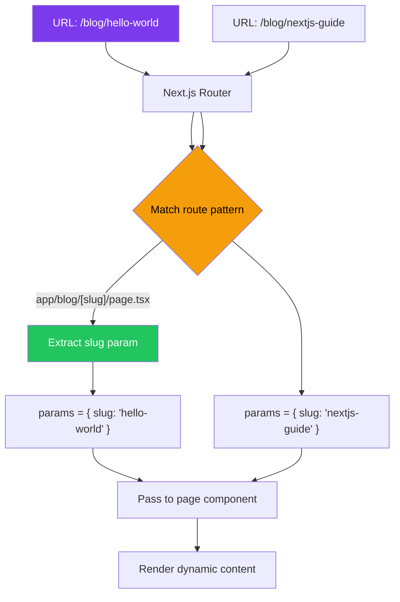
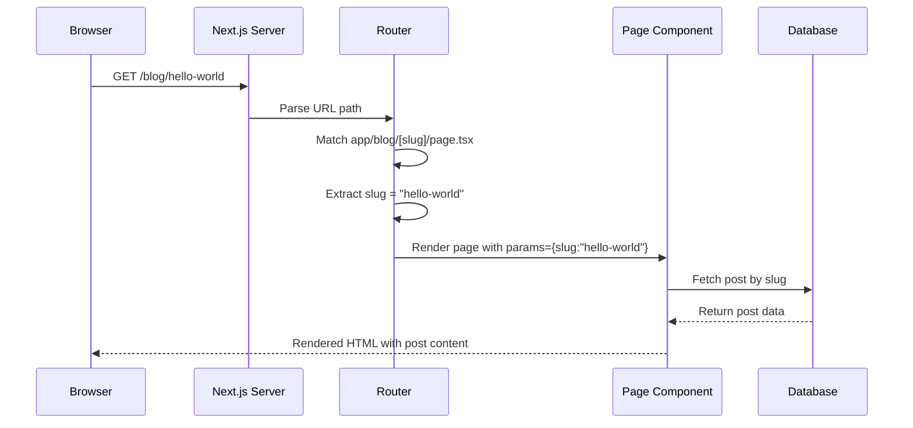
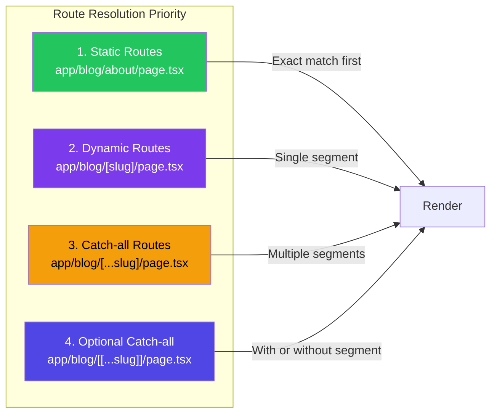

# Dynamic Routes with [slug]

## Introduction
Dynamic routes in Next.js allow you to create pages that handle variable URL segments. By using folder names wrapped in square brackets like `[slug]`, `[id]`, or `[username]`, you can create a single page template that renders different content based on the URL parameter. In the App Router, the `[param]` folder convention captures the dynamic segment and passes it as a `params` prop to your page, layout, or other special files.

## Why do we need this?
Static routes like `/about` and `/contact` are limited. Real applications need to handle dynamic content:
- `/blog/hello-world` — each blog post has a unique slug
- `/products/123` — each product has a unique ID
- `/users/jane-doe` — each user profile has a unique username
- `/posts/2024/01/my-post` — multiple dynamic segments

Without dynamic routes, you'd need to create a separate file for every possible URL — which is impossible for user-generated or database-driven content.

## Problem Statement
As a developer building a content-driven website, you need a way to:
- Handle thousands (or millions) of unique URLs with a single page template
- Access the URL parameters inside your component to fetch the right data
- Generate metadata dynamically based on the current route
- Pre-render popular dynamic routes at build time while handling others on-demand
- Catch invalid parameters and show appropriate 404 pages

## Real World Story
Sarah is building a blog platform like Medium. She has thousands of blog posts, each with a unique URL like `/blog/how-to-learn-nextjs`. Creating a separate file for each post is impossible. Instead, she creates a single file at `app/blog/[slug]/page.tsx`. The `[slug]` folder captures any value, and she accesses it via `params.slug` to fetch the correct post from her database.

## Real World Analogy
Think of dynamic routes like **mailbox slots in an apartment building**:
- **Static routes** are like the main entrance — everyone uses the same door
- **Dynamic routes** are like individual mailboxes — each apartment (URL) has its own slot (handler)

The `[slug]` syntax is like a postal worker sorting mail: "Put letters for apartment 101 in slot 101, letters for apartment 102 in slot 102." Similarly, Next.js routes `/blog/hello-world` to the `[slug]` handler with `params.slug = 'hello-world'`.

## Visual Explanation
```
File System:                          URLs:
app/
└── blog/
    └── [slug]/                       /blog/hello-world
        └── page.tsx     ────────▶    /blog/nextjs-guide
                                     /blog/react-tutorial
                                     
The [slug] folder captures any value after /blog/
```

## Mermaid Diagram 1: Dynamic Route Resolution



## Internal Working
When the Next.js server receives a request for a dynamic route:

1. **URL parsing** — The incoming URL is parsed into segments
2. **Route matching** — The file system is scanned for matching route patterns
3. **Parameter extraction** — The value in the dynamic segment position is extracted
4. **Type conversion** — For catch-all routes, the value is converted to an array; for regular params, it's a string
5. **Component rendering** — The matched page component receives `params` containing the extracted values
6. **generateStaticParams** — If defined, it's called during build to pre-generate known routes
7. **404 handling** — If no matching static params exist and the content isn't found, `notFound()` is called

## Mermaid Diagram 2: Request Lifecycle with Dynamic Routes



## Architecture
Dynamic routes in the App Router follow a hierarchical matching system:

```
Route Resolution Order:
1. Static routes (e.g., /blog/about)
2. Dynamic routes (e.g., /blog/[slug])
3. Catch-all routes (e.g., /blog/[...slug])
4. Optional catch-all (e.g., /blog/[[...slug]])
```

```
Component Hierarchy:
app/blog/[slug]/
├── page.tsx          → Receives params: { slug: string }
├── layout.tsx        → Receives params: { slug: string }
├── loading.tsx       → Loading UI for this segment
├── error.tsx         → Error boundary for this segment
└── not-found.tsx     → 404 for invalid slugs
```

## Mermaid Diagram 3: Route Hierarchy



## Step-by-Step Flow

1. **Create the folder** — Create `app/blog/[slug]/` in your project
2. **Create the page** — Add `page.tsx` inside the `[slug]` folder
3. **Access params** — The page component receives `{ params }` as a prop
4. **Fetch data** — Use the params to fetch the correct content from your database or API
5. **Handle errors** — Show a 404 page if the slug doesn't exist
6. **Pre-generate (optional)** — Use `generateStaticParams` to pre-render popular routes

## Mermaid Diagram 4: Developer Workflow

```mermaid
flowchart TD
    A[Create app/blog/[slug]/] --> B[Create page.tsx]
    B --> C["Export default function with params prop"]
    C --> D["Use params.slug to fetch data"]
    D --> E{Content found?}
    E -->|Yes| F[Render page with content]
    E -->|No| G[Call notFound()]
    G --> H[Show 404 page]
    
    I[Optional: generateStaticParams] --> J[Specify known slugs]
    J --> K[Pre-rendered at build time]
    
    style A fill:#7c3aed,color:#fff
    style C fill:#22c55e,color:#fff
    style E fill:#f59e0b,color:#000
```

## Syntax

```tsx
// app/blog/[slug]/page.tsx — Basic dynamic route page
interface PageProps {
  params: {
    slug: string
  }
}

export default async function BlogPostPage({ params }: PageProps) {
  // params.slug contains the dynamic segment from the URL
  // e.g., /blog/hello-world → params.slug = "hello-world"
  
  const post = await getPost(params.slug)
  
  return (
    <article>
      <h1>{post.title}</h1>
      <p>{post.content}</p>
    </article>
  )
}
```

**What's happening:**
- The `[slug]` folder name defines the parameter name
- The `params` object contains all dynamic segments from the URL
- The page is a Server Component by default (no `"use client"`)
- `params` is a readonly Promise-like object that resolves to the actual values

## Basic Example

A simple blog post page:

```tsx
// app/blog/[slug]/page.tsx
interface BlogPost {
  title: string
  content: string
  author: string
  date: string
}

// Simulated database
const posts: Record<string, BlogPost> = {
  'hello-world': {
    title: 'Hello World',
    content: 'This is my first blog post!',
    author: 'Jane Doe',
    date: '2024-01-15',
  },
  'getting-started': {
    title: 'Getting Started with Next.js',
    content: 'Next.js is a React framework for production...',
    author: 'Jane Doe',
    date: '2024-01-20',
  },
}

async function getPost(slug: string): Promise<BlogPost | null> {
  // Simulate database delay
  await new Promise((resolve) => setTimeout(resolve, 100))
  return posts[slug] || null
}

export default async function BlogPostPage({
  params,
}: {
  params: { slug: string }
}) {
  const post = await getPost(params.slug)

  if (!post) {
    return <h1>Post not found</h1>
  }

  return (
    <article style={{ maxWidth: 720, margin: '0 auto', padding: '2rem' }}>
      <h1>{post.title}</h1>
      <div style={{ color: '#666', marginBottom: '1rem' }}>
        <span>By {post.author}</span>
        <span> · </span>
        <time>{post.date}</time>
      </div>
      <p>{post.content}</p>
    </article>
  )
}
```

**What's happening:**
- `params.slug` is extracted from the URL `/blog/hello-world`
- The `getPost` function fetches content based on the slug
- If no post is found, a fallback message is shown
- The component is async (Server Component), allowing direct `await` for data

## Intermediate Example

Dynamic routes with `generateStaticParams`, metadata, and error handling:

```tsx
// app/products/[id]/page.tsx
import { notFound } from 'next/navigation'
import type { Metadata } from 'next'

interface Product {
  id: string
  name: string
  price: number
  description: string
  image: string
  category: string
}

// Simulated API
const products: Product[] = [
  { id: '1', name: 'Wireless Headphones', price: 99.99, description: 'High-quality wireless headphones with noise cancellation.', image: '/headphones.jpg', category: 'electronics' },
  { id: '2', name: 'Running Shoes', price: 129.99, description: 'Lightweight running shoes with superior cushioning.', image: '/shoes.jpg', category: 'sports' },
  { id: '3', name: 'Coffee Maker', price: 49.99, description: 'Programmable coffee maker with thermal carafe.', image: '/coffee.jpg', category: 'kitchen' },
]

interface PageProps {
  params: { id: string }
}

// 1. Generate metadata dynamically based on params
export async function generateMetadata({ params }: PageProps): Promise<Metadata> {
  const product = products.find((p) => p.id === params.id)

  if (!product) {
    return { title: 'Product Not Found' }
  }

  return {
    title: `${product.name} | Shop`,
    description: product.description,
    openGraph: {
      title: product.name,
      description: product.description,
      images: [product.image],
    },
  }
}

// 2. Pre-generate known product pages at build time
export async function generateStaticParams() {
  return products.map((product) => ({
    id: product.id,
  }))
}

// 3. Main page component
export default async function ProductPage({ params }: PageProps) {
  const product = products.find((p) => p.id === params.id)

  // 4. Handle invalid IDs with 404
  if (!product) {
    notFound()
  }

  return (
    <div style={{ maxWidth: 600, margin: '0 auto', padding: '2rem' }}>
      <span style={{ color: '#666', textTransform: 'uppercase', fontSize: '0.875rem' }}>
        {product.category}
      </span>
      <h1 style={{ margin: '0.5rem 0' }}>{product.name}</h1>
      <p style={{ color: '#333', lineHeight: 1.6 }}>{product.description}</p>
      <p style={{ fontSize: '1.5rem', fontWeight: 'bold' }}>
        ${product.price.toFixed(2)}
      </p>
    </div>
  )
}
```

**What's happening:**
- `generateMetadata` creates dynamic SEO tags based on the product
- `generateStaticParams` tells Next.js which product pages to pre-render at build time
- `notFound()` from `next/navigation` triggers the `not-found.tsx` UI
- The `params.id` doesn't need `await` — it's directly available

## Advanced Example

Dynamic routes with multiple parameters, search params, and type-safe params:

```tsx
// app/posts/[year]/[month]/[slug]/page.tsx
import { notFound } from 'next/navigation'
import type { Metadata } from 'next'

interface Post {
  slug: string
  title: string
  content: string
  year: string
  month: string
  tags: string[]
}

// Type-safe params interface
interface PageProps {
  params: {
    year: string
    month: string
    slug: string
  }
  searchParams: {
    preview?: string
    version?: string
  }
}

// Simulated database
const posts: Post[] = [
  { slug: 'understanding-nextjs', title: 'Understanding Next.js', content: '...', year: '2024', month: '01', tags: ['nextjs', 'react'] },
  { slug: 'react-server-components', title: 'React Server Components Deep Dive', content: '...', year: '2024', month: '01', tags: ['react', 'server-components'] },
  { slug: 'css-in-nextjs', title: 'CSS in Next.js', content: '...', year: '2024', month: '02', tags: ['css', 'nextjs'] },
]

export async function generateStaticParams() {
  // Generate all combinations
  return posts.map((post) => ({
    year: post.year,
    month: post.month,
    slug: post.slug,
  }))
}

export async function generateMetadata({ params }: PageProps): Promise<Metadata> {
  const post = posts.find(
    (p) => p.slug === params.slug && p.year === params.year && p.month === params.month
  )

  if (!post) {
    return { title: 'Post Not Found' }
  }

  return {
    title: `${post.title} | Blog`,
    description: `Read ${post.title} - published ${post.month}/${post.year}`,
  }
}

export default async function PostPage({
  params,
  searchParams,
}: PageProps) {
  const post = posts.find(
    (p) => p.slug === params.slug && p.year === params.year && p.month === params.month
  )

  if (!post) {
    notFound()
  }

  const isPreview = searchParams.preview === 'true'
  const version = searchParams.version || 'published'

  return (
    <article style={{ maxWidth: 720, margin: '0 auto', padding: '2rem' }}>
      {isPreview && (
        <div style={{ background: '#fef3c7', padding: '0.5rem 1rem', borderRadius: 8, marginBottom: '1rem' }}>
          🔍 Preview mode — {version} version
        </div>
      )}

      <time style={{ color: '#666' }}>
        {params.month}/{params.year}
      </time>
      <h1>{post.title}</h1>

      <div style={{ display: 'flex', gap: '0.5rem', marginTop: '1rem' }}>
        {post.tags.map((tag) => (
          <span
            key={tag}
            style={{
              background: '#e2e8f0',
              padding: '0.25rem 0.5rem',
              borderRadius: 4,
              fontSize: '0.875rem',
            }}
          >
            #{tag}
          </span>
        ))}
      </div>

      <p style={{ marginTop: '2rem', lineHeight: 1.8 }}>{post.content}</p>
    </article>
  )
}
```

**What's happening:**
- Multiple dynamic segments: `[year]`, `[month]`, `[slug]`
- `searchParams` provides access to query string parameters (`?preview=true&version=draft`)
- `generateStaticParams` returns an array of all parameter combinations
- TypeScript interfaces ensure type safety for all params

## Production Example

A production e-commerce product page with dynamic routes:

```tsx
// app/products/[category]/[productId]/page.tsx
import { notFound } from 'next/navigation'
import Image from 'next/image'
import Link from 'next/link'
import type { Metadata } from 'next'

interface Product {
  id: string
  name: string
  price: number
  originalPrice?: number
  description: string
  images: string[]
  specs: Record<string, string>
  inStock: boolean
  variants: { name: string; options: string[] }[]
  reviews: { rating: number; count: number }
}

interface PageProps {
  params: {
    category: string
    productId: string
  }
}

// Fetch from real API
async function getProduct(category: string, productId: string): Promise<Product | null> {
  const res = await fetch(`https://api.example.com/products/${category}/${productId}`, {
    next: { revalidate: 300 }, // Revalidate every 5 minutes
  })
  
  if (!res.ok) return null
  return res.json()
}

// Fetch all products for static generation
export async function generateStaticParams() {
  const categories = ['electronics', 'clothing', 'home']
  
  const params = await Promise.all(
    categories.map(async (category) => {
      const res = await fetch(`https://api.example.com/products/${category}`)
      const products: Product[] = await res.json()
      return products.map((product) => ({
        category,
        productId: product.id,
      }))
    })
  )

  return params.flat()
}

export async function generateMetadata({ params }: PageProps): Promise<Metadata> {
  const product = await getProduct(params.category, params.productId)

  if (!product) {
    return { title: 'Product Not Found' }
  }

  return {
    title: `${product.name} | Buy Online`,
    description: product.description.slice(0, 160),
    openGraph: {
      title: product.name,
      description: product.description,
      images: product.images,
      type: 'website',
    },
    twitter: {
      card: 'summary_large_image',
      title: product.name,
      description: product.description,
      images: product.images,
    },
    alternates: {
      canonical: `/products/${params.category}/${params.productId}`,
    },
  }
}

// Incremental Static Regeneration — page revalidates every 5 minutes
export const revalidate = 300

export default async function ProductPage({ params }: PageProps) {
  const product = await getProduct(params.category, params.productId)

  if (!product) {
    notFound()
  }

  const discountPercent = product.originalPrice
    ? Math.round(((product.originalPrice - product.price) / product.originalPrice) * 100)
    : 0

  return (
    <div className="product-page">
      {/* Breadcrumb navigation for SEO */}
      <nav aria-label="Breadcrumb">
        <ol>
          <li><Link href="/">Home</Link></li>
          <li><Link href={`/products/${params.category}`}>{params.category}</Link></li>
          <li aria-current="page">{product.name}</li>
        </ol>
      </nav>

      {/* Product schema.org structured data */}
      <script
        type="application/ld+json"
        dangerouslySetInnerHTML={{
          __html: JSON.stringify({
            '@context': 'https://schema.org',
            '@type': 'Product',
            name: product.name,
            description: product.description,
            image: product.images[0],
            offers: {
              '@type': 'Offer',
              price: product.price,
              priceCurrency: 'USD',
              availability: product.inStock 
                ? 'https://schema.org/InStock' 
                : 'https://schema.org/OutOfStock',
            },
          }),
        }}
      />

      <div className="product-layout">
        <div className="image-gallery">
          <div className="main-image">
            <Image
              src={product.images[0]}
              alt={product.name}
              width={600}
              height={600}
              priority
              sizes="(max-width: 768px) 100vw, 50vw"
            />
          </div>
        </div>

        <div className="product-info">
          <h1>{product.name}</h1>
          
          <div className="price-section">
            <span className="current-price">${product.price.toFixed(2)}</span>
            {product.originalPrice && (
              <>
                <span className="original-price">${product.originalPrice.toFixed(2)}</span>
                <span className="discount-badge">-{discountPercent}%</span>
              </>
            )}
          </div>

          <p className="description">{product.description}</p>

          {product.variants.map((variant) => (
            <div key={variant.name} className="variant-section">
              <h3>{variant.name}</h3>
              <div className="variant-options">
                {variant.options.map((option) => (
                  <button key={option} className="variant-btn">
                    {option}
                  </button>
                ))}
              </div>
            </div>
          ))}

          <button 
            className="add-to-cart-btn"
            disabled={!product.inStock}
          >
            {product.inStock ? 'Add to Cart' : 'Out of Stock'}
          </button>

          <div className="specs-table">
            <h3>Specifications</h3>
            <dl>
              {Object.entries(product.specs).map(([key, value]) => (
                <div key={key} className="spec-row">
                  <dt>{key}</dt>
                  <dd>{value}</dd>
                </div>
              ))}
            </dl>
          </div>
        </div>
      </div>
    </div>
  )
}
```

```
// API route for dynamic product data:
// app/api/products/[category]/[productId]/route.ts
import { NextResponse } from 'next/server'

export async function GET(
  request: Request,
  { params }: { params: { category: string; productId: string } }
) {
  // Fetch from database
  const product = await db.products.findOne({
    category: params.category,
    id: params.productId,
  })

  if (!product) {
    return NextResponse.json(
      { error: 'Product not found' },
      { status: 404 }
    )
  }

  return NextResponse.json(product)
}
```

## Folder Structure

```
app/
├── blog/
│   ├── [slug]/                      # Single dynamic segment
│   │   ├── page.tsx                 # /blog/hello-world
│   │   ├── layout.tsx               # Layout for blog posts
│   │   ├── loading.tsx              # Loading UI
│   │   ├── error.tsx                # Error boundary
│   │   └── not-found.tsx            # Custom 404 for invalid slugs
│   └── page.tsx                     # /blog (listing)
│
├── products/
│   ├── [category]/                   # First dynamic segment
│   │   ├── page.tsx                  # /products/electronics
│   │   └── [productId]/
│   │       └── page.tsx              # /products/electronics/123
│   └── page.tsx                      # /products (all)
│
├── posts/
│   ├── [year]/                       # Multiple dynamic segments
│   │   └── [month]/
│   │       └── [slug]/
│   │           └── page.tsx          # /posts/2024/01/hello
│   └── page.tsx                      # /posts (archive)
│
└── api/
    └── products/
        └── [category]/
            └── [productId]/
                └── route.ts          # API: /api/products/electronics/123
```

## Best Practices

1. **Use descriptive parameter names** — `[slug]`, `[productId]`, `[username]` instead of `[id]` or `[param]`
2. **Validate params in `generateStaticParams`** — Return only valid parameter combinations for SSG
3. **Always handle missing content** — Use `notFound()` for invalid params
4. **Use `generateMetadata`** — Create dynamic SEO metadata based on params
5. **Colocate related files** — Keep `loading.tsx`, `error.tsx`, and `not-found.tsx` next to the dynamic page
6. **Prefer `generateStaticParams` for known routes** — Improves performance by pre-rendering
7. **Use TypeScript for type safety** — Define explicit interfaces for params

## Common Mistakes

1. **Forgetting to handle not-found** — If `params.slug` is invalid and you don't call `notFound()`, users see a blank page
2. **Mixing [dynamic] with (route groups) confusingly** — `(group)/[param]` works but can be confusing
3. **Making params client-side** — `params` should be consumed in Server Components; Client Components need different approaches
4. **Not using generateStaticParams** — Without it, dynamic routes can't be used with `output: export`
5. **Conflicting routes** — A static route `/blog/about` and a dynamic route `/blog/[slug]` can coexist, but the static one takes priority

## Performance Notes

- **ISR with dynamic routes** — Use `revalidate` export for Incremental Static Regeneration
- **generateStaticParams** — Pre-renders popular routes at build time, reducing server load
- **Partial rendering** — Only the dynamic content re-renders; shared layouts stay cached
- **Prefetching** — Next.js automatically prefetches dynamic routes linked from the current page
- **Data caching** — Cache fetched data based on params to avoid redundant requests

## Security Notes

- **Input validation** — Always validate params before using them in database queries (prevent injection)
- **Path traversal** — Don't use params directly in file system operations
- **Rate limiting** — Dynamic routes can be targeted for brute force; implement rate limiting
- **Access control** — Check authorization for protected dynamic routes

## SEO Considerations

- **Dynamic metadata** — Use `generateMetadata` for unique title and description per dynamic route
- **Canonical URLs** — Use `generateMetadata`'s `alternates.canonical` to prevent duplicate content
- **Sitemap generation** — Include dynamic routes in your sitemap using the slugs from `generateStaticParams`
- **Crawl budget** — Pre-generate high-value dynamic routes to ensure they're indexed
- **Structured data** — Add JSON-LD schema for dynamic content types

## Interview Questions

1. How do you create a dynamic route in the App Router?
2. What is the difference between `[slug]` and `[...slug]`?
3. How does `generateStaticParams` work with dynamic routes?
4. How do you generate dynamic metadata for different routes?
5. What happens when a user visits a dynamic route with an invalid parameter?

## MCQs

1. What folder syntax creates a dynamic route in the App Router?
   a) `(slug)`
   b) `[slug]`
   c) `{slug}`
   d) `<slug>`
   <details>
   <summary>Answer</summary>
   b) `[slug]` — Square brackets define dynamic route segments.
   </details>

2. How do you access the dynamic segment value in a page component?
   a) `props.slug`
   b) `params.slug`
   c) `context.slug`
   d) `router.query.slug`
   <details>
   <summary>Answer</summary>
   b) `params.slug` — The `params` object contains all dynamic segments.
   </details>

3. Which function pre-renders dynamic routes at build time?
   a) `getStaticPaths`
   b) `generateStaticParams`
   c) `preRenderPaths`
   d) `staticPaths`
   <details>
   <summary>Answer</summary>
   b) `generateStaticParams` — Returns an array of param objects for pre-rendering.
   </details>

4. Which function generates SEO metadata based on route params?
   a) `getMetadata`
   b) `generateMetadata`
   c) `metadata`
   d) `seoMetadata`
   <details>
   <summary>Answer</summary>
   b) `generateMetadata` — Async function that returns a Metadata object based on params.
   </details>

5. What happens if a static route and dynamic route match the same URL?
   a) Both render
   b) Static route takes priority
   c) Dynamic route takes priority
   d) Next.js throws an error
   <details>
   <summary>Answer</summary>
   b) Static route takes priority — Static routes are matched before dynamic ones.
   </details>

## Practice Exercise

1. Create a `recipes/[recipeId]/page.tsx` route that displays recipe details
2. Create a database (or mock) of 5 recipes with: name, ingredients, instructions, cooking time
3. Use `generateStaticParams` to pre-generate all 5 recipe pages
4. Add `generateMetadata` to create unique SEO tags per recipe
5. Handle invalid recipe IDs with `notFound()`
6. Create a `loading.tsx` for the recipe route segment

## Debugging Exercise

The following code has bugs. Find and fix them:

```tsx
// app/posts/[slug]/page.tsx
export default async function PostPage({ params }) {  // Bug 1: No type for params
  const data = await fetch(`/api/posts/${params.slug}`)  // Bug 2: Relative URL in Server Component
  const post = await data.json()

  return (
    <div>
      <h1>{post.title}</h1>
    </div>
  )
}
```

**Bug 1:** Missing TypeScript interface for `params`.
**Fix:** Add `{ params: { slug: string } }` type annotation.

**Bug 2:** Using relative URL `/api/posts/${params.slug}` in a Server Component. Server Components run on the server and need absolute URLs.
**Fix:** Use absolute URL: `process.env.NEXT_PUBLIC_API_URL + '/api/posts/' + params.slug` or fetch directly from the database.

## Real-world Scenario

**Problem:** Your e-commerce site has 50,000 products. Pre-rendering all of them at build time takes hours. You need to balance between SEO (pre-rendered popular products) and build speed.

**Solution:** Use `generateStaticParams` with a subset of top products, and let the remaining routes be rendered on-demand with ISR:

```tsx
export async function generateStaticParams() {
  // Only pre-render the top 1000 products
  const topProducts = await db.products.findMany({
    take: 1000,
    orderBy: { sales: 'desc' },
    select: { id: true },
  })

  return topProducts.map((product) => ({
    productId: product.id,
  }))
}

// Revalidate less popular products on demand
export const revalidate = 3600 // Every hour
```

## Interview Coding Question

Build a paginated product listing with dynamic routing:

```tsx
// app/products/page/[page]/page.tsx
interface Product {
  id: string
  name: string
  price: number
}

interface PageProps {
  params: { page: string }
}

const ITEMS_PER_PAGE = 10
const TOTAL_PRODUCTS = 100
const TOTAL_PAGES = Math.ceil(TOTAL_PRODUCTS / ITEMS_PER_PAGE)

// Generate all page numbers
export async function generateStaticParams() {
  return Array.from({ length: TOTAL_PAGES }, (_, i) => ({
    page: String(i + 1),
  }))
}

async function getProducts(page: number): Promise<Product[]> {
  const start = (page - 1) * ITEMS_PER_PAGE
  const res = await fetch(
    `https://api.example.com/products?_start=${start}&_limit=${ITEMS_PER_PAGE}`
  )
  return res.json()
}

export default async function ProductsPage({ params }: PageProps) {
  const currentPage = parseInt(params.page, 10)
  
  if (isNaN(currentPage) || currentPage < 1 || currentPage > TOTAL_PAGES) {
    return <h1>Page not found</h1>
  }

  const products = await getProducts(currentPage)

  return (
    <div>
      <h1>Products — Page {currentPage}</h1>
      <ul>
        {products.map((product) => (
          <li key={product.id}>
            {product.name} — ${product.price}
          </li>
        ))}
      </ul>
      
      <div style={{ display: 'flex', gap: '0.5rem', marginTop: '2rem' }}>
        {currentPage > 1 && (
          <a href={`/products/page/${currentPage - 1}`}>Previous</a>
        )}
        {currentPage < TOTAL_PAGES && (
          <a href={`/products/page/${currentPage + 1}`}>Next</a>
        )}
      </div>
    </div>
  )
}
```

## Mini Project

**Build a Recipe Blog with Dynamic Routes**

Create a recipe blog with the following structure:

1. **Route Structure:**
   - `/recipes` — Listing of all recipes with search/filter
   - `/recipes/[category]` — Recipes filtered by category (breakfast, lunch, dinner, dessert)
   - `/recipes/[category]/[slug]` — Individual recipe page
   - `/recipes/[category]/[slug]/print` — Printer-friendly version

2. **Features:**
   - `generateStaticParams` for all recipe combinations
   - Dynamic `generateMetadata` with recipe name, description, and image
   - Breadcrumb navigation for SEO
   - JSON-LD structured data for recipes
   - Related recipes sidebar (using params to find similar recipes)
   - `notFound()` for invalid categories or slugs
   - Loading states for each segment level

3. **Recipe Data:**
   - Name, description, image, cooking time, servings
   - Ingredients list (array)
   - Instructions (steps)
   - Category, tags
   - Author, date published

## Summary
Dynamic routes (`[slug]`, `[id]`, `[param]`) allow you to create page templates that handle variable URL segments. The folder name inside square brackets becomes the parameter name, accessible via `params` in the page component. Use `generateStaticParams` for pre-rendering known routes, `generateMetadata` for dynamic SEO, and `notFound()` for invalid parameters. Dynamic routes are fundamental to building content-driven, database-backed applications with Next.js.

## Cheat Sheet

```tsx
// Folder: app/blog/[slug]/page.tsx

// Basic dynamic route
export default async function Page({ params }: { params: { slug: string } }) {
  const data = await getData(params.slug)
  return <div>{data.title}</div>
}

// Pre-render known routes
export async function generateStaticParams() {
  return [{ slug: 'post-1' }, { slug: 'post-2' }]
}

// Dynamic metadata
export async function generateMetadata({ params }: { params: { slug: string } }) {
  return { title: `Post: ${params.slug}` }
}

// ISR — revalidate every hour
export const revalidate = 3600

// Handle not found
import { notFound } from 'next/navigation'
if (!data) notFound()

// Multiple params: app/[category]/[id]/page.tsx
// params: { category: string, id: string }
```

## Related Topics
- Catch-all and Optional Catch-all Routes
- Route Groups for Organization
- Parallel Routes
- Data Fetching (Phase 3)
- Route Handlers (Module 3)

## Further Reading
- [Next.js Documentation: Dynamic Routes](https://nextjs.org/docs/app/building-your-application/routing/dynamic-routes)
- [Next.js Documentation: generateStaticParams](https://nextjs.org/docs/app/api-reference/functions/generate-static-params)
- [Next.js Documentation: generateMetadata](https://nextjs.org/docs/app/api-reference/functions/generate-metadata)
