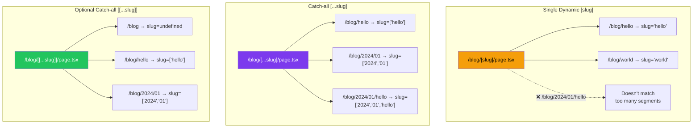
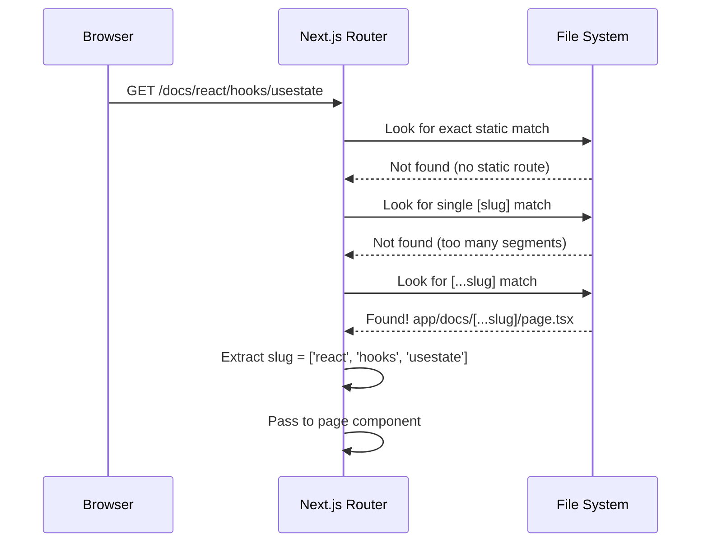
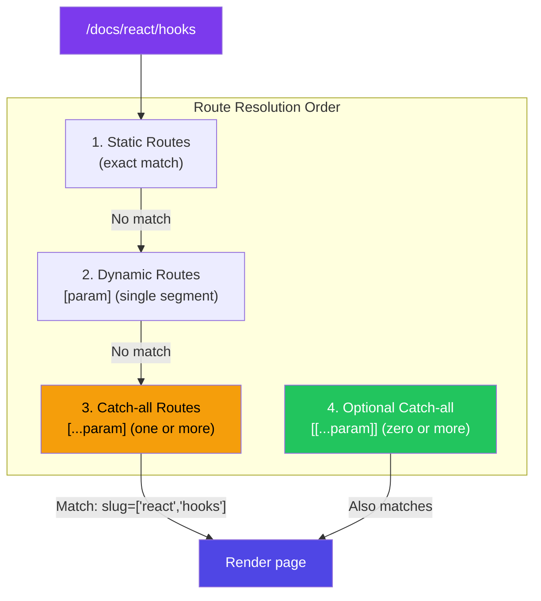
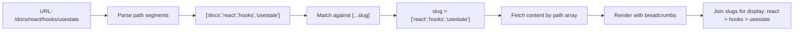

# Catch-all and Optional Catch-all Routes

## Introduction
Catch-all routes allow you to capture multiple URL segments in a single parameter. By using the `[...slug]` folder syntax, you can create pages that handle variable-depth URL paths like `/blog/2024/01/my-post` or `/docs/guide/getting-started/installation`. Optional catch-all routes (`[[...slug]]`) extend this by also matching when no segments are provided, giving you maximum flexibility for handling nested content structures.

## Why do we need this?
Static routes (`/about`) and single dynamic routes (`/blog/[slug]`) only capture one URL segment. Real-world applications often need to handle nested content:

- **Documentation sites**: `/docs/guide/getting-started/installation` — multiple levels of hierarchy
- **Category trees**: `/products/electronics/laptops/gaming` — nested categories
- **File browsers**: `/files/projects/2024/reports/q1` — arbitrary depth paths
- **Catch-all pages**: A page that should match any path under a route segment

Without catch-all routes, you'd need to create nested folder structures for every possible depth — which is inflexible and hard to maintain.

## Problem Statement
As a developer building content-rich applications, you need to:

- Handle URLs with variable-depth path segments (2, 3, 5, or more levels)
- Access all segments as an array to reconstruct the full path
- Build applications where users navigate deeply nested content
- Create catch-all pages for user-generated content with unknown paths
- Optionally match routes with or without additional segments

## Real World Story
Imagine you're building a documentation platform like MDN or Microsoft Learn. Your documentation has structures like:

- `/docs/react/` — React overview
- `/docs/react/hooks/` — Hooks overview
- `/docs/react/hooks/usestate/` — Specific hook docs
- `/docs/react/hooks/usestate/advanced/` — Advanced usage

Each of these is the same page template, just rendered with different content based on the full path. With `[...slug]`, you create ONE file at `app/docs/[...slug]/page.tsx` that handles ALL of these paths by receiving `params.slug = ['react']`, `params.slug = ['react', 'hooks']`, or `params.slug = ['react', 'hooks', 'usestate']`.

## Real World Analogy
Think of URL path segments like **a file system directory tree**:

- **Dynamic routes `[slug]`** are like clicking into a single folder — you can only go one level deep (`/docs/react`)
- **Catch-all routes `[...slug]`** are like using the full file path — you go as deep as needed (`/docs/react/hooks/usestate/advanced`)

The `[...slug]` syntax is like a recursive function: "capture everything from this point forward" while `[slug]` is a single-depth lookup.

## Visual Explanation
```
File System:                                      URLs Matched:
app/
└── docs/
    └── [...slug]/                                /docs
        └── page.tsx                              /docs/react
                                                  /docs/react/hooks
                                                  /docs/react/hooks/usestate
                                                  /docs/guide/getting-started
                                                  (any depth under /docs/)

vs.

app/
└── docs/
    └── [slug]/                                   /docs/react
        └── page.tsx                              /docs/hooks
                                                  /docs/getting-started
                                                  (only ONE level under /docs/)
```

## Mermaid Diagram 1: Route Segment Capture Comparison



## Internal Working
When Next.js resolves a request against catch-all route patterns:

1. **URL splitting** — The URL path is split into segments by `/`
2. **Route matching** — Next.js tries to match against the file system in priority order:
   - Static routes (exact match)
   - Dynamic routes (single `[param]`)
   - Catch-all routes (`[...param]`)
   - Optional catch-all (`[[...param]]`)
3. **Array construction** — All remaining segments from the catch-all position are collected into an array
4. **Type handling** — For regular catch-all, the array is always present; for optional catch-all, it can be `undefined`
5. **Single segment optimization** — If only one segment is captured, the array still contains one element (e.g., `['hello']`)

## Mermaid Diagram 2: Route Resolution Priority



## Architecture
Catch-all routes follow a layered matching architecture:



## Mermaid Diagram 4: Catch-all Route Data Flow



## Step-by-Step Flow

1. **Create the folder** — Add `app/docs/[...slug]/` folder in your project
2. **Create the page** — Add `page.tsx` inside the `[...slug]` folder
3. **Access the array** — The page receives `params.slug` as a string array
4. **Map to content** — Use the array to navigate your content hierarchy
5. **Build breadcrumbs** — Map segments to display names for navigation
6. **Handle empty** — For optional catch-all, handle the `undefined` case

## Syntax

### Catch-all Route `[...slug]`
```tsx
// app/docs/[...slug]/page.tsx
interface PageProps {
  params: {
    slug: string[]  // Always an array when route matches
  }
}

export default async function DocPage({ params }: PageProps) {
  // params.slug is always a string array
  // /docs/quick-start → ['quick-start']
  // /docs/react/hooks → ['react', 'hooks']
  // /docs/guide/1/installation → ['guide', '1', 'installation']
  
  const fullPath = params.slug.join('/')
  const content = await getContent(fullPath)
  
  return <article>{/* render content */}</article>
}
```

### Optional Catch-all Route `[[...slug]]`
```tsx
// app/docs/[[...slug]]/page.tsx
interface PageProps {
  params: {
    slug?: string[]  // Can be undefined when no segments provided
  }
}

export default async function DocPage({ params }: PageProps) {
  // params.slug can be undefined
  // /docs → slug is undefined
  // /docs/quick-start → ['quick-start']
  // /docs/react/hooks → ['react', 'hooks']
  
  const segments = params.slug || []
  const content = await getDefaultContent(segments)
  
  return <article>{/* render content */}</article>
}
```

**Key differences:**
- `[...slug]` — Requires at least one segment (`/docs/*`), matches only with segments
- `[[...slug]]` — Optional, matches even without segments (`/docs` alone works)
- The type changes: `string[]` vs `string[] | undefined`

## Basic Example

A simple documentation page that renders content based on the full path:

```tsx
// app/docs/[...slug]/page.tsx
import Link from 'next/link'

// Simulated content tree
const docsContent: Record<string, { title: string; content: string }> = {
  'getting-started': {
    title: 'Getting Started',
    content: 'Welcome to our documentation. Learn how to set up your first project.'
  },
  'getting-started/installation': {
    title: 'Installation Guide',
    content: 'Follow these steps to install the package.'
  },
  'getting-started/installation/windows': {
    title: 'Windows Installation',
    content: 'Specific instructions for Windows users.'
  },
  'guides': {
    title: 'Guides',
    content: 'Explore our comprehensive guides.'
  },
  'guides/advanced': {
    title: 'Advanced Guides',
    content: 'Deep dive into advanced topics.'
  },
}

export default async function DocPage({
  params,
}: {
  params: { slug: string[] }
}) {
  // Build the path key from the slug array
  const pathKey = params.slug.join('/')
  const doc = docsContent[pathKey]

  if (!doc) {
    return (
      <div>
        <h1>Documentation Not Found</h1>
        <p>No documentation found for: {pathKey}</p>
        <Link href="/docs">← Back to Docs Home</Link>
      </div>
    )
  }

  return (
    <article>
      {/* Breadcrumb navigation */}
      <nav aria-label="Breadcrumb">
        <ol style={{ display: 'flex', gap: '0.5rem', listStyle: 'none', padding: 0 }}>
          <li><Link href="/docs">Docs</Link></li>
          {params.slug.map((segment, index) => {
            const href = `/docs/${params.slug.slice(0, index + 1).join('/')}`
            const isLast = index === params.slug.length - 1
            return (
              <li key={segment}>
                <span> / </span>
                {isLast ? (
                  <span>{segment.replace(/-/g, ' ')}</span>
                ) : (
                  <Link href={href}>{segment.replace(/-/g, ' ')}</Link>
                )}
              </li>
            )
          })}
        </ol>
      </nav>

      <h1>{doc.title}</h1>
      <p>{doc.content}</p>

      {/* Navigation links */}
      <div style={{ marginTop: '2rem', display: 'flex', gap: '1rem' }}>
        {params.slug.length > 1 && (
          <Link href={`/docs/${params.slug.slice(0, -1).join('/')}`}>
            ← Previous
          </Link>
        )}
        <Link href="/docs">Back to Docs Home →</Link>
      </div>
    </article>
  )
}
```

**What's happening:**
- `params.slug` captures all segments after `/docs/` as an array
- `join('/')` reconstructs the full path to look up content
- Breadcrumbs are dynamically generated from the slug segments
- Each breadcrumb segment links to its specific depth level

## Intermediate Example

Blog with year/month/date/post structure using catch-all routes and metadata:

```tsx
// app/blog/[...slug]/page.tsx
import { notFound } from 'next/navigation'
import Link from 'next/link'
import type { Metadata } from 'next'

interface PageProps {
  params: { slug: string[] }
}

interface BlogPost {
  title: string
  date: string
  author: string
  content: string
  tags: string[]
}

// Simulated blog database with nested paths
const blogPosts: Record<string, BlogPost> = {
  'hello-world': {
    title: 'Hello World',
    date: '2024-01-15',
    author: 'Jane',
    content: 'This is my first blog post...',
    tags: ['introduction'],
  },
  'nextjs/deep-dive': {
    title: 'Next.js Deep Dive',
    date: '2024-02-01',
    author: 'Jane',
    content: 'Exploring advanced Next.js features...',
    tags: ['nextjs', 'react'],
  },
  'nextjs/deep-dive/server-components': {
    title: 'Server Components Explained',
    date: '2024-02-15',
    author: 'Jane',
    content: 'Understanding React Server Components in depth...',
    tags: ['nextjs', 'server-components'],
  },
  'tutorials/react/basics': {
    title: 'React Basics Tutorial',
    date: '2024-03-01',
    author: 'John',
    content: 'Learn React from scratch...',
    tags: ['react', 'tutorial'],
  },
}

// Generate metadata based on the slug
export async function generateMetadata({ params }: PageProps): Promise<Metadata> {
  const pathKey = params.slug.join('/')
  const post = blogPosts[pathKey]

  if (!post) {
    return { title: 'Post Not Found' }
  }

  return {
    title: `${post.title} | Blog`,
    description: post.content.slice(0, 160),
    openGraph: {
      title: post.title,
      description: post.content.slice(0, 160),
      type: 'article',
      publishedTime: post.date,
      authors: [post.author],
    },
  }
}

export default async function BlogPage({ params }: PageProps) {
  const pathKey = params.slug.join('/')
  const post = blogPosts[pathKey]

  if (!post) {
    // Check if the path matches a partial (category/tag listing)
    const isCategory = params.slug.length <= 2
    if (isCategory) {
      // Show category listing instead of 404
      return renderCategoryListing(params.slug)
    }
    notFound()
  }

  return (
    <article style={{ maxWidth: 720, margin: '0 auto', padding: '2rem' }}>
      {/* Breadcrumbs */}
      <nav aria-label="Breadcrumb" style={{ marginBottom: '1rem' }}>
        <ol style={{ display: 'flex', gap: '0.5rem', listStyle: 'none', padding: 0 }}>
          <li><Link href="/blog">Blog</Link></li>
          {params.slug.map((segment, i) => (
            <li key={segment}>
              <span> / </span>
              {i === params.slug.length - 1 ? (
                <span>{segment.replace(/-/g, ' ')}</span>
              ) : (
                <Link href={`/blog/${params.slug.slice(0, i + 1).join('/')}`}>
                  {segment.replace(/-/g, ' ')}
                </Link>
              )}
            </li>
          ))}
        </ol>
      </nav>

      {/* Post metadata */}
      <header style={{ marginBottom: '2rem' }}>
        <h1>{post.title}</h1>
        <div style={{ color: '#666' }}>
          <time>{new Date(post.date).toLocaleDateString('en-US', {
            year: 'numeric',
            month: 'long',
            day: 'numeric',
          })}</time>
          <span> · By {post.author}</span>
        </div>
        <div style={{ display: 'flex', gap: '0.5rem', marginTop: '0.5rem' }}>
          {post.tags.map(tag => (
            <Link
              key={tag}
              href={`/blog/tagged/${tag}`}
              style={{
                background: '#e2e8f0',
                padding: '0.25rem 0.5rem',
                borderRadius: 4,
                fontSize: '0.875rem',
                textDecoration: 'none',
                color: '#333',
              }}
            >
              #{tag}
            </Link>
          ))}
        </div>
      </header>

      {/* Content */}
      <div style={{ lineHeight: 1.8 }}>{post.content}</div>
    </article>
  )
}

// Render category listing when the slug matches a partial path
async function renderCategoryListing(slug: string[]) {
  const prefix = slug.join('/')
  const matchingPosts = Object.entries(blogPosts)
    .filter(([key]) => key.startsWith(prefix) && key !== prefix)
    .map(([key, post]) => ({ slug: key, ...post }))

  return (
    <div style={{ maxWidth: 720, margin: '0 auto', padding: '2rem' }}>
      <h1>
        {slug.map(s => s.charAt(0).toUpperCase() + s.slice(1)).join(' / ')}
      </h1>
      <p>{matchingPosts.length} posts found</p>
      <ul style={{ listStyle: 'none', padding: 0 }}>
        {matchingPosts.map(post => (
          <li key={post.slug} style={{ marginBottom: '1rem' }}>
            <Link href={`/blog/${post.slug}`}>
              <h2>{post.title}</h2>
            </Link>
            <time>{new Date(post.date).toLocaleDateString()}</time>
          </li>
        ))}
      </ul>
    </div>
  )
}
```

**What's happening:**
- A single `[...slug]` route handles multiple content depths
- Breadcrumbs are dynamically generated for any depth
- `generateMetadata` creates unique SEO tags per slug path
- When a partial path is matched (e.g., `/blog/nextjs`), a category listing is shown instead of 404
- Tags link to tagged filtering (deep linking)

## Advanced Example

Optional catch-all route for a multilingual site with SEO optimization:

```tsx
// app/[[...slug]]/page.tsx — Optional catch-all at root
import { notFound } from 'next/navigation'
import Link from 'next/link'
import type { Metadata } from 'next'

interface PageProps {
  params: { slug?: string[] }
}

// Supported locales
const locales = ['en', 'es', 'fr', 'de', 'ja'] as const
type Locale = typeof locales[number]

// Content map by locale and path
const content: Record<string, Record<string, { title: string; content: string }>> = {
  en: {
    '': { title: 'Home', content: 'Welcome to our multilingual site!' },
    about: { title: 'About Us', content: 'Learn about our company.' },
    'products/widget': { title: 'Widget Product', content: 'Our flagship widget.' },
  },
  es: {
    '': { title: 'Inicio', content: '¡Bienvenido a nuestro sitio multilingüe!' },
    about: { title: 'Sobre Nosotros', content: 'Conoce nuestra empresa.' },
    'products/widget': { title: 'Producto Widget', content: 'Nuestro widget insignia.' },
  },
  fr: {
    '': { title: 'Accueil', content: 'Bienvenue sur notre site multilingue!' },
    about: { title: 'À Propos', content: 'Découvrez notre entreprise.' },
    'products/widget': { title: 'Produit Widget', content: 'Notre widget phare.' },
  },
}

export async function generateMetadata({ params }: PageProps): Promise<Metadata> {
  const segments = params.slug || []
  const locale = locales.includes(segments[0] as Locale) ? segments[0] as Locale : 'en'
  const pathWithoutLocale = segments.slice(locales.includes(segments[0] as Locale) ? 1 : 0).join('/')
  
  const pageContent = content[locale]?.[pathWithoutLocale]
  
  return {
    title: pageContent?.title || 'Not Found',
    description: pageContent?.content.slice(0, 160),
    alternates: {
      languages: Object.fromEntries(
        locales.map(locale => [
          locale,
          `/${locale}${pathWithoutLocale ? `/${pathWithoutLocale}` : ''}`,
        ])
      ),
    },
  }
}

export default async function Page({ params }: PageProps) {
  const segments = params.slug || []
  
  // Detect locale from first segment
  const detectedLocale = locales.includes(segments[0] as Locale)
  const locale = detectedLocale ? segments[0] as Locale : 'en'
  const pathWithoutLocale = detectedLocale ? segments.slice(1) : segments
  const pathKey = pathWithoutLocale.join('/')
  
  const pageContent = content[locale]?.[pathKey]

  if (!pageContent && pathKey !== '') {
    notFound()
  }

  return (
    <div style={{ maxWidth: 800, margin: '0 auto', padding: '2rem' }}>
      {/* Locale switcher */}
      <nav style={{ marginBottom: '2rem', display: 'flex', gap: '0.5rem' }}>
        {locales.map(l => (
          <Link
            key={l}
            href={`/${l}${pathKey ? `/${pathKey}` : ''}`}
            style={{
              padding: '0.25rem 0.5rem',
              background: l === locale ? '#7c3aed' : '#e2e8f0',
              color: l === locale ? '#fff' : '#333',
              borderRadius: 4,
              textDecoration: 'none',
              textTransform: 'uppercase',
            }}
          >
            {l}
          </Link>
        ))}
      </nav>

      {/* Content */}
      {pageContent ? (
        <article>
          <h1>{pageContent.title}</h1>
          <p>{pageContent.content}</p>
        </article>
      ) : (
        <div>
          <h1>Welcome</h1>
          <p>Select a page to get started.</p>
          <ul>
            <li><Link href={`/${locale}/about`}>About</Link></li>
            <li><Link href={`/${locale}/products/widget`}>Widget Product</Link></li>
          </ul>
        </div>
      )}
    </div>
  )
}
```

**What's happening:**
- `[[...slug]]` at the root level matches `/` (no segments) and any path
- The first segment is checked against supported locales
- Content is served based on detected locale and remaining path
- `alternates.languages` provides hreflang tags for SEO
- Locale switcher creates links to equivalent pages in other languages

## Production Example

A production knowledge base with full-text search, breadcrumbs, and ISR:

```tsx
// app/help/[...slug]/page.tsx
import { notFound } from 'next/navigation'
import Link from 'next/link'
import type { Metadata } from 'next'

interface PageProps {
  params: { slug: string[] }
}

interface Article {
  id: string
  title: string
  content: string
  category: string
  relatedArticles: string[]
  lastUpdated: string
  author: string
}

// Production-ready fetch with caching and revalidation
async function getArticle(slug: string[]): Promise<Article | null> {
  const path = slug.join('/')
  
  try {
    const res = await fetch(
      `${process.env.API_URL}/help/articles?path=${encodeURIComponent(path)}`,
      {
        next: {
          revalidate: 300, // Revalidate every 5 minutes
          tags: [`help-article-${path}`],
        },
        headers: {
          'Content-Type': 'application/json',
        },
      }
    )
    
    if (!res.ok) return null
    return res.json()
  } catch (error) {
    console.error(`Failed to fetch article: ${path}`, error)
    return null
  }
}

// Fetch all paths for static generation
export async function generateStaticParams() {
  try {
    const res = await fetch(`${process.env.API_URL}/help/articles/paths`, {
      next: { revalidate: 3600 }, // Update paths every hour
    })
    
    if (!res.ok) return []
    
    const paths: string[][] = await res.json()
    return paths.map(slug => ({ slug }))
  } catch {
    return [] // Fallback to on-demand rendering
  }
}

// Dynamic metadata
export async function generateMetadata({ params }: PageProps): Promise<Metadata> {
  const article = await getArticle(params.slug)
  
  if (!article) {
    return { title: 'Help Article Not Found' }
  }
  
  return {
    title: `${article.title} | Help Center`,
    description: article.content.slice(0, 160),
    openGraph: {
      title: article.title,
      description: article.content.slice(0, 160),
      type: 'article',
      publishedTime: article.lastUpdated,
    },
    alternates: {
      canonical: `/help/${params.slug.join('/')}`,
    },
  }
}

export default async function HelpArticle({ params }: PageProps) {
  const article = await getArticle(params.slug)

  if (!article) {
    notFound()
  }

  return (
    <div className="help-article-layout">
      {/* Structured data for SEO */}
      <script
        type="application/ld+json"
        dangerouslySetInnerHTML={{
          __html: JSON.stringify({
            '@context': 'https://schema.org',
            '@type': 'Article',
            headline: article.title,
            dateModified: article.lastUpdated,
            author: {
              '@type': 'Person',
              name: article.author,
            },
          }),
        }}
      />

      {/* BreadcrumbList structured data */}
      <script
        type="application/ld+json"
        dangerouslySetInnerHTML={{
          __html: JSON.stringify({
            '@context': 'https://schema.org',
            '@type': 'BreadcrumbList',
            itemListElement: params.slug.map((segment, index) => ({
              '@type': 'ListItem',
              position: index + 1,
              name: segment.replace(/-/g, ' '),
              item: `${process.env.NEXT_PUBLIC_SITE_URL}/help/${params.slug.slice(0, index + 1).join('/')}`,
            })),
          }),
        }}
      />

      {/* Sidebar navigation */}
      <aside className="help-sidebar">
        <nav>
          <h3>Categories</h3>
          <ul>
            <li><Link href="/help/getting-started">Getting Started</Link></li>
            <li><Link href="/help/account">Account & Billing</Link></li>
            <li><Link href="/help/troubleshooting">Troubleshooting</Link></li>
            <li><Link href="/help/advanced">Advanced Features</Link></li>
          </ul>
        </nav>
      </aside>

      <main className="help-content">
        {/* Breadcrumb navigation */}
        <nav aria-label="Breadcrumb">
          <ol className="breadcrumb">
            <li><Link href="/help">Help Center</Link></li>
            {params.slug.map((segment, index) => {
              const href = `/help/${params.slug.slice(0, index + 1).join('/')}`
              const isLast = index === params.slug.length - 1
              return (
                <li key={segment}>
                  {isLast ? (
                    <span aria-current="page">
                      {segment.replace(/-/g, ' ')}
                    </span>
                  ) : (
                    <Link href={href}>
                      {segment.replace(/-/g, ' ')}
                    </Link>
                  )}
                </li>
              )
            })}
          </ol>
        </nav>

        <article>
          <h1>{article.title}</h1>
          <div className="article-meta">
            <time>Last updated: {new Date(article.lastUpdated).toLocaleDateString()}</time>
          </div>
          <div className="article-content">
            {article.content}
          </div>
        </article>

        {/* Related articles */}
        {article.relatedArticles.length > 0 && (
          <section className="related-articles">
            <h2>Related Articles</h2>
            <ul>
              {article.relatedArticles.map(id => (
                <li key={id}>
                  <Link href={`/help/${id.replace(/\//g, '/')}`}>
                    {id.replace(/-/g, ' ')}
                  </Link>
                </li>
              ))}
            </ul>
          </section>
        )}

        {/* Feedback */}
        <div className="article-feedback">
          <p>Was this article helpful?</p>
          <button>Yes</button>
          <button>No</button>
        </div>
      </main>
    </div>
  )
}
```

**Production considerations:**
- API calls use `next.revalidate` and `next.tags` for granular cache invalidation
- `generateStaticParams` fetches all known paths, falling back to on-demand rendering
- BreadcrumbList JSON-LD structured data improves SEO
- Canonical URLs prevent duplicate content issues
- Error handling with `try/catch` ensures graceful degradation
- Environment variables for API URLs (not hardcoded)

## Folder Structure

```
app/
├── docs/
│   └── [...slug]/                    # Catch-all: at least one segment
│       ├── page.tsx                  # /docs/* → handles any depth
│       ├── layout.tsx                # Layout for all doc pages
│       ├── loading.tsx               # Loading UI for doc pages
│       └── error.tsx                 # Error boundary for doc pages
│
├── blog/
│   └── [[...slug]]/                  # Optional catch-all: zero or more
│       ├── page.tsx                  # /blog or /blog/*/*...
│       └── not-found.tsx             # Custom 404 for blog
│
├── (marketing)/                      # Route group (no URL change)
│   └── [[...slug]]/                  # Optional catch-all at root
│       └── page.tsx                  # / or /any/path
│
└── api/
    └── search/
        └── [...query]/               # Catch-all API route
            └── route.ts              # /api/search/term/with/slashes

Multiple catch-all examples:
my-app/
├── app/
│   ├── docs/
│   │   └── [...slug]/
│   │       └── page.tsx              # /docs/react/hooks/usestate
│   ├── categories/
│   │   └── [...slug]/
│   │       └── page.tsx              # /categories/electronics/laptops
│   └── [[...slug]]/
│       └── page.tsx                  # / or /any/path (root level catch)
└── content/
    ├── docs/                         # Markdown files mapped to slugs
    └── categories/
```

## 🚀 Best Practices

1. **Use `[...slug]` for required paths** — When the route must have at least one segment
2. **Use `[[...slug]]` for optional paths** — When the root path should also work (e.g., `/blog` and `/blog/2024/post`)
3. **Always handle `undefined` in optional catch-all** — Destructure with default: `const segments = params.slug || []`
4. **Build breadcrumb navigation** — Use the slug array to generate navigable breadcrumbs for any depth
5. **Use `generateStaticParams` with catch-all** — Pre-render known paths, use `fallback` for unknown ones
6. **Limit depth in production** — Very deep nesting can impact performance; consider a max depth
7. **Combine with route groups** — Use `(marketing)/[[...slug]]` for clean URL structures

## ⚠ Common Mistakes

1. **Assuming `params.slug` is always a string** — It's always `string[]` for `[...slug]` and `string[] | undefined` for `[[...slug]]`
2. **Using `[...slug]` when you need the root path too** — Use `[[...slug]]` instead
3. **Not handling `undefined`** — Accessing `params.slug.length` on undefined throws an error
4. **Conflicting routes** — A catch-all at root (`app/[[...slug]]`) matches everything, blocking other routes
5. **Forgetting `generateStaticParams` for SSG** — Without it, catch-all routes can't be statically exported
6. **Deep path traversal** — Using slug segments directly in file system or database queries without sanitization

## 📦 Performance Notes

- **ISR with catch-all routes** — Use `revalidate` export to periodically rebuild deep content
- **Selective pre-rendering** — Use `generateStaticParams` to pre-render only popular deep paths
- **Streaming** — Catch-all pages can stream content as data is fetched for each depth level
- **Layout caching** — Parent layouts remain cached while only the catch-all page content changes
- **Breadcrumb calculation** — Compute breadcrumbs from the slug array, which is O(n) and negligible

## 🔒 Security Notes

- **Path traversal attacks** — Sanitize slug segments: `../../../etc/passwd` can be a security risk
- **URL encoding** — Handle encoded characters: `%2F` (encoded `/`) in slugs
- **Input validation** — Validate segment count to prevent denial-of-service via extremely long paths
- **Access control** — Check permissions for each segment depth in protected routes
- **SQL injection** — Never interpolate slug values directly into database queries; use parameterized queries

## 🌍 SEO Considerations

- **Canonical URLs** — Use `generateMetadata` with `alternates.canonical` for the full path
- **Breadcrumb structured data** — Add `BreadcrumbList` JSON-LD for dynamic hierarchy
- **Sitemap generation** — Include all catch-all route variants in your sitemap
- **Avoid duplicate content** — Use canonical tags when multiple paths lead to the same content
- **Crawl budget** — Pre-generate high-value deep paths; let search engines discover others naturally
- **Deep linking** — Each depth level should have a unique, descriptive title and meta description

## Interview Questions

1. What's the difference between `[...slug]` and `[[...slug]]` in the App Router?
2. How does Next.js resolve route conflicts between static, dynamic, and catch-all routes?
3. When would you use a catch-all route instead of a dynamic route?
4. How do you access multiple URL segments in a catch-all route component?
5. What TypeScript type does `params.slug` have for each variation?
6. How does `generateStaticParams` work with catch-all routes?
7. What are the SEO implications of using catch-all routes for content hierarchies?

## MCQs

1. What type does `params.slug` have in a `[...slug]` catch-all route?
   a) `string`
   b) `string[]`
   c) `string[] | undefined`
   d) `string[][]`
   <details>
   <summary>Answer</summary>
   b) `string[]` — Regular catch-all routes always have at least one segment.
   </details>

2. What type does `params.slug` have in a `[[...slug]]` optional catch-all route?
   a) `string`
   b) `string[]`
   c) `string[] | undefined`
   d) `string | undefined`
   <details>
   <summary>Answer</summary>
   c) `string[] | undefined` — Optional catch-all can match zero segments.
   </details>

3. Which route takes highest priority when resolving `/blog/hello`?
   a) `app/blog/[slug]/page.tsx`
   b) `app/blog/[...slug]/page.tsx`
   c) `app/blog/[[...slug]]/page.tsx`
   d) `app/blog/hello/page.tsx`
   <details>
   <summary>Answer</summary>
   d) `app/blog/hello/page.tsx` — Static routes have highest priority.
   </details>

4. What does `params.slug` equal when visiting `/docs/react/hooks` with `app/docs/[...slug]/page.tsx`?
   a) `'react/hooks'`
   b) `['react', 'hooks']`
   c) `'react'`
   d) `['docs', 'react', 'hooks']`
   <details>
   <summary>Answer</summary>
   b) `['react', 'hooks']` — The slug captures everything after `/docs/` as an array.
   </details>

5. What happens when you visit just `/docs` with `app/docs/[...slug]/page.tsx`?
   a) The page renders with empty slug
   b) Next.js returns a 404 error
   c) The page renders with slug as undefined
   d) It defaults to the parent layout
   <details>
   <summary>Answer</summary>
   b) Next.js returns a 404 error — `[...slug]` requires at least one segment.
   </details>

## Practice Exercise

1. Create a knowledge base with the following structure:
   - `app/help/[...slug]/page.tsx` — Catch-all for help articles
   - Create mock data for: `/help/getting-started`, `/help/account/billing`, `/help/account/profile/settings`
   - Build dynamic breadcrumb navigation
   - Add `generateStaticParams` to pre-render known paths
   - Implement `generateMetadata` for dynamic SEO

2. Create a category browser with optional catch-all:
   - `app/categories/[[...slug]]/page.tsx` — Browse by category depth
   - `/categories` shows all top-level categories
   - `/categories/electronics` shows subcategories
   - `/categories/electronics/laptops` shows products
   - Each depth renders different UI (listing vs. detail)

3. Build a simple file explorer:
   - `app/files/[...path]/page.tsx` — Browse a mock file system
   - Show folder contents at each depth level
   - Add "Go up one level" navigation
   - Show breadcrumbs for the current path

## Debugging Exercise

Find and fix the bugs in this code:

```tsx
// app/products/[...slug]/page.tsx
interface Product {
  id: string
  name: string
  price: number
}

interface PageProps {
  params: {
    slug: string  // Bug 1: Wrong type
  }
}

export default async function CategoryPage({ params }: PageProps) {
  const { slug } = params
  const path = slug.join('/')  // Bug 2: slug is typed as string, not string[]
  
  const product = await fetch(`/api/products/${path}`)  // Bug 3: Relative URL in Server Component
  
  if (!product) {
    return <h1>Not found</h1>  // Bug 4: Should use notFound() from next/navigation
  }
  
  return <div>{product.name}</div>
}
```

**Bug 1:** `slug` is typed as `string` but should be `string[]`
**Fix:** Change to `slug: string[]`

**Bug 2:** Can't call `.join()` on a string
**Fix:** Fixed by Bug 1's type correction

**Bug 3:** Relative URL in Server Component — Server Components use absolute URLs
**Fix:** Use `process.env.API_URL + '/api/products/' + encodeURIComponent(path)`

**Bug 4:** Returning JSX for not-found doesn't trigger the proper 404 response
**Fix:** Import and use `notFound()` from `next/navigation`

## Real-world Scenario

**Problem:** You're building a documentation platform for a SaaS product with 10,000+ help articles organized in a deeply nested category structure. Users frequently share and bookmark deep links like `/help/account/billing/plans/enterprise/custom-contracts`. You need these to work reliably, load fast, and be SEO-friendly.

**Solution:**
```tsx
// app/help/[...slug]/page.tsx
export const revalidate = 3600 // Revalidate once an hour

export async function generateStaticParams() {
  // Pre-render only the top 1000 most-viewed articles
  const popularArticles = await db.articles.findMany({
    where: { views: { gt: 100 } },
    orderBy: { views: 'desc' },
    take: 1000,
    select: { path: true },
  })
  
  return popularArticles.map(article => ({
    slug: article.path.split('/'),
  }))
}

// For less popular articles, they'll be generated on first visit and cached
// for an hour. This balances build time against SEO and performance.
```

**Implementation:**
- Top articles are statically generated at build time
- Less popular articles use ISR (regenerated on first visit, cached for 1 hour)
- All articles have unique metadata and structured data
- CDN caches the HTML for fast global access

## Interview Coding Question

Build a dynamic sitemap generator that uses catch-all routes to create a tree navigation:

```tsx
// app/categories/[[...slugs]]/page.tsx
interface PageProps {
  params: { slugs?: string[] }
}

// Content tree
const categories = {
  '': {
    name: 'All Categories',
    children: ['electronics', 'clothing', 'home-garden'],
  },
  electronics: {
    name: 'Electronics',
    children: ['computers', 'phones', 'accessories'],
  },
  'electronics/computers': {
    name: 'Computers',
    children: ['laptops', 'desktops', 'tablets'],
  },
  'electronics/computers/laptops': {
    name: 'Laptops',
    children: ['gaming', 'ultrabooks', 'budget'],
  },
}

export default async function CategoryPage({ params }: PageProps) {
  const segments = params.slugs || []
  const path = segments.join('/')
  const category = categories[path as keyof typeof categories]

  if (!category) {
    return <h1>Category not found</h1>
  }

  return (
    <div>
      <h1>{category.name}</h1>
      {category.children.length > 0 ? (
        <ul>
          {category.children.map(child => (
            <li key={child}>
              <a href={`/categories/${path ? path + '/' + child : child}`}>
                {child.replace(/-/g, ' ')}
              </a>
            </li>
          ))}
        </ul>
      ) : (
        <p>No subcategories. This is a leaf category.</p>
      )}
    </div>
  )
}
```

## Mini Project

**Build a Documentation Site with Catch-all Routes**

Create a documentation platform with the following:

1. **Route structure:**
   - `/docs/[...slug]/page.tsx` — Catch-all route for all docs
   - `/docs/[[...slug]]/page.tsx` — Optional variation that also handles `/docs`

2. **Content structure (at least 10 articles):**
   - `/getting-started`
   - `/getting-started/installation`
   - `/getting-started/installation/windows`
   - `/getting-started/installation/mac`
   - `/guides`
   - `/guides/intermediate`
   - `/guides/intermediate/routing`
   - `/guides/intermediate/data-fetching`
   - `/api-reference`
   - `/api-reference/core-functions`

3. **Features:**
   - Dynamic breadcrumbs for every depth level
   - `generateStaticParams` for all content paths
   - `generateMetadata` with unique descriptions per page
   - Sidebar showing sibling pages at the current depth
   - "Previous" and "Next" navigation at the bottom
   - BreadcrumbList JSON-LD structured data
   - Loading state for content fetching
   - Error boundary for failed content loads

4. **Styling:** Use CSS modules or inline styles for a clean documentation look with:
   - Responsive sidebar that collapses on mobile
   - Code blocks with syntax highlighting (mock)
   - Table of contents for long articles
   - Search bar (static, filters client-side)

## Summary

Catch-all routes (`[...slug]`) capture multiple URL segments into an array parameter, enabling you to handle variable-depth URL paths with a single page template. Optional catch-all routes (`[[...slug]]`) extend this by also matching routes with zero segments, making them ideal for root-level catch-alls. Key features include dynamic breadcrumb generation from the slug array, `generateStaticParams` for pre-rendering known paths, and `generateMetadata` for SEO. Always handle `undefined` for optional catch-all routes and remember that static routes take priority over dynamic and catch-all patterns in route resolution.

## Cheat Sheet

```tsx
// Catch-all: [...slug] — requires at least one segment
// Folder: app/docs/[...slug]/
params: { slug: string[] }
// /docs/a → ['a']
// /docs/a/b → ['a', 'b']

// Optional catch-all: [[...slug]] — zero or more segments
// Folder: app/docs/[[...slug]]/
params: { slug?: string[] }
// /docs → undefined
// /docs/a → ['a']

// Access pattern (optional)
const { slug = [] } = params

// Reconstruct path
const path = slug.join('/')

// Generate static params
export async function generateStaticParams() {
  return [
    { slug: ['getting-started'] },
    { slug: ['guide', 'advanced'] },
  ]
}

// Build breadcrumbs
params.slug.map((seg, i) => ({
  href: `/docs/${params.slug.slice(0, i + 1).join('/')}`,
  label: seg.replace(/-/g, ' '),
}))

// Route priority: static > [param] > [...param] > [[...param]]
```

## Related Topics
- Dynamic Routes with [slug] (Previous Topic)
- Route Groups for Organization (Next Topic)
- Parallel Routes
- Route Handlers (Phase 2, Module 3)
- Layouts and Templates

## Further Reading
- [Next.js Documentation: Catch-all Segments](https://nextjs.org/docs/app/building-your-application/routing/dynamic-routes#catch-all-segments)
- [Next.js Documentation: Route Resolution](https://nextjs.org/docs/app/building-your-application/routing/dynamic-routes#how-routers-are-matched)
- [Next.js Documentation: generateStaticParams](https://nextjs.org/docs/app/api-reference/functions/generate-static-params)
