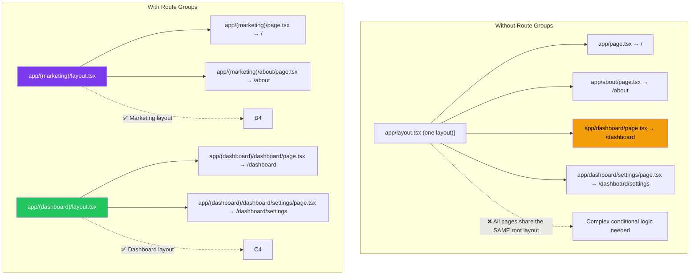
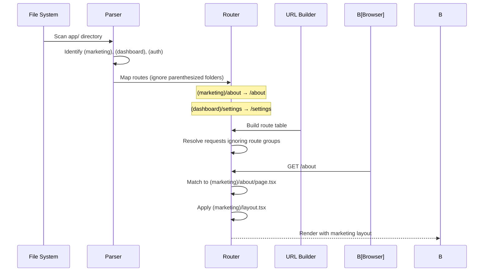
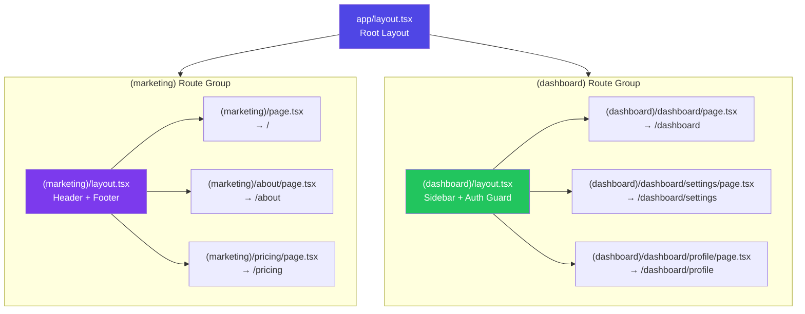
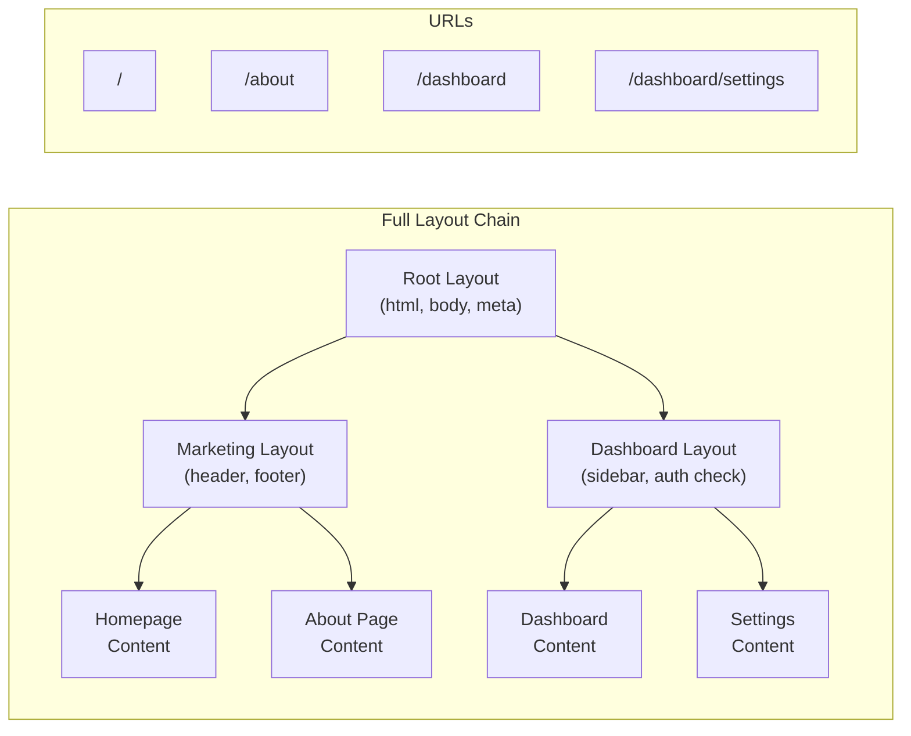

# Route Groups for Organization

## Introduction
Route groups in the Next.js App Router allow you to organize your routes into logical groups without affecting the URL structure. By wrapping folder names in parentheses `(groupName)`, you create route groups that keep your project organized while maintaining clean, predictable URLs. Route groups are purely an organizational tool — they don't add segments to the URL path.

## Why do we need this?
As your application grows, you'll have routes for different parts of your app — marketing pages, dashboard sections, API endpoints, authentication flows, and more. Without route groups, these all live at the top level of your `app/` directory, making it hard to:

- Apply different layouts to different sections of your app
- Separate public and authenticated routes
- Organize routes by feature or team
- Prevent layout conflicts between unrelated sections

Route groups solve this by letting you create folder-based organization without polluting your URLs.

## Problem Statement
As a developer building a complex application, you face these organizational challenges:

- The marketing site (`/`, `/about`, `/pricing`) needs a different layout than the dashboard (`/dashboard`, `/dashboard/settings`)
- Public pages and authenticated pages should be clearly separated in code
- Multiple teams working on different features need clear organizational boundaries
- Route-specific code (components, styles, tests) needs to live close to the routes they belong to

## Real World Story
Jane is building a SaaS platform with three distinct sections: a marketing site (public, with header/footer), a dashboard (authenticated, with sidebar navigation), and an admin panel (admin-only, with its own layout). Without route groups, all routes live at the top level with complex conditional layout logic. With route groups, she creates `(marketing)`, `(dashboard)`, and `(admin)` folders — each with its own layout — and the URLs remain clean: `/`, `/about`, `/dashboard`, `/dashboard/settings`, `/admin/users`.

## Real World Analogy
Think of route groups like **file folders in a filing cabinet**:

- **Without route groups**: All papers are thrown into one drawer — you have to dig through everything to find what you need
- **With route groups**: Papers are organized into labeled folders — "Marketing," "Dashboard," "Admin" — but when you reference a paper, you just say "the pricing page" (the URL), not "the pricing page from the marketing folder"

The parentheses `(folderName)` are like the folder labels — they help you organize but don't change the name of the document inside.

## Visual Explanation

```
Without Route Groups:
app/
├── layout.tsx              ← One layout for EVERYTHING
├── page.tsx                → /
├── about/
│   └── page.tsx            → /about
├── pricing/
│   └── page.tsx            → /pricing
├── dashboard/
│   ├── page.tsx            → /dashboard
│   └── settings/
│       └── page.tsx        → /dashboard/settings
├── login/
│   └── page.tsx            → /login

Problem: Can't apply different layouts to marketing vs dashboard vs auth

With Route Groups:
app/
├── (marketing)/
│   ├── layout.tsx          ← Marketing layout (header + footer)
│   ├── page.tsx            → /
│   ├── about/
│   │   └── page.tsx        → /about
│   └── pricing/
│       └── page.tsx        → /pricing
├── (dashboard)/
│   ├── layout.tsx          ← Dashboard layout (sidebar + auth)
│   ├── dashboard/
│   │   └── page.tsx        → /dashboard
│   └── settings/
│       └── page.tsx        → /dashboard/settings
└── (auth)/
    ├── layout.tsx          ← Auth layout (centered card)
    └── login/
        └── page.tsx        → /login
```

## Mermaid Diagram 1: Route Groups vs No Route Groups



## Internal Working
Route groups affect routing at the file-system level but not the URL level:

1. **File system parsing** — Next.js scans the `app/` directory for folders
2. **Parenthesis detection** — Folders wrapped in `()` are identified as route groups
3. **URL construction** — Route groups are stripped from the URL path during construction
4. **URL resolution** — When resolving incoming URLs, route groups are transparent
5. **Layout scoping** — Layouts within a route group ONLY apply to pages within that group
6. **Route matching** — Routes with the same URL but in different groups would conflict

## Mermaid Diagram 2: Internal Route Resolution



## Architecture
Route groups create isolated layout scopes within your application:



**Key architecture insight:** The root layout `app/layout.tsx` still wraps both route groups, but each route group can add its own layout on top. Think of it as:

Root Layout → Route Group Layout → Page

## Mermaid Diagram 4: Layout Nesting with Route Groups



## Step-by-Step Flow

1. **Identify logical groups** — Decide the major sections of your app (marketing, dashboard, auth, admin)
2. **Create route group folders** — Wrap group names in parentheses: `(marketing)`, `(dashboard)`, `(auth)`
3. **Add layouts** — Create `layout.tsx` inside each route group for section-specific layouts
4. **Move routes** — Move existing pages into the appropriate route groups
5. **Create new routes** — Add new pages inside the appropriate route groups
6. **Verify URLs** — Check that URLs remain clean (route group names don't appear in URLs)

## Syntax

```tsx
// app/(marketing)/layout.tsx — Marketing section layout
export default function MarketingLayout({
  children,
}: {
  children: React.ReactNode
}) {
  return (
    <>
      <header>
        <nav>
          <a href="/">Home</a>
          <a href="/about">About</a>
          <a href="/pricing">Pricing</a>
        </nav>
      </header>
      <main>{children}</main>
      <footer>© 2024 Company</footer>
    </>
  )
}
```

```tsx
// app/(dashboard)/layout.tsx — Dashboard section layout
export default function DashboardLayout({
  children,
}: {
  children: React.ReactNode
}) {
  return (
    <div className="dashboard-layout">
      <aside className="sidebar">
        <nav>
          <a href="/dashboard">Overview</a>
          <a href="/dashboard/settings">Settings</a>
          <a href="/dashboard/profile">Profile</a>
        </nav>
      </aside>
      <section className="content">
        {children}
      </section>
    </div>
  )
}
```

**Key point:** The URL for a page inside `(dashboard)/dashboard/settings/page.tsx` is `/dashboard/settings`, NOT `/(dashboard)/dashboard/settings`.

## Basic Example

Organizing a simple SaaS application with two distinct layouts:

```tsx
// app/layout.tsx — Root layout (applies to ALL pages)
export default function RootLayout({
  children,
}: {
  children: React.ReactNode
}) {
  return (
    <html lang="en">
      <body>
        {children}
      </body>
    </html>
  )
}
```

```tsx
// app/(marketing)/layout.tsx — Marketing pages get header + footer
export default function MarketingLayout({
  children,
}: {
  children: React.ReactNode
}) {
  return (
    <div className="min-h-screen">
      <nav className="bg-white shadow">
        <div className="max-w-7xl mx-auto px-4">
          <div className="flex justify-between h-16">
            <div className="flex gap-8 items-center">
              <a href="/" className="font-bold text-xl">MyApp</a>
              <a href="/features">Features</a>
              <a href="/pricing">Pricing</a>
              <a href="/about">About</a>
            </div>
            <div className="flex items-center gap-4">
              <a href="/login">Log In</a>
              <a href="/signup" className="bg-blue-600 text-white px-4 py-2 rounded">
                Sign Up
              </a>
            </div>
          </div>
        </div>
      </nav>
      <main>{children}</main>
      <footer className="bg-gray-50 py-12">
        <div className="max-w-7xl mx-auto px-4">
          <p>© 2024 MyApp. All rights reserved.</p>
        </div>
      </footer>
    </div>
  )
}
```

```tsx
// app/(dashboard)/layout.tsx — Dashboard gets sidebar + auth check
export default function DashboardLayout({
  children,
}: {
  children: React.ReactNode
}) {
  return (
    <div className="flex h-screen">
      <aside className="w-64 bg-gray-900 text-white p-6">
        <h2 className="text-lg font-bold mb-8">Dashboard</h2>
        <nav className="space-y-4">
          <a href="/dashboard" className="block hover:text-blue-400">Overview</a>
          <a href="/dashboard/analytics" className="block hover:text-blue-400">Analytics</a>
          <a href="/dashboard/settings" className="block hover:text-blue-400">Settings</a>
          <a href="/dashboard/profile" className="block hover:text-blue-400">Profile</a>
        </nav>
      </aside>
      <main className="flex-1 overflow-auto bg-gray-50 p-8">
        {children}
      </main>
    </div>
  )
}
```

```tsx
// File structure
app/
├── layout.tsx                    ← Root (html, body)
├── (marketing)/
│   ├── layout.tsx                ← Marketing (header, footer)
│   ├── page.tsx                  → /
│   ├── about/
│   │   └── page.tsx              → /about
│   ├── pricing/
│   │   └── page.tsx              → /pricing
│   └── features/
│       └── page.tsx              → /features
├── (dashboard)/
│   ├── layout.tsx                ← Dashboard (sidebar, auth)
│   ├── dashboard/
│   │   └── page.tsx              → /dashboard
│   └── settings/
│       └── page.tsx              → /settings
└── (auth)/
    ├── layout.tsx                ← Auth (centered card)
    ├── login/
    │   └── page.tsx              → /login
    └── signup/
        └── page.tsx              → /signup
```

**What's happening:**
- Root layout provides `<html>` and `<body>` tags (required)
- Marketing layout adds header and footer only to public pages
- Dashboard layout adds sidebar and would contain auth checks
- Auth layout provides a centered card design for login/signup
- URLs remain clean: `/`, `/about`, `/dashboard`, `/login`, `/settings`

## Intermediate Example

Multiple route groups with shared code, private folders, and naming conventions:

```tsx
// app/(marketing)/layout.tsx — Marketing layout with shared components
import { Header } from '@/components/Header'
import { Footer } from '@/components/Footer'

export default function MarketingLayout({
  children,
}: {
  children: React.ReactNode
}) {
  return (
    <div className="marketing-layout">
      <Header variant="public" />
      <main>{children}</main>
      <Footer />
    </div>
  )
}
```

```tsx
// app/(dashboard)/layout.tsx — Dashboard layout with auth guard
import { redirect } from 'next/navigation'
import { getServerSession } from '@/lib/auth'
import { DashboardSidebar } from '@/components/DashboardSidebar'

export default async function DashboardLayout({
  children,
}: {
  children: React.ReactNode
}) {
  const session = await getServerSession()
  
  if (!session) {
    redirect('/login')
  }
  
  return (
    <div className="dashboard-layout">
      <DashboardSidebar user={session.user} />
      <main className="dashboard-content">
        {children}
      </main>
    </div>
  )
}
```

```tsx
// app/(admin)/layout.tsx — Admin layout with admin-only guard
import { redirect } from 'next/navigation'
import { getServerSession } from '@/lib/auth'

export default async function AdminLayout({
  children,
}: {
  children: React.ReactNode
}) {
  const session = await getServerSession()
  
  if (!session || session.user.role !== 'admin') {
    redirect('/dashboard')
  }
  
  return (
    <div className="admin-layout">
      <nav className="admin-nav">
        <a href="/admin/users">Users</a>
        <a href="/admin/settings">Settings</a>
        <a href="/admin/logs">Logs</a>
      </nav>
      <main>{children}</main>
    </div>
  )
}
```

```tsx
// Folder structure with private folders for internal code
app/
├── layout.tsx
├── globals.css
│
├── (marketing)/
│   ├── layout.tsx
│   ├── page.tsx              → /
│   ├── about/page.tsx        → /about
│   ├── pricing/page.tsx      → /pricing
│   │
│   ├── _components/          ← Private: NOT a route group
│   │   ├── HeroSection.tsx
│   │   └── PricingCard.tsx
│   └── _lib/                 ← Private: internal helpers
│       └── marketing-utils.ts
│
├── (dashboard)/
│   ├── layout.tsx
│   ├── dashboard/
│   │   ├── page.tsx          → /dashboard
│   │   └── analytics/
│   │       └── page.tsx      → /dashboard/analytics
│   ├── settings/
│   │   └── page.tsx          → /settings
│   │
│   ├── _components/          ← Private: dashboard components
│   │   ├── Chart.tsx
│   │   └── DataTable.tsx
│   └── _lib/
│       └── dashboard-utils.ts
│
└── (auth)/
    ├── layout.tsx
    ├── login/page.tsx        → /login
    └── signup/page.tsx       → /signup
```

**What's happening:**
- Route groups clearly separate marketing, dashboard, and admin concerns
- Private folders (`_components`, `_lib`) keep route-specific code colocated
- Each layout handles its own auth requirements
- URLs remain clean regardless of organizational nesting

## Advanced Example

Complex route group patterns with nested route groups and URL deduplication:

```tsx
// app/(marketing)/layout.tsx — Marketing layout
export default function MarketingLayout({
  children,
}: {
  children: React.ReactNode
}) {
  return (
    <div className="marketing">
      <nav>...</nav>
      <main>{children}</main>
      <footer>...</footer>
    </div>
  )
}
```

```tsx
// app/(marketing)/blog/layout.tsx — Blog sub-layout within marketing
export default function BlogLayout({
  children,
}: {
  children: React.ReactNode
}) {
  return (
    <div className="blog-layout">
      <aside className="blog-sidebar">
        <h3>Categories</h3>
        <ul>
          <li><a href="/blog/category/tech">Tech</a></li>
          <li><a href="/blog/category/design">Design</a></li>
        </ul>
      </aside>
      <article>{children}</article>
    </div>
  )
}
```

```tsx
// URL deduplication pattern: avoiding /dashboard/dashboard
// Instead of:
//   app/(dashboard)/dashboard/page.tsx → /dashboard
//   app/(dashboard)/dashboard/settings/page.tsx → /dashboard/settings
// 
// You can use a route group on the dashboard segment:
//   app/(dashboard)/(overview)/page.tsx → /dashboard (WRONG - causes conflict)
// 
// Better approach: Keep URL-segment folders inside route groups
//   app/(dashboard)/dashboard/page.tsx → /dashboard  ✅
//   app/(dashboard)/dashboard/settings/page.tsx → /dashboard/settings  ✅
// 
// Or use route groups for URL flexibility:
//   app/(dashboard)/(protected)/page.tsx → / ?? Conflict!
// 
// Rule: Route groups don't affect URL, so two pages at the same URL
// in different route groups will conflict.
```

```tsx
// Simulating URL segments with route groups
// Goal: Create an app where /app/* routes to dashboard layout
// and /* routes to marketing layout

app/
├── layout.tsx                          ← Root
├── (marketing)/
│   ├── layout.tsx                      ← Marketing layout
│   ├── page.tsx                        → /
│   ├── about/page.tsx                  → /about
│   └── pricing/page.tsx               → /pricing
│
├── app-section/                        ← This folder creates URL segment /app
│   └── (dashboard)/
│       ├── layout.tsx                  ← Dashboard layout
│       ├── page.tsx                    → /app
│       └── settings/
│           └── page.tsx                → /app/settings
```

**What's happening:**
- Blog layout nests inside the marketing layout (layout inheritance)
- URL deduplication is handled by choosing the right folder structure
- Route groups combined with actual URL segments give maximum flexibility
- The `app-section/` folder creates a real `/app` segment while `(dashboard)/` organizes without URL impact

## Production Example

Enterprise SaaS application with multiple route groups, feature flags, and A/B testing:

```tsx
// app/layout.tsx — Root layout
export default function RootLayout({
  children,
}: {
  children: React.ReactNode
}) {
  return (
    <html lang="en">
      <body>
        <Providers>{children}</Providers>
      </body>
    </html>
  )
}
```

```tsx
// app/(marketing)/layout.tsx — Marketing with analytics and SEO
import { Analytics } from '@vercel/analytics/react'
import { CookieBanner } from '@/components/CookieBanner'

export default function MarketingLayout({
  children,
}: {
  children: React.ReactNode
}) {
  return (
    <>
      <Header />
      <main>{children}</main>
      <Footer />
      <CookieBanner />
      <Analytics />
    </>
  )
}
```

```tsx
// app/(dashboard)/layout.tsx — Dashboard with auth, feature flags, and onboarding
import { redirect } from 'next/navigation'
import { getServerSession } from '@/lib/auth'
import { getFeatureFlags } from '@/lib/feature-flags'
import { DashboardShell } from '@/components/DashboardShell'
import { OnboardingBanner } from '@/components/OnboardingBanner'

export default async function DashboardLayout({
  children,
}: {
  children: React.ReactNode
}) {
  const session = await getServerSession()
  
  if (!session) {
    redirect('/login?redirect=/dashboard')
  }
  
  const flags = await getFeatureFlags(session.user.id)
  
  return (
    <DashboardShell user={session.user}>
      {flags.showOnboarding && !session.user.onboarded && (
        <OnboardingBanner />
      )}
      {children}
    </DashboardShell>
  )
}
```

```tsx
// app/(dashboard)/beta/layout.tsx — Beta features layout (experimental)
// Route: /beta/*
export default function BetaLayout({
  children,
}: {
  children: React.ReactNode
}) {
  return (
    <div className="beta-notice">
      <div className="beta-banner">
        ⚠ You're using beta features. Some functionality may change.
      </div>
      {children}
    </div>
  )
}
```

**Production folder structure:**
```
app/
├── layout.tsx                              # Root
├── not-found.tsx                           # Global 404
├── error.tsx                               # Global error
├── sitemap.ts                              # Sitemap generation
├── robots.ts                               # Robots.txt
│
├── (marketing)/
│   ├── layout.tsx                          # Header + Footer
│   ├── page.tsx                            # /
│   ├── about/page.tsx                      # /about
│   ├── blog/
│   │   ├── layout.tsx                      # Blog sidebar
│   │   ├── page.tsx                        # /blog
│   │   └── [slug]/page.tsx                # /blog/post-slug
│   └── _components/                        # Marketing-specific components
│
├── (dashboard)/
│   ├── layout.tsx                          # Auth check + sidebar
│   ├── dashboard/page.tsx                  # /dashboard
│   ├── dashboard/analytics/page.tsx        # /dashboard/analytics
│   ├── dashboard/reports/page.tsx          # /dashboard/reports
│   ├── settings/page.tsx                   # /settings
│   ├── settings/profile/page.tsx           # /settings/profile
│   └── beta/
│       ├── layout.tsx                      # Beta notice banner
│       ├── page.tsx                        # /beta
│       └── features/page.tsx               # /beta/features
│
├── (admin)/
│   ├── layout.tsx                          # Admin auth + admin nav
│   ├── admin/users/page.tsx                # /admin/users
│   ├── admin/logs/page.tsx                 # /admin/logs
│   └── admin/config/page.tsx               # /admin/config
│
└── (auth)/
    ├── layout.tsx                          # Centered card layout
    ├── login/page.tsx                      # /login
    ├── signup/page.tsx                     # /signup
    ├── forgot-password/page.tsx            # /forgot-password
    └── reset-password/page.tsx             # /reset-password
```

## Folder Structure

```
app/
├── layout.tsx                      # Root layout (required)
├── page.tsx                        # Optional (if not in a route group)
│
├── (marketing)/                    # Route group: no URL impact
│   ├── layout.tsx                  # Marketing layout
│   ├── page.tsx                    → /
│   ├── about/
│   │   └── page.tsx                → /about
│   └── _components/                # Private folder (not a route)
│       └── HeroSection.tsx
│
├── (dashboard)/                    # Route group: no URL impact
│   ├── layout.tsx                  # Dashboard layout
│   ├── dashboard/                  # URL segment: /dashboard
│   │   └── page.tsx                → /dashboard
│   └── settings/
│       └── page.tsx                → /settings
│
├── (auth)/                         # Route group: no URL impact
│   ├── layout.tsx                  # Auth layout
│   ├── login/
│   │   └── page.tsx                → /login
│   └── signup/
│       └── page.tsx                → /signup
│
├── (admin)/                        # Route group: no URL impact
│   ├── layout.tsx                  # Admin layout
│   └── admin/                      # URL segment: /admin
│       └── users/
│           └── page.tsx            → /admin/users
│
└── api/                            # API routes (outside groups)
    └── auth/
        └── route.ts                → /api/auth
```

## 🚀 Best Practices

1. **Group by section, not by feature** — Route groups should represent distinct sections of your app (marketing, dashboard, auth), not individual features
2. **Use clear, descriptive group names** — `(marketing)`, `(dashboard)`, `(auth)` are better than `(site1)`, `(site2)`
3. **Combine with private folders** — Use `_components`, `_lib`, `_styles` inside route groups for colocated code
4. **Keep root layout minimal** — Put section-specific logic in route group layouts, not the root layout
5. **Avoid URL conflicts** — Two route groups can't have the same URL path
6. **Don't over-organize** — Use route groups for major sections, not every minor feature
7. **Use nested route groups** — Route groups can be nested for deeper organization

## ⚠ Common Mistakes

1. **Creating URL conflicts** — Two pages at the same URL in different route groups cause build errors
2. **Over-nesting route groups** — `(group1)/(group2)/(group3)` adds unnecessary complexity
3. **Forgetting the root layout** — Route group layouts only apply within the group; root layout still wraps everything
4. **Using route groups instead of dynamic routes** — Route groups organize, not create dynamic paths; use `[param]` for dynamic content
5. **Putting API routes in route groups** — API routes in `(group)/api/...` create confusing paths
6. **Naming route groups with special characters** — Stick to alphanumeric characters and hyphens

## 📦 Performance Notes

- Route groups have zero runtime performance cost — they only affect file-system parsing at build time
- Layouts within route groups are scope-isolated, improving React's re-render efficiency
- Route groups enable better code splitting — sections load only their own layout and components
- Route group layouts can be lazy-loaded using dynamic imports for further optimization

## 🔒 Security Notes

- Route groups are a compile-time concept — they don't create security boundaries
- Authorization should be implemented in layouts (as shown in the dashboard example)
- Route groups can help organize public vs. private routes, but access control must be explicit
- Private folders (`_prefix`) inside route groups prevent accidental route creation

## 🌍 SEO Considerations

- Route groups don't affect URLs, so SEO is identical to not using them
- Use route groups to organize sitemap generation by section
- Consistent layout structure within route groups helps with site structure for crawlers

## Interview Questions

1. What are route groups and how do they differ from regular folders in the App Router?
2. How do you apply different layouts to different sections of a Next.js application?
3. Can two route groups contain pages with the same URL? What happens?
4. What's the difference between a route group `(name)` and a private folder `_name`?
5. How does layout nesting work with route groups?
6. Can route groups be nested inside each other?
7. When should you use route groups vs. creating actual URL segments?

## MCQs

1. What is the purpose of route groups in the App Router?
   a) Add segments to URLs
   b) Organize routes without affecting URLs
   c) Create dynamic routes
   d) Improve page load performance
   <details>
   <summary>Answer</summary>
   b) Route groups organize folders without affecting the URL path.
   </details>

2. How do you create a route group in the file system?
   a) `[groupName]`
   b) `{groupName}`
   c) `(groupName)`
   d) `_groupName`
   <details>
   <summary>Answer</summary>
   c) `(groupName)` — Parentheses define a route group.
   </details>

3. What URLs do pages inside `(marketing)/blog/page.tsx` and `(dashboard)/blog/page.tsx` create?
   a) `/marketing/blog` and `/dashboard/blog`
   b) `/blog` for both — causing a conflict
   c) `/(marketing)/blog` and `/(dashboard)/blog`
   d) Only one works; the other is ignored
   <details>
   <summary>Answer</summary>
   b) Both create `/blog`, causing a route conflict error.
   </details>

4. Which layout wraps a page inside a route group?
   a) Only the root layout
   b) Only the route group layout
   c) Both the root layout and the route group layout
   d) Neither, unless explicitly imported
   <details>
   <summary>Answer</summary>
   c) Both — the root layout wraps everything, and the route group layout wraps pages inside it.
   </details>

5. What's the difference between `(dashboard)` and `_dashboard` in the app directory?
   a) No difference; both are route groups
   b) `(dashboard)` is a route group; `_dashboard` is a private folder excluded from routing
   c) `(dashboard)` is a dynamic route; `_dashboard` is a static route
   d) `_dashboard` creates a URL segment; `(dashboard)` does not
   <details>
   <summary>Answer</summary>
   b) `(dashboard)` is a route group that organizes routes; `_dashboard` is a private folder that excludes files from routing.
   </details>

## Practice Exercise

1. Create a Next.js app with these sections:
   - Marketing section: Home (`/`), About (`/about`), Blog (`/blog`, `/blog/[slug]`)
   - Dashboard section: Overview (`/dashboard`), Profile (`/dashboard/profile`), Settings (`/dashboard/settings`)
   - Auth section: Login (`/login`), Signup (`/signup`)
   - Admin section: Users (`/admin/users`), Logs (`/admin/logs`)

2. Implement layouts for each section:
   - Marketing: Header with nav + Footer
   - Dashboard: Sidebar + Top bar with user info
   - Auth: Centered card layout
   - Admin: Minimal admin nav

3. Add private folders for section-specific components

4. Verify all URLs resolve correctly without route group names

## Debugging Exercise

Find the bugs in this route group setup:

```tsx
// app/(marketing)/page.tsx  → Goal: /
// app/(dashboard)/page.tsx  → Goal: / (conflict!)
//
// Problem: Both route groups have a page at the same URL "/"
```

**Bug:** Two route groups have pages at the same URL.
**Fix:** Move the marketing homepage to `app/(marketing)/page.tsx` and ensure the dashboard has no competing page at `/`. If the dashboard needs a homepage, use a distinct URL like `/dashboard`.

```tsx
// Another bug: Folder name with special character
// app/(my section)/page.tsx  ← Space in folder name!
```

**Bug:** Space in route group name.
**Fix:** Use hyphens: `(my-section)/page.tsx`.

## Real-world Scenario

**Problem:** You're building a multilingual SaaS platform. The marketing content exists in English, Spanish, and French. The dashboard is language-agnostic (uses user preferences). You need different layouts for marketing vs. dashboard but also need to handle locale prefixes in URLs.

**Solution:**
```
app/
├── (marketing)/
│   └── [locale]/                    # Dynamic locale segment
│       ├── layout.tsx               # Marketing layout
│       ├── page.tsx                 → /en, /es, /fr
│       ├── about/page.tsx           → /en/about, /es/about
│       └── pricing/page.tsx         → /en/pricing
│
├── (dashboard)/
│   ├── layout.tsx                   # Dashboard layout (auth required)
│   ├── dashboard/page.tsx          → /dashboard
│   └── settings/page.tsx           → /settings
│
└── (auth)/
    ├── layout.tsx                    # Auth layout
    ├── login/page.tsx                → /login
    └── signup/page.tsx               → /signup
```

The `[locale]` dynamic segment inside the marketing route group keeps locale handling isolated to the marketing section, while dashboard and auth routes remain locale-free.

## Interview Coding Question

Implement a route group setup that role-based renders different layouts:

```tsx
// app/(admin)/layout.tsx
import { redirect } from 'next/navigation'
import { getServerSession } from '@/lib/auth'

export default async function AdminLayout({
  children,
}: {
  children: React.ReactNode
}) {
  const session = await getServerSession()
  
  if (!session || session.user.role !== 'admin') {
    redirect('/dashboard')
  }
  
  return (
    <div className="admin-layout">
      <nav>
        <span>Admin Panel</span>
        <a href="/admin/users">Users</a>
        <a href="/admin/logs">Activity Logs</a>
        <a href="/admin/features">Feature Flags</a>
      </nav>
      <main>{children}</main>
    </div>
  )
}
```

## Mini Project

**Build a Multi-Section SaaS Application**

Create a full SaaS application with route groups:

1. **Marketing section** `(marketing)`:
   - Landing page (`/`)
   - Features page (`/features`)
   - Pricing page (`/pricing`)
   - Blog (`/blog`) with individual posts (`/blog/[slug]`)
   - Marketing layout: Header with nav + Footer + Cookie banner

2. **Dashboard section** `(dashboard)`:
   - Overview (`/dashboard`)
   - Analytics (`/dashboard/analytics`)
   - Reports (`/dashboard/reports`)
   - Settings (`/dashboard/settings`)
   - Dashboard layout: Sidebar + Top bar with user menu + Auth guard

3. **Auth section** `(auth)`:
   - Login (`/login`)
   - Signup (`/signup`)
   - Forgot password (`/forgot-password`)
   - Auth layout: Centered card with logo

4. **Admin section** `(admin)`:
   - User management (`/admin/users`)
   - System logs (`/admin/logs`)
   - Configuration (`/admin/config`)
   - Admin layout: Admin-specific nav + Admin-only auth check

5. **Features:**
   - Each section has its own layout
   - Auth guards on dashboard and admin sections
   - Private folders for section-specific components
   - All URLs remain clean without route group prefixes
   - Loading and error states per section

## Summary

Route groups organize your `app/` directory using `(folderName)` syntax without affecting the URL structure. They enable section-specific layouts, clean separation of concerns, and better code organization. Route groups are a compile-time concept with no runtime performance cost. Combine them with private folders (`_prefix`) for colocated components and utilities. Always ensure no two route groups have pages at the same URL to avoid conflicts.

## Cheat Sheet

```tsx
// Route group syntax
app/
├── (marketing)/             ← No URL prefix
│   ├── layout.tsx           ← Only for marketing pages
│   └── page.tsx             → /
├── (dashboard)/
│   └── dashboard/
│       └── page.tsx         → /dashboard

// Key rules
// ✔ (name) = Route group (no URL impact)
// ✔ _name = Private folder (excluded from routing)
// ✔ Layout nests: Root → Group → Page
// ✗ Two groups cannot have the same URL
// ✗ Route groups don't create security boundaries
```

## Related Topics
- Catch-all and Optional Catch-all Routes (Previous Topic)
- Parallel Routes (Next Topic)
- Private Folders
- Layouts and Templates
- Project Organization Best Practices

## Further Reading
- [Next.js Documentation: Route Groups](https://nextjs.org/docs/app/building-your-application/routing/route-groups)
- [Next.js Documentation: Project Structure](https://nextjs.org/docs/getting-started/project-structure)
- [Next.js Documentation: Layouts](https://nextjs.org/docs/app/building-your-application/routing/pages-and-layouts)
