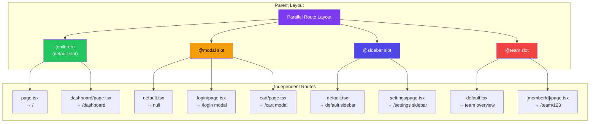
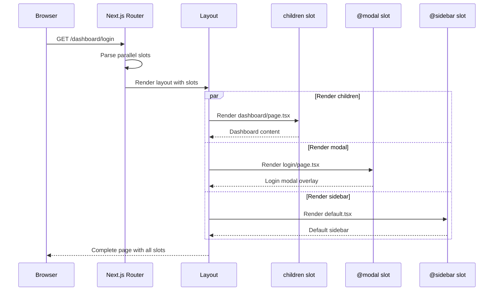
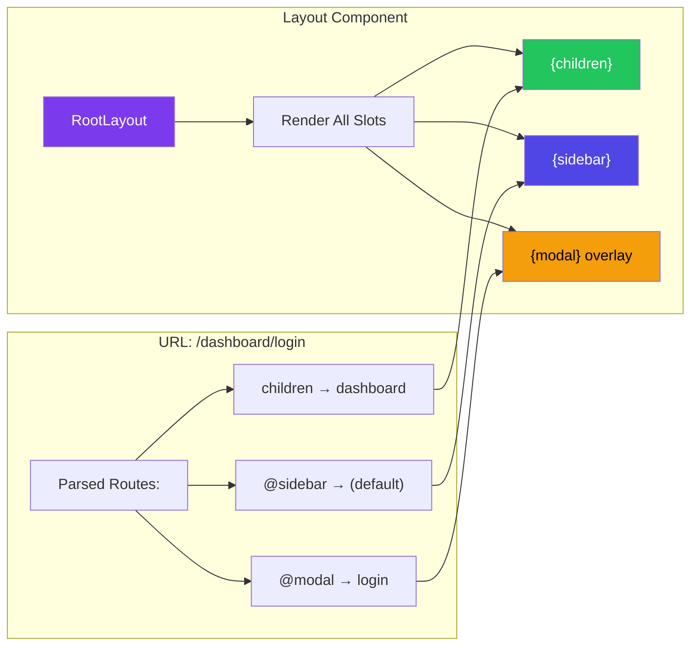
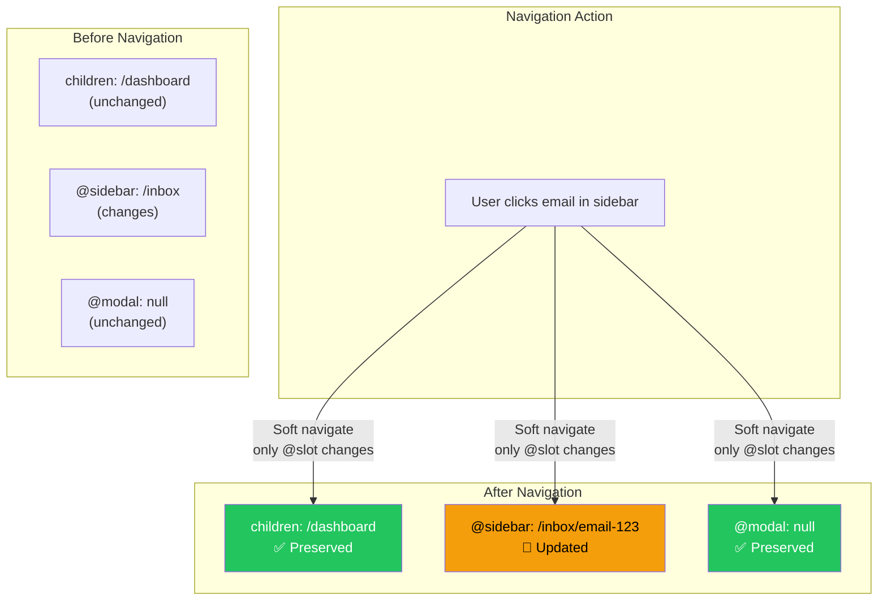

# Parallel Routes

## Introduction
Parallel routes in Next.js allow you to render multiple pages simultaneously within the same layout. By using the `@slot` folder convention (e.g., `@modal`, `@sidebar`, `@team`), you can create named "slots" that each render their own page content independently. This is perfect for dashboards with side panels, modals that overlay the current page, split-view interfaces, and complex layouts where different sections update independently.

## Why do we need this?
Traditional single-page layouts render one page at a time. When you navigate, the entire page content is replaced. But many real-world interfaces need multiple, independently-updating sections:

- **Dashboards** — Main content and sidebar both change based on navigation
- **Modals** — A modal opens over the current page without losing the page state
- **Split views** — Email apps with a list panel and a detail panel that update independently
- **Complex forms** — Multi-step forms where each step has its own URL

Parallel routes solve these by allowing each slot to have its own navigation and state, all rendered simultaneously.

## Problem Statement
As a developer building complex dashboards and interfaces, you face:

- How to show a modal over content while preserving the underlying page's scroll position
- How to update a sidebar and main content independently
- How to avoid losing state when navigating within one section of a layout
- How to handle complex layouts where different sections have their own loading/error states

## Real World Story
Imagine building an email client like Gmail. The interface has three sections: a sidebar (folders), a list (emails in the folder), and a detail panel (selected email). Each section needs independent navigation — clicking a folder changes the email list, clicking an email changes the detail panel. With parallel routes (`@sidebar`, `@list`, `@detail`), each section is its own route slot with independent URL-based navigation, all rendered simultaneously.

## Real World Analogy
Think of parallel routes like **multiple picture frames on a wall**:

- Each frame (slot) displays its own picture (page content)
- You can change the picture in one frame without affecting the others
- The wall (layout) stays the same regardless of what's in each frame
- Viewers see all frames simultaneously — they don't navigate through one frame to see another

Without parallel routes, it's like having one digital photo frame that cycles through pictures — you can only see one at a time.

## Visual Explanation
```
app/
├── layout.tsx                    ← Wall/parent layout
├── page.tsx                      ← Default main content
├── @modal/                       ← Slot: renders in parallel
│   ├── default.tsx               ← Default: no modal open
│   └── login/
│       └── page.tsx              ← /login shows as modal overlay
├── @sidebar/                     ← Slot: renders in parallel  
│   ├── default.tsx               ← Default sidebar
│   └── settings/
│       └── page.tsx              ← /settings sidebar content
└── @team/                        ← Slot: renders in parallel
    ├── default.tsx               ← Default team view
    └── [memberId]/
        └── page.tsx              ← /team/member shows team detail

Layout receives and renders all slots simultaneously:
export default function Layout({ children, modal, sidebar, team }) {
  return (
    <div>
      <aside>{sidebar}</aside>
      <main>{children}</main>
      {modal}
      <aside>{team}</aside>
    </div>
  )
}
```

## Mermaid Diagram 1: Parallel Route Architecture



## Internal Working
When Next.js processes parallel routes:

1. **Folder scanning** — The `app/` directory is scanned for `@name` folders (slots)
2. **Slot detection** — Each `@name` folder becomes a named prop in the parent layout
3. **Route matching** — Each slot independently matches its own route from the URL
4. **Parallel rendering** — All matched slot pages render simultaneously
5. **Soft navigation** — Navigating within one slot doesn't affect other slots' state
6. **Default fallback** — When a slot has no matching route, `default.tsx` is rendered

## Mermaid Diagram 2: Request Lifecycle with Parallel Routes



## Architecture
The parallel route architecture creates independent rendering streams within a single layout:



## Mermaid Diagram 4: Slot Navigation Independence



## Step-by-Step Flow

1. **Identify slots** — Decide which sections of your layout need independent navigation (modal, sidebar, main content)
2. **Create slot folders** — Add `@slotName` folders in your `app/` directory
3. **Add slot props** — Update your layout to accept and render each slot as a prop
4. **Create slot pages** — Add `page.tsx` files inside each slot for different routes
5. **Provide defaults** — Add `default.tsx` in each slot for fallback rendering
6. **Navigate within slots** — Use `Link` and `useRouter` to navigate within individual slots

## Syntax

```tsx
// app/layout.tsx — Layout rendering parallel slots
export default function Layout({
  children,      // Default slot (always present)
  modal,         // @modal slot
  sidebar,       // @sidebar slot
  team,          // @team slot
}: {
  children: React.ReactNode
  modal: React.ReactNode
  sidebar: React.ReactNode
  team: React.ReactNode
}) {
  return (
    <div className="app-layout">
      <aside className="sidebar">{sidebar}</aside>
      <main className="content">{children}</main>
      <aside className="team-panel">{team}</aside>
      <div className="modal-overlay">{modal}</div>
    </div>
  )
}
```

**Key points:**
- Slot names become prop names in the layout (kebab-case slots become camelCase props: `@my-slot` → `mySlot`)
- `children` is the default slot (un-named folder, always required)
- All slots render simultaneously in the same request
- Each slot has its own `page.tsx`, `loading.tsx`, `error.tsx`

## Basic Example

A dashboard with a sidebar and main content:

```tsx
// app/layout.tsx — Root layout with parallel slots
export default function DashboardLayout({
  children,
  sidebar,
}: {
  children: React.ReactNode
  sidebar: React.ReactNode
}) {
  return (
    <div style={{ display: 'flex', height: '100vh' }}>
      <aside style={{ width: 300, background: '#f3f4f6', padding: '1rem' }}>
        {sidebar}
      </aside>
      <main style={{ flex: 1, padding: '2rem' }}>
        {children}
      </main>
    </div>
  )
}
```

```tsx
// app/@sidebar/default.tsx — Default sidebar content
import Link from 'next/link'

export default function DefaultSidebar() {
  return (
    <nav>
      <h2 style={{ marginBottom: '1rem' }}>Navigation</h2>
      <ul style={{ listStyle: 'none', padding: 0 }}>
        <li style={{ marginBottom: '0.5rem' }}>
          <Link href="/dashboard">Dashboard Home</Link>
        </li>
        <li style={{ marginBottom: '0.5rem' }}>
          <Link href="/dashboard/analytics">Analytics</Link>
        </li>
        <li style={{ marginBottom: '0.5rem' }}>
          <Link href="/dashboard/settings">Settings</Link>
        </li>
        <li style={{ marginBottom: '0.5rem' }}>
          <Link href="/dashboard/profile">Profile</Link>
        </li>
      </ul>
      
      <h3 style={{ marginTop: '2rem', marginBottom: '0.5rem' }}>Projects</h3>
      <ul style={{ listStyle: 'none', padding: 0 }}>
        <li><Link href="/dashboard/projects/1">Project Alpha</Link></li>
        <li><Link href="/dashboard/projects/2">Project Beta</Link></li>
      </ul>
    </nav>
  )
}
```

```tsx
// app/@sidebar/dashboard/page.tsx — Sidebar content for /dashboard
import Link from 'next/link'

export default function DashboardSidebar() {
  return (
    <div>
      <div style={{ 
        background: '#7c3aed', 
        color: 'white', 
        padding: '0.75rem', 
        borderRadius: 8,
        marginBottom: '1rem',
      }}>
        📊 Dashboard Overview
      </div>
      
      <nav>
        {/* Same navigation as default */}
        <ul style={{ listStyle: 'none', padding: 0 }}>
          <li><Link href="/dashboard">Home</Link></li>
          <li><Link href="/dashboard/analytics">Analytics</Link></li>
          <li><Link href="/dashboard/settings">Settings</Link></li>
        </ul>
      </nav>
    </div>
  )
}
```

```tsx
// app/@sidebar/settings/page.tsx — Sidebar content for /dashboard/settings
import Link from 'next/link'

export default function SettingsSidebar() {
  return (
    <div>
      <div style={{ 
        background: '#059669', 
        color: 'white', 
        padding: '0.75rem', 
        borderRadius: 8,
        marginBottom: '1rem',
      }}>
        ⚙️ Settings
      </div>
      
      <nav>
        <ul style={{ listStyle: 'none', padding: 0 }}>
          <li><Link href="/dashboard/settings/general">General</Link></li>
          <li><Link href="/dashboard/settings/security">Security</Link></li>
          <li><Link href="/dashboard/settings/notifications">Notifications</Link></li>
          <li><Link href="/dashboard/settings/billing">Billing</Link></li>
        </ul>
      </nav>
    </div>
  )
}
```

```tsx
// app/dashboard/page.tsx — Main content for /dashboard
export default function DashboardPage() {
  return (
    <div>
      <h1>Dashboard Overview</h1>
      <div style={{ display: 'grid', gridTemplateColumns: 'repeat(3, 1fr)', gap: '1rem', marginTop: '1rem' }}>
        <div style={{ background: '#dbeafe', padding: '1rem', borderRadius: 8 }}>
          <h3>Users</h3>
          <p style={{ fontSize: '2rem', fontWeight: 'bold' }}>1,234</p>
        </div>
        <div style={{ background: '#d1fae5', padding: '1rem', borderRadius: 8 }}>
          <h3>Revenue</h3>
          <p style={{ fontSize: '2rem', fontWeight: 'bold' }}>$12,345</p>
        </div>
        <div style={{ background: '#fef3c7', padding: '1rem', borderRadius: 8 }}>
          <h3>Active</h3>
          <p style={{ fontSize: '2rem', fontWeight: 'bold' }}>89%</p>
        </div>
      </div>
    </div>
  )
}
```

**File structure:**
```
app/
├── layout.tsx                    ← Renders children + sidebar
├── @sidebar/
│   ├── default.tsx               ← Default sidebar content
│   ├── dashboard/
│   │   └── page.tsx              ← Sidebar for /dashboard/* routes
│   └── settings/
│       └── page.tsx              ← Sidebar for /settings/* routes
├── dashboard/
│   └── page.tsx                  ← Main content at /dashboard
└── settings/
    └── page.tsx                  ← Main content at /settings
```

**What's happening:**
- The layout renders both `children` (main content) and `sidebar` (aside) in parallel
- Navigating to `/dashboard` updates both the main content AND the sidebar simultaneously
- The sidebar slot has its own page files for different route segments
- `default.tsx` renders when no specific sidebar page matches the current route

## Intermediate Example

Modal pattern with intercepting routes and parallel routes:

```tsx
// app/layout.tsx — Root layout with modal slot
export default function RootLayout({
  children,
  modal,
}: {
  children: React.ReactNode
  modal: React.ReactNode
}) {
  return (
    <html lang="en">
      <body>
        {children}
        {modal}
      </body>
    </html>
  )
}
```

```tsx
// app/@modal/default.tsx — No modal by default
export default function DefaultModal() {
  return null
}
```

```tsx
// app/@modal/(.)login/page.tsx — Login modal (intercepted from /login)
'use client'

import { useRouter } from 'next/navigation'

export default function LoginModal() {
  const router = useRouter()
  
  return (
    <div 
      style={{
        position: 'fixed',
        inset: 0,
        background: 'rgba(0,0,0,0.5)',
        display: 'flex',
        alignItems: 'center',
        justifyContent: 'center',
        zIndex: 50,
      }}
      onClick={(e) => {
        if (e.target === e.currentTarget) {
          router.back() // Close modal on backdrop click
        }
      }}
    >
      <div 
        style={{
          background: 'white',
          padding: '2rem',
          borderRadius: 12,
          width: 400,
          maxWidth: '90vw',
        }}
      >
        <h2 style={{ marginBottom: '1.5rem' }}>Log In</h2>
        
        <form style={{ display: 'flex', flexDirection: 'column', gap: '1rem' }}>
          <div>
            <label style={{ display: 'block', marginBottom: '0.25rem' }}>Email</label>
            <input 
              type="email" 
              style={{ width: '100%', padding: '0.5rem', border: '1px solid #ccc', borderRadius: 4 }}
            />
          </div>
          <div>
            <label style={{ display: 'block', marginBottom: '0.25rem' }}>Password</label>
            <input 
              type="password" 
              style={{ width: '100%', padding: '0.5rem', border: '1px solid #ccc', borderRadius: 4 }}
            />
          </div>
          <button 
            type="submit"
            style={{
              background: '#7c3aed',
              color: 'white',
              padding: '0.75rem',
              border: 'none',
              borderRadius: 4,
              cursor: 'pointer',
            }}
          >
            Log In
          </button>
        </form>
        
        <button 
          onClick={() => router.back()}
          style={{
            marginTop: '1rem',
            background: 'none',
            border: 'none',
            color: '#666',
            cursor: 'pointer',
          }}
        >
          Close
        </button>
      </div>
    </div>
  )
}
```

```tsx
// app/login/page.tsx — Standalone login page (direct navigation)
export default function LoginPage() {
  return (
    <div style={{ maxWidth: 400, margin: '4rem auto', padding: '2rem' }}>
      <h1>Log In</h1>
      <form style={{ display: 'flex', flexDirection: 'column', gap: '1rem' }}>
        <div>
          <label>Email</label>
          <input type="email" style={{ width: '100%', padding: '0.5rem' }} />
        </div>
        <div>
          <label>Password</label>
          <input type="password" style={{ width: '100%', padding: '0.5rem' }} />
        </div>
        <button type="submit">Log In</button>
      </form>
    </div>
  )
}
```

**Folder structure:**
```
app/
├── layout.tsx                    ← Root layout with modal slot
├── page.tsx                      ← Homepage
├── login/
│   └── page.tsx                  ← Full login page (direct nav)
└── @modal/
    ├── default.tsx               ← No modal
    └── (.)login/
        └── page.tsx              ← Login modal (intercepted)
```

**What's happening:**
- Navigating to `/login` from another page shows the login as a modal overlay
- Navigating directly to `/login` (URL typed in browser) shows the full page
- The `(.)login` intercepting route catches soft navigations to `/login`
- The `default.tsx` returns `null` when no modal should be shown
- Clicking the backdrop calls `router.back()` to dismiss the modal

## Advanced Example

Complex dashboard with three parallel slots and independent state:

```tsx
// app/layout.tsx — Advanced dashboard layout
export default function DashboardLayout({
  children,       // Main content area
  sidebar,        // @sidebar - navigation and filters
  team,           // @team - team members panel
}: {
  children: React.ReactNode
  sidebar: React.ReactNode
  team: React.ReactNode
}) {
  return (
    <div className="dashboard-layout" style={{ display: 'flex', height: '100vh' }}>
      <aside className="sidebar-panel" style={{ width: 280, borderRight: '1px solid #e5e7eb', overflow: 'auto' }}>
        {sidebar}
      </aside>
      
      <main className="main-content" style={{ flex: 1, overflow: 'auto' }}>
        {children}
      </main>
      
      <aside className="team-panel" style={{ width: 320, borderLeft: '1px solid #e5e7eb', overflow: 'auto' }}>
        {team}
      </aside>
    </div>
  )
}
```

```tsx
// app/@sidebar/default.tsx
import Link from 'next/link'
import { Search } from '@/components/Search'

export default function Sidebar() {
  return (
    <div style={{ padding: '1rem' }}>
      <Search />
      
      <nav style={{ marginTop: '1.5rem' }}>
        <Section title="Main">
          <NavItem href="/dashboard">Overview</NavItem>
          <NavItem href="/dashboard/analytics">Analytics</NavItem>
          <NavItem href="/dashboard/reports">Reports</NavItem>
        </Section>
        
        <Section title="Management">
          <NavItem href="/dashboard/projects">Projects</NavItem>
          <NavItem href="/dashboard/team">Team</NavItem>
          <NavItem href="/dashboard/documents">Documents</NavItem>
        </Section>
        
        <Section title="Settings">
          <NavItem href="/dashboard/settings">General</NavItem>
          <NavItem href="/dashboard/settings/billing">Billing</NavItem>
          <NavItem href="/dashboard/settings/integrations">Integrations</NavItem>
        </Section>
      </nav>
    </div>
  )
}

function Section({ title, children }: { title: string; children: React.ReactNode }) {
  return (
    <div style={{ marginBottom: '1.5rem' }}>
      <h3 style={{ fontSize: '0.75rem', textTransform: 'uppercase', color: '#6b7280', marginBottom: '0.5rem' }}>
        {title}
      </h3>
      <ul style={{ listStyle: 'none', padding: 0 }}>
        {children}
      </ul>
    </div>
  )
}

function NavItem({ href, children }: { href: string; children: React.ReactNode }) {
  return (
    <li style={{ marginBottom: '0.25rem' }}>
      <Link 
        href={href}
        style={{ 
          display: 'block', 
          padding: '0.5rem', 
          borderRadius: 6,
          textDecoration: 'none',
          color: '#374151',
        }}
      >
        {children}
      </Link>
    </li>
  )
}
```

```tsx
// app/@team/default.tsx — Team panel with online members
import Link from 'next/link'

const teamMembers = [
  { id: '1', name: 'Alice Johnson', role: 'Designer', online: true },
  { id: '2', name: 'Bob Smith', role: 'Developer', online: true },
  { id: '3', name: 'Carol Davis', role: 'PM', online: false },
  { id: '4', name: 'David Wilson', role: 'Developer', online: true },
]

export default function TeamPanel() {
  return (
    <div style={{ padding: '1rem' }}>
      <div style={{ display: 'flex', justifyContent: 'space-between', alignItems: 'center', marginBottom: '1rem' }}>
        <h2 style={{ fontSize: '1rem', fontWeight: 600 }}>Team Members</h2>
        <span style={{ fontSize: '0.875rem', color: '#6b7280' }}>
          {teamMembers.filter(m => m.online).length} online
        </span>
      </div>
      
      <ul style={{ listStyle: 'none', padding: 0 }}>
        {teamMembers.map(member => (
          <li key={member.id} style={{ marginBottom: '0.75rem' }}>
            <Link 
              href={`/dashboard/team/${member.id}`}
              style={{ 
                display: 'flex', 
                alignItems: 'center', 
                gap: '0.75rem', 
                padding: '0.5rem',
                borderRadius: 6,
                textDecoration: 'none',
                color: '#374151',
              }}
            >
              <div style={{
                width: 36,
                height: 36,
                borderRadius: '50%',
                background: member.online ? '#22c55e' : '#d1d5db',
                display: 'flex',
                alignItems: 'center',
                justifyContent: 'center',
                color: 'white',
                fontWeight: 'bold',
              }}>
                {member.name[0]}
              </div>
              <div>
                <div style={{ fontWeight: 500 }}>{member.name}</div>
                <div style={{ fontSize: '0.875rem', color: '#6b7280' }}>{member.role}</div>
              </div>
            </Link>
          </li>
        ))}
      </ul>
    </div>
  )
}
```

```tsx
// app/@team/team/[memberId]/page.tsx — Team member detail in side panel
import Link from 'next/link'

const teamMembers = {
  '1': { name: 'Alice Johnson', role: 'Designer', email: 'alice@example.com', bio: 'Senior UI/UX designer with 8 years of experience.' },
  '2': { name: 'Bob Smith', role: 'Developer', email: 'bob@example.com', bio: 'Full-stack developer specializing in Next.js.' },
}

export default function TeamMemberDetail({
  params,
}: {
  params: { memberId: string }
}) {
  const member = teamMembers[params.memberId as keyof typeof teamMembers]
  
  if (!member) {
    return <div style={{ padding: '1rem', color: '#ef4444' }}>Member not found</div>
  }
  
  return (
    <div style={{ padding: '1rem' }}>
      <Link 
        href="/dashboard"
        style={{ fontSize: '0.875rem', color: '#7c3aed' }}
      >
        ← Back to team
      </Link>
      
      <div style={{ marginTop: '1rem', textAlign: 'center' }}>
        <div style={{
          width: 64,
          height: 64,
          borderRadius: '50%',
          background: '#7c3aed',
          display: 'flex',
          alignItems: 'center',
          justifyContent: 'center',
          color: 'white',
          fontSize: '1.5rem',
          fontWeight: 'bold',
          margin: '0 auto',
        }}>
          {member.name[0]}
        </div>
        <h3 style={{ marginTop: '0.75rem' }}>{member.name}</h3>
        <p style={{ color: '#6b7280', fontSize: '0.875rem' }}>{member.role}</p>
      </div>
      
      <div style={{ marginTop: '1.5rem' }}>
        <div style={{ marginBottom: '0.75rem' }}>
          <label style={{ fontSize: '0.75rem', color: '#6b7280' }}>Email</label>
          <p>{member.email}</p>
        </div>
        <div>
          <label style={{ fontSize: '0.75rem', color: '#6b7280' }}>Bio</label>
          <p>{member.bio}</p>
        </div>
      </div>
    </div>
  )
}
```

**What's happening:**
- Three independent slots: `children` (main), `@sidebar` (navigation), `@team` (team panel)
- Each slot has its own `page.tsx`, `default.tsx`, and navigation
- Navigating within one slot doesn't affect the others' state
- The team panel shows a detail view when navigating to `/dashboard/team/1`
- Each slot can have its own loading/error states

## Production Example

Enterprise analytics dashboard with real-time data and parallel routing:

```tsx
// app/(dashboard)/layout.tsx — Production dashboard layout
export default function DashboardLayout({
  children,
  metrics,
  activity,
  notifications,
}: {
  children: React.ReactNode
  metrics: React.ReactNode
  activity: React.ReactNode
  notifications: React.ReactNode
}) {
  return (
    <div className="dashboard-shell">
      <DashboardHeader />
      
      <div className="dashboard-body">
        <DashboardSidebar />
        
        <div className="dashboard-main">
          {/* Metrics bar renders from its own slot */}
          <div className="metrics-bar">
            {metrics}
          </div>
          
          {/* Main content */}
          <div className="content-area">
            {children}
          </div>
        </div>
        
        {/* Activity feed (right sidebar) */}
        <aside className="activity-panel">
          {activity}
        </aside>
      </div>
      
      {/* Notification toasts (overlay) */}
      <div className="notification-container">
        {notifications}
      </div>
    </div>
  )
}
```

```tsx
// Production folder structure
app/
├── (dashboard)/
│   ├── layout.tsx
│   ├── dashboard/
│   │   ├── page.tsx                   → /dashboard
│   │   └── reports/
│   │       └── page.tsx               → /dashboard/reports
│   │
│   ├── @metrics/
│   │   ├── default.tsx                ← Real-time metrics bar
│   │   └── reports/
│   │       └── page.tsx               ← Reports-specific metrics
│   │
│   ├── @activity/
│   │   ├── default.tsx                ← Recent activity feed
│   │   └── team/
│   │       └── page.tsx               ← Team activity filter
│   │
│   └── @notifications/
│       ├── default.tsx                ← Empty state (null)
│       ├── (.)alerts/
│       │   └── page.tsx               ← Alert notification modal
│       └── (.)messages/
│           └── page.tsx               ← Message notification modal
```

## Folder Structure

```
app/
├── layout.tsx                    ← Root layout (accepts all slots)
├── page.tsx                      ← Default homepage
│
├── @analytics/                   ← Slot: analytics panel
│   ├── default.tsx               ← Default: show overview
│   ├── dashboard/
│   │   └── page.tsx              ← /dashboard: show dashboard analytics
│   └── reports/
│       └── page.tsx              ← /reports: show report analytics
│
├── @modal/                       ← Slot: modal overlay
│   ├── default.tsx               ← Default: null (no modal)
│   ├── (.)login/page.tsx        ← Intercepted: /login as modal
│   └── (.)photos/[id]/page.tsx  ← Intercepted: photo modal
│
├── @sidebar/                     ← Slot: sidebar navigation
│   ├── default.tsx               ← Default: expanded sidebar
│   └── _components/              ← Private: sidebar components
│
├── dashboard/
│   └── page.tsx                  → /dashboard
├── reports/
│   └── page.tsx                  → /reports
└── login/
    └── page.tsx                  → /login (full page, not modal)
```

## 🚀 Best Practices

1. **Always provide a `default.tsx`** — Every slot needs a default fallback for unmatched routes
2. **Use `null` for empty defaults** — `default.tsx` returning `null` is cleaner than empty divs
3. **Avoid complex state in modal slots** — Modals should be lightweight; use them for temporary overlays
4. **Combine with intercepting routes** — `(.)path` intercepting routes pair perfectly with `@modal` slots
5. **Keep layout components pure** — Layouts should only compose slots, not contain business logic
6. **Use route groups inside slots** — `@modal/(.)login/page.tsx` keeps modal intercepts organized
7. **Each slot has independent loading/error** — Add `loading.tsx` and `error.tsx` per slot

## ⚠ Common Mistakes

1. **Missing `default.tsx`** — Without it, navigating to routes with no match throws an error
2. **Forgetting to render a slot** — If you don't use a slot in your layout, Next.js warns at build time
3. **Complex layouts in modal slots** — Modals should be simple overlays, not complex pages
4. **Slot name inconsistency** — `@my-slot` becomes `mySlot` prop (kebab-case to camelCase)
5. **Nesting parallel routes too deep** — Slots at multiple levels add complexity; keep them flat
6. **Not handling browser navigation** — Back/forward buttons may not behave as expected with parallel routes

## 📦 Performance Notes

- Slots render in parallel, not serial — performance depends on the slowest slot
- Each slot has its own bundle, improving code splitting
- `default.tsx` that returns `null` has zero runtime cost (no DOM to render)
- Soft navigation within one slot doesn't re-render other slots
- Use streaming within slow slots to improve perceived performance

## 🔒 Security Notes

- Parallel routes don't create security boundaries — each slot's content is on the same page
- Auth checks should be in the layout that wraps all slots, not in individual slot pages
- Sensitive data in modal slots still loads on the server — it's not client-side only
- Use caution with intercepting routes for auth pages — ensure direct URLs also work

## 🌍 SEO Considerations

- Search engines see the fully-rendered page including all slots
- Modal content rendered via parallel/intercepting routes should have standalone pages too
- Use `generateMetadata` in the main content slot for primary SEO tags
- Avoid duplicating SEO-critical content across multiple slots

## Interview Questions

1. What are parallel routes and when would you use them?
2. How do you define a parallel route slot in the file system?
3. What is the purpose of `default.tsx` in a parallel route slot?
4. How do parallel routes differ from nested layouts?
5. What's the relationship between parallel routes and intercepting routes?
6. Can you have parallel routes within parallel routes?
7. How does navigation work within individual slots?

## MCQs

1. How do you define a parallel route slot in the App Router?
   a) `[slotName]`
   b) `(slotName)`
   c) `@slotName`
   d) `_slotName`
   <details>
   <summary>Answer</summary>
   c) `@slotName` — The `@` prefix defines a parallel route slot.
   </details>

2. What is the purpose of `default.tsx` in a parallel route slot?
   a) It's the main page for the slot
   b) It renders when no other page in the slot matches the route
   c) It provides default styles for the slot
   d) It's mandatory and must return HTML
   <details>
   <summary>Answer</summary>
   b) `default.tsx` renders when no other page in the slot matches the current route.
   </details>

3. What happens when a user navigates within one parallel route slot?
   a) The entire page re-renders
   b) Only that slot re-renders; other slots maintain state
   c) All slots re-render independently
   d) Navigation is blocked
   <details>
   <summary>Answer</summary>
   b) Only the navigated slot re-renders; other slots maintain their state.
   </details>

4. Which pattern pairs perfectly with `@modal` parallel routes?
   a) Dynamic routes
   b) Intercepting routes
   c) Route groups
   d) Private folders
   <details>
   <summary>Answer</summary>
   b) Intercepting routes `(.)path` pair perfectly with modals for soft navigation patterns.
   </details>

5. What should `default.tsx` return when no modal should be shown?
   a) An empty `<div>`
   b) `null`
   c) `undefined`
   d) A loading spinner
   <details>
   <summary>Answer</summary>
   b) `null` — Returning null renders nothing, which is the cleanest approach.
   </details>

## Practice Exercise

1. Create a dashboard with two parallel slots: `@sidebar` and `@activity`
2. The sidebar should have different content for `/dashboard` vs `/dashboard/settings`
3. The activity panel should show recent activity on the default route and team activity on `/dashboard/team`
4. Add `default.tsx` for both slots
5. Implement independent navigation: clicking in the sidebar updates only the sidebar slot

## Debugging Exercise

Find and fix the bugs:

```tsx
// app/layout.tsx — Parallel route layout
export default function Layout({ children, sidebar }) {
  return (
    <div>
      {sidebar}
      {children}
    </div>
  )
}
// Error: Missing modal slot rendering
// @modal/default.tsx doesn't exist
```

**Bug 1:** Missing TypeScript type for the `sidebar` prop.
**Fix:** Add `sidebar: React.ReactNode` type annotation.

**Bug 2:** The `@modal` slot exists in the folder structure but isn't rendered.
**Fix:** Add `modal` prop and render `{modal}` in the layout.

**Bug 3:** Missing `default.tsx` in the `@modal` slot.
**Fix:** Create `@modal/default.tsx` that returns `null`.

## Real-world Scenario

**Problem:** Your e-commerce site needs a quick-view modal for product images. When users click a product image on the listing page, a modal opens showing the full-size image without navigating away from the listing. If they share the URL, the full image page should load directly.

**Solution:**
```
app/
├── products/
│   ├── page.tsx                    → /products (listing)
│   └── [id]/
│       └── page.tsx                → /products/123 (detail page)
│
└── @modal/
    ├── default.tsx                 → null (no modal)
    └── (.)products/[id]/
        └── page.tsx               → Intercepted: modal overlay
```

When clicking a product from the listing: modal opens (intercepted route). When navigating directly to `/products/123`: full page loads. When closing the modal: user sees the listing page again.

## Interview Coding Question

Implement a photo gallery with parallel route modals:

```tsx
// app/layout.tsx
export default function Layout({
  children,
  modal,
}: {
  children: React.ReactNode
  modal: React.ReactNode
}) {
  return (
    <html>
      <body>
        {children}
        {modal}
      </body>
    </html>
  )
}

// app/@modal/default.tsx
export default function Default() {
  return null
}

// app/@modal/(.)photos/[id]/page.tsx
'use client'
import { useRouter } from 'next/navigation'

export default function PhotoModal({ params }: { params: { id: string } }) {
  const router = useRouter()
  
  return (
    <div className="modal-backdrop" onClick={() => router.back()}>
      <div className="modal-content" onClick={e => e.stopPropagation()}>
        
        <button onClick={() => router.back()}>Close</button>
      </div>
    </div>
  )
}
```

## Mini Project

**Build a Dashboard with Parallel Routes**

Create a project management dashboard with:

1. **Layout structure:**
   - `@sidebar` — Navigation with sections: Overview, Projects, Team, Settings
   - `@main` (children) — Main content area
   - `@activity` — Right sidebar showing real-time activity
   - `@modal` — Modal overlay for quick actions

2. **Routes:**
   - `/dashboard` — Overview with metrics
   - `/dashboard/projects` — Project listing
   - `/dashboard/projects/[id]` — Project detail
   - `/dashboard/team` — Team overview
   - `/dashboard/team/[memberId]` — Member detail (in activity panel)

3. **Features:**
   - Sidebar updates active section highlighting based on route
   - Activity panel shows team members by default, member detail when navigated
   - Modal for creating new projects/tasks
   - Independent loading states per slot
   - Independent error boundaries per slot

4. **Data:** Mock data for projects, team members, and activity feed

## Summary

Parallel routes (using `@slotName` folders) allow you to render multiple pages simultaneously within the same layout. Each slot has independent navigation, state, loading states, and error boundaries. The `default.tsx` file provides fallback content when no route matches a particular slot. Parallel routes pair perfectly with intercepting routes for modal patterns. They're ideal for dashboards, complex layouts, and applications requiring independent section navigation.

## Cheat Sheet

```tsx
// Define slots in folder: @name
app/
├── layout.tsx                    ← Receives slot props
├── @sidebar/                     ← Named slot
│   ├── default.tsx               ← Fallback (REQUIRED)
│   └── dashboard/
│       └── page.tsx              ← Specific route
├── @modal/
│   └── default.tsx               ← Returns null for no modal
└── dashboard/
    └── page.tsx                  ← children (default slot)

// Layout renders all slots
export default function Layout({
  children,  // Default slot
  sidebar,   // @sidebar
  modal,     // @modal
}: {
  children: React.ReactNode
  sidebar: React.ReactNode
  modal: React.ReactNode
}) {
  return (
    <div>
      <aside>{sidebar}</aside>
      <main>{children}</main>
      {modal}
    </div>
  )
}

// default.tsx for empty modal
export default function Default() {
  return null
}

// Each slot has its own:
// - page.tsx (route-specific content)
// - loading.tsx (loading state)
// - error.tsx (error boundary)
// - default.tsx (fallback for unmatched routes)
```

## Related Topics
- Intercepting Routes (Next Topic)
- Route Groups for Organization (Previous Topic)
- Layouts and Templates
- Loading UI and Streaming
- Error Handling

## Further Reading
- [Next.js Documentation: Parallel Routes](https://nextjs.org/docs/app/building-your-application/routing/parallel-routes)
- [Next.js Documentation: Intercepting Routes](https://nextjs.org/docs/app/building-your-application/routing/intercepting-routes)
- [Next.js Documentation: Layouts](https://nextjs.org/docs/app/building-your-application/routing/pages-and-layouts)
