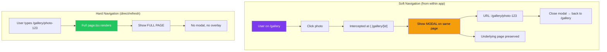
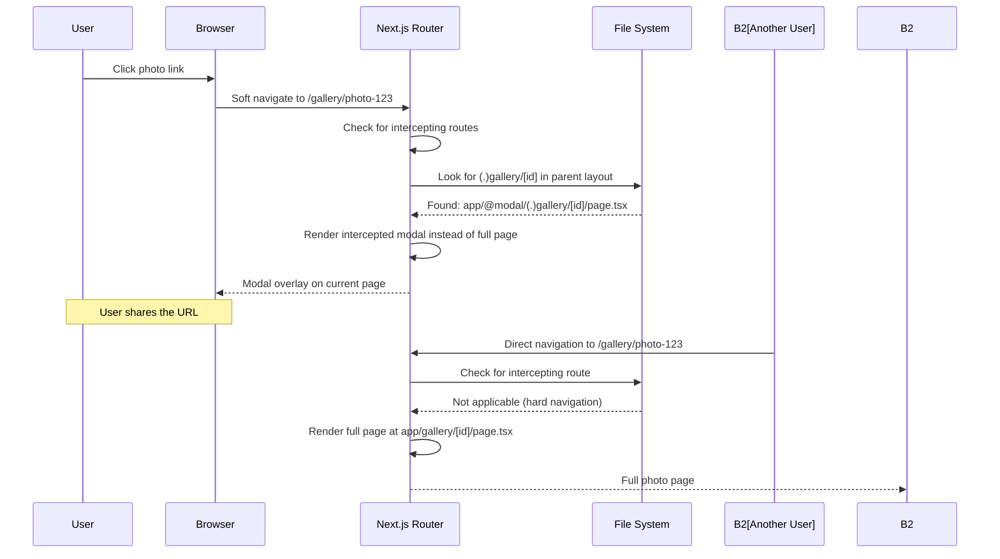
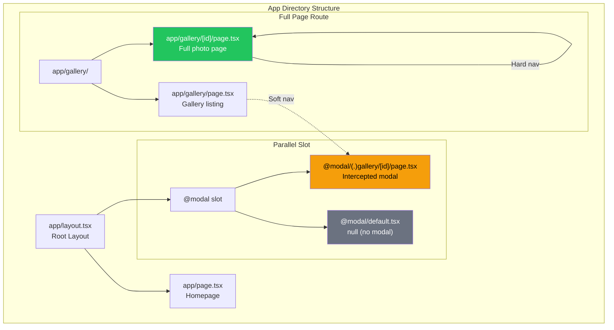
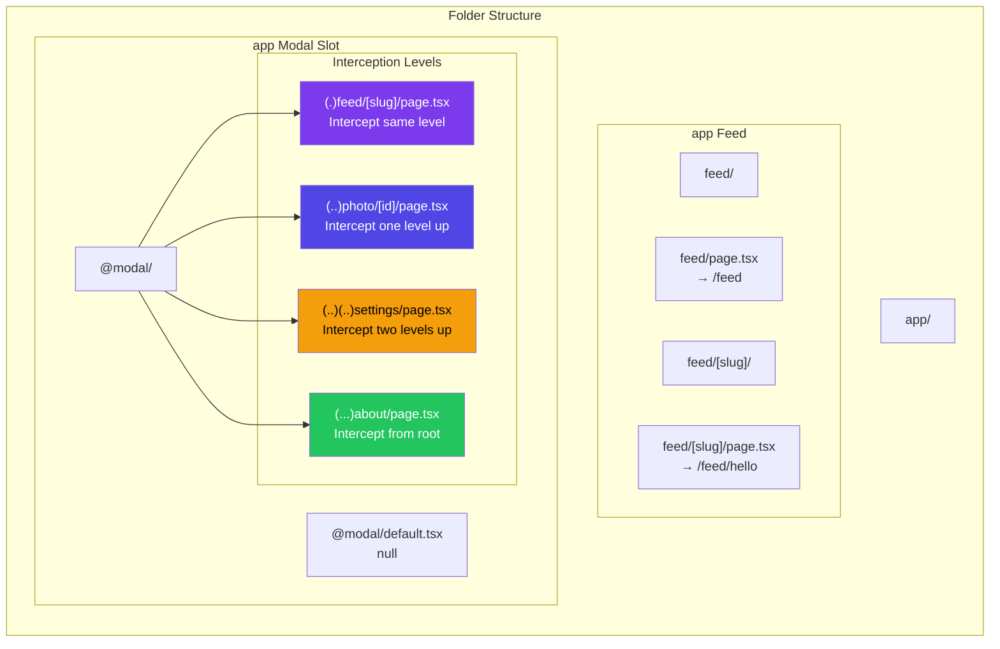

# Intercepting Routes

## Introduction
Intercepting routes in Next.js allow you to intercept a navigation action and display a different UI than what the URL normally renders. By using the `(.)`, `(..)`, `(..)(..)`, or `(...)` conventions, you can "intercept" route segments and show alternative content — most commonly used for modals, slide-in panels, and overlays that appear on top of the current page while the URL reflects the intercepted route.

## Why do we need this?
Modern web applications frequently need patterns where:

- A user clicks a link and a **modal** appears, but the URL updates to the modal's page
- A **slide-in panel** shows content from another page without leaving the current page
- A **photo gallery** opens images in a lightbox while preserving the gallery behind it
- Users can **share or bookmark** the modal/slide-in URL and get the full page directly

Intercepting routes make these patterns possible by providing two views for the same URL:
1. **Intercepted view** — Rendered in a modal/overlay when navigating from within the app
2. **Full page view** — Rendered directly when navigating to the URL (or refreshing)

## Problem Statement
As a developer building modern interfaces, you need to:

- Show content in a modal/overlay without losing the underlying page state
- Update the URL when a modal opens (for shareability and browser history)
- Show the full page instead of the modal when users navigate directly to the URL
- Handle browser back button correctly (close modal, don't navigate away)
- Preserve scroll position and component state behind the modal

## Real World Story
Instagram's photo viewer is the classic example. When you're scrolling your feed and tap a photo, a modal/lightbox opens showing the photo in detail. The URL changes to `/p/ABC123/`. If you share that URL, anyone who opens it sees the full photo page with comments. If you close the modal, you're back to your feed exactly where you left off. This is intercepting routes in action — one URL, two presentations depending on context.

## Real World Analogy
Think of intercepting routes like **a store with a window display**:

- **Full page (direct navigation)** = Walking through the store's main entrance. You see the full product display.
- **Intercepted modal (from within)** = Looking at the window display from inside the store. You see the product highlighted in a showcase while the rest of the store (the underlying page) remains visible around it.

The product is the same (`/product/123`), but how you experience it depends on where you're looking from.

## Visual Explanation

```
Navigation Flow:
┌─────────────────────────────────┐
│  Photo Gallery (/gallery)       │
│  ┌─────┐ ┌─────┐ ┌─────┐       │
│  │     │ │     │ │     │       │
│  │  📷 │ │  📷 │ │  📷 │       │
│  └──┴──┘ └──┴──┘ └──┴──┘       │
│       │ click                    │
│       ▼                         │
│  ┌─────────────────────────┐    │  ← Intercepted route
│  │  🖼️ Photo Modal          │   │     renders AS MODAL
│  │  /gallery/photo-123      │   │     URL: /gallery/photo-123
│  └─────────────────────────┘    │
└─────────────────────────────────┘

Direct Navigation:
┌─────────────────────────────────┐
│  Photo Detail (/gallery/photo-123) │  ← Full page renders
│                                 │     DIRECTLY
│  ┌─────────────────────────┐    │
│  │                         │    │
│  │         🖼️              │    │
│  │     Full Photo Page     │    │
│  │   with comments, likes  │    │
│  │                         │    │
│  └─────────────────────────┘    │
│  ← Back to gallery              │
└─────────────────────────────────┘
```

## Mermaid Diagram 1: Intercepting Routes Concept



## Internal Working
Next.js intercepting routes work through a multi-layered routing mechanism:

1. **Route registration** — Each page route has a full page handler and zero or more interceptors
2. **Navigation type detection** — Next.js distinguishes between soft navigation (Link/useRouter) and hard navigation (browser refresh, direct URL entry)
3. **Interceptor matching** — On soft navigation, Next.js checks parent layouts for matching intercepting route patterns
4. **Pattern matching syntax**:
   - `(.)` — Intercept at the same level
   - `(..)` — Intercept one level above
   - `(..)(..)` — Intercept two levels above
   - `(...)` — Intercept from the root app directory

## Mermaid Diagram 2: Intercepting Route Resolution



## Architecture
Intercepting routes work within the parallel route architecture to create modal patterns:



## Mermaid Diagram 4: Interception Pattern Levels



## Step-by-Step Flow

1. **Create the full page route** — First, create the normal page (e.g., `app/gallery/[id]/page.tsx`)
2. **Add a parallel slot** — Create `@modal` in the parent layout for the intercepted view
3. **Create default.tsx** — Return `null` when no modal should be shown
4. **Add intercepted route** — Inside `@modal/`, create `(.)gallery/[id]/page.tsx`
5. **Update layout** — Render both `{children}` and `{modal}` in the parent layout
6. **Create Link** — Link to the normal page route — Next.js automatically intercepts soft navigations

## Syntax

```tsx
// Intercepting route patterns:
// (.)    → Same level    → app/feed/@modal/(.)feed/[slug]/page.tsx
// (..)   → One level up  → app/feed/@modal/(..)photo/[id]/page.tsx
// (..)(..) → Two levels up → app/feed/@modal/(..)(..)settings/page.tsx
// (...)  → Root level    → app/feed/@modal/(...)about/page.tsx

// Full page: app/gallery/[id]/page.tsx
export default async function PhotoPage({ params }: { params: { id: string } }) {
  const photo = await getPhoto(params.id)
  
  return (
    <div className="photo-page">
      <Image src={photo.url} alt={photo.title} width={1200} height={800} />
      <h1>{photo.title}</h1>
      <p>{photo.description}</p>
      <div className="comments">{/* comments */}</div>
    </div>
  )
}

// Intercepted modal: app/@modal/(.)gallery/[id]/page.tsx
'use client'

import { useRouter } from 'next/navigation'

export default function PhotoModal({ params }: { params: { id: string } }) {
  const router = useRouter()
  
  return (
    <div className="modal-backdrop" onClick={() => router.back()}>
      <div className="modal-content" onClick={e => e.stopPropagation()}>
        <Image src={photo.url} alt={photo.title} />
        <button onClick={() => router.back()}>Close</button>
      </div>
    </div>
  )
}
```

**Key syntax rules:**
- The `(.)` prefix is relative to the location of the intercepting route file
- `(.)` intercepts at the same URL segment level
- `(..)` goes up one URL segment level
- `(...)` intercepts from the root `app/` directory

## Basic Example

Simple photo gallery with intercepted modals:

```tsx
// app/layout.tsx — Root layout with modal slot
export default function RootLayout({
  children,
  modal,
}: {
  children: React.ReactNode
  modal: React.ReactNode
}) {
  return (
    <html lang="en">
      <body>
        {children}
        {modal}
      </body>
    </html>
  )
}
```

```tsx
// app/@modal/default.tsx
export default function Default() {
  return null
}
```

```tsx
// app/gallery/page.tsx — Gallery listing page
import Link from 'next/link'

const photos = [
  { id: '1', title: 'Sunset', thumb: '/sunset-thumb.jpg' },
  { id: '2', title: 'Ocean', thumb: '/ocean-thumb.jpg' },
  { id: '3', title: 'Forest', thumb: '/forest-thumb.jpg' },
]

export default function GalleryPage() {
  return (
    <div style={{ padding: '2rem' }}>
      <h1>Photo Gallery</h1>
      <div style={{ display: 'grid', gridTemplateColumns: 'repeat(3, 1fr)', gap: '1rem', marginTop: '1rem' }}>
        {photos.map(photo => (
          <Link 
            key={photo.id}
            href={`/gallery/${photo.id}`}
            style={{ textDecoration: 'none' }}
          >
            <div style={{
              background: '#f3f4f6',
              borderRadius: 8,
              padding: '2rem',
              textAlign: 'center',
              cursor: 'pointer',
            }}>
              <div style={{ fontSize: '3rem' }}>📷</div>
              <p style={{ marginTop: '0.5rem' }}>{photo.title}</p>
            </div>
          </Link>
        ))}
      </div>
    </div>
  )
}
```

```tsx
// app/@modal/(.)gallery/[id]/page.tsx — Intercepted photo modal
'use client'

import { useRouter } from 'next/navigation'

const photos = {
  '1': { title: 'Sunset', description: 'Beautiful sunset over the mountains' },
  '2': { title: 'Ocean', description: 'Waves crashing on the shore' },
  '3': { title: 'Forest', description: 'Misty morning in the forest' },
}

export default function PhotoModal({
  params,
}: {
  params: { id: string }
}) {
  const router = useRouter()
  const photo = photos[params.id as keyof typeof photos]

  return (
    <div
      style={{
        position: 'fixed',
        inset: 0,
        backgroundColor: 'rgba(0, 0, 0, 0.7)',
        display: 'flex',
        alignItems: 'center',
        justifyContent: 'center',
        zIndex: 50,
        backdropFilter: 'blur(4px)',
      }}
      onClick={(e) => {
        if (e.target === e.currentTarget) {
          router.back()
        }
      }}
    >
      <div
        style={{
          backgroundColor: 'white',
          borderRadius: 16,
          padding: '2rem',
          maxWidth: 600,
          width: '90%',
          position: 'relative',
        }}
      >
        <button
          onClick={() => router.back()}
          style={{
            position: 'absolute',
            top: '1rem',
            right: '1rem',
            background: '#e5e7eb',
            border: 'none',
            borderRadius: '50%',
            width: 36,
            height: 36,
            cursor: 'pointer',
            fontSize: '1.25rem',
            display: 'flex',
            alignItems: 'center',
            justifyContent: 'center',
          }}
        >
          ✕
        </button>

        <div style={{ fontSize: '4rem', textAlign: 'center', marginBottom: '1rem' }}>🖼️</div>
        <h2 style={{ textAlign: 'center' }}>{photo?.title}</h2>
        <p style={{ textAlign: 'center', color: '#666', marginTop: '0.5rem' }}>
          {photo?.description}
        </p>
      </div>
    </div>
  )
}
```

```tsx
// app/gallery/[id]/page.tsx — Full page (direct navigation)
import Link from 'next/link'

const photos = {
  '1': { title: 'Sunset', description: 'Beautiful sunset over the mountains', date: '2024-01-15', author: 'John' },
  '2': { title: 'Ocean', description: 'Waves crashing on the shore', date: '2024-01-20', author: 'Jane' },
  '3': { title: 'Forest', description: 'Misty morning in the forest', date: '2024-02-01', author: 'John' },
}

export default async function PhotoPage({
  params,
}: {
  params: { id: string }
}) {
  const photo = photos[params.id as keyof typeof photos]

  return (
    <div style={{ maxWidth: 800, margin: '2rem auto', padding: '0 1rem' }}>
      <Link href="/gallery" style={{ color: '#7c3aed', textDecoration: 'none' }}>
        ← Back to Gallery
      </Link>

      <div style={{
        background: '#f9fafb',
        borderRadius: 16,
        padding: '2rem',
        marginTop: '1rem',
      }}>
        <div style={{ fontSize: '8rem', textAlign: 'center' }}>🖼️</div>
        <h1 style={{ marginTop: '1rem' }}>{photo?.title}</h1>
        <p style={{ color: '#666', marginTop: '0.5rem' }}>{photo?.description}</p>
        
        <div style={{ display: 'flex', gap: '2rem', marginTop: '1.5rem', color: '#6b7280', fontSize: '0.875rem' }}>
          <span>📅 {photo?.date}</span>
          <span>✍️ {photo?.author}</span>
        </div>

        <div style={{ marginTop: '2rem' }}>
          <h3>Comments</h3>
          <p style={{ color: '#6b7280' }}>No comments yet. Be the first to share your thoughts!</p>
        </div>
      </div>
    </div>
  )
}
```

**Folder structure:**
```
app/
├── layout.tsx                    ← Renders children + modal
├── @modal/
│   ├── default.tsx               ← null (no modal)
│   └── (.)gallery/
│       └── [id]/
│           └── page.tsx          ← Intercepted modal
├── gallery/
│   ├── page.tsx                  ← Gallery listing
│   └── [id]/
│       └── page.tsx              ← Full page
```

**What's happening:**
- Clicking a photo in the gallery shows a modal overlay
- The URL changes to `/gallery/1` (shareable, bookmarkable)
- Clicking the backdrop or "Close" button navigates back to `/gallery`
- Navigating directly to `/gallery/1` shows the full page with comments
- The `default.tsx` returns `null` when no modal should be shown

## Intermediate Example

E-commerce product quick view with intercepting routes:

```tsx
// app/(shop)/layout.tsx — Shop layout with modal slot
export default function ShopLayout({
  children,
  modal,
}: {
  children: React.ReactNode
  modal: React.ReactNode
}) {
  return (
    <div className="shop-layout">
      <ShopHeader />
      <main>{children}</main>
      {modal}
    </div>
  )
}
```

```tsx
// app/(shop)/@modal/(.)products/[id]/page.tsx — Product quick view modal
'use client'

import { useRouter } from 'next/navigation'
import { useState } from 'react'

export default function ProductQuickView({
  params,
}: {
  params: { id: string }
}) {
  const router = useRouter()
  const [quantity, setQuantity] = useState(1)
  
  return (
    <div
      className="fixed inset-0 bg-black/50 flex items-center justify-center z-50"
      onClick={(e) => { if (e.target === e.currentTarget) router.back() }}
    >
      <div 
        className="bg-white rounded-2xl max-w-3xl w-[90vw] max-h-[90vh] overflow-auto p-6 relative"
        onClick={e => e.stopPropagation()}
      >
        <button
          onClick={() => router.back()}
          className="absolute top-4 right-4 w-8 h-8 bg-gray-200 rounded-full flex items-center justify-center hover:bg-gray-300"
        >
          ✕
        </button>
        
        <div className="flex gap-8">
          <div className="w-1/2 bg-gray-100 rounded-xl flex items-center justify-center p-8">
            <span className="text-6xl">📦</span>
          </div>
          
          <div className="w-1/2">
            <h2 className="text-2xl font-bold">Premium Wireless Headphones</h2>
            <p className="text-3xl font-bold text-purple-600 mt-2">$99.99</p>
            <p className="text-gray-600 mt-4">
              High-quality wireless headphones with active noise cancellation, 
              30-hour battery life, and premium comfort.
            </p>
            
            <div className="mt-6">
              <label className="block text-sm font-medium mb-2">Quantity</label>
              <div className="flex items-center gap-2">
                <button 
                  onClick={() => setQuantity(Math.max(1, quantity - 1))}
                  className="w-10 h-10 border rounded-lg"
                >-</button>
                <span className="w-12 text-center">{quantity}</span>
                <button 
                  onClick={() => setQuantity(quantity + 1)}
                  className="w-10 h-10 border rounded-lg"
                >+</button>
              </div>
            </div>
            
            <button className="w-full bg-purple-600 text-white py-3 rounded-xl mt-6 hover:bg-purple-700">
              Add to Cart — ${(99.99 * quantity).toFixed(2)}
            </button>
            
            <button 
              onClick={() => router.push(`/products/${params.id}`)}
              className="w-full text-purple-600 py-2 mt-2 hover:underline"
            >
              View Full Details ↗
            </button>
          </div>
        </div>
      </div>
    </div>
  )
}
```

```tsx
// app/(shop)/products/[id]/page.tsx — Full product page
export default async function ProductPage({
  params,
}: {
  params: { id: string }
}) {
  return (
    <div className="max-w-6xl mx-auto p-8">
      {/* Full product page with reviews, specs, etc. */}
      <h1>Full Product Details</h1>
      {/* Full content with all sections */}
    </div>
  )
}
```

**What's happening:**
- Clicking "Quick View" shows a product modal on the current page
- The URL updates to `/products/123` (or `/shop/products/123`)
- The modal includes quantity selector and add-to-cart functionality
- "View Full Details" navigates to the full page within the same session
- Direct navigation to `/products/123` shows the complete product page

## Advanced Example

Multi-level interception with dashboard modals and slide-in panels:

```tsx
// app/(dashboard)/layout.tsx — Dashboard layout with multiple slots
export default function DashboardLayout({
  children,
  modal,
  slideover,
}: {
  children: React.ReactNode
  modal: React.ReactNode
  slideover: React.ReactNode
}) {
  return (
    <div className="dashboard-shell">
      <DashboardHeader />
      <div className="flex">
        <DashboardSidebar />
        <main className="flex-1 p-6">
          {children}
        </main>
      </div>
      
      {/* Modal overlay (centered) */}
      <div id="modal-root">{modal}</div>
      
      {/* Slide-in panel (right side) */}
      <div id="slideover-root">{slideover}</div>
    </div>
  )
}
```

```tsx
// app/(dashboard)/@modal/default.tsx
export default function Default() {
  return null
}
```

```tsx
// app/(dashboard)/@slideover/default.tsx
export default function Default() {
  return null
}
```

```tsx
// app/(dashboard)/@modal/(.)settings/profile/page.tsx
// Settings profile opens as a modal
'use client'

import { useRouter } from 'next/navigation'

export default function ProfileModal() {
  const router = useRouter()
  
  return (
    <div className="fixed inset-0 bg-black/50 flex items-center justify-center z-50"
      onClick={(e) => { if (e.target === e.currentTarget) router.back() }}
    >
      <div className="bg-white rounded-2xl p-6 w-full max-w-lg">
        <div className="flex justify-between items-center mb-4">
          <h2 className="text-xl font-bold">Edit Profile</h2>
          <button onClick={() => router.back()} className="text-gray-500 hover:text-gray-700">✕</button>
        </div>
        
        <form className="space-y-4">
          <div>
            <label className="block text-sm font-medium">Name</label>
            <input className="w-full border rounded-lg p-2" />
          </div>
          <div>
            <label className="block text-sm font-medium">Email</label>
            <input className="w-full border rounded-lg p-2" />
          </div>
          <div className="flex justify-end gap-2">
            <button type="button" onClick={() => router.back()} className="px-4 py-2 border rounded-lg">
              Cancel
            </button>
            <button type="submit" className="px-4 py-2 bg-purple-600 text-white rounded-lg">
              Save
            </button>
          </div>
        </form>
      </div>
    </div>
  )
}
```

```tsx
// app/(dashboard)/@slideover/(..)notifications/page.tsx
// Notifications opens as a slide-in panel from the right
'use client'

import { useRouter } from 'next/navigation'

export default function NotificationsSlideover() {
  const router = useRouter()
  
  const notifications = [
    { id: '1', text: 'New comment on your post', time: '2m ago' },
    { id: '2', text: 'Your report is ready', time: '15m ago' },
    { id: '3', text: 'Team meeting in 1 hour', time: '1h ago' },
  ]
  
  return (
    <>
      {/* Backdrop */}
      <div 
        className="fixed inset-0 bg-black/30 z-40"
        onClick={() => router.back()}
      />
      
      {/* Slide-over panel */}
      <div className="fixed inset-y-0 right-0 w-96 bg-white shadow-xl z-50 transform transition-transform">
        <div className="p-6">
          <div className="flex justify-between items-center mb-6">
            <h2 className="text-xl font-bold">Notifications</h2>
            <button onClick={() => router.back()} className="text-gray-500">✕</button>
          </div>
          
          <ul className="space-y-4">
            {notifications.map(notification => (
              <li key={notification.id} className="p-3 bg-gray-50 rounded-lg">
                <p className="text-sm">{notification.text}</p>
                <span className="text-xs text-gray-500">{notification.time}</span>
              </li>
            ))}
          </ul>
        </div>
      </div>
    </>
  )
}
```

```tsx
// Full page routes (direct navigation)
// app/(dashboard)/settings/profile/page.tsx — Full profile page
export default function ProfilePage() {
  return (
    <div>
      <h1>Profile Settings</h1>
      <p>Full settings page with all options visible.</p>
      {/* All settings sections rendered */}
    </div>
  )
}

// app/(dashboard)/notifications/page.tsx — Full notifications page
export default function NotificationsPage() {
  return (
    <div>
      <h1>All Notifications</h1>
      <p>Full notifications page with history and filters.</p>
    </div>
  )
}
```

**Folder structure:**
```
app/(dashboard)/
├── layout.tsx                    ← Renders children + modal + slideover
├── @modal/
│   ├── default.tsx               ← null
│   └── (.)settings/
│       └── profile/
│           └── page.tsx          ← Profile modal
├── @slideover/
│   ├── default.tsx               ← null
│   └── (..)notifications/
│       └── page.tsx              ← Notifications slide-in
├── dashboard/
│   └── page.tsx                  → /dashboard
├── settings/
│   └── profile/
│       └── page.tsx              → /settings/profile (full)
├── notifications/
│   └── page.tsx                  → /notifications (full)
```

**What's happening:**
- Two different interception types in one layout: modal (centered) and slide-over (right panel)
- The `(.)` pattern intercepts same-level routes (settings/profile)
- The `(..)` pattern goes up one level to intercept notifications
- Each slot has separate `default.tsx` — `null` means nothing renders
- Direct navigation to these routes shows full pages instead

## Production Example

Enterprise app with complex interception patterns including auth guards and data fetching:

```tsx
// app/(app)/layout.tsx — Production layout
export default function AppLayout({
  children,
  modal,
  panel,
}: {
  children: React.ReactNode
  modal: React.ReactNode
  panel: React.ReactNode
}) {
  return (
    <div className="app-shell">
      <AppHeader />
      <div className="app-content">
        {children}
      </div>
      {modal}
      {panel}
    </div>
  )
}
```

```tsx
// app/(app)/@modal/(.)invoices/[id]/page.tsx
// Invoice preview modal with data fetching
import { notFound } from 'next/navigation'

async function getInvoice(id: string) {
  const res = await fetch(`https://api.example.com/invoices/${id}`, {
    next: { revalidate: 60 },
  })
  if (!res.ok) return null
  return res.json()
}

export default async function InvoiceModal({
  params,
}: {
  params: { id: string }
}) {
  const invoice = await getInvoice(params.id)
  
  if (!invoice) {
    notFound()
  }
  
  return (
    <div className="fixed inset-0 bg-black/50 flex items-center justify-center z-50">
      <div className="bg-white rounded-2xl p-8 max-w-2xl w-[90vw] max-h-[85vh] overflow-auto">
        {/* Invoice preview content */}
        <h2>Invoice #{invoice.number}</h2>
        {/* ... full invoice preview */}
      </div>
    </div>
  )
}
```

```tsx
// app/(app)/invoices/[id]/page.tsx — Full invoice page
import { notFound } from 'next/navigation'
import type { Metadata } from 'next'

async function getInvoice(id: string) {
  const res = await fetch(`https://api.example.com/invoices/${id}`, {
    next: { revalidate: 60 },
  })
  if (!res.ok) return null
  return res.json()
}

export async function generateMetadata({ params }: { params: { id: string } }): Promise<Metadata> {
  const invoice = await getInvoice(params.id)
  if (!invoice) return { title: 'Invoice Not Found' }
  return { title: `Invoice #${invoice.number}`, description: `Invoice for ${invoice.client}` }
}

export default async function InvoicePage({ params }: { params: { id: string } }) {
  const invoice = await getInvoice(params.id)
  if (!invoice) notFound()
  
  return (
    <div className="invoice-page max-w-4xl mx-auto p-8">
      <h1>Invoice #{invoice.number}</h1>
      {/* Full invoice with all details, print styles, etc. */}
    </div>
  )
}
```

**Production folder structure:**
```
app/(app)/
├── layout.tsx
├── page.tsx                      → /
├── @modal/
│   ├── default.tsx
│   ├── (.)invoices/[id]/
│   │   └── page.tsx              ← Invoice preview modal
│   └── (.)contacts/[id]/
│       └── page.tsx              ← Contact quick-view modal
├── invoices/
│   ├── page.tsx                  → /invoices
│   └── [id]/
│       └── page.tsx              → /invoices/123 (full)
├── contacts/
│   ├── page.tsx                  → /contacts
│   └── [id]/
│       └── page.tsx              → /contacts/123 (full)
└── @panel/
    ├── default.tsx
    └── (..)settings/
        └── integrations/
            └── page.tsx          ← Settings slide-in panel
```

## Folder Structure

```
app/
├── layout.tsx                         ← Root with modal slot
├── page.tsx                           ← Homepage
│
├── @modal/                            ← Modal slot
│   ├── default.tsx                    ← null
│   ├── (.)gallery/[id]/
│   │   └── page.tsx                   ← Photo modal (same level)
│   ├── (..)products/[id]/
│   │   └── page.tsx                   ← Product modal (one level up)
│   └── (...)about/
│       └── page.tsx                   ← About modal (from root)
│
├── gallery/
│   ├── page.tsx
│   └── [id]/page.tsx
│
├── products/
│   └── [id]/page.tsx
│
└── about/page.tsx

// Nested interception pattern:
app/
├── feed/
│   └── @modal/
│       ├── default.tsx
│       └── (.)photos/[id]/
│           └── page.tsx               ← Intercepts /feed/photos/*
└── photos/[id]/page.tsx               ← Full page at /photos/*
```

## 🚀 Best Practices

1. **Always pair with parallel routes** — Intercepting routes are most useful inside `@modal` slots
2. **Always provide a `default.tsx`** — Returns `null` when interception shouldn't apply
3. **Create the full page first** — Always have the full page route working before adding interception
4. **Handle backdrop clicks** — Clicking outside the modal should call `router.back()`
5. **Prevent event bubbling** — Use `e.stopPropagation()` on modal content to prevent accidental closes
6. **Test both navigation paths** — Test soft navigation (modal) AND direct navigation (full page)
7. **Use `router.back()` for close** — This preserves browser history correctly
8. **Add `router.push()` for "View Full"** — Provide a way to navigate to the full page from the modal

## ⚠ Common Mistakes

1. **Missing `default.tsx`** — Without it, navigating to routes without intercepted views causes errors
2. **Wrong interception level** — `(.)` vs `(..)` confusion leads to routes not being intercepted
3. **Forgetting `stopPropagation`** — Clicking inside the modal can close it if propagation isn't stopped
4. **No full page fallback** — Intercepted routes must have corresponding full page routes
5. **Complex state in modals** — Don't put complex state management in modals that should be lightweight
6. **Broken browser navigation** — Not handling browser back button correctly (use `router.back()`)

## 📦 Performance Notes

- Intercepted routes share the parent layout's state — the underlying page is preserved
- Each modal is a separate bundle, improving initial page load
- `default.tsx` returning `null` has zero runtime cost
- Use React.lazy or dynamic imports for heavy modal content
- Consider streaming for modals that fetch significant data

## 🔒 Security Notes

- Intercepted modals still run on the server — sensitive data is not exposed client-side
- Auth checks still apply — modals should respect the same auth as full pages
- XSS protection applies to intercepted content just like full pages
- URLs with intercepted views are still real URLs — ensure they're properly protected

## 🌍 SEO Considerations

- Search engines crawl the full page version, not the intercepted modal
- Modal content (intercepted) should not contain primary SEO content
- Canonical URLs should point to the full page version
- Structured data should be in the full page, not the modal

## Interview Questions

1. What are intercepting routes and what problem do they solve?
2. How do intercepting routes work with parallel routes?
3. What do `(.)`, `(..)`, `(..)(..)`, and `(...)` mean in intercepting routes?
4. How does next/router decide whether to show the intercepted or full page view?
5. What's the difference between the intercepted view and the full page view?
6. Why is `default.tsx` important for intercepting routes in parallel slots?
7. How do you handle the back button correctly with intercepted modals?

## MCQs

1. What does the `(.)` prefix mean in an intercepting route?
   a) Intercept from one level up
   b) Intercept at the same segment level
   c) Intercept from the root
   d) Intercept all routes
   <details>
   <summary>Answer</summary>
   b) `(.)` intercepts at the same URL segment level.
   </details>

2. How do intercepting routes work with parallel routes?
   a) They're alternatives — you use one or the other
   b) Intercepting routes are placed inside `@slot` parallel route folders
   c) They work independently and can't be combined
   d) Parallel routes make intercepting routes unnecessary
   <details>
   <summary>Answer</summary>
   b) Intercepting routes are typically placed inside `@modal` parallel route slots.
   </details>

3. What happens when a user navigates directly to a URL that has an intercepting route?
   a) The intercepted view is shown
   b) The full page is shown (interception only applies to soft navigation)
   c) A 404 error is returned
   d) Both views are shown simultaneously
   <details>
   <summary>Answer</summary>
   b) Direct navigation shows the full page — interception only applies to soft navigation (Link/useRouter).
   </details>

4. Which component should you use to close an intercepted modal and go back?
   a) `router.push('/')`
   b) `router.replace('/')`
   c) `router.back()`
   d) `router.reload()`
   <details>
   <summary>Answer</summary>
   c) `router.back()` correctly preserves browser history and takes the user back to the underlying page.
   </details>

5. What should `default.tsx` return in a modal slot?
   a) A loading spinner
   b) null
   c) An empty layout
   d) A 404 page
   <details>
   <summary>Answer</summary>
   b) null — Returning null renders nothing when no modal should be shown.
   </details>

## Practice Exercise

1. Create a blog with intercepted post previews:
   - `app/blog/page.tsx` — Blog listing with post cards
   - `app/blog/[slug]/page.tsx` — Full blog post page
   - `app/@modal/(.)blog/[slug]/page.tsx` — Post preview modal
   - Implement: click post → show modal, close → back to listing, direct → full page

2. Add multiple interception patterns to a dashboard:
   - `@modal/(.)settings/profile` — Edit profile as modal
   - `@modal/(..)notifications` — Notifications as slide-in
   - `@modal/(...)help` — Help center from root as full-screen overlay

3. Implement proper keyboard handling (Escape key closes modal)

## Debugging Exercise

Find and fix the bugs:

```tsx
// app/@modal/(.)products/[id]/page.tsx
export default function ProductModal({ params }: { params: { id: string } }) {
  const router = useRouter()
  
  return (
    <div className="modal-backdrop" onClick={() => router.back()}>
      <div className="modal-content">
        <h2>Product {params.id}</h2>
        <button onClick={() => router.back()}>Close</button>
      </div>
    </div>
  )
}
```

**Bug 1:** Missing `'use client'` directive — Modal uses `useRouter()` hook.
**Fix:** Add `'use client'` at the top.

**Bug 2:** No `e.stopPropagation()` on the modal content — clicking content closes modal.
**Fix:** Add `onClick={e => e.stopPropagation()}` on the modal content div.

**Bug 3:** Backdrop click also doesn't need `e` — already using arrow function correctly.

## Real-world Scenario

**Problem:** Your email application needs a quick-view modal for emails from the inbox list. Clicking an email shows a preview modal. Clicking "View Full" opens the full email page. Direct links to emails (e.g., from notifications) show the full email page.

**Solution:**
```
app/
├── (app)/
│   ├── layout.tsx              ← Renders children + modal
│   ├── inbox/
│   │   └── page.tsx            → /inbox
│   ├── emails/
│   │   └── [id]/
│   │       └── page.tsx        → /emails/123 (full)
│   └── @modal/
│       ├── default.tsx
│       └── (.)emails/[id]/
│           └── page.tsx        ← Email preview modal
```

## Interview Coding Question

Build a modal router that intercepts multiple route patterns:

```tsx
// app/@modal/(.)photos/[id]/page.tsx
'use client'
import { useRouter } from 'next/navigation'

export default function PhotoModal({ params }: { params: { id: string } }) {
  const router = useRouter()
  
  return (
    <div className="fixed inset-0 bg-black/70 z-50 flex items-center justify-center backdrop-blur-sm"
      onClick={(e) => { if (e.target === e.currentTarget) router.back() }}>
      <div className="bg-white rounded-2xl max-w-2xl w-[90%] overflow-hidden"
        onClick={e => e.stopPropagation()}>
        {/* Photo */}
        <div className="bg-gray-100 h-96 flex items-center justify-center">
          <span className="text-8xl">🖼️</span>
        </div>
        {/* Actions */}
        <div className="p-4 flex justify-between items-center">
          <button onClick={() => router.push(`/photos/${params.id}`)}
            className="text-blue-600 hover:underline">
            View Full Page ↗
          </button>
          <button onClick={() => router.back()}
            className="px-4 py-2 bg-gray-200 rounded-lg hover:bg-gray-300">
            Close
          </button>
        </div>
      </div>
    </div>
  )
}
```

## Mini Project

**Build a Social Media Feed with Intercepted Content**

Create a social media-style app with:

1. **Feed page** (`/feed`) — Scrollable post list with photos
2. **Photo modal** — Click a photo → intercepted modal with full image
3. **Post detail** — Click "View Post" → full post page with comments
4. **Profile modal** — Click username → intercepted profile card
5. **Notifications panel** — Click notification bell → slide-in panel from right

**Routes:**
- `/feed` — Main feed
- `/feed/post/[id]` — Full post page
- `/feed/photo/[id]` — Full photo page  
- `/profile/[username]` — Full profile page
- `/notifications` — Full notifications page

**Intercepted views:**
- `@modal/(.)feed/photo/[id]` — Photo lightbox
- `@modal/(.)profile/[username]` — Quick profile card
- `@slideover/(..)notifications` — Notifications panel

**Features:**
- Each intercepted view has a close button and backdrop dismiss
- "View Full" link in each modal navigates to the full page
- Keyboard shortcut: Escape closes modals
- Browser back button correctly dismisses modals
- Direct URL navigation shows full pages

## Summary

Intercepting routes allow you to show alternative UI (modals, slide-ins, overlays) when users navigate within your app, while preserving the full page experience for direct visits. They use `(.)`, `(..)`, `(..)(..)`, and `(...)` prefixes to define interception levels relative to the current route. Intercepting routes are most powerful when combined with parallel route slots (`@modal`, `@slideover`), creating seamless modal experiences with shareable URLs. Key implementation details include providing `default.tsx` fallbacks, using `router.back()` for closing, and preventing event propagation on modal content.

## Cheat Sheet

```tsx
// Interception patterns
(.)         → Same segment level
(..)        → One segment level up
(..)(..)    → Two segment levels up
(...)       → From app root

// Folder structure
app/
├── layout.tsx                        ← Render {children} + {modal}
├── @modal/
│   ├── default.tsx                   ← export default function Default() { return null }
│   └── (.)products/[id]/
│       └── page.tsx                  ← Intercepted modal
├── products/[id]/page.tsx           ← Full page

// Modal component pattern
'use client'
import { useRouter } from 'next/navigation'

export default function Modal({ params }) {
  const router = useRouter()
  return (
    <div onClick={e => { if(e.target === e.currentTarget) router.back() }}>
      <div onClick={e => e.stopPropagation()}>
        {/* Modal content */}
        <button onClick={() => router.back()}>Close</button>
      </div>
    </div>
  )
}

// Key rules
// ✔ Soft nav → intercepted view
// ✔ Direct nav → full page
// ✔ Always add default.tsx returning null
// ✔ Use router.back() for close
// ✔ Stop propagation on modal content
```

## Related Topics
- Parallel Routes (Previous Topic)
- Route Groups for Organization
- Dynamic Routes with [slug]
- Layouts and Templates
- Client-side Navigation

## Further Reading
- [Next.js Documentation: Intercepting Routes](https://nextjs.org/docs/app/building-your-application/routing/intercepting-routes)
- [Next.js Documentation: Parallel Routes](https://nextjs.org/docs/app/building-your-application/routing/parallel-routes)
- [Next.js Documentation: Linking and Navigating](https://nextjs.org/docs/app/building-your-application/routing/linking-and-navigating)
