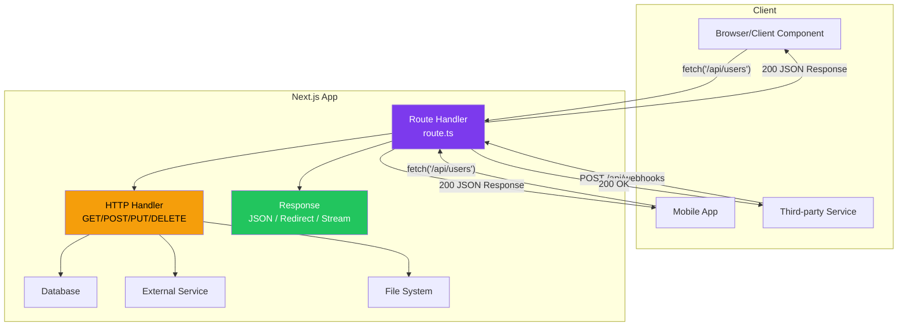
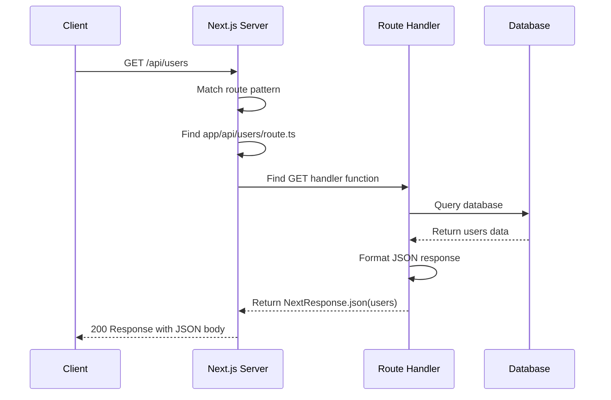
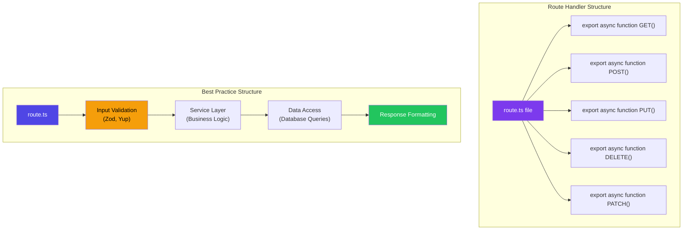
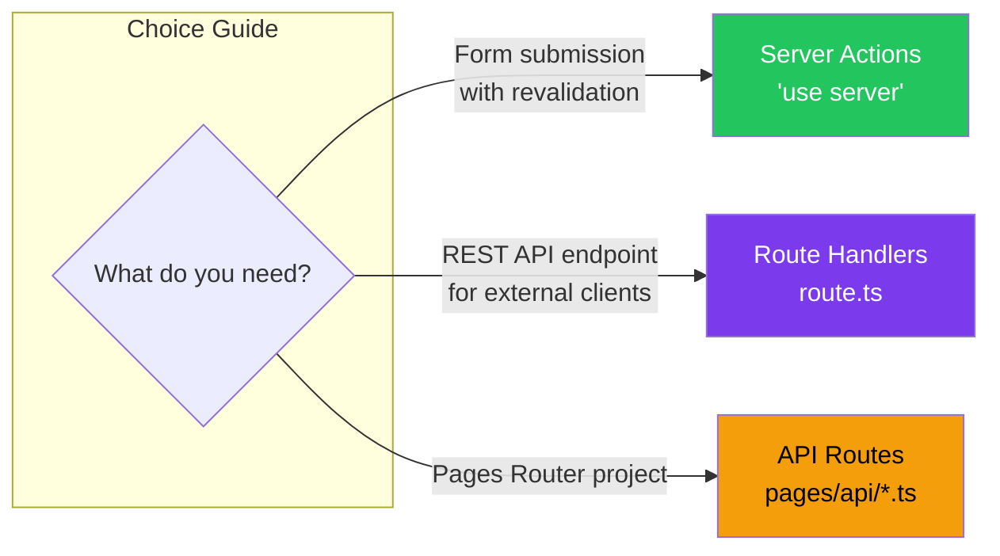

# What are Route Handlers?

## Introduction
Route Handlers are Next.js's way of creating server-side API endpoints within the App Router. By creating a `route.ts` or `route.js` file inside your `app/` directory, you can define custom API routes that handle HTTP requests. Route Handlers are Server Components by default and can handle various HTTP methods (GET, POST, PUT, PATCH, DELETE, HEAD, OPTIONS) while accessing request data, route parameters, and headers.

## Why do we need this?
Modern web applications aren't just about rendering pages. You often need server-side endpoints to:

- Serve JSON data to client components for dynamic updates
- Handle form submissions (though Server Actions are often better for mutations)
- Create webhook endpoints for Stripe, GitHub, Slack, etc.
- Build a public API for your application
- Handle authentication callbacks from OAuth providers
- Serve as a BFF (Backend For Frontend) layer

Route Handlers provide these capabilities within your Next.js project, eliminating the need for a separate backend server.

## Problem Statement
As a developer building full-stack applications with Next.js, you have data that needs to be served via API endpoints. You could set up a separate Express/Fastify server, but that adds deployment complexity, requires CORS configuration, and fragments your codebase. Route Handlers solve this by letting you create API endpoints directly in your Next.js project — no separate server needed.

## Real World Story
Sarah is building a SaaS dashboard that displays real-time analytics data. She needs API endpoints that her client components can fetch to update charts, tables, and metrics. Instead of running a separate Node.js server, she creates Route Handlers inside her Next.js app: `app/api/metrics/route.ts`, `app/api/users/route.ts`, and `app/api/reports/route.ts`. These handlers fetch data from her database and return it as JSON. The entire application — frontend and backend — is deployed as a single Next.js project.

## Real World Analogy
Think of Route Handlers as **restaurant kitchen windows**:

- **Page routes** are like the dining room — where customers (users) come to eat (view pages)
- **Route Handlers** are like the kitchen service window — where waiters (client components) come to pick up orders (data)

The waiter (client component) goes to the kitchen window (Route Handler), says "I need order #123" (makes a request), and the chef (server) prepares the meal (fetches data) and hands it through the window (returns a response).

Both the dining room and the kitchen window serve the same restaurant (your Next.js app) — they just serve different purposes.

## Visual Explanation
```
app/api/ directory structure:

app/
├── api/
│   ├── route.ts              → /api (lists all available endpoints)
│   ├── users/
│   │   ├── route.ts          → GET /api/users (list users)
│   │   └── [id]/
│   │       └── route.ts      → GET /api/users/123 (get user)
│   ├── webhooks/
│   │   └── stripe/
│   │       └── route.ts      → POST /api/webhooks/stripe
│   └── hello/
│       └── route.ts          → GET /api/hello (simple endpoint)
```

## Mermaid Diagram 1: Route Handler Architecture



## Internal Working
When Next.js processes a Route Handler request:

1. **File detection** — Next.js scans `app/` directory for `route.ts` / `route.js` files
2. **Route registration** — Each `route.ts` file registers as an API endpoint at its path
3. **Request matching** — Incoming requests match against route patterns (static and dynamic)
4. **HTTP method matching** — The request's HTTP method is matched against exported functions
5. **Handler execution** — The matched function runs on the server (never client)
6. **Response generation** — The handler returns a Response object or NextResponse
7. **Caching** — Route Handlers are not cached by default (unlike page routes)

## Mermaid Diagram 2: Route Handler Request Lifecycle



## Architecture
Route Handlers follow a clean separation of concerns:



## Mermaid Diagram 4: Route Handler vs Server Actions vs API Routes



## Step-by-Step Flow

1. **Create the directory** — Create `app/api/[endpoint-name]/` folder (use `api/` convention)
2. **Create route.ts** — Add `route.ts` file inside the endpoint folder
3. **Export handlers** — Export named async functions for each HTTP method (GET, POST, etc.)
4. **Handle the request** — Access request data, parse body, validate input
5. **Return a response** — Use `NextResponse.json()`, `Response`, or `redirect()`
6. **Test the endpoint** — Visit the URL in browser or use curl/Postman

## Syntax

```tsx
// app/api/hello/route.ts — Basic Route Handler
import { NextResponse } from 'next/server'

export async function GET() {
  return NextResponse.json({ message: 'Hello, World!' })
}

export async function POST(request: Request) {
  const body = await request.json()
  return NextResponse.json({ received: body })
}
```

```tsx
// app/api/users/[id]/route.ts — Dynamic Route Handler
import { NextResponse } from 'next/server'

interface RouteParams {
  params: { id: string }
}

export async function GET(
  request: Request,
  { params }: RouteParams
) {
  const user = await getUser(params.id)
  return NextResponse.json(user)
}
```

**Key differences from page routes:**
- `route.ts` replaces `page.tsx` in the same folder
- Route Handlers and page routes CANNOT coexist in the same route segment
- Route Handlers support: `GET`, `POST`, `PUT`, `PATCH`, `DELETE`, `HEAD`, `OPTIONS`
- Route Handlers are NOT cached by default (no `fetch` caching)

## Basic Example

A simple Todo API with CRUD operations:

```tsx
// app/api/todos/route.ts — List and create todos
import { NextResponse } from 'next/server'

// In-memory database (use a real database in production)
const todos = [
  { id: 1, title: 'Learn Next.js', completed: false },
  { id: 2, title: 'Build a project', completed: false },
]

// GET /api/todos — List all todos
export async function GET() {
  return NextResponse.json(todos)
}

// POST /api/todos — Create a new todo
export async function POST(request: Request) {
  const body = await request.json()
  
  // Validate input
  if (!body.title) {
    return NextResponse.json(
      { error: 'Title is required' },
      { status: 400 }
    )
  }
  
  const newTodo = {
    id: todos.length + 1,
    title: body.title,
    completed: false,
  }
  
  todos.push(newTodo)
  
  return NextResponse.json(newTodo, { status: 201 })
}
```

```tsx
// app/api/todos/[id]/route.ts — Single todo operations
import { NextResponse } from 'next/server'

interface RouteParams {
  params: { id: string }
}

const todos = [
  { id: 1, title: 'Learn Next.js', completed: false },
  { id: 2, title: 'Build a project', completed: false },
]

// GET /api/todos/1 — Get a single todo
export async function GET(
  request: Request,
  { params }: RouteParams
) {
  const todo = todos.find(t => t.id === parseInt(params.id))
  
  if (!todo) {
    return NextResponse.json(
      { error: 'Todo not found' },
      { status: 404 }
    )
  }
  
  return NextResponse.json(todo)
}

// PUT /api/todos/1 — Update a todo
export async function PUT(
  request: Request,
  { params }: RouteParams
) {
  const body = await request.json()
  const index = todos.findIndex(t => t.id === parseInt(params.id))
  
  if (index === -1) {
    return NextResponse.json(
      { error: 'Todo not found' },
      { status: 404 }
    )
  }
  
  todos[index] = { ...todos[index], ...body }
  
  return NextResponse.json(todos[index])
}

// DELETE /api/todos/1 — Delete a todo
export async function DELETE(
  request: Request,
  { params }: RouteParams
) {
  const index = todos.findIndex(t => t.id === parseInt(params.id))
  
  if (index === -1) {
    return NextResponse.json(
      { error: 'Todo not found' },
      { status: 404 }
    )
  }
  
  todos.splice(index, 1)
  
  return NextResponse.json({ message: 'Deleted successfully' })
}
```

**What's happening:**
- `GET` returns the list of todos as JSON
- `POST` accepts JSON body, validates it, creates a new todo
- `PUT` updates an existing todo by ID
- `DELETE` removes a todo by ID
- Error responses return appropriate HTTP status codes (400, 404)

## Intermediate Example

Route Handler with database, authentication, and error handling:

```tsx
// app/api/posts/route.ts
import { NextResponse } from 'next/server'
import { getServerSession } from 'next-auth'
import { z } from 'zod'

// Zod validation schema
const CreatePostSchema = z.object({
  title: z.string().min(3, 'Title must be at least 3 characters'),
  content: z.string().min(10, 'Content must be at least 10 characters'),
  published: z.boolean().default(false),
})

// GET /api/posts — List posts (with optional filtering)
export async function GET(request: Request) {
  try {
    const { searchParams } = new URL(request.url)
    const page = parseInt(searchParams.get('page') || '1')
    const limit = parseInt(searchParams.get('limit') || '10')
    const published = searchParams.get('published')
    
    // Build query with filters
    const where: any = {}
    if (published !== null) {
      where.published = published === 'true'
    }
    
    const posts = await db.post.findMany({
      where,
      skip: (page - 1) * limit,
      take: limit,
      orderBy: { createdAt: 'desc' },
    })
    
    const total = await db.post.count({ where })
    
    return NextResponse.json({
      posts,
      pagination: {
        page,
        limit,
        total,
        totalPages: Math.ceil(total / limit),
      },
    })
  } catch (error) {
    console.error('Failed to fetch posts:', error)
    return NextResponse.json(
      { error: 'Internal server error' },
      { status: 500 }
    )
  }
}

// POST /api/posts — Create a new post
export async function POST(request: Request) {
  try {
    // Check authentication
    const session = await getServerSession()
    if (!session) {
      return NextResponse.json(
        { error: 'Unauthorized' },
        { status: 401 }
      )
    }
    
    // Parse and validate request body
    const body = await request.json()
    const validation = CreatePostSchema.safeParse(body)
    
    if (!validation.success) {
      return NextResponse.json(
        { 
          error: 'Validation failed',
          details: validation.error.flatten().fieldErrors,
        },
        { status: 400 }
      )
    }
    
    // Create the post
    const post = await db.post.create({
      data: {
        title: validation.data.title,
        content: validation.data.content,
        published: validation.data.published,
        authorId: session.user.id,
      },
    })
    
    return NextResponse.json(post, { status: 201 })
  } catch (error) {
    console.error('Failed to create post:', error)
    return NextResponse.json(
      { error: 'Internal server error' },
      { status: 500 }
    )
  }
}
```

```tsx
// Client component consuming the Route Handler
'use client'

import { useState, useEffect } from 'react'

export function PostList() {
  const [posts, setPosts] = useState([])
  const [loading, setLoading] = useState(true)
  
  useEffect(() => {
    fetch('/api/posts?page=1&limit=10')
      .then(res => res.json())
      .then(data => {
        setPosts(data.posts)
        setLoading(false)
      })
  }, [])
  
  if (loading) return <div>Loading...</div>
  
  return (
    <ul>
      {posts.map(post => (
        <li key={post.id}>{post.title}</li>
      ))}
    </ul>
  )
}
```

**What's happening:**
- Zod validates the request body with clear error messages
- `getServerSession()` checks authentication before mutations
- `searchParams` enables filtering and pagination
- Database operations use Prisma (or any ORM)
- Error handling with try/catch and proper status codes
- `safeParse` provides detailed validation errors

## Advanced Example

Webhook handler with signature verification and streaming:

```tsx
// app/api/webhooks/stripe/route.ts
import { NextResponse } from 'next/server'
import Stripe from 'stripe'

const stripe = new Stripe(process.env.STRIPE_SECRET_KEY!)
const webhookSecret = process.env.STRIPE_WEBHOOK_SECRET!

export async function POST(request: Request) {
  try {
    // Get the raw body for signature verification
    const text = await request.text()
    const signature = request.headers.get('stripe-signature')
    
    if (!signature) {
      return NextResponse.json(
        { error: 'Missing stripe-signature header' },
        { status: 400 }
      )
    }
    
    // Verify the webhook signature
    let event: Stripe.Event
    try {
      event = stripe.webhooks.constructEvent(text, signature, webhookSecret)
    } catch (err) {
      console.error('Webhook signature verification failed:', err)
      return NextResponse.json(
        { error: 'Invalid signature' },
        { status: 400 }
      )
    }
    
    // Handle different event types
    switch (event.type) {
      case 'checkout.session.completed': {
        const session = event.data.object as Stripe.Checkout.Session
        await handleCheckoutCompleted(session)
        break
      }
      case 'customer.subscription.updated': {
        const subscription = event.data.object as Stripe.Subscription
        await handleSubscriptionUpdated(subscription)
        break
      }
      case 'invoice.paid': {
        const invoice = event.data.object as Stripe.Invoice
        await handleInvoicePaid(invoice)
        break
      }
      default:
        console.log(`Unhandled event type: ${event.type}`)
    }
    
    return NextResponse.json({ received: true })
  } catch (error) {
    console.error('Webhook handler error:', error)
    return NextResponse.json(
      { error: 'Internal server error' },
      { status: 500 }
    )
  }
}

async function handleCheckoutCompleted(session: Stripe.Checkout.Session) {
  // Update user's subscription in database
  await db.user.update({
    where: { email: session.customer_email! },
    data: {
      subscriptionId: session.subscription as string,
      subscriptionStatus: 'active',
    },
  })
  
  // Send confirmation email
  await sendEmail({
    to: session.customer_email!,
    subject: 'Payment successful!',
    body: `Thank you for your purchase!`,
  })
}

async function handleSubscriptionUpdated(subscription: Stripe.Subscription) {
  await db.user.update({
    where: { subscriptionId: subscription.id },
    data: {
      subscriptionStatus: subscription.status,
      currentPeriodEnd: new Date(subscription.current_period_end * 1000),
    },
  })
}

async function handleInvoicePaid(invoice: Stripe.Invoice) {
  await db.invoice.create({
    data: {
      stripeInvoiceId: invoice.id,
      amount: invoice.amount_paid,
      status: 'paid',
      userId: invoice.customer as string,
    },
  })
}
```

```tsx
// Streaming Route Handler (RSC-compatible)
// app/api/stream/route.ts
export async function GET() {
  const encoder = new TextEncoder()
  
  const stream = new ReadableStream({
    async start(controller) {
      // Send initial message
      controller.enqueue(encoder.encode('data: Starting...\n\n'))
      
      // Simulate streaming data
      for (let i = 0; i < 5; i++) {
        await new Promise(resolve => setTimeout(resolve, 1000))
        controller.enqueue(
          encoder.encode(`data: Chunk ${i + 1} of 5\n\n`)
        )
      }
      
      controller.enqueue(encoder.encode('data: Complete!\n\n'))
      controller.close()
    },
  })
  
  return new Response(stream, {
    headers: {
      'Content-Type': 'text/event-stream',
      'Cache-Control': 'no-cache',
      'Connection': 'keep-alive',
    },
  })
}
```

## Production Example

A production Route Handler with rate limiting, caching headers, and monitoring:

```tsx
// app/api/search/route.ts — Production search API
import { NextResponse } from 'next/server'
import { rateLimit } from '@/lib/rate-limit'
import { searchContent } from '@/lib/search'
import { logApiCall } from '@/lib/monitoring'

export async function GET(request: Request) {
  const startTime = Date.now()
  
  try {
    // Rate limiting
    const ip = request.headers.get('x-forwarded-for') || 'unknown'
    const { success, limit, remaining, reset } = await rateLimit(ip)
    
    if (!success) {
      return NextResponse.json(
        { error: 'Too many requests' },
        { 
          status: 429,
          headers: {
            'X-RateLimit-Limit': String(limit),
            'X-RateLimit-Remaining': String(remaining),
            'X-RateLimit-Reset': String(reset),
            'Retry-After': String(Math.ceil((reset - Date.now()) / 1000)),
          },
        }
      )
    }
    
    // Parse search parameters
    const { searchParams } = new URL(request.url)
    const query = searchParams.get('q')
    const type = searchParams.get('type') || 'all'
    const page = parseInt(searchParams.get('page') || '1')
    const limit_param = parseInt(searchParams.get('limit') || '20')
    
    if (!query || query.length < 2) {
      return NextResponse.json(
        { error: 'Query must be at least 2 characters' },
        { status: 400 }
      )
    }
    
    // Execute search
    const results = await searchContent({ query, type, page, limit: limit_param })
    
    // Log API call for monitoring
    const duration = Date.now() - startTime
    logApiCall({ endpoint: '/api/search', duration, query, ip })
    
    // Return results with caching headers
    return NextResponse.json(results, {
      status: 200,
      headers: {
        'Cache-Control': 'public, max-age=60, stale-while-revalidate=300',
        'X-Response-Time': `${duration}ms`,
        'X-RateLimit-Remaining': String(remaining),
      },
    })
  } catch (error) {
    console.error('Search API error:', error)
    
    return NextResponse.json(
      { error: 'Search failed' },
      { status: 500 }
    )
  }
}
```

**Production considerations:**
- Rate limiting prevents abuse (using Vercel KV or Redis)
- Caching headers control CDN and browser caching
- Response time tracking for monitoring
- IP logging for analytics and abuse detection
- Proper error handling with 500 status

## Folder Structure

```
app/
├── api/
│   ├── route.ts                     → /api (list endpoints or health check)
│   ├── users/
│   │   ├── route.ts                 → GET/POST /api/users
│   │   └── [id]/
│   │       └── route.ts             → GET/PUT/DELETE /api/users/123
│   ├── posts/
│   │   ├── route.ts                 → GET/POST /api/posts
│   │   └── [id]/
│   │       └── route.ts             → GET/PUT/DELETE /api/posts/123
│   ├── webhooks/
│   │   ├── stripe/
│   │   │   └── route.ts             → POST /api/webhooks/stripe
│   │   └── github/
│   │       └── route.ts             → POST /api/webhooks/github
│   ├── auth/
│   │   ├── [...nextauth]/
│   │   │   └── route.ts             → NextAuth handler
│   │   └── callback/
│   │       └── route.ts             → OAuth callback
│   ├── search/
│   │   └── route.ts                 → GET /api/search?q=...
│   └── upload/
│       └── route.ts                 → POST /api/upload (file upload)
│
├── (route handlers can also be outside api/)
├── webhooks/
│   └── stripe/
│       └── route.ts                 → /webhooks/stripe
├── health/
│   └── route.ts                     → /health (health check endpoint)
└── revalidate/
    └── route.ts                     → /revalidate (ISR revalidation)
```

## 🚀 Best Practices

1. **Use HTTP method names as function names** — Export `GET`, `POST`, `PUT`, `DELETE` directly
2. **Validate input with Zod or Yup** — Never trust raw request bodies
3. **Always set proper status codes** — 200, 201, 400, 401, 403, 404, 500
4. **Use try/catch for error handling** — Never let exceptions escape the handler
5. **Add rate limiting for public endpoints** — Protect against abuse
6. **Set caching headers appropriately** — Public, private, no-cache, stale-while-revalidate
7. **Keep handlers thin** — Move business logic to service files
8. **Use `NextResponse.json()` for JSON responses** — Provides proper Content-Type headers
9. **Don't mix route.ts and page.tsx** — They conflict in the same route segment
10. **Consider Server Actions for form mutations** — Route Handlers are better for external APIs

## ⚠ Common Mistakes

1. **Mixing `route.ts` and `page.tsx`** — They can't coexist in the same folder; one takes priority
2. **Not parsing the request body** — `request.json()` must be called (and awaited) for POST/PUT
3. **Forgetting to return a response** — Next.js will hang if no response is returned
4. **Exposing sensitive data** — Route Handlers are server-side, but be careful with error messages
5. **Not handling CORS** — External clients need CORS headers if accessing from different origins
6. **Assuming caching** — Route Handlers are NOT cached by default (unlike page routes)
7. **Not handling OPTIONS** — Preflight CORS requests fail without an OPTIONS handler

## 📦 Performance Notes

- Route Handlers run on the server and don't add to client bundle size
- They can use `NextResponse.json()` with appropriate caching headers
- Streaming responses with `ReadableStream` for real-time data
- Route Handlers support ISR-like revalidation patterns
- Consider Edge Runtime for lower latency on public endpoints

## 🔒 Security Notes

- Always validate and sanitize user input (Zod, Yup)
- Implement authentication for protected endpoints
- Add rate limiting to prevent brute force attacks
- Use webhook signatures for third-party integrations
- Never expose internal error details to clients
- Set CORS headers restrictively (don't use `*` with credentials)
- Use HTTPS-only cookies for session tokens

## 🌍 SEO Considerations

- Route Handlers don't directly affect SEO (they're not pages)
- API responses can be used by client components to enhance page content
- Structured data can be served via API for dynamic content
- Use proper HTTP status codes for search engine crawlers

## Interview Questions

1. What is a Route Handler in Next.js and how do you create one?
2. What HTTP methods can Route Handlers handle?
3. How do Route Handlers differ from API Routes in the Pages Router?
4. How do you access dynamic route parameters in a Route Handler?
5. Can Route Handlers and page routes coexist in the same segment?
6. How do you handle CORS in Route Handlers?
7. What's the difference between Route Handlers and Server Actions?

## MCQs

1. What file creates a Route Handler in the App Router?
   a) `api.ts`
   b) `route.ts`
   c) `handler.ts`
   d) `endpoint.ts`
   <details>
   <summary>Answer</summary>
   b) `route.ts` — The `route.ts` file defines API endpoints in the App Router.
   </details>

2. Can `page.tsx` and `route.ts` exist in the same folder?
   a) Yes, they work together
   b) No, they conflict
   c) Only if one is in a route group
   d) Only for GET requests
   <details>
   <summary>Answer</summary>
   b) No — `page.tsx` and `route.ts` cannot coexist in the same route segment.
   </details>

3. How do you parse a JSON request body in a POST handler?
   a) `request.parse()`
   b) `request.json()`
   c) `JSON.parse(request.body)`
   d) `request.body()`
   <details>
   <summary>Answer</summary>
   b) `await request.json()` — This parses the JSON request body asynchronously.
   </details>

4. What does `NextResponse.json()` return?
   a) An HTML page
   b) A JSON response with proper headers
   c) A redirect response
   d) A streaming response
   <details>
   <summary>Answer</summary>
   b) `NextResponse.json()` returns a JSON response with the correct Content-Type header.
   </details>

5. Are Route Handlers cached by default?
   a) Yes, like page routes
   b) No, they're dynamic by default
   c) Only GET requests are cached
   d) Only POST requests are cached
   <details>
   <summary>Answer</summary>
   b) No — Route Handlers are NOT cached by default, unlike page routes.
   </details>

## Practice Exercise

1. **Create a Product API:**
   - `GET /api/products` — List products with pagination
   - `POST /api/products` — Create a product (validate name, price, description)
   - `GET /api/products/[id]` — Get single product
   - `PUT /api/products/[id]` — Update a product
   - `DELETE /api/products/[id]` — Delete a product

2. **Add input validation with Zod** for the create and update endpoints

3. **Add search functionality:** `GET /api/products/search?q=...`

## Debugging Exercise

Find and fix the bugs:

```tsx
// app/api/users/route.ts
export async function POST(request) {  // Bug 1: Missing type
  const body = request.json()  // Bug 2: Missing await
  return NextResponse.json({ body })
}
```

**Bug 1:** Missing TypeScript type for the `request` parameter.
**Fix:** Add `request: Request` type annotation.

**Bug 2:** `request.json()` is not awaited, returning a Promise instead of the parsed body.
**Fix:** Add `await`: `const body = await request.json()`

## Real-world Scenario

**Problem:** Your e-commerce app has a product listing page that fetches data from an API. The API needs authentication, supports filtering, and must handle thousands of concurrent users.

**Solution:**
```tsx
// app/api/products/route.ts
export async function GET(request: Request) {
  const session = await getServerSession()
  if (!session) {
    return NextResponse.json({ error: 'Unauthorized' }, { status: 401 })
  }
  
  const { searchParams } = new URL(request.url)
  const products = await db.product.findMany({
    where: {
      category: searchParams.get('category') || undefined,
      price: { lte: parseFloat(searchParams.get('maxPrice') || '') || undefined },
    },
    take: 50,
  })
  
  return NextResponse.json(products, {
    headers: { 'Cache-Control': 'public, max-age=60' },
  })
}
```

## Interview Coding Question

Implement a Route Handler that handles file upload with multipart form data:

```tsx
// app/api/upload/route.ts
import { NextResponse } from 'next/server'
import { writeFile } from 'fs/promises'
import path from 'path'

export async function POST(request: Request) {
  const formData = await request.formData()
  const file = formData.get('file') as File
  
  if (!file) {
    return NextResponse.json({ error: 'No file provided' }, { status: 400 })
  }
  
  const bytes = await file.arrayBuffer()
  const buffer = Buffer.from(bytes)
  
  const filename = `${Date.now()}-${file.name}`
  const filepath = path.join(process.cwd(), 'public/uploads', filename)
  await writeFile(filepath, buffer)
  
  return NextResponse.json({ url: `/uploads/${filename}` })
}
```

## Mini Project

**Build a Complete REST API Backend**

Create a blog API with:

1. **Endpoints:**
   - `GET /api/posts` — List with pagination, search, category filter
   - `POST /api/posts` — Create (auth required, validation)
   - `GET /api/posts/[id]` — Get single with comments
   - `PUT /api/posts/[id]` — Update (auth required)
   - `DELETE /api/posts/[id]` — Delete (auth required, owner only)
   - `POST /api/posts/[id]/comments` — Add comment
   - `GET /api/categories` — List categories

2. **Features:**
   - Rate limiting
   - Input validation (Zod)
   - Proper error handling
   - Caching headers
   - Pagination metadata
   - CORS support for external clients

3. **Structure:**
   ```
   app/api/
   ├── posts/
   │   ├── route.ts
   │   └── [id]/
   │       ├── route.ts
   │       └── comments/
   │           └── route.ts
   └── categories/
       └── route.ts
   ```

## Summary

Route Handlers (`route.ts`) create API endpoints within the App Router. They support all HTTP methods, access dynamic route parameters, and return Response objects. Route Handlers are not cached by default, making them ideal for dynamic data. Use them for REST APIs, webhooks, and BFF patterns. Always validate input, handle errors, and set appropriate caching headers. Route Handlers cannot coexist with page routes in the same segment.

## Cheat Sheet

```tsx
// Basic Route Handler
// app/api/hello/route.ts
import { NextResponse } from 'next/server'

export async function GET() {
  return NextResponse.json({ message: 'Hello' })
}

export async function POST(request: Request) {
  const body = await request.json()
  return NextResponse.json(body, { status: 201 })
}

// Dynamic Route Handler
// app/api/users/[id]/route.ts
export async function GET(
  request: Request,
  { params }: { params: { id: string } }
) {
  return NextResponse.json({ id: params.id })
}

// Query parameters
const { searchParams } = new URL(request.url)
const page = searchParams.get('page')

// Response helpers
NextResponse.json(data)           // JSON response
NextResponse.redirect(url)        // Redirect
NextResponse.next()               // Continue to next middleware
new Response('text')              // Text response

// Headers
return NextResponse.json(data, {
  headers: { 'Cache-Control': 'public, max-age=60' }
})
```

## Related Topics
- HTTP Methods & Dynamic Routes (Next Topic)
- Middleware Basics (Next Module)
- Server Actions (Phase 4)
- Data Fetching (Phase 3)

## Further Reading
- [Next.js Documentation: Route Handlers](https://nextjs.org/docs/app/building-your-application/routing/route-handlers)
- [Next.js Documentation: API Reference - Route Handlers](https://nextjs.org/docs/app/api-reference/file-conventions/route)
- [Next.js Documentation: Middleware](https://nextjs.org/docs/app/building-your-application/routing/middleware)
