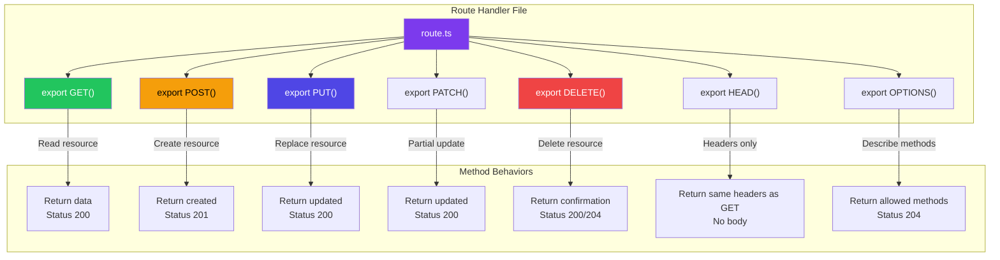
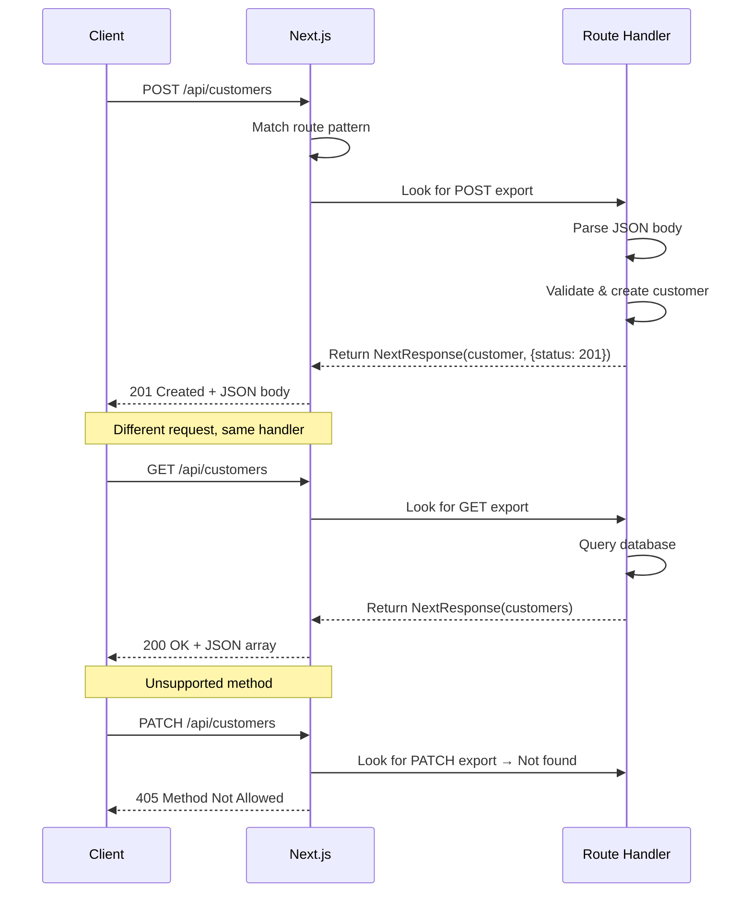
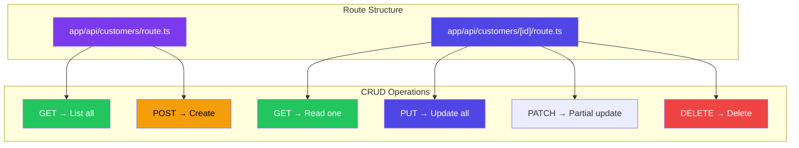
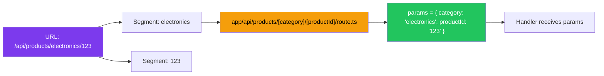

# HTTP Methods & Dynamic Routes in Route Handlers

## Introduction
Route Handlers support all standard HTTP methods — GET, POST, PUT, PATCH, DELETE, HEAD, and OPTIONS — each mapped to an exported function of the same name. When combined with dynamic route segments (`[id]`, `[slug]`), Route Handlers can create powerful RESTful APIs. Understanding how to use each HTTP method and how to structure dynamic Route Handlers is essential for building production-ready APIs in Next.js.

## Why do we need this?
Building a real API requires more than just returning data. You need to:

- **Create** resources with POST
- **Read** resources with GET (list and single)
- **Update** resources with PUT or PATCH
- **Delete** resources with DELETE
- **Handle CORS preflight** with OPTIONS
- **Access dynamic parameters** like IDs, slugs, and composite keys
- **Parse query strings** for filtering, sorting, and pagination

Route Handlers support all of these requirements natively within the App Router's file-system structure.

## Problem Statement
Developers building APIs need to map HTTP methods to specific actions, validate dynamic parameters, handle request bodies, and return appropriate status codes. Without a clear understanding of how Route Handlers process different methods and route patterns, APIs become disorganized, insecure, and difficult to maintain.

## Real World Story
Maria is building a customer management API for her SaaS product. She needs endpoints like:
- `GET /api/customers` — List all customers (with pagination)
- `POST /api/customers` — Create a new customer
- `GET /api/customers/[id]` — Get one customer
- `PUT /api/customers/[id]` — Update customer details
- `DELETE /api/customers/[id]` — Delete a customer

By creating `app/api/customers/route.ts` (list/create) and `app/api/customers/[id]/route.ts` (read/update/delete), she follows REST conventions and keeps her API organized. Each HTTP method maps clearly to a function in the appropriate handler file.

## Real World Analogy
Think of HTTP methods as **verbs in a language**:

- **GET** = "Look at this" (reading, no side effects)
- **POST** = "Create this" (new resource, unknown URL)
- **PUT** = "Replace this entirely" (full update, known URL)
- **PATCH** = "Update this part" (partial update)
- **DELETE** = "Remove this" (delete resource)
- **OPTIONS** = "What can I do here?" (describe available methods)

Dynamic routes `[id]` are like **post office boxes** — each box has a unique number (the ID), and you can check what's inside (GET), replace the contents (PUT), or remove them (DELETE).

## Visual Explanation
```
Route Handler Organization:

app/api/
├── route.ts                    → GET /api (health check)
│                                 POST /api (create root resource)
│
├── customers/
│   ├── route.ts                → GET /api/customers (list)
│   │                             POST /api/customers (create)
│   │
│   └── [id]/
│       └── route.ts            → GET /api/customers/123 (read)
│                                  PUT /api/customers/123 (update)
│                                  PATCH /api/customers/123 (partial)
│                                  DELETE /api/customers/123 (delete)
│
├── products/
│   ├── route.ts                → GET /api/products (list)
│   │                             POST /api/products (create)
│   │
│   └── [category]/
│       └── [productId]/
│           └── route.ts         → GET /api/products/electronics/123
│                                  PUT /api/products/electronics/123
```

## Mermaid Diagram 1: HTTP Methods in Route Handlers



## Internal Working
When a request arrives at a Route Handler:

1. **Route matching** — The request path is matched against the file system
2. **Method detection** — The HTTP method is extracted from the request
3. **Function lookup** — Next.js looks for an exported function matching the method name
4. **405 handling** — If no matching function exists, Next.js automatically returns 405 Method Not Allowed
5. **Dynamic params** — For dynamic routes (`[id]`), the extracted value is passed as `params`
6. **Execution** — The matched function runs with `request` and `params` as arguments
7. **Response** — The function must return a Response or NextResponse object

## Mermaid Diagram 2: Request Flow by Method



## Architecture
The relationship between HTTP methods, route structure, and CRUD operations:



## Mermaid Diagram 4: Dynamic Route Parameter Flow



## Step-by-Step Flow

1. **Plan your API structure** — Determine endpoints, methods, and response formats
2. **Create route files** — Create `route.ts` files matching your desired URL structure
3. **Export method handlers** — Export `GET`, `POST`, `PUT`, `PATCH`, `DELETE` as named functions
4. **Access request data** — Parse JSON body, query strings, and headers
5. **Access dynamic params** — Use `params` from the second argument of the handler
6. **Implement business logic** — Validate, process, and store/retrieve data
7. **Return responses** — Use `NextResponse.json()` with appropriate status codes

## Syntax

```tsx
// List & Create — app/api/customers/route.ts
import { NextResponse } from 'next/server'

// GET /api/customers — List all customers
export async function GET(request: Request) {
  const { searchParams } = new URL(request.url)
  const page = searchParams.get('page') || '1'
  const customers = await db.customer.findMany({ skip: (+page - 1) * 10, take: 10 })
  return NextResponse.json(customers)
}

// POST /api/customers — Create a customer
export async function POST(request: Request) {
  const body = await request.json()
  const customer = await db.customer.create({ data: body })
  return NextResponse.json(customer, { status: 201 })
}
```

```tsx
// Read, Update, Delete — app/api/customers/[id]/route.ts
import { NextResponse } from 'next/server'

export async function GET(request: Request, { params }: { params: { id: string } }) {
  const customer = await db.customer.findUnique({ where: { id: params.id } })
  if (!customer) return NextResponse.json({ error: 'Not found' }, { status: 404 })
  return NextResponse.json(customer)
}

export async function PUT(request: Request, { params }: { params: { id: string } }) {
  const body = await request.json()
  const customer = await db.customer.update({ where: { id: params.id }, data: body })
  return NextResponse.json(customer)
}

export async function DELETE(request: Request, { params }: { params: { id: string } }) {
  await db.customer.delete({ where: { id: params.id } })
  return NextResponse.json({ message: 'Deleted' })
}
```

## Basic Example

Complete CRUD for a notes API:

```tsx
// app/api/notes/route.ts — List and create notes
import { NextResponse } from 'next/server'

// In-memory store
let notes = [
  { id: '1', title: 'Meeting Notes', content: 'Discuss Q1 goals', createdAt: new Date() },
  { id: '2', title: 'Shopping List', content: 'Milk, eggs, bread', createdAt: new Date() },
]
let nextId = 3

// GET /api/notes — List all notes
export async function GET() {
  return NextResponse.json(notes.sort((a, b) => 
    b.createdAt.getTime() - a.createdAt.getTime()
  ))
}

// POST /api/notes — Create a note
export async function POST(request: Request) {
  const body = await request.json()
  
  // Basic validation
  if (!body.title) {
    return NextResponse.json({ error: 'Title is required' }, { status: 400 })
  }
  
  const note = {
    id: String(nextId++),
    title: body.title,
    content: body.content || '',
    createdAt: new Date(),
  }
  
  notes.push(note)
  return NextResponse.json(note, { status: 201 })
}

// POST /api/notes with search — Demonstrate query params
// Also handle HEAD for header-only requests
export async function HEAD(request: Request) {
  return new Response(null, {
    headers: {
      'X-Total-Count': String(notes.length),
      'Content-Type': 'application/json',
    },
  })
}
```

```tsx
// app/api/notes/[id]/route.ts — Single note operations
import { NextResponse } from 'next/server'

interface RouteParams {
  params: { id: string }
}

// Reuse the same in-memory store
const notes = [
  { id: '1', title: 'Meeting Notes', content: 'Discuss Q1 goals', createdAt: new Date() },
  { id: '2', title: 'Shopping List', content: 'Milk, eggs, bread', createdAt: new Date() },
]

function findNote(id: string) {
  return notes.find(n => n.id === id)
}

// GET /api/notes/1 — Get single note
export async function GET(
  request: Request,
  { params }: RouteParams
) {
  const note = findNote(params.id)
  
  if (!note) {
    return NextResponse.json(
      { error: 'Note not found' },
      { status: 404 }
    )
  }
  
  return NextResponse.json(note)
}

// PUT /api/notes/1 — Replace entire note  
export async function PUT(
  request: Request,
  { params }: RouteParams
) {
  const note = findNote(params.id)
  
  if (!note) {
    return NextResponse.json(
      { error: 'Note not found' },
      { status: 404 }
    )
  }
  
  const body = await request.json()
  
  // PUT replaces the entire resource
  note.title = body.title
  note.content = body.content || ''
  
  return NextResponse.json(note)
}

// PATCH /api/notes/1 — Partial update
export async function PATCH(
  request: Request,
  { params }: RouteParams
) {
  const note = findNote(params.id)
  
  if (!note) {
    return NextResponse.json(
      { error: 'Note not found' },
      { status: 404 }
    )
  }
  
  const body = await request.json()
  
  // PATCH only updates provided fields
  if (body.title !== undefined) note.title = body.title
  if (body.content !== undefined) note.content = body.content
  
  return NextResponse.json(note)
}

// DELETE /api/notes/1 — Delete note
export async function DELETE(
  request: Request,
  { params }: RouteParams
) {
  const index = notes.findIndex(n => n.id === params.id)
  
  if (index === -1) {
    return NextResponse.json(
      { error: 'Note not found' },
      { status: 404 }
    )
  }
  
  notes.splice(index, 1)
  
  // 204 No Content for successful deletion
  return new Response(null, { status: 204 })
}
```

```tsx
// app/api/notes/options/route.ts — CORS preflight handler
import { NextResponse } from 'next/server'

export async function OPTIONS(request: Request) {
  return new Response(null, {
    status: 204,
    headers: {
      'Access-Control-Allow-Origin': '*',
      'Access-Control-Allow-Methods': 'GET, POST, PUT, PATCH, DELETE, OPTIONS',
      'Access-Control-Allow-Headers': 'Content-Type, Authorization',
      'Access-Control-Max-Age': '86400',
    },
  })
}
```

**What's happening:**
- `GET` on `/api/notes` returns all notes sorted by date
- `POST` creates a new note with validation
- `GET` on `/api/notes/[id]` returns a single note
- `PUT` replaces the entire note resource
- `PATCH` only updates provided fields
- `DELETE` removes a note and returns 204
- `HEAD` returns headers without body (useful for checking existence)
- `OPTIONS` returns CORS headers for preflight requests

## Intermediate Example

Multi-segment dynamic routes with query parameters and conditional methods:

```tsx
// app/api/posts/[year]/[month]/[slug]/route.ts
import { NextResponse } from 'next/server'

interface RouteParams {
  params: {
    year: string
    month: string
    slug: string
  }
}

// GET /api/posts/2024/01/hello-world
export async function GET(
  request: Request,
  { params }: RouteParams
) {
  const { year, month, slug } = params
  
  // Validate date segments
  const yearNum = parseInt(year)
  const monthNum = parseInt(month)
  
  if (isNaN(yearNum) || yearNum < 2000 || yearNum > 2030) {
    return NextResponse.json(
      { error: 'Invalid year' },
      { status: 400 }
    )
  }
  
  if (isNaN(monthNum) || monthNum < 1 || monthNum > 12) {
    return NextResponse.json(
      { error: 'Invalid month' },
      { status: 400 }
    )
  }
  
  // Get query parameters
  const { searchParams } = new URL(request.url)
  const includeComments = searchParams.get('include_comments') === 'true'
  const version = searchParams.get('v')
  
  // Fetch the post
  const post = await db.post.findUnique({
    where: { slug_year_month: { slug, year, month } },
    include: includeComments ? { comments: true } : undefined,
  })
  
  if (!post) {
    return NextResponse.json(
      { error: 'Post not found' },
      { status: 404 }
    )
  }
  
  return NextResponse.json(post)
}

// PUT /api/posts/2024/01/hello-world
export async function PUT(
  request: Request,
  { params }: RouteParams
) {
  const body = await request.json()
  
  const post = await db.post.update({
    where: { slug_year_month: { slug: params.slug, year: params.year, month: params.month } },
    data: {
      title: body.title,
      content: body.content,
      tags: body.tags,
    },
  })
  
  return NextResponse.json(post)
}

// DELETE /api/posts/2024/01/hello-world
export async function DELETE(
  request: Request,
  { params }: RouteParams
) {
  await db.post.delete({
    where: { slug_year_month: { slug: params.slug, year: params.year, month: params.month } },
  })
  
  return NextResponse.json({ message: 'Post deleted' })
}
```

## Advanced Example

File upload handler with FormData, multiple methods, and streaming:

```tsx
// app/api/documents/route.ts — Document management
import { NextResponse } from 'next/server'
import { writeFile, mkdir } from 'fs/promises'
import path from 'path'

export async function GET(request: Request) {
  const { searchParams } = new URL(request.url)
  const type = searchParams.get('type') || 'all'
  const documents = await db.document.findMany({
    where: type !== 'all' ? { type } : undefined,
    orderBy: { uploadedAt: 'desc' },
  })
  return NextResponse.json(documents)
}

export async function POST(request: Request) {
  try {
    const formData = await request.formData()
    const file = formData.get('file') as File
    const description = formData.get('description') as string
    
    if (!file) {
      return NextResponse.json({ error: 'No file provided' }, { status: 400 })
    }
    
    // Validate file type
    const allowedTypes = ['image/jpeg', 'image/png', 'application/pdf']
    if (!allowedTypes.includes(file.type)) {
      return NextResponse.json(
        { error: 'Invalid file type. Allowed: JPEG, PNG, PDF' },
        { status: 400 }
      )
    }
    
    // Validate file size (max 10MB)
    const maxSize = 10 * 1024 * 1024
    if (file.size > maxSize) {
      return NextResponse.json(
        { error: 'File too large. Maximum size is 10MB' },
        { status: 400 }
      )
    }
    
    // Save file
    const uploadDir = path.join(process.cwd(), 'public/uploads')
    await mkdir(uploadDir, { recursive: true })
    
    const filename = `${Date.now()}-${file.name}`
    const filepath = path.join(uploadDir, filename)
    const bytes = await file.arrayBuffer()
    await writeFile(filepath, Buffer.from(bytes))
    
    // Save to database
    const document = await db.document.create({
      data: {
        filename: file.name,
        storedPath: `/uploads/${filename}`,
        size: file.size,
        type: file.type,
        description,
      },
    })
    
    return NextResponse.json(document, { status: 201 })
  } catch (error) {
    return NextResponse.json({ error: 'Upload failed' }, { status: 500 })
  }
}

// OPTIONS handler for CORS
export async function OPTIONS() {
  return new Response(null, {
    status: 204,
    headers: {
      'Access-Control-Allow-Origin': '*',
      'Access-Control-Allow-Methods': 'GET, POST, OPTIONS',
      'Access-Control-Allow-Headers': 'Content-Type',
    },
  })
}
```

## Production Example

Production-ready API with authentication, pagination, filtering, and error handling:

```tsx
// app/api/users/route.ts — Production users API
import { NextResponse } from 'next/server'
import { getServerSession } from 'next-auth'
import { z } from 'zod'

const CreateUserSchema = z.object({
  name: z.string().min(2).max(100),
  email: z.string().email(),
  role: z.enum(['user', 'admin', 'moderator']).default('user'),
})

export async function GET(request: Request) {
  try {
    const session = await getServerSession()
    if (!session) {
      return NextResponse.json({ error: 'Unauthorized' }, { status: 401 })
    }
    
    const { searchParams } = new URL(request.url)
    const page = Math.max(1, parseInt(searchParams.get('page') || '1'))
    const limit = Math.min(100, Math.max(1, parseInt(searchParams.get('limit') || '20')))
    const search = searchParams.get('search')
    const role = searchParams.get('role')
    
    const where: any = {}
    if (search) {
      where.OR = [
        { name: { contains: search, mode: 'insensitive' } },
        { email: { contains: search, mode: 'insensitive' } },
      ]
    }
    if (role) where.role = role
    
    const [users, total] = await Promise.all([
      db.user.findMany({
        where,
        skip: (page - 1) * limit,
        take: limit,
        orderBy: { createdAt: 'desc' },
        select: { id: true, name: true, email: true, role: true, createdAt: true },
      }),
      db.user.count({ where }),
    ])
    
    return NextResponse.json({
      data: users,
      pagination: {
        page,
        limit,
        total,
        totalPages: Math.ceil(total / limit),
        hasNext: page * limit < total,
        hasPrev: page > 1,
      },
    }, {
      headers: {
        'Cache-Control': 'private, max-age=30',
        'X-Total-Count': String(total),
      },
    })
  } catch (error) {
    console.error('Error fetching users:', error)
    return NextResponse.json({ error: 'Internal server error' }, { status: 500 })
  }
}

export async function POST(request: Request) {
  try {
    const session = await getServerSession()
    if (!session || session.user.role !== 'admin') {
      return NextResponse.json({ error: 'Forbidden' }, { status: 403 })
    }
    
    const body = await request.json()
    const validation = CreateUserSchema.safeParse(body)
    
    if (!validation.success) {
      return NextResponse.json({
        error: 'Validation failed',
        details: validation.error.flatten().fieldErrors,
      }, { status: 400 })
    }
    
    const existing = await db.user.findUnique({ where: { email: validation.data.email } })
    if (existing) {
      return NextResponse.json({ error: 'Email already in use' }, { status: 409 })
    }
    
    const user = await db.user.create({ data: validation.data })
    return NextResponse.json(user, { status: 201 })
  } catch (error) {
    console.error('Error creating user:', error)
    return NextResponse.json({ error: 'Internal server error' }, { status: 500 })
  }
}
```

## Folder Structure

```
app/api/
├── route.ts                                   → /api (API overview/health)
├── auth/
│   └── [...nextauth]/
│       └── route.ts                           → NextAuth handler
├── users/
│   ├── route.ts                               → GET, POST /api/users
│   └── [id]/
│       └── route.ts                           → GET, PUT, PATCH, DELETE /api/users/123
├── products/
│   ├── route.ts                               → GET, POST /api/products
│   └── [category]/
│       ├── route.ts                           → GET /api/products/electronics
│       └── [productId]/
│           └── route.ts                       → GET /api/products/electronics/123
├── posts/
│   ├── route.ts                               → GET, POST /api/posts
│   └── [year]/
│       └── [month]/
│           └── [slug]/
│               └── route.ts                   → GET /api/posts/2024/01/hello-world
├── webhooks/
│   └── stripe/
│       └── route.ts                           → POST /api/webhooks/stripe
└── upload/
    └── route.ts                               → POST /api/upload

// Static routes take priority over dynamic routes
// /api/users/me → app/api/users/me/route.ts (static)
// /api/users/[id] → app/api/users/[id]/route.ts (dynamic)
```

## 🚀 Best Practices

1. **Use standard HTTP methods** — GET for reads, POST for creates, PUT for full updates, PATCH for partial, DELETE for removal
2. **Return appropriate status codes** — 200 (success), 201 (created), 204 (no content), 400 (bad request), 401 (unauthorized), 403 (forbidden), 404 (not found), 409 (conflict), 500 (server error)
3. **Use PUT vs PATCH correctly** — PUT replaces the entire resource; PATCH only applies partial changes
4. **Validate dynamic params** — Parse and validate `params.id` early (isNaN, range checks)
5. **Handle OPTIONS explicitly** — Return proper CORS headers for cross-origin requests
6. **Use searchParams for filtering** — Query strings for pagination, sorting, and filtering
7. **Separate list and detail routes** — `route.ts` for collection, `[id]/route.ts` for individual
8. **Static routes over dynamic** — `/api/users/me` (static) takes priority over `/api/users/[id]` (dynamic)

## ⚠ Common Mistakes

1. **Forgetting `await` for `request.json()`** — Body parsing is async
2. **PUT vs PATCH confusion** — Using PUT for partial updates (should use PATCH)
3. **Not validating route params** — `params.id` arrives as a string; parse and validate it
4. **Missing OPTIONS handler** — CORS preflight fails without it
5. **Exposing stack traces in errors** — Never return error.stack in production
6. **Not HEAD handler** — HEAD requests fall through to GET method automatically in Next.js
7. **405 Method Not Allowed** — Next.js returns this automatically for unhandled methods

## 📦 Performance Notes

- Route Handlers are dynamic by default (not cached)
- Use `NextResponse.json()` with caching headers for GET endpoints
- Edge Runtime can reduce cold starts for public API endpoints
- Streaming responses with `ReadableStream` for large datasets
- Batch database queries with `Promise.all` for related data
- Use HTTP caching (ETag, Last-Modified) for immutable resources

## 🔒 Security Notes

- Always validate params before using them in database queries
- Use parameterized queries to prevent SQL injection
- Check authorization for each method independently
- Rate limit public endpoints
- Validate file types and sizes for upload endpoints
- Use CORS headers restrictively (specify origins, don't use wildcards with credentials)

## 🌍 SEO Considerations

- API responses don't directly affect SEO
- Use structured API responses that client components can render as SEO-friendly content
- Consider server-side fetching in Server Components over client-side API calls for critical content

## Interview Questions

1. What's the difference between PUT and PATCH in Route Handlers?
2. How does Next.js handle unsupported HTTP methods?
3. How do you access dynamic route parameters in a Route Handler?
4. How do you handle CORS preflight requests?
5. What status code should you return for a successful creation? Deletion?
6. How do you handle pagination in a Route Handler?
7. Can you have both `route.ts` and `page.tsx` in the same folder?

## MCQs

1. What HTTP method should you use to update only a few fields of a resource?
   a) PUT
   b) PATCH
   c) POST
   d) UPDATE
   <details>
   <summary>Answer</summary>
   b) PATCH — Used for partial updates; PUT replaces the entire resource.
   </details>

2. What status code indicates a resource was created successfully?
   a) 200
   b) 201
   c) 204
   d) 202
   <details>
   <summary>Answer</summary>
   b) 201 Created — Standard response for successful resource creation.
   </details>

3. What does Next.js return when a method handler isn't exported?
   a) 404 Not Found
   b) 405 Method Not Allowed
   c) 501 Not Implemented
   d) It throws an error
   <details>
   <summary>Answer</summary>
   b) 405 Method Not Allowed — Next.js automatically returns this for unhandled methods.
   </details>

4. How do you access URL query parameters in a Route Handler?
   a) `request.query`
   b) `new URL(request.url).searchParams`
   c) `request.searchParams`
   d) `params.query`
   <details>
   <summary>Answer</summary>
   b) `new URL(request.url).searchParams` — Construct a URL object and access searchParams.
   </details>

5. What's the correct way to handle a file upload in a Route Handler?
   a) `request.json()` then access file property
   b) `request.formData()` then access File object
   c) `request.file()` 
   d) `request.blob()`
   <details>
   <summary>Answer</summary>
   b) `await request.formData()` — File uploads use multipart form data.
   </details>

## Practice Exercise

1. **Build a Blog API:**
   - `GET /api/posts` — List posts with pagination and search
   - `POST /api/posts` — Create post (auth required)
   - `GET /api/posts/[id]` — Get single post with comments
   - `PUT /api/posts/[id]` — Replace post
   - `PATCH /api/posts/[id]` — Publish/unpublish post
   - `DELETE /api/posts/[id]` — Delete post
   - `POST /api/posts/[id]/comments` — Add comment

2. **Implement proper error handling** for each endpoint

3. **Add query parameter support** for filtering and sorting

## Debugging Exercise

Find and fix the bugs:

```tsx
// app/api/products/route.ts
export async function GET() {
  return NextResponse.json(products)
}

export async function POST(request) {  // Bug 1: Missing type
  const body = request.json()  // Bug 2: Missing await
  products.push(body)
  return NextResponse.json(body)  // Bug 3: Should return 201
}
```

**Bug 1:** Missing TypeScript type for `request`.
**Fix:** Add `request: Request`.

**Bug 2:** `request.json()` is not awaited.
**Fix:** Add `await`: `const body = await request.json()`

**Bug 3:** Successful creation should return status 201.
**Fix:** Add `{ status: 201 }` to the response.

## Real-world Scenario

**Problem:** Your SaaS app needs a webhook endpoint for Stripe that handles multiple event types, verifies signatures, and updates the database. Different events need different HTTP methods conceptually, but Stripe only sends POST requests.

**Solution:** A single POST handler with event type routing:

```tsx
// app/api/webhooks/stripe/route.ts
export async function POST(request: Request) {
  const event = await verifyStripeWebhook(request)
  
  switch (event.type) {
    case 'checkout.session.completed': ...
    case 'customer.subscription.updated': ...
    case 'invoice.paid': ...
  }
  
  return NextResponse.json({ received: true })
}
```

## Interview Coding Question

Build a search API endpoint with filtering and caching:

```tsx
// app/api/search/route.ts
export async function GET(request: Request) {
  const { searchParams } = new URL(request.url)
  const query = searchParams.get('q')
  const type = searchParams.get('type') || 'all'
  
  if (!query || query.length < 2) {
    return NextResponse.json({ error: 'Query must be at least 2 characters' }, { status: 400 })
  }
  
  const results = await searchDatabase(query, type)
  
  return NextResponse.json(results, {
    headers: { 'Cache-Control': 'public, max-age=60' }
  })
}
```

## Mini Project

**Build a Full-featured REST API**

Create a complete REST API for a task management system:

1. **Authentication:**
   - `POST /api/auth/login`
   - `POST /api/auth/register`
   - `POST /api/auth/logout`

2. **Projects:**
   - `GET /api/projects` — List with pagination
   - `POST /api/projects` — Create
   - `GET /api/projects/[id]` — Get with tasks
   - `PUT /api/projects/[id]` — Update
   - `DELETE /api/projects/[id]` — Delete

3. **Tasks (nested under projects):**
   - `GET /api/projects/[id]/tasks` — List tasks
   - `POST /api/projects/[id]/tasks` — Create task
   - `PATCH /api/projects/[id]/tasks/[taskId]` — Update status
   - `DELETE /api/projects/[id]/tasks/[taskId]` — Delete task

4. **Features:**
   - Input validation with Zod
   - Authentication middleware
   - Proper HTTP status codes
   - CORS headers
   - Error handling
   - Pagination metadata
   - Caching headers for GET endpoints

## Summary

Route Handlers support all standard HTTP methods — GET, POST, PUT, PATCH, DELETE, HEAD, and OPTIONS — each exported as a named function in `route.ts`. Dynamic route segments (`[id]`, `[slug]`) are accessed through the `params` argument. Route Handlers follow REST conventions: collection routes (`route.ts`) handle list/create operations, while detail routes (`[id]/route.ts`) handle read/update/delete operations. Always validate input, return appropriate status codes, handle CORS with OPTIONS, and remember that Route Handlers are not cached by default. Use PUT for full replacements and PATCH for partial updates.

## Cheat Sheet

```tsx
// HTTP Methods & Route Handlers Quick Reference

// List: GET /api/resource
app/api/resource/route.ts
export async function GET() { return NextResponse.json([]) }

// Create: POST /api/resource
export async function POST(request: Request) {
  const body = await request.json()
  return NextResponse.json(body, { status: 201 })
}

// Read: GET /api/resource/[id]
app/api/resource/[id]/route.ts
export async function GET(request: Request, { params }: { params: { id: string } }) {
  return NextResponse.json({ id: params.id })
}

// Replace: PUT /api/resource/[id]
export async function PUT(request: Request, { params }: { params: { id: string } }) {
  const body = await request.json()
  return NextResponse.json(body)
}

// Partial: PATCH /api/resource/[id]
export async function PATCH(request: Request, { params }: { params: { id: string } }) {
  const body = await request.json()
  return NextResponse.json(body)
}

// Delete: DELETE /api/resource/[id]
export async function DELETE(request: Request, { params }: { params: { id: string } }) {
  return new Response(null, { status: 204 })
}

// CORS: OPTIONS /api/resource
export async function OPTIONS() {
  return new Response(null, {
    status: 204,
    headers: { 'Access-Control-Allow-Origin': '*' }
  })
}

// Status codes
200 OK          201 Created         204 No Content
400 Bad Request 401 Unauthorized    403 Forbidden
404 Not Found   409 Conflict        500 Server Error

// Query params
const { searchParams } = new URL(request.url)
const page = searchParams.get('page')
```

## Related Topics
- Route Handlers Basics (Previous Topic)
- Middleware Basics (Next Topic)
- Server Actions (Phase 4)
- Data Fetching (Phase 3)

## Further Reading
- [Next.js Documentation: Route Handlers](https://nextjs.org/docs/app/building-your-application/routing/route-handlers)
- [HTTP Methods (MDN)](https://developer.mozilla.org/en-US/docs/Web/HTTP/Methods)
- [REST API Best Practices](https://stackoverflow.blog/2020/03/02/best-practices-for-rest-api-design/)
