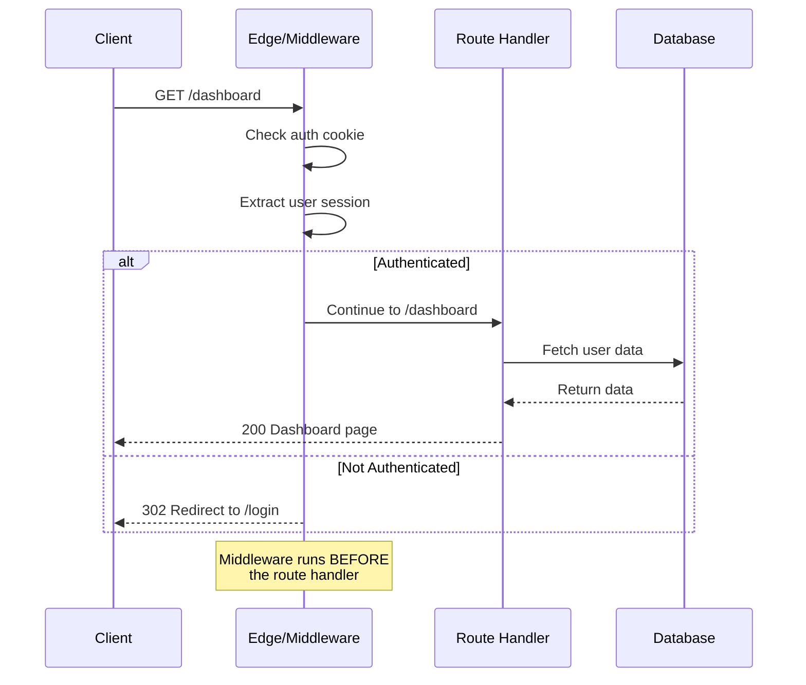
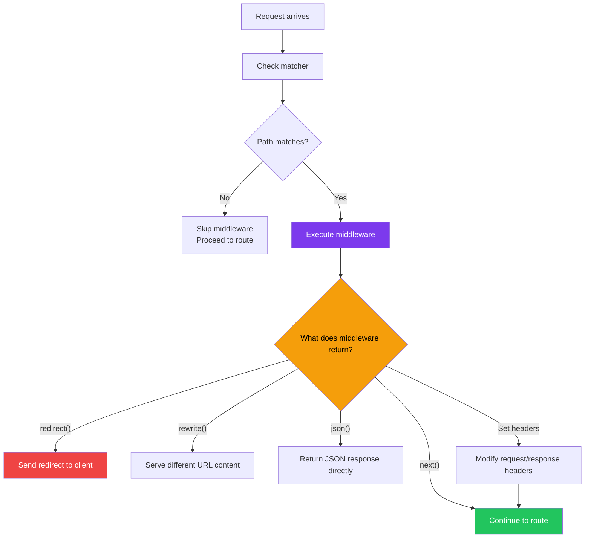
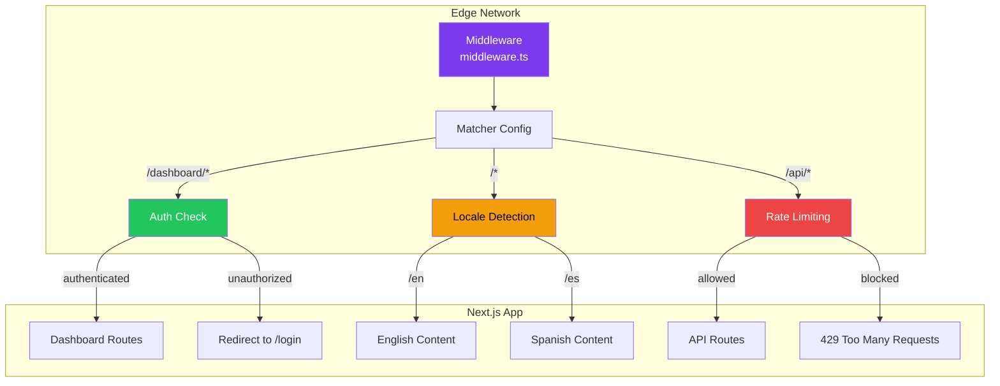
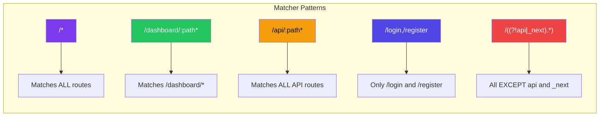

# Middleware Basics

## Introduction
Middleware in Next.js is a powerful feature that runs code before a request is completed. It executes at the Edge, before any route is rendered, allowing you to inspect, modify, or redirect requests. Middleware is defined in a single `middleware.ts` file at the root of your project and can match specific paths using a matcher configuration. Common use cases include authentication checks, redirects, URL rewrites, header manipulation, and bot detection.

## Why do we need this?
Without middleware, every route in your application would need its own logic for:
- Checking if a user is authenticated before showing a page
- Redirecting users based on their location or device
- Setting custom headers for security or caching
- Preventing access to certain routes in specific conditions
- A/B testing and feature flag checks

Middleware runs at the Edge (before your application code), making it the perfect place for these pre-processing tasks — they happen with minimal latency and don't require loading your entire application.

## Problem Statement
As application complexity grows, you need a centralized way to handle cross-cutting concerns:
- Authentication checks that run before protected pages
- URL redirects based on user location, cookies, or headers
- Bot detection and rate limiting at the edge
- A/B testing variants based on cookies
- Internationalization redirects based on user locale

Implementing these in every route individually leads to code duplication, increased bundle size, and maintenance issues.

## Real World Story
Netflix uses edge middleware to handle regional content restrictions. When a user requests a movie page, middleware checks the user's IP address and geolocation headers. If the content isn't available in their region, the middleware redirects them to a regional content page without ever loading the full application. This happens in milliseconds at the CDN edge, providing a fast, relevant experience.

## Real World Analogy
Think of middleware as a **security checkpoint at an airport**:

- **Without middleware**: Every passenger (request) walks directly to their gate (route). Security checks (auth, redirects) happen at each gate, causing delays and requiring guards at every location.
- **With middleware**: Passengers go through a central security checkpoint before reaching the gates. Guards check passports (auth), verify boarding passes (redirects), and direct people to the correct terminal (URL rewrites).

The checkpoint handles everything in one place before passengers proceed to their specific gates.

## Visual Explanation
```
Request Flow with Middleware:

                    ┌─────────────────┐
                    │   Client Request │
                    └────────┬────────┘
                             │
                             ▼
                    ┌─────────────────┐
                    │   MIDDLEWARE    │ ← Runs at Edge
                    │  middleware.ts  │
                    └────────┬────────┘
                             │
              ┌──────────────┼──────────────┐
              │              │              │
              ▼              ▼              ▼
     ┌────────────┐  ┌────────────┐  ┌────────────┐
     │ Continue to │  │  Redirect  │  │   Rewrite  │
     │   Route     │  │            │  │            │
     └────────────┘  └────────────┘  └────────────┘
              │
              ▼
     ┌─────────────────┐
     │   Route Handler │  ← Page or API route
     └─────────────────┘
```

## Mermaid Diagram 1: Middleware Request Lifecycle



## Internal Working
When Next.js processes middleware:

1. **Request arrives** — The request hits the Next.js server or Edge network
2. **Middleware detection** — Next.js checks for a `middleware.ts` file at the project root
3. **Matcher check** — The request URL is checked against the `config.matcher` array (if configured)
4. **Middleware execution** — If the path matches, the middleware function runs
5. **Response decision** — Middleware can:
   - Return `NextResponse.next()` — Continue to the route
   - Return `NextResponse.redirect()` — Redirect to another URL
   - Return `NextResponse.rewrite()` — Rewrite the URL (serve different content)
   - Return `NextResponse.json()` — Return a JSON response directly
6. **Header manipulation** — Middleware can set, modify, or delete request/response headers
7. **Cookie management** — Cookies can be read, set, or removed

## Mermaid Diagram 2: Middleware Decision Flow



## Architecture
Middleware sits between the client and your routes, acting as a gatekeeper:



## Mermaid Diagram 4: Middleware Matcher Patterns



## Step-by-Step Flow

1. **Create middleware.ts** — Place `middleware.ts` at the root of your project (not in `app/` or `pages/`)
2. **Export middleware function** — The file must export a default async function
3. **Configure matcher** — Use `export const config = { matcher: [...] }` to specify which paths trigger middleware
4. **Implement logic** — Add authentication checks, redirects, header modifications, etc.
5. **Return response** — Return `NextResponse.next()`, `redirect()`, `rewrite()`, or handle the response
6. **Test the middleware** — Visit matched paths and verify the middleware behavior

## Syntax

```tsx
// middleware.ts — Root of project
import { NextResponse } from 'next/server'
import type { NextRequest } from 'next/server'

// This function runs for every matched request
export function middleware(request: NextRequest) {
  // Access request information
  const url = request.nextUrl
  const cookies = request.cookies
  const headers = request.headers
  
  // Get the pathname
  const pathname = url.pathname
  
  // Example: Continue to the route
  return NextResponse.next()
}

// Configure which paths trigger middleware
export const config = {
  matcher: [
    /*
     * Match all request paths except:
     * - _next/static (static files)
     * - _next/image (image optimization files)
     * - favicon.ico (favicon file)
     * - public folder files
     */
    '/((?!_next/static|_next/image|favicon.ico).*)',
  ],
}
```

**Key points:**
- Middleware runs at the Edge (Vercel Edge Functions or similar)
- It has access to the Request object but NOT to Node.js APIs (fs, database drivers, etc.)
- It can use Web APIs (fetch, URL, crypto, etc.)
- The `config.matcher` is optional — without it, middleware runs on every request

## Basic Example

Simple authentication middleware:

```tsx
// middleware.ts
import { NextResponse } from 'next/server'
import type { NextRequest } from 'next/server'

export function middleware(request: NextRequest) {
  const isAuthenticated = request.cookies.has('session')
  const isLoginPage = request.nextUrl.pathname === '/login'
  
  // Redirect unauthenticated users to login
  if (!isAuthenticated && !isLoginPage) {
    return NextResponse.redirect(new URL('/login', request.url))
  }
  
  // Redirect authenticated users away from login
  if (isAuthenticated && isLoginPage) {
    return NextResponse.redirect(new URL('/dashboard', request.url))
  }
  
  return NextResponse.next()
}

export const config = {
  matcher: ['/dashboard/:path*', '/settings/:path*', '/login', '/'],
}
```

```tsx
// app/dashboard/page.tsx — Protected page
export default function DashboardPage() {
  return (
    <div>
      <h1>Dashboard</h1>
      <p>You are authenticated! This page is protected by middleware.</p>
    </div>
  )
}
```

```tsx
// app/login/page.tsx — Login page (redirects if already authenticated)
export default function LoginPage() {
  return (
    <div>
      <h1>Log In</h1>
      <form>
        <input type="email" placeholder="Email" />
        <input type="password" placeholder="Password" />
        <button type="submit">Log In</button>
      </form>
    </div>
  )
}
```

**What's happening:**
- Middleware checks for a `session` cookie on every request
- Users without a session cookie are redirected to `/login`
- Users who are authenticated and visit `/login` are redirected to `/dashboard`
- The matcher ensures middleware only runs on specific paths for performance

## Intermediate Example

Internationalization middleware with locale detection:

```tsx
// middleware.ts
import { NextResponse } from 'next/server'
import type { NextRequest } from 'next/server'

// Supported locales
const locales = ['en', 'es', 'fr', 'de', 'ja']
const defaultLocale = 'en'

// Get the preferred locale from the request
function getLocale(request: NextRequest): string {
  // Check cookie first
  const cookieLocale = request.cookies.get('NEXT_LOCALE')
  if (cookieLocale && locales.includes(cookieLocale)) {
    return cookieLocale
  }
  
  // Check Accept-Language header
  const acceptLanguage = request.headers.get('accept-language')
  if (acceptLanguage) {
    const preferred = acceptLanguage
      .split(',')
      .map(lang => lang.split(';')[0].trim().split('-')[0])
      .find(lang => locales.includes(lang))
    if (preferred) return preferred
  }
  
  return defaultLocale
}

export function middleware(request: NextRequest) {
  const { pathname } = request.nextUrl
  const pathnameHasLocale = locales.some(
    locale => pathname.startsWith(`/${locale}/`) || pathname === `/${locale}`
  )
  
  if (pathnameHasLocale) return NextResponse.next()
  
  // Redirect to locale-prefixed URL
  const locale = getLocale(request)
  request.nextUrl.pathname = `/${locale}${pathname}`
  
  // Set cookie for future requests
  const response = NextResponse.redirect(request.nextUrl)
  response.cookies.set('NEXT_LOCALE', locale, {
    maxAge: 60 * 60 * 24 * 30, // 30 days
    path: '/',
  })
  
  return response
}

export const config = {
  matcher: ['/((?!api|_next|_vercel|.*\\..*).*)'],
}
```

```tsx
// app/[locale]/layout.tsx — Locale layout
export default function LocaleLayout({
  children,
  params,
}: {
  children: React.ReactNode
  params: { locale: string }
}) {
  return (
    <div>
      <nav>
        <a href="/en">English</a>
        <a href="/es">Español</a>
        <a href="/fr">Français</a>
      </nav>
      <main>{children}</main>
    </div>
  )
}
```

**What's happening:**
- Middleware detects the user's preferred locale from cookie or Accept-Language header
- It redirects the user to `/en/path`, `/es/path`, etc.
- If the URL already has a locale prefix, it passes through
- The locale preference is saved in a cookie for persistence

## Advanced Example

Advanced middleware with A/B testing, feature flags, and security headers:

```tsx
// middleware.ts
import { NextResponse } from 'next/server'
import type { NextRequest } from 'next/server'

// Simple cookie-based A/B test
const VARIANTS = ['A', 'B']
const FEATURE_FLAGS = {
  newDashboard: { enabled: true, percentage: 50 },
  darkMode: { enabled: true, percentage: 25 },
}

// Bot detection patterns
const BOT_PATTERNS = [
  'bot', 'crawler', 'spider', 'scraper',
  'googlebot', 'bingbot', 'slurp', 'duckduckbot',
  'baiduspider', 'yandexbot', 'facebookexternalhit',
]

function isBot(userAgent: string): boolean {
  return BOT_PATTERNS.some(pattern => 
    userAgent.toLowerCase().includes(pattern)
  )
}

function getVariant(userId: string): string {
  // Consistent assignment based on user ID
  const hash = userId.split('').reduce((acc, char) => 
    acc + char.charCodeAt(0), 0
  )
  return VARIANTS[hash % VARIANTS.length]
}

function shouldShowFeature(flag: string, userId: string): boolean {
  const feature = FEATURE_FLAGS[flag as keyof typeof FEATURE_FLAGS]
  if (!feature || !feature.enabled) return false
  
  const hash = userId.split('').reduce((acc, char) => 
    acc + char.charCodeAt(0), 0
  )
  return (hash % 100) < feature.percentage
}

export function middleware(request: NextRequest) {
  const response = NextResponse.next()
  const url = request.nextUrl
  const userAgent = request.headers.get('user-agent') || ''
  const userId = request.cookies.get('user_id')?.value || 'anonymous'
  
  // 1. Security headers
  response.headers.set('X-Frame-Options', 'DENY')
  response.headers.set('X-Content-Type-Options', 'nosniff')
  response.headers.set('X-XSS-Protection', '1; mode=block')
  response.headers.set('Referrer-Policy', 'strict-origin-when-cross-origin')
  
  // 2. A/B testing variant assignment
  if (!request.cookies.has('ab_variant')) {
    const variant = getVariant(userId)
    response.cookies.set('ab_variant', variant, {
      maxAge: 60 * 60 * 24 * 90, // 90 days
      path: '/',
    })
  }
  
  // 3. Feature flags
  if (!request.cookies.has('features')) {
    const features = {
      newDashboard: shouldShowFeature('newDashboard', userId),
      darkMode: shouldShowFeature('darkMode', userId),
    }
    response.cookies.set('features', JSON.stringify(features), {
      maxAge: 60 * 60 * 24, // 1 day
      path: '/',
    })
  }
  
  // 4. Bot handling for API routes
  if (url.pathname.startsWith('/api/') && isBot(userAgent)) {
    return NextResponse.json(
      { error: 'Access denied' },
      { status: 403 }
    )
  }
  
  // 5. Maintenance mode check
  if (url.pathname.startsWith('/dashboard') && process.env.MAINTENANCE_MODE === 'true') {
    return NextResponse.redirect(new URL('/maintenance', request.url))
  }
  
  return response
}

export const config = {
  matcher: [
    '/((?!_next/static|_next/image|favicon.ico).*)',
  ],
}
```

## Production Example

Enterprise authentication middleware with session validation and CSRF protection:

```tsx
// middleware.ts
import { NextResponse } from 'next/server'
import type { NextRequest } from 'next/server'

// Validate session via external auth service
async function validateSession(token: string): Promise<{ valid: boolean; user?: { id: string; role: string } }> {
  try {
    const response = await fetch(`${process.env.AUTH_API_URL}/verify`, {
      headers: { Authorization: `Bearer ${token}` },
    })
    if (!response.ok) return { valid: false }
    return await response.json()
  } catch {
    return { valid: false }
  }
}

// Protected routes
const PROTECTED_ROUTES = ['/dashboard/:path*', '/settings/:path*', '/admin/:path*']
const ADMIN_ROUTES = ['/admin/:path*']
const PUBLIC_ROUTES = ['/login', '/register', '/', '/about', '/pricing']

export async function middleware(request: NextRequest) {
  const { pathname } = request.nextUrl
  const sessionToken = request.cookies.get('session_token')?.value
  
  // Skip middleware for public assets
  if (pathname.startsWith('/_next') || pathname.startsWith('/static')) {
    return NextResponse.next()
  }
  
  // Check authentication for protected routes
  const isProtected = PROTECTED_ROUTES.some(route => {
    const pattern = route.replace(':path*', '.*')
    return new RegExp(`^${pattern}$`).test(pathname)
  })
  
  const isAdmin = ADMIN_ROUTES.some(route => {
    const pattern = route.replace(':path*', '.*')
    return new RegExp(`^${pattern}$`).test(pathname)
  })
  
  if (isProtected && !sessionToken) {
    const loginUrl = new URL('/login', request.url)
    loginUrl.searchParams.set('redirect', pathname)
    return NextResponse.redirect(loginUrl)
  }
  
  if (sessionToken) {
    const session = await validateSession(sessionToken)
    
    if (!session.valid) {
      // Clear invalid session and redirect
      const response = NextResponse.redirect(new URL('/login', request.url))
      response.cookies.delete('session_token')
      return response
    }
    
    // Check admin access
    if (isAdmin && session.user?.role !== 'admin') {
      return NextResponse.redirect(new URL('/dashboard', request.url))
    }
    
    // Attach user info via header (for consumption by Server Components)
    const requestHeaders = new Headers(request.headers)
    requestHeaders.set('x-user-id', session.user!.id)
    requestHeaders.set('x-user-role', session.user!.role)
    
    return NextResponse.next({
      request: { headers: requestHeaders },
    })
  }
  
  return NextResponse.next()
}

export const config = {
  matcher: [
    '/((?!_next/static|_next/image|favicon.ico|.*\\.(?:svg|png|jpg|jpeg|gif|webp)$).*)',
  ],
}
```

## Folder Structure

```
my-app/
├── middleware.ts              ← Middleware file (MUST be at project root)
├── app/                       ← Application routes
│   ├── layout.tsx
│   ├── page.tsx
│   ├── dashboard/
│   │   └── page.tsx
│   ├── login/
│   │   └── page.tsx
│   └── api/
│       └── route.ts
├── lib/
│   └── auth.ts                ← Auth utilities
├── next.config.js
└── package.json

// middleware.ts location is critical:
✅ /my-app/middleware.ts       ← Correct
❌ /my-app/app/middleware.ts   ← Wrong! (needs to be at root)
❌ /my-app/pages/middleware.ts ← Wrong!
```

## 🚀 Best Practices

1. **Use matcher config to limit execution** — Don't run middleware on every request; match only needed paths
2. **Keep middleware fast** — Middleware runs at the Edge; avoid heavy computation or database calls
3. **Use cookies over headers for persistence** — Cookies persist across requests and are easy to read/write
4. **Set security headers in middleware** — CSP, X-Frame-Options, etc. should be set at the edge
5. **Handle redirects carefully** — Avoid redirect loops by checking current path
6. **Return early for static assets** — Skip middleware for `_next/static`, `favicon.ico`, etc.
7. **Use environment variables** — Configure middleware behavior via env vars (maintenance mode, feature flags)

## ⚠ Common Mistakes

1. **Placing middleware in `app/`** — Middleware must be at the project root, not inside `app/` or `pages/`
2. **Missing matcher config** — Without matcher, middleware runs on EVERY request, slowing things down
3. **Using Node.js APIs** — Middleware runs at Edge; `fs`, `path`, `crypto` (Node) are not available
4. **Creating redirect loops** — Redirecting to a path that also triggers middleware redirect
5. **Not handling static files** — Images, scripts, and fonts should bypass middleware
6. **Excessive computation** — Middleware should be lightweight; offload heavy work to route handlers

## 📦 Performance Notes

- Middleware runs at the Edge (CDN level), close to users — minimal latency
- Keep middleware lightweight — it runs on EVERY matched request
- Use matcher patterns to minimize middleware invocations
- Avoid external API calls in middleware (use route handlers for heavy operations)
- Edge Runtime has limited execution time (typically 5-30 seconds on most platforms)
- Middleware doesn't increase bundle size — it runs independently of the client app

## 🔒 Security Notes

- Middleware is the first line of defense for authentication
- Never trust client-side data — always validate tokens in middleware
- Use `crypto.subtle` (Web API) for hashing, not Node.js `crypto`
- Set security headers (CSP, HSTS, X-Frame-Options) in middleware
- Rate limiting at the middleware level prevents DDoS attacks at the edge
- Middleware can read but should not log sensitive information (tokens, passwords)

## 🌍 SEO Considerations

- Redirects in middleware preserve SEO (301/302 status codes)
- Use `NextResponse.rewrite()` for A/B testing without duplicate content issues
- Set `x-robots-tag` header in middleware to control crawling
- Canonical URLs can be enforced via middleware redirects
- Internationalization redirects should pass through search engine crawlers

## Interview Questions

1. What is middleware in Next.js and when does it run in the request lifecycle?
2. Where should the `middleware.ts` file be placed in a Next.js project?
3. How do you configure which paths trigger middleware execution?
4. What are the main functions of `NextResponse` in middleware?
5. Can you use Node.js APIs in middleware? Why or why not?
6. How do you read and set cookies in middleware?
7. What's the difference between `redirect()` and `rewrite()` in middleware?

## MCQs

1. Where should the `middleware.ts` file be placed?
   a) Inside `app/`
   b) Inside `pages/`
   c) At the project root
   d) Inside `lib/`
   <details>
   <summary>Answer</summary>
   c) At the project root — middleware.ts must be at the root of your project, not inside app/ or pages/.
   </details>

2. How do you restrict middleware to specific paths?
   a) Using `if` statements in the middleware function
   b) Using `export const config = { matcher: [...] }`
   c) Using `next.config.js`
   d) Using route groups
   <details>
   <summary>Answer</summary>
   b) The `config.matcher` array specifies which paths trigger middleware.
   </details>

3. Which runtime does middleware execute on?
   a) Node.js Runtime
   b) Edge Runtime
   c) Browser Runtime
   d) Serverless Runtime
   <details>
   <summary>Answer</summary>
   b) Edge Runtime — Middleware runs at the Edge, close to users.
   </details>

4. What function returns the original response and continues to the route?
   a) `NextResponse.continue()`
   b) `NextResponse.next()`
   c) `NextResponse.proceed()`
   d) `NextResponse.forward()`
   <details>
   <summary>Answer</summary>
   b) `NextResponse.next()` — Returns the default response and continues processing.
   </details>

5. What's the difference between `NextResponse.redirect()` and `NextResponse.rewrite()`?
   a) They're the same
   b) `redirect()` sends a 302 to the browser; `rewrite()` serves different content at the same URL
   c) `rewrite()` is faster than `redirect()`
   d) `redirect()` works on Edge; `rewrite()` works on Node.js
   <details>
   <summary>Answer</summary>
   b) `redirect()` sends a 302 response to the browser; `rewrite()` serves different content without changing the URL in the browser.
   </details>

## Practice Exercise

1. **Basic Auth Middleware:**
   - Create middleware that checks for a `token` cookie
   - Protect `/dashboard/*` and `/settings/*` routes
   - Redirect unauthenticated users to `/login`
   - Add the login URL as a query parameter for post-login redirect

2. **Maintenance Mode:**
   - Create middleware that checks `process.env.MAINTENANCE_MODE`
   - Redirect all traffic (except `/maintenance`) to `/maintenance` when enabled

3. **Custom Headers:**
   - Add security headers to all responses: CSP, HSTS, X-Frame-Options
   - Add a custom `X-Server` header with the deployment environment

## Debugging Exercise

Find and fix the bugs:

```tsx
// middleware.ts
export function middleware(request: NextRequest) {  // Bug 1: Missing type import
  const url = request.nextUrl
  
  if (url.pathname === '/dashboard') {
    return NextResponse.redirect('/login')  // Bug 2: Wrong redirect syntax
  }
}

// Bug 3: No matcher config — runs on ALL requests
```

**Bug 1:** Missing `NextRequest` type and `NextResponse` import.
**Fix:** Add `import { NextResponse } from 'next/server'` and `import type { NextRequest } from 'next/server'`.

**Bug 2:** `NextResponse.redirect()` requires a URL object, not a string.
**Fix:** `NextResponse.redirect(new URL('/login', request.url))`

**Bug 3:** No matcher config means middleware runs on every request.
**Fix:** Add `export const config = { matcher: ['/dashboard/:path*'] }`

## Real-world Scenario

**Problem:** Your SaaS platform operates in the EU and must comply with GDPR. When users from EU countries visit your site, you need to show a cookie consent banner. You also need to block EU users from certain data processing routes until they consent.

**Solution:**
```tsx
// middleware.ts — GDPR compliance middleware
export function middleware(request: NextRequest) {
  const country = request.geo?.country || request.headers.get('x-vercel-ip-country') || ''
  const euCountries = ['DE', 'FR', 'ES', 'IT', 'NL', 'BE', 'AT', 'IE', 'PT', 'SE', 'DK', 'FI', 'PL', 'CZ', 'RO']
  
  const isEU = euCountries.includes(country)
  const hasConsent = request.cookies.has('gdpr_consent')
  
  if (isEU && !hasConsent) {
    const response = NextResponse.next()
    response.headers.set('x-needs-gdpr-consent', 'true')
    return response
  }
  
  return NextResponse.next()
}
```

## Interview Coding Question

Implement a rate-limiting middleware:

```tsx
// middleware.ts
import { NextResponse } from 'next/server'
import type { NextRequest } from 'next/server'

const rateLimit = new Map<string, { count: number; timestamp: number }>()
const WINDOW_MS = 60 * 1000 // 1 minute
const MAX_REQUESTS = 10

export function middleware(request: NextRequest) {
  if (!request.nextUrl.pathname.startsWith('/api/')) {
    return NextResponse.next()
  }
  
  const ip = request.headers.get('x-forwarded-for') || 
              request.headers.get('x-real-ip') || 
              'unknown'
  const now = Date.now()
  const windowStart = now - WINDOW_MS
  
  // Clean old entries
  const entry = rateLimit.get(ip)
  if (!entry || entry.timestamp < windowStart) {
    rateLimit.set(ip, { count: 1, timestamp: now })
    return NextResponse.next()
  }
  
  entry.count++
  if (entry.count > MAX_REQUESTS) {
    return NextResponse.json(
      { error: 'Too many requests' },
      { status: 429 }
    )
  }
  
  return NextResponse.next()
}

export const config = {
  matcher: '/api/:path*',
}
```

## Mini Project

**Build a Multi-layered Middleware System**

Create middleware that handles:

1. **Security layer:**
   - Set all security headers (CSP, HSTS, X-Frame-Options, etc.)
   - Block known bad bots based on User-Agent patterns
   - Rate limiting on API routes

2. **Authentication layer:**
   - Validate session tokens for protected routes
   - Redirect to login for unauthenticated users
   - Redirect authenticated users away from login/register
   - Role-based access for admin routes

3. **Internationalization layer:**
   - Detect user locale from cookie, header, or geo
   - Redirect to locale-prefixed URL
   - Set locale cookie for persistence

4. **Feature flags:**
   - A/B testing variant assignment via cookie
   - Feature flag evaluation for new features
   - Maintenance mode check

5. **Performance:**
   - Proper matcher config to minimize invocations
   - Skip processing for static assets
   - Cache session validation results where possible

## Summary

Middleware (`middleware.ts`) runs at the Edge before requests reach your routes. It enables authentication checks, redirects, rewrites, header manipulation, A/B testing, internationalization, and bot detection — all in a centralized location. Middleware must be at the project root and uses `config.matcher` to specify which paths trigger execution. It has access to Web APIs (fetch, URL, crypto) but not Node.js APIs (fs, database). Keep middleware fast and focused on pre-processing tasks.

## Cheat Sheet

```tsx
// middleware.ts — Project root
import { NextResponse } from 'next/server'
import type { NextRequest } from 'next/server'

export function middleware(request: NextRequest) {
  const url = request.nextUrl
  const cookies = request.cookies
  const headers = request.headers
  const geo = request.geo // (country, city, region)
  
  // Continue to route
  return NextResponse.next()
  
  // Redirect (302)
  return NextResponse.redirect(new URL('/login', request.url))
  
  // Rewrite (serve different content, same URL)
  return NextResponse.rewrite(new URL('/old-path', request.url))
  
  // JSON response
  return NextResponse.json({ error: 'Blocked' }, { status: 403 })
  
  // Modify headers
  const response = NextResponse.next()
  response.headers.set('X-Custom', 'value')
  response.cookies.set('key', 'value', { maxAge: 3600 })
  response.cookies.delete('old-cookie')
  return response
  
  // Modify request headers (for Server Components)
  const requestHeaders = new Headers(request.headers)
  requestHeaders.set('x-user-id', '123')
  return NextResponse.next({ request: { headers: requestHeaders } })
}

// Matcher config
export const config = {
  matcher: [
    '/dashboard/:path*',
    '/api/:path*',
    '/((?!_next/static|_next/image|favicon.ico).*)',
  ],
}
```

## Related Topics
- Advanced Middleware Patterns (Next Topic)
- Route Handlers (This Module)
- Authentication (Phase 5)
- Edge Runtime

## Further Reading
- [Next.js Documentation: Middleware](https://nextjs.org/docs/app/building-your-application/routing/middleware)
- [Next.js Documentation: Edge Runtime](https://nextjs.org/docs/app/building-your-application/routing/edge)
- [Vercel Edge Functions Documentation](https://vercel.com/docs/functions/edge-functions)
