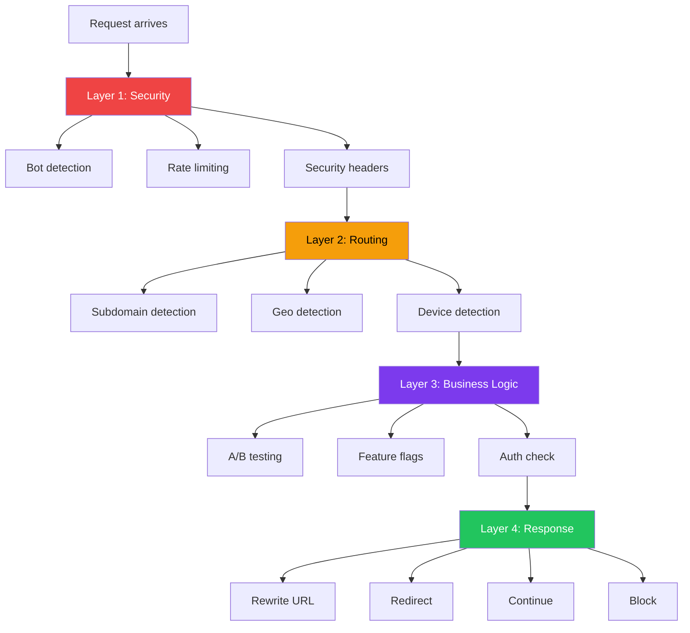
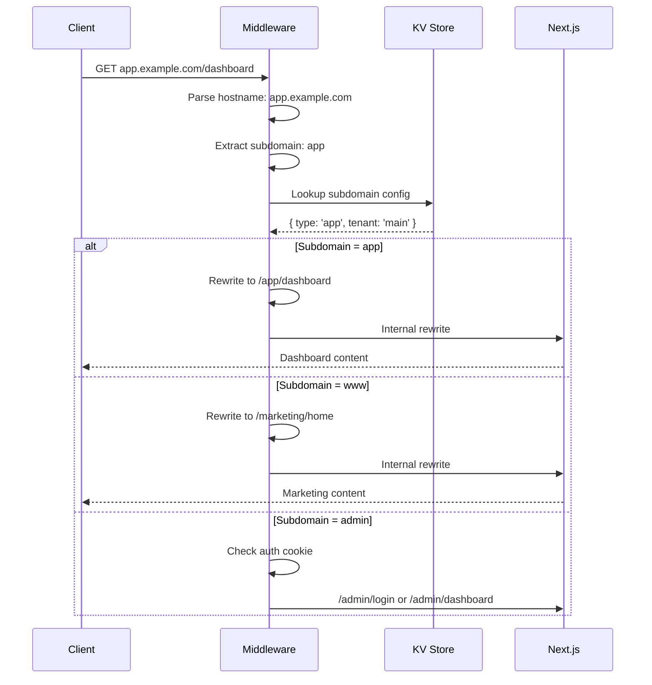
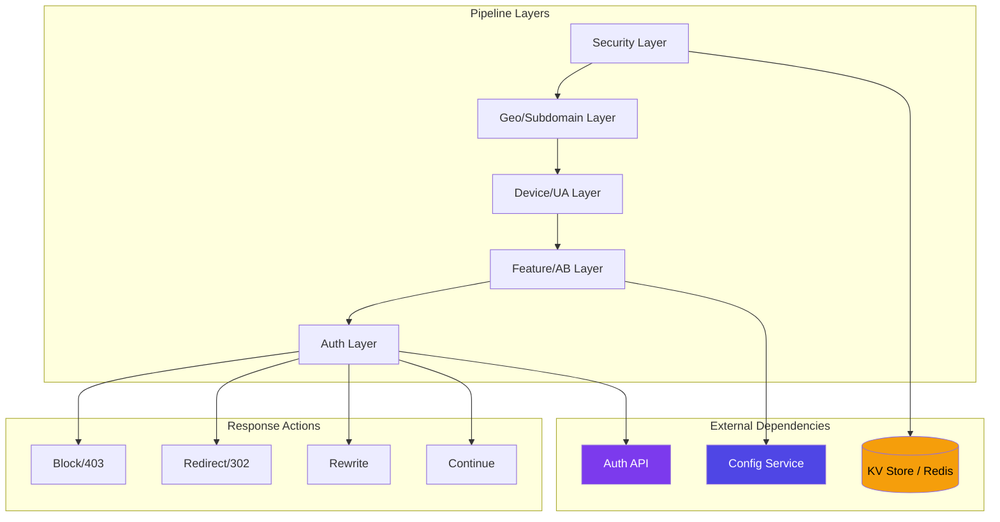
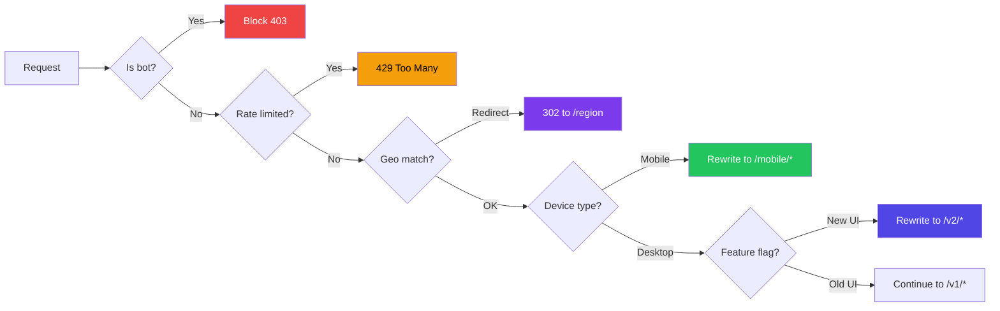

# Advanced Middleware Patterns

## Introduction
Beyond basic authentication and redirects, Next.js middleware can handle complex patterns like geolocation-based routing, multi-tenant subdomain routing, API rate limiting with Redis, dynamic SEO tag injection, complex A/B testing frameworks, and conditional API proxying. This topic explores production-ready advanced middleware patterns that solve real-world problems at the Edge.

## Why do we need this?
Basic middleware handles simple auth and redirects, but real-world applications demand more:

- **Geo-routing** — Serve different content based on visitor country (GDPR compliance, regional pricing)
- **Subdomain routing** — Route `app.example.com` to dashboard and `www.example.com` to marketing
- **Advanced rate limiting** — Distributed rate limiting with Redis for multi-server deployments
- **Dynamic SEO** — Inject meta tags, canonical URLs, and hreflang based on request properties
- **Conditional proxying** — Route API requests to different backends based on feature flags
- **Device detection** — Serve mobile-optimized versions to phone users

## Problem Statement
As your application scales, you need sophisticated request processing that can:
- Handle multi-region deployments with geo-specific content
- Route traffic by subdomain, device type, or feature flag
- Protect against abuse with distributed rate limiting
- Inject dynamic SEO metadata without server-rendered pages
- Proxy requests to different backends based on complex conditions

These patterns must execute at the Edge with minimal latency and zero impact on page load times.

## Real World Story
Shopify uses advanced edge middleware to power their multi-tenant platform. When a request arrives for `mystore.shopify.com`, middleware reads the subdomain, looks up the store configuration from a distributed cache, and rewrites the URL to serve that specific store's theme, products, and content — all without the visitor ever seeing the backend structure. The same middleware also handles geo-redirects (a visitor from Canada sees CAD pricing) (Vistor from UK sees GBP pricing) device detection (mobile vs. desktop themes), and A/B testing for new checkout flows.

## Real World Analogy
Think of advanced middleware as an **airport air traffic control system**:

- **Basic middleware** = A single security guard checking IDs
- **Advanced middleware** = The entire control tower that:
  - Routes planes to the correct runway (subdomain routing)
  - Diverts flights based on weather (geo-routing)
  - Manages takeoff/landing slots (rate limiting)
  - Coordinates between multiple airports (distributed systems)

Every plane (request) gets the right treatment based on its origin (geo), type (device), and destination (route) — all coordinated centrally.

## Visual Explanation

```
Advanced Middleware Architecture:

                     ┌─────────────────────────────────────┐
                     │         Edge / CDN Layer             │
                     │         ┌───────────────┐            │
                     │         │  MIDDLEWARE   │            │
                     │         │ (Edge Runtime)│            │
                     │         └───────┬───────┘            │
                     │                 │                    │
                     │    ┌────────────┼────────────┐       │
                     │    │            │            │       │
                     ▼    ▼            ▼            ▼       │
              ┌────────┐ ┌────────┐ ┌────────┐ ┌────────┐  │
              │ Geo-   │ │ Sub-   │ │ Device │ │ A/B    │  │
              │ Route  │ │ domain │ │ Detect │ │ Test   │  │
              └────────┘ └────────┘ └────────┘ └────────┘  │
                     │         │         │         │       │
                     └─────────┼─────────┼─────────┘       │
                               │         │                 │
                               ▼         ▼                 │
                     ┌─────────────────────────┐           │
                     │    Rewritten Request     │           │
                     │  → /store/mystore/page   │           │
                     │  → /en-CA/dashboard      │           │
                     │  → /mobile/products      │           │
                     └─────────────┬───────────┘           │
                                   │                       │
                                   ▼                       │
                     ┌─────────────────────────┐           │
                     │    Next.js App Server    │           │
                     └─────────────────────────┘           │
└──────────────────────────────────────────────────────────┘
```

## Mermaid Diagram 1: Multi-layered Middleware Pipeline



## Internal Working
Advanced middleware patterns leverage several Edge Runtime capabilities:

1. **Geolocation** — `request.geo` provides country, city, region from the CDN
2. **Subdomain parsing** — `request.nextUrl.hostname` extracts subdomains
3. **User-Agent detection** — Parse device type from headers
4. **External services** — Fetch from Redis, KV stores, or APIs (with caching)
5. **Cookie-based persistence** — Store A/B test variants, feature flags, preferences
6. **Conditional rewrites** — Rewrite to different internal paths based on conditions

## Mermaid Diagram 2: Subdomain Routing Flow



## Architecture
Advanced middleware follows a **pipeline architecture** with distinct processing layers:



## Mermaid Diagram 4: Advanced Middleware Decision Tree



## Step-by-Step Flow

1. **Analyze requirements** — Determine all conditions that affect routing (geo, device, subdomain, auth)
2. **Design pipeline layers** — Order checks from cheapest to most expensive (security first, auth last)
3. **Implement each layer** — Each concern gets its own function or module
4. **Configure matchers** — Be specific about which paths each pattern applies to
5. **Handle edge cases** — What happens when geo data is missing? When rate limit is exceeded?
6. **Test all paths** — Verify every decision point in the pipeline

## Syntax

```tsx
// Advanced middleware pipeline structure
import { NextResponse } from 'next/server'
import type { NextRequest } from 'next/server'

// Security layer
function securityCheck(request: NextRequest): NextResponse | null {
  // Returns response to block, or null to continue
}

// Routing layer
function routeByGeo(request: NextRequest): NextResponse | null {
  // Returns redirect/rewrite, or null to continue
}

// Business logic layer
function applyFeatureFlags(request: NextRequest): NextResponse {
  // Returns modified response with cookies/headers
}

export function middleware(request: NextRequest) {
  // Run pipeline layers sequentially
  const security = securityCheck(request)
  if (security) return security
  
  const routing = routeByGeo(request)
  if (routing) return routing
  
  return applyFeatureFlags(request)
}
```

## Basic Example

Geolocation-based routing with country detection:

```tsx
// middleware.ts
import { NextResponse } from 'next/server'
import type { NextRequest } from 'next/server'

// Regional content mapping
const regionConfig = {
  US: { currency: 'USD', locale: 'en-US', site: 'us' },
  GB: { currency: 'GBP', locale: 'en-GB', site: 'uk' },
  DE: { currency: 'EUR', locale: 'de-DE', site: 'eu' },
  FR: { currency: 'EUR', locale: 'fr-FR', site: 'eu' },
  IN: { currency: 'INR', locale: 'en-IN', site: 'in' },
  JP: { currency: 'JPY', locale: 'ja-JP', site: 'jp' },
  DEFAULT: { currency: 'USD', locale: 'en-US', site: 'intl' },
}

const EU_COUNTRIES = ['DE', 'FR', 'ES', 'IT', 'NL', 'BE', 'AT', 'IE', 'PT', 'SE', 'DK', 'FI', 'PL']

export function middleware(request: NextRequest) {
  const { pathname } = request.nextUrl
  const country = (request.geo?.country || request.headers.get('x-vercel-ip-country') || '').toUpperCase()
  
  // Skip middleware for static files and API routes
  if (pathname.startsWith('/_next') || pathname.startsWith('/api/')) {
    return NextResponse.next()
  }
  
  // Get region config
  const config = regionConfig[country as keyof typeof regionConfig] || regionConfig.DEFAULT
  
  // Set regional cookies
  const response = NextResponse.next()
  response.cookies.set('currency', config.currency, { maxAge: 3600 * 24, path: '/' })
  response.cookies.set('locale', config.locale, { maxAge: 3600 * 24, path: '/' })
  
  // GDPR check for EU visitors
  if (EU_COUNTRIES.includes(country) && !request.cookies.has('gdpr_consent')) {
    response.headers.set('x-show-gdpr-banner', 'true')
  }
  
  // Regional pricing page redirect (if not already on the right page)
  if (pathname === '/pricing' && !request.cookies.has('region_seen')) {
    response.cookies.set('region_seen', config.site, { maxAge: 3600 * 24 * 30, path: '/' })
  }
  
  return response
}

export const config = {
  matcher: ['/((?!_next/static|_next/image|favicon.ico).*)'],
}
```

## Intermediate Example

Subdomain-based multi-tenant routing:

```tsx
// middleware.ts
import { NextResponse } from 'next/server'
import type { NextRequest } from 'next/server'

// Tenant configuration (in production, fetch from KV store or database)
const tenantConfig = {
  app: {
    name: 'App Dashboard',
    rewrite: '/dashboard',
    auth: true,
  },
  www: {
    name: 'Marketing Site',
    rewrite: '/marketing',
    auth: false,
  },
  admin: {
    name: 'Admin Panel',
    rewrite: '/admin',
    auth: true,
    role: 'admin',
  },
  docs: {
    name: 'Documentation',
    rewrite: '/docs',
    auth: false,
  },
  blog: {
    name: 'Blog',
    rewrite: '/blog',
    auth: false,
  },
}

export function middleware(request: NextRequest) {
  const { pathname } = request.nextUrl
  const hostname = request.headers.get('host') || ''
  const subdomain = hostname.split('.')[0]
  
  // Skip for direct IP or localhost
  if (hostname === 'localhost:3000' || hostname === '127.0.0.1:3000') {
    return NextResponse.next()
  }
  
  // Find tenant config
  const tenant = tenantConfig[subdomain as keyof typeof tenantConfig]
  
  if (!tenant) {
    // Unknown subdomain — redirect to main site
    return NextResponse.redirect(new URL('https://www.example.com'))
  }
  
  // Authentication check for protected tenants
  if (tenant.auth) {
    const session = request.cookies.get('session')
    if (!session) {
      const loginUrl = new URL('/login', request.url)
      loginUrl.searchParams.set('redirect', pathname)
      loginUrl.searchParams.set('tenant', subdomain)
      return NextResponse.redirect(loginUrl)
    }
    
    // Role-based access for admin
    if (tenant.role) {
      const userRole = request.cookies.get('user_role')?.value
      if (userRole !== tenant.role) {
        return NextResponse.redirect(new URL('/dashboard', request.url))
      }
    }
  }
  
  // Rewrite to tenant-specific internal route
  const url = request.nextUrl.clone()
  url.pathname = `${tenant.rewrite}${pathname}`
  return NextResponse.rewrite(url)
}

export const config = {
  matcher: ['/((?!_next/static|_next/image|favicon.ico).*)'],
}
```

## Advanced Example

Comprehensive middleware system with rate limiting, caching, and multi-plexing:

```tsx
// middleware.ts
import { NextResponse } from 'next/server'
import type { NextRequest } from 'next/server'

// ====== SECURITY LAYER ======

const BOT_PATTERNS = [
  'bot', 'crawler', 'spider', 'scraper', 'harvest',
  'curl', 'wget', 'python-requests', 'go-http-client',
]

const ALLOWED_BOTS = ['googlebot', 'bingbot', 'slurp']

function isBot(ua: string): { isBot: boolean; name?: string } {
  const uaLower = ua.toLowerCase()
  
  for (const bot of ALLOWED_BOTS) {
    if (uaLower.includes(bot)) return { isBot: true, name: bot }
  }
  
  for (const pattern of BOT_PATTERNS) {
    if (uaLower.includes(pattern)) return { isBot: true, name: pattern }
  }
  
  return { isBot: false }
}

// ====== GEO LAYER ======

interface GeoConfig {
  currency: string
  locale: string
  domain: string
  gdprRequired: boolean
}

const geoConfigs: Record<string, GeoConfig> = {
  US: { currency: 'USD', locale: 'en-US', domain: 'example.com', gdprRequired: false },
  GB: { currency: 'GBP', locale: 'en-GB', domain: 'example.co.uk', gdprRequired: false },
  DE: { currency: 'EUR', locale: 'de-DE', domain: 'example.de', gdprRequired: true },
  FR: { currency: 'EUR', locale: 'fr-FR', domain: 'example.fr', gdprRequired: true },
  DEFAULT: { currency: 'USD', locale: 'en-US', domain: 'example.com', gdprRequired: false },
}

function getGeoConfig(request: NextRequest): GeoConfig {
  const country = (request.geo?.country || '').toUpperCase()
  return geoConfigs[country] || geoConfigs.DEFAULT
}

// ====== DEVICE LAYER ======

function isMobile(ua: string): boolean {
  return /mobile|android|iphone|ipad|ipod|blackberry|windows phone/i.test(ua)
}

// ====== FEATURE FLAGS ======

const featureFlags = {
  newCheckout: { rollout: 50, cookie: 'ff_new_checkout' },
  darkMode: { rollout: 25, cookie: 'ff_dark_mode' },
  aiSearch: { rollout: 10, cookie: 'ff_ai_search' },
}

function getFeatureFlags(userId: string): Record<string, boolean> {
  const hash = userId.split('').reduce((acc, c) => acc + c.charCodeAt(0), 0)
  const flags: Record<string, boolean> = {}
  
  for (const [flag, config] of Object.entries(featureFlags)) {
    flags[flag] = (hash % 100) < config.rollout
  }
  
  return flags
}

// ====== MAIN MIDDLEWARE ======

export function middleware(request: NextRequest) {
  const { pathname } = request.nextUrl
  const ua = request.headers.get('user-agent') || ''
  
  // Skip static files
  if (pathname.startsWith('/_next') || pathname === '/favicon.ico') {
    return NextResponse.next()
  }
  
  // 1. BOT DETECTION
  if (pathname.startsWith('/api/')) {
    const bot = isBot(ua)
    if (bot.isBot && !ALLOWED_BOTS.includes(bot.name || '')) {
      return NextResponse.json(
        { error: 'Access denied', code: 'BOT_DETECTED' },
        { status: 403 }
      )
    }
  }
  
  // 2. GEO PROCESSING
  const geoConfig = getGeoConfig(request)
  const response = NextResponse.next()
  
  // Set geo-based cookies
  response.cookies.set('geo_currency', geoConfig.currency, {
    maxAge: 3600 * 24 * 7,
    path: '/',
    sameSite: 'lax',
  })
  
  response.cookies.set('geo_locale', geoConfig.locale, {
    maxAge: 3600 * 24 * 7,
    path: '/',
    sameSite: 'lax',
  })
  
  // GDPR banner
  if (geoConfig.gdprRequired && !request.cookies.has('gdpr_consent')) {
    response.headers.set('x-gdpr-required', 'true')
  }
  
  // 3. DEVICE DETECTION
  if (isMobile(ua)) {
    response.headers.set('x-device-type', 'mobile')
    response.cookies.set('device', 'mobile', {
      maxAge: 3600 * 24,
      path: '/',
    })
  }
  
  // 4. FEATURE FLAGS
  const userId = request.cookies.get('user_id')?.value || 'anonymous'
  
  if (!request.cookies.has('ff_initialized')) {
    const flags = getFeatureFlags(userId)
    response.cookies.set('ff_initialized', 'true', {
      maxAge: 3600 * 24,
      path: '/',
    })
    
    for (const [flag, enabled] of Object.entries(flags)) {
      response.cookies.set(featureFlags[flag as keyof typeof featureFlags].cookie, String(enabled), {
        maxAge: 3600 * 24 * 7,
        path: '/',
      })
    }
  }
  
  // 5. A/B TESTING FOR CHECKOUT
  if (pathname.startsWith('/checkout') && !request.cookies.has('checkout_variant')) {
    const variant = Math.random() < 0.5 ? 'A' : 'B'
    response.cookies.set('checkout_variant', variant, {
      maxAge: 3600 * 24 * 30,
      path: '/',
    })
    
    if (variant === 'B') {
      response.headers.set('x-checkout-variant', 'B')
    }
  }
  
  // 6. SECURITY HEADERS
  response.headers.set('X-Content-Type-Options', 'nosniff')
  response.headers.set('X-Frame-Options', 'DENY')
  response.headers.set('X-XSS-Protection', '1; mode=block')
  response.headers.set('Referrer-Policy', 'strict-origin-when-cross-origin')
  
  if (pathname.startsWith('/dashboard/')) {
    response.headers.set('X-Robots-Tag', 'noindex, nofollow')
  }
  
  return response
}

export const config = {
  matcher: ['/((?!_next/static|_next/image|favicon.ico).*)'],
}
```

## Production Example

Enterprise middleware with distributed rate limiting, multi-region failover, and observability:

```tsx
// middleware.ts
import { NextResponse } from 'next/server'
import type { NextRequest } from 'next/server'

declare const process: {
  env: {
    REDIS_URL?: string
    AUTH_API_URL?: string
    MAINTENANCE_MODE?: string
    ENVIRONMENT?: string
  }
}

// ====== DISTRIBUTED RATE LIMITING ======

// In-memory fallback (use Upstash Redis in production)
const rateLimitStore = new Map<string, { count: number; resetTime: number }>()

async function checkRateLimit(
  key: string,
  maxRequests: number,
  windowMs: number
): Promise<{ allowed: boolean; remaining: number; resetTime: number }> {
  const now = Date.now()
  const record = rateLimitStore.get(key)
  
  if (!record || now > record.resetTime) {
    rateLimitStore.set(key, { count: 1, resetTime: now + windowMs })
    return { allowed: true, remaining: maxRequests - 1, resetTime: now + windowMs }
  }
  
  record.count++
  
  if (record.count > maxRequests) {
    return { allowed: false, remaining: 0, resetTime: record.resetTime }
  }
  
  return { allowed: true, remaining: maxRequests - record.count, resetTime: record.resetTime }
}

// ====== AUTH SESSION VERIFICATION ======

// Cache auth results to reduce upstream calls
const authCache = new Map<string, { valid: boolean; role: string; expiresAt: number }>()

async function verifySession(token: string): Promise<{ valid: boolean; role: string }> {
  // Check cache first
  const cached = authCache.get(token)
  if (cached && Date.now() < cached.expiresAt) {
    return { valid: cached.valid, role: cached.role }
  }
  
  try {
    const response = await fetch(`${process.env.AUTH_API_URL}/verify`, {
      headers: { Authorization: `Bearer ${token}` },
      signal: AbortSignal.timeout(2000), // 2 second timeout
    })
    
    if (!response.ok) return { valid: false, role: '' }
    
    const data = await response.json()
    
    // Cache for 5 minutes
    authCache.set(token, {
      valid: data.valid,
      role: data.role,
      expiresAt: Date.now() + 5 * 60 * 1000,
    })
    
    return { valid: data.valid, role: data.role }
  } catch {
    // Fail open for degraded experience
    return { valid: true, role: 'user' }
  }
}

// ====== GEO AND REGION ROUTING ======

const REGION_CONFIG = {
  NA: { sites: ['US', 'CA', 'MX'], cache: 'na-cache.example.com' },
  EU: { sites: ['DE', 'FR', 'GB', 'ES', 'IT'], cache: 'eu-cache.example.com' },
  APAC: { sites: ['JP', 'AU', 'IN', 'SG'], cache: 'apac-cache.example.com' },
}

function getRegion(country: string): string {
  for (const [region, config] of Object.entries(REGION_CONFIG)) {
    if (config.sites.includes(country)) return region
  }
  return 'NA' // Default to NA
}

// ====== MAIN MIDDLEWARE ======

export async function middleware(request: NextRequest) {
  const { pathname, search } = request.nextUrl
  const ua = request.headers.get('user-agent') || ''
  const ip = request.headers.get('x-forwarded-for') || 'unknown'
  const country = (request.geo?.country || '').toUpperCase()
  
  const startTime = Date.now()
  
  // === 1. MAINTENANCE MODE ===
  if (process.env.MAINTENANCE_MODE === 'true' && !pathname.startsWith('/api/health')) {
    return new Response('Under maintenance', {
      status: 503,
      headers: { 'Retry-After': '3600' },
    })
  }
  
  // === 2. RATE LIMITING ===
  if (pathname.startsWith('/api/')) {
    const { allowed, remaining, resetTime } = await checkRateLimit(
      `api:${ip}`,
      pathname.startsWith('/api/auth') ? 20 : 100,
      60 * 1000
    )
    
    if (!allowed) {
      return NextResponse.json(
        { error: 'Too many requests' },
        {
          status: 429,
          headers: {
            'Retry-After': String(Math.ceil((resetTime - Date.now()) / 1000)),
            'X-RateLimit-Remaining': '0',
          },
        }
      )
    }
    
    const response = NextResponse.next()
    response.headers.set('X-RateLimit-Remaining', String(remaining))
    
    // === 3. AUTH FOR API ROUTES ===
    const authHeader = request.headers.get('authorization')
    if (authHeader?.startsWith('Bearer ')) {
      const token = authHeader.slice(7)
      const session = await verifySession(token)
      
      if (!session.valid) {
        return NextResponse.json({ error: 'Unauthorized' }, { status: 401 })
      }
      
      const requestHeaders = new Headers(request.headers)
      requestHeaders.set('x-user-role', session.role)
      
      return NextResponse.next({
        request: { headers: requestHeaders },
      })
    }
    
    return response
  }
  
  // === 4. PAGE ROUTE PROCESSING ===
  const response = NextResponse.next()
  
  // Region-based cache header
  const region = getRegion(country)
  response.headers.set('X-Region', region)
  response.headers.set('X-Cache-Group', region)
  
  // Performance monitoring
  const duration = Date.now() - startTime
  response.headers.set('X-Middleware-Time', `${duration}ms`)
  
  // Security headers
  response.headers.set('Content-Security-Policy', 
    "default-src 'self'; script-src 'self' 'unsafe-inline'; style-src 'self' 'unsafe-inline'"
  )
  response.headers.set('Strict-Transport-Security', 'max-age=63072000; includeSubDomains; preload')
  
  return response
}

export const config = {
  matcher: [
    '/((?!_next/static|_next/image|favicon.ico|.*\\.(?:svg|png|jpg|jpeg|gif|webp)$).*)',
  ],
}
```

## Folder Structure

```
my-app/
├── middleware.ts                   ← Main middleware (pipeline orchestrator)
├── lib/
│   ├── middleware/
│   │   ├── security.ts             ← Bot detection, rate limiting
│   │   ├── geo.ts                  ← Geo-routing, localization
│   │   ├── device.ts               ← Device detection
│   │   ├── feature-flags.ts        ← A/B testing, feature flags
│   │   ├── auth.ts                 ← Session verification
│   │   └── headers.ts              ← Security headers
│   ├── rate-limit.ts               ← Rate limiting utilities
│   ├── geo.ts                      ← Geolocation utilities
│   └── auth.ts                     ← Auth verification utilities
├── app/
│   ├── (marketing)/                ← Marketing routes
│   ├── (dashboard)/                ← Dashboard routes
│   ├── (admin)/                    ← Admin routes
│   └── api/                        ← API routes
└── next.config.js
```

## 🚀 Best Practices

1. **Pipeline pattern** — Separate concerns into distinct layers (security → routing → business logic)
2. **Cache external calls** — Cache auth verification, feature flag lookups, and configuration fetches
3. **Fail open for degraded mode** — When external services fail, allow requests through rather than blocking everything
4. **Use typed environment variables** — Validate env vars at startup, not in middleware
5. **Set timeouts on external calls** — Never block middleware on slow upstream services (use `AbortSignal.timeout`)
6. **Return early for static assets** — Skip all processing for `_next/static`, images, and fonts
7. **Monitor middleware performance** — Add timing headers to track middleware execution time
8. **Test every decision path** — Write unit tests for each middleware layer independently

## ⚠ Common Mistakes

1. **Blocking on external API calls** — Middleware should never wait indefinitely; always set timeouts
2. **Missing fallback for missing geo data** — `request.geo` can be null in development; always provide defaults
3. **Rate limiting by IP alone** — Behind proxies, use `x-forwarded-for` headers with multiple IPs
4. **Overly complex middleware** — Keep each layer focused; extract into separate files when it grows
5. **Not cleaning up rate limit stores** — In-memory stores grow indefinitely without cleanup logic
6. **Leaking internal URLs via rewrites** — Rewritten URLs shouldn't be exposed to the client

## 📦 Performance Notes

- Each middleware layer adds latency — measure and optimize hot paths
- Use in-memory caches for auth tokens and config lookups
- Set aggressive timeouts (500ms-2s) for external calls
- Consider which checks can run in parallel vs. sequential
- Monitor `x-middleware-time` header in production
- For Vercel Edge, middleware has a 5-second execution limit

## 🔒 Security Notes

- Never trust geo-location data for security decisions (can be spoofed)
- Combine rate limiting with auth for sensitive endpoints
- Use signed cookies for A/B test assignments (prevent tampering)
- Cache auth tokens with short TTLs (5 minutes max)
- Implement fail-closed for security checks (fail-open only for degraded UX)
- Log middleware decisions for audit trails (anonymized)

## 🌍 SEO Considerations

- Geo-redirects should use 302 (temporary) unless permanent
- Subdomain rewrites hide URL structure from crawlers — use canonical tags
- Hreflang tags should match the geo-detected locale
- Mobile detection should use responsive design primarily; middleware rewrites as secondary
- Set `x-robots-tag` for duplicate content from geo-routing

## Interview Questions

1. How do you implement distributed rate limiting across multiple Edge regions?
2. What's the best approach for multi-tenant subdomain routing?
3. How do you handle geo-detection when `request.geo` is unavailable?
4. What caching strategies work well for external API calls in middleware?
5. How do you implement a failover pattern when auth services are down?
6. What security considerations apply to middleware-based geo-routing?
7. How do you A/B test at the middleware level without affecting SEO?

## MCQs

1. What's the recommended pattern for organizing complex middleware?
   a) Single large function with all logic
   b) Pipeline of focused layers/functions
   c) Multiple middleware.ts files
   d) All logic in next.config.js
   <details>
   <summary>Answer</summary>
   b) Pipeline pattern — separate concerns into focused layers for maintainability.
   </details>

2. How should you handle external API calls in middleware?
   a) Wait indefinitely for the response
   b) Set a timeout with AbortSignal.timeout()
   c) Never make external calls
   d) Use synchronous requests
   <details>
   <summary>Answer</summary>
   b) Always set timeouts on external calls to prevent middleware from hanging.
   </details>

3. What happens when `request.geo` is null?
   a) Middleware crashes
   b) You should provide default fallback values
   c) The request is automatically blocked
   d) Geo is always available in production
   <details>
   <summary>Answer</summary>
   b) Always provide fallback values since geo data may not be available (dev, test environments).
   </details>

4. Which header is used to identify the original client IP behind a proxy?
   a) `x-real-ip`
   b) `x-forwarded-for`
   c) `client-ip`
   d) `remote-addr`
   <details>
   <summary>Answer</summary>
   b) `x-forwarded-for` — Contains the original client IP when behind proxies.
   </details>

5. What's the maximum execution time for Vercel Edge Functions?
   a) 1 second
   b) 5 seconds
   c) 30 seconds
   d) 60 seconds
   <details>
   <summary>Answer</summary>
   b) 5 seconds — Edge Functions on Vercel have a 5-second execution limit.
   </details>

## Practice Exercise

1. **Build a Geo-aware E-commerce Middleware:**
   - Detect user country from geo/headers
   - Set currency cookie (USD, EUR, GBP, JPY)
   - Redirect `/pricing` to region-specific pricing page
   - Show GDPR banner for EU visitors
   - Set cache group header based on region

2. **Multi-tenant Blog Platform:**
   - Route `blog.example.com` to blog content
   - Route `docs.example.com` to documentation
   - Route `app.example.com` to dashboard (auth required)
   - Each tenant has its own layout and theme

3. **Comprehensive API Protection:**
   - Rate limit by IP (100 req/min for public, 1000 req/min for authenticated)
   - Bot detection for known crawlers vs scrapers
   - Block known malicious IPs from a config list
   - Add security headers to all API responses

## Debugging Exercise

Find and fix the bugs:

```tsx
// middleware.ts — Geo middleware
export function middleware(request: NextRequest) {
  const country = request.geo.country  // Bug 1: No null check
  
  if (country === 'US') {
    return NextResponse.redirect('/us')  // Bug 2: Missing base URL
  }
}

// Bug 3: No matcher — runs on all requests including static files
```

**Bug 1:** `request.geo` could be null, causing a crash.
**Fix:** `const country = request.geo?.country || 'US'`

**Bug 2:** `NextResponse.redirect()` requires a full URL object.
**Fix:** `NextResponse.redirect(new URL('/us', request.url))`

**Bug 3:** Missing matcher config — middleware runs on every request.
**Fix:** Add `export const config = { matcher: [...] }`

## Real-world Scenario

**Problem:** A global e-commerce platform needs to serve different product catalogs, pricing, and checkout flows based on the user's country. EU users must see GDPR-compliant checkout with VAT, US users see sales tax, and APAC users see simplified checkout with regional payment methods. The platform also needs A/B testing for a new checkout UI.

**Solution:**
```tsx
// middleware.ts
export async function middleware(request: NextRequest) {
  const country = request.geo?.country || 'US'
  const region = getRegion(country)
  
  // Set regional config
  const response = NextResponse.next()
  response.cookies.set('region', region, { maxAge: 3600 * 24, path: '/' })
  
  // A/B test new checkout
  if (request.nextUrl.pathname === '/checkout' && !request.cookies.has('checkout_v')) {
    response.cookies.set('checkout_v', Math.random() < 0.5 ? 'old' : 'new', {
      maxAge: 3600 * 24 * 30, path: '/'
    })
  }
  
  return response
}
```

## Interview Coding Question

Implement a middleware-based API proxy that routes to different backends:

```tsx
// middleware.ts
export function middleware(request: NextRequest) {
  const { pathname } = request.nextUrl
  
  if (pathname.startsWith('/api/')) {
    const country = request.geo?.country || 'US'
    
    // Route to nearest regional API
    const regions = {
      EU: 'https://api-eu.example.com',
      NA: 'https://api-na.example.com',
      APAC: 'https://api-apac.example.com',
    }
    
    const region = getRegion(country)
    const baseUrl = regions[region as keyof typeof regions] || regions.NA
    
    // Rewrite to regional backend
    const url = new URL(pathname, baseUrl)
    url.search = request.nextUrl.search
    
    return NextResponse.rewrite(url)
  }
  
  return NextResponse.next()
}
```

## Mini Project

**Build a Production-Grade Middleware System**

Create a comprehensive middleware that handles:

1. **Security (4 patterns):**
   - Bot detection (allowlist/blocklist)
   - Rate limiting with tiered limits (public: 100/min, auth: 1000/min, admin: 5000/min)
   - Security headers (CSP, HSTS, XFO, CORS for API)
   - Blocked IP ranges from config

2. **Routing (3 patterns):**
   - Subdomain-based tenant routing (app, www, admin, docs)
   - Geo-based region routing (NA, EU, APAC)
   - Device-based content adaptation (mobile vs desktop)

3. **Business Logic (3 patterns):**
   - A/B testing for checkout, landing pages, pricing
   - Feature flags with percentage rollout
   - GDPR/EU compliance handling

4. **Performance:**
   - In-memory caching for auth verification
   - Early returns for static assets
   - Timing headers for observability
   - Proper matcher configuration

## Summary

Advanced middleware patterns extend beyond basic auth checks to include geo-routing, subdomain-based multi-tenancy, distributed rate limiting, device detection, A/B testing, and complex feature flag systems. The key to maintainability is the pipeline pattern — separate each concern into focused layers. Always provide fallback values for geo data, set timeouts on external calls, and cache results where possible. Advanced middleware runs at the Edge, processing requests with minimal latency before they reach your application.

## Cheat Sheet

```tsx
// Advanced Middleware Patterns Quick Reference

// Geo detection
const country = request.geo?.country || 'US'
const city = request.geo?.city
const region = request.geo?.region

// Subdomain routing
const hostname = request.headers.get('host') || ''
const subdomain = hostname.split('.')[0]

// Device detection
const isMobile = /mobile/i.test(request.headers.get('user-agent') || '')

// Rewrite (internal routing)
return NextResponse.rewrite(new URL('/internal/path', request.url))

// Rate limiting
const { allowed, remaining } = await checkRateLimit(`api:${ip}`, 100, 60000)

// Session verification (cached)
const session = await verifySession(token) // Cache results for 5 min

// Security headers
response.headers.set('Content-Security-Policy', "default-src 'self'")
response.headers.set('Strict-Transport-Security', 'max-age=63072000')

// Feature flags (cookie-based)
response.cookies.set('ff_new_checkout', 'true', { maxAge: 86400, path: '/' })

// Pipeline pattern
function security(req) { /* ... */ }
function routing(req) { /* ... */ }
function businessLogic(req) { /* ... */ }

export function middleware(req) {
  return security(req) || routing(req) || businessLogic(req)
}
```

## Related Topics
- Middleware Basics (Previous Topic)
- Edge Runtime
- Authentication (Phase 5)
- Performance Optimization (Phase 6)
- Internationalization

## Further Reading
- [Next.js Documentation: Middleware](https://nextjs.org/docs/app/building-your-application/routing/middleware)
- [Vercel Edge Functions](https://vercel.com/docs/functions/edge-functions)
- [Upstash Rate Limiting](https://upstash.com/docs/redis/sdks/ratelimit/vercel)
- [Geo-Routing Patterns](https://vercel.com/docs/edge-network/headers#request-headers)
