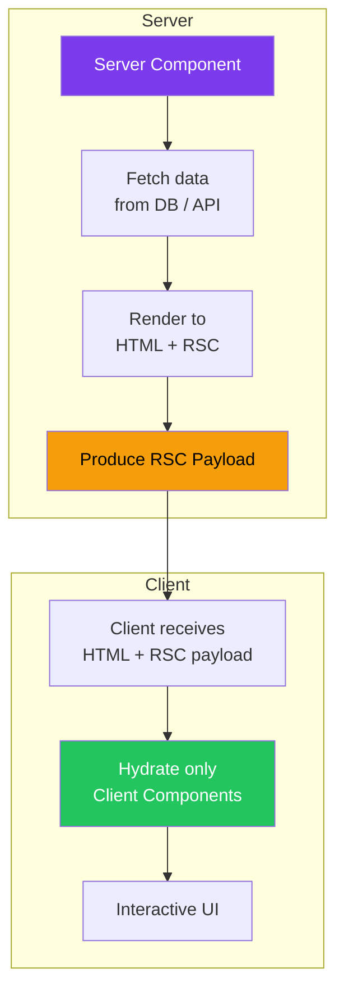
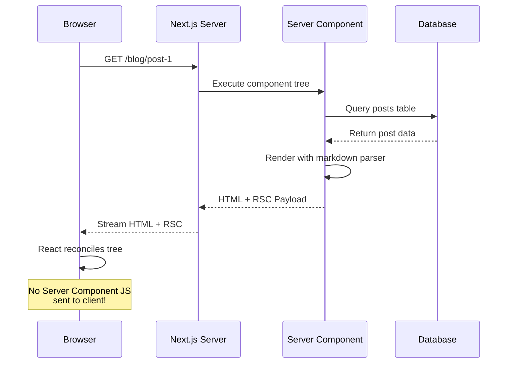
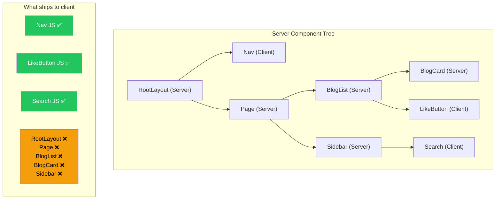
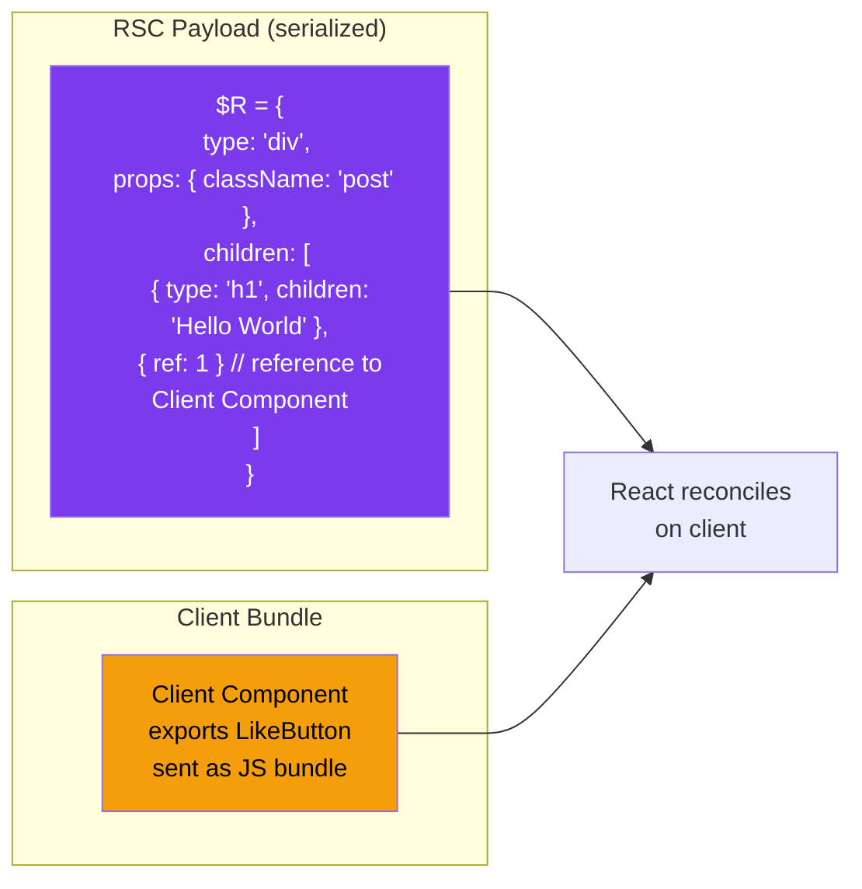

# What are React Server Components?

## Introduction
React Server Components (RSC) are a new type of React component that render exclusively on the server. Unlike traditional React components that run in the browser, Server Components execute on the server, generate HTML, and produce a special RSC payload that React uses to efficiently update the client-side component tree. They are the default component type in the Next.js App Router.

## Why do we need this?
Traditional React components execute entirely in the browser. This means:
- **Large bundle sizes** — Every component's JavaScript must be downloaded and parsed
- **No direct data access** — Components can't directly access databases; you need API routes
- **Waterfall requests** — Components fetch data → render → hydrate → fetch more data
- **Slower initial loads** — Everything waits for JavaScript to download and execute

Server Components solve all of these problems by running on the server, sending only the rendered output to the client.

## Problem Statement
React applications have traditionally shipped all component code to the browser. A page that renders a blog post from a database needs: the blog post component code, the markdown parser, the date formatter library, and the data fetching logic — all downloaded as JavaScript. This creates a poor user experience, especially on slow connections or low-powered devices.

## Real World Story
Spotify's web player historically struggled with slow initial load times because their React application shipped large bundles of JavaScript for features like audio processing, playlist management, and data visualization. By adopting Server Components (via Next.js), they moved data fetching and initial rendering to the server, reducing the initial bundle size by 40% and improving Time to Interactive by 60%.

## Real World Analogy
Think of Server Components vs Client Components like **restaurant kitchen vs dining table**:

- **Server Components (kitchen)**: The chef prepares your meal (renders HTML), plates it (generates RSC payload), and serves it to you. You don't see the cooking process (database queries, API calls), and you don't need the kitchen utensils (npm dependencies) at your table.

- **Client Components (dining table)**: The salt shaker (interactive button), menu (navigation), and water glass (form inputs) are things you interact with directly — these stay on the table (browser).

The kitchen handles all the complex preparation work; the table only has what you need to interact with.

## Visual Explanation
```
Server Components vs Client Components:

┌─────────────────────────────────────────────┐
│               SERVER                         │
│  ┌─────────────────────────────────────┐    │
│  │  Server Component                   │    │
│  │  - Fetches data from DB             │    │
│  │  - Renders markdown to HTML         │    │
│  │  - Formats dates                    │    │
│  │  - Returns: <article>...</article>  │    │
│  └─────────────────────────────────────┘    │
│           │                                  │
│           ▼ HTML + RSC Payload               │
└─────────────────────────────────────────────┘
                    │
                    ▼
┌─────────────────────────────────────────────┐
│               CLIENT                         │
│  ┌─────────────────────────────────────┐    │
│  │  Client Component                   │    │
│  │  - <button> onClick → like post    │    │
│  │  - <input> onChange → search       │    │
│  │  - <div> useState → toggle menu    │    │
│  └─────────────────────────────────────┘    │
└─────────────────────────────────────────────┘
```

## Mermaid Diagram 1: Server Component Architecture



## Internal Working
When Next.js renders a page with Server Components:

1. **Component tree resolution** — Next.js traverses the component tree from the root layout
2. **Server Component execution** — All Server Components execute on the server, including their async data fetching
3. **RSC Payload generation** — A special serialized format (RSC Payload) is generated, containing the rendered component tree
4. **HTML generation** — Server Components render to static HTML for initial page load (SEO, fast FCP)
5. **Streaming** — HTML and RSC payload are streamed to the client as they become ready
6. **Client reconciliation** — React uses the RSC payload to reconcile the component tree without sending Server Component code to the browser

## Mermaid Diagram 2: Server Component Request Lifecycle



## Architecture
The RSC architecture creates a clear server/client boundary:



## Mermaid Diagram 4: RSC Payload Example



## Step-by-Step Flow
1. **Create a component** — Export a function from a file WITHOUT `"use client"` directive
2. **Make it async** — Add `async` keyword to fetch data directly (database, API, file system)
3. **Render on server** — The component runs on the server during request/build time
4. **Produce output** — Server Component generates HTML and RSC Payload (no JS sent to client)
5. **Stream to client** — HTML for initial paint, RSC payload for React reconciliation

## Syntax

```tsx
// Server Component (default — no directive needed)
// This component runs ONLY on the server
export default async function BlogPost({ id }: { id: string }) {
  // Direct database access — no API route needed
  const post = await db.post.findUnique({ where: { id } })
  
  // Server-side libraries — not sent to client
  const html = await markdownToHtml(post.content)
  
  return (
    <article>
      <h1>{post.title}</h1>
      <div dangerouslySetInnerHTML={{ __html: html }} />
      <p>Published: {formatDate(post.createdAt)}</p>
    </article>
  )
}
```

**Key differences from Client Components:**
- No `"use client"` directive
- Can be `async` (fetch data directly)
- Cannot use hooks (`useState`, `useEffect`, etc.)
- Cannot use browser APIs
- Direct database and file system access

## Basic Example

A simple Server Component that fetches and renders data:

```tsx
// app/page.tsx — Server Component by default
interface User {
  id: number
  name: string
  email: string
}

async function getUsers(): Promise<User[]> {
  // Server Component can fetch data directly
  const res = await fetch('https://jsonplaceholder.typicode.com/users')
  return res.json()
}

export default async function HomePage() {
  const users = await getUsers()

  return (
    <main>
      <h1>Users</h1>
      <ul>
        {users.map(user => (
          <li key={user.id}>
            <strong>{user.name}</strong> — {user.email}
          </li>
        ))}
      </ul>
    </main>
  )
}
```

**What's happening:**
- This component has NO `"use client"` directive — it's a Server Component
- `getUsers()` fetches data directly — no API route needed
- The `async` keyword lets us await data directly in the component
- Zero JavaScript is sent to the client for this component
- The rendered HTML is streamed to the browser

## Intermediate Example

Server Component with error handling, empty states, and client component integration:

```tsx
// app/posts/page.tsx — Server Component
import { notFound } from 'next/navigation'
import { PostCard } from './PostCard'
import { SearchPosts } from './SearchPosts'

interface Post {
  id: string
  title: string
  excerpt: string
  publishedAt: string
}

async function getPosts(): Promise<Post[]> {
  try {
    const res = await fetch('https://api.example.com/posts', {
      next: { revalidate: 60 }, // ISR — revalidate every 60 seconds
    })
    
    if (!res.ok) {
      throw new Error(`Failed to fetch: ${res.status}`)
    }
    
    return res.json()
  } catch (error) {
    console.error('Failed to fetch posts:', error)
    throw error // Let error.tsx handle it
  }
}

export default async function PostsPage() {
  const posts = await getPosts()
  
  if (posts.length === 0) {
    return (
      <div className="empty-state">
        <h2>No posts yet</h2>
        <p>Check back later for new content.</p>
      </div>
    )
  }
  
  return (
    <div>
      <h1>Blog Posts</h1>
      {/* Client Component with interactivity */}
      <SearchPosts />
      
      <div className="posts-grid">
        {posts.map(post => (
          // Server-rendered PostCard (data is fetched on server)
          <PostCard key={post.id} post={post} />
        ))}
      </div>
    </div>
  )
}
```

```tsx
// app/posts/SearchPosts.tsx — Client Component
'use client'

import { useState } from 'react'

export function SearchPosts() {
  const [query, setQuery] = useState('')
  
  return (
    <input
      type="search"
      placeholder="Search posts..."
      value={query}
      onChange={(e) => setQuery(e.target.value)}
      className="search-input"
    />
  )
}
```

**What's happening:**
- `PostsPage` is a Server Component that fetches data and renders the page
- Error handling with `try/catch` and proper fallback
- Empty state handled before rendering
- `SearchPosts` is the only Client Component (has `"use client"`) — it handles interactivity
- `PostCard` is another Server Component receiving data as props
- The page uses ISR with `next: { revalidate: 60 }`

## Advanced Example

Async Server Component with parallel data fetching and streaming:

```tsx
// app/dashboard/page.tsx — Advanced Server Component
import { Suspense } from 'react'
import { MetricsCard } from './MetricsCard'
import { RecentOrders } from './RecentOrders'
import { ActivityFeed } from './ActivityFeed'

// Data fetching functions — run in parallel
async function getMetrics() {
  const res = await fetch('https://api.example.com/metrics', {
    next: { revalidate: 30 },
  })
  return res.json()
}

async function getOrders() {
  const res = await fetch('https://api.example.com/orders/recent', {
    next: { revalidate: 15 },
  })
  return res.json()
}

async function getActivity() {
  const res = await fetch('https://api.example.com/activity', {
    next: { revalidate: 10 },
  })
  return res.json()
}

export default async function DashboardPage() {
  // Start all fetches in parallel
  const [metrics, orders, activity] = await Promise.all([
    getMetrics(),
    getOrders(),
    getActivity(),
  ])

  return (
    <div className="dashboard">
      <h1>Dashboard</h1>
      
      {/* Server-rendered metrics */}
      <div className="metrics-grid">
        <MetricsCard title="Revenue" value={metrics.revenue} />
        <MetricsCard title="Users" value={metrics.users} />
        <MetricsCard title="Orders" value={metrics.orders} />
      </div>
      
      {/* Each section can also stream independently with Suspense */}
      <div className="dashboard-grid">
        <Suspense fallback={<div>Loading orders...</div>}>
          <RecentOrders initialOrders={orders} />
        </Suspense>
        <Suspense fallback={<div>Loading activity...</div>}>
          <ActivityFeed initialActivity={activity} />
        </Suspense>
      </div>
    </div>
  )
}
```

**What's happening:**
- `Promise.all()` fetches all data in parallel, not sequentially
- Each data source has its own `revalidate` time for granular cache control
- Metrics are server-rendered inline (fastest path)
- Orders and Activity use Suspense boundaries for streaming
- Each section can load independently

## Production Example

Production landing page with Server Components, SEO, and streaming:

```tsx
// app/page.tsx — Production Server Component
import { Suspense } from 'react'
import type { Metadata } from 'next'
import { HeroSection } from './HeroSection'
import { FeaturesSection } from './FeaturesSection'
import { PricingSection } from './PricingSection'
import { TestimonialsSection } from './TestimonialsSection'
import { NewsletterSignup } from './NewsletterSignup'

// Static metadata — no data fetching needed (fastest)
export const metadata: Metadata = {
  title: 'MyApp — Modern SaaS Platform',
  description: 'Build better products with MyApp. Features include analytics, collaboration, and integrations.',
  openGraph: {
    title: 'MyApp — Modern SaaS Platform',
    description: 'Build better products with MyApp.',
    images: ['/og-image.png'],
  },
}

export default async function LandingPage() {
  return (
    <main>
      {/* Hero — Server Component, renders first */}
      <HeroSection />
      
      {/* Features — streams in after hero */}
      <Suspense fallback={<div className="skeleton" />}>
        <FeaturesSection />
      </Suspense>
      
      {/* Pricing — fetches from CMS with ISR */}
      <Suspense fallback={<PricingSkeleton />}>
        <PricingSection />
      </Suspense>
      
      {/* Testimonials — slowest data, streams last */}
      <Suspense fallback={<TestimonialsSkeleton />}>
        <TestimonialsSection />
      </Suspense>
      
      {/* Client Component — newsletter form */}
      <NewsletterSignup />
    </main>
  )
}

function PricingSkeleton() {
  return <div className="pricing-skeleton">Loading pricing...</div>
}

function TestimonialsSkeleton() {
  return <div className="testimonials-skeleton">Loading testimonials...</div>
}
```

## Folder Structure

```
my-app/
├── app/
│   ├── layout.tsx                    ← Root layout (Server)
│   ├── page.tsx                      ← Homepage (Server)
│   ├── posts/
│   │   ├── page.tsx                  ← Blog listing (Server)
│   │   └── [slug]/
│   │       └── page.tsx              ← Blog post (Server)
│   └── dashboard/
│       └── page.tsx                  ← Dashboard (Server with Client islands)
│
├── components/
│   ├── Header.tsx                    ← Server (no interactivity)
│   ├── Footer.tsx                    ← Server (no interactivity)
│   ├── LikeButton.tsx                ← Client ('use client')
│   ├── SearchInput.tsx               ← Client ('use client')
│   └── ThemeToggle.tsx               ← Client ('use client')
│
├── lib/
│   ├── db.ts                        ← Server utilities
│   └── api.ts                       ← Shared API helpers
└── next.config.js

// Naming convention:
// *.tsx without 'use client' = Server Component (default)
// *.tsx with 'use client' = Client Component (explicit)
```

## 🚀 Best Practices

1. **Default to Server Components** — Only add `"use client"` when you need hooks, event handlers, or browser APIs
2. **Push Client Components to the leaves** — Keep Server Components at the top of your tree; add interactivity at the leaf level
3. **Use async components for data fetching** — Fetch data directly in Server Components instead of creating API routes
4. **Leverage `Promise.all`** — Fetch independent data in parallel to avoid waterfall requests
5. **Extract client parts** — Move interactive elements (buttons, inputs) into separate Client Component files
6. **Stream with Suspense** — Wrap slow data fetching sections in Suspense boundaries
7. **Keep heavy deps on server** — Markdown parsers, date libraries, and chart utilities belong in Server Components

## ⚠ Common Mistakes

1. **Adding `"use client"` too early** — The entire subtree becomes client-rendered, losing server benefits
2. **Forgetting Server Components can't use hooks** — `useState`, `useEffect`, `useContext` are client-only
3. **Passing complex objects across the boundary** — Functions, Date objects, and classes can't be serialized
4. **Making all components async** — Only Server Components can be async; Client Components cannot
5. **Not handling errors in async components** — Use `error.tsx` for error boundaries
6. **Putting sensitive data in Server Components** — They still send rendered output; don't expose secrets in props

## 📦 Performance Notes

- Server Components contribute ZERO bytes to the client JavaScript bundle
- Only the RSC payload (serialized component tree) is sent to the client
- Server Components improve Largest Contentful Paint (LCP) through direct HTML generation
- Streaming allows progressive rendering — users see content faster
- Each Server Component can have its own cache TTL and revalidation strategy

## 🔒 Security Notes

- Server Components access databases and file systems directly — no API endpoint to secure
- Database queries in Server Components are server-side only — not exposed to the client
- Environment variables used in Server Components never reach the browser
- However, rendered output (props, text content) is sent to the client

## 🌍 SEO Considerations

- Server Components produce HTML directly — excellent for SEO (search engines get rendered content)
- No JavaScript required for content rendering — search engine crawlers can index content easily
- Metadata API works naturally with Server Components
- Streaming doesn't affect SEO — initial HTML is always complete

## Interview Questions

1. What are React Server Components and how do they differ from Client Components?
2. What is the RSC Payload and what does it contain?
3. Why can't Server Components use hooks like useState or useEffect?
4. How do you pass data from Server Components to Client Components?
5. What happens when a Server Component is a parent of a Client Component?
6. Can Server Components be async? Can Client Components be async?
7. How does streaming work with Server Components?

## MCQs

1. What directive makes a component a Client Component?
   a) `"use server"`
   b) `"use client"`
   c) `"use browser"`
   d) No directive needed
   <details>
   <summary>Answer</summary>
   b) `"use client"` — Adding this directive at the top of the file makes it a Client Component.
   </details>

2. What type is the default component in the App Router?
   a) Client Component
   b) Server Component
   c) Static Component
   d) Hydrated Component
   <details>
   <summary>Answer</summary>
   b) Server Component — All components in the App Router are Server Components by default.
   </details>

3. Can a Server Component use useState?
   a) Yes, always
   b) No, never
   c) Only if it's async
   d) Only in development mode
   <details>
   <summary>Answer</summary>
   b) No — Server Components cannot use hooks; they are rendered on the server where there's no state.
   </details>

4. What is the RSC Payload?
   a) A JavaScript bundle sent to the client
   b) A serialized representation of the rendered component tree
   c) A CSS stylesheet
   d) An HTML file
   <details>
   <summary>Answer</summary>
   b) The RSC Payload is a serialized format that represents the Server Component tree, enabling React to reconcile updates on the client.
   </details>

5. Can a Server Component import and render a Client Component?
   a) No, it's not allowed
   b) Yes, Server Components can render Client Components
   c) Only if the Client Component is wrapped in Suspense
   d) Only with the `"use server"` directive
   <details>
   <summary>Answer</summary>
   b) Yes — Server Components can render Client Components. This is the recommended pattern.
   </details>

## Practice Exercise

1. **Create a Server Component page** that fetches data from JSONPlaceholder and renders a list of posts
2. **Add a Client Component** for searching/filtering the posts
3. **Convert a traditional React component** to a Server Component — move data fetching inline, remove hooks
4. **Measure the bundle size difference** using browser DevTools (Network tab) between Server and Client versions

## Debugging Exercise

Find and fix the bugs:

```tsx
// app/users/page.tsx
'use client'  // Bug 1: This should be a Server Component

import { useState } from 'react'  // Bug 2: useState not needed

export default async function UsersPage() {  // Bug 3: Client Components can't be async
  const users = await fetch('https://api.example.com/users')
  const data = await users.json()
  
  return (
    <ul>
      {data.map(user => (
        <li key={user.id}>{user.name}</li>
      ))}
    </ul>
  )
}
```

**Bug 1:** `'use client'` directive makes this a Client Component unnecessarily.
**Fix:** Remove `'use client'` — it should be a Server Component.

**Bug 2:** `useState` is imported but never used.
**Fix:** Remove the unused import.

**Bug 3:** Client Components cannot be async.
**Fix:** After removing `'use client'`, the async function works perfectly as a Server Component.

## Real-world Scenario

**Problem:** Your e-commerce product page needs to show product details (from database), user reviews (from API), and recommended products (from ML service). Each data source has different response times. You need the page to load fast and progressively show content.

**Solution:**
```tsx
export default async function ProductPage({ params }: { params: { id: string } }) {
  return (
    <div>
      {/* Fast: rendered immediately */}
      <ProductInfo id={params.id} />
      
      {/* Streaming: shows when reviews arrive */}
      <Suspense fallback={<ReviewsSkeleton />}>
        <UserReviews productId={params.id} />
      </Suspense>
      
      {/* Streaming: shows when ML recommendations arrive */}
      <Suspense fallback={<RecommendationsSkeleton />}>
        <RecommendedProducts productId={params.id} />
      </Suspense>
    </div>
  )
}
```

## Interview Coding Question

Build a Server Component that fetches data from two sources in parallel and renders a combined view:

```tsx
export default async function DashboardPage() {
  const [userData, analyticsData] = await Promise.all([
    fetchUserData(),
    fetchAnalytics(),
  ])
  
  return (
    <div>
      <h1>Welcome back, {userData.name}</h1>
      <p>You have {analyticsData.activeUsers} active users today</p>
    </div>
  )
}
```

## Mini Project

**Build a Server-Component Driven Blog**

Create a blog with:
1. **Post listing page** — Server Component fetching posts from a database/API
2. **Individual post pages** — Server Component with markdown rendering
3. **Search component** — Client Component filtering posts by title
4. **Like button** — Client Component with interactive state
5. **Author card** — Server Component with related posts

**Structure:**
```
app/
├── page.tsx                ← Server: post listing
├── posts/
│   └── [slug]/
│       └── page.tsx        ← Server: individual post
├── components/
│   ├── PostList.tsx        ← Server: renders posts
│   ├── PostSearch.tsx      ← Client: search input
│   └── LikeButton.tsx      ← Client: like interaction
└── lib/
    └── posts.ts            ← Server: data fetching
```

## Summary

React Server Components (RSC) are the default component type in the App Router. They run exclusively on the server, reducing client-side JavaScript, enabling direct data access, and improving performance. Server Components can be async, fetch data directly, and access server-side resources. They cannot use hooks, browser APIs, or event handlers. Add `"use client"` only when you need interactivity — Server Components should be your default choice.

## Cheat Sheet

```tsx
// Server Component (default — NO directive needed)
export default async function MyComponent() {
  const data = await fetchData()
  return <div>{data}</div>
}

// Server Component rules:
// ✅ Can be async
// ✅ Can fetch data directly
// ✅ Can access DB, file system
// ✅ Zero client-side JS
// ❌ Cannot use hooks (useState, useEffect)
// ❌ Cannot use browser APIs
// ❌ Cannot have event handlers (onClick)

// Client Component (add 'use client' at top)
'use client'
export default function MyComponent() {
  const [count, setCount] = useState(0)
  return <button onClick={() => setCount(c => c + 1)}>{count}</button>
}

// Client Component rules:
// ✅ Can use hooks
// ✅ Can manage state
// ✅ Can handle events
// ❌ Cannot be async
// ❌ Cannot access DB directly
// ❌ Sends JS to browser

// Pattern: Server wraps Client
// ✅ Server → Client (correct)
// ❌ Client → Server (incorrect)
```

## Related Topics
- Server vs Client Components (Next Topic)
- Data Fetching Patterns (Module 2)
- Streaming & Suspense (Module 4)
- Server Actions (Module 5)

## Further Reading
- [React Server Components (React.dev)](https://react.dev/reference/rsc/server-components)
- [Next.js Server Components Documentation](https://nextjs.org/docs/app/building-your-application/rendering/server-components)
- [RSC: The Complete Guide](https://www.patterns.dev/posts/react-server-components)
- [Next.js App Router: Data Fetching](https://nextjs.org/docs/app/building-your-application/data-fetching)
