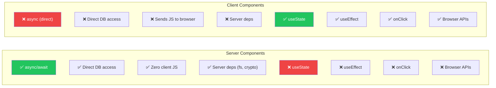
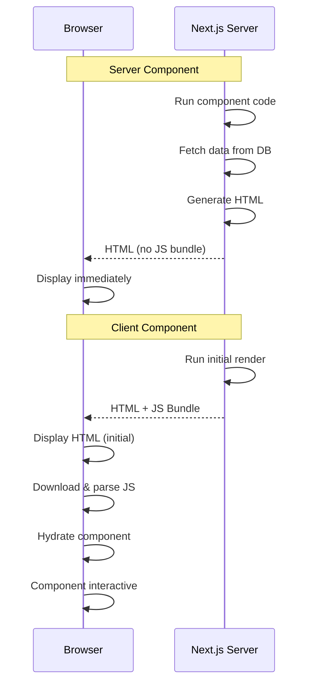
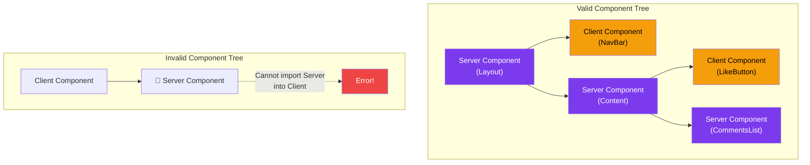
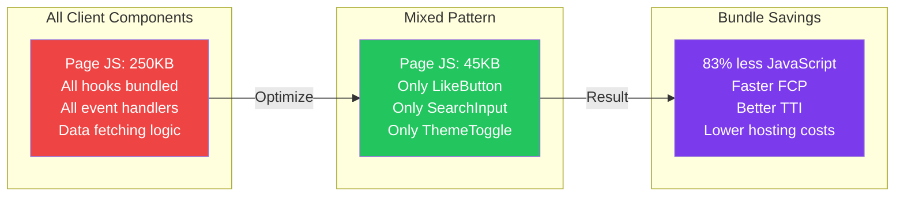

# Server Components vs Client Components

## Introduction
The App Router's component model has a clear distinction: Server Components (the default) render exclusively on the server, while Client Components (with `"use client"`) render on both the server (for initial HTML) and the client (for interactivity). Choosing between them is one of the most important architectural decisions in Next.js development.

## Why do we need this?
Every component you create in the App Router needs to be either a Server or Client Component. Making the wrong choice leads to:
- **Too many Client Components** — Large bundle sizes, slow load times
- **Too many Server Components** — Missing interactivity, poor UX
- **Incorrect nesting** — Server Components cannot be imported into Client Components
- **Missed optimization opportunities** — Client-bundled code that should be server-only

## Problem Statement
Developers coming from traditional React (where all components are client-side) often default to adding `"use client"` everywhere "just in case." This defeats the purpose of Server Components and leads to bloated bundles. Conversely, developers may not realize when they actually NEED client-side interactivity.

## Real World Story
A team at Vercel was building a documentation site. Initially, they made the navigation sidebar a Client Component because it had click handlers. Then they realized the sidebar data (list of docs) was being fetched client-side, causing a flash of empty content. By splitting the sidebar into a Server Component (to fetch and render the list) and only making the interactive toggle button a Client Component, they reduced the page's JavaScript by 80% and eliminated the layout shift.

## Real World Analogy
Think of Server vs Client Components like **a cookbook vs a recipe app**:

- **Server Components (cookbook)**: The entire book is printed (rendered) before it reaches you. You can read everything (HTML), but you can't change the content (no interactivity). The book is lightweight — just paper and ink.

- **Client Components (recipe app)**: The app is a framework that runs on your phone. It needs more resources (JavaScript), but you can interact: add notes, scale recipes, set timers. It can also fetch new recipes from the internet.

A good cooking experience uses both: the sturdy printed book for reference (Server) and the interactive app for timers and scaling (Client).

## Visual Explanation
```
Decision Tree for Component Type:

           ┌──────────────┐
           │  New Component │
           └──────┬───────┘
                  │
        ┌─────────┴─────────┐
        │                   │
   Needs hooks?         No hooks?
   (useState,           (static display)
   useEffect, etc.)          │
        │                   │
        ▼                   ▼
 ┌──────────────┐  ┌──────────────────┐
 │ Client        │  │ Server            │
 │ Component     │  │ Component         │
 │              │  │                   │
 │ • useState   │  │ • async/await    │
 │ • useEffect  │  │ • Direct DB      │
 │ • onClick    │  │ • Zero JS bundle │
 │ • Browser API│  │ • Server deps    │
 └──────────────┘  └──────────────────┘
```

## Mermaid Diagram 1: Capability Comparison



## Internal Working

**Server Component execution:**
1. Component code runs on the server
2. RSC Payload is generated (serializes the rendered output)
3. HTML is streamed to the client (no component JS)
4. React reconciles the tree using the RSC Payload

**Client Component execution:**
1. Component code is bundled and sent to the client as JavaScript
2. Initial render happens on the server (HTML generation)
3. The component hydrates on the client (becomes interactive)
4. Subsequent re-renders happen entirely on the client

## Mermaid Diagram 2: Server vs Client Rendering Paths



## Architecture
The server/client boundary creates a tree structure:



## Mermaid Diagram 4: Bundle Size Impact



## Step-by-Step Flow
1. **Check for interactivity** — Does the component use hooks, event handlers, or browser APIs?
2. **If YES** → Add `"use client"` directive at the top of the file
3. **If NO** → Keep as Server Component (no directive needed)
4. **For mixed needs** — Split into parent Server Component (data) + child Client Component (interactivity)
5. **Pass data as props** — Server Component fetches data, passes it to Client Component
6. **Verify the boundary** — Ensure no Server Component is imported inside a Client Component

## Syntax

```tsx
// Server Component (DEFAULT)
// File: components/PostList.tsx
export default async function PostList() {
  const posts = await fetchPosts() // Direct data access
  return (
    <ul>
      {posts.map(post => (
        <li key={post.id}>{post.title}</li>
      ))}
    </ul>
  )
}
```

```tsx
// Client Component
// File: components/LikeButton.tsx
'use client'

import { useState } from 'react'

export default function LikeButton({ postId }: { postId: string }) {
  const [liked, setLiked] = useState(false)
  
  return (
    <button onClick={() => setLiked(!liked)}>
      {liked ? '❤️' : '🤍'}
    </button>
  )
}
```

```tsx
// Combining them — Server wraps Client
// File: app/posts/[slug]/page.tsx
export default async function PostPage({ params }: { params: { slug: string } }) {
  const post = await getPost(params.slug)
  
  return (
    <article>
      <h1>{post.title}</h1>
      <div>{post.content}</div>
      {/* ✅ Server Component renders Client Component */}
      <LikeButton postId={post.id} />
    </article>
  )
}
```

**Key rules:**
- Server Components can render Client Components ✅
- Client Components CANNOT render Server Components ❌
- But Client Components can receive Server Components as `children` or props ✅

## Basic Example

Determining component type based on needs:

```tsx
// This is a SERVER Component — no interactivity needed
// app/page.tsx
export default async function HomePage() {
  const data = await fetch('https://api.example.com/data')
  const json = await data.json()
  
  return (
    <main>
      <h1>{json.title}</h1>
      <p>{json.description}</p>
      <ServerRenderedList items={json.items} />
    </main>
  )
}
```

```tsx
// This is a CLIENT Component — needs interactivity
// components/Accordion.tsx
'use client'

import { useState } from 'react'

export function Accordion({ title, children }: { title: string; children: React.ReactNode }) {
  const [isOpen, setIsOpen] = useState(false)
  
  return (
    <div>
      <button onClick={() => setIsOpen(!isOpen)}>
        {title} {isOpen ? '▲' : '▼'}
      </button>
      {isOpen && <div>{children}</div>}
    </div>
  )
}
```

```tsx
// This is MIXED — Server Component renders a Client Component
// Server: app/faq/page.tsx
import { Accordion } from '@/components/Accordion'

export default async function FAQPage() {
  const faqs = await getFAQs()
  
  return (
    <div>
      <h1>Frequently Asked Questions</h1>
      {faqs.map(faq => (
        <Accordion key={faq.id} title={faq.question}>
          <p>{faq.answer}</p>
        </Accordion>
      ))}
    </div>
  )
}
```

**What's happening:**
- `HomePage` is a Server Component — it fetches data and renders it. No need for hooks.
- `Accordion` is a Client Component — it uses `useState` for toggle state.
- `FAQPage` is a Server Component that renders multiple `Accordion` Client Components. This is the correct pattern.

## Intermediate Example

Passing Server-rendered content as children to a Client Component:

```tsx
// components/ClientLayout.tsx — Client Component wrapper
'use client'

import { useState } from 'react'

export function ClientLayout({ 
  sidebar,    // Server-rendered content passed as prop
  children    // Server-rendered content passed as children
}: { 
  sidebar: React.ReactNode
  children: React.ReactNode 
}) {
  const [sidebarOpen, setSidebarOpen] = useState(true)
  
  return (
    <div className="layout">
      <button onClick={() => setSidebarOpen(!sidebarOpen)}>
        Toggle Sidebar
      </button>
      {sidebarOpen && <aside>{sidebar}</aside>}
      <main>{children}</main>
    </div>
  )
}
```

```tsx
// app/dashboard/page.tsx — Server Component
import { ClientLayout } from '@/components/ClientLayout'

export default async function DashboardPage() {
  // These are Server Components — rendered on server,
  // passed as ReactNode to the Client Component
  const sidebarContent = await <ServerSidebar />
  const mainContent = await <DashboardContent />
  
  return (
    <ClientLayout sidebar={sidebarContent}>
      {mainContent}
    </ClientLayout>
  )
}

async function ServerSidebar() {
  const user = await getUser()
  return <div>Welcome, {user.name}</div>
}

async function DashboardContent() {
  const stats = await getStats()
  return <div>Stats: {stats.count}</div>
}
```

**What's happening:**
- `ClientLayout` manages sidebar toggle state (Client Component)
- The sidebar content and main content are rendered as Server Components
- They're passed as `ReactNode` props to the Client Component
- This pattern preserves Server Component benefits while adding interactivity

## Advanced Example

Creating a composable pattern for server/client boundary management:

```tsx
// components/InteractiveWrapper.tsx
'use client'

import { useState } from 'react'

interface InteractiveWrapperProps {
  serverContent: React.ReactNode
  label: string
}

export function InteractiveWrapper({ serverContent, label }: InteractiveWrapperProps) {
  const [show, setShow] = useState(false)
  
  return (
    <div>
      <button onClick={() => setShow(!show)}>
        {label}: {show ? 'Hide' : 'Show'}
      </button>
      {show && <div className="content">{serverContent}</div>}
    </div>
  )
}
```

```tsx
// app/projects/page.tsx
import { InteractiveWrapper } from '@/components/InteractiveWrapper'
import { ProjectCard } from './ProjectCard'

async function getFeaturedProjects() {
  const res = await fetch('https://api.example.com/projects/featured')
  return res.json()
}

export default async function ProjectsPage() {
  const projects = await getFeaturedProjects()
  
  return (
    <div>
      <h1>Projects</h1>
      
      {/* Server Component content passed to Client Wrapper */}
      <InteractiveWrapper 
        label="Featured Projects"
        serverContent={
          <div className="project-grid">
            {projects.map(project => (
              <ProjectCard key={project.id} project={project} />
            ))}
          </div>
        }
      />
    </div>
  )
}
```

## Production Example

Real-world dashboard with mixed component architecture:

```tsx
// app/dashboard/layout.tsx — Server Component layout
import { DashboardNav } from './DashboardNav'
import { UserMenu } from './UserMenu'

export default async function DashboardLayout({
  children,
}: {
  children: React.ReactNode
}) {
  const user = await getCurrentUser() // Server data fetch
  
  return (
    <div className="dashboard">
      {/* Client Component: interactivity */}
      <DashboardNav user={user} />
      
      <main>{children}</main>
      
      {/* Client Component: interactive menu */}
      <UserMenu user={user} />
    </div>
  )
}
```

```tsx
// components/DashboardNav.tsx — Client Component
'use client'

import { useState } from 'react'
import Link from 'next/link'

export function DashboardNav({ user }: { user: { name: string } }) {
  const [mobileOpen, setMobileOpen] = useState(false)
  
  return (
    <nav>
      <button onClick={() => setMobileOpen(!mobileOpen)}>
        ☰ Menu
      </button>
      {mobileOpen && (
        <div className="mobile-menu">
          <Link href="/dashboard">Dashboard</Link>
          <Link href="/dashboard/settings">Settings</Link>
          <span>{user.name}</span>
        </div>
      )}
    </nav>
  )
}
```

## Folder Structure

```
my-app/
├── components/
│   ├── Header.tsx                    ← Server (no interactivity)
│   ├── Footer.tsx                    ← Server (no interactivity)
│   ├── LikeButton.tsx                ← Client ('use client')
│   ├── SearchInput.tsx               ← Client ('use client')
│   ├── Accordion.tsx                 ← Client ('use client')
│   ├── DataTable.tsx                 ← Client ('use client')
│   └── ClientLayout.tsx              ← Client ('use client')
│
├── app/
│   ├── layout.tsx                    ← Server (root layout)
│   ├── page.tsx                      ← Server (data fetching + rendering)
│   ├── dashboard/
│   │   ├── layout.tsx               ← Server (layout with data)
│   │   └── page.tsx                  ← Server (renders Client components)
│   └── settings/
│       └── page.tsx                  ← Server (fetches + renders form)
│
├── lib/
│   └── data.ts                      ← Server utilities (never 'use client')
├── next.config.js
└── package.json

// Convention:
// No directive = Server Component (default)
// 'use client' = Client Component (explicit)
// Separate files by type — don't mix in the same file
```

## 🚀 Best Practices

1. **Default to Server Components** — Only add `"use client"` when you must
2. **Push interactivity to leaves** — Make the top-level page a Server Component, add client logic only where needed
3. **Use the children prop pattern** — Pass Server Components as `children` to Client Components
4. **Split components at the boundary** — If a component needs both server data and interactivity, split it into two
5. **Move non-interactive logic out** — Extract data transformation, formatting, and computation into Server Components

## ⚠ Common Mistakes

1. **Adding `"use client"` to the root layout** — This makes your entire app client-rendered! Keep the root layout as Server Component.
2. **Not realizing `"use client"` affects children** — A Client Component wrapping children makes them all client-rendered
3. **Trying to import Server Component into Client Component** — This causes a build error
4. **Putting all logic in Client Components** — Data fetching, heavy computation, and transformations belong in Server Components
5. **Forgetting that initial render is still SSR** — Client Components DO render HTML on the server first

## 📦 Performance Notes

- Each `"use client"` adds JavaScript to the client bundle
- Server Components never ship to the client — zero bytes
- The RSC Payload is highly compressible (gzip/brotli)
- Client Components should be as small as possible
- Use `dynamic(() => import(...), { ssr: false })` for heavy client-only components

## 🔒 Security Notes

- Sensitive logic in Server Components never reaches the client
- Environment variables in Server Components stay on the server
- Database queries in Server Components are not accessible to clients
- Only serialized props cross the server/client boundary

## 🌍 SEO Considerations

- Server Components produce HTML natively — great for SEO
- Client Components also produce HTML (initial SSR) — but more JS means slower TTI
- Server Components are preferred for above-the-fold content
- Use Server Components for structured data and meta tags

## Interview Questions

1. What's the fundamental difference between Server and Client Components?
2. Can a Client Component import a Server Component? What's the workaround?
3. How do you pass data from a Server Component to a Client Component?
4. What happens when you add `"use client"` to a component?
5. Why would you split a component into Server and Client parts?
6. What is the `children` prop pattern for crossing the boundary?
7. How does hydration work for Client Components?

## MCQs

1. Which directive is needed at the top of a Client Component file?
   a) `"use server"`
   b) `"use client"`
   c) `"use browser"`
   d) None — it's the default
   <details>
   <summary>Answer</summary>
   b) `"use client"` — This directive marks the file as a Client Component.
   </details>

2. Can a Server Component import and render a Client Component?
   a) No, that's not allowed
   b) Yes, Server Components can render Client Components
   c) Only if the Server Component is async
   d) Only if both are in the same file
   <details>
   <summary>Answer</summary>
   b) Yes — Server Components can render Client Components. This is the recommended pattern.
   </details>

3. Can a Client Component import and render a Server Component?
   a) Yes, directly
   b) No, this causes an error
   c) Yes, if wrapped in Suspense
   d) Yes, if the Server Component is passed as a prop
   <details>
   <summary>Answer</summary>
   b) No — Server Components cannot be imported into Client Components. They can only be passed as props/children.
   </details>

4. What happens to Server Component code in the browser?
   a) It's downloaded but not executed
   b) It's never sent to the browser at all
   c) It's bundled with Client Component code
   d) It runs in a web worker
   <details>
   <summary>Answer</summary>
   b) Server Component code is never sent to the browser — only the rendered RSC Payload and HTML are sent.
   </details>

5. Which component type is better for handling form submissions?
   a) Server Component
   b) Client Component (for event handling)
   c) Either — they both can handle forms
   d) Neither — use a separate framework
   <details>
   <summary>Answer</summary>
   b) Client Components handle form events (onSubmit, onChange). Server Components handle the actual submission logic via Server Actions.
   </details>

## Practice Exercise

1. **Convert a Client-heavy page**: Take a page that has `"use client"` and identify which parts can be Server Components. Split them out.
2. **Build a product page**: Server Component fetches product data. Client Component handles "Add to Cart" interaction. Pass data via props.
3. **Create a dashboard**: Mix Server Components (data tables, metrics) with Client Components (filters, search, toggle).

## Debugging Exercise

Find the bugs:

```tsx
// app/profile/page.tsx
'use client'  // Bug 1: Unnecessary client directive

import { useEffect, useState } from 'react'

export default async function ProfilePage() {  // Bug 2: Client + async
  const [user, setUser] = useState(null)
  
  useEffect(() => {
    fetch('/api/user').then(r => r.json()).then(setUser)
  }, [])
  
  // Bug 3: Should fetch in Server Component instead
  return <div>{user?.name}</div>
}
```

**Bug 1:** `'use client'` is unnecessary — this page can be a Server Component.
**Fix:** Remove `'use client'` and remove hooks.

**Bug 2:** Client Components can't be async. After removing `'use client'`, async works.
**Fix:** Move the data fetching inline (no useEffect needed).

**Bug 3:** Fetching data client-side with useEffect causes waterfall.
**Fix:** Fetch directly in the Server Component.

## Real-world Scenario

**Problem:** Your SaaS dashboard has a data table with server-fetched data, but users need to sort, filter, and search the table interactively. You want the initial load to be fast (server-rendered table) while keeping the interactivity client-side.

**Solution:**
```tsx
// app/dashboard/orders/page.tsx — Server Component
export default async function OrdersPage() {
  const orders = await getOrders()
  
  return (
    <div>
      <h1>Orders</h1>
      <OrdersTable initialOrders={orders} />
    </div>
  )
}

// components/OrdersTable.tsx — Client Component
'use client'
export function OrdersTable({ initialOrders }) {
  const [search, setSearch] = useState('')
  const [sort, setSort] = useState('date')
  
  const filtered = initialOrders
    .filter(order => order.name.includes(search))
    .sort((a, b) => a[sort] > b[sort] ? 1 : -1)
  
  return (
    <div>
      <input onChange={e => setSearch(e.target.value)} />
      <table>{/* render filtered data */}</table>
    </div>
  )
}
```

## Interview Coding Question

Build a component that demonstrates the proper server/client boundary:

```tsx
// Server Component (app/page.tsx)
import { InteractiveCounter } from './InteractiveCounter'

export default async function HomePage() {
  const data = await fetchInitialData()
  
  return (
    <div>
      <h1>{data.title}</h1>
      {/* Server data passed as prop to Client Component */}
      <InteractiveCounter initialCount={data.count} />
    </div>
  )
}

// Client Component (InteractiveCounter.tsx)
'use client'
import { useState } from 'react'

export function InteractiveCounter({ initialCount }: { initialCount: number }) {
  const [count, setCount] = useState(initialCount)
  return <button onClick={() => setCount(c => c + 1)}>Count: {count}</button>
}
```

## Mini Project

**Build a Server/Client Hybrid Dashboard**

Create a dashboard with:
1. **Server Components:**
   - Page layout and navigation
   - Data fetching for metrics, user list, activity feed
   - Rendering of data tables and charts (using a client-side chart library)
2. **Client Components:**
   - Search/filter controls
   - Interactive data table with sorting
   - Theme toggle (light/dark mode)
   - Notification bell with dropdown
3. **Passing data:** Server Components fetch and pass data to Client Components as props
4. **Performance:** Measure the bundle size difference between server-only and client-only approaches

## Summary

Server Components (default) and Client Components (`"use client"`) serve different purposes. Server Components fetch data, access server resources, and render static content with zero client JavaScript. Client Components handle interactivity, state, and browser APIs. The optimal architecture keeps Server Components at the top and pushes Client Components to the leaves. Server Components can render Client Components, but the reverse requires the `children` prop pattern.

## Cheat Sheet

```tsx
// Server Component (DEFAULT)
export default async function Server() {
  const data = await fetch('api/data')
  return <div>{data}</div>
}
// ✅ async, direct DB, zero JS
// ❌ hooks, events, browser APIs

// Client Component ('use client')
'use client'
export default function Client() {
  const [state, setState] = useState()
  return <button onClick={() => setState()}>Click</button>
}
// ✅ hooks, events, browser APIs
// ❌ async (direct), direct DB

// Nesting Rules:
// ✅ Server → Client (correct)
// ❌ Client → Server (error)
// ✅ Client gets Server as children/props

// Pattern: Server fetches, Client interacts
// Server: fetch data → pass as props
// Client: receive data → add interactivity
```

## Related Topics
- What are React Server Components (Previous Topic)
- Component Trees & Nesting Rules (Next Topic)
- Data Fetching Patterns (Module 2)
- Streaming & Suspense (Module 4)

## Further Reading
- [React Server Components (React.dev)](https://react.dev/reference/rsc/server-components)
- [Next.js Server vs Client Components](https://nextjs.org/docs/app/building-your-application/rendering/server-components)
- [The Server Component Pattern](https://www.patterns.dev/posts/react-server-components)
