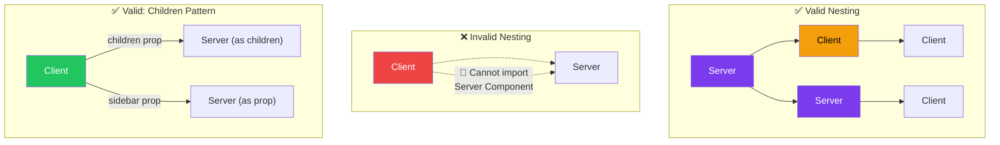
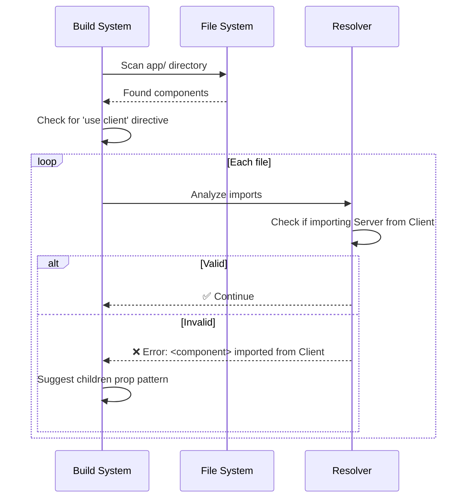
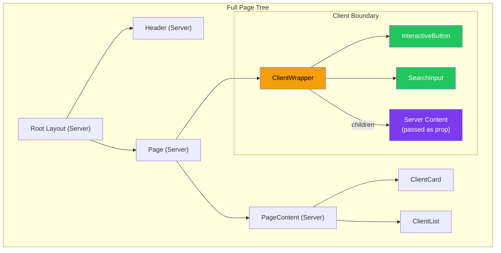
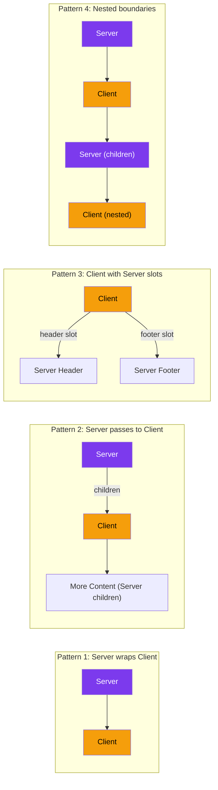

# Component Trees & Nesting Rules

## Introduction
The App Router's component model has strict nesting rules: Server Components (default) can render Client Components, but Client Components cannot directly import Server Components. Understanding these rules and the patterns to work around them is critical for building correct, optimized component trees. This topic covers the server/client boundary, the `children` prop pattern, and strategies for component composition.

## Why do we need this?
The server/client boundary creates a fundamental constraint in the App Router. Violating these rules causes build errors. But more importantly, understanding the rules lets you design component trees that maximize Server Component benefits while enabling rich interactivity where needed.

## Problem Statement
The simplest way to break the App Router is to import a Server Component into a Client Component. But the fix isn't always obvious — you can't just make everything a Client Component (defeats the purpose) or make everything a Server Component (lose interactivity). You need composable patterns that respect the boundary.

## Real World Story
A developer built a social media feed with a Client Component wrapper that contained a sidebar, main content, and a trending topics panel. Inside that Client Component, they imported three Server Components for data fetching. This caused a build error: "You're importing a component that needs to render on the server in a Client Component." The fix was to restructure: the Client Component received the Server Components as `children` and `props` instead of importing them directly.

## Real World Analogy
Think of the server/client boundary like **a hotel room door**:

- **Server Components** are things inside the room (bed, desk, TV) — they exist and are ready when you arrive
- **Client Components** are things you interact with (light switch, TV remote, door handle)
- The **door frame** is the server/client boundary — you can reach INTO the room (Server → Client) but you can't reach OUT of the room from inside (Client → Server)
- However, someone inside the room can HAND you something through the door (the `children` prop pattern)

## Visual Explanation
```
✅ VALID Pattern: Server → Client
┌──────────────────────────────────────┐
│  Server Component (Parent)          │
│   - Fetches data                    │
│   - Renders content                 │
│   ┌──────────────────────────────┐  │
│   │  Client Component (Child)    │  │  ← Server imports Client ✅
│   │  - Handles interactions      │  │
│   └──────────────────────────────┘  │
└──────────────────────────────────────┘

✅ VALID Pattern: Client with Server children
┌──────────────────────────────────────┐
│  Client Component (Wrapper)         │
│  ┌──────────────┐ ┌──────────────┐  │
│  │ Server Child │ │ Server Child │  │  ← Server passed as children ✅
│  └──────────────┘ └──────────────┘  │
└──────────────────────────────────────┘

❌ INVALID Pattern: Client → Server
┌──────────────────────────────────────┐
│  Client Component                   │
│  ┌──────────────────────────────┐   │
│  │  Server Component            │   │  ← Client imports Server ❌
│  │  (imported directly)         │   │
│  └──────────────────────────────┘   │
└──────────────────────────────────────┘
```

## Mermaid Diagram 1: Valid vs Invalid Nesting



## Internal Working
The server/client boundary is enforced during the Next.js build process:

1. **Module graph analysis** — Next.js builds a dependency graph of all components
2. **`"use client"` detection** — Files with `"use client"` are marked as Client Components
3. **Boundary enforcement** — If a Client Component imports a file without `"use client"`, the build checks if that file can be rendered on the server
4. **Serialization check** — Props passed from Server to Client must be serializable (no functions, dates, or complex objects)
5. **Tree construction** — The valid component tree is constructed, and the server/client boundary is established at the first `"use client"` file

## Mermaid Diagram 2: Build-time Component Analysis



## Architecture
The component tree architecture follows a clear hierarchy:



## Mermaid Diagram 4: Server/Client Boundary Patterns



## Step-by-Step Flow
1. **Design the tree** — Sketch your component hierarchy, marking which components need interactivity
2. **Identify Client Components** — Any component needing hooks, events, or browser APIs
3. **Push Client to leaves** — Make Client Components as deep in the tree as possible
4. **Server Components at top** — Keep pages, layouts, and data-fetching components as Server Components
5. **Use children prop** — If a Client Component needs to display Server-rendered content, pass it as `children` or a prop
6. **Extract client islands** — If a Server Component needs interactivity in a small area, extract that area into a Client Component
7. **Verify no reverse imports** — Ensure no Client Component directly imports a Server Component

## Syntax

```tsx
// Pattern 1: Server wraps Client ✅
// app/page.tsx (Server)
export default async function Page() {
  const data = await fetchData()
  return <InteractiveWidget data={data} />
}

// components/InteractiveWidget.tsx (Client)
'use client'
export function InteractiveWidget({ data }: { data: any }) {
  const [open, setOpen] = useState(false)
  return <button onClick={() => setOpen(!open)}>{data.title}</button>
}
```

```tsx
// Pattern 2: Client receives Server content as children ✅
// app/layout.tsx (Server)
export default function RootLayout({ children }: { children: React.ReactNode }) {
  return (
    <html>
      <body>
        <ClientShell>
          {/* Server-rendered content passed as children */}
          {children}
        </ClientShell>
      </body>
    </html>
  )
}

// components/ClientShell.tsx (Client)
'use client'
export function ClientShell({ children }: { children: React.ReactNode }) {
  const [sidebarOpen, setSidebarOpen] = useState(true)
  return (
    <div>
      <button onClick={() => setSidebarOpen(!sidebarOpen)}>☰</button>
      {sidebarOpen && <aside>{children}</aside>}
    </div>
  )
}
```

```tsx
// Pattern 3: Client with multiple Server slots ✅
// app/dashboard/page.tsx (Server)
export default async function DashboardPage() {
  return (
    <ClientDashboardLayout
      sidebar={<ServerSidebar />}
      header={<ServerHeader />}
    >
      <ServerMainContent />
    </ClientDashboardLayout>
  )
}
```

## Basic Example

Simple component tree with proper boundary placement:

```tsx
// ✅ This works — Server renders Client
// app/page.tsx (Server)
export default async function HomePage() {
  return (
    <div>
      <h1>Welcome</h1>
      <Counter initialValue={10} />
    </div>
  )
}

// components/Counter.tsx (Client)
'use client'
import { useState } from 'react'
export function Counter({ initialValue }: { initialValue: number }) {
  const [count, setCount] = useState(initialValue)
  return <button onClick={() => setCount(c => c + 1)}>{count}</button>
}
```

```tsx
// ❌ This FAILS — Client tries to import Server
// components/Wrapper.tsx (Client)
'use client'
import { ServerData } from './ServerData' // ERROR: Can't import Server Component

export function Wrapper() {
  return (
    <div>
      <ServerData /> {/* This won't work */}
    </div>
  )
}
```

## Intermediate Example

Complex tree with multiple boundary crossings:

```tsx
// ✅ Correct: Server Component page
// app/blog/page.tsx
import { BlogSidebar } from './BlogSidebar'
import { InteractiveBlogList } from './InteractiveBlogList'

export default async function BlogPage() {
  const posts = await getPosts()
  const categories = await getCategories()
  const featured = await getFeaturedPost()
  
  return (
    <div className="blog-layout">
      {/* Client Component receives Server-rendered sidebar as prop */}
      <InteractiveBlogList
        posts={posts}
        sidebar={<BlogSidebar categories={categories} />}
      />
      {/* Server Component rendered directly */}
      <FeaturedPost post={featured} />
    </div>
  )
}
```

```tsx
// components/InteractiveBlogList.tsx (Client)
'use client'

import { useState } from 'react'
import { PostCard } from './PostCard'

export function InteractiveBlogList({ 
  posts, 
  sidebar 
}: { 
  posts: any[]
  sidebar: React.ReactNode  // Server-rendered content
}) {
  const [search, setSearch] = useState('')
  const filtered = posts.filter(p => p.title.includes(search))
  
  return (
    <div className="blog-list">
      <input onChange={e => setSearch(e.target.value)} placeholder="Search..." />
      <div className="content">
        {filtered.map(post => (
          <PostCard key={post.id} post={post} /> // Server Component works here
        ))}
      </div>
      <aside>{sidebar}</aside> {/* Server content rendered here */}
    </div>
  )
}
```

## Advanced Example

Multiple nested boundaries for complex layouts:

```tsx
// app/products/page.tsx — Server Component
import { ProductFilters } from './ProductFilters'
import { ProductGrid } from './ProductGrid'
import { ShoppingCart } from './ShoppingCart'

export default async function ProductsPage() {
  const products = await getProducts()
  const cart = await getCart()
  
  return (
    <div className="products-page">
      {/* Server Component */}
      <ProductGrid 
        products={products}
        filters={
          <ProductFilters> {/* Server Component as prop */}
            <PriceSlider /> {/* Client Component nested inside */}
          </ProductFilters>
        }
        cart={
          <ShoppingCart> {/* Client Component */}
            <CartSummary /> {/* Server Component as children */}
          </ShoppingCart>
        }
      />
    </div>
  )
}
```

## 🚀 Best Practices

1. **Push Client Components to leaf nodes** — The deeper in the tree, the more Server Components benefit
2. **Use children prop pattern** — Client wrappers should accept children to preserve Server Components
3. **Extract interactive islands** — Small Client Components for specific interactive areas
4. **Keep layouts as Server Components** — Root and nested layouts should default to Server
5. **Pass data, not components** — Server Components fetch data and pass it to Client Components
6. **Create boundary files** — Keep Client Components in separate files from Server Components

## ⚠ Common Mistakes

1. **Direct Client→Server import** — This is the most common nesting error
2. **Adding `"use client"` to layouts** — Makes everything client-rendered
3. **Not using children prop** — Wrapping content in Client Component without children prop
4. **Deep client tree** — A Client Component at the root makes the entire subtree client-rendered
5. **Functions in props** — Passing functions from Server to Client (not serializable)

## 📦 Performance Notes

- Each Client Component boundary adds serialization overhead for props crossing from Server to Client
- The deeper Client Components are in the tree, the more Server Components benefit from server-only rendering
- Multiple small Client Component islands are better than one large Client Component wrapper
- The `children` prop pattern preserves Server Component benefits inside Client wrappers
- Use `React.memo()` on Client Components to prevent unnecessary re-renders when parent Server Components change

## 🔒 Security Notes

- Server-rendered content passed as children to Client Components is still rendered on the server
- Never pass sensitive data (tokens, secrets) as props across the boundary if they could be exposed client-side
- Validation should happen on the server before passing data to Client Components
- The server/client boundary is a code execution boundary, not a security boundary

## 🌍 SEO Considerations

- Server Components produce HTML directly — excellent for SEO
- When Client Components wrap Server content via children prop, the HTML is still generated server-side
- Avoid Client Components wrapping critical above-the-fold SEO content
- Use Server Components for structured data, meta tags, and content that crawlers need

## Interview Questions

1. What happens when you import a Server Component into a Client Component?
2. How do you pass Server-rendered content into a Client Component?
3. What is the `children` prop pattern and when would you use it?
4. Can a Client Component have Server Components as grandchildren?
5. Why can't Server Components be imported into Client Components directly?

## MCQs

1. Which nesting pattern is INVALID?
   a) Server → Client
   b) Server → Server
   c) Client → Server (direct import)
   d) Client → Client
   <details>
   <summary>Answer</summary>
   c) Client → Server direct import — This causes a build error.
   </details>

2. How do you pass Server-rendered content into a Client Component?
   a) Import the Server Component directly
   b) Pass it as `children` or a prop
   c) Use a global state manager
   d) It's not possible
   <details>
   <summary>Answer</summary>
   b) Pass Server-rendered content as children or props — not through direct imports.
   </details>

3. What does `'use client'` do when added to a file?
   a) Makes only that component run on the client
   b) Creates a server/client boundary — all components imported by this file also become client-rendered
   c) Disables server-side rendering
   d) Makes the component async
   <details>
   <summary>Answer</summary>
   b) `'use client'` creates a boundary — all descendants in the import tree become client components.
   </details>

4. Can a Client Component have Server Components as children in the children prop?
   a) No, children must be Client Components too
   b) Yes, children are rendered on the server before being passed
   c) Only if wrapped in Suspense
   d) Only in development mode
   <details>
   <summary>Answer</summary>
   b) Yes — children are Server-rendered HTML passed as ReactNode to the Client Component.
   </details>

5. What happens when a Server Component passes functions as props to a Client Component?
   a) The function executes on the server
   b) It throws a serialization error — functions can't be passed across the boundary
   c) The function is bundled for the client
   d) It works fine
   <details>
   <summary>Answer</summary>
   b) Functions can't be serialized across the server/client boundary — this causes an error.
   </details>

## Practice Exercise

1. **Identify boundary violations**: Given a component tree, identify which components violate the server/client boundary rules
2. **Fix a broken tree**: Take a component tree where Client Components directly import Server Components and restructure it using the children prop pattern
3. **Optimize a tree**: Given a page with a large Client Component wrapper, extract interactive elements into smaller Client Component islands

## Debugging Exercise

Find and fix the bugs:

```tsx
// components/PageWrapper.tsx
'use client'
import { Sidebar } from './Sidebar' // Sidebar is a Server Component

export function PageWrapper() {
  return (
    <div>
      <Sidebar /> {/* Error: Can't render Server in Client */}
    </div>
  )
}
```

**Bug:** Direct import and rendering of Server Component inside Client Component.
**Fix:** Pass Sidebar as children:
```tsx
'use client'
export function PageWrapper({ children }: { children: React.ReactNode }) {
  return <div>{children}</div>
}

// app/layout.tsx (Server)
export default function Layout({ children }) {
  return (
    <PageWrapper>
      <Sidebar /> {/* Server Component passed as children */}
      {children}
    </PageWrapper>
  )
}
```

## Real-world Scenario

**Problem:** Your team is building a social media feed. The feed displays posts (Server-rendered data), but each post has interactive like/comment buttons (Client). You also have a sidebar with trending topics (Server) and a search bar (Client).

**Solution:**
```tsx
// app/feed/page.tsx (Server)
export default async function FeedPage() {
  const [posts, trending] = await Promise.all([getPosts(), getTrending()])
  return (
    <FeedLayout
      sidebar={<TrendingTopics topics={trending} />}
    >
      {posts.map(post => (
        <FeedPost key={post.id} post={post}>
          <LikeButton postId={post.id} /> {/* Client Component */}
        </FeedPost>
      ))}
    </FeedLayout>
  )
}
```

## Interview Coding Question

Implement a component tree with proper server/client boundaries:

```tsx
// Create a dashboard layout with:
// - A Server Component that fetches user data
// - A Client Component that handles sidebar toggle
// - Server-rendered content passed as children

export default async function DashboardPage() {
  const user = await getUser()
  return (
    <DashboardShell>
      <h1>Welcome, {user.name}</h1>
      <DashboardContent />
    </DashboardShell>
  )
}
```

## Mini Project

**Build a Properly Nested Component Tree**

Create an e-commerce product page with:
1. **Server Components:** Product details, related products, reviews list
2. **Client Components:** Add to cart button, size selector, image gallery carousel, review form
3. **Proper boundaries:** All Client Components receive data as props; no direct Server-to-Client imports
4. **Children pattern:** A Client "ProductCard" wrapper that receives Server-rendered content

## Summary

Component nesting follows strict rules: Server Components can render Client Components, but Client Components cannot import Server Components. The `children` prop pattern is the workaround — pass Server-rendered content as props to Client Components. Push Client Components to leaf nodes, keep layouts as Server Components, and always prefer Server Components by default.

## Cheat Sheet

```tsx
// ✅ Server → Client: WORKS
// Server.tsx
import { Client } from './Client'
export default function Server() { return <Client /> }

// ✅ Client receives Server as children: WORKS
// Client.tsx
'use client'
export function Client({ children }: { children: React.ReactNode }) {
  return <div>{children}</div>
}

// ❌ Client → Server: ERROR
// Client.tsx
'use client'
import { Server } from './Server' // ERROR!
export function Client() { return <Server /> }

// Rules:
// Server → Client ✅
// Server → Server ✅
// Client → Client ✅
// Client → Server ❌ (direct import)
// Client receives Server as children ✅
```

## Related Topics
- When to Use "use client" (Next Topic)
- Data Fetching Patterns (Module 2)
- Server Actions (Module 5)
