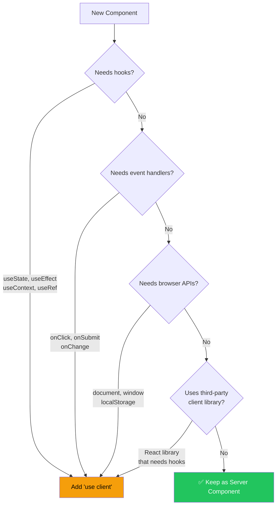
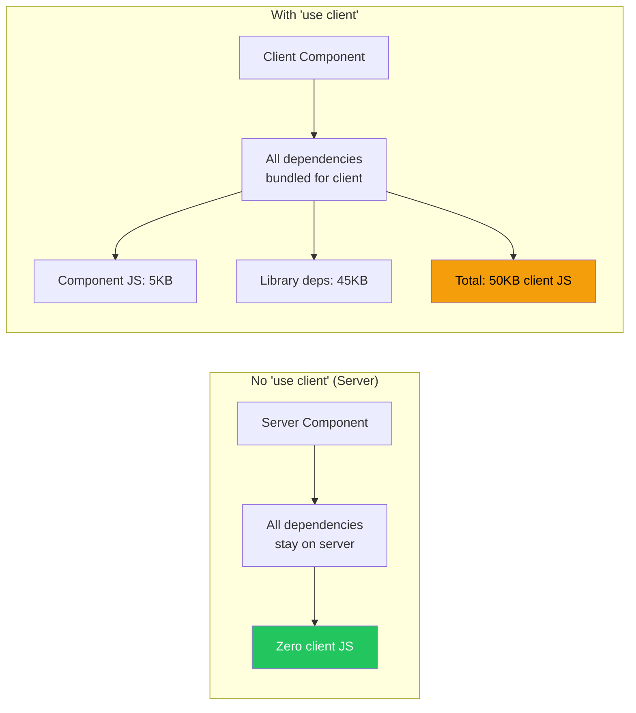

# When to Use "use client"

## Introduction
The `"use client"` directive marks a file as a Client Component, enabling hooks, event handlers, and browser APIs. However, adding it unnecessarily defeats the purpose of Server Components — increasing bundle size and reducing performance. Knowing exactly when to use (and not use) `"use client"` is a critical skill for Next.js development.

## Why do we need this?
Every `"use client"` directive has a cost — it adds JavaScript to the client bundle. Over-using it eliminates the benefits of Server Components. Under-using it prevents interactivity. Developers need clear guidelines for when the directive is necessary vs. when to keep the server default.

## Problem Statement
New Next.js developers often add `"use client"` to every file "just in case," turning their entire app into a client-rendered application. Conversely, experienced developers may struggle to determine the exact boundary between server and client code, especially when using third-party libraries.

## Real World Story
A team building a documentation site added `"use client"` to their root layout because they used a font library (next/font) that needed client-side setup. This caused every page to be client-rendered — adding 200KB of JavaScript per page. The fix was simple: move the font setup to a separate Client Component and keep the root layout as a Server Component.

## Real World Analogy
Think of `"use client"` like **adding a power outlet to a wall**:

- If you need electricity (interactivity), you install an outlet (add `"use client"`)
- But you don't install outlets on every wall — only where you need them
- The walls themselves (Server Components) stay as simple structures
- You can run extension cords (pass Server Components as children) from outlets to where they're needed

## Mermaid Diagram 1: Decision Flow for "use client"



## Internal Working
When Next.js encounters `"use client"`:

1. **Boundary creation** — A server/client boundary is created at this file
2. **All descendants become client** — Every component imported by this file (and their imports) becomes part of the client bundle
3. **RSC Payload** — The rendered output is still produced as RSC Payload, but component code is also bundled for the client
4. **Hydration** — The component renders on the server (HTML) and hydrates on the client (JS execution)

## Mermaid Diagram 2: Impact of "use client" on Bundle



## When to use "use client"

| Requirement | Example | Use "use client"? |
|------------|---------|------------------|
| State management | `useState`, `useReducer` | ✅ Yes |
| Side effects | `useEffect`, `useLayoutEffect` | ✅ Yes |
| Event handlers | `onClick`, `onSubmit`, `onChange` | ✅ Yes |
| Context | `useContext`, `createContext` | ✅ Yes |
| Browser APIs | `document`, `window`, `localStorage` | ✅ Yes |
| Third-party UI libs | `@headlessui/react`, `framer-motion` | ✅ Often |
| Data fetching | `fetch`, database queries | ❌ No (use Server) |
| Static display | Showing data, rendering HTML | ❌ No |
| Date formatting | Formatting dates on server | ❌ No |
| String manipulation | `.toUpperCase()`, `.trim()` | ❌ No |

## Basic Example

Identifying when `"use client"` is needed:

```tsx
// ✅ NEEDS "use client" — has state and events
'use client'
import { useState } from 'react'

export function LikeButton() {
  const [liked, setLiked] = useState(false)
  return <button onClick={() => setLiked(!liked)}>{liked ? '❤️' : '🤍'}</button>
}
```

```tsx
// ✅ NEEDS "use client" — uses browser API
'use client'
import { useState, useEffect } from 'react'

export function WindowWidth() {
  const [width, setWidth] = useState(0)
  useEffect(() => {
    setWidth(window.innerWidth)
    const handler = () => setWidth(window.innerWidth)
    window.addEventListener('resize', handler)
    return () => window.removeEventListener('resize', handler)
  }, [])
  return <div>Window width: {width}px</div>
}
```

```tsx
// ❌ DOES NOT NEED "use client" — no hooks, no events
export async function UserProfile({ userId }: { userId: string }) {
  const user = await db.user.findUnique({ where: { id: userId } })
  return (
    <div>
      <h1>{user.name}</h1>
      <p>{user.email}</p>
    </div>
  )
}
```

## Intermediate Example

Third-party library that requires `"use client"`:

```tsx
// ✅ Some libraries need 'use client'
'use client'

import { Menu, Transition } from '@headlessui/react'

export function DropdownMenu() {
  return (
    <Menu>
      <Menu.Button>Options</Menu.Button>
      <Menu.Items>
        <Menu.Item><a href="/settings">Settings</a></Menu.Item>
        <Menu.Item><a href="/logout">Logout</a></Menu.Item>
      </Menu.Items>
    </Menu>
  )
}
```

```tsx
// ❌ NOT all third-party imports need 'use client'
// This component doesn't need 'use client' — it just formats data
export function formatDate(date: Date) {
  return new Intl.DateTimeFormat('en-US').format(date)
}
```

## Advanced Example

Extracting client-only code into minimal Client Components:

```tsx
// The WRONG way — entire page as client component
'use client' // Unnecessary!
import { useState, useEffect } from 'react'

export default function ProductsPage() {
  const [products, setProducts] = useState([])
  const [search, setSearch] = useState('')
  
  useEffect(() => {
    fetch('/api/products').then(r => r.json()).then(setProducts)
  }, [])
  
  return (
    <div>
      <input onChange={e => setSearch(e.target.value)} />
      {products.filter(p => p.name.includes(search)).map(p => (
        <div key={p.id}>{p.name}</div>
      ))}
    </div>
  )
}
// Bundle size: ~150KB client JS
```

```tsx
// The RIGHT way — only the interactive part is client
// app/products/page.tsx (Server)
export default async function ProductsPage() {
  const products = await fetchProducts() // Server fetch
  return (
    <div>
      <ProductSearch initialProducts={products} />
    </div>
  )
}

// components/ProductSearch.tsx (Client — minimal!)
'use client'
import { useState } from 'react'

export function ProductSearch({ initialProducts }: { initialProducts: any[] }) {
  const [search, setSearch] = useState('')
  const filtered = initialProducts.filter(p => p.name.includes(search))
  
  return (
    <div>
      <input onChange={e => setSearch(e.target.value)} />
      {filtered.map(p => <div key={p.id}>{p.name}</div>)}
    </div>
  )
}
// Bundle size: ~5KB client JS (95% savings!)
```

## 🚀 Best Practices

1. **Start without `"use client"`** — Only add it when you get an error or know you need it
2. **Keep client files small** — Extract only the interactive parts; keep data fetching in Server Components
3. **Minimize client library imports** — Import only the specific components you need, not the entire library
4. **Check third-party libraries** — Check if a library works without `"use client"` before using it
5. **Separate server and client files** — Keep Client Components in their own files for clarity

## ⚠ Common Mistakes

1. **Adding `"use client"` to `layout.tsx`** — Makes every page client-rendered
2. **Adding it "just in case"** — Creates unnecessary client bundle
3. **Putting it in utility files** — Utility functions don't need it (use `'use server'` if needed)
4. **Not checking if a third-party lib needs it** — Some UI libraries like `@radix-ui` do need it
5. **Wrapping everything in a Client Provider** — Context providers need `"use client"` but should be minimized

## 📦 Performance Notes

- Each `"use client"` file adds its JavaScript to the client bundle
- Minimizing `"use client"` files directly reduces Time to Interactive
- Small, focused Client Components (islands) are more efficient than large client wrappers
- Third-party client libraries can significantly increase bundle size — check bundle impact
- Use `next/dynamic` with `ssr: false` for heavy client-only components

## 🔒 Security Notes

- Server Components never expose their source code to the client — keep sensitive logic there
- Client Components can access browser APIs — be careful with what you expose
- Never put secret keys or tokens in Client Components (use Server Components or environment variables with NEXT_PUBLIC_ prefix)
- The `"use client"` boundary is where data transitions from server-only to client-visible

## 🌍 SEO Considerations

- Minimizing Client Components improves Core Web Vitals (especially LCP and TBT)
- Above-the-fold content should be Server Components for fastest initial render
- Client Components still produce initial HTML (SSR), but require more processing
- Search engines can index Server-rendered content faster than client-hydrated content

## Interview Questions

1. When should you add `"use client"` to a component?
2. What happens if you forget to add `"use client"` to a component that uses useState?
3. How does `"use client"` affect bundle size?
4. Can utility functions use `"use client"`?
5. How do you handle third-party libraries that require client-side APIs?

## MCQs

1. What does the `"use client"` directive do?
   a) Runs the component only on the client
   b) Marks the file as a Client Component, enabling hooks and browser APIs
   c) Disables server-side rendering for this component
   d) Optimizes the component for mobile devices
   <details>
   <summary>Answer</summary>
   b) Marks the file as a Client Component, enabling hooks, events, and browser APIs.
   </details>

2. Which of these does NOT require `"use client"`?
   a) `useState`
   b) `useEffect`
   c) `onClick`
   d) `async/await`
   <details>
   <summary>Answer</summary>
   d) `async/await` works in Server Components without `"use client"`.
   </details>

3. What happens if you add `"use client"` to the root layout?
   a) Nothing — it's required
   b) The entire app becomes client-rendered, losing Server Component benefits
   c) Only the layout becomes interactive
   d) Next.js throws an error
   <details>
   <summary>Answer</summary>
   b) Adding `"use client"` to root layout makes your entire app client-rendered.
   </details>

4. Should utility functions like date formatters have `"use client"`?
   a) Yes, always
   b) No — they don't need hooks or browser APIs
   c) Only if they use `Date`
   d) Only in development
   <details>
   <summary>Answer</summary>
   b) No — utility functions that don't use hooks or browser APIs should be server-side.
   </details>

5. How can you minimize the bundle impact of a heavy charting library?
   a) Add `"use client"` to the chart file
   b) Use dynamic import with `ssr: false`
   c) Import the library in a Server Component
   d) Use a CDN link
   <details>
   <summary>Answer</summary>
   b) Use `next/dynamic` with `ssr: false` to lazy-load heavy client libraries.
   </details>

## Practice Exercise

1. **Audit a page for unnecessary `"use client"`** — Count how many files use the directive and identify which could be Server Components
2. **Extract client islands** — Take a page with one large `"use client"` component and split it into a Server parent with small Client children
3. **Test third-party libraries** — Try using a UI library like `date-fns` or `marked` without `"use client"` to see if it works server-side

## Debugging Exercise

Find and fix the bugs:

```tsx
// app/layout.tsx
'use client'  // Bug: Unnecessary — makes everything client-rendered

import { ReactNode } from 'react'

export default function RootLayout({ children }: { children: ReactNode }) {
  return (
    <html lang="en">
      <body>{children}</body>
    </html>
  )
}
```

**Bug:** `"use client"` on root layout makes entire app client-rendered.
**Fix:** Remove `"use client"` — root layout should be a Server Component.

## Real-world Scenario

**Problem:** Your blog uses a markdown editor component from `@uiw/react-md-editor` that requires browser APIs. You don't want to make the entire blog page a Client Component just for the editor.

**Solution:** Extract the editor into its own Client Component file and only render it on the specific page where editing happens:
```tsx
// components/MarkdownEditor.tsx
'use client'
import MDEditor from '@uiw/react-md-editor'
export function MarkdownEditor({ value, onChange }: any) {
  return <MDEditor value={value} onChange={onChange} />
}
```

## Interview Coding Question

Explain when you would add `"use client"` to this component:
```tsx
export default function UserProfile({ userId }: { userId: string }) {
  return (
    <div>
      <h1>User Profile</h1>
      <EditButton userId={userId} />
    </div>
  )
}
```
**Answer:** The `UserProfile` itself doesn't need `"use client"` — it only renders content. The `EditButton` (which likely has an onClick handler) would need `"use client"`. Keep `UserProfile` as a Server Component.

## Mini Project

**Audit and Optimize**

Take an existing Next.js page that heavily uses `"use client"` and:
1. Identify ALL components that use the directive
2. For each, determine if it's truly needed (hooks? events? browser APIs?)
3. Remove unnecessary `"use client"` directives
4. Extract minimal Client Components for truly interactive parts
5. Move data fetching to Server Components
6. Measure the bundle size reduction using browser DevTools

## Summary

Add `"use client"` only when you need hooks (useState, useEffect), event handlers, browser APIs, or third-party client libraries. Start without it and add it only when necessary. Extract interactive parts into small, focused Client Component files.

## Cheat Sheet

```tsx
// When you NEED 'use client':
'use client' // ✅ useState
'use client' // ✅ useEffect
'use client' // ✅ onClick, onSubmit
'use client' // ✅ window, document
'use client' // ✅ createContext

// When you DON'T need 'use client':
// (no directive) ✅ async data fetching
// (no directive) ✅ static rendering
// (no directive) ✅ server deps (fs, db)
// (no directive) ✅ prop drilling
// (no directive) ✅ rendering children

// Rule of thumb:
// If it doesn't need to be interactive on the client,
// don't add 'use client'.
```

## Related Topics
- Component Trees & Nesting Rules (Previous Topic)
- Data Fetching Patterns (Module 2)
- Server Actions (Module 5)
