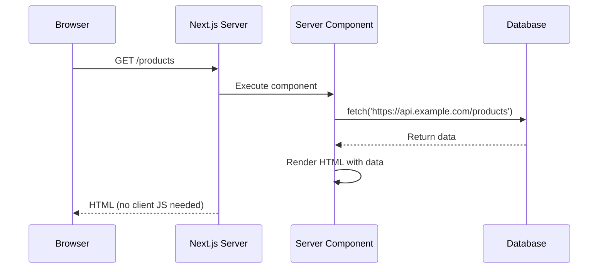
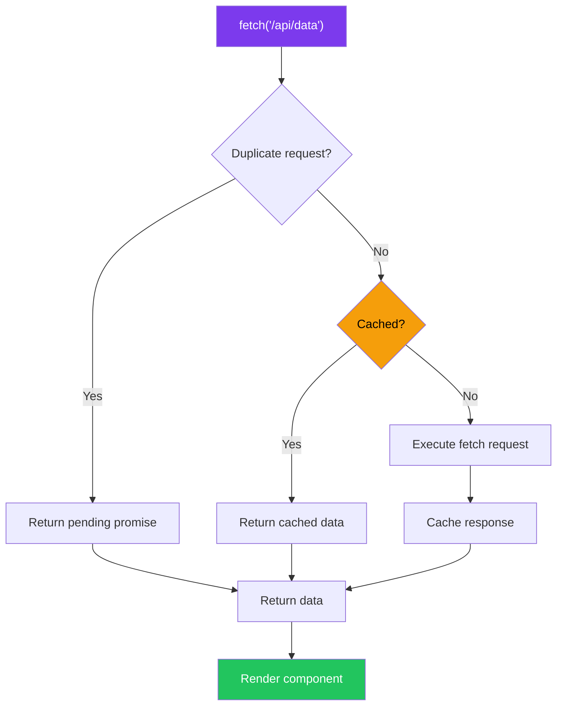
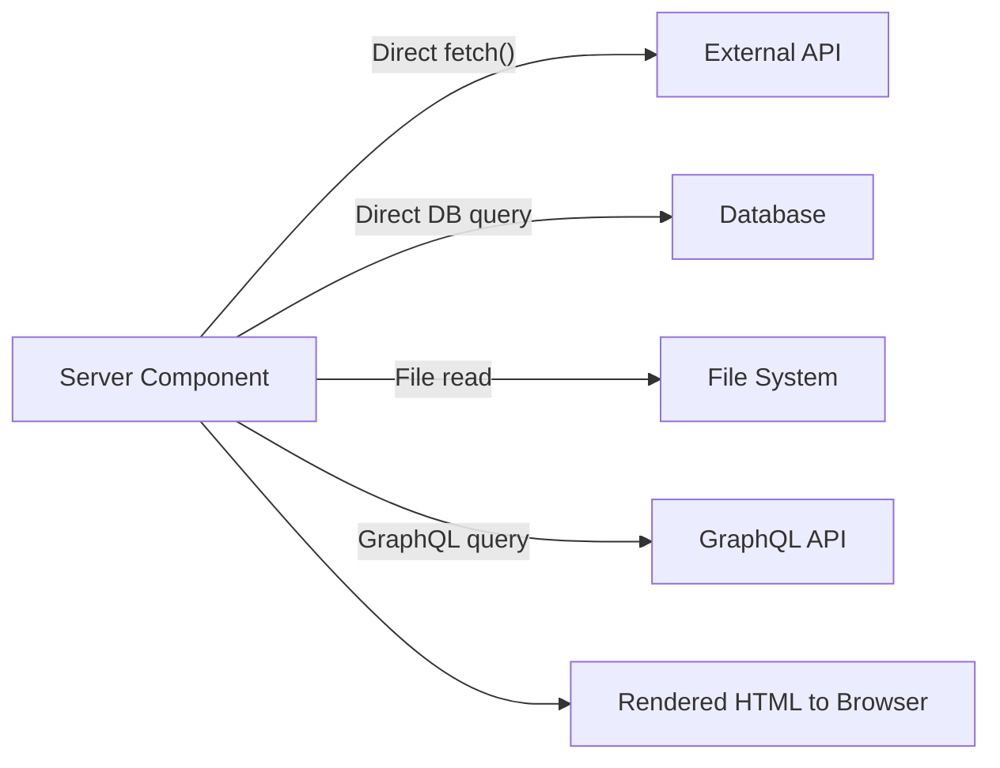
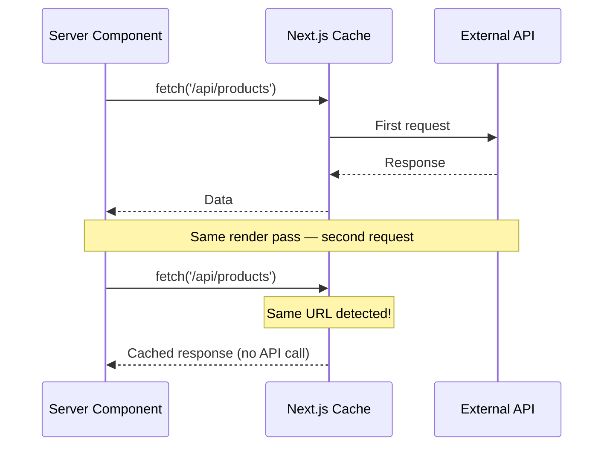

# Fetching Data in Server Components

## Introduction
Server Components can fetch data directly using `fetch()` or database clients without creating API routes. The `fetch` function has built-in caching and revalidation support through the `next` option object. This direct data fetching pattern is the foundation of the App Router's data model.

## Why do we need this?
Traditional React apps need API routes to fetch data because components run on the client. Server Components eliminate this need — they run on the server, so they can access databases, file systems, and external APIs directly. This reduces boilerplate, improves performance, and simplifies the architecture.

## Problem Statement
In traditional React, data fetching follows this pattern: Component → fetch API → API route → Database query → Response → Component. Each hop adds latency and complexity. Server Components reduce this to: Component → Database query (no API route needed).

## Real World Story
A team at Vercel was building a dashboard with 10 data sources. With the Pages Router, they needed 10 API routes, 10 client-side fetch calls with loading states, and a combined state management solution. After migrating to the App Router, they replaced all 10 API routes with direct `fetch()` calls in Server Components, cutting their code by 60% and eliminating loading spinners entirely.

## Real World Analogy
Think of Server Component data fetching like **ordering from a restaurant**:
- **Pages Router**: You tell the waiter what you want → waiter goes to the kitchen → chef prepares it → waiter brings it back (API route)
- **App Router**: You walk directly into the kitchen and ask the chef (Server Component fetches data directly)

Both get you food, but the direct approach is faster and has fewer steps.

## Visual Explanation
```
Pages Router (traditional):
Browser → Client Component → fetch('/api/data') → Route Handler → Database → Response → Client → Render

App Router:
Server Component → fetch()/db.query() → Database → HTML (sent to browser directly)
```

## Mermaid Diagram 1: Direct Data Fetching Flow



## Syntax

```tsx
// Direct fetch in Server Component
export default async function ProductsPage() {
  const res = await fetch('https://api.example.com/products', {
    next: { revalidate: 60 } // ISR: revalidate every 60 seconds
  })
  const products = await res.json()
  
  return (
    <ul>
      {products.map(product => (
        <li key={product.id}>{product.name}</li>
      ))}
    </ul>
  )
}
```

## Basic Example

Fetching data from an external API:

```tsx
export default async function UsersPage() {
  const res = await fetch('https://jsonplaceholder.typicode.com/users')
  const users = await res.json()
  
  return (
    <ul>
      {users.map(user => (
        <li key={user.id}>{user.name} — {user.email}</li>
      ))}
    </ul>
  )
}
```

## Internal Working
When Next.js processes a `fetch()` call in a Server Component:

1. **Request deduplication** — Next.js checks if the same URL + options has been requested in the same render pass
2. **Cache check** — The Data Cache is checked for a cached response
3. **Fetch execution** — If not cached, the fetch is executed; if cached, the cached response is returned
4. **Result caching** — The response is stored in the Data Cache (based on `next` options)
5. **Component rendering** — The fetched data is used to render the component

## Mermaid Diagram 2: Internal Fetching Flow



## Architecture
Data fetching flows from Server Components directly to data sources:



## Mermaid Diagram 4: Request Deduplication



## Step-by-Step Flow

1. **Identify data source** — Database, external API, or file system
2. **Make the fetch call** — Use `fetch()` or database client directly in the component
3. **Configure caching** — Add `next: { revalidate, tags }` as needed
4. **Handle the response** — Parse JSON, check for errors
5. **Render the data** — Return JSX with the fetched data
6. **Handle fallbacks** — Show error states or empty states when data isn't available

## Syntax

```tsx
// Basic fetch in Server Component
import { NextResponse } from 'next/server'

export default async function ProductsPage() {
  const res = await fetch('https://api.example.com/products', {
    next: { revalidate: 60 }
  })
  const products = await res.json()
  return <div>{/* render products */}</div>
}
```

## Basic Example

```tsx
export default async function UsersPage() {
  const res = await fetch('https://jsonplaceholder.typicode.com/users')
  const users = await res.json()
  
  return (
    <ul>
      {users.map(user => (
        <li key={user.id}>{user.name} — {user.email}</li>
      ))}
    </ul>
  )
}
```

## Intermediate Example

Fetching with error handling and empty state:

```tsx
interface Post {
  id: number
  title: string
  body: string
}

export default async function PostsPage() {
  let posts: Post[] = []
  let error: string | null = null
  
  try {
    const res = await fetch('https://jsonplaceholder.typicode.com/posts', {
      next: { revalidate: 300 },
    })
    if (!res.ok) throw new Error(`HTTP ${res.status}`)
    posts = await res.json()
  } catch (e) {
    error = e instanceof Error ? e.message : 'Failed to load posts'
  }
  
  if (error) {
    return <div className="error">Error: {error}</div>
  }
  
  if (posts.length === 0) {
    return <div className="empty">No posts found</div>
  }
  
  return (
    <div>
      <h1>Blog Posts ({posts.length})</h1>
      <div className="posts-grid">
        {posts.map(post => (
          <article key={post.id}>
            <h2>{post.title}</h2>
            <p>{post.body}</p>
          </article>
        ))}
      </div>
    </div>
  )
}
```

## Advanced Example

Fetching from multiple sources and combining data:

```tsx
export default async function DashboardPage() {
  const [users, posts, comments] = await Promise.all([
    fetch('https://jsonplaceholder.typicode.com/users').then(r => r.json()),
    fetch('https://jsonplaceholder.typicode.com/posts').then(r => r.json()),
    fetch('https://jsonplaceholder.typicode.com/comments').then(r => r.json()),
  ])
  
  return (
    <div>
      <h1>Dashboard</h1>
      <p>Users: {users.length}</p>
      <p>Posts: {posts.length}</p>
      <p>Comments: {comments.length}</p>
    </div>
  )
}
```

## Production Example

Production fetch with environment variables, timeout, and error handling:

```tsx
const API_BASE = process.env.API_BASE_URL || 'https://api.example.com'

export default async function ProductsPage() {
  const res = await fetch(`${API_BASE}/products`, {
    next: { 
      revalidate: 60,
      tags: ['products']
    },
    headers: {
      'Authorization': `Bearer ${process.env.API_TOKEN}`,
    },
    signal: AbortSignal.timeout(5000),
  })
  
  if (!res.ok) throw new Error(`API error: ${res.status}`)
  const products = await res.json()
  
  return <ProductGrid products={products} />
}
```

## Folder Structure

```
app/
├── products/
│   └── page.tsx              ← Server Component with data fetching
├── blog/
│   ├── page.tsx              ← Server Component with fetch
│   └── [slug]/page.tsx       ← Server Component with fetch by param
├── lib/
│   └── api.ts                ← Shared data fetching utilities
└── components/
    └── ProductGrid.tsx       ← Client/Server component
```

## 🚀 Best Practices

1. **Fetch in Server Components** — Default to fetching data in Server Components, not Client Components
2. **Use the `next` options** — Configure caching with `next: { revalidate, tags }`
3. **Handle errors** — Use try/catch around fetches and return appropriate fallback UI
4. **Deduplicate requests** — Next.js automatically deduplicates `fetch()` calls
5. **Fetch in layouts too** — Layouts can fetch data for shared content

## ⚠ Common Mistakes

1. **Fetching in Client Components unnecessarily** — Most data fetching should happen in Server Components
2. **Not handling fetch errors** — A failed fetch crashes the component
3. **Relative URLs in Server Components** — Use absolute URLs or environment variables

## 📦 Performance Notes

- `fetch()` in Server Components is automatically cached and deduplicated
- Use `next: { revalidate }` for time-based cache refresh
- Use `next: { tags }` for on-demand cache invalidation

## 🔒 Security Notes

- API keys in Server Components never reach the client
- Use environment variables for all API credentials
- Never expose internal API URLs to the client

## 🌍 SEO Considerations

- Server-fetched data renders as HTML — great for SEO
- Search engines see fully rendered content
- No JavaScript needed for content visibility

## Interview Questions

1. How do you fetch data in a Server Component?
2. What's the difference between fetching in Server vs Client Components?
3. How does Next.js deduplicate fetch requests?
4. What are the `next` options for `fetch`?
5. How do you handle errors in Server Component data fetching?

## MCQs

1. How do you fetch data in a Server Component?
   a) Using `useEffect` and `fetch`
   b) Using `async/await` and `fetch` directly
   c) Using `getServerSideProps`
   d) Using a custom hook
   <details>
   <summary>Answer</summary>
   b) Server Components can use `async/await` with `fetch()` directly.
   </details>

2. What does `next: { revalidate: 60 }` do?
   a) Revalidates data every 60 milliseconds
   b) Revalidates data every 60 seconds
   c) Caches data for 60 days
   d) Disables caching
   <details>
   <summary>Answer</summary>
   b) Revalidates cached data every 60 seconds.
   </details>

3. What happens when two Server Components fetch the same URL in one render?
   a) Both execute — two API calls
   b) The second request uses the cached response from the first
   c) Only the first request executes
   d) Next.js throws a duplicate warning
   <details>
   <summary>Answer</summary>
   b) Next.js automatically deduplicates — the second request gets the cached response.
   </details>

4. Can Server Components use relative URLs with fetch?
   a) Yes, always
   b) No, they need absolute URLs
   c) Only in development
   d) Only for internal API routes
   <details>
   <summary>Answer</summary>
   b) Server Components run on the server; they need absolute URLs or environment variables for the base URL.
   </details>

5. What happens if a fetch fails in a Server Component?
   a) The component renders with empty data
   b) The error propagates to the nearest error boundary (error.tsx)
   c) The page shows a blank screen
   d) Next.js retries automatically
   <details>
   <summary>Answer</summary>
   b) Unhandled errors propagate to `error.tsx` boundaries.
   </details>

## Practice Exercise

1. **Basic fetch**: Create a Server Component that fetches posts from JSONPlaceholder and renders them
2. **Error handling**: Add try/catch, empty state, and loading states
3. **Parallel fetches**: Fetch users AND posts in parallel using Promise.all

## Debugging Exercise

```tsx
export default async function Page() {
  const res = await fetch('/api/data')  // Bug: relative URL
  const data = res.json()  // Bug: missing await
  return <div>{data.name}</div>
}
```
**Bugs:** Relative URL should be absolute; missing `await` on `res.json()`.

## Real-world Scenario

**Problem:** Your e-commerce homepage needs product data from an external CMS. Data changes a few times per day. You need fresh data without rebuilding the site.
**Solution:** Use ISR with `next: { revalidate: 3600 }` — caches for 1 hour, revalidates in background.

## Interview Coding Question

```tsx
export default async function Page() {
  const [posts, users] = await Promise.all([
    fetch('https://api.example.com/posts').then(r => r.json()),
    fetch('https://api.example.com/users').then(r => r.json()),
  ])
  return <div>{posts.length} posts by {users.length} users</div>
}
```

## Mini Project

Build a Server Component that:
1. Fetches data from 3 APIs in parallel
2. Handles errors gracefully with try/catch
3. Shows empty states
4. Uses ISR with appropriate revalidation times

## Summary

Server Components fetch data directly using `fetch()` with automatic deduplication and caching. Use `next: { revalidate, tags }` for cache control. Always handle errors and use absolute URLs.

## Cheat Sheet

```tsx
// Basic fetch
export default async function Page() {
  const res = await fetch('https://api.example.com/data')
  const data = await res.json()
  return <div>{data.name}</div>
}

// With caching
fetch('url', { next: { revalidate: 60 } })  // Time-based
fetch('url', { next: { tags: ['posts'] } })  // Tag-based
fetch('url', { cache: 'no-store' })  // No cache

// Deduplication: Same URL in same render = 1 request
// Error handling: try/catch or error.tsx
```

## Related Topics
- Parallel and Sequential Data Fetching (Next Topic)
- Caching & Revalidation (Module 3)
- Streaming & Suspense (Module 4)

## Further Reading
- [Next.js Data Fetching Docs](https://nextjs.org/docs/app/building-your-application/data-fetching)
- [Next.js fetch API Reference](https://nextjs.org/docs/app/api-reference/functions/fetch)
