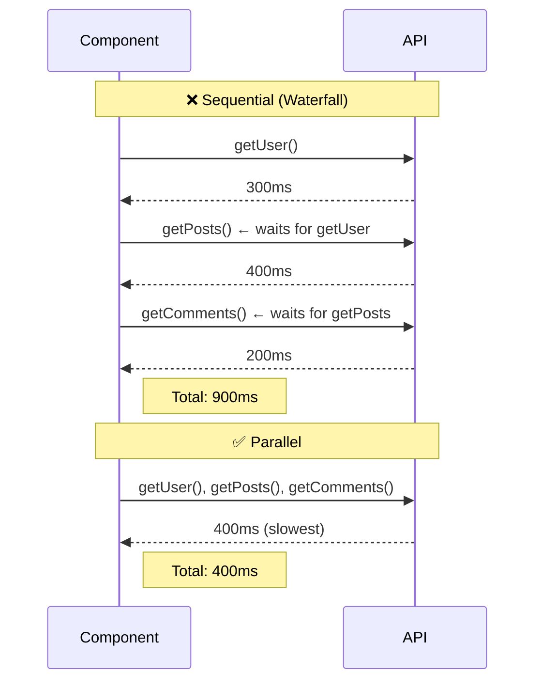

# Parallel & Sequential Data Fetching

## Introduction
How you structure your data fetching — parallel vs sequential — directly impacts page load performance. Fetching data sequentially creates "waterfalls" where each request waits for the previous one. Fetching in parallel reduces total wait time to the slowest request.

## Why do we need this?
A page with three API calls: getUser, getPosts, getComments. If fetched sequentially: 300ms + 400ms + 200ms = 900ms total. If fetched in parallel: max(300ms, 400ms, 200ms) = 400ms total. Parallel fetching is 2x faster for the same data.

## The Waterfall Problem


## Solution: Promise.all

Fetch independent data in parallel using `Promise.all`:

```tsx
// ❌ Sequential — 900ms total
async function Page() {
  const user = await getUser()      // 300ms
  const posts = await getPosts()    // 400ms
  const comments = await getComments() // 200ms
  return <Dashboard user={user} posts={posts} comments={comments} />
}

// ✅ Parallel — 400ms total
async function Page() {
  const [user, posts, comments] = await Promise.all([
    getUser(),      // 300ms
    getPosts(),     // 400ms
    getComments(),  // 200ms
  ])
  return <Dashboard user={user} posts={posts} comments={comments} />
}
```

## When Sequential is Necessary

Some data depends on other data. In these cases, sequential is unavoidable:

```tsx
// Sequential is REQUIRED here — post depends on user
async function Page() {
  const user = await getUser()                    // 1st: get user
  const posts = await getPosts(user.id)           // 2nd: needs user.id
  const comments = await getComments(posts[0].id) // 3rd: needs first post id
  return <Profile user={user} posts={posts} />
}
```

## Granular Streaming with Suspense

For mixed dependencies, use Suspense to stream independent sections:

```tsx
import { Suspense } from 'react'

export default function Page() {
  return (
    <div>
      {/* Header streams immediately */}
      <Header />
      
      {/* User info streams when ready (independent) */}
      <Suspense fallback={<UserSkeleton />}>
        <UserInfo />
      </Suspense>
      
      {/* Posts stream independently (independent) */}
      <Suspense fallback={<PostsSkeleton />}>
        <PostsList />
      </Suspense>
    </div>
  )
}

async function UserInfo() {
  const user = await getUser()  // 300ms
  return <div>{user.name}</div>
}

async function PostsList() {
  const posts = await getPosts()  // 400ms
  return <div>{posts.length} posts</div>
}
```

## Best Practices
1. **Use `Promise.all`** for independent data — cuts total time to the slowest request
2. **Sequential is fine for dependent data** — but minimize the chain length
3. **Use Suspense boundaries** to stream each section independently
4. **Consider route groups** — fetch layout data at the layout level, not in every page
5. **Avoid deep waterfalls** — 2-3 sequential steps is okay; 5+ is a problem

## Common Mistakes
- Fetching in child components that creates hidden waterfalls
- Using sequential `await` for independent data (worst case: N sequential requests)
- Putting all fetches in one component instead of splitting into Suspense boundaries

## Summary
Fetch independent data in parallel with `Promise.all` to minimize total load time. Use sequential fetching only when data depends on previous results. Combine with Suspense for progressive rendering.

## Related Topics
- [Data Fetching in Server Components](./topic-1-fetching-data-in-server-components.md)
- [Streaming & Suspense (Module 4)](../module-4-streaming-suspense/)
- [Caching & Revalidation (Module 3)](../module-3-caching-revalidation/)
