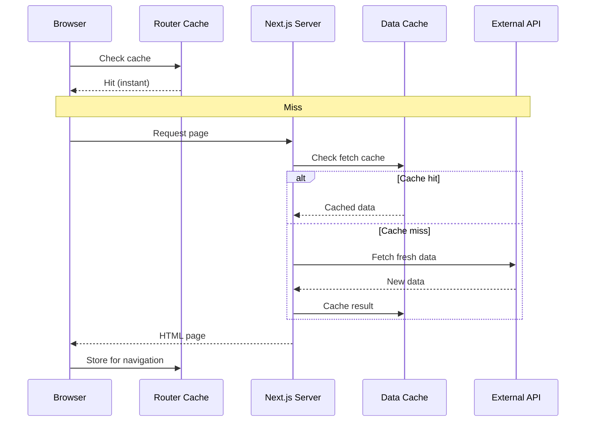

# Understanding Next.js Caching

## Introduction
Next.js has four caching layers that control how pages and data are cached. Understanding these layers — and how they interact — is essential for building performant applications that balance speed and freshness.

## The Four Cache Layers


### 1. Full Route Cache
Static HTML is generated at build time and served from the CDN. Pages are static by default unless opted out.

**Controls:** `dynamic = 'force-dynamic'`, `revalidate` export, `generateStaticParams`

### 2. Data Cache
`fetch()` responses are cached across requests. Next.js extends `fetch` with `next.revalidate` and `next.tags` options.

**Controls:** `cache: 'force-cache'` (default), `cache: 'no-store'`, `next: { revalidate: 60 }`, `next: { tags: [...] }`

### 3. Router Cache (Client)
The browser caches page payloads during navigation for instant back/forward. Default 30s for static, 5m for full.

**Controls:** No direct API — purged on navigation, revalidation, or timeout.

### 4. React Cache (Per Render)
`React.cache()` wraps functions so they return the same result within the same render pass. Used for deduplication.

**Controls:** `React.cache()`, `unstable_cache()`

## How the Layers Interact



## When Each Cache Matters

| Cache Layer | Duration | Impact | Best For |
|-------------|----------|--------|----------|
| Full Route | Until rebuild | First load speed | Static pages |
| Data Cache | Per fetch config | API response time | ISR, revalidation |
| Router Cache | 30s-5m | Navigation speed | SPA-like UX |
| React Cache | Single render | Data deduplication | Component trees |

## Key Controls

```tsx
// Opt out of Full Route Cache per page
export const dynamic = 'force-dynamic'

// Control Data Cache per fetch
fetch('url', { cache: 'force-cache' }) // Default — cache always
fetch('url', { cache: 'no-store' })    // Never cache
fetch('url', { next: { revalidate: 60 } }) // 60s TTL

// Tag-based revalidation
fetch('url', { next: { tags: ['posts'] } })

// React.cache for deduplication
import { cache } from 'react'
const getData = cache(() => fetch('url').then(r => r.json()))
```

## Common Mistakes
- Confusing Full Route Cache with Data Cache — they're independent
- Using `no-store` everywhere when ISR would suffice
- Not understanding that Router Cache is client-side only
- Forgetting that `fetch` deduplication is per render, not persistent

## Summary
Next.js has four caching layers: Full Route (static HTML), Data (fetch results), Router (client navigation), and React (per-render dedup). Each serves a different purpose and has its own controls.

## Related Topics
- [ISR with App Router](./topic-2-isr-with-app-router.md)
- [On-demand Revalidation](./topic-3-on-demand-revalidation.md)
- [Data Fetching Patterns (Module 2)](../module-2-data-fetching-patterns/)
