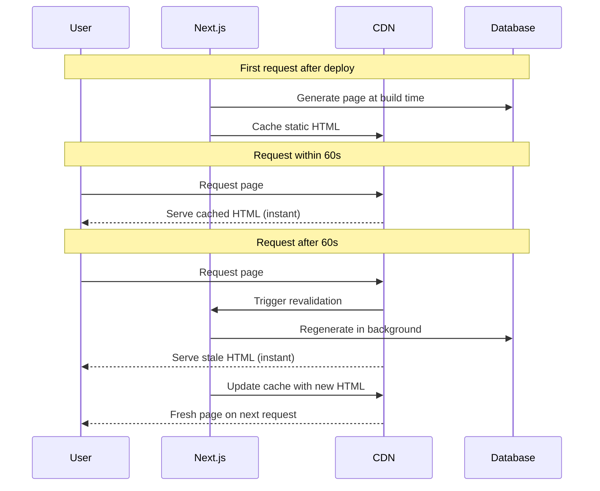

# ISR with the App Router

## Introduction
Incremental Static Regeneration (ISR) allows you to serve statically-generated pages that automatically refresh in the background when data changes. It combines the speed of static pages with the freshness of dynamic rendering.

## How ISR Works



## Basic ISR

```tsx
// app/products/[id]/page.tsx
export const revalidate = 60 // Revalidate every 60 seconds

export default async function ProductPage({ params }: { params: { id: string } }) {
  const product = await fetch(`https://api.example.com/products/${params.id}`, {
    next: { revalidate: 60 }
  }).then(r => r.json())
  
  return <div>{product.name} — ${product.price}</div>
}
```

## ISR with generateStaticParams

```tsx
// Pre-generate popular products, ISR for the rest
export async function generateStaticParams() {
  const products = await fetch('https://api.example.com/products')
    .then(r => r.json())
  
  // Only pre-render top 100 products
  return products.slice(0, 100).map(product => ({
    id: product.id
  }))
}

export const revalidate = 300 // 5 minute revalidation for ALL products

export default async function ProductPage({ params }) {
  // Products 1-100: statically generated
  // Products 101+: generated on first visit, then cached for 5 min
  const product = await getProduct(params.id)
  return <div>{product.name}</div>
}
```

## Per-fetch ISR (Granular Control)

Instead of page-level `revalidate`, use per-fetch ISR:

```tsx
export default async function DashboardPage() {
  // Each fetch has its own revalidation schedule
  const [fastData, slowData, realtimeData] = await Promise.all([
    fetch('https://api.example.com/fast', { next: { revalidate: 30 } }),
    fetch('https://api.example.com/slow', { next: { revalidate: 3600 } }),
    fetch('https://api.example.com/realtime', { cache: 'no-store' }),
  ])
  
  return <Dashboard {...data} />
}
```

## When to Use ISR

| Scenario | ISR Config | Why |
|----------|-----------|-----|
| Blog posts | `revalidate: 3600` | Updated hourly, fast delivery |
| Product prices | `revalidate: 300` | Changed periodically |
| User dashboard | `cache: 'no-store'` | Always fresh, no ISR |
| Marketing pages | Static (no revalidate) | Rarely changes |

## Best Practices
1. **Start with a high revalidate time** (3600) and decrease if needed
2. **Use per-fetch revalidation** for granular control over page-level
3. **Combine with on-demand revalidation** for instant updates when content changes
4. **Monitor stale-while-revalidate** behavior — users may see stale content briefly

## Common Mistakes
- Setting `revalidate: 0` instead of `cache: 'no-store'` (0 is invalid — use no-store)
- Using ISR for user-specific data (it's shared across users)
- Not understanding that ISR serves stale data first, then updates

## Summary
ISR generates static pages that revalidate on a schedule. Users get cached pages instantly while fresh versions are built in the background. Use `revalidate` at the page or per-fetch level for granular control.

## Related Topics
- [Understanding Next.js Caching](./topic-1-understanding-nextjs-caching.md)
- [On-demand Revalidation](./topic-3-on-demand-revalidation.md)
- [Streaming & Suspense (Module 4)](../module-4-streaming-suspense/)
