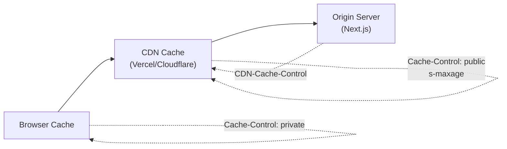

# Cache Headers & CDN Caching

## Introduction
Beyond Next.js's built-in caching layers, you can control how CDNs and browsers cache your responses using HTTP headers. Understanding `Cache-Control`, `CDN-Cache-Control`, and `stale-while-revalidate` gives you fine-grained control over the entire caching chain.

## The Cache Chain



## Cache-Control Directives

| Directive | Meaning | Example |
|-----------|---------|---------|
| `public` | Cacheable by CDN and browser | `public, max-age=3600` |
| `private` | Browser only, not CDN | `private, max-age=60` |
| `no-cache` | Check origin before serving | `no-cache` |
| `no-store` | Never cache | `no-store` |
| `max-age` | Cache duration in seconds | `max-age=3600` |
| `s-maxage` | CDN cache duration (overrides max-age) | `s-maxage=3600` |
| `stale-while-revalidate` | Serve stale while fetching fresh | `stale-while-revalidate=600` |
| `stale-if-error` | Serve stale if origin fails | `stale-if-error=3600` |

## Setting Headers in Route Handlers

```tsx
// app/api/products/route.ts
export async function GET() {
  const products = await db.product.findMany()
  
  return NextResponse.json(products, {
    headers: {
      'Cache-Control': 'public, max-age=60, stale-while-revalidate=300',
    },
  })
}
```

## Setting Headers in next.config.js

```js
// next.config.js
module.exports = {
  async headers() {
    return [
      {
        source: '/static/:path*',
        headers: [
          { key: 'Cache-Control', value: 'public, max-age=31536000, immutable' },
        ],
      },
      {
        source: '/api/:path*',
        headers: [
          { key: 'Cache-Control', value: 'public, max-age=60, s-maxage=300' },
        ],
      },
    ]
  },
}
```

## stale-while-revalidate Pattern

The most powerful pattern for production APIs:

```
Cache-Control: public, max-age=60, stale-while-revalidate=300
```

1. **0-60s**: Fresh from cache (instant)
2. **60-360s**: Stale but acceptable — serve cached, revalidate in background
3. **360s+**: Stale — wait for fresh response

This gives you instant responses for most requests while ensuring background freshness.

## CDN-Specific Headers

On Vercel, use `CDN-Cache-Control` to override Next.js's default CDN behavior. This header is Vercel-specific — other CDNs (Cloudflare, Fastly) use different mechanisms.

```tsx
export async function GET() {
  return NextResponse.json(data, {
    headers: {
      'CDN-Cache-Control': 'public, s-maxage=3600', // Vercel CDN only
      'Cache-Control': 'public, max-age=60',        // Browser cache
    },
  })
}
```

Browser sees 60s cache. Vercel CDN caches for 3600s.

## Best Practices
1. **Use `stale-while-revalidate`** for the best balance of speed and freshness
2. **Set different TTLs for browser and CDN** — longer CDN cache, shorter browser cache
3. **Use `s-maxage`** to control CDN caching independently
4. **Set immutable cache for hashed assets** — `max-age=31536000, immutable`
5. **Never cache authenticated responses** — use `private` or `no-store`

## Common Mistakes
- Setting `max-age` too high for dynamic content (users see stale data)
- Forgetting `s-maxage` — CDN may cache differently than expected
- Caching authenticated responses across users (privacy leak)
- Not setting CDN headers on platforms like Vercel that extend them

## Summary
Cache headers give you control over the browser-to-CDN-to-origin caching chain. Use `Cache-Control` for browser caching, `CDN-Cache-Control` (Vercel) for edge caching, and `stale-while-revalidate` for background refresh.

## Related Topics
- [Understanding Next.js Caching](./topic-1-understanding-nextjs-caching.md)
- [ISR with App Router](./topic-2-isr-with-app-router.md)
- [On-demand Revalidation](./topic-3-on-demand-revalidation.md)
