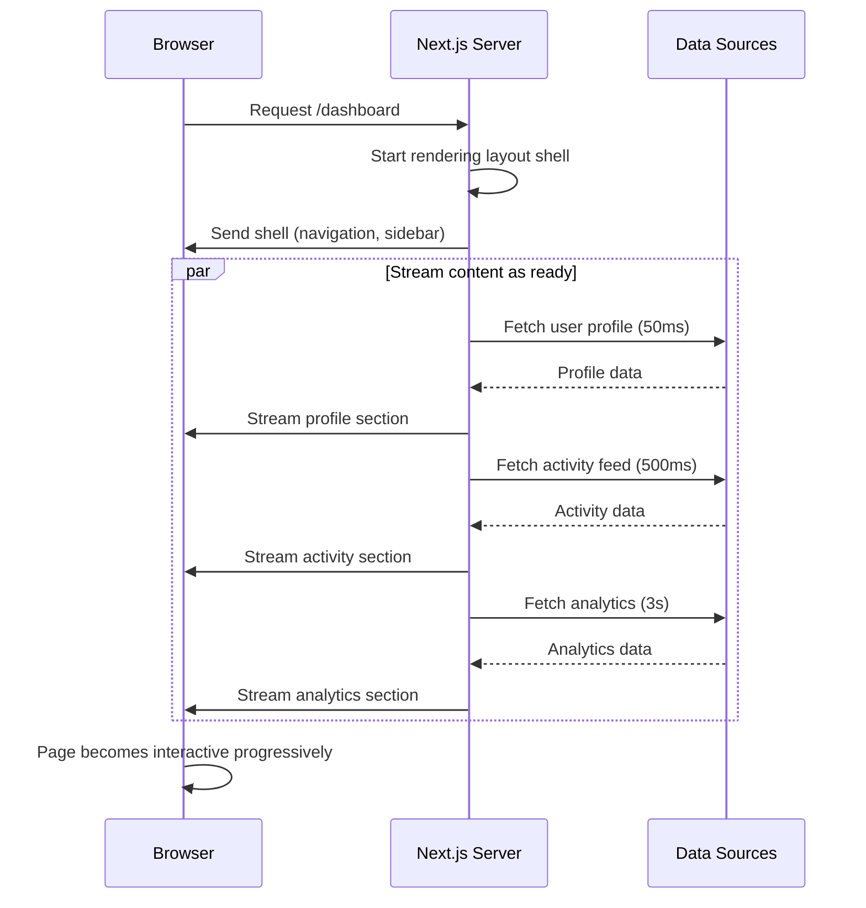

# Understanding Streaming in Next.js

## Introduction

Streaming is a rendering technique where the server progressively sends HTML to the client as it becomes available, rather than waiting for the entire page to render. This means users see content sooner, and the page feels faster.

## Why Do We Need This?

Traditional server-side rendering (SSR) sends the complete HTML only after all data fetching and rendering is done. If one component is slow — say, a database query takes 2 seconds — the entire page is blocked. Users stare at a blank screen during that time.

Streaming solves this by sending the page shell (navigation, sidebar, layout) immediately, then streaming in each section as it finishes rendering. The user sees meaningful content within milliseconds instead of seconds.

## Problem Statement

In a typical Next.js app, a dashboard page might need:
- User profile data (fast — 50ms cache hit)
- Sales analytics (slow — 3s database aggregation)
- Recent activity feed (medium — 500ms API call)

Without streaming, the page renders only after all three complete — that's 3+ seconds of blank screen. With streaming, the profile and activity feed render immediately, and the analytics section appears when ready.

## How Streaming Works



## Streaming in Next.js

Next.js supports streaming through two mechanisms:

1. **`loading.tsx`** — Automatic page-level streaming using the route segment
2. **`<Suspense>`** — Granular component-level streaming with custom fallbacks

### Loading UI with `loading.tsx`

Place a `loading.tsx` file in any route folder. Next.js automatically wraps the page content in a `<Suspense>` boundary:

```tsx
// app/dashboard/loading.tsx
export default function Loading() {
  return <div className="p-8 animate-pulse">
    <div className="h-8 bg-gray-200 rounded w-1/3 mb-4" />
    <div className="h-64 bg-gray-200 rounded" />
  </div>
}
```

The loading state shows immediately while the page renders on the server.

### Granular Streaming with `<Suspense>`

For more control, use React's Suspense component directly:

```tsx
// app/dashboard/page.tsx
import { Suspense } from 'react'
import { AnalyticsChart, ActivityFeed, UserProfile } from './components'

export default function DashboardPage() {
  return (
    <div className="grid gap-6">
      <UserProfile /> {/* Fast — renders immediately */}
      
      <Suspense fallback={<ActivityFeedSkeleton />}>
        <ActivityFeed /> {/* Streams when ready */}
      </Suspense>
      
      <Suspense fallback={<AnalyticsSkeleton />}>
        <AnalyticsChart /> {/* Streams when ready */}
      </Suspense>
    </div>
  )
}
```

Each `<Suspense>` boundary is independent. A slow component doesn't block the others.

## HTTP Streaming Protocol

Next.js uses the **chunked transfer encoding** protocol. The server sends:

1. Initial HTML shell with inline scripts
2. Placeholder content (Suspense fallbacks)
3. Streamed HTML chunks wrapped in `<template>` tags
4. Closing `</html>` tag

The browser progressively renders each chunk as it arrives, thanks to React's streaming SSR renderer.

## Streaming vs Traditional SSR

| Aspect | Traditional SSR | Streaming SSR |
|--------|----------------|---------------|
| First byte | Slow (wait for all data) | Fast (shell sent immediately) |
| Time to interactive | Higher | Lower (progressive) |
| User experience | Blank → full page | Content appears gradually |
| Data dependency | All data must resolve | Each section individually |
| Implementation | Default behavior | `loading.tsx` or `<Suspense>` |

## Streaming in Server Components

Streaming works natively with React Server Components. Each async Server Component becomes a streamable chunk. The key difference from traditional SSR streaming: RSC uses a custom wire format (the RSC Payload) that interleaves HTML with serialized component data, not plain HTML chunks.

```tsx
// app/dashboard/analytics-chart.tsx (Server Component)
import { db } from '@/lib/db'

export default async function AnalyticsChart() {
  // This component streams independently
  const data = await db.query.analytics.findAll()
  
  return (
    <div className="rounded-xl bg-white p-6 shadow">
      <h2>Monthly Revenue</h2>
      <Chart data={data} />
    </div>
  )
}
```

Under the hood, Next.js wraps each streamed chunk in `<template>` tags with unique IDs. The browser receives these progressively and React's streaming reconciler inserts them at the correct DOM positions — no layout shifts, no flickering.

## Common Mistakes

- **Too many Suspense boundaries** — Each boundary adds overhead. Group related content.
- **Skeleton abuse** — Use simple, subtle skeletons. Avoid jarring layout shifts.
- **Forgetting `loading.tsx` for page-level streaming** — Always provide a loading state for the initial page shell.
- **Nesting Suspense without fallbacks** — Wrap each slow component individually, not all in one boundary.

## Best Practices

- Start with `loading.tsx` for route-level streaming
- Add granular `<Suspense>` boundaries for critical slow components
- Use `Suspense` with `key` props for navigation-triggered re-fetching
- Combine streaming with `fetch()` deduplication for efficient data loading
- Measure Time to First Byte (TTFB) and First Contentful Paint (FCP) to validate improvements

## Summary

Streaming transforms the user experience by eliminating the all-or-nothing rendering model. Users see content progressively, with the fastest components rendering immediately. Implement it through `loading.tsx` for pages and `<Suspense>` for granular control. Streaming is a cornerstone of the App Router's performance model — use it by default for data-dependent pages.

## Related Topics

- [Suspense Boundaries & Loading UI](./topic-2-suspense-boundaries-and-loading-ui.md)
- [Streaming Architecture & Best Practices](./topic-3-streaming-architecture-and-best-practices.md)
- [Data Fetching Patterns (Module 2)](../module-2-data-fetching-patterns/)
