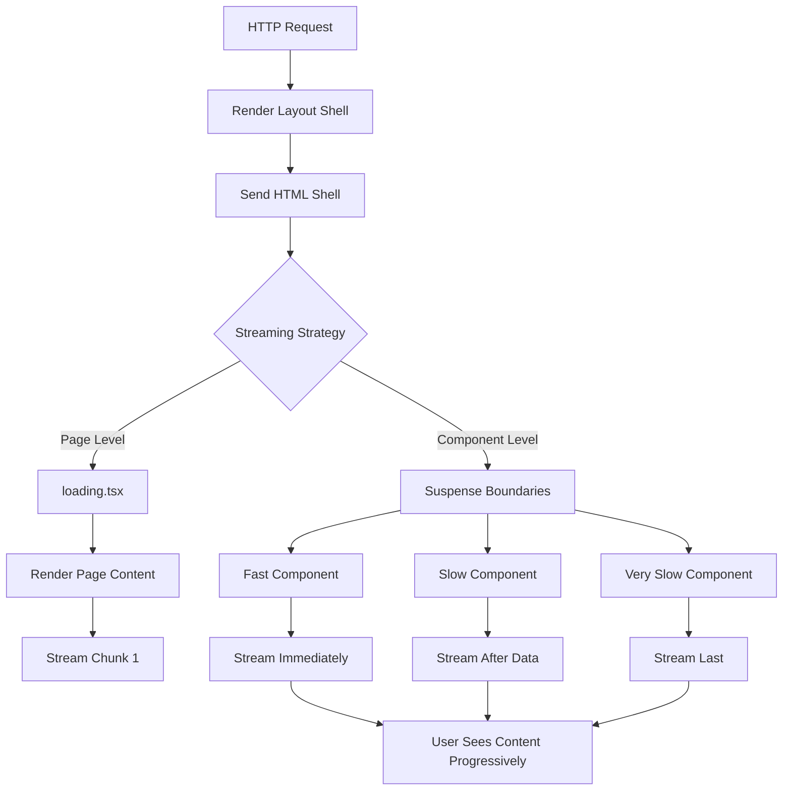
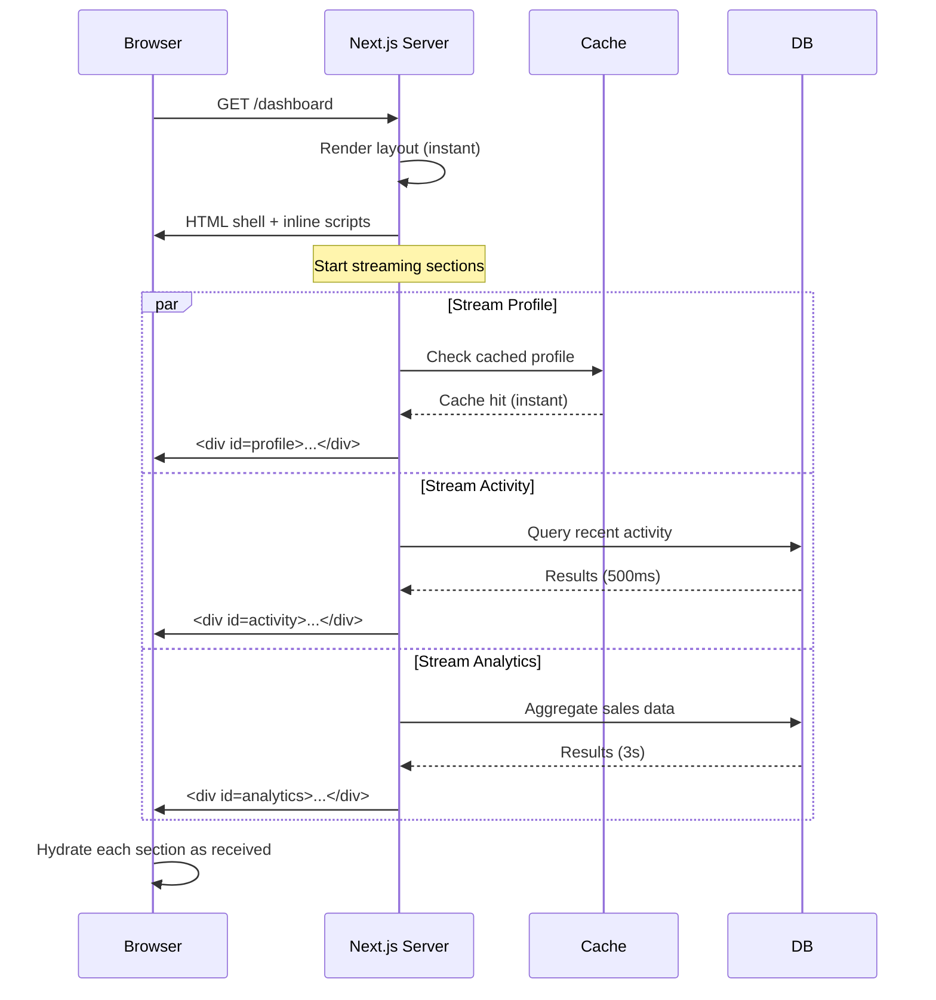

# Streaming Architecture & Best Practices

## Introduction

Streaming isn't just about adding `<Suspense>` boundaries. Designing an effective streaming architecture requires thinking about data dependencies, component boundaries, user perception, and production monitoring. This topic covers architectural patterns, performance considerations, and how to structure your app for optimal streaming.

## Streaming Architecture



## Data Flow with Streaming



## Designing Effective Streaming Boundaries

### 1. Group by Data Source

Structure your components so each Suspense boundary wraps components that fetch from the same data source:

```tsx
// ✅ Good — each boundary has similar fetch time
<Suspense fallback={<UserCardSkeleton />}>
  <UserProfile /> {/* Single DB query — ~50ms */}
</Suspense>

<Suspense fallback={<OrdersSkeleton />}>
  <RecentOrders /> {/* Single DB query — ~200ms */}
</Suspense>
```

```tsx
// ❌ Bad — uneven data dependencies inside one boundary
<Suspense fallback={<BigSkeleton />}>
  <UserProfile /> {/* 50ms */}
  <AnalyticsChart /> {/* 3s — blocks the profile */}
</Suspense>
```

### 2. Prioritize Above-the-Fold Content

Stream critical content first. Use the page layout to control rendering order:

```tsx
export default function ProductPage({ params }) {
  return (
    <div className="space-y-8">
      {/* Above the fold — stream first */}
      <Suspense fallback={<ProductSkeleton />}>
        <ProductDetails id={params.id} />
      </Suspense>
      
      {/* Below the fold — lower priority */}
      <Suspense fallback={<ReviewsSkeleton />}>
        <ProductReviews id={params.id} />
      </Suspense>
      
      <Suspense fallback={null}> {/* No fallback — don't show anything */}
        <RelatedProducts id={params.id} />
      </Suspense>
    </div>
  )
}
```

### 3. Streaming with Parallel Data Fetching

Combine parallel fetching with Suspense for maximum performance:

```tsx
// app/dashboard/page.tsx — all fetches start simultaneously
async function DashboardShell() {
  // These trigger immediately, not sequentially
  const profilePromise = fetchUserProfile()
  const ordersPromise = fetchRecentOrders()
  const analyticsPromise = fetchAnalytics()
  
  return (
    <div className="space-y-6">
      <Suspense fallback={<ProfileSkeleton />}>
        <UserProfile dataPromise={profilePromise} />
      </Suspense>
      <Suspense fallback={<OrdersSkeleton />}>
        <RecentOrders dataPromise={ordersPromise} />
      </Suspense>
      <Suspense fallback={<AnalyticsSkeleton />}>
        <AnalyticsChart dataPromise={analyticsPromise} />
      </Suspense>
    </div>
  )
}
```

## Performance Monitoring

Track these metrics to validate your streaming strategy:

| Metric | What it Measures | Target |
|--------|-----------------|--------|
| **TTFB** (Time to First Byte) | When the server starts sending HTML | < 200ms |
| **FCP** (First Contentful Paint) | When first content appears | < 1.5s |
| **LCP** (Largest Contentful Paint) | When main content finishes | < 2.5s |
| **CLS** (Cumulative Layout Shift) | Visual stability from skeletons | < 0.1 |
| **INP** (Interaction to Next Paint) | Responsiveness after hydration | < 200ms |

## Production Considerations

### Edge vs Node.js Runtime

Streaming works with both runtimes, but there are tradeoffs:

| Runtime | Streaming Support | Use Case |
|---------|------------------|----------|
| **Node.js** | Full streaming | Server-heavy pages (DB queries, complex rendering) |
| **Edge** | Limited streaming | Lightweight pages (CDN, geo-personalization) |

### Streaming with ISR

Combine streaming with ISR for a hybrid approach:

```tsx
// app/blog/[slug]/page.tsx
export const revalidate = 3600 // ISR: revalidate every hour

async function BlogContent({ slug }: { slug: string }) {
  const post = await db.query.posts.findFirst({ where: eq(posts.slug, slug) })
  return <article>{/* ... */}</article>
}

export default function BlogPage({ params }) {
  return (
    <Suspense fallback={<BlogSkeleton />}>
      <BlogContent slug={params.slug} />
    </Suspense>
  )
}
```

## Common Mistakes

- **Over-splitting** — Too many tiny Suspense boundaries = network overhead. Group wisely.
- **Skeleton flash** — If a component resolves instantly (< 100ms), the skeleton flashes briefly before content appears. Consider skipping the fallback for fast sections.
- **Ignoring mobile users** — Large skeletons with heavy animations drain battery. Use subtle loading states on mobile.
- **Not testing with slow networks** — Always test streaming behavior under throttled conditions (Slow 3G).

## Best Practices

- Structure components so Suspense boundaries align with natural data-fetching boundaries
- Use `loading.tsx` as the default; add granular `<Suspense>` where needed
- Prefer skeletons that match the layout to minimize CLS
- Test with network throttling to verify progressive rendering
- Monitor streaming performance with Web Vitals

## Summary

Effective streaming is about architecture, not just API usage. Group components by data source, prioritize above-the-fold content, and monitor real-world performance. Combine streaming with parallel fetching and ISR for maximum performance. Always test under real-world network conditions.

## Related Topics

- [Understanding Streaming](./topic-1-understanding-streaming-in-nextjs.md)
- [Suspense Boundaries & Loading UI](./topic-2-suspense-boundaries-and-loading-ui.md)
- [ISR with App Router (Module 3)](../module-3-caching-revalidation/topic-2-isr-with-app-router.md)
