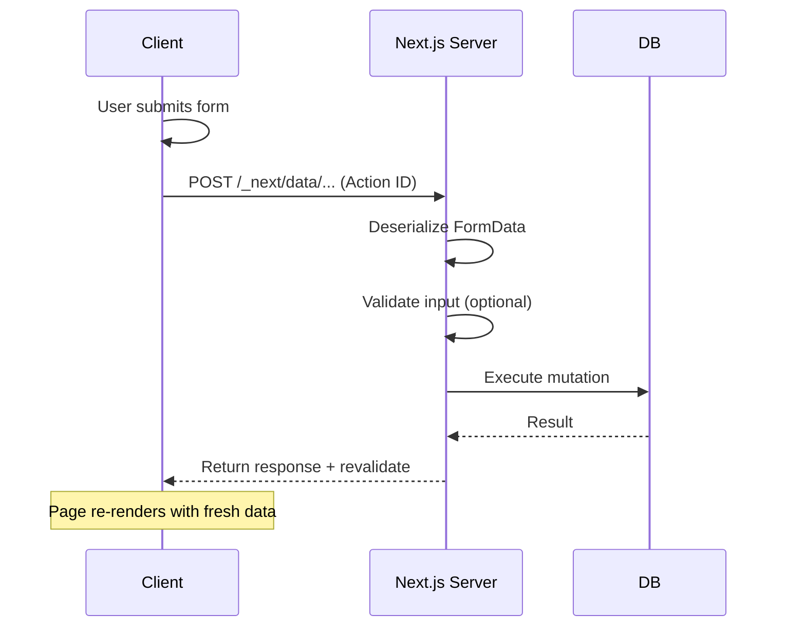

# Introduction to Server Actions

## Introduction

Server Actions are async functions that run on the server but can be called directly from Client Components. They reimagine form handling and data mutations — instead of building an API route just to handle a form submission, you write a function that runs on the server.

## Why Do We Need This?

Before Server Actions, handling a form submission required:

1. Create an API route (`app/api/contact/route.ts`)
2. Write a handler function with request parsing
3. Handle client-side form submission with `fetch()`
4. Manage loading, error, and success states manually

This created a lot of boilerplate. Server Actions eliminate the API route layer entirely. The form calls a function directly.

## How is a Server Action

A Server Action is any async function marked with `"use server"`:

```tsx
// app/actions.ts
"use server"

export async function createUser(formData: FormData) {
  const name = formData.get('name')
  const email = formData.get('email')
  
  // Validate and save to database
  await db.user.create({ data: { name, email } })
}
```

Called directly from a form:

```tsx
// app/page.tsx
import { createUser } from './actions'

export default function HomePage() {
  return (
    <form action={createUser}>
      <input name="name" placeholder="Name" required />
      <input name="email" type="email" placeholder="Email" required />
      <button type="submit">Submit</button>
    </form>
  )
}
```

## Server Action Invocation Flow



## Server Action Patterns

### Inline Action (in Server Component)

```tsx
// app/posts/[id]/page.tsx (Server Component)
export default function PostPage({ params }: { params: { id: string } }) {
  async function addComment(formData: FormData) {
    'use server'
    
    const content = formData.get('comment')
    await db.comment.create({
      data: { postId: params.id, content }
    })
    
    revalidatePath(`/posts/${params.id}`)
  }
  
  return (
    <form action={addComment}>
      <textarea name="comment" placeholder="Write a comment..." />
      <button type="submit">Post Comment</button>
    </form>
  )
}
```

### Separate File

```tsx
// app/actions.ts
"use server"

import { revalidatePath } from 'next/cache'
import { db } from '@/lib/db'

export async function deletePost(formData: FormData) {
  const postId = formData.get('postId')
  
  await db.post.delete({ where: { id: postId } })
  revalidatePath('/posts')
}
```

## Server Action with Client Component

To use a Server Action from a Client Component, import it:

```tsx
// app/actions.ts
"use server"

export async function updateProfile(formData: FormData) {
  // Server-side logic
}
```

```tsx
// app/settings/page.tsx
"use client"

import { updateProfile } from './actions'

export default function SettingsPage() {
  async function handleSubmit(event: React.FormEvent<HTMLFormElement>) {
    event.preventDefault()
    const formData = new FormData(event.currentTarget)
    const result = await updateProfile(formData)
  }
  
  return (
    <form onSubmit={handleSubmit}>
      <input name="name" placeholder="Name" />
      <button type="submit">Save</button>
    </form>
  )
}

> **Tip:** For production forms, use `useActionState` ([covered in Forms & Mutations](./topic-2-forms-and-mutations.md)) to automatically handle pending states, error responses, and form reset.
}
```

## Action Return Values

Server Actions can return values to the client:

```tsx
"use server"

export async function checkUsername(formData: FormData) {
  const username = formData.get('username') as string
  
  const existing = await db.user.findUnique({ where: { username } })
  
  if (existing) {
    return { available: false, message: 'Username taken' }
  }
  
  return { available: true }
}
```

## Common Mistakes

- **Not calling `revalidatePath` or `revalidateTag`** — The action runs but the page doesn't update. Always call revalidation after mutations.
- **Sensitive logic in Client Components** — Even if a function is a Server Action, don't pass sensitive parameters from the client. Validate everything server-side.
- **Missing error handling** — Server Actions throw errors by default. Wrap in try/catch for better UX.
- **Forgetting `"use server"`** — Without the directive, the function runs on the client.

## Best Practices

- Always revalidate after mutations (`revalidatePath` or `revalidateTag`)
- Validate inputs server-side even if you validate client-side
- Return structured responses (success/error objects) instead of throwing raw errors
- Use Server Actions in forms by default; fall back to API routes for complex scenarios (webhooks, third-party callbacks)
- Keep actions in a separate `actions.ts` or colocate with the page

## Summary

Server Actions simplify data mutations by eliminating the API route boilerplate. Define a function with `"use server"`, call it from a form action, and revalidate the cache afterward. They're the primary way to handle form submissions and data mutations in the App Router.

## Related Topics

- [Forms & Mutations](./topic-2-forms-and-mutations.md)
- [Server Actions with Database](./topic-3-server-actions-with-database.md)
- [Error Handling & Best Practices](./topic-4-error-handling-and-best-practices.md)
- [Data Fetching Patterns (Module 2)](../module-2-data-fetching-patterns/)
