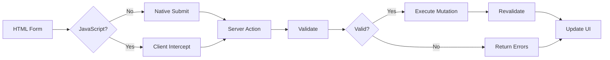

# Forms & Mutations

## Introduction

Forms are the primary way users interact with web applications. Next.js Server Actions integrate deeply with HTML forms, providing progressive enhancement, pending states, and validation — without writing client-side JavaScript for basic cases.

## Form Action with Server Actions

The simplest form uses the `action` prop with a Server Action:

```tsx
// app/newsletter/page.tsx
async function subscribe(formData: FormData) {
  'use server'
  
  const email = formData.get('email')
  
  if (!email || typeof email !== 'string') {
    return { error: 'Email is required' }
  }
  
  await db.subscriber.create({ data: { email } })
  revalidatePath('/newsletter')
  
  return { success: true }
}

export default function NewsletterPage() {
  return (
    <form action={subscribe}>
      <input type="email" name="email" placeholder="you@example.com" required />
      <button type="submit">Subscribe</button>
    </form>
  )
}
```

This works even without JavaScript — the form submits natively. Next.js intercepts the submission on the client when JS is available for a smoother experience.

## useActionState: Managing Form State

For better UX, use the `useActionState` hook to track pending and error states:

```tsx
// app/contact/page.tsx
"use client"

import { useActionState } from 'react'
import { submitContact } from './actions'

const initialState = { message: '', error: '' }

export default function ContactPage() {
  const [state, formAction, isPending] = useActionState(submitContact, initialState)
  
  return (
    <form action={formAction} className="space-y-4 max-w-md">
      <div>
        <label htmlFor="name">Name</label>
        <input id="name" name="name" required className="border p-2 w-full" />
      </div>
      
      <div>
        <label htmlFor="message">Message</label>
        <textarea id="message" name="message" required className="border p-2 w-full" />
      </div>
      
      <button
        type="submit"
        disabled={isPending}
        className="bg-blue-600 text-white px-4 py-2 rounded disabled:opacity-50"
      >
        {isPending ? 'Sending...' : 'Send Message'}
      </button>
      
      {state.message && <p className="text-green-600">{state.message}</p>}
      {state.error && <p className="text-red-600">{state.error}</p>}
    </form>
  )
}
```

```tsx
// app/contact/actions.ts
"use server"

export async function submitContact(prevState: any, formData: FormData) {
  const name = formData.get('name')
  const message = formData.get('message')
  
  if (!name || !message || typeof name !== 'string') {
    return { error: 'All fields required', message: '' }
  }
  
  try {
    await db.contact.create({ data: { name, message } })
    revalidatePath('/contact')
    return { message: 'Message sent successfully!', error: '' }
  } catch {
    return { error: 'Failed to send. Please try again.', message: '' }
  }
}
```

## useFormStatus: Loading from Child Components

The `useFormStatus` hook reads the parent form's pending state — useful for submit buttons in separate components:

```tsx
// app/components/SubmitButton.tsx
"use client"

import { useFormStatus } from 'react-dom'

export function SubmitButton() {
  const { pending } = useFormStatus()
  
  return (
    <button
      type="submit"
      disabled={pending}
      className="bg-blue-600 text-white px-6 py-2 rounded disabled:opacity-50"
    >
      {pending ? (
        <span className="flex items-center gap-2">
          <Spinner /> Saving...
        </span>
      ) : (
        'Save Changes'
      )}
    </button>
  )
}
```

```tsx
// app/settings/profile/page.tsx
import { SubmitButton } from '@/components/SubmitButton'
import { updateProfile } from './actions'

export default function ProfileSettings() {
  return (
    <form action={updateProfile}>
      <input name="bio" placeholder="Bio" />
      <SubmitButton />
    </form>
  )
}
```

## Validation Patterns

### Basic Validation (Server Side)

```tsx
"use server"

export async function createPost(prevState: any, formData: FormData) {
  const title = formData.get('title')
  const content = formData.get('content')
  
  const errors: Record<string, string> = {}
  
  if (!title || typeof title !== 'string' || title.length < 3) {
    errors.title = 'Title must be at least 3 characters'
  }
  
  if (!content || typeof content !== 'string' || content.length < 10) {
    errors.content = 'Content must be at least 10 characters'
  }
  
  if (Object.keys(errors).length > 0) {
    return { errors }
  }
  
  await db.post.create({ data: { title, content } })
  revalidatePath('/posts')
  
  return { success: true }
}
```

### Validation with Zod

```tsx
"use server"

import { z } from 'zod'

const postSchema = z.object({
  title: z.string().min(3, 'Title too short').max(100),
  content: z.string().min(10, 'Content too short').max(5000),
  published: z.coerce.boolean().optional(),
})

export async function createPost(prevState: any, formData: FormData) {
  const validated = postSchema.safeParse({
    title: formData.get('title'),
    content: formData.get('content'),
    published: formData.get('published'),
  })
  
  if (!validated.success) {
    return { errors: validated.error.flatten().fieldErrors }
  }
  
  await db.post.create({ data: validated.data })
  revalidatePath('/posts')
  return { success: true }
}
```

## Progressive Enhancement Flow



## Common Mistakes

- **Not handling validation errors** — Always return error objects from actions. Don't let the form silently fail.
- **Missing `name` attributes** — `formData.get()` requires `name` on input elements.
- **Over-complicating with client state** — Let Server Actions manage most form state. Use `useActionState` instead of `useState`.
- **Forgetting to disable buttons during pending** — Prevents double submissions.

## Best Practices

- Start with plain `<form action={action}>` (works without JS)
- Upgrade to `useActionState` for loading states and validation feedback
- Use `useFormStatus` for submit buttons extracted into separate components
- Validate all inputs on the server — never trust the client
- Return structured error responses for field-level feedback

## Summary

Forms with Server Actions provide progressive enhancement out of the box. Start simple with the `action` prop, add `useActionState` for state management, and use `useFormStatus` for pending indicators. Validate server-side with Zod for production-grade input handling.

## Related Topics

- [Introduction to Server Actions](./topic-1-introduction-to-server-actions.md)
- [Server Actions with Database](./topic-3-server-actions-with-database.md)
- [Error Handling & Best Practices](./topic-4-error-handling-and-best-practices.md)
