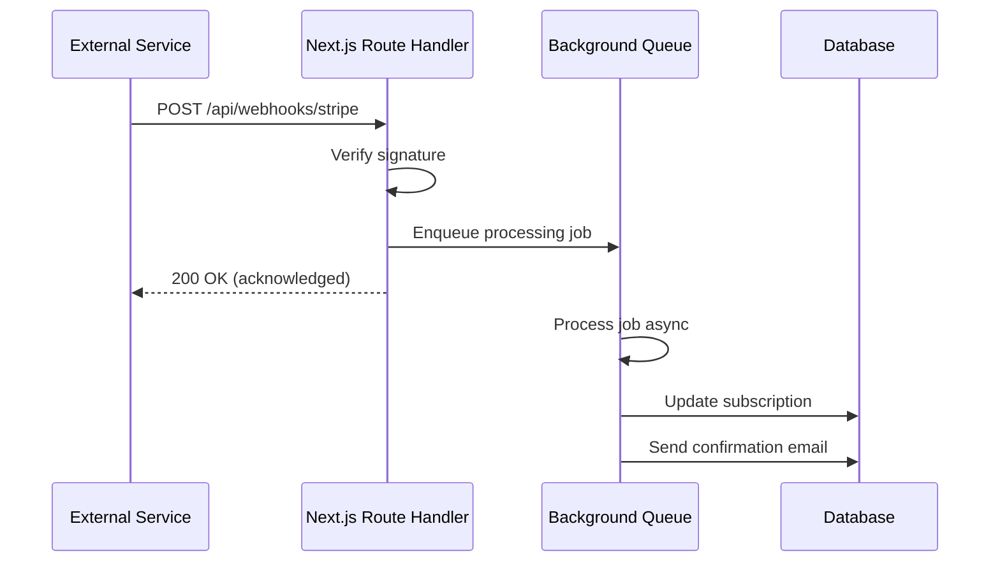

# Third-party API Integration

## Introduction

Modern applications integrate with external services: payment processors, email providers, AI APIs, and more. This topic covers patterns for calling external APIs from Next.js, handling webhooks, and managing errors gracefully.

## Calling External APIs from Server Components

```tsx
// Server Component — fetch from external API
export default async function GitHubProfile({ username }: { username: string }) {
  const res = await fetch(`https://api.github.com/users/${username}`, {
    headers: { 'Authorization': `token ${process.env.GITHUB_TOKEN}` },
    next: { revalidate: 3600 }, // Cache for 1 hour
  })
  
  if (!res.ok) {
    // Handle API errors gracefully
    throw new Error(`GitHub API error: ${res.status}`)
  }
  
  const data = await res.json()
  
  return (
    <div>
      
      <h2>{data.name}</h2>
      <p>{data.bio}</p>
    </div>
  )
}
```

## Service Layer Pattern

Abstract external APIs behind a service layer for better testing and error handling:

```ts
// lib/services/github.ts
export class GitHubService {
  private baseUrl = 'https://api.github.com'
  private token: string
  
  constructor() {
    this.token = process.env.GITHUB_TOKEN!
  }
  
  private async request(path: string) {
    const res = await fetch(`${this.baseUrl}${path}`, {
      headers: {
        'Authorization': `token ${this.token}`,
        'Accept': 'application/vnd.github.v3+json',
      },
      next: { revalidate: 3600 },
    })
    
    if (!res.ok) {
      throw new GitHubApiError(res.status, await res.text())
    }
    
    return res.json()
  }
  
  async getUser(username: string) {
    return this.request(`/users/${username}`)
  }
  
  async getRepos(username: string) {
    return this.request(`/users/${username}/repos?sort=updated&per_page=5`)
  }
}

export class GitHubApiError extends Error {
  constructor(public status: number, message: string) {
    super(`GitHub API Error (${status}): ${message}`)
  }
}
```

```tsx
// app/github/[username]/page.tsx
import { GitHubService } from '@/lib/services/github'

export default async function GitHubPage({ params }) {
  const github = new GitHubService()
  
  const [user, repos] = await Promise.all([
    github.getUser(params.username),
    github.getRepos(params.username),
  ])
  
  return <div>{/* render user and repos */}</div>
}
```

## Webhook Handling

Webhooks are HTTP callbacks sent by external services when events occur.

### Stripe Webhook

```ts
// app/api/webhooks/stripe/route.ts
import { NextRequest, NextResponse } from 'next/server'
import Stripe from 'stripe'

const stripe = new Stripe(process.env.STRIPE_SECRET_KEY!)

export async function POST(request: NextRequest) {
  const body = await request.text()
  const signature = request.headers.get('stripe-signature')!
  
  let event: Stripe.Event
  
  try {
    event = stripe.webhooks.constructEvent(
      body,
      signature,
      process.env.STRIPE_WEBHOOK_SECRET!
    )
  } catch (err) {
    console.error('Webhook signature verification failed:', err)
    return NextResponse.json(
      { error: 'Invalid signature' },
      { status: 400 }
    )
  }
  
  // Handle the event
  switch (event.type) {
    case 'checkout.session.completed': {
      const session = event.data.object as Stripe.Checkout.Session
      await handleCheckoutCompleted(session)
      break
    }
    case 'customer.subscription.updated': {
      const subscription = event.data.object as Stripe.Subscription
      await handleSubscriptionUpdated(subscription)
      break
    }
    default:
      console.log(`Unhandled event type: ${event.type}`)
  }
  
  return NextResponse.json({ received: true })
}
```

### GitHub Webhook

```ts
// app/api/webhooks/github/route.ts
import { NextRequest, NextResponse } from 'next/server'
import crypto from 'crypto'

export async function POST(request: NextRequest) {
  const body = await request.text()
  const signature = request.headers.get('x-hub-signature-256')!
  
  // Verify signature
  const hmac = crypto.createHmac('sha256', process.env.GITHUB_WEBHOOK_SECRET!)
  const digest = `sha256=${hmac.update(body).digest('hex')}`
  
  if (signature !== digest) {
    return NextResponse.json({ error: 'Invalid signature' }, { status: 401 })
  }
  
  const event = request.headers.get('x-github-event')
  const payload = JSON.parse(body)
  
  switch (event) {
    case 'push':
      await handlePush(payload)
      break
    case 'pull_request':
      await handlePullRequest(payload)
      break
  }
  
  return NextResponse.json({ received: true })
}
```

## API Client Pattern

```ts
// lib/api-client.ts
export class ApiClient {
  private baseUrl: string
  private headers: Record<string, string>
  
  constructor(baseUrl: string, apiKey: string) {
    this.baseUrl = baseUrl
    this.headers = {
      'Authorization': `Bearer ${apiKey}`,
      'Content-Type': 'application/json',
    }
  }
  
  async get<T>(path: string): Promise<T> {
    const res = await fetch(`${this.baseUrl}${path}`, {
      headers: this.headers,
    })
    
    if (!res.ok) {
      throw new ApiError(res.status, await res.text())
    }
    
    return res.json()
  }
  
  async post<T>(path: string, data: unknown): Promise<T> {
    const res = await fetch(`${this.baseUrl}${path}`, {
      method: 'POST',
      headers: this.headers,
      body: JSON.stringify(data),
    })
    
    if (!res.ok) {
      throw new ApiError(res.status, await res.text())
    }
    
    return res.json()
  }
}

export class ApiError extends Error {
  constructor(public status: number, message: string) {
    super(message)
  }
}
```

```ts
// lib/services/openai.ts
import { ApiClient } from '@/lib/api-client'

const openai = new ApiClient(
  'https://api.openai.com/v1',
  process.env.OPENAI_API_KEY!
)

export async function generateSummary(text: string) {
  const response = await openai.post<{
    choices: Array<{ message: { content: string } }>
  }>('/chat/completions', {
    model: 'gpt-4',
    messages: [
      { role: 'system', content: 'Summarize the following text in 2-3 sentences.' },
      { role: 'user', content: text },
    ],
  })
  
  return response.choices[0].message.content
}
```

## Webhook Processing Flow



## Common Mistakes

- **Synchronous webhook processing** — Webhooks should acknowledge immediately (2xx) and process asynchronously. Otherwise, slow processing causes timeouts and retries.
- **Not verifying webhook signatures** — Always verify signatures before processing webhook data.
- **Exposing API keys on the client** — External API calls should go through Route Handlers or Server Components, never from client code.
- **No retry logic** — External APIs fail. Implement retry with exponential backoff.

## Best Practices

- Use a service layer to abstract external API calls
- Verify webhook signatures before processing
- Process webhooks asynchronously (return 200 immediately)
- Cache external API responses with `next: { revalidate }`
- Implement retry logic with exponential backoff for production
- Log external API errors with request context for debugging

## Summary

Integrate external APIs through a service layer for testability. Handle webhooks with signature verification and async processing. Cache responses where possible and always implement retry logic. Never expose API keys to the client — proxy through Route Handlers or Server Components.

## Related Topics

- [Building RESTful APIs](./topic-1-building-restful-apis.md)
- [API Security & Rate Limiting](./topic-2-api-security-and-rate-limiting.md)
- [Full Stack Architecture (Module 4)](../module-4-full-stack-architecture/)
