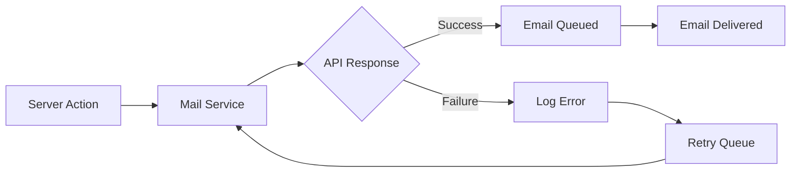

# Email & Notifications

## Introduction

Sending emails is a core requirement for most applications — welcome emails, password resets, order confirmations. This topic covers sending transactional emails from Next.js and building in-app notification systems.

## Sending Emails with Resend

Resend is a modern email API built for developers that works well with Next.js and React Email.

### Setup

```bash
npm install resend react-email @react-email/components
```

```ts
// lib/resend.ts
import { Resend } from 'resend'

export const resend = new Resend(process.env.RESEND_API_KEY)
```

### Email Templates with React Email

```tsx
// emails/welcome.tsx
import {
  Body, Container, Head, Heading, Html,
  Link, Preview, Text,
} from '@react-email/components'

export default function WelcomeEmail({ name, url }: { name: string; url: string }) {
  return (
    <Html>
      <Head />
      <Preview>Welcome to our platform!</Preview>
      <Body style={{ fontFamily: 'Arial, sans-serif' }}>
        <Container>
          <Heading>Hi {name},</Heading>
          <Text>Welcome aboard! We're excited to have you.</Text>
          <Link href={url} style={{
            background: '#2563eb',
            color: 'white',
            padding: '12px 24px',
            borderRadius: '6px',
            textDecoration: 'none',
          }}>
            Get Started
          </Link>
        </Container>
      </Body>
    </Html>
  )
}
```

### Sending via Server Action

```ts
// app/actions/email.ts
"use server"

import { resend } from '@/lib/resend'
import WelcomeEmail from '@/emails/welcome'

export async function sendWelcomeEmail(userId: string) {
  const user = await db.user.findUnique({ where: { id: userId } })
  if (!user) return
  
  const { data, error } = await resend.emails.send({
    from: 'Acme <welcome@acme.com>',
    to: user.email,
    subject: 'Welcome to Acme!',
    react: WelcomeEmail({ name: user.name, url: `https://acme.com/welcome/${user.id}` }),
  })
  
  if (error) {
    console.error('Failed to send welcome email:', error)
    return { error: 'Failed to send email' }
  }
  
  return { success: true, id: data?.id }
}
```

## In-App Notifications

```ts
// app/actions/notifications.ts
"use server"

import { db } from '@/lib/db'
import { revalidatePath } from 'next/cache'

export async function createNotification(userId: string, type: string, message: string) {
  await db.notification.create({
    data: { userId, type, message }
  })
  
  revalidatePath('/notifications')
}

export async function markAsRead(notificationId: string) {
  await db.notification.update({
    where: { id: notificationId },
    data: { readAt: new Date() }
  })
  
  revalidatePath('/notifications')
}
```

```tsx
// app/components/NotificationBell.tsx
"use client"

import { useState } from 'react'
import { markAsRead } from '@/app/actions/notifications'

export function NotificationBell({ initialUnread }: { initialUnread: number }) {
  const [open, setOpen] = useState(false)
  const [unread, setUnread] = useState(initialUnread)
  
  return (
    <div className="relative">
      <button onClick={() => setOpen(!open)} className="relative p-2">
        <BellIcon />
        {unread > 0 && (
          <span className="absolute -top-1 -right-1 bg-red-500 text-white text-xs rounded-full w-5 h-5 flex items-center justify-center">
            {unread}
          </span>
        )}
      </button>
      
      {open && (
        <div className="absolute right-0 mt-2 w-80 bg-white rounded-lg shadow-xl border">
          <NotificationsList onRead={() => setUnread(prev => prev - 1)} />
        </div>
      )}
    </div>
  )
}
```

## Real-time Notifications

For real-time updates, use Server-Sent Events or a WebSocket service:

```ts
// app/api/notifications/stream/route.ts
export async function GET(request: Request) {
  const userId = request.headers.get('x-user-id')
  
  const stream = new ReadableStream({
    start(controller) {
      const encoder = new TextEncoder()
      
      // Send initial data
      controller.enqueue(encoder.encode('data: connected\n\n'))
      
      // Poll for new notifications
      const interval = setInterval(async () => {
        const notifications = await db.notification.findMany({
          where: { userId, readAt: null },
          orderBy: { createdAt: 'desc' },
          take: 5,
        })
        
        if (notifications.length > 0) {
          controller.enqueue(
            encoder.encode(`data: ${JSON.stringify(notifications)}\n\n`)
          )
        }
      }, 5000)
      
      request.signal.addEventListener('abort', () => clearInterval(interval))
    }
  })
  
  return new Response(stream, {
    headers: {
      'Content-Type': 'text/event-stream',
      'Cache-Control': 'no-cache',
      'Connection': 'keep-alive',
    },
  })
}
```

## Email Delivery Architecture



## Common Mistakes

- **Sending emails synchronously during requests** — Email delivery can be slow. Offload to a background queue.
- **No email error handling** — Email APIs can fail. Log errors and implement retry logic.
- **Not using email templates** — Plain text emails look unprofessional. Use React Email for beautiful templates.
- **Bypassing email verification** — Always verify email ownership before sending sensitive emails.

## Best Practices

- Use React Email for template design — components, types, preview
- Send emails asynchronously via background jobs
- Track email delivery status (sent, delivered, bounced)
- Include unsubscribe links in marketing emails
- Verify email ownership before sending sensitive content
- Use a dedicated sending domain for better deliverability

## Summary

Send transactional emails with Resend and React Email for beautiful, type-safe templates. Use background queues to avoid blocking requests. Build in-app notification systems with database-persisted notifications and real-time updates via SSE for a complete user experience.

## Related Topics

- [File Uploads](./topic-1-file-uploads.md)
- [Background Jobs & Queues](./topic-3-background-jobs-and-queues.md)
- [Third-party API Integration (Module 3)](../module-3-rest-apis-route-handlers/topic-3-third-party-api-integration.md)
