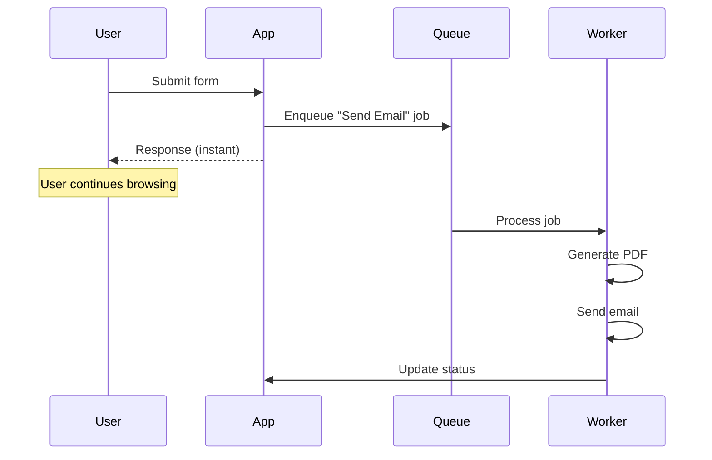
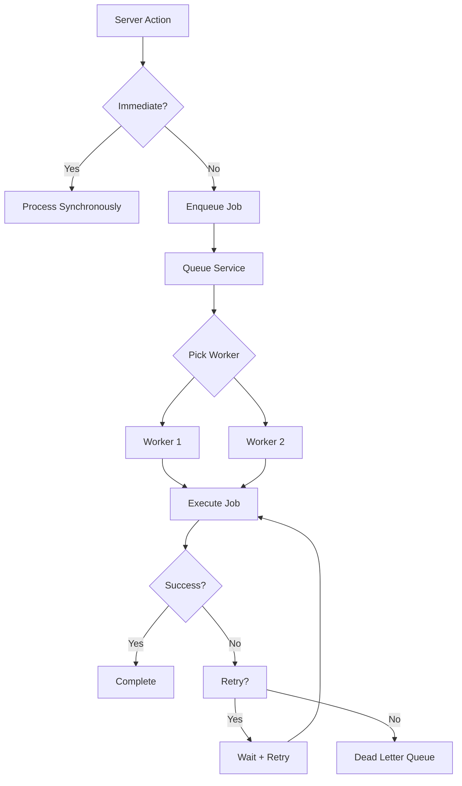

# Background Jobs & Queues

## Introduction

Some operations don't belong in the request-response cycle: sending emails, resizing images, generating PDFs, processing data. Background jobs handle these asynchronously, keeping your app fast and responsive.

## Why Queues?



Without a queue, the user waits while the PDF generates and the email sends. With a queue, they get an instant response.

## Using Inngest

[Inngest](https://inngest.com) is a serverless queue platform designed for Next.js. It runs your functions as background jobs with retries, scheduling, and observability.

### Setup

```bash
npm install inngest
```

```ts
// lib/inngest.ts
import { Inngest } from 'inngest'

export const inngest = new Inngest({ id: 'my-app' })
```

### Defining Background Functions

```ts
// app/inngest/functions.ts
import { inngest } from '@/lib/inngest'
import { resend } from '@/lib/resend'
import WelcomeEmail from '@/emails/welcome'

export const sendWelcomeEmail = inngest.createFunction(
  { id: 'send-welcome-email', retries: 3 },
  { event: 'user/created' },
  async ({ event, step }) => {
    const { userId, email, name } = event.data
    
    await step.run('send-email', async () => {
      await resend.emails.send({
        from: 'Acme <welcome@acme.com>',
        to: email,
        subject: 'Welcome to Acme!',
        react: WelcomeEmail({ name, url: `https://acme.com/welcome/${userId}` }),
      })
    })
    
    await step.run('update-database', async () => {
      await db.user.update({
        where: { id: userId },
        data: { welcomeEmailSent: true }
      })
    })
  }
)

export const generateInvoice = inngest.createFunction(
  { id: 'generate-invoice' },
  { event: 'order/completed' },
  async ({ event, step }) => {
    const { orderId } = event.data
    
    const pdf = await step.run('generate-pdf', async () => {
      const order = await db.order.findUnique({
        where: { id: orderId },
        include: { items: true, user: true }
      })
      return generateInvoicePDF(order)
    })
    
    await step.run('upload-pdf', async () => {
      await uploadToBlob(pdf, `invoices/${orderId}.pdf`)
    })
    
    await step.run('send-invoice-email', async () => {
      await resend.emails.send({
        to: event.data.email,
        subject: 'Your invoice is ready',
        attachments: [{ filename: 'invoice.pdf', content: pdf }],
      })
    })
  }
)
```

### Triggering from Server Actions

```ts
// app/actions/orders.ts
"use server"

import { inngest } from '@/lib/inngest'

export async function placeOrder(formData: FormData) {
  const order = await db.order.create({
    data: {
      userId: formData.get('userId') as string,
      total: Number(formData.get('total')),
      items: { /* ... */ },
    }
  })
  
  // Trigger background job
  await inngest.send({
    name: 'order/completed',
    data: {
      orderId: order.id,
      email: order.user.email,
    }
  })
  
  revalidatePath('/orders')
  return { orderId: order.id }
}
```

## Cron Jobs / Scheduled Tasks

```ts
// app/inngest/functions.ts
import { inngest } from '@/lib/inngest'

export const dailyDigest = inngest.createFunction(
  { id: 'daily-digest' },
  { cron: '0 8 * * *' }, // Every day at 8 AM
  async ({ step }) => {
    const users = await step.run('fetch-users', async () => {
      return db.user.findMany({
        where: { preferences: { digestEnabled: true } }
      })
    })
    
    for (const user of users) {
      await step.run(`send-digest-${user.id}`, async () => {
        const posts = await db.post.findMany({
          where: { createdAt: { gte: daysAgo(1) } }
        })
        
        await resend.emails.send({
          to: user.email,
          subject: 'Your Daily Digest',
          react: DigestEmail({ name: user.name, posts }),
        })
      })
    }
  }
)

export const cleanupInactiveUsers = inngest.createFunction(
  { id: 'cleanup-users' },
  { cron: '0 0 * * 0' }, // Every Sunday at midnight
  async ({ step }) => {
    const threshold = daysAgo(90)
    
    const inactiveUsers = await step.run('find-inactive', async () => {
      return db.user.findMany({
        where: { lastLoginAt: { lt: threshold }, deletedAt: null }
      })
    })
    
    for (const user of inactiveUsers) {
      await step.run(`soft-delete-${user.id}`, async () => {
        await db.user.update({
          where: { id: user.id },
          data: { deletedAt: new Date() }
        })
      })
    }
  }
)
```

## Alternative: Redis-based Queues

For simpler cases, use Redis directly:

```ts
// lib/queue.ts
import { Redis } from '@upstash/redis'

const redis = Redis.fromEnv()

export async function enqueue(job: string, data: unknown) {
  await redis.lpush('queue', JSON.stringify({ job, data, createdAt: Date.now() }))
}
```

## Job Processing Flow



## Common Mistakes

- **Processing long-running tasks in request handlers** — Always offload heavy work to background queues
- **No retry logic** — Transient failures happen. Always implement retries with backoff.
- **Idempotency issues** — Ensure jobs are idempotent (running twice produces the same result)
- **No monitoring** — Track job failures, latency, and queue depth

## Best Practices

- Offload email sending, PDF generation, image processing to queues
- Use Inngest for serverless-friendly background jobs
- Make jobs idempotent — they can be retried
- Set appropriate retry limits and backoff strategies
- Monitor job failures and queue depth
- Use cron jobs for recurring maintenance tasks

## Summary

Background queues keep your application responsive by deferring heavy work. Use Inngest for serverless-optimized job processing with built-in retries, scheduling, and observability. Always make jobs idempotent and monitor job health in production.

## Related Topics

- [File Uploads](./topic-1-file-uploads.md)
- [Email & Notifications](./topic-2-email-and-notifications.md)
- [Third-party API Integration (Module 3)](../module-3-rest-apis-route-handlers/topic-3-third-party-api-integration.md)
