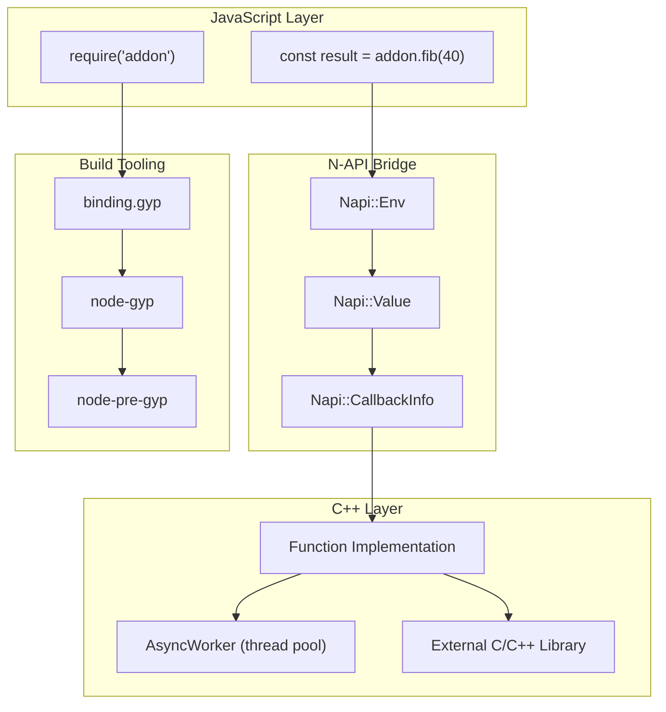
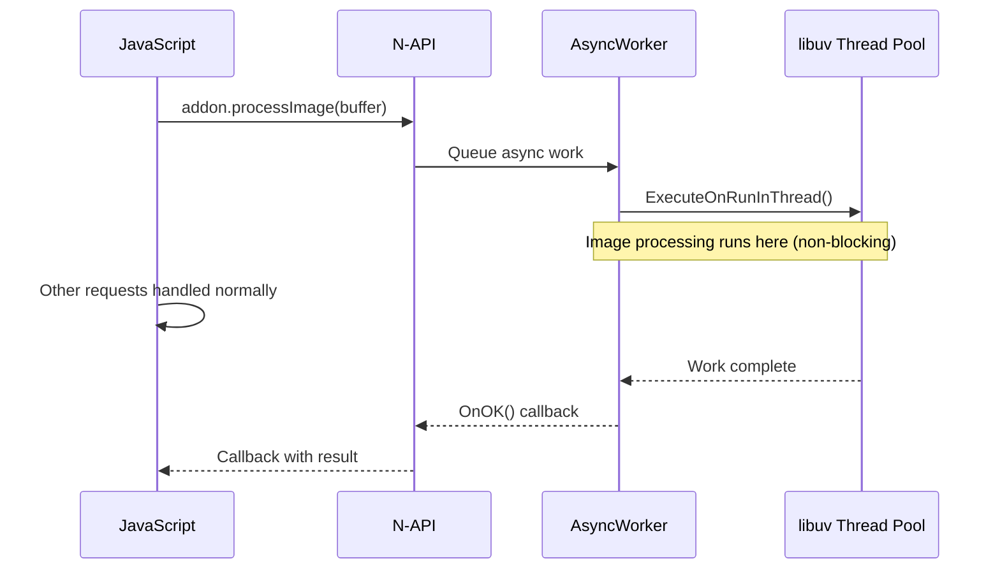
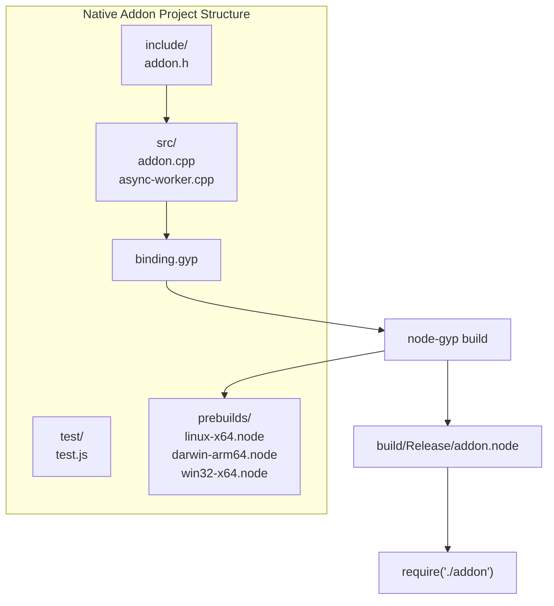

# Native Addons

## 📖 Introduction

Native addons are **C++ modules** that can be loaded into Node.js like any JavaScript module. They allow you to write performance-critical code in C++ and call it directly from JavaScript with near-zero overhead. Native addons are built using **N-API** (stable ABI) and the **node-addon-api** C++ wrapper.

While most Node.js developers will never need to write native addons, understanding how they work is valuable for performance-critical applications, working with C/C++ libraries, and understanding Node.js internals.

## 🤔 Why Do We Need This?

JavaScript is fast for I/O-bound work but struggles with CPU-bound tasks. Operations like image processing, cryptography, and data compression can be 10-100x faster in C++:

```javascript
// JavaScript Fibonacci (recursive): ~1M ops/sec
function fibJS(n) {
  if (n <= 1) return n;
  return fibJS(n - 1) + fibJS(n - 2);
}

// Native addon (iterative C++): ~50M ops/sec — 50x faster!
const { fib } = require('./build/Release/fibonacci');
```

## ⚠️ Problem Statement

Building native addons requires solving:

1. **ABI stability** — Addons must work across Node.js versions without recompilation
2. **Thread safety** — C++ code must not block the Event Loop
3. **Memory management** — Manual memory management in C++ vs V8's garbage collector
4. **Cross-platform builds** — Windows, macOS, and Linux use different compilers
5. **Debugging** — Debugging across two languages is significantly more complex
6. **Packaging** — Distributing compiled binaries for different platforms (node-pre-gyp)

## 📚 Real World Story

**Node.js core itself** relies heavily on native addons. The `crypto` module wraps OpenSSL (C library), `zlib` wraps zlib compression, `fs` is built on libuv (C library). When you run `crypto.createHash('sha256')`, you're calling C++ code through a native addon.

The `sharp` npm package (image processing) uses a native addon wrapping the libvips C library. It's 4-5x faster than pure JavaScript alternatives and processes millions of images daily in production at companies like Vercel and Cloudinary.

## 🍕 Real World Analogy

| Concept | Kitchen Analogy |
|---------|----------------|
| **Node.js (JavaScript)** | Your everyday chef — versatile but slow for specialized tasks |
| **Native addon** | A specialized robot chef — incredibly fast but only for specific tasks |
| **N-API** | The interface between the chef and the robot — standard, well-defined API |
| **node-gyp** | The assembly instructions for building the robot |
| **AsyncWorker** | The robot works in the background while the chef prepares other dishes |

## 👁️ Visual Explanation

```
JavaScript Call → Native Addon Flow:

JS Call: .add(5, 3)
    │
    ▼
Node.js/V8 ──► N-API Bridge ──► C++ Function
    │                              │
    │                         ┌────┴────┐
    │                         │ int result│
    │                         │ = a + b; │
    │                         └────┬────┘
    │                              │
    │◄──────── result (8) ─────────┘
    │
    ▼
JS returns 8
```

## 📊 Mermaid Diagram 1: Node.js Native Addon Architecture



## ⚙️ Internal Working: How N-API Bridges JavaScript and C++

When Node.js loads a native addon:

1. **Loading**: `require()` finds the `.node` binary (compiled from C++)
2. **Initialization**: Node.js calls the `NODE_MODULE_INIT()` function, which registers the addon's exports
3. **Function calls**: JavaScript calls an exported function → N-API serializes arguments → C++ function executes → result is deserialized back to JavaScript
4. **Async operations**: `AsyncWorker` runs C++ code on libuv's thread pool, calling a JavaScript callback when done — this keeps the Event Loop unblocked

## 🔄 Mermaid Diagram 2: AsyncWorker Flow



## 🏗️ Architecture: Project Structure



## 👣 Step-by-Step: Building Your First Addon


## 📝 Syntax

### binding.gyp

```json
{
  "targets": [{
    "target_name": "addon",
    "sources": ["src/addon.cpp"],
    "include_dirs": ["<!(node -e \"require('node-addon-api').include\")"],
    "dependencies": ["<!(node -e \"require('node-addon-api').gyp\")"]
  }]
}
```

### C++ Addon with node-addon-api

```cpp
#include <napi.h>

Napi::Number Add(const Napi::CallbackInfo& info) {
  Napi::Env env = info.Env();
  if (info.Length() < 2) {
    Napi::TypeError::New(env, "Two arguments expected").ThrowAsJavaScriptException();
    return Napi::Number::New(env, 0);
  }
  double a = info[0].As<Napi::Number>().DoubleValue();
  double b = info[1].As<Napi::Number>().DoubleValue();
  return Napi::Number::New(env, a + b);
}

Napi::Object Init(Napi::Env env, Napi::Object exports) {
  exports.Set(Napi::String::New(env, "add"), Napi::Function::New(env, Add));
  return exports;
}

NODE_API_MODULE(addon, Init)
```

### AsyncWorker (non-blocking)

```cpp
class FibWorker : public Napi::AsyncWorker {
public:
  FibWorker(Napi::Function& callback, int n)
    : Napi::AsyncWorker(callback), n(n), result(0) {}

  void Execute() { result = fibonacci(n); }  // Thread pool

  void OnOK() {
    Callback().Call({Env().Null(), Napi::Number::New(Env(), result)});
  }

private:
  int n;
  long long result;
};
```

## 🟢 Basic Example: Hello World Addon

```cpp
// src/addon.cpp
#include <napi.h>

Napi::String Greet(const Napi::CallbackInfo& info) {
  Napi::Env env = info.Env();
  std::string name = info[0].As<Napi::String>().Utf8Value();
  return Napi::String::New(env, "Hello, " + name + "!");
}

Napi::Object Init(Napi::Env env, Napi::Object exports) {
  exports.Set("greet", Napi::Function::New(env, Greet));
  return exports;
}

NODE_API_MODULE(addon, Init)
```

```javascript
// test.js
const addon = require('./build/Release/addon');
console.log(addon.greet('World')); // "Hello, World!"
```

## 🟡 Intermediate Example: Fibonacci with AsyncWorker

```cpp
// fibonacci.cpp
#include <napi.h>

long long fib(int n) {
  if (n <= 1) return n;
  long long a = 0, b = 1;
  for (int i = 2; i <= n; i++) {
    long long temp = a + b;
    a = b;
    b = temp;
  }
  return b;
}

class FibWorker : public Napi::AsyncWorker {
public:
  FibWorker(Napi::Function& callback, int n)
    : Napi::AsyncWorker(callback), n(n), result(0) {}

  void Execute() { result = fib(n); }

  void OnOK() {
    Callback().Call({Env().Null(), Napi::Number::New(Env(), result)});
  }

private:
  int n;
  long long result;
};

Napi::Value FibAsync(const Napi::CallbackInfo& info) {
  Napi::Env env = info.Env();
  int n = info[0].As<Napi::Number>().Int32Value();
  Napi::Function callback = info[1].As<Napi::Function>();
  auto* worker = new FibWorker(callback, n);
  worker->Queue();
  return env.Undefined();
}
```

## 🔴 Advanced Example: Image Processing Pipeline

```cpp
// image-worker.cpp
#include <napi.h>
#include <vector>
#include <algorithm>

struct Pixel { unsigned char r, g, b, a; };

void Grayscale(Pixel* pixels, size_t count) {
  for (size_t i = 0; i < count; i++) {
    unsigned char gray = static_cast<unsigned char>(
      0.299 * pixels[i].r + 0.587 * pixels[i].g + 0.114 * pixels[i].b
    );
    pixels[i].r = pixels[i].g = pixels[i].b = gray;
  }
}

class ImageWorker : public Napi::AsyncWorker {
public:
  ImageWorker(Napi::Buffer<Pixel>& buffer, Napi::Function& callback)
    : Napi::AsyncWorker(callback),
      pixels(buffer.Data()), count(buffer.Length()) {}

  void Execute() { Grayscale(pixels, count); }

  void OnOK() {
    Callback().Call({Env().Null(), Napi::Boolean::New(Env(), true)});
  }

private:
  Pixel* pixels;
  size_t count;
};
```

## 🏭 Production Example: Prebuilt Binary Distribution

```json
// package.json
{
  "name": "my-native-addon",
  "scripts": {
    "install": "node-pre-gyp install --fallback-to-build",
    "build": "node-pre-gyp build",
    "prebuild": "node-pre-gyp rebuild"
  },
  "binary": {
    "module_name": "addon",
    "module_path": "./build",
    "host": "https://github.com/user/repo/releases/download/",
    "remote_path": "{version}"
  }
}
```

```javascript
// Native addons use node-pre-gyp for cross-platform distribution.
// Prebuilt binaries are compiled for each platform and architecture.
// When a user runs npm install, the correct binary is downloaded
// without requiring C++ build tools.
```

## ⚙️ How It Works Internally

When you call `require('./addon.node')`:

1. Node.js calls `process.dlopen()` which uses `uv_dlopen()` (libuv) to load the shared library
2. The `NODE_MODULE_INIT()` function runs, registering the module's exports
3. V8 compiles the C++ functions and makes them callable from JavaScript
4. Each function call crosses the JS/C++ boundary through N-API

The boundary crossing has overhead (~50-100ns per call). This is why passing large amounts of data (vs. calling many small functions) is preferred.

## 📦 Performance Notes

| Operation | JavaScript (ops/s) | Native Addon (ops/s) | Speedup |
|-----------|-------------------|---------------------|---------|
| Fibonacci (n=40) | ~1M | ~50M | 50x |
| MD5 hashing (1MB) | ~100 | ~800 | 8x |
| Image grayscale (4K) | ~5 | ~60 | 12x |

### Optimization Tips

- **Minimize boundary crossings** — Pass large data as Buffer, not individual values
- **Use AsyncWorker** — Never block the Event Loop with expensive C++ operations
- **Prefer batch operations** — Process arrays of data in C++, not item by item
- **Profile before optimizing** — Most apps don't need native addons

## 🔒 Security Notes

- Native addons run in the same process as Node.js — a crash takes down the server
- Memory corruption in C++ can lead to undefined behavior
- Validate all inputs before passing to native code (defense in depth)
- Use fuzzing to test addon with unexpected inputs

## ⚠️ Common Mistakes

1. **❌ Forgetting to validate arguments** — C++ crashes on invalid input, and Node.js crashes with it

2. **❌ Blocking the Event Loop** — Running CPU work on the main thread defeats the purpose of Node.js

3. **❌ Memory leaks** — C++ doesn't have garbage collection — every `new` needs a `delete`

4. **❌ Not handling edge cases** — Empty buffers, null values, and negative numbers must be checked

5. **❌ Platform-specific code** — Windows uses different APIs than Linux/macOS

## 🚀 Best Practices

```cpp
// ✅ Validate all inputs
if (info.Length() < 1 || !info[0].IsNumber()) {
  Napi::TypeError::New(env, "Expected a number").ThrowAsJavaScriptException();
  return Napi::Number::New(env, 0);
}

// ✅ Use AsyncWorker for CPU work
auto* worker = new MyWorker(callback, data);
worker->Queue();  // Runs on thread pool

// ✅ Pre-allocate and reuse buffers
// Don't allocate inside hot paths

// ✅ Use smart pointers (std::unique_ptr) for RAII
```

## 🎯 Interview Questions

**Q1: What is N-API and why was it created?**

N-API is a stable C API for building native Node.js addons. It was created to solve the ABI (Application Binary Interface) instability problem — previously, native addons had to be recompiled for each Node.js version because V8's internal APIs changed frequently. N-API provides a stable API that works across Node.js versions without recompilation.

**Q2: How do you prevent native addons from blocking the Event Loop?**

Use `Napi::AsyncWorker` or `Napi::ThreadSafeFunction`. AsyncWorker runs the C++ code on libuv's thread pool and calls a JavaScript callback when done. This prevents blocking the Event Loop while the computation runs. Work is queued, executed on a background thread, and the result is returned asynchronously.

## 📝 MCQs

**1. What is the primary purpose of node-addon-api?**
- A) A replacement for Node.js core modules
- B) A C++ wrapper for N-API that simplifies native addon development ✅
- C) A JavaScript library for C++ interop
- D) A build tool for compiling TypeScript

**2. How does AsyncWorker prevent Event Loop blocking?**
- A) It runs code on the main thread
- B) It runs code on libuv's thread pool ✅
- C) It uses setTimeout to yield control
- D) It creates a new Node.js process

**3. What does .node file extension represent?**
- A) A Node.js configuration file
- B) A compiled native addon binary ✅
- C) A Node.js test file
- D) A Node.js environment file

**4. What tool is used to build native addons?**
- A) npm
- B) node-gyp ✅
- C) Webpack
- D) Babel

**5. Why should you minimize boundary crossings between JS and C++?**
- A) C++ can't access JavaScript variables
- B) Each crossing has ~50-100ns overhead ✅
- C) JavaScript can't call C++ functions
- D) It causes memory leaks

**Answer Key:** 1-B, 2-B, 3-B, 4-B, 5-B

## 💻 Coding Challenge 1: Hello World Addon

Build a simple native addon using node-addon-api:
- Exports a `greet(name)` function returning "Hello, {name}!"
- Uses proper error handling when called without arguments
- Create a binding.gyp configuration
- Build with node-gyp and test from JavaScript

## 💻 Coding Challenge 2: Fibonacci Calculator

Build a native addon that exports:
- `fibSync(n)` — synchronous Fibonacci (blocking)
- `fibAsync(n, callback)` — async Fibonacci using AsyncWorker
- Compare performance against a JavaScript version
- Test with n=45 and measure the difference

## 💻 Coding Challenge 3: Buffer Processor

Build a native addon that processes binary data:
- Accepts a Node.js Buffer and a multiplier
- Multiplies each byte value by the multiplier (clamped to 255)
- Returns the modified buffer
- Benchmarks against JavaScript `map()` implementation
- Test with 10MB, 100MB, and 1GB buffers

## 🧪 Mini Exercise: Debugging a Native Addon

```cpp
#include <napi.h>

Napi::Value Fib(const Napi::CallbackInfo& info) {
  Napi::Env env = info.Env();
  // Bug 1: What if info[0] is not a number?
  int n = info[0].As<Napi::Number>().Int32Value();
  // Bug 2: Negative n causes infinite recursion!
  if (n <= 1) return Napi::Number::New(env, n);
  // Bug 3: Recursive Fibonacci is slow — O(2^n)
  return Napi::Number::New(env, fibSync(n - 1) + fibSync(n - 2));
  // Bug 4: This blocks the Event Loop!
}

// Bug 5: Memory leak — never freed
char* buffer = (char*)malloc(1024 * 1024);
```

## 🌍 Real World Problem (Interview Coding Challenge)

**Problem:** You're building a real-time video processing pipeline. Your Node.js server receives video frames from a camera at 30fps. Each frame needs: face detection (OpenCV C++), compression (x264), and metadata extraction. Processing must complete within 33ms per frame.

**Questions:**
1. Would you use native addons, worker threads, or offload to a microservice?
2. How would you pass video frames between JavaScript and C++ efficiently?
3. How do you handle backpressure when processing is slower than incoming frames?
4. How would you distribute prebuilt binaries for different platforms?

## 🏗️ Mini Project: String Process Library

Build a native addon that provides high-performance string processing:

**Core features:**
- `reverse(str)` — reverse a string
- `countWords(str)` — count words
- `levenshtein(a, b)` — edit distance between two strings
- All functions have both sync and async versions
- Benchmark against JavaScript implementations

**Technical requirements:**
- Use node-addon-api
- AsyncWorker for async versions
- Proper error handling for all edge cases
- node-pre-gyp for binary distribution
- Cross-platform build configuration

## 📖 Summary

| Concept | Key Takeaway |
|---------|-------------|
| **N-API** | Stable C API for native addons across Node.js versions |
| **node-addon-api** | C++ wrapper that makes writing addons easier |
| **node-gyp** | Build tool for compiling C++ to .node binary |
| **AsyncWorker** | Run C++ code on libuv thread pool (non-blocking) |
| **ABI stability** | Addons work across Node.js versions without recompilation |
| **node-pre-gyp** | Distribute prebuilt binaries for different platforms |

## 📋 Cheat Sheet

```cpp
// Quick reference: Native Addons

// binding.gyp
{ "targets": [{
  "target_name": "addon",
  "sources": ["src/addon.cpp"],
  "include_dirs": ["<!(node -e \"require('node-addon-api').include\")"],
  "dependencies": ["<!(node -e \"require('node-addon-api').gyp\")"]
}]}

// Basic addon
#include <napi.h>
Napi::Number MyFn(const Napi::CallbackInfo& info) {
  return Napi::Number::New(info.Env(), 42);
}
Napi::Object Init(Napi::Env env, Napi::Object exports) {
  exports.Set("myFn", Napi::Function::New(env, MyFn));
  return exports;
}
NODE_API_MODULE(addon, Init)

// AsyncWorker
class Worker : public Napi::AsyncWorker {
  void Execute() { /* thread pool */ }
  void OnOK() { /* main thread callback */ }
};

// Building
// node-gyp configure && node-gyp build
// require('./build/Release/addon')
```

## 📚 Further Reading

- [node-addon-api Documentation](https://github.com/nodejs/node-addon-api)
- [Node.js N-API Guide](https://nodejs.org/api/n-api.html)
- [node-gyp Documentation](https://github.com/nodejs/node-gyp)
- [node-pre-gyp Documentation](https://github.com/mapbox/node-pre-gyp)

## 🔗 Related Topics

- [WebAssembly](./wasm) — Alternative to native addons for high-performance code
- [Performance Optimization](../production/performance) — When to use native code
- [Clustering & Worker Threads](../production/clustering-and-worker-threads) — Worker threads for parallelism
