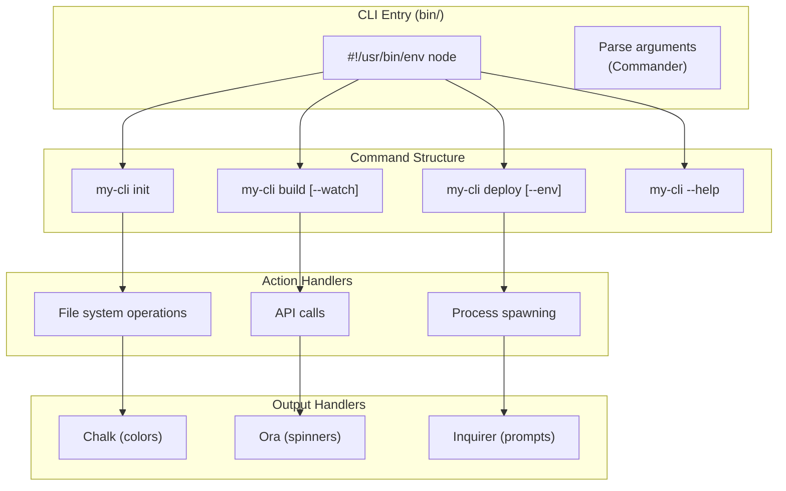
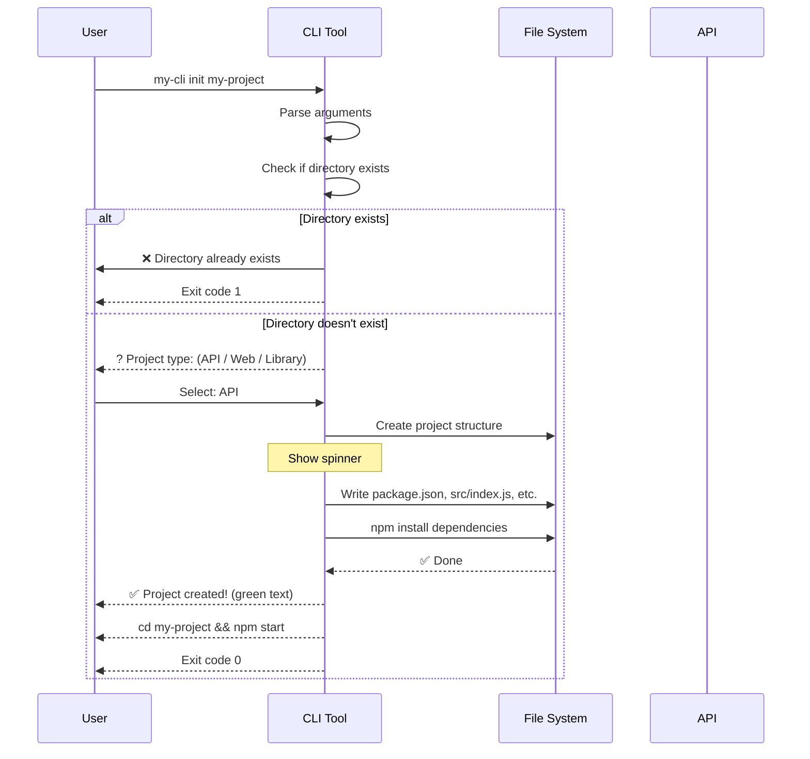

# Building CLI Tools

## 📖 Introduction

Node.js is an excellent platform for building command-line interface (CLI) tools. The extensive npm ecosystem provides libraries for argument parsing (Commander), user interaction (Inquirer), output styling (Chalk), progress spinners (Ora), and config management (Conf).

Many of the most popular developer tools — ESLint, Webpack, Create React App, and Next.js — are built with Node.js CLI frameworks. CLI tools automate repetitive tasks, standardize workflows, and create reusable development utilities.

## 🤔 Why Do We Need This?

Without CLI tools, development workflows require manual steps:

```bash
# ❌ Without CLI — 5 manual steps
mkdir my-project && cd my-project
npm init -y
npm install express
echo "console.log('hello')" > index.js
# Each project needs the same setup — error-prone and slow!

# ✅ With CLI — one command
npx create-my-app my-project
# Automates everything above + more!
```

CLI tools are how developers interact with infrastructure, automation, and workflows.

## ⚠️ Problem Statement

Building a production-grade CLI tool requires solving:

1. **Argument parsing** — Handle flags (`--verbose`), options (`--name=value`), and positional arguments
2. **User experience** — Colorful output, progress bars, interactive prompts, error messages
3. **Cross-platform** — Path separators, environment variables, and commands differ across OS
4. **Error handling** — Meaningful exit codes and error messages
5. **Configuration** — Support config files, environment variables, and CLI flags with priority
6. **Testing** — How to test interactive prompts and file system operations

## 📚 Real World Story

**Vercel's `vercel` CLI** is one of the most polished Node.js CLI tools. It handles complex deployment workflows with subcommands like `vercel deploy`, `vercel env`, and `vercel logs`. It uses interactive prompts for first-time setup, progress spinners for long operations, colorized output for clarity, and handles edge cases like network failures with retries and helpful error messages.

The CLI has been downloaded millions of times and is the primary interface for deploying to Vercel's platform. Its success demonstrates the importance of developer experience in CLI tools.

## 🍕 Real World Analogy

| CLI Concept | Restaurant Ordering Analogy |
|-------------|---------------------------|
| **Command** | "I'd like to order a pizza" |
| **Argument** | "Pepperoni" (the main subject) |
| **Option/Flag** | "Extra cheese please" (modifier) |
| **--help** | The menu — tells you what's available |
| **Interactive prompt** | The waiter asking "What size?" |
| **Spinner** | "Your order is being prepared..." |
| **Exit code 0** | Order completed successfully |
| **Exit code 1** | "We're out of pepperoni" |

## 👁️ Visual Explanation

```
Command Structure:

my-cli deploy --env production --verbose ./dist
└─┬──┘ └─┬─┘ └──────┬────────┘└───┬───┘ └─┬───┘
  │       │           │            │        │
  │       │           │            │        └── Argument (positional)
  │       │           │            └── Value for --env
  │       │           └── Option (--env)
  │       └── Subcommand
  └── Root command
```

## 📊 Mermaid Diagram 1: CLI Architecture



## ⚙️ Internal Working: How Commander Parses Arguments

When a user runs `my-cli deploy --env production`:

1. Commander reads `process.argv` — the raw command-line arguments
2. It matches against registered commands, options, and arguments
3. **Positional arguments** are matched by position in the definition
4. **Options** are matched by name (`--env` matches the `--env` option)
5. **Defaults** are applied for any unspecified options
6. Commander calls the action handler with parsed data

```javascript
// process.argv = ['node', 'my-cli', 'deploy', '--env', 'production']
// Commander parses into:
{
  args: ['deploy'],         // Subcommand
  env: 'production',        // Option value
  verbose: false,           // Not specified → default
}
```

## 🔄 Mermaid Diagram 2: CLI User Experience Flow



## 📝 Syntax

### Commander.js

```javascript
#!/usr/bin/env node
const { Command } = require('commander');
const program = new Command();

program
  .name('my-cli')
  .description('My CLI tool')
  .version('1.0.0');

program
  .command('init <name>')
  .option('-t, --type <type>', 'Project type')
  .description('Initialize a new project')
  .action((name, options) => {
    console.log(`Creating ${name} as ${options.type || 'default'}...`);
  });

program.parse();
```

### Inquirer (interactive prompts)

```javascript
const { prompt } = require('inquirer');

const answers = await prompt([
  { type: 'input', name: 'name', message: 'Project name:' },
  { type: 'list', name: 'type', message: 'Project type:',
    choices: ['API', 'Web App', 'CLI Tool'] },
  { type: 'confirm', name: 'docker', message: 'Add Docker support?', default: true },
]);
```

## 🟢 Basic Example: Simple File Generator CLI

```javascript
#!/usr/bin/env node
const { program } = require('commander');
const { prompt } = require('inquirer');
const fs = require('fs');
const path = require('path');
const chalk = require('chalk');

program
  .command('generate <name>')
  .option('-t, --type <type>', 'Component type')
  .action(async (name, options) => {
    const answers = await prompt([
      { type: 'list', name: 'type', message: 'Component type:',
        choices: ['React', 'Express Route', 'CLI Command'] },
    ]);

    const content = generateTemplate(name, answers.type);
    const filePath = path.join(process.cwd(), `${name}.js`);

    fs.writeFileSync(filePath, content);
    console.log(chalk.green(`✅ Created ${filePath}`));
  });

program.parse();
```

## 🟡 Intermediate Example: CLI with Config and Error Handling

```javascript
#!/usr/bin/env node
const { program } = require('commander');
const Conf = require('conf');
const ora = require('ora');
const chalk = require('chalk');

const config = new Conf({ projectName: 'my-cli' });

program
  .command('deploy')
  .option('-e, --env <env>', 'Environment', 'production')
  .action(async (options) => {
    const spinner = ora('Deploying...').start();
    try {
      const apiKey = config.get('apiKey');
      if (!apiKey) throw new Error('Not configured. Run `my-cli login`');

      const result = await deployApp(options.env, apiKey);
      spinner.succeed(chalk.green(`Deployed to ${result.url}`));
    } catch (err) {
      spinner.fail(chalk.red(err.message));
      process.exit(1);
    }
  });

program
  .command('login')
  .action(async () => {
    const { apiKey } = await prompt([
      { type: 'password', name: 'apiKey', message: 'API Key:' },
    ]);
    config.set('apiKey', apiKey);
    console.log(chalk.green('✅ Configured!'));
  });

program.parse();
```

## 🏭 Production Example: Multi-Command CLI with NPX Support

```json
{
  "name": "my-cli",
  "version": "1.0.0",
  "bin": {
    "my-cli": "./bin/my-cli.js"
  },
  "files": ["bin/", "src/"],
  "scripts": {
    "prepublishOnly": "npm test"
  }
}
```

```javascript
#!/usr/bin/env node
// bin/my-cli.js
const { program } = require('commander');
const { version } = require('../package.json');
const init = require('../src/commands/init');
const build = require('../src/commands/build');
const deploy = require('../src/commands/deploy');

program.version(version).name('my-cli');

program.addCommand(init);
program.addCommand(build);
program.addCommand(deploy);

program.on('--help', () => {
  console.log('');
  console.log('Examples:');
  console.log('  $ my-cli init my-app');
  console.log('  $ my-cli deploy --env production');
});

// Handle errors gracefully
process.on('uncaughtException', (err) => {
  console.error(chalk.red(err.message));
  process.exit(1);
});

program.parse(process.argv);
```

## ⚙️ How It Works Internally: NPX Resolution

When a user runs `npx my-cli`:

1. npx checks if `my-cli` is installed locally in `node_modules/.bin/`
2. If not, npx downloads the package from npm to a temporary cache
3. npx executes the script pointed to by the `bin` field in package.json
4. The `#!/usr/bin/env node` shebang tells the OS to use Node.js
5. Node.js runs the script, which parses `process.argv` and handles the command

## 📦 Performance Notes

CLI tools should be **fast to start** — every millisecond of startup feels slow to developers:

```javascript
// ❌ Slow startup — require everything upfront
const _ = require('lodash');
const chalk = require('chalk');
const { program } = require('commander');

// ✅ Fast startup — require only what's needed
// Use lazy requires for commands
program.command('build').action(async () => {
  const { build } = require('../commands/build');
  await build();
});
```

## 🔒 Security Notes

- **Never ask for passwords with plain input** — Use `inquirer` with `type: 'password'`
- **Validate user input** — Path traversal attacks are common in CLI tools
- **Be careful with `eval()` or `exec()`** — Especially with user-provided input
- **Install scripts** — The `postinstall` script runs with npm install permissions

## ⚠️ Common Mistakes

1. **❌ No shebang line** — `#!/usr/bin/env node` is required for direct execution

2. **❌ Not handling SIGINT** — Ctrl+C should clean up temp files gracefully

3. **❌ Sync file operations blocking** — Use sync is fine for CLIs, but show a spinner for long ops

4. **❌ No --help documentation** — Every command needs help text

5. **❌ Hardcoded paths** — Use `path.join()` and `process.cwd()` for portability

## 🚀 Best Practices

```javascript
// ✅ Handle SIGINT
process.on('SIGINT', () => {
  console.log('\nOperation cancelled');
  process.exit(0);
});

// ✅ Exit with proper codes
process.exit(0); // Success
process.exit(1); // Error

// ✅ Cross-platform paths
const filePath = path.join(__dirname, '..', 'templates');

// ✅ Colorize output
console.log(chalk.green('✅ Success'));
console.log(chalk.red('❌ Error'));
console.log(chalk.yellow('⚠️ Warning'));

// ✅ Progress feedback
const spinner = ora('Processing...').start();
// ... do work ...
spinner.succeed('Done!');
```

## 🎯 Interview Questions

**Q1: How does `npx my-cli` work?**

npx checks if the package is locally installed. If not, it downloads it from npm to a temporary cache, executes the `bin` script, and then the package can be garbage collected. This allows running CLI tools without globally installing them.

**Q2: How do you handle asynchronous operations in a CLI tool?**

Use async/await in command handlers. Show a spinner using `ora` for operations taking >100ms. For long operations, use `cli-progress` for progress bars. Always handle promise rejections with `process.on('unhandledRejection')`.

## 📝 MCQs

**1. What does `#!/usr/bin/env node` do?**
- A) Installs Node.js on the system
- B) Tells the system to execute the script with Node.js ✅
- C) Checks if Node.js is installed
- D) Sets the Node.js version

**2. Which library provides interactive prompts (checkboxes, lists, inputs)?**
- A) Commander
- B) Inquirer ✅
- C) Chalk
- D) Ora

**3. What is the purpose of the `bin` field in package.json?**
- A) To store binary files
- B) To register CLI commands that npx/npm can find ✅
- C) To configure build tools
- D) To specify the Node.js binary path

**4. Which exit code indicates success in a CLI tool?**
- A) 0 ✅
- B) 1
- C) -1
- D) 200

**5. Which library would you use to display a loading spinner?**
- A) Chalk
- B) Inquirer
- C) Ora ✅
- D) Commander

**Answer Key:** 1-B, 2-B, 3-B, 4-A, 5-C

## 💻 Coding Challenge 1: Project Scaffolder

Build a CLI tool that scaffolds a Node.js project:
- `create-project init <name>` — creates folder, package.json, src/index.js
- `create-project add-route <path>` — adds an Express route file
- Interactive prompts for project type (API, CLI, Library)
- Colorful output with chalk
- Handle SIGINT gracefully

## 💻 Coding Challenge 2: Task Runner with Progress

Build a CLI task runner:
- Reads tasks from a `tasks.json` file
- Runs tasks in sequence or parallel (configurable)
- Shows real-time progress with spinners
- Exits with non-zero code on task failure
- Supports `--watch` mode for development (re-runs on file change)

## 💻 Coding Challenge 3: Config Validator

Build a CLI tool that validates configuration files:
- `validate-config --schema schema.json config.json`
- Reads JSON Schema and validates the config file
- Colorized error output showing exactly which fields fail
- Supports YAML files as well as JSON
- Auto-fixes common issues with `--fix` flag

## 🧪 Mini Exercise: Debugging CLI Bugs

```javascript
#!/usr/bin/env node
const { program } = require('commander');
const fs = require('fs');

program
  .command('read <file>')
  .action((file) => {
    // Bug 1: No error handling — what if file doesn't exist?
    const content = fs.readFileSync(file, 'utf8');
    
    // Bug 2: No path traversal protection!
    // User can read /etc/passwd with: my-cli read ../../etc/passwd
    
    console.log(content);
  });

// Bug 3: No --help text on the command
// Bug 4: No SIGINT handler — Ctrl+C leaves the terminal in a weird state
// Bug 5: Not exiting with code 1 on error

program.parse();
```

## 🌍 Real World Problem (Interview Coding Challenge)

**Problem:** Your team uses 10+ different CLI tools internally (deploy, lint, test, codegen, migration). Each has different arguments, behavior, and configuration. Developers constantly misuse them and waste time reading docs.

**Requirements:**
1. A unified CLI (`platform`) that wraps all existing tools
2. Common authentication across all tools
3. Configuration from `.platformrc` file with env var overrides
4. Interactive prompts for missing required arguments
5. Must work offline (cache what you can)

**Questions:**
1. How would you design the command structure?
2. How would you implement the config resolution (file → env → flag)?
3. How would you handle the "offline" mode requirement?
4. How would you test the CLI across different platforms in CI?

## 🏗️ Mini Project: API Client CLI

Build a CLI tool for interacting with a REST API:

**Core features:**
- `api-client login` — authenticate and store token
- `api-client get /users` — GET request with formatted output
- `api-client post /users '{"name":"Alice"}'` — POST request
- `api-client config set baseUrl=https://api.example.com`
- Colorized JSON output with `--pretty` flag

**Technical requirements:**
- Commander for CLI structure
- Conf for persistent config
- Chalk for colored output
- Ora for request spinners
- Axios for HTTP requests
- NPX-compatible package.json

## 📖 Summary

| Concept | Key Takeaway |
|---------|-------------|
| **Commander** | Argument parsing, commands, options, help text |
| **Inquirer** | Interactive prompts (input, list, checkbox) |
| **Chalk** | Colorized terminal output (green=success, red=error) |
| **Ora** | Spinners for progress indication |
| **Conf** | Persistent configuration storage |
| **bin** | Package.json field to register CLI entry point |
| **Shebang** | `#!/usr/bin/env node` for direct execution |

## 📋 Cheat Sheet

```javascript
#!/usr/bin/env node
// Quick reference: CLI Tools

// 1. Commander setup
const { program } = require('commander');
program.name('my-cli').version('1.0.0');

program
  .command('init <name>')
  .option('-t, --type <type>', 'Project type')
  .description('Initialize a project')
  .action(async (name, options) => { /* ... */ });

program.parse();

// 2. Interactive prompts
const { prompt } = require('inquirer');
const answers = await prompt([
  { type: 'input', name: 'name', message: 'Name:' },
]);

// 3. Colorized output
const chalk = require('chalk');
console.log(chalk.green('✅ Success'));
console.log(chalk.red('❌ Error'));

// 4. Spinners
const ora = require('ora');
const spinner = ora('Loading...').start();
// ... work ...
spinner.succeed('Done!');

// 5. Exit codes
process.exit(0); // Success
process.exit(1); // Error

// 6. package.json
// { "bin": { "my-cli": "./bin/my-cli.js" } }
```

## 📚 Further Reading

- [Commander.js Documentation](https://github.com/tj/commander.js)
- [Inquirer.js Documentation](https://github.com/SBoudrias/Inquirer.js)
- [Chalk Documentation](https://github.com/chalk/chalk)
- [Ora Documentation](https://github.com/sindresorhus/ora)
- [Building CLI Tools in Node.js](https://developer.okta.com/blog/2019/06/18/command-line-app-with-nodejs)

## 🔗 Related Topics

- [Event Sourcing](./event-sourcing) — CLI tools for event management
- [Monorepos](./monorepos) — CLI tools for monorepo management
- [Streams & Buffers](../core/streams-and-buffers) — Streaming data in CLIs
- [Error Handling](../core/error-handling) — Graceful CLI error handling
