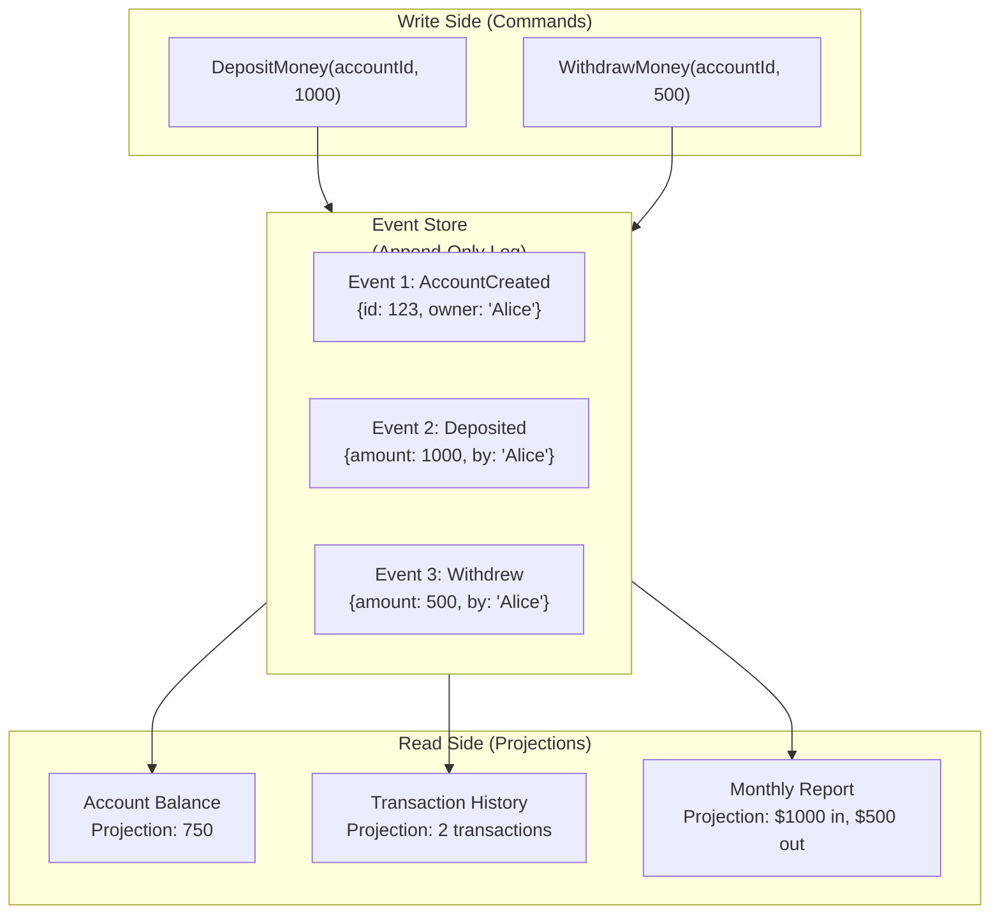
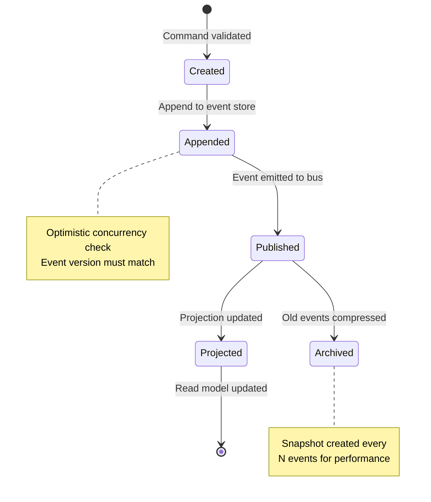
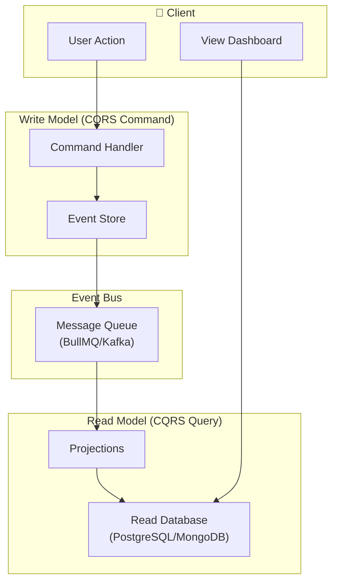
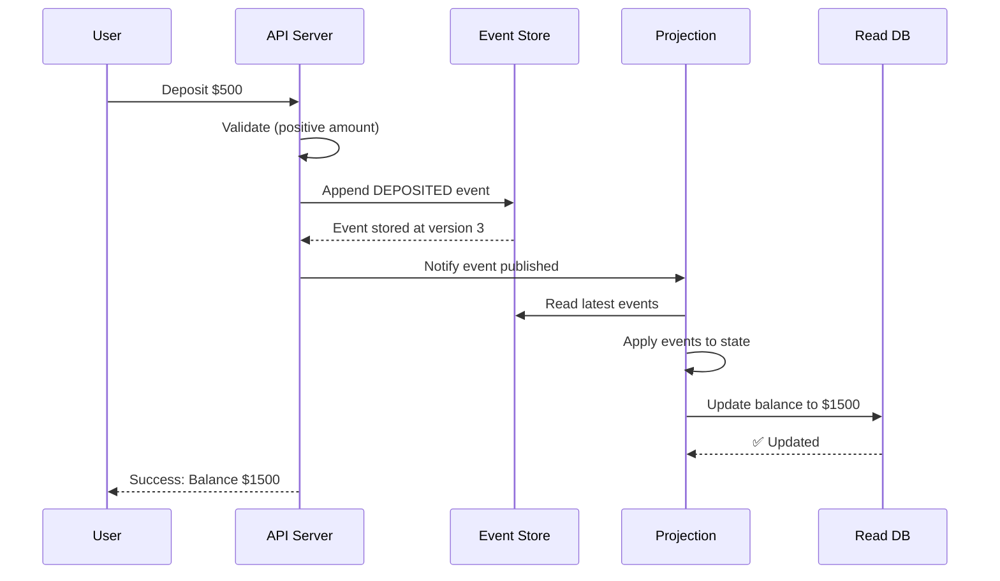

# Event Sourcing

## 📖 Introduction

**Event Sourcing** is an architectural pattern where application state is derived from a sequence of immutable events, rather than storing the current state directly. Instead of updating a "current balance" field, you store every "deposit" and "withdrawal" event. The current balance is computed by replaying all events.

This provides: perfect audit trails, temporal querying ("what was the state on Jan 1?"), and the ability to reconstruct past states for debugging or compliance.

## 🤔 Why Do We Need This?

Traditional CRUD overwrites state — losing history:

```javascript
// ❌ CRUD — loses history
await db.update('account', { id: 123, balance: 500 });
// Was the balance 1000 and we withdrew 500?
// Was it 0 and we deposited 500?
// We can never know!

// ✅ Event Sourcing — preserves history
await eventStore.append('account:123', [
  { type: 'DEPOSITED', amount: 1000, timestamp: '2024-01-01' },
  { type: 'WITHDREW', amount: 500, timestamp: '2024-01-02' },
]);
// Full audit trail! Replay to get current balance.
```

## ⚠️ Problem Statement

Implementing event sourcing requires solving:

1. **Event storage** — Append-only store with high write throughput
2. **State reconstruction** — Replaying millions of events to compute current state
3. **Snapshots** — Periodic state snapshots to avoid replaying all events from scratch
4. **Event versioning** — Events evolve over time; old events must still be readable
5. **CQRS** — Separating read models (projections) from write models (event store)
6. **Consistency** — Eventual consistency between event store and read projections

## 📚 Real World Story

**EventStoreDB** is a database purpose-built for event sourcing. It stores events as streams, supports projections (read models), and provides subscriptions for real-time event processing. **Kafka** is another popular choice for event streaming at scale — used by LinkedIn, Netflix, and Uber for event-driven architectures.

In the Node.js ecosystem, companies use event sourcing for financial systems (perfect audit trails), collaborative editing (Google Docs-style OT/CRDT), and inventory management (full product state history).

## 🍕 Real World Analogy

| Event Sourcing Concept | Bank Statement Analogy |
|------------------------|------------------------|
| **Event** | A single transaction (deposit, withdrawal) |
| **Event store** | Your complete bank statement (all transactions ever) |
| **Current state** | Your current balance (sum of all transactions) |
| **Snapshot** | A monthly statement summary (balance at month end) |
| **Projection** | A spending report (categorized transactions) |
| **CQRS** | You read your statement (read), bank processes deposits (write) |
| **Time travel** | "What was my balance on Jan 1?" |

## 👁️ Visual Explanation

```
Event Sourcing vs CRUD:

CRUD:
┌──────────┐    UPDATE    ┌──────────┐    UPDATE    ┌──────────┐
│ Balance  │──────────►   │ Balance  │──────────►   │ Balance  │
│ = 1000   │              │ = 500    │              │ = 750    │
└──────────┘  Overwrite!  └──────────┘  Overwrite!  └──────────┘
              (Lose 1000)              (Lose 500)

Event Sourcing:
┌──────────────┐   Append   ┌──────────────────────┐
│ Event Store   │◄──────────│ DEPOSITED: 1000       │
│ (Append-only) │           │ WITHDREW: 500         │
│              │           │ DEPOSITED: 250        │
│              │           │ ──────────────────    │
│              │           │ Replay: Balance = 750 │
└──────────────┘           └──────────────────────┘
              Nothing is lost — full history preserved!
```

## 📊 Mermaid Diagram 1: Event Sourcing Architecture



## ⚙️ Internal Working: Event Store Append and Replay

**Appending events:**
1. Validate the command (e.g., sufficient balance for withdrawal)
2. Create the event with: type, data, metadata, version, stream ID
3. Append to the event store (optimistic concurrency check on stream version)
4. Publish event to subscribers (for projections)

**Replaying events to compute state:**
1. Load all events for a stream from the event store
2. Start from the latest snapshot (if available) to avoid replaying everything
3. Apply each event in order to build current state
4. This is called "folding" or "reducing" events into state

```javascript
function applyEvent(state, event) {
  switch (event.type) {
    case 'ACCOUNT_CREATED': return { ...state, owner: event.data.owner, balance: 0 };
    case 'DEPOSITED':       return { ...state, balance: state.balance + event.data.amount };
    case 'WITHDREW':        return { ...state, balance: state.balance - event.data.amount };
    default: return state;
  }
}

const currentState = events.reduce(applyEvent, {});
```

## 🔄 Mermaid Diagram 2: Event Lifecycle



## 🏗️ Architecture: CQRS with Event Sourcing



## 👣 Step-by-Step: Event Sourcing in Action



## 📝 Syntax

### Event Definition

```javascript
// Events are immutable objects with a standard structure
const event = {
  id: 'evt_abc123',                    // Unique event ID
  type: 'ORDER_PLACED',                // Past tense verb
  version: 1,                          // Event schema version
  stream: 'order:123',                 // Aggregate stream ID
  streamVersion: 5,                    // Version in stream
  data: {                              // Business data
    orderId: '123',
    total: 49.99,
    items: [{ productId: 'p1', qty: 2 }],
  },
  metadata: {                          // System metadata
    timestamp: Date.now(),
    userId: 'user_456',
    correlationId: 'corr_789',
    ip: '192.168.1.1',
  },
};
```

### Event Store Interface

```javascript
class EventStore {
  async append(streamId, events, expectedVersion) { /* ... */ }
  async read(streamId, fromVersion = 0) { /* ... */ }
  async readAll(fromPosition = 0, limit = 100) { /* ... */ }
}
```

## 🟢 Basic Example: In-Memory Event Store

```javascript
class InMemoryEventStore {
  constructor() {
    this.streams = new Map(); // streamId → [events]
  }

  async append(streamId, events, expectedVersion) {
    const current = this.streams.get(streamId) || [];
    if (expectedVersion !== undefined && current.length !== expectedVersion) {
      throw new Error(`Concurrency conflict on stream ${streamId}`);
    }
    this.streams.set(streamId, [...current, ...events]);
  }

  async read(streamId) {
    return this.streams.get(streamId) || [];
  }

  project(streamId, applyFn, initialState = {}) {
    const events = this.streams.get(streamId) || [];
    return events.reduce(applyFn, initialState);
  }
}

// Usage
const store = new InMemoryEventStore();

const account = (state, event) => {
  switch (event.type) {
    case 'CREATED': return { ...state, owner: event.data.owner, balance: 0 };
    case 'DEPOSITED': return { ...state, balance: state.balance + event.data.amount };
    case 'WITHDREW': return { ...state, balance: state.balance - event.data.amount };
    default: return state;
  }
};

await store.append('acct:1', [
  { type: 'CREATED', data: { owner: 'Alice' } },
  { type: 'DEPOSITED', data: { amount: 1000 } },
]);

const state = store.project('acct:1', account, {});
console.log(state); // { owner: 'Alice', balance: 1000 }
```

## 🟡 Intermediate Example: Snapshotting

```javascript
class SnapshotStore {
  constructor(eventStore, snapshotFrequency = 100) {
    this.eventStore = eventStore;
    this.snapshotFrequency = snapshotFrequency;
    this.snapshots = new Map();
  }

  async append(streamId, events, expectedVersion) {
    await this.eventStore.append(streamId, events, expectedVersion);

    // Check if we should create a snapshot
    const stream = await this.eventStore.read(streamId);
    if (stream.length % this.snapshotFrequency === 0) {
      const state = this.projectStream(stream);
      this.snapshots.set(streamId, {
        version: stream.length,
        state,
        timestamp: Date.now(),
      });
    }
  }

  async getState(streamId, projectFn, initialState = {}) {
    const snapshot = this.snapshots.get(streamId);
    const events = await this.eventStore.read(streamId);

    if (snapshot) {
      // Start from snapshot, apply only newer events
      const newEvents = events.slice(snapshot.version);
      return newEvents.reduce(projectFn, snapshot.state);
    }

    // No snapshot — replay all events
    return events.reduce(projectFn, initialState);
  }
}
```

## 🔴 Advanced Example: Event Sourcing with PostgreSQL

```javascript
// event-store.js — PostgreSQL-backed event store
const { Pool } = require('pg');

class PostgresEventStore {
  constructor(connectionString) {
    this.pool = new Pool({ connectionString });
  }

  async init() {
    await this.pool.query(`
      CREATE TABLE IF NOT EXISTS events (
        id UUID PRIMARY KEY DEFAULT gen_random_uuid(),
        stream_id VARCHAR(255) NOT NULL,
        stream_version INT NOT NULL,
        event_type VARCHAR(255) NOT NULL,
        event_data JSONB NOT NULL,
        metadata JSONB NOT NULL DEFAULT '{}',
        created_at TIMESTAMP DEFAULT NOW(),
        UNIQUE(stream_id, stream_version)
      );
      CREATE INDEX IF NOT EXISTS idx_events_stream ON events(stream_id, stream_version);
    `);
  }

  async append(streamId, events, expectedVersion) {
    const client = await this.pool.connect();
    try {
      await client.query('BEGIN');

      // Check current stream version
      const { rows } = await client.query(
        'SELECT MAX(stream_version) as ver FROM events WHERE stream_id = $1',
        [streamId]
      );
      const currentVersion = rows[0].ver || 0;

      if (expectedVersion !== undefined && currentVersion !== expectedVersion) {
        throw new Error(`Concurrency conflict: expected ${expectedVersion}, got ${currentVersion}`);
      }

      // Insert events with sequential versions
      for (let i = 0; i < events.length; i++) {
        await client.query(
          `INSERT INTO events (stream_id, stream_version, event_type, event_data, metadata)
           VALUES ($1, $2, $3, $4, $5)`,
          [streamId, currentVersion + i + 1, events[i].type,
           JSON.stringify(events[i].data), JSON.stringify(events[i].metadata || {})]
        );
      }

      await client.query('COMMIT');
    } catch (err) {
      await client.query('ROLLBACK');
      throw err;
    } finally {
      client.release();
    }
  }

  async read(streamId) {
    const { rows } = await this.pool.query(
      'SELECT * FROM events WHERE stream_id = $1 ORDER BY stream_version',
      [streamId]
    );
    return rows.map(r => ({
      id: r.id,
      type: r.event_type,
      data: r.event_data,
      metadata: r.metadata,
      streamVersion: r.stream_version,
      createdAt: r.created_at,
    }));
  }
}
```

## 🏭 Production Example: Projection with Read Model

```javascript
// projections/account-projection.js
class AccountProjection {
  constructor(readDb) {
    this.db = readDb;
  }

  async handleEvent(event) {
    switch (event.type) {
      case 'ACCOUNT_CREATED':
        await this.db.query(
          `INSERT INTO account_read (id, owner, balance, version)
           VALUES ($1, $2, 0, $3)`,
          [event.streamId, event.data.owner, event.streamVersion]
        );
        break;

      case 'DEPOSITED':
        await this.db.query(
          `UPDATE account_read SET balance = balance + $1, version = $2
           WHERE id = $3`,
          [event.data.amount, event.streamVersion, event.streamId]
        );
        break;

      case 'WITHDREW':
        await this.db.query(
          `UPDATE account_read SET balance = balance - $1, version = $2
           WHERE id = $3 AND balance >= $1`,
          [event.data.amount, event.streamVersion, event.streamId]
        );
        break;
    }
  }
}
```

## ⚙️ How It Works Internally

### Optimistic Concurrency

When two users try to withdraw from the same account simultaneously:

1. Both read the stream (both see version 5)
2. Both try to append a WITHDREW event at version 6
3. One succeeds (version 6 is written)
4. The other gets a concurrency error (version 6 already exists)
5. The second user retries: reads updated stream (now at version 6), checks balance again, retries

This is how event sourcing handles concurrent access without locks.

## 📦 Performance Notes

| Strategy | Read Performance | Write Performance | Complexity |
|----------|-----------------|-------------------|------------|
| Replay all events | Slow (O(n)) | Fast (append only) | Low |
| Snapshot + replay | Fast (O(snapshot + new events)) | Medium (periodic snapshot) | Medium |
| CQRS projection | Fastest (O(1) read) | Medium (async projection) | High |

### Snapshot Strategy

- Snapshot every 100-1000 events (tunable based on event size)
- Store snapshots in a separate table/cache
- On read: load latest snapshot + replay newer events

## 🔒 Security Notes

- Events are immutable — once written, they should never be deleted or modified
- Implement access control on commands (who can deposit/withdraw)
- Metadata should include who performed the action (audit trail)
- Encrypt sensitive event data at rest

## ⚠️ Common Mistakes

1. **❌ Modifying events** — Events are immutable. Never delete or change past events. Use compensating events.

2. **❌ No versioning** — When event schemas change, old events break projections. Always version your events.

3. **❌ No snapshotting** — Replaying 1 million events takes minutes. Snapshot regularly.

4. **❌ Not handling concurrent writes** — Without optimistic concurrency, events can be lost.

5. **❌ Synchronous projections** — Updating read models in the same transaction as writing events slows down writes.

## 🚀 Best Practices

```javascript
// ✅ Events are immutable — never delete or modify
// ✅ Use descriptive past-tense names: ORDER_PLACED, PAYMENT_RECEIVED
// ✅ Include metadata for audit (who, when, why)
// ✅ Version your events (backward compatibility)
// ✅ Use snapshots for performance
// ✅ Separate read and write models (CQRS)

const event = {
  type: 'ORDER_PLACED',
  version: 2,  // Event schema version
  data: { orderId, total, items, shippingAddress },
  metadata: { timestamp, userId, correlationId },
};
```

## 🎯 Interview Questions

**Q1: What is event sourcing and when would you use it?**

Event sourcing stores state changes as a sequence of immutable events rather than the current state. Use it when you need: perfect audit trails (financial systems), temporal querying (what was the state on Jan 1?), complex state reconstruction (debugging), or event-driven architectures that need to replay history.

**Q2: What is CQRS and how does it relate to event sourcing?**

CQRS (Command Query Responsibility Segregation) separates write operations (commands) from read operations (queries). With event sourcing, the write side appends events to the event store, while the read side builds projections from those events into a read-optimized database. This allows scaling reads and writes independently and optimizing each for its specific use case.

## 📝 MCQs

**1. What makes events in event sourcing immutable?**
- A) They're encrypted
- B) Once written, they should never be modified or deleted ✅
- C) They're stored in a read-only database
- D) They expire after a set TTL

**2. What problem do snapshots solve in event sourcing?**
- A) Data security
- B) Performance — avoiding replay of all events from the beginning ✅
- C) Event ordering
- D) Network latency

**3. What does CQRS stand for?**
- A) Complete Query Response System
- B) Command Query Responsibility Segregation ✅
- C) Concurrent Query Read System
- D) Command Queue Request Service

**4. How does event sourcing handle concurrent writes?**
- A) Database locks
- B) Optimistic concurrency (version check) ✅
- C) Waiting for other writes to complete
- D) Using a single-threaded queue

**5. Why should events use past-tense names like ORDER_PLACED?**
- A) It's a convention that clearly indicates an event that already happened ✅
- B) It's required by the event store
- C) Past tense is shorter
- D) It improves performance

**Answer Key:** 1-B, 2-B, 3-B, 4-B, 5-A

## 💻 Coding Challenge 1: Bank Account Event Store

Build an event-sourced bank account:
- Events: `ACCOUNT_CREATED`, `DEPOSITED`, `WITHDREW`, `ACCOUNT_CLOSED`
- Implement an in-memory event store
- Replay events to compute current balance
- Support time-travel: "what was the balance on Jan 1?"
- Implement a snapshot every 100 events

## 💻 Coding Challenge 2: Shopping Cart with CQRS

Build a shopping cart using event sourcing + CQRS:
- Write side: Events (`ITEM_ADDED`, `ITEM_REMOVED`, `CHECKED_OUT`)
- Read side: Projections for cart summary, item count, total price
- Handle concurrent cart modifications (version check on event append)
- Rebuild projection from scratch if it gets out of sync

## 💻 Coding Challenge 3: Order Audit Trail

Build an order management system with full audit:
- Every order status change is an event (`ORDER_PLACED`, `PAYMENT_RECEIVED`, `SHIPPED`, `DELIVERED`)
- Events include who made the change and why
- Admin can view the full event history for any order
- Support reverting to a previous state by creating a compensating event (not deleting history)

## 🧪 Mini Exercise: Debugging Event Sourcing Issues

```javascript
// Bug 1: Event is modified after storage!
const event = events.find(e => e.id === '123');
event.type = 'MODIFIED'; // Events should be immutable!

// Bug 2: No event versioning
function projectOrder(events) {
  return events.reduce((state, event) => {
    // What if event.data has different shapes?
    // Version 1: { items: [...] }
    // Version 2: { items: [...], shipping: {...} }
    // Old events don't have shipping!
  }, {});
}

// Bug 3: No snapshotting — slow startup
function getAccountBalance(accountId) {
  const events = getEvents(accountId); // All 1M events
  return events.reduce(reduceFn, {}); // Takes 5 seconds!
}

// Bug 4: No concurrency check — lost event!
await store.append('acct:1', [event]); // Should check expectedVersion!
```

## 🌍 Real World Problem (Interview Coding Challenge)

**Problem:** You're designing the order management system for an e-commerce platform. Each order goes through states: pending → confirmed → shipped → delivered. You need full audit trails, the ability to cancel orders mid-shipment, and must handle 1000+ orders/minute during peak hours.

**Questions:**
1. How would you model the events for order state changes?
2. How would you handle cancellations and returns in an event-sourced system?
3. How would you build the "my order history" read model for customers?
4. How would you handle the "last item in stock" race condition with event sourcing?

## 🏗️ Mini Project: Event-Sourced Task Board

Build a Trello-like task board using event sourcing:

**Core features:**
- Events: `BOARD_CREATED`, `LIST_ADDED`, `CARD_CREATED`, `CARD_MOVED`, `CARD_ARCHIVED`
- Full history for each board: "Show me everything that happened"
- Undo: revert the last N events on a board
- Projections: current board state, card positions, activity feed
- CQRS: Write events to store, read from projected views

**Technical requirements:**
- PostgreSQL-backed event store
- Optimistic concurrency for concurrent card moves
- Snapshots for fast board loading
- Activity feed projection for audit trail

## 📖 Summary

| Concept | Key Takeaway |
|---------|-------------|
| **Event store** | Append-only log of immutable events |
| **Projection** | Read model built by reducing events |
| **Snapshot** | Periodic state save for fast reload |
| **CQRS** | Separate write (events) from read (projections) |
| **Versioning** | Event schemas evolve; handle old formats |
| **Optimistic concurrency** | Version check prevents conflicts |

## 📋 Cheat Sheet

```javascript
// Quick reference: Event Sourcing

// 1. Define events
const depositEvent = {
  type: 'DEPOSITED',
  version: 1,
  data: { amount: 500 },
  metadata: { timestamp: Date.now(), userId: 'u1' },
};

// 2. Append to event store
await eventStore.append('account:123', [depositEvent], expectedVersion);

// 3. Read events
const events = await eventStore.read('account:123');

// 4. Project to state
const state = events.reduce((s, e) => {
  if (e.type === 'DEPOSITED') return { ...s, balance: s.balance + e.data.amount };
  if (e.type === 'WITHDREW') return { ...s, balance: s.balance - e.data.amount };
  return s;
}, { balance: 0 });

// 5. Snapshot
if (events.length % 100 === 0) {
  await saveSnapshot('account:123', state, events.length);
}
```

## 📚 Further Reading

- [Event Sourcing Pattern (Martin Fowler)](https://martinfowler.com/eaaDev/EventSourcing.html)
- [CQRS Documentation](https://cqrs.files.wordpress.com/2010/11/cqrs_documents.pdf)
- [EventStoreDB Documentation](https://www.eventstore.com/)
- [Kafka Event Sourcing](https://kafka.apache.org/documentation/#uses_eventsourcing)

## 🔗 Related Topics

- [Message Queues](../data/message-queues) — Async event processing with BullMQ
- [Design Patterns](../production/design-patterns) — Command pattern, Repository pattern
- [Working with Databases](../data/databases) — PostgreSQL for event store
- [Caching](../data/caching) — Snapshot caching with Redis
