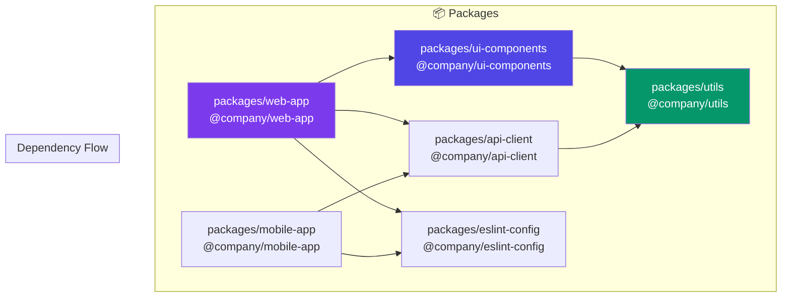
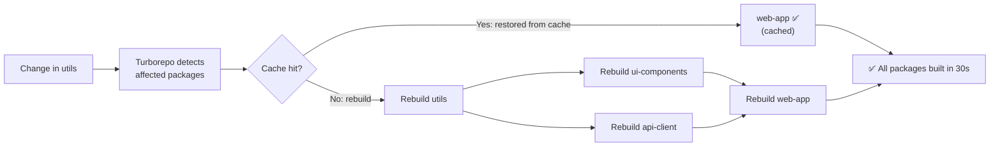
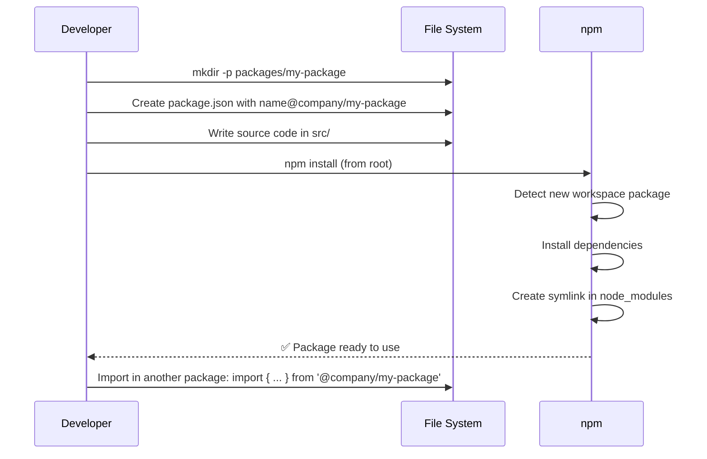

# Monorepos & Workspaces

## 📖 Introduction

A **monorepo** (monolithic repository) is a single repository containing multiple projects or packages. In the Node.js ecosystem, monorepos are managed with **npm workspaces**, **Yarn workspaces**, **Turborepo**, or **Nx**.

Monorepos enable: shared code between packages, unified tooling, coordinated releases, cross-package refactoring, and atomic commits that change multiple packages at once.

## 🤔 Why Do We Need This?

As projects grow, they're often split into multiple packages — shared UI components, API clients, utility libraries, configuration presets. Without a monorepo, each package lives in its own repository:

```bash
# ❌ Multi-repo — manual coordination
# Update shared-utils: push to repo A, publish to npm
# Update api-client: push to repo B, update dependency
# Update app: push to repo C, update dependency
# 3 separate PRs, 3 separate deploys, lots of coordination

# ✅ Monorepo — instant sharing
git commit -m "Update shared-utils"
# All packages see the change immediately!
# One PR, one build pipeline, atomic changes
```

## ⚠️ Problem Statement

Monorepos solve several problems but introduce new challenges:

1. **Build orchestration** — When package A changes, rebuild only packages that depend on A
2. **Dependency management** — Shared dependencies at the root, hoisted correctly without conflicts
3. **Testing** — Run tests only for changed packages and their dependents
4. **Circular dependencies** — Prevent packages from depending on each other in loops
5. **Git history** — Clean commit history across packages
6. **CI/CD** — Efficient CI pipelines that cache build artifacts

## 📚 Real World Story

**Vercel** (Next.js) is one of the most well-known Node.js monorepos. The Next.js repository contains 50+ packages — the core framework, CLI, dev tools, plugins, and examples — all in a single repository. Changes to the bundler (`webpack`) can be tested against all plugins before merging. When a contributor fixes a bug in the core, all packages benefit immediately.

The Next.js monorepo uses Turborepo for build caching, achieving build times of under 2 minutes even with 50+ packages, compared to 30+ minutes without caching.

## 🍕 Real World Analogy

| Monorepo Concept | Apartment Building Analogy |
|-----------------|---------------------------|
| **Root package.json** | The building's main electrical panel |
| **Workspace package** | An individual apartment |
| **Shared dependency** | The building's water supply — shared by all apartments |
| **Hoisting** | Water pipes going to each apartment efficiently |
| **Turborepo cache** | Remembering which apartments you've already renovated |
| **Circular dependency** | Apartment A's power goes to B, and B's goes back to A |
| **Dependency graph** | The building's blueprint showing all connections |

## 👁️ Visual Explanation

```
Monorepo Structure:

monorepo/                          npm workspaces config:
├── package.json          ← Root: { "workspaces": ["packages/*"] }
├── packages/
│   ├── utils/            ← Shared utilities
│   │   ├── package.json
│   │   └── src/
│   ├── ui-components/    ← Shared React components
│   │   ├── package.json  ← depends on utils
│   │   └── src/
│   ├── api-client/       ← HTTP client library
│   │   ├── package.json  ← depends on utils
│   │   └── src/
│   ├── web-app/          ← Main web application
│   │   ├── package.json  ← depends on ui-components, api-client
│   │   └── src/
│   └── mobile-app/       ← Mobile application
│       ├── package.json  ← depends on api-client
│       └── src/
```

## 📊 Mermaid Diagram 1: Monorepo Dependency Graph



## ⚙️ Internal Working: How npm Workspaces Hoist Dependencies

When you run `npm install` in a monorepo root:

1. npm reads the `workspaces` config and finds all workspace packages
2. npm builds a dependency tree across ALL packages
3. **Hoisting**: npm moves shared dependencies to the root `node_modules` to avoid duplication
4. **Deduplication**: If two packages depend on different versions of the same package, npm tries to find a compatible version that satisfies both
5. **Symlinks**: Workspace packages are symlinked into the root `node_modules`, so `require('@company/utils')` works from any package

```bash
# Before install:                     # After install (hoisted):
monorepo/                             monorepo/
└── packages/                         ├── node_modules/
    ├── web-app/                      │   ├── react@18 (shared!)
    │   └── node_modules/             │   ├── express@4 (shared!)
    │       ├── react@18              │   └── @company/utils → ../packages/utils
    │       └── express@4             └── packages/
    └── api-client/                       ├── web-app/
        └── node_modules/                └── api-client/
            └── react@18  ← DUPLICATE!
```

## 🔄 Mermaid Diagram 2: Build Pipeline with Caching



## 👣 Step-by-Step: Adding a New Package to a Monorepo



## 📝 Syntax

### Root package.json

```json
{
  "name": "my-monorepo",
  "private": true,
  "workspaces": ["packages/*"],
  "scripts": {
    "build": "npm run build --workspaces",
    "test": "npm run test --workspaces",
    "lint": "npm run lint --workspaces",
    "build:web": "npm run build -w packages/web-app"
  }
}
```

### Workspace Package

```json
{
  "name": "@company/utils",
  "version": "1.0.0",
  "main": "src/index.js",
  "dependencies": {
    "lodash": "^4.17.21"
  }
}
```

### Turborepo Config

```json
{
  "pipeline": {
    "build": {
      "dependsOn": ["^build"],
      "outputs": ["dist/**", ".next/**"]
    },
    "test": {
      "dependsOn": ["build"]
    },
    "lint": {}
  }
}
```

## 🟢 Basic Example: npm Workspaces Setup

```json
// Root package.json
{
  "name": "my-project",
  "private": true,
  "workspaces": {
    "packages": ["packages/*"]
  }
}
```

```bash
# Install all packages
npm install

# Run script in all packages
npm run build --workspaces

# Run script in specific package
npm run build -w packages/web-app

# Add dependency to specific package
npm install lodash -w packages/utils
```

## 🟡 Intermediate Example: Shared Configurations

```javascript
// packages/eslint-config/index.js
module.exports = {
  extends: ['eslint:recommended'],
  rules: {
    'no-unused-vars': 'error',
    'no-console': 'warn',
    'prefer-const': 'error',
  },
};
```

```json
// packages/web-app/package.json
{
  "name": "@company/web-app",
  "eslintConfig": {
    "extends": ["@company/eslint-config"]
  }
}
```

## 🔴 Advanced Example: Turborepo Build Caching

```javascript
// turbo.json — configure build caching
{
  "pipeline": {
    "build": {
      "dependsOn": ["^build"],   // Build dependencies first
      "outputs": ["dist/**"],     // Cache these outputs
      "inputs": ["src/**", "tsconfig.json"] // Hash these files for cache key
    },
    "test": {
      "dependsOn": ["build"],     // Wait for build
      "outputs": []               // No cacheable outputs
    },
    "deploy": {
      "dependsOn": ["build", "test"],
      "outputs": []
    }
  }
}
```

```bash
# Turborepo commands
npx turbo run build          # Build everything (cached)
npx turbo run build --scope=@company/web-app  # Single package
npx turbo run test --filter=...[main]         # Test packages changed from main
```

## 🏭 Production Example: CI/CD for Monorepos

```yaml
# .github/workflows/ci.yml
name: Monorepo CI
on: [push, pull_request]
jobs:
  build:
    runs-on: ubuntu-latest
    steps:
      - uses: actions/checkout@v4
      - uses: actions/setup-node@v4
      - run: npm ci

      # Turborepo cache (remote caching)
      - uses: actions/cache@v3
        with:
          path: .turbo
          key: turbo-${{ github.sha }}
          restore-keys: turbo-

      # Build only affected packages
      - run: npx turbo run build --filter=...[origin/main]

      # Test only affected packages
      - run: npx turbo run test --filter=...[origin/main]
```

## ⚙️ How It Works Internally: Turborepo Caching

Turborepo creates a hash of each package's inputs (source files + dependencies). If the hash matches a previous build:

1. Turborepo skips the build task
2. It restores the cached `dist/` output from a remote/ local cache
3. Build time goes from minutes to milliseconds

The cache key is computed from: package source files + dependencies' outputs + environment variables + Git branch.

## 📦 Performance Notes

```bash
# Build time comparison
# Without caching: 30 minutes for 50 packages
# With Turborepo: 45 seconds (full rebuild) / 2 seconds (cached)

# Local cache: ~500MB on disk
# Remote cache: stored in cloud (Vercel, AWS S3)
```

## 🔒 Security Notes

- **Private packages** — Use `"private": true` in root and `"publishConfig": { "access": "restricted" }` for workspace packages
- **Dependency audit** — Run `npm audit` across all packages with `--workspaces`
- **Supply chain** — Lockfile at the root level ensures consistent installs

## ⚠️ Common Mistakes

1. **❌ Different versions of the same dependency** — Causes unexpected behavior. Use `npm dedupe` to resolve.

2. **❌ Forgetting to add workspace to config** — `package.json` must list `workspaces`, or new packages won't be found.

3. **❌ Circular dependencies** — Package A imports from B, B imports from A. Use dependency graph check.

4. **❌ No build order** — Building web-app before utils fails. Use `dependsOn` in Turborepo.

5. **❌ Committing `node_modules`** — Always `.gitignore` node_modules.

## 🚀 Best Practices

```json
// ✅ Root package.json
{ "private": true, "workspaces": ["packages/*"] }

// ✅ Consistent dependency versions
// Use * for workspace dependencies
{ "dependencies": { "@company/utils": "*" } }

// ✅ Semantic versioning for published packages
// version: "1.0.0"

// ✅ Turborepo for build caching
// turbo.json with remote caching

// ✅ Changesets for versioning
// npx changeset
// npx changeset version
// npx changeset publish
```

## 🎯 Interview Questions

**Q1: What problem do workspace tools (npm workspaces, Turborepo) solve?**

They allow multiple packages to live in a single repository with shared dependencies (hoisted to the root), symlinked cross-package imports, and coordinated build pipelines. Without workspaces, each package has its own node_modules and you'd need `npm link` for local development.

**Q2: How does Turborepo know which packages to rebuild?**

Turborepo builds a dependency graph of all packages. When package A changes, Turborepo identifies all packages that depend on A (transitively) and only rebuilds those. Combined with caching (hash of inputs), unchanged packages are restored from cache in milliseconds.

## 📝 MCQs

**1. What does the `workspaces` field in package.json do?**
- A) Lists all files in the project
- B) Configures which directories contain workspace packages ✅
- C) Sets the workspace directory name
- D) Installs global dependencies

**2. What is dependency hoisting in npm workspaces?**
- A) Moving dependencies to a higher version
- B) Moving shared dependencies to the root node_modules ✅
- C) Installing dependencies in alphabetical order
- D) Removing duplicate packages

**3. What tool is specifically designed for build caching in monorepos?**
- A) npm
- B) Turborepo ✅
- C) Babel
- D) Webpack

**4. What does `npm run test -w packages/web-app` do?**
- A) Tests all packages
- B) Tests only the web-app package ✅
- C) Installs web-app globally
- D) Publishes web-app to npm

**5. How are workspace packages linked together without publishing to npm?**
- A) Git submodules
- B) npm creates symlinks in node_modules ✅
- C) File copying during install
- D) Environment variables

**Answer Key:** 1-B, 2-B, 3-B, 4-B, 5-B

## 💻 Coding Challenge 1: npm Workspace Setup

Set up a monorepo with npm workspaces:
- Root `package.json` with workspaces config
- `packages/utils/` — shared utility functions
- `packages/api-client/` — API client using utils
- `packages/web-app/` — web app using both
- Demonstrate that changes to utils are immediately available in web-app

## 💻 Coding Challenge 2: Build Caching with Turborepo

Add Turborepo to the monorepo:
- Configure build pipeline with dependencies
- Implement task caching (cache build outputs)
- Measure build time with and without cache
- Run lint, test, and build in parallel across packages

## 💻 Coding Challenge 3: Shared Config Monorepo

Build a monorepo for shared configurations:
- `packages/eslint-config/` — shared ESLint config
- `packages/tsconfig/` — shared TypeScript config
- `packages/prettier-config/` — shared Prettier config
- `packages/app-a/` and `packages/app-b/` — two apps using all shared configs
- Update a shared config and verify both apps pick up the change

## 🧪 Mini Exercise: Debugging Monorepo Issues

```json
// Bug 1: Circular dependency!
{ "name": "package-a", "dependencies": { "package-b": "*" } }
{ "name": "package-b", "dependencies": { "package-a": "*" } }

// Bug 2: Package not added to workspaces config
// Root package.json
{ "workspaces": ["packages/utils", "packages/app"] }
// Missing: "packages/api-client" — it won't be installed!

// Bug 3: Different TypeScript versions across packages
// package-a uses TS 4.8, package-b uses TS 5.0
// npm can't hoist — both versions exist in different node_modules

// Bug 4: Forgot to rerun npm install after adding a new package
// The symlink won't exist!
```

## 🌍 Real World Problem (Interview Coding Challenge)

**Problem:** Your company has 30 frontend applications, 15 backend services, and 8 shared libraries — all in separate Git repositories. Developers spend hours updating shared libraries, publishing new versions, and updating each consumer. Releases are coordinated through spreadsheets.

**Requirements:**
1. A single commit should be able to update a shared library and all its consumers
2. Developers should only build and test the packages affected by their changes
3. CI should complete in under 10 minutes
4. Teams should be able to publish only their specific packages

**Questions:**
1. How would you structure the monorepo?
2. How would you handle the different deploy schedules of different teams?
3. How would you implement CI for only affected packages?
4. How would you handle versioning (independent vs consistent)?

## 🏗️ Mini Project: Full Monorepo Setup

Build a production-grade monorepo:

**Core features:**
- npm workspaces configuration
- Turborepo with build caching
- Shared ESLint, Prettier, TypeScript configs
- At least 3 packages: utils, api-client, web-app
- CI pipeline with affected package detection
- Changesets for versioning and changelogs

## 📖 Summary

| Concept | Key Takeaway |
|---------|-------------|
| **npm workspaces** | Built-in monorepo support |
| **Hoisting** | Shared deps at root, avoid duplication |
| **Turborepo** | Build caching and affected package detection |
| **Dependency graph** | Build packages in dependency order |
| **Symlinks** | Workspace packages linked without publishing |
| **Remote caching** | Share build cache across CI machines |

## 📋 Cheat Sheet

```json
// Root package.json
{ "workspaces": ["packages/*"], "private": true }

// Package package.json
{ "name": "@company/utils", "version": "1.0.0" }
```

```bash
# Commands
npm install                    # Install all packages
npm run build --workspaces     # Build all packages
npm run build -w packages/app  # Build one package
npm install lodash -w packages/utils  # Add dep to one package
npm test --workspaces --if-present    # Test all that have tests
```

## 📚 Further Reading

- [npm Workspaces Documentation](https://docs.npmjs.com/cli/v7/using-npm/workspaces)
- [Turborepo Documentation](https://turbo.build/repo/docs)
- [Nx Monorepo](https://nx.dev/)
- [Changesets](https://github.com/changesets/changesets)
- [Lerna (legacy)](https://lerna.js.org/)

## 🔗 Related Topics

- [CLI Tools](./cli-tools) — CLI tools for monorepo management
- [Design Patterns](../production/design-patterns) — Module patterns
- [Testing](../production/testing) — Testing across packages
- [Deployment](../production/deployment) — CI/CD for monorepos
