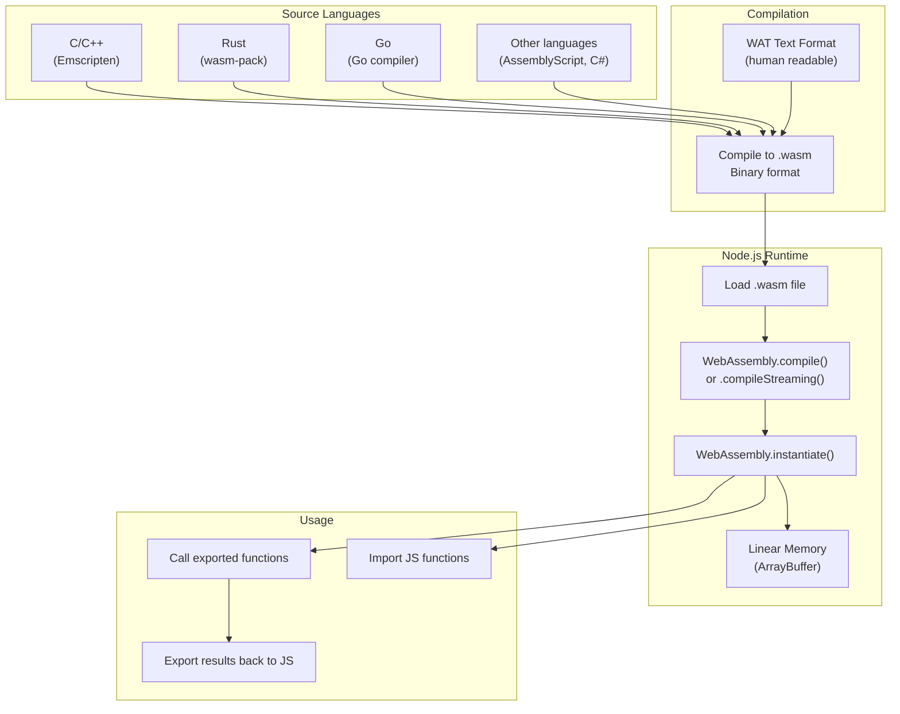
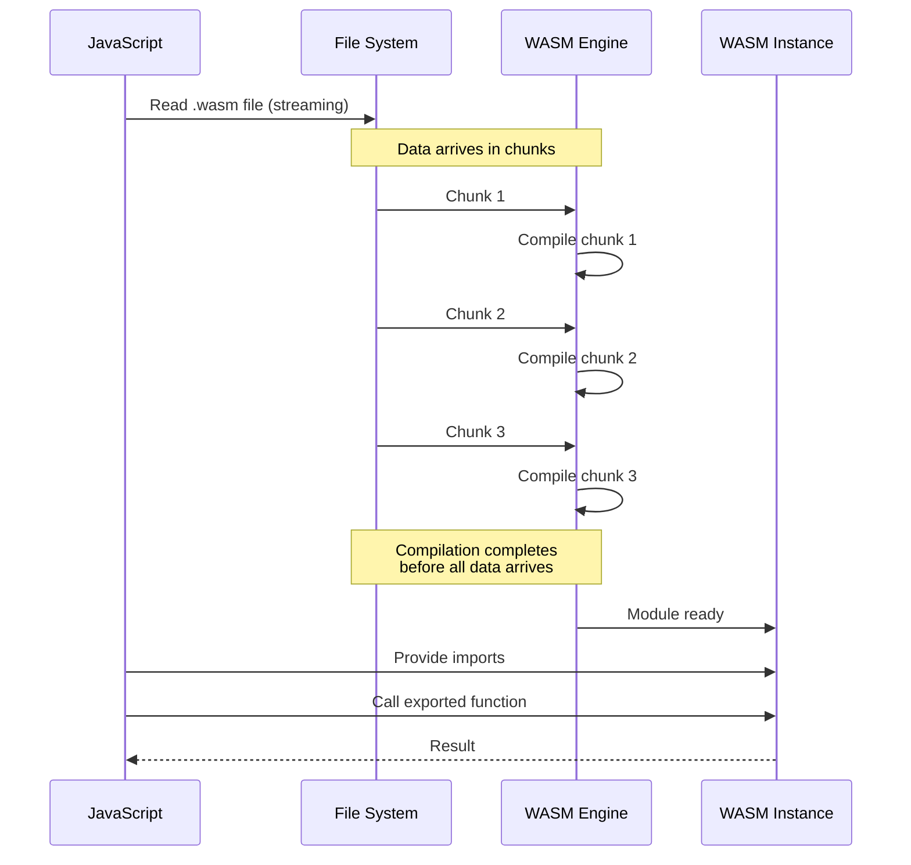

# WebAssembly with Node.js

## 📖 Introduction

**WebAssembly (WASM)** is a binary instruction format that provides near-native performance for compute-intensive tasks. Node.js has built-in WebAssembly support — you can compile and run WASM modules without any external dependencies. WASM is an alternative to native addons that's platform-independent and sandboxed by default.

WASM is particularly useful for: CPU-intensive computations (image processing, video encoding), running existing C/C++/Rust libraries in Node.js, and performance-critical hot paths where JavaScript isn't fast enough.

## 🤔 Why Do We Need This?

Some operations are fundamentally CPU-bound and slow in JavaScript:

```javascript
// JavaScript: ~1M operations/second
function sumArray(arr) {
  let sum = 0;
  for (let i = 0; i < arr.length; i++) sum += arr[i];
  return sum;
}

// WebAssembly: ~50M operations/second — 50x faster!
const wasm = await WebAssembly.instantiate(module, imports);
const result = wasm.instance.exports.sum(arr, arr.length);
```

WASM also lets you reuse existing C/C++/Rust libraries (libvips, OpenCV, zlib) without rewriting them in JavaScript.

## ⚠️ Problem Statement

Using WASM in Node.js requires solving:

1. **Compilation** — Source code (Rust/C++) must be compiled to `.wasm` binary
2. **Memory management** — WASM uses linear memory; data must be copied in/out via `ArrayBuffer`
3. **Type conversion** — WASM only understands numbers; pass complex data via shared memory
4. **Async compilation** — Compilation is expensive; use streaming compilation to avoid blocking
5. **Debugging** — Debugging WASM is harder than JavaScript (source maps help)

## 📚 Real World Story

**Figma** uses WebAssembly extensively. Their rendering engine is written in C++ and compiled to WASM, enabling Photoshop-level vector editing in the browser. The WASM binary handles path rendering, boolean operations, and text layout at near-native speed. When Figma was acquired by Adobe for $20B, their WASM-based rendering engine was a key technology asset.

In the Node.js ecosystem, **sharp** (image processing) uses a native addon, but many libraries are moving to WASM for easier distribution (no platform-specific binaries).

## 🍕 Real World Analogy

| WASM Concept | Restaurant Analogy |
|-------------|-------------------|
| **JavaScript** | Your regular chef — flexible, knows many recipes |
| **WASM** | A specialized cooking robot — incredibly fast at one thing |
| **Compilation** | Programming the robot with a specific recipe card |
| **Linear memory** | The robot's ingredient tray — organized numbered slots |
| **Memory copy** | Putting ingredients into the robot's tray |
| **Exports** | The buttons on the robot (chop, blend, slice) |
| **Imports** | The robot's ability to call you when it needs help |

## 👁️ Visual Explanation

```
JavaScript ↔ WebAssembly Communication:

JavaScript                     WebAssembly
┌────────────────────┐        ┌────────────────────┐
│ const data =       │        │ (module            │
│   new Int32Array(  │        │  (memory $mem 1)   │
│     wasm.memory    │        │  (func $sum        │
│   );               │        │   (param $ptr i32) │
│ data[0] = 5;       │───►    │   (param $len i32) │
│ data[1] = 10;      │ write  │   (result i32)     │
│                    │ to     │   ...              │
│ const result =     │ memory │  )                 │
│   wasm.sum(0, 2);  │───►    │ )                  │
│                    │ call   │                     │
│ console.log(result)│◄───    │ Returns: 15        │
└────────────────────┘  read  └────────────────────┘
```

## 📊 Mermaid Diagram 1: WASM Architecture



## ⚙️ Internal Working: WASM Compilation Pipeline

When Node.js loads a WASM module:

1. **Load**: The `.wasm` binary is loaded (from file, HTTP, or inline bytes)
2. **Compile**: `WebAssembly.compile()` validates and compiles the binary to machine code. This is expensive (~100ms for a 1MB module)
3. **Instantiate**: `WebAssembly.instantiate()` creates a running instance with its own linear memory
4. **Imports**: JavaScript functions that WASM can call are injected
5. **Execute**: WASM exports are callable JavaScript functions that run at near-native speed

**Streaming compilation** (`WebAssembly.compileStreaming()`) starts compiling as the file downloads, reducing total time.

## 🔄 Mermaid Diagram 2: Streaming Compilation



## 📝 Syntax

### Loading and Running WASM

```javascript
// Method 1: From buffer (sync compilation)
const fs = require('fs');
const wasmBuffer = fs.readFileSync('module.wasm');
const module = new WebAssembly.Module(wasmBuffer);
const instance = new WebAssembly.Instance(module, imports);
instance.exports.myFunction();

// Method 2: Streaming (async, non-blocking)
const module = await WebAssembly.compileStreaming(
  fs.createReadStream('module.wasm')
);
const instance = await WebAssembly.instantiate(module, imports);

// Method 3: One-shot instantiation
const { instance } = await WebAssembly.instantiate(wasmBuffer, imports);
```

### Memory Operations

```javascript
// Writing data to WASM memory
const memory = instance.exports.memory;
const buffer = new Uint8Array(memory.buffer);

// Copy data into WASM memory
const data = new Uint8Array([1, 2, 3, 4]);
buffer.set(data, 0); // Write at offset 0

// Call WASM function with pointer
const result = instance.exports.processData(0, data.length);

// Read result from memory
const output = new Uint8Array(memory.buffer, 0, result.length);
```

## 🟢 Basic Example: Simple WASM Module

```wat
;; math.wat — WAT text format (compile with wat2wasm)
(module
  (func $add (param $a i32) (param $b i32) (result i32)
    local.get $a
    local.get $b
    i32.add
  )
  (export "add" (func $add))
  
  (func $factorial (param $n i32) (result i32)
    (if (i32.le_s (local.get $n) (i32.const 1))
      (then (return (i32.const 1)))
    )
    (return
      (i32.mul
        (local.get $n)
        (call $factorial (i32.sub (local.get $n) (i32.const 1)))
      )
    )
  )
  (export "factorial" (func $factorial))
)
```

```javascript
// Load and use
const fs = require('fs');
const wasm = fs.readFileSync('math.wasm');
const { instance } = await WebAssembly.instantiate(wasm);

console.log(instance.exports.add(5, 3));       // 8
console.log(instance.exports.factorial(5));    // 120
```

## 🟡 Intermediate Example: WASM with Memory Operations

```wat
;; memory.wat
(module
  (memory (export "memory") 1)  ;; 1 page = 64KB
  
  (func $fill (param $offset i32) (param $value i32) (param $len i32)
    (local $i i32)
    (loop $loop
      (i32.store8
        (i32.add (local.get $offset) (local.get $i))
        (local.get $value)
      )
      (local.set $i (i32.add (local.get $i) (i32.const 1)))
      (br_if $loop (i32.lt_s (local.get $i) (local.get $len)))
    )
  )
  (export "fill" (func $fill))
  
  (func $sum (param $offset i32) (param $len i32) (result i32)
    (local $i i32)
    (local $sum i32)
    (loop $loop
      (local.set $sum
        (i32.add
          (local.get $sum)
          (i32.load8_u (i32.add (local.get $offset) (local.get $i)))
        )
      )
      (local.set $i (i32.add (local.get $i) (i32.const 1)))
      (br_if $loop (i32.lt_s (local.get $i) (local.get $len)))
    )
    (local.get $sum)
  )
  (export "sum" (func $sum))
)
```

```javascript
const { instance } = await WebAssembly.instantiate(wasm);
const mem = new Uint8Array(instance.exports.memory.buffer);

// Fill memory at offset 0 with value 42, length 100
instance.exports.fill(0, 42, 100);

// Sum values from memory
const total = instance.exports.sum(0, 100);
console.log(total); // 42 * 100 = 4200

// Read from JS
console.log(mem.slice(0, 10)); // Uint8Array(10) [42, 42, 42, ...]
```

## 🔴 Advanced Example: Rust to WASM Image Processing

```rust
// lib.rs — compile with wasm-pack build --target nodejs
use wasm_bindgen::prelude::*;

#[wasm_bindgen]
pub fn grayscale(pixels: &mut [u8], width: u32, height: u32) {
    for y in 0..height {
        for x in 0..width {
            let i = (y * width + x) as usize * 4;
            let r = pixels[i] as f32;
            let g = pixels[i + 1] as f32;
            let b = pixels[i + 2] as f32;
            let gray = (0.299 * r + 0.587 * g + 0.114 * b) as u8;
            pixels[i] = gray;
            pixels[i + 1] = gray;
            pixels[i + 2] = gray;
            // pixels[i + 3] = alpha, unchanged
        }
    }
}
```

```javascript
const wasm = require('./pkg/image_processing.js');
const sharp = require('sharp');

async function processImage(inputPath) {
  const image = await sharp(inputPath)
    .raw()
    .toBuffer({ resolveWithObject: true });

  // Pass buffer to WASM for processing
  wasm.grayscale(image.data, image.info.width, image.info.height);

  // Write processed result
  await sharp(image.data, {
    raw: { width: image.info.width, height: image.info.height, channels: 4 }
  }).toFile('output.jpg');
}
```

## 🏭 Production Example: WASM in an Express API

```javascript
const express = require('express');
const fs = require('fs');
const app = express();

// Cache the compiled module (expensive to compile twice)
let wasmModule = null;

async function initWasm() {
  const wasmBuffer = fs.readFileSync('processor.wasm');
  wasmModule = await WebAssembly.compile(wasmBuffer);
}

app.post('/process', async (req, res) => {
  const { data } = req.body;

  // Reuse cached module — instantiate is fast
  const instance = await WebAssembly.instantiate(wasmModule, {
    env: {
      log: (ptr, len) => {
        const str = Buffer.from(instance.exports.memory.buffer, ptr, len).toString();
        console.log('[WASM]', str);
      },
    },
  });

  // Write input data to WASM memory
  const input = new Float64Array(data);
  const inputPtr = instance.exports.allocate(input.length * 8);
  new Float64Array(instance.exports.memory.buffer).set(input, inputPtr / 8);

  // Process
  const resultPtr = instance.exports.process(inputPtr, input.length);

  // Read result
  const result = new Float64Array(
    instance.exports.memory.buffer, resultPtr, input.length
  );

  res.json({ result: Array.from(result) });
});

initWasm().then(() => app.listen(3000));
```

## ⚙️ How It Works Internally: WASM Linear Memory

WASM uses a **linear memory model** — a contiguous `ArrayBuffer` accessible by both WASM and JavaScript:

```
WASM Linear Memory (ArrayBuffer):
┌──────────┬──────────┬──────────┬──────────┬──────────┬──────────┐
│ Stack    │ Heap     │ Free     │ Data     │ Data     │ Data     │
│ (locals) │ (malloc) │ space    │ (input)  │ (output) │ (temp)   │
└──────────┴──────────┴──────────┴──────────┴──────────┴──────────┘
↑          ↑                      ↑                     ↑
0          stack_ptr             input_ptr             output_ptr
```

WASM can only access its own linear memory — it can't directly access JavaScript objects or the DOM. All data sharing happens through this memory buffer.

## 📦 Performance Notes

| Operation | JavaScript | WebAssembly | Speedup |
|-----------|-----------|-------------|---------|
| Integer arithmetic | ~1B ops/s | ~3B ops/s | 3x |
| Array sum (1M elements) | ~2ms | ~0.1ms | 20x |
| Image grayscale (4K) | ~80ms | ~5ms | 16x |
| JSON parsing (10MB) | ~15ms | ~12ms | 1.25x |

### When WASM is Worth It

- **CPU-intensive loops** — Image processing, video encoding, cryptography
- **Existing C/C++/Rust libraries** — Reuse without rewriting
- **Stable, well-defined operations** — Not frequently changing logic

### When WASM is NOT Worth It

- **I/O operations** — WASM has no native I/O; JavaScript handles this better
- **Small computations** — The cost of crossing the JS↔WASM boundary outweighs the speedup
- **Rapidly changing code** — Compilation overhead is significant

## 🔒 Security Notes

- WASM runs in a **sandbox** — it can only access its linear memory and imported functions
- WASM cannot access the file system, network, or system calls (unless explicitly imported)
- WASM helps prevent supply chain attacks (no eval, no dynamic code loading)
- However, poorly written WASM can still crash the Node.js process

## ⚠️ Common Mistakes

1. **❌ Not using streaming compilation** — `WebAssembly.compile()` blocks the Event Loop. Use `compileStreaming()`.

2. **❌ Frequent memory allocation** — Allocating in WASM is expensive. Pre-allocate and reuse buffers.

3. **❌ Small function calls across boundary** — Each JS↔WASM call has ~50ns overhead. Batch operations.

4. **❌ Forgetting to free WASM memory** — WASM memory is not garbage collected. Call the free function if provided.

5. **❌ No error handling** — WASM traps (divide by zero, out of bounds) are unrecoverable.

## 🚀 Best Practices

```javascript
// ✅ Use streaming compilation for non-blocking load
const module = await WebAssembly.compileStreaming(
  fs.createReadStream('module.wasm')
);

// ✅ Cache compiled modules (compilation is expensive)
// Reuse module, create new instances

// ✅ Pre-allocate memory buffers
const buffer = new Float64Array(1024);
// Reuse for multiple calls

// ✅ Batch operations — minimize boundary crossings
// ❌ Bad: wasm.process(a), wasm.process(b), wasm.process(c)
// ✅ Good: wasm.process([a, b, c])

// ✅ Handle errors from WASM traps
try {
  instance.exports.divide(a, 0); // Will throw
} catch (err) {
  console.error('WASM trap:', err.message);
}
```

## 🎯 Interview Questions

**Q1: How does WebAssembly differ from JavaScript in terms of performance?**

WASM provides predictable, near-native performance because it's compiled to machine code ahead of time, while JavaScript is JIT-compiled with optimization/deoptimization cycles. WASM is 1.5-50x faster than JavaScript for CPU-bound operations (the gap widens for integer-heavy workloads). However, crossing the JS↔WASM boundary has overhead, so small functions may be slower in WASM.

**Q2: How do you pass complex data (strings, objects) between JavaScript and WebAssembly?**

WASM only understands numbers. For complex data: (1) allocate memory in WASM, (2) write data byte-by-byte from JavaScript into WASM's linear memory (ArrayBuffer), (3) pass the pointer and length to WASM, (4) WASM processes the data, (5) read the result back from memory.

## 📝 MCQs

**1. What is WebAssembly (WASM) primarily used for in Node.js?**
- A) Replacing JavaScript entirely
- B) Running CPU-intensive code at near-native speed ✅
- C) Managing file system operations
- D) Handling HTTP requests

**2. How does WebAssembly share data with JavaScript?**
- A) Through HTTP requests
- B) Through a shared ArrayBuffer (linear memory) ✅
- C) Through JSON serialization
- D) Through the file system

**3. Which method compiles WASM asynchronously without blocking?**
- A) `WebAssembly.compile()`
- B) `WebAssembly.compileStreaming()` ✅
- C) `WebAssembly.instantiate()`
- D) `WebAssembly.validate()`

**4. What programming languages can compile to WebAssembly?**
- A) Only JavaScript
- B) C/C++, Rust, Go, and others ✅
- C) Only Python
- D) Only TypeScript

**5. What is the primary limitation of WebAssembly?**
- A) It's slower than JavaScript
- B) It can only access its linear memory and imported functions ✅
- C) It requires a browser to run
- D) It can't handle numbers

**Answer Key:** 1-B, 2-B, 3-B, 4-B, 5-B

## 💻 Coding Challenge 1: WASM Math Library

Create a WASM module (using Rust or C) that exports:
- `add(a, b)`, `subtract(a, b)`, `multiply(a, b)`, `divide(a, b)`
- Compile to .wasm
- Load and call from Node.js
- Implement error handling for division by zero
- Benchmark against JavaScript

## 💻 Coding Challenge 2: Buffer Processor

Build a WASM function that:
- Accepts a pointer and length to an Int32Array
- Doubles each element in place
- Returns the sum of all elements
- Test with 1M, 10M, and 100M element arrays
- Compare performance to JavaScript

## 💻 Coding Challenge 3: Image Processing Pipeline

Build a WASM image processing module:
- Convert RGBA pixel data to grayscale
- Apply a blur filter (simple box blur)
- Process in WASM (Rust) vs JavaScript
- Compare performance at 1080p and 4K resolutions
- Generate source maps for debugging

## 🧪 Mini Exercise: Debugging WASM Issues

```javascript
// Bug 1: Not using streaming compilation — blocks Event Loop!
const buffer = fs.readFileSync('module.wasm');
const module = new WebAssembly.Module(buffer); // Blocking on large files!

// Bug 2: Not caching the compiled module
app.post('/process', async (req, res) => {
  const module = await WebAssembly.compile(fs.readFileSync('module.wasm'));
  // Compiling on every request — very slow!
});

// Bug 3: Memory leak — never freeing WASM allocations
// WASM memory must be manually freed!

// Bug 4: Forgetting memory alignment
// WASM requires aligned access — 4-byte alignment for i32

// Bug 5: No error handling for WASM traps
const result = instance.exports.divide(10, 0); // Crashes!
```

## 🌍 Real World Problem (Interview Coding Challenge)

**Problem:** You're building a real-time video processing service. Each video frame (1920×1080, RGBA) needs: color correction, face blurring (OpenCV), and compression. Frames arrive at 30fps, and each frame must be processed in under 33ms.

**Requirements:**
1. Processing must not block the server's ability to handle other requests
2. The pipeline should handle 10 concurrent video streams
3. WASM modules must be hot-reloadable (update without restarting the server)
4. Memory usage must stay under 2GB

**Questions:**
1. Would you use WASM, native addons, or worker threads? Why?
2. How would you pass video frames between JavaScript and WASM efficiently?
3. How would you handle backpressure when processing is slower than incoming frames?
4. How would you implement hot-reloading for WASM modules?

## 🏗️ Mini Project: Real-Time Data Processor

Build a WASM-powered data processing API:

**Core features:**
- `POST /process` — accepts an array of numbers, returns processed results
- WASM module exports: `sum`, `average`, `stdDev`, `normalize`
- Efficient memory reuse (no allocation per request)
- Fallback to JavaScript if WASM fails to load
- Benchmark endpoint comparing WASM vs JS performance

**Technical requirements:**
- Write the WASM module in Rust (using wasm-pack)
- Cache the compiled module
- Streaming compilation on startup
- Error handling for WASM traps
- Memory management (allocate once, reuse)

## 📖 Summary

| Concept | Key Takeaway |
|---------|-------------|
| **WebAssembly** | Binary instruction format, near-native speed |
| **compileStreaming** | Non-blocking async compilation |
| **Linear memory** | Shared ArrayBuffer between JS and WASM |
| **Imports/Exports** | JS functions WASM can call / WASM functions JS can call |
| **Boundary crossing** | ~50ns overhead per call — batch operations |
| **WASI** | WASM system interface for I/O operations |
| **Rust → WASM** | wasm-pack for Rust compilation |
| **C++ → WASM** | Emscripten for C/C++ compilation |

## 📋 Cheat Sheet

```javascript
// Quick reference: WebAssembly in Node.js

// 1. Load and compile
const fs = require('fs');
const wasmBuffer = fs.readFileSync('module.wasm');
const module = new WebAssembly.Module(wasmBuffer);

// Or streaming (preferred):
const module = await WebAssembly.compileStreaming(
  fs.createReadStream('module.wasm')
);

// 2. Instantiate with imports
const instance = new WebAssembly.Instance(module, {
  env: { jsFunction: (ptr) => { /* ... */ } }
});

// 3. Call exports
const result = instance.exports.add(5, 3);

// 4. Memory access
const mem = new Uint8Array(instance.exports.memory.buffer);
mem.set(inputData, 0); // Write to WASM memory
instance.exports.process(0, inputData.length); // Process
const output = mem.slice(0, resultSize); // Read result
```

## 📚 Further Reading

- [WebAssembly on MDN](https://developer.mozilla.org/en-US/docs/WebAssembly)
- [Rust and WebAssembly (wasm-pack)](https://rustwasm.github.io/docs/wasm-pack/)
- [Emscripten (C/C++ to WASM)](https://emscripten.org/)
- [Node.js WASM Guide](https://nodejs.org/api/wasi.html)
- [WASM by Example](https://wasmbyexample.dev/)

## 🔗 Related Topics

- [Native Addons](./addons) — Comparing WASM with native C++ addons
- [Performance Optimization](../production/performance) — When to use WASM
- [Streams & Buffers](../core/streams-and-buffers) — Buffer manipulation
- [Clustering & Worker Threads](../production/clustering-and-worker-threads) — Running WASM in workers
