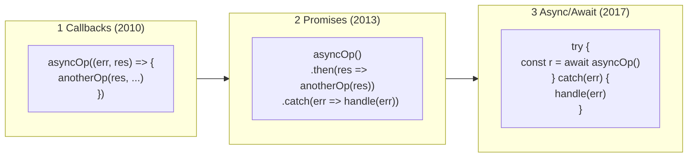
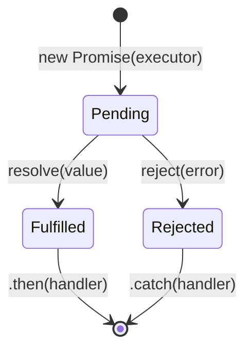
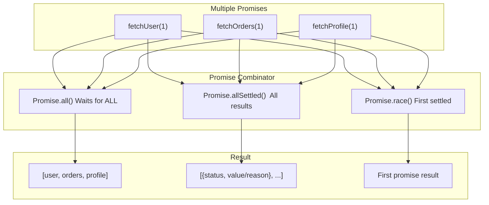
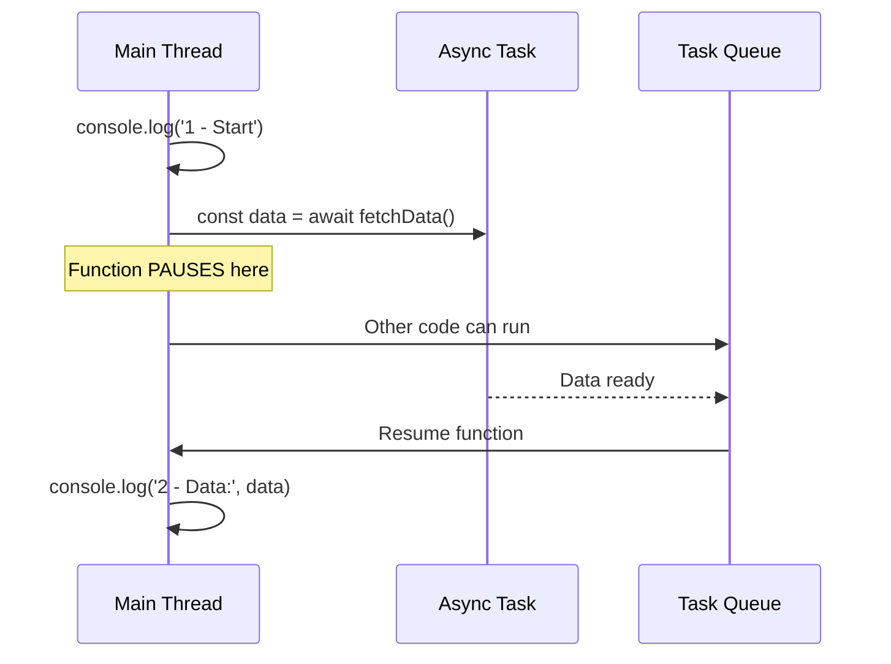

# Async Programming

## 📖 Introduction

Asynchronous programming is **the core superpower of Node.js**. It's what allows a single thread to handle thousands of concurrent operations — from database queries and file reads to API calls and WebSocket messages — without blocking.

> **Async programming isn't just a Node.js feature. It IS Node.js.**

## 🤔 Why Do We Need This?

| Scenario | Without Async | With Async |
|----------|--------------|------------|
| Read a file | Program pauses for 50ms | Program continues, notified later |
| Query database | Server can't handle other requests | Thousands of queries in parallel |
| Call external API | Thread blocked waiting for response | Fire and forget, handle response later |
| Process 1M users | Need 1M threads (impossible) | 1 thread handles all users |

## ⚠️ Problem Statement

```javascript
// The fundamental problem: operations take TIME
// This code FREEZES for 5 seconds:
const data = fs.readFileSync('huge-file.json');  // ⛔ BLOCKING!
console.log('This waits 5 seconds');

// Node.js solution: DON'T wait — register a callback
fs.readFile('huge-file.json', (err, data) => {
  console.log('This runs LATER, when file is ready');
});
console.log('This runs IMMEDIATELY, no waiting!'); // ✅
```

## 📚 Real World Story

**The Callback Hell That Almost Killed a Startup**

A food delivery startup's order processing pipeline looked like this:

```javascript
createOrder(data, (err, order) => {
  processPayment(order, (err, payment) => {
    notifyRestaurant(payment, (err, notify) => {
      assignDelivery(notify, (err, delivery) => {
        sendConfirmation(delivery, (err, confirm) => {
          // 6 levels deep! Any error propagates incorrectly!
        });
      });
    });
  });
});
```

Bugs were impossible to trace. A single unhandled error at any level would crash the entire order flow. The team migrated to async/await and the code shrank by 60%.

## 🍕 Real World Analogy

| Concept | Restaurant Analogy |
|---------|-------------------|
| Synchronous code | A chef who cooks one dish at a time, waiting for each step |
| Callback | Chef says "tell me when the rice is done" and continues |
| Promise | Chef gets a pager that buzzes when the rice is done |
| async/await | Chef tells the rice cooker "cook rice" and the cooker handles timing |

## 👁️ Visual Explanation

```
EVOLUTION OF ASYNC PATTERNS

2010 ─── Callbacks ──── (Node.js 0.x)
         Simple for single async ops, callback hell for complex flows

2013 ─── Promises ───── (Bluebird, native in ES6)
         Chaining with .then(), error propagation with .catch()

2017 ─── Async/Await ── (Node 7.6+)
         Looks synchronous, try/catch works naturally, Promise.all
```

## 📊 Mermaid Diagram 1: Callback → Promise → Async/Await Evolution



## ⚙️ Internal Working: How Promises Work



## 🔄 Mermaid Diagram 2: Promise Combinator Architecture



## 🏗️ Architecture: Async Patterns Hierarchy

```mermaid
flowchart TD
    subgraph Sync["Synchronous (Blocking)"]
        SyncCode["readFileSync()\nwriteFileSync()\nAll *Sync methods"]
    end
    subgraph Callback["Callback-based"]
        CB1["readFile(path, cb)\nLegacy fs methods"]
    end
    subgraph Promise["Promise-based"]
        P1["fs.promises.readFile()\nfetch()"]
    end
    subgraph Async["Async/Await"]
        A1["async/await\nModern standard"]
    end
    Sync --x "Never use" --> Callback
    Callback --> "Modernize" --> Promise
    Promise --> "Sugar" --> Async
```

## 👣 Step-by-Step Flow: Async/Await Execution



## 📝 Syntax

```javascript
// CALLBACK PATTERN
function asyncOp(input, callback) {
  setTimeout(() => {
    if (input === null) callback(new Error('Invalid'));
    else callback(null, `Processed: ${input}`);
  }, 100);
}

// PROMISE PATTERN
const promise = new Promise((resolve, reject) => {
  // resolve(value) → Fulfilled, reject(error) → Rejected
});

// ASYNC/AWAIT (Modern)
async function myFn() {
  try { const r = await somePromise; return r; }
  catch (err) { throw err; }
}

// COMBINATORS
Promise.all([p1, p2]);       // All or nothing
Promise.allSettled([p1, p2]); // Wait for all
Promise.race([p1, p2]);      // First settled
```

## 🟢 Basic Example: Three Patterns Compared

```javascript
// CALLBACKS
function fetchUserCb(id, cb) {
  setTimeout(() => {
    if (!id) { cb(new Error('ID required')); return; }
    cb(null, { id, name: 'Alice' });
  }, 100);
}
fetchUserCb(1, (err, user) => {
  if (err) return console.error(err);
  console.log('User:', user.name);
});

// PROMISES
function fetchUserP(id) {
  return new Promise((resolve, reject) => {
    setTimeout(() => {
      if (!id) reject(new Error('ID required'));
      else resolve({ id, name: 'Alice' });
    }, 100);
  });
}
fetchUserP(1).then(u => console.log(u.name)).catch(console.error);

// ASYNC/AWAIT
async function main() {
  try { const user = await fetchUserP(1); console.log(user.name); }
  catch (err) { console.error(err); }
}
main();
```

## 🟡 Intermediate Example: Sequential vs Parallel

```javascript
// SEQUENTIAL (one at a time) - SLOW
async function getDashboardSeq(userId) {
  console.time('seq');
  const user = await fetchUser(userId);          // 100ms
  const orders = await fetchOrders(userId);      // 200ms  (waits!)
  const notifications = await fetchNotif(userId); // 50ms   (waits!)
  console.timeEnd('seq');  // Total: 350ms
  return { user, orders, notifications };
}

// PARALLEL (all at once) - FAST
async function getDashboardPar(userId) {
  console.time('par');
  const [user, orders, notifications] = await Promise.all([
    fetchUser(userId),          // 100ms
    fetchOrders(userId),        // 200ms  (runs in parallel!)
    fetchNotif(userId),         // 50ms   (runs in parallel!)
  ]);
  console.timeEnd('par');  // Total: max(100, 200, 50) = 200ms
  return { user, orders, notifications };
}
// 2x faster with Promise.all!
```

## 🔴 Advanced Example: Concurrency Control

```javascript
// Run N tasks with max M concurrent
async function asyncPool(tasks, concurrency = 3) {
  const results = [];
  const running = new Set();
  
  for (const [index, task] of tasks.entries()) {
    const p = task().then(r => { running.delete(p); return r; });
    results[index] = p;
    running.add(p);
    if (running.size >= concurrency) await Promise.race(running);
  }
  return Promise.all(results);
}
```

## 🏭 Production Example: Retry with Backoff

```javascript
async function withRetry(fn, opts = {}) {
  const { maxRetries = 3, baseDelay = 1000 } = opts;
  let lastErr;
  
  for (let attempt = 1; attempt <= maxRetries; attempt++) {
    try { return await fn(); }
    catch (err) {
      lastErr = err;
      if (err.status === 400 || err.status === 401) throw err;
      if (attempt === maxRetries) break;
      const delay = baseDelay * Math.pow(2, attempt - 1) * (0.5 + Math.random());
      await new Promise(r => setTimeout(r, delay));
    }
  }
  throw lastErr;
}

// Usage
const charge = await withRetry(
  () => stripe.charges.create({ amount: 5000, currency: 'usd' }),
  { maxRetries: 5, baseDelay: 200 }
);
```

## ⚙️ How It Works Internally

```
Promise flow:
1. new Promise(executor) → executor runs IMMEDIATELY
2. resolve()/reject() → settles the promise
3. .then()/.catch() → queued as microtasks
4. Event Loop drains microtasks between phases

async function flow:
- Returns a Promise
- await pauses the function (yields control)
- When promise settles, function resumes
- Entire function runs as one synchronous block until await
```

## 📦 Performance Notes

| Pattern | Speed | Memory | Error Handling |
|---------|-------|--------|----------------|
| Callback | Fast | Low | Manual |
| Promise | Fast | Med | .catch() |
| async/await | Same as Promise | Same | try/catch |
| Promise.all | Parallel | Med | Fails fast |

## 🔒 Security Notes

- Unhandled Promise rejections crash Node 15+
- Always add .catch() or try/catch
- Never mix callbacks and promises in same flow

## ⚠️ Common Mistakes

```javascript
// MISTAKE 1: Forgetting await
async function get() { return fetchData(); }  // Returns Promise!

// MISTAKE 2: Sequential when parallel is possible
const u = await fetchUser(id);                // waits!
const o = await fetchOrders(id);              // waits!

// FIX: Promise.all
const [u, o] = await Promise.all([fetchUser(id), fetchOrders(id)]);

// MISTAKE 3: Not returning from .then()
fetchUser(1).then(user => { fetchOrders(user.id); })  // Missing return!
```

## 🚀 Best Practices

| # | Practice |
|---|----------|
| 1 | Always use async/await for new code |
| 2 | Use Promise.all() for independent ops |
| 3 | Handle all rejections with try/catch |
| 4 | Use Promise.allSettled() when you need all results |
| 5 | Implement retry with backoff for network calls |
| 6 | Never ignore promise rejections |

## 🎯 Interview Questions

**Q1: What's the difference between Promise.all() and Promise.allSettled()?**
Promise.all() fails fast — one rejection rejects the whole thing. Promise.allSettled() waits for all to settle regardless.

**Q2: How do you run async ops in parallel?**
Use Promise.all([p1, p2, p3]). This is faster than sequential awaits.

**Q3: What happens if you forget await in an async function?**
The function returns a Promise immediately. The rest of the code runs before the async operation completes.

## 📝 MCQs

**1. What does an async function return?**
- A) A value
- B) A Promise ✅
- C) A callback
- D) undefined

**2. Which combinator fails fast?**
- A) Promise.all() ✅
- B) Promise.allSettled()
- C) Promise.race()
- D) Promise.any()

**3. What pattern runs microtasks between Event Loop phases?**
- A) callbacks
- B) Promises ✅
- C) setTimeout
- D) setImmediate

**4. Which keyword pauses an async function?**
- A) async
- B) await ✅
- C) yield
- D) return

**5. How do you convert a callback function to a promise?**
- A) Promise.resolve()
- B) util.promisify() ✅
- C) Promise.all()
- D) async function

## 💻 Coding Challenge 1: Promise Retry

Create a function that retries a failing async operation up to 3 times with 1-second delays between attempts.

## 💻 Coding Challenge 2: Parallel Fetcher

Write a function that fetches URLs in parallel but limits concurrency to 5 simultaneous requests.

## 💻 Coding Challenge 3: Async Queue

Build an async queue class that processes tasks sequentially but allows adding tasks at any time. Each task should await before the next starts.

## 🧪 Mini Exercise: Debugging Async Bugs

```javascript
// Find and fix the bugs:
async function processData() {
  const data = fetchData();           // Bug 1
  const transformed = data.map(transform);  // Bug 2
  return transformed;
}
// Bug 1: Missing await
// Bug 2: data is a Promise, not an array
```

## 🌍 Real World Problem

**Problem:** Your payment service makes 3 external API calls per order. Under load, response times increase because calls run sequentially. How would you parallelize them while handling partial failures?

## 🏗️ Mini Project: Async Waterfall

Build a utility that runs an array of async functions in sequence, passing each result to the next:

```javascript
asyncWaterfall([
  () => fetchUser(id),
  (user) => fetchOrders(user.id),
  (orders) => calculateTotal(orders),
]).then(console.log);
```

## 📖 Summary

| Concept | Key Takeaway |
|---------|-------------|
| Callbacks | Error-first pattern, callback hell risk |
| Promises | .then()/.catch(), combinator methods |
| async/await | Syntactic sugar over Promises |
| Promise.all | Parallel execution, fail-fast |
| Error handling | try/catch + process-level handlers |

## 📋 Cheat Sheet

```javascript
// Syntax
async function fn() { 
  try { const r = await promise; return r; } 
  catch (e) { throw e; }
}
const [a, b] = await Promise.all([p1, p2]);
await withRetry(fn, { maxRetries: 3 });

// Convert callback to promise
const readFile = util.promisify(fs.readFile);
```

## 📚 Further Reading

- [MDN: Async/Await](https://developer.mozilla.org/en-US/docs/Web/JavaScript/Reference/Statements/async_function)
- [Node.js Async Guide](https://nodejs.org/en/learn/asynchronous-work)
- [JavaScript Promises Explained](https://javascript.info/promise-basics)

## 🔗 Related Topics

| Topic | Link |
|-------|------|
| Event Emitter | [Next](/DSA-Notes-Problems/nodejs/core/event-emitter) |
| Error Handling | [Error Handling](/DSA-Notes-Problems/nodejs/core/error-handling) |
| Streams & Buffers | [Streams](/DSA-Notes-Problems/nodejs/core/streams-and-buffers) |
| Fundamentals | [Architecture](/DSA-Notes-Problems/nodejs/fundamentals/architecture) |
