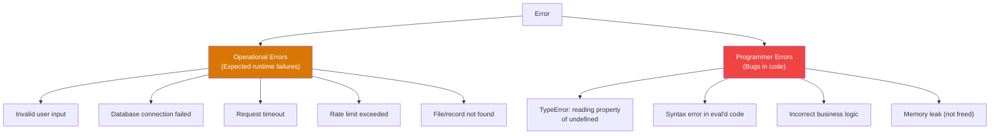
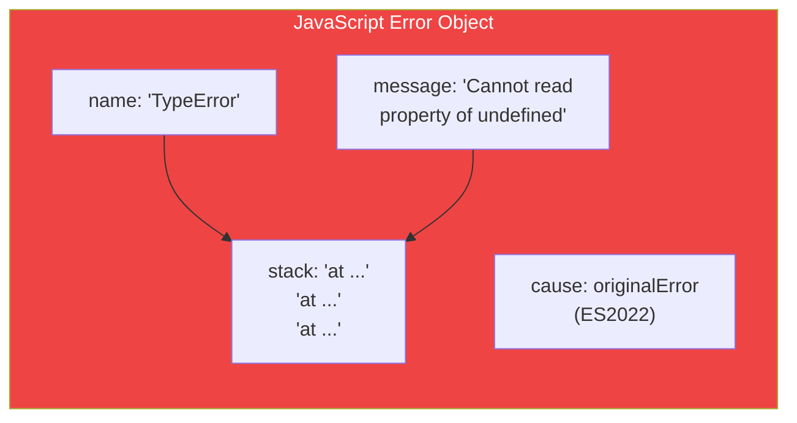
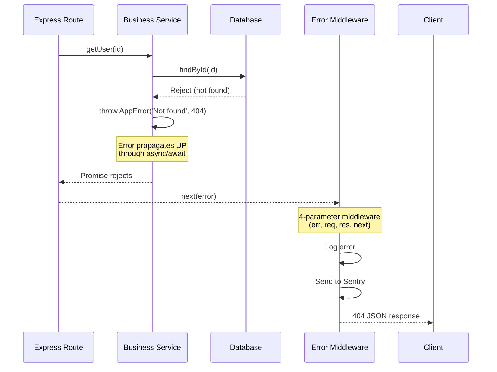
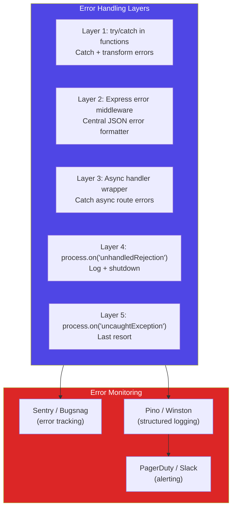
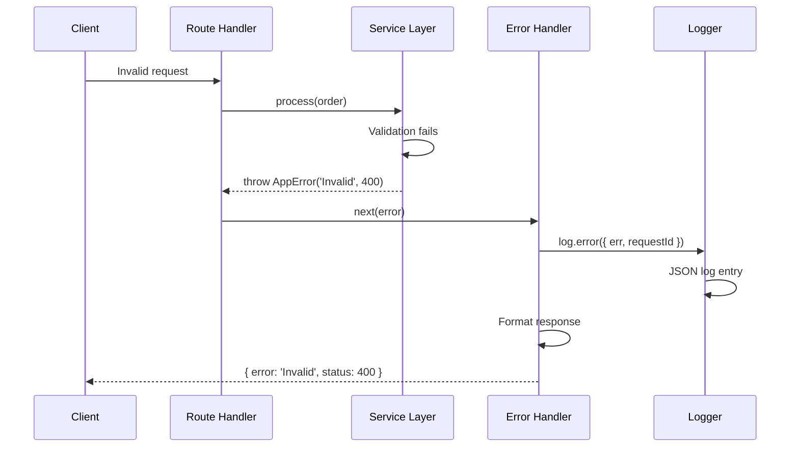

# Error Handling

## 📖 Introduction

Error handling in Node.js is **strategic, not accidental**. Well-handled errors log, report, and recover gracefully. Poorly-handled errors crash servers, lose data, and wake up on-call engineers at 3 AM.

> **The difference between a junior and senior developer is how they handle errors.**

## 🤔 Why Do We Need This?

| Without Error Handling | With Error Handling |
|-----------------------|-------------------|
| Server crashes on bad input | Returns 400 with helpful message |
| Users see "Something broke" | Users see friendly error page |
| No trace of what happened | Full error log with context |
| 3 AM page for the team | Alert with stack trace + request data |
| Data corruption from partial writes | Rollback or retry guarantees |

## ⚠️ Problem Statement

```javascript
// The million-dollar Node.js bug:
app.post('/charge', async (req, res) => {
  const charge = await stripe.charges.create(req.body); // ⛔ If this throws, the ENTIRE server crashes!
  res.json({ success: true });
});

// unhandled Promise rejection → Node 15+ crashes the process
// All active connections DROP
// Users lose their orders
```

Without proper error handling, a single malformed request can bring down your entire application.

## 📚 Real World Story

**The $300K Silent Crash**

A startup's payment service had no error handling. Every few days at 2 AM, a customer would send an invalid credit card number. The `stripe.charges.create()` call would reject. Since there was no `.catch()` or try/catch, the Promise rejection was **unhandled**.

In Node.js 15+, unhandled rejections crash the process. The server would restart (Docker kept it alive), but active payments were lost. It took weeks to correlate the 2 AM crashes with specific customer inputs.

**Cost:** ~$300K in lost orders over 3 months.

**Fix:** One error handling middleware + one process-level handler.

## 🍕 Real World Analogy

| Concept | Airplane Analogy |
|---------|-----------------|
| try/catch | Seatbelt (individual protection) |
| Error class | Different alarm types (fire, engine, cabin pressure) |
| Error middleware | Air traffic control (central coordination) |
| uncaughtException | Ejector seat (last resort, plane is going down) |
| Graceful shutdown | Emergency landing protocol |
| Logging | Black box flight recorder |

## 👁️ Visual Explanation

```
ERROR HANDLING STRATEGY DECISION TREE

                    Error occurs
                        │
                        ▼
              ┌─────────────────┐
              │  Type of error? │
              └────────┬────────┘
                       │
         ┌─────────────┴─────────────┐
         ▼                           ▼
  ┌──────────────┐          ┌──────────────────┐
  │  Operational │          │  Programmer       │
  │  (Expected)  │          │  (Bug)            │
  └──────┬───────┘          └──────┬───────────┘
         │                         │
         ▼                         ▼
  ┌──────────────┐          ┌──────────────────┐
  │  Catch it    │          │  Fix the code    │
  │  Handle it   │          │  (crash in dev)  │
  │  Retry/log   │          │  (log in prod)   │
  └──────────────┘          └──────────────────┘
         │                         │
         ▼                         ▼
  ┌──────────────┐          ┌──────────────────┐
  │ Continue     │          │ Process.exit(1)  │
  │ (mostly safe)│          │ (unstable state) │
  └──────────────┘          └──────────────────┘
```

## 📊 Mermaid Diagram 1: Error Types Taxonomy



## ⚙️ Internal Working: The Error Object



Every error in JavaScript has three key properties:
- `.name` — Error type (TypeError, ReferenceError, SyntaxError)
- `.message` — Human-readable description
- `.stack` — Call stack trace (V8 provides this)

## 🔄 Mermaid Diagram 2: Error Propagation in Async Code



## 🏗️ Architecture: Comprehensive Error Handling System



## 👣 Step-by-Step Flow: Error Lifecycle



## 📝 Syntax

```javascript
// CUSTOM ERROR CLASS
class AppError extends Error {
  constructor(message, statusCode = 500) {
    super(message);
    this.statusCode = statusCode;
    this.isOperational = true;
    Error.captureStackTrace(this, this.constructor);
  }
}

// ASYNC HANDLER WRAPPER
const asyncHandler = (fn) => (req, res, next) => {
  Promise.resolve(fn(req, res, next)).catch(next);
};

// EXPRESS ERROR MIDDLEWARE (4 params!)
app.use((err, req, res, next) => {
  const statusCode = err.statusCode || 500;
  res.status(statusCode).json({
    status: 'error',
    message: err.message,
    ...(process.env.NODE_ENV === 'development' && { stack: err.stack }),
  });
});
```

## 🟢 Basic Example: Custom Error Classes

```javascript
class AppError extends Error {
  constructor(message, statusCode) {
    super(message);
    this.statusCode = statusCode;
    this.isOperational = true;
  }
}

class NotFoundError extends AppError {
  constructor(resource = 'Resource') {
    super(`${resource} not found`, 404);
  }
}

class ValidationError extends AppError {
  constructor(errors) {
    super('Validation failed', 400);
    this.errors = errors;
  }
}

class AuthError extends AppError {
  constructor() {
    super('Authentication required', 401);
  }
}

// Usage
app.get('/users/:id', asyncHandler(async (req, res) => {
  const user = await findUser(req.params.id);
  if (!user) throw new NotFoundError('User');
  res.json(user);
}));
```

## 🟡 Intermediate Example: Async Error Wrapper

```javascript
// Without wrapper — error crashes the process!
app.get('/users', async (req, res) => {
  const users = await getUsers(); // If this rejects → 💥 CRASH
  res.json(users);
});

// With wrapper — error goes to middleware
const asyncHandler = (fn) => (req, res, next) => {
  Promise.resolve(fn(req, res, next)).catch(next);
};

app.get('/users', asyncHandler(async (req, res) => {
  const users = await getUsers();
  res.json(users);
}));

// Or use express-async-errors (auto-wraps everything):
require('express-async-errors');
```

## 🔴 Advanced Example: Result Pattern (Go-style)

```javascript
// Instead of try/catch everywhere, use a Result type
class Result {
  static success(value) {
    return { success: true, value, error: null };
  }
  
  static failure(error) {
    return { success: false, value: null, error };
  }
}

async function findUser(id) {
  try {
    const user = await db.users.findById(id);
    if (!user) return Result.failure(new NotFoundError('User'));
    return Result.success(user);
  } catch (err) {
    return Result.failure(err);
  }
}

const result = await findUser(id);
if (!result.success) {
  logger.error('User lookup failed:', result.error);
  return res.status(404).json({ error: 'Not found' });
}
const user = result.value; // Type-safe!
```

## 🏭 Production Example: Full Error Handling Setup

```javascript
// ─── CUSTOM ERRORS ──────────────────────────────────
class AppError extends Error {
  constructor(message, statusCode) {
    super(message);
    this.statusCode = statusCode;
    this.isOperational = true;
  }
}

// ─── PROCESS-LEVEL HANDLERS ────────────────────────
process.on('unhandledRejection', (reason) => {
  logger.error({ err: reason }, 'UNHANDLED REJECTION');
  // Log, then shutdown
  server.close(() => process.exit(1));
  setTimeout(() => process.exit(1), 10000).unref();
});

process.on('uncaughtException', (err) => {
  logger.error({ err }, 'UNCAUGHT EXCEPTION');
  // Must exit — app is unstable
  process.exit(1);
});

// ─── EXPRESS ERROR MIDDLEWARE ──────────────────────
app.use((err, req, res, next) => {
  // Default to 500
  err.statusCode = err.statusCode || 500;
  
  // Log everything
  logger.error({
    err,
    requestId: req.id,
    method: req.method,
    url: req.url,
    userId: req.user?.id,
  }, 'Request error');
  
  // Don't leak internals in production
  const message = process.env.NODE_ENV === 'production'
    ? 'Internal Server Error'
    : err.message;
  
  res.status(err.statusCode).json({
    error: message,
    statusCode: err.statusCode,
    ...(err.errors && { errors: err.errors }), // Validation errors
  });
});

// ─── 404 HANDLER ────────────────────────────────────
app.use((req, res) => {
  res.status(404).json({ error: 'Route not found' });
});
```

## ⚙️ How It Works Internally

```
V8 stack trace generation:
1. Error.captureStackTrace(this, constructor)
2. V8 walks the call stack
3. Extracts: file, line number, column, function name
4. Formats as: "at functionName (file:line:col)"
5. Attaches to error.stack

Express error middleware detection:
1. Express checks middleware arity (number of params)
2. 4 params (err, req, res, next) → error middleware
3. Express skips regular middleware on error
4. Calls error middleware in registration order
```

## 📦 Performance Notes

| Error Pattern | Overhead | Notes |
|--------------|----------|-------|
| throw new Error() | ~1µs | Generating stack trace is expensive |
| try/catch (no error) | ~0.01µs | Near-zero cost when no error |
| Custom error class | ~0.5µs | Extra property setup |
| Error.stack access | ~5µs | Only access when logging |

## 🔒 Security Notes

| Practice | Why |
|----------|-----|
| Don't leak stack traces in production | Reveals internal paths and code structure |
| Sanitize error messages | Don't echo user input in errors |
| Log full errors, send safe messages | Internal detail vs. external response |
| Rate-limit error endpoints | Prevent brute-force via error messages |

## ⚠️ Common Mistakes

```javascript
// MISTAKE 1: Swallowing errors
try { await risky(); } catch (e) {}
// Never do this! At minimum: logger.error(e);

// MISTAKE 2: Not handling promise rejections
async function load() {
  await fetchData(); // If this rejects → unhandled!
}
load(); // No .catch()!

// MISTAKE 3: Catching but not throwing
try { await db.save(); }
catch (err) {
  logger.error(err);
  // Forgot to throw or return error response!
}

// MISTAKE 4: Using uncaughtException to keep running
process.on('uncaughtException', (err) => {
  // Don't just log and continue — app state is corrupted
  // Always exit after uncaughtException
});
```

## 🚀 Best Practices

| # | Practice |
|---|----------|
| 1 | Use custom error classes with status codes |
| 2 | Always wrap async Express handlers |
| 3 | Use process handlers as safety nets, not regular handling |
| 4 | Don't leak stack traces in production |
| 5 | Always log errors with context (requestId, userId) |
| 6 | Never swallow errors silently |
| 7 | Implement graceful shutdown |

## 🎯 Interview Questions

**Q1: What's the difference between operational and programmer errors?**
Operational errors are expected runtime issues (invalid input, DB timeout). Programmer errors are bugs (TypeError, undefined access). Handle operational errors gracefully; fix programmer errors in code.

**Q2: What happens if an error event is emitted with no listener?**
Node.js throws the error and crashes the process. Always register an 'error' listener on EventEmitters.

**Q3: Why should you exit after uncaughtException?**
The app is in an unknown state — memory may be corrupted, file handles may be inconsistent. Continuing leads to data corruption.

## 📝 MCQs

**1. How many parameters does an Express error middleware have?**
- A) 2
- B) 3
- C) 4 ✅
- D) 5

**2. What property distinguishes operational errors from bugs?**
- A) `.message`
- B) `.isOperational` (custom) ✅
- C) `.stack`
- D) `.statusCode`

**3. What does an unhandled promise rejection do in Node 15+?**
- A) Logs a warning
- B) Crashes the process ✅
- C) Ignores it
- D) Retries automatically

**4. Which pattern wraps async Express handlers to catch errors?**
- A) try/catch in every route
- B) asyncHandler wrapper ✅
- C) Global error handler
- D) express.json()

**5. What should you do in an uncaughtException handler?**
- A) Log and continue
- B) Log, cleanup, and exit ✅
- C) Restart the server
- D) Send an email and ignore

## 💻 Coding Challenge 1: Error Class Hierarchy

Create a hierarchy of error classes: AppError → NotFoundError, ValidationError, AuthError, RateLimitError.

## 💻 Coding Challenge 2: Error Monitoring Client

Build a simple error monitoring client that catches errors, adds context, and sends to an API endpoint.

## 💻 Coding Challenge 3: Graceful Shutdown

Implement a graceful shutdown handler that closes HTTP server, database connections, and pending requests on SIGTERM.

## 🧪 Mini Exercise: Debugging Error Handling

```javascript
// Find and fix 5 error handling bugs:
app.get('/users/:id', async (req, res) => {
  const user = await db.users.findById(req.params.id); // Bug 1
  if (!user) res.status(404).json({ error: 'Not found' }); // Bug 2
  res.json(user);
});
process.on('unhandledRejection', (err) => { /* Bug 3 */ });
process.on('uncaughtException', (err) => { logger.error(err); }); // Bug 4
```

## 🌍 Real World Problem

**Problem:** Your e-commerce API processes 1000 orders/minute. Occasionally, a database timeout causes an unhandled Promise rejection that crashes the entire process. Active orders are lost.

**Questions:**
1. Where should you add error handling?
2. What layers of protection would you implement?
3. How would you prevent data loss during shutdown?

## 🏗️ Mini Project: Error Dashboard

Build an Express middleware that records all errors to an in-memory store and exposes a `/debug/errors` endpoint showing recent errors with their frequency.

## 📖 Summary

| Concept | Key Takeaway |
|---------|-------------|
| Operational errors | Expected, handle gracefully |
| Programmer errors | Bugs, fix the code |
| Custom errors | Extend Error with statusCode |
| Express error middleware | 4-parameter (err, req, res, next) |
| asyncHandler | Wraps async routes |
| unhandledRejection | Last resort, then exit |
| uncaughtException | Must exit, app is unstable |

## 📋 Cheat Sheet

```javascript
// Custom error
class AppError extends Error {
  constructor(m, c) { super(m); this.statusCode = c; this.isOperational = true; }
}
// Async wrapper
const asyncHandler = (fn) => (req, res, next) => fn(req, res, next).catch(next);
// Error middleware
app.use((err, req, res, next) => { res.status(err.statusCode || 500).json({error: err.message}); });
// Process handlers
process.on('unhandledRejection', (r) => { logger.error(r); process.exit(1); });
process.on('uncaughtException', (e) => { logger.error(e); process.exit(1); });
```

## 📚 Further Reading

- [Node.js Error Handling Guide](https://nodejs.org/en/learn/asynchronous-work/error-handling)
- [Express Error Handling](https://expressjs.com/en/guide/error-handling.html)
- [Joyent: Error Handling in Node.js](https://www.joyent.com/node-js/production/design/errors)

## 🔗 Related Topics

| Topic | Link |
|-------|------|
| Streams & Buffers | [Previous](/DSA-Notes-Problems/nodejs/core/streams-and-buffers) |
| Async Programming | [Async](/DSA-Notes-Problems/nodejs/core/async-programming) |
| Debugging Node.js | [Debugging](/DSA-Notes-Problems/nodejs/fundamentals/debugging) |
| Production Architecture | [Production](/DSA-Notes-Problems/nodejs/production/production-architecture) |
