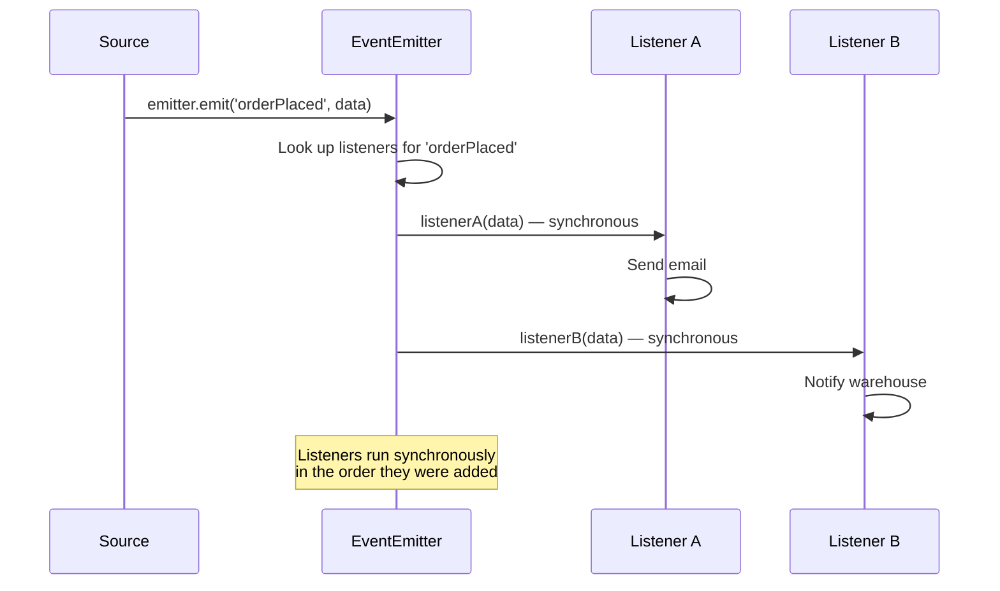

## Event Emitter

The **EventEmitter** is Node.js's implementation of the **publish/subscribe** pattern. It's at the heart of Node.js's event-driven architecture — many built-in modules (Streams, HTTP, fs watchers) inherit from EventEmitter.

### Basic Usage

```javascript
const EventEmitter = require('events');

const emitter = new EventEmitter();

// Subscribe to an event
emitter.on('greet', (name) => {
  console.log(`Hello, ${name}!`);
});

// Emit the event
emitter.emit('greet', 'Alice');
// Output: Hello, Alice!
```

### The Emit → Listener Flow



### `.on()` vs `.once()` vs `.addListener()`

```javascript
const EventEmitter = require('events');
const emitter = new EventEmitter();

// .on() / .addListener() — fires every time
emitter.on('data', (msg) => console.log('on:', msg));

// .once() — fires only the FIRST time, then auto-removed
emitter.once('init', () => console.log('This runs only once'));

emitter.emit('data', 'first');   // on: first
emitter.emit('init', 'first');   // This runs only once
emitter.emit('data', 'second');  // on: second
emitter.emit('init', 'second');  // (nothing — listener removed)
```

### Custom EventEmitter Classes

```javascript
const EventEmitter = require('events');

class OrderSystem extends EventEmitter {
  placeOrder(item, quantity) {
    console.log(`Placing order: ${item} x${quantity}`);
    
    // Business logic
    const order = { item, quantity, id: Date.now(), status: 'pending' };
    
    // Emit events
    this.emit('order:placed', order);
    
    // Simulate async processing
    setTimeout(() => {
      order.status = 'confirmed';
      this.emit('order:confirmed', order);
    }, 1000);
    
    return order;
  }
}

// Usage
const orders = new OrderSystem();

orders.on('order:placed', (order) => {
  console.log(`📧 Sending confirmation for order ${order.id}`);
});

orders.on('order:confirmed', (order) => {
  console.log(`✅ Order ${order.id} confirmed — updating inventory`);
});

orders.placeOrder('Laptop', 1);
// Output:
// Placing order: Laptop x1
// 📧 Sending confirmation for order 1234567890
// (1 second later...)
// ✅ Order 1234567890 confirmed — updating inventory
```

### Passing Arguments and `this`

```javascript
class Logger extends EventEmitter {
  log(level, message) {
    this.emit('log', { level, message, timestamp: new Date() });
  }
}

const logger = new Logger();

logger.on('log', (data) => {
  console.log(`[${data.level.toUpperCase()}] ${data.message}`);
});

logger.log('info', 'Server started');
logger.log('warn', 'Memory usage high');
// Output:
// [INFO] Server started
// [WARN] Memory usage high
```

### Error Events

If an `error` event is emitted and no listener is registered, Node.js **throws the error and crashes the process**.

```javascript
const emitter = new EventEmitter();

// ❌ If this runs without an error listener, the process crashes!
emitter.emit('error', new Error('Something went wrong'));

// ✅ Always attach an error listener
emitter.on('error', (err) => {
  console.error('Emitter error:', err.message);
  // Log, cleanup, then optionally crash
});
```

### Managing Listeners

```javascript
const emitter = new EventEmitter();

function handler(data) {
  console.log('Handled:', data);
}

// Add
emitter.on('data', handler);

// Remove specific listener
emitter.off('data', handler);         // Same as removeListener
emitter.removeListener('data', handler);

// Remove all listeners for an event
emitter.removeAllListeners('data');
emitter.removeAllListeners();         // Removes ALL listeners for ALL events

// Inspect
emitter.listenerCount('data');        // Number of listeners
emitter.listeners('data');            // Array of listener functions
emitter.eventNames();                 // Array of event names with listeners

// Set max listeners (default is 10 — warns if exceeded)
emitter.setMaxListeners(20);
```

### Practical: Event-Driven Logger

```javascript
const EventEmitter = require('events');

class Logger extends EventEmitter {
  constructor() {
    super();
    this.logs = [];
    
    // Auto-log to array
    this.on('log', (entry) => {
      this.logs.push(entry);
    });
  }
  
  info(msg) { this.emit('log', { level: 'info', msg, time: new Date() }); }
  warn(msg) { this.emit('log', { level: 'warn', msg, time: new Date() }); }
  error(msg) { this.emit('log', { level: 'error', msg, time: new Date() }); }
  
  getLogs() { return this.logs; }
}

// Extend with file logging
class FileLogger extends Logger {
  constructor(filePath) {
    super();
    this.path = filePath;
    
    this.on('log', async (entry) => {
      await fs.appendFile(this.path, JSON.stringify(entry) + '\n');
    });
  }
}
```

### Practical: Async Event Handlers

```javascript
class UserService extends EventEmitter {
  async register(userData) {
    try {
      const user = await db.users.create(userData);
      this.emit('user:registered', user);
      
      // These run asynchronously via event loop
      this.emit('email:welcome', user.email);
      this.emit('analytics:track', 'registration', user.id);
      return user;
    } catch (err) {
      this.emit('error', err);
    }
  }
}

const users = new UserService();

users.on('user:registered', async (user) => {
  // These listeners run sync or async — EventEmitter doesn't await them
  console.log(`User created: ${user.id}`);
});

// If you need async handling, handle within the listener:
users.on('email:welcome', async (email) => {
  await sendEmail(email, 'Welcome!');
});
```

### 🚨 Common Gotchas

```javascript
// ⚠️ Memory leak: listeners hold references!
class MyClass {
  constructor(emitter) {
    // ❌ Arrow function — can't remove this listener later!
    emitter.on('data', (data) => this.handle(data));
  }
}

// ✅ Store reference for cleanup
class MyClass {
  constructor(emitter) {
    this.handleData = (data) => this.handle(data);
    emitter.on('data', this.handleData);
  }
  destroy() {
    emitter.off('data', this.handleData); // Cleanup!
  }
}

// ⚠️ Listeners are called synchronously
emitter.on('event', () => console.log('1'));
emitter.on('event', () => console.log('2'));
emitter.emit('event');
// Output: 1, 2 — both run before any other code
```

### Key Takeaways

- EventEmitter implements the **publish/subscribe** pattern — `.on()` to listen, `.emit()` to fire
- `.once()` fires the listener at most once, then auto-removes it
- **Always attach an `error` listener** — unhandled `error` events crash the process
- Listeners run **synchronously** in the order they were added
- Store listener references to remove them later and prevent memory leaks
- Use custom EventEmitter classes by extending `EventEmitter`
- Default max listeners is **10** — set with `.setMaxListeners()` if you need more
