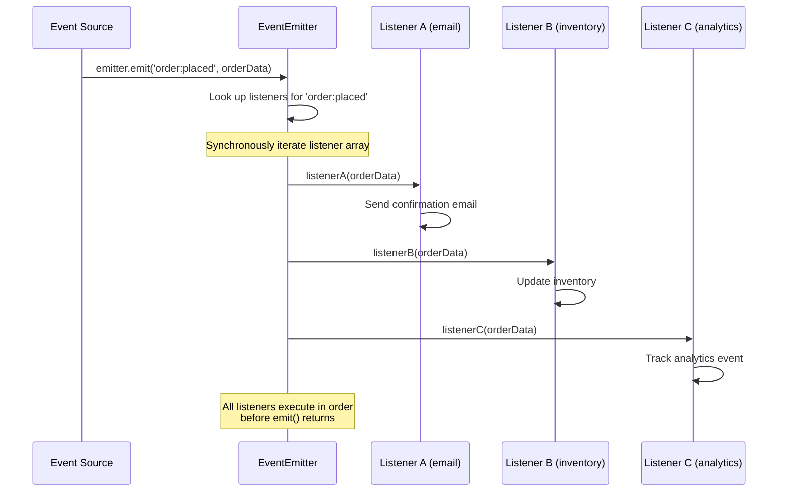
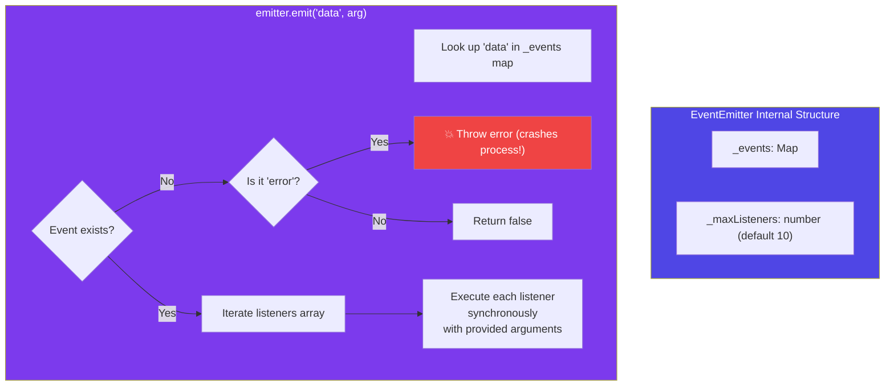
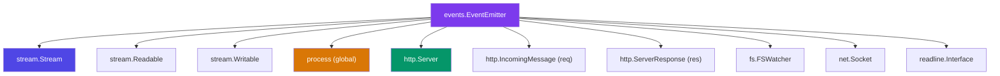
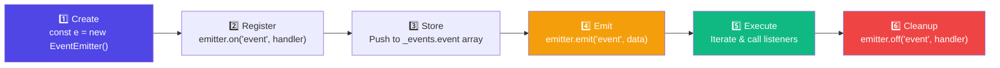

# Event Emitter

## 📖 Introduction

The **EventEmitter** is Node.js's implementation of the **publish/subscribe** pattern. It's the foundation of Node.js's event-driven architecture — built-in modules like Streams, HTTP, and file system watchers all inherit from EventEmitter.

> **EventEmitter turns function calls into broadcast announcements.** One emitter, many listeners.

## 🤔 Why Do We Need This?

| Pattern | Problem | EventEmitter Solution |
|---------|---------|---------------------|
| Tight coupling | Function A calls B directly | A emits an event, B listens |
| Many listeners | One event triggers 10 actions | All 10 listeners react to one emit |
| Dynamic subscriptions | Need to add/remove handlers at runtime | .on() / .off() anytime |
| Loose architecture | Modules depend on each other | Modules only depend on events |

## ⚠️ Problem Statement

```javascript
// Without EventEmitter — tight coupling
class OrderService {
  constructor() {
    this.email = new EmailService();
    this.inventory = new InventoryService();
    this.analytics = new AnalyticsService();
    // Every new feature = edit this class!
  }
  
  placeOrder(order) {
    // Coupled to every service
    this.email.sendConfirmation(order);
    this.inventory.updateStock(order.items);
    this.analytics.trackOrder(order);
    // What if we want to add SMS notification?
    // What if analytics service changes?
  }
}

// With EventEmitter — loose coupling ✨
class OrderService extends EventEmitter {
  placeOrder(order) {
    this.emit('order:placed', order);
    // OrderService doesn't know or care who listens!
  }
}
```

## 📚 Real World Story

**The Microservices Migration**

A monolithic e-commerce app had 15 different actions to perform when an order was placed: email, SMS, inventory, analytics, fraud detection, loyalty points, etc. Each new feature meant editing the same `OrderService.placeOrder()` method — and every edit risked breaking existing functionality.

By switching to an event-driven architecture (EventEmitter locally, message queues for microservices), each feature became independent:
- Adding SMS notification? Just add a listener
- Fixing inventory bug? Just edit the inventory module
- New fraud check? Register a new listener

Zero changes to existing code.

## 🍕 Real World Analogy

| Concept | Radio Station Analogy |
|---------|----------------------|
| EventEmitter | A radio station transmitter |
| `.emit('event')` | Broadcasting on a frequency |
| `.on('event', fn)` | Tuning in to the frequency |
| `.once('event', fn)` | Listening for a one-time announcement |
| `.off('event', fn)` | Turning off the radio |
| `.removeAllListeners()` | Changing the station entirely |

## 👁️ Visual Explanation

```
BEFORE EventEmitter (Tight Coupling)
══════════════════════════════════════

OrderService ───→ EmailService
     │
     ├──→ InventoryService
     │
     ├──→ AnalyticsService
     │
     └──→ SMSService
     
     Problem: OrderService knows about EVERY service!
     Adding SMS means editing OrderService!

AFTER EventEmitter (Loose Coupling)
══════════════════════════════════════

              ┌──→ EmailService
              │
OrderService ─┼──→ InventoryService  (Each listens independently)
  (emits)     │
              ├──→ AnalyticsService
              │
              └──→ SMSService (Added without touching OrderService!)
```

## 📊 Mermaid Diagram 1: Publish/Subscribe Architecture



## ⚙️ Internal Working: EventEmitter Internals



When you call `emitter.emit('data', arg)`:
1. JavaScript looks up `_events.data` (an array of listener functions)
2. If found → iterates and calls each listener synchronously
3. If NOT found and event is `error` → throws the error (⚠️ crashes!)
4. If NOT found and NOT error → silently returns `false`

## 🏗️ Architecture: EventEmitter in the Node.js Ecosystem



> 💡 **Did You Know?** Almost every async I/O operation in Node.js uses EventEmitter under the hood. Streams, HTTP requests, file system watchers — they all inherit from EventEmitter.

## 👣 Step-by-Step Flow: Event Lifecycle



## 📝 Syntax

```javascript
const EventEmitter = require('events');

// ─── CREATE ────────────────────────────────────────
const emitter = new EventEmitter();

// ─── LISTEN ─────────────────────────────────────────
emitter.on('event', handler);       // Every time (alias: addListener)
emitter.once('event', handler);     // One time only
emitter.prependListener('event', handler);  // Add to FRONT of array
emitter.prependOnceListener('event', handler); // Front + once

// ─── EMIT ──────────────────────────────────────────
emitter.emit('event', arg1, arg2);  // Pass any arguments

// ─── REMOVE ────────────────────────────────────────
emitter.off('event', handler);            // Remove (alias: removeListener)
emitter.removeAllListeners('event');      // Remove all for event
emitter.removeAllListeners();              // Remove ALL listeners

// ─── INSPECT ────────────────────────────────────────
emitter.listenerCount('event');           // Number of listeners
emitter.listeners('event');               // Array of functions
emitter.eventNames();                     // Array of event names
emitter.rawListeners('event');            // Listeners including wrappers

// ─── CONFIGURE ─────────────────────────────────────
emitter.setMaxListeners(20);              // Increase warning limit
EventEmitter.defaultMaxListeners = 20;    // Change global default
```

## 🟢 Basic Example: Simple Event System

```javascript
const EventEmitter = require('events');

// Create an emitter
const notifications = new EventEmitter();

// Subscribe to events
notifications.on('login', (username) => {
  console.log(`👋 Welcome back, ${username}!`);
});

notifications.once('first-visit', (username) => {
  console.log(`🎉 First time here, ${username}!`);
});

// Emit events
notifications.emit('first-visit', 'Alice');  // ✅ "First time here, Alice!"
notifications.emit('login', 'Alice');         // ✅ "Welcome back, Alice!"
notifications.emit('login', 'Alice');         // ✅ "Welcome back, Alice!"
notifications.emit('first-visit', 'Alice');   // ❌ Nothing — once() removed it
```

## 🟡 Intermediate Example: Custom Logger with Events

```javascript
const EventEmitter = require('events');

class Logger extends EventEmitter {
  constructor() {
    super();
    this.setMaxListeners(20); // We expect many log listeners
  }
  
  info(module, message, data) {
    this.emit('log', { level: 'info', module, message, data, timestamp: new Date() });
  }
  
  warn(module, message, data) {
    this.emit('log', { level: 'warn', module, message, data, timestamp: new Date() });
  }
  
  error(module, message, error) {
    this.emit('log', { level: 'error', module, message, error: error?.stack, timestamp: new Date() });
  }
}

const logger = new Logger();

// Listener: Console output
logger.on('log', (entry) => {
  const prefix = {
    info: '📘',
    warn: '⚠️',
    error: '❌',
  }[entry.level];
  console.log(`${prefix} [${entry.module}] ${entry.message}`);
});

// Listener: Send errors to external service
logger.on('log', (entry) => {
  if (entry.level === 'error') {
    sendToSentry(entry);  // Fire and forget
  }
});

// Listener: Metrics
let logCount = 0;
logger.on('log', () => { logCount++; });
```

## 🔴 Advanced Example: Async Event Queue with Error Handling

```javascript
const EventEmitter = require('events');

class AsyncEventQueue extends EventEmitter {
  constructor(options = {}) {
    super();
    this.concurrency = options.concurrency || 5;
    this.queue = [];
    this.running = 0;
    this.errorHandler = options.errorHandler || ((err) => console.error(err));
    
    // Auto-process when events are registered
    this.on('_process', () => this.processNext());
  }
  
  enqueue(eventName, ...args) {
    this.queue.push({ eventName, args });
    this.emit('_process');
  }
  
  async processNext() {
    if (this.running >= this.concurrency || this.queue.length === 0) return;
    
    this.running++;
    const item = this.queue.shift();
    
    try {
      const listeners = this.listeners(item.eventName);
      for (const listener of listeners) {
        await Promise.resolve(listener(...item.args));
      }
    } catch (err) {
      this.errorHandler(err);
      this.emit('error', err, item);
    }
    
    this.running--;
    this.emit('_process');
  }
  
  // Override emit to use our queue instead
  emit(eventName, ...args) {
    if (eventName === 'error') {
      return super.emit(eventName, ...args);
    }
    this.enqueue(eventName, ...args);
    return true;
  }
}
```

## 🏭 Production Example: Event-Driven Microservice

```javascript
const EventEmitter = require('events');

class PaymentService extends EventEmitter {
  async processPayment(orderId, amount) {
    this.emit('payment:started', { orderId, amount });
    
    try {
      const charge = await stripe.charges.create({ amount, currency: 'usd' });
      this.emit('payment:completed', { orderId, chargeId: charge.id });
      return charge;
    } catch (err) {
      this.emit('payment:failed', { orderId, error: err.message });
      throw err;
    }
  }
}

// ─── SETUP ──────────────────────────────────────────
const payments = new PaymentService();

// Update order status
payments.on('payment:completed', async ({ orderId, chargeId }) => {
  await db.orders.update(orderId, { status: 'paid', chargeId });
});

// Send email
payments.on('payment:completed', async ({ orderId }) => {
  const order = await db.orders.findById(orderId);
  await email.send(order.userEmail, 'payment-confirmation', { orderId });
});

// Update inventory
payments.on('payment:completed', async ({ orderId }) => {
  const order = await db.orders.findById(orderId);
  for (const item of order.items) {
    await db.inventory.decrement(item.productId, item.quantity);
  }
});

// Track analytics
payments.on('payment:completed', ({ amount }) => {
  analytics.track('payment_completed', { amount });
});

// Handle failures
payments.on('payment:failed', async ({ orderId, error }) => {
  await db.orders.update(orderId, { status: 'failed', error });
  sentry.captureMessage(`Payment failed: ${orderId}`, { extra: { error } });
});

// ⚠️ Always handle errors
payments.on('error', (err) => {
  logger.error('PaymentService error:', err);
});
```

## ⚙️ How It Works Internally

```
emitter.on('data', handler)
  ↓
1. Check if _events map has 'data' key
2. If not, create array: _events.data = []
3. Push handler to array: _events.data.push(handler)
4. Increment listener count
5. If count > maxListeners, emit warning

emitter.emit('data', value)
  ↓
1. Look up _events.data
2. If found, copy the array (to prevent mutation during iteration)
3. Call each listener: handler(value)
4. If NOT found and event name is 'error' → THROW
5. Return true if listeners found, false otherwise
```

## 📦 Performance Notes

| Operation | Complexity | Notes |
|-----------|-----------|-------|
| `.on()` | O(1) | Push to array |
| `.emit()` | O(n) | n = number of listeners |
| `.off()` | O(n) | Find + splice array |
| `.removeAllListeners()` | O(1) | Reset array |

> Emitting with 100 listeners is ~1μs. Don't worry about performance — worry about memory leaks.

## 🔒 Security Notes

| Risk | Mitigation |
|------|-----------|
| Listener memory leaks | Always call `.off()` when done |
| Error event crashes | Always register `on('error', handler)` |
| Too many listeners | Set `setMaxListeners()` explicitly |
| Event argument leaks | Don't emit sensitive data in events |

## ⚠️ Common Mistakes

```javascript
// ❌ MISTAKE 1: Memory leak — never removing listeners
class Widget {
  start() {
    someEmitter.on('data', this.handleData); // ❌ Never removed!
  }
}

// ✅ Always cleanup
class Widget {
  start() {
    this.boundHandler = (data) => this.handleData(data);
    someEmitter.on('data', this.boundHandler);
  }
  destroy() {
    someEmitter.off('data', this.boundHandler);
  }
}

// ❌ MISTAKE 2: Not handling error events
emitter.emit('error', new Error('💥'));  // Crashes process!

// ✅ Always listen for errors
emitter.on('error', (err) => logger.error(err));

// ❌ MISTAKE 3: Using arrow functions (can't remove)
emitter.on('data', (data) => this.handle(data));
emitter.off('data', ???);  // Can't remove anonymous arrow function!
```

## 🚀 Best Practices

| # | Practice |
|---|----------|
| 1 | Always register an `error` listener |
| 2 | Store listener references to remove them later |
| 3 | Use `.once()` for one-time events |
| 4 | Set `setMaxListeners()` when expecting many listeners |
| 5 | Clean up listeners in `destroy()` or cleanup methods |
| 6 | Use event constants instead of string literals |

## 🎯 Interview Questions

**Q1: What is the EventEmitter pattern?**
EventEmitter implements the publish/subscribe pattern. Objects emit named events, and listeners subscribe to those events. It decouples event producers from consumers.

**Q2: Why must you always register an 'error' listener?**
If an 'error' event is emitted with no listener, Node.js throws the error and crashes the process. Always register `emitter.on('error', handler)`.

**Q3: What causes EventEmitter memory leaks?**
Registering listeners and never removing them. Each listener holds references to its closure scope. Use `.off()` to clean up, and watch for the "MaxListeners" warning.

## 📝 MCQs

**1. Which method registers a one-time listener?**
- A) `.on()`
- B) `.once()` ✅
- C) `.addListener()`
- D) `.prependListener()`

**2. What happens if 'error' is emitted with no listener?**
- A) Nothing
- B) Node.js crashes ✅
- C) Error is logged
- D) Listener is auto-created

**3. What is the default max listener count before a warning?**
- A) 5
- B) 10 ✅
- C) 20
- D) 100

**4. Which method removes a specific listener?**
- A) `.off()` ✅
- B) `.removeAllListeners()`
- C) `.clear()`
- D) `.reset()`

**5. Are listeners called synchronously or asynchronously?**
- A) Synchronously ✅
- B) Asynchronously
- C) Depends on the event
- D) Both

## 🧪 Mini Exercise: Debugging Memory Leak

```javascript
const EventEmitter = require('events');
const emitter = new EventEmitter();

function leakyFunction() {
  const bigData = new Array(10000000).fill('X');
  
  emitter.on('data', () => {
    console.log(bigData.length);
  });
}

for (let i = 0; i < 1000; i++) {
  leakyFunction();
}
// 1000 listeners x 10MB = 10GB memory!
// Find the leak and fix it
```

**Fix:** Each closure holds a reference to bigData. Use a method reference instead, or avoid capturing large data in closures. Also remove listeners when done.

## 💻 Coding Challenge 1: Event-Based Logger

Create a Logger class that extends EventEmitter with `info()`, `warn()`, `error()` methods that emit 'log' events. Add a listener that filters by log level.

## 💻 Coding Challenge 2: Connection Pool

Implement a connection pool using EventEmitter that emits 'acquired', 'released', and 'exhausted' events.

## 💻 Coding Challenge 3: Task Queue

Build an event-driven task queue where tasks are emitted as events and processed by listeners. Support concurrency limits.

## 🌍 Real World Problem

**Problem:** Your real-time chat server uses EventEmitter for message routing. Under load, memory grows unboundedly. Users disconnect but their listeners aren't cleaned up. How would you implement proper listener lifecycle management?

## 🏗️ Mini Project: Event Bus

Build a simple event bus that supports namespaced events (e.g., 'user:created', 'order:paid') and wildcard subscriptions ('user:*').

```javascript
const bus = new EventBus();
bus.on('user:*', (event, data) => {});  // Wildcard!
bus.emit('user:created', { id: 1 });
```

## 📖 Summary

| Concept | Key |
|---------|-----|
| Pattern | Publish/Subscribe (Pub/Sub) |
| Listen | `.on()`, `.once()`, `.prependListener()` |
| Emit | `.emit(event, ...args)` |
| Cleanup | `.off()`, `.removeAllListeners()` |
| Error | Always handle `error` events |
| Memory | Remove listeners when done |

## 📋 Cheat Sheet

```javascript
const EE = require('events');
const e = new EE();
e.on('evt', handler);          // Listen
e.once('evt', handler);        // Listen once
e.emit('evt', arg);            // Emit
e.off('evt', handler);         // Remove
e.removeAllListeners();        // Clear all
e.listenerCount('evt');        // Count
e.setMaxListeners(20);         // Increase limit
```

## 📚 Further Reading

- [Node.js Events Documentation](https://nodejs.org/api/events.html)
- [Node.js Event-Driven Architecture](https://nodejs.org/en/learn/asynchronous-work/the-nodejs-event-emitter)
