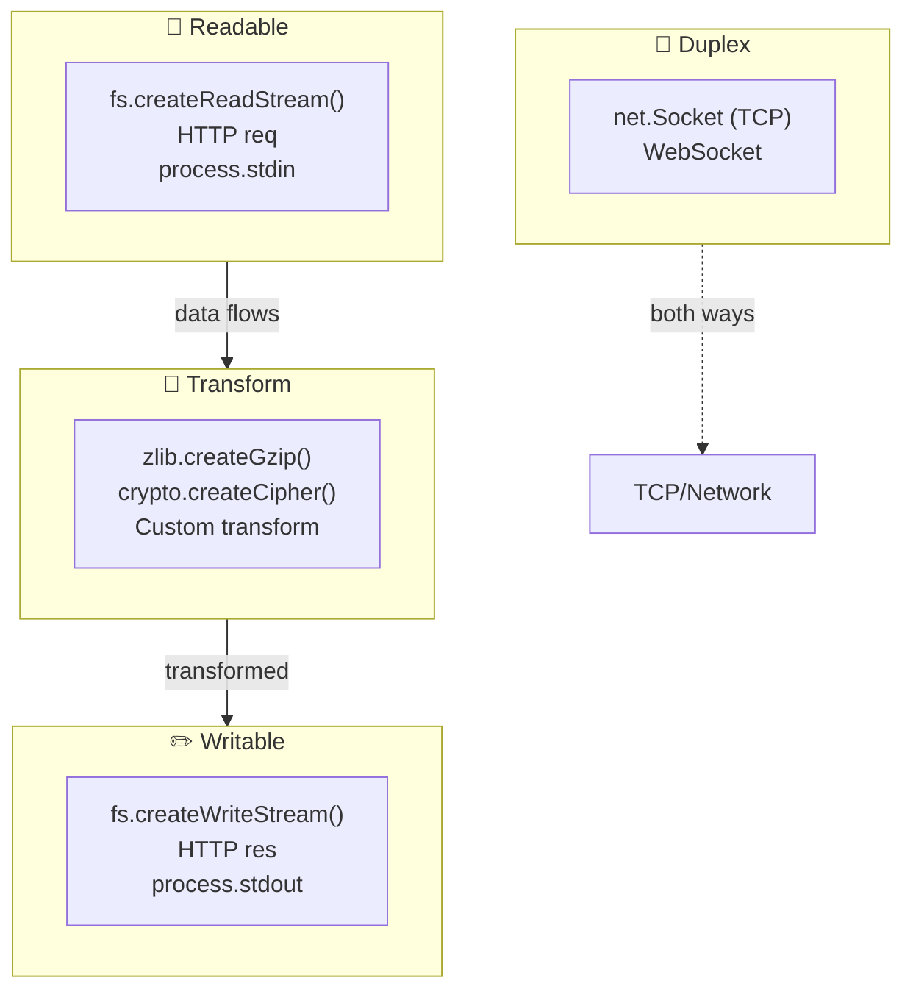
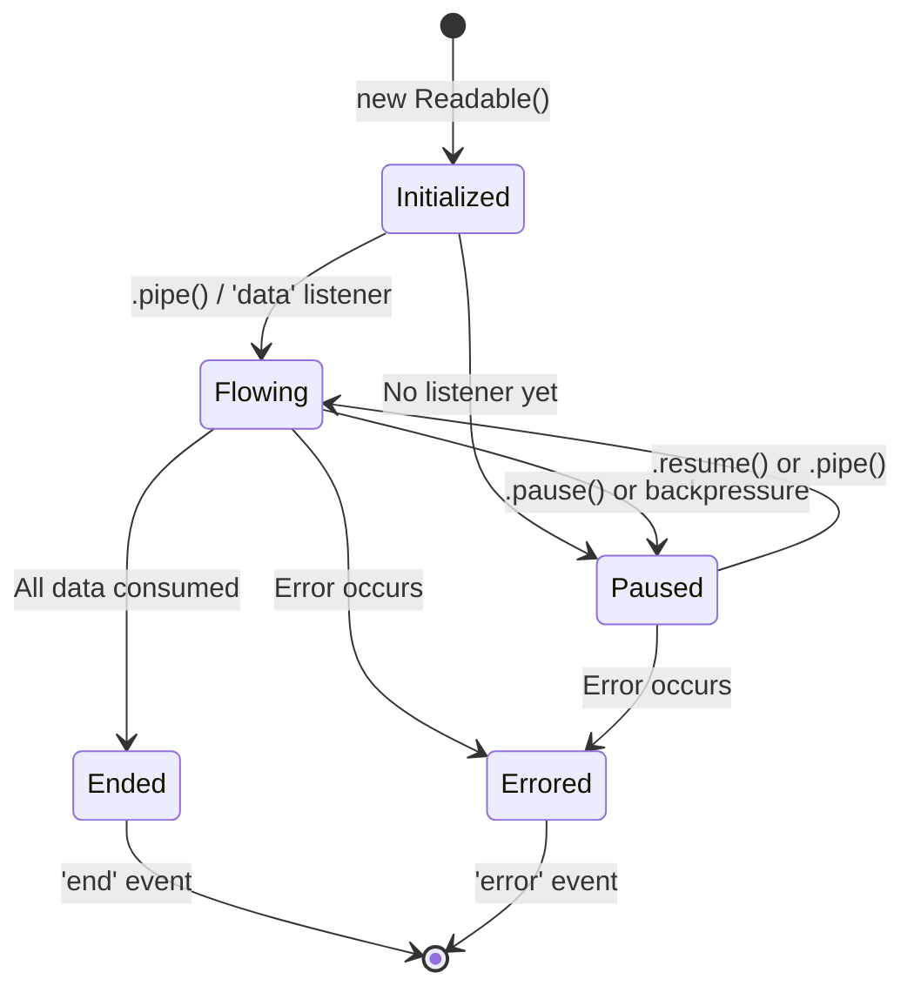
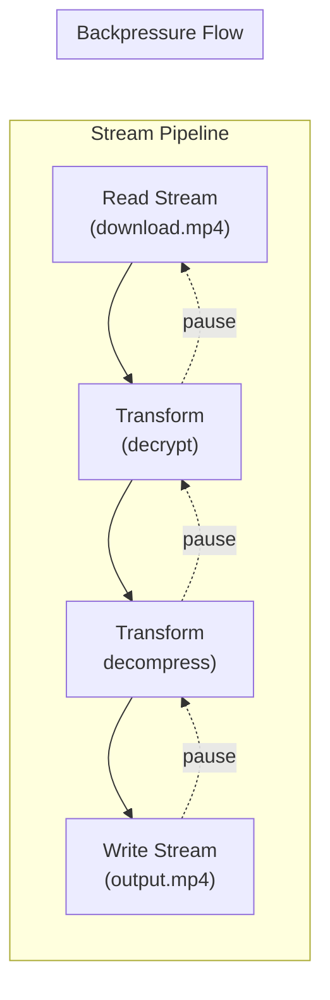
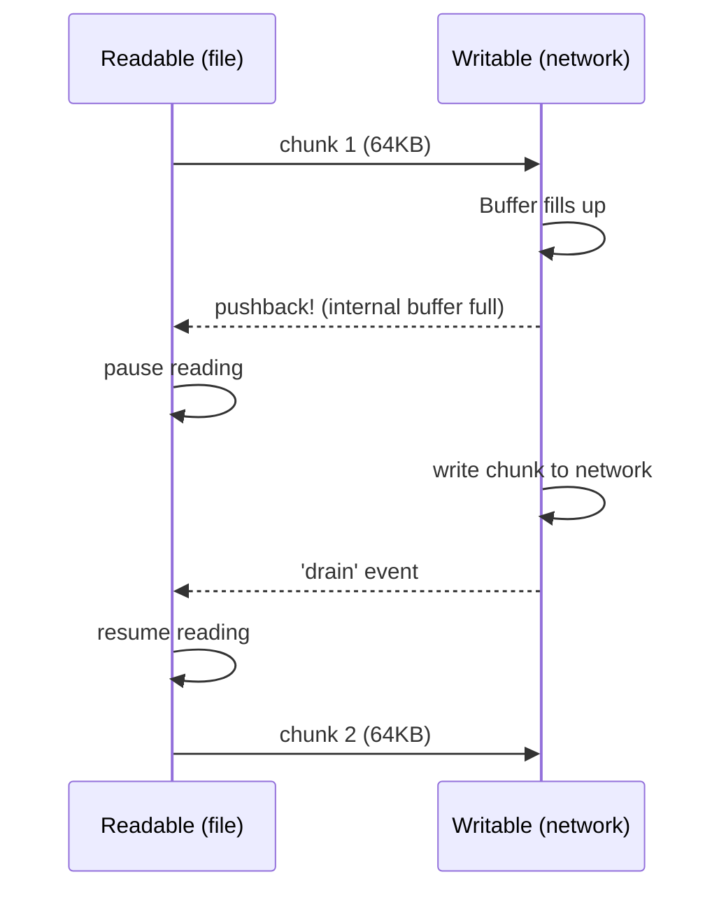

# Streams & Buffers

## 📖 Introduction

**Streams** process data chunk-by-chunk instead of loading everything into memory. **Buffers** handle raw binary data. Together, they make Node.js capable of handling gigabytes of data with megabytes of RAM.

> **Streams are to data what water pipes are to water — continuous flow without storing the entire ocean.**

## 🤔 Why Do We Need This?

| Approach | Memory | Use Case |
|----------|--------|----------|
| `fs.readFile()` | Entire file in RAM (1GB file = 1GB RAM) | Small files |
| `fs.createReadStream()` | Chunks in buffer (64KB at a time) | Large files, video, logs |

A 4GB video file:
- `readFile` → **crashes** (out of memory) or uses 4GB RAM
- `createReadStream` → uses **64KB** RAM

## ⚠️ Problem Statement

```javascript
// What happens with a 4GB file?
const fs = require('fs');

// BROWSER: 4GB file → 4GB RAM → 💥 Out of memory!
fs.readFile('video.mp4', (err, data) => {
  // data = ENTIRE 4GB in memory!
  res.send(data);
});

// CORRECT: Stream processes 64KB chunks
fs.createReadStream('video.mp4', { highWaterMark: 64 * 1024 })
  .pipe(res);
// Memory usage: ~64KB 😌
```

## 📚 Real World Story

**Netflix's Streaming Architecture**

Netflix serves billions of hours of video每月. If they loaded entire videos into memory, they'd need data centers the size of small countries. Instead, they use **streaming** — video data flows chunk-by-chunk from disk → network → browser.

The same principle applies to log processing, file uploads, and database backups in every large-scale Node.js application.

## 🍕 Real World Analogy

| Concept | Water Pipe Analogy |
|---------|-------------------|
| Buffer | A measuring cup (fixed capacity) |
| Readable Stream | Water source (tap) |
| Writable Stream | Destination (bucket) |
| Transform Stream | Water filter |
| .pipe() | Connecting hoses |
| Backpressure | Pipe too narrow — water backs up |
| highWaterMark | Cup size (default 64KB) |

## 👁️ Visual Explanation

```
WITHOUT STREAMS (Load entire file):
═════════════════════════════════════

┌──────────┐    ┌──────────────────────────────────────┐    ┌──────────┐
│   Disk   │───→│         Entire 4GB File in RAM        │───→│ Network  │
└──────────┘    └──────────────────────────────────────┘    └──────────┘
                              ↓
                         💥 OUT OF MEMORY

WITH STREAMS (Process chunks):
═════════════════════════════════

┌──────────┐    ┌──────────┐    ┌──────────┐    ┌──────────┐
│   Disk   │───→│  64KB    │───→│  64KB    │───→│ Network  │
│          │    │  Chunk 1 │    │  Chunk 2 │    │          │
└──────────┘    └──────────┘    └──────────┘    └──────────┘
     │               │               │               │
     │    ┌──────────┘    ┌──────────┘               │
     │    ↓               ↓                           │
     │   ┌─────────────────────────────────────────┐  │
     └──→│         Memory: ~64KB TOTAL             │←─┘
         └─────────────────────────────────────────┘
```

## 📊 Mermaid Diagram 1: Four Stream Types



## ⚙️ Internal Working: Buffer Internals

```javascript
// A Buffer is raw memory allocated outside V8's heap
const buf = Buffer.alloc(1024 * 1024); // 1MB

// Buffer.toString() decodes bytes to string
buf.toString('utf8');

// Buffer.from() encodes string to bytes
Buffer.from('Hello', 'utf8');

// Buffers share memory with TypedArrays (Uint8Array)
console.log(buf instanceof Uint8Array); // true
```

## 🔄 Mermaid Diagram 2: Stream Lifecycle



## 🏗️ Architecture: Stream Pipeline



## 👣 Step-by-Step Flow: File Stream with Backpressure



## 📝 Syntax

```javascript
// BUFFERS
Buffer.from('Hello');                // String → bytes
Buffer.alloc(1024);                  // Allocate 1KB (zero-filled)
Buffer.allocUnsafe(1024);            // Faster, but might have old data
buf.toString('utf8');                // Bytes → string
buf.toString('hex');                 // Bytes → hex
Buffer.concat([buf1, buf2]);         // Combine

// READABLE STREAM
const rs = fs.createReadStream('file.txt', { highWaterMark: 65536 });
rs.on('data', (chunk) => {});        // Each chunk
rs.on('end', () => {});              // All done
rs.on('error', (err) => {});         // Error

// WRITABLE STREAM
const ws = fs.createWriteStream('out.txt');
ws.write(data);                      // Write chunk
ws.end(data);                        // Signal done
ws.on('finish', () => {});           // All written
ws.on('error', (err) => {});         // Error

// PIPE (auto backpressure)
readable.pipe(writable);
// Chain: readable.pipe(transform).pipe(writable);

// PIPELINE (Node 10+, better error handling)
const { pipeline } = require('stream');
pipeline(readable, transform, writable, (err) => {});
const { promisify } = require('util');
const pipelineAsync = promisify(pipeline);
await pipelineAsync(readable, transform, writable);
```

## 🟢 Basic Example: Reading and Writing Files with Streams

```javascript
const fs = require('fs');
const zlib = require('zlib');

// Read a file as a stream
const readStream = fs.createReadStream('input.txt', { encoding: 'utf8' });

readStream.on('data', (chunk) => {
  console.log(`📦 Received ${chunk.length} bytes`);
});

readStream.on('end', () => {
  console.log('✅ Stream ended');
});

readStream.on('error', (err) => {
  console.error('Stream error:', err.message);
});

// Write using a stream
const writeStream = fs.createWriteStream('output.txt');
writeStream.write('Line 1\n');
writeStream.write('Line 2\n');
writeStream.end('Last line\n');
writeStream.on('finish', () => console.log('✅ All data written'));
```

## 🟡 Intermediate Example: Transform Stream (Uppercase)

```javascript
const { Transform } = require('stream');
const fs = require('fs');

// Custom transform: Convert text to uppercase
const upperCase = new Transform({
  transform(chunk, encoding, callback) {
    // chunk is a Buffer, convert to string, uppercase, push
    this.push(chunk.toString().toUpperCase());
    callback();
  }
});

// Pipeline: file → uppercase → output
fs.createReadStream('input.txt')
  .pipe(upperCase)
  .pipe(fs.createWriteStream('output.txt'));
```

## 🔴 Advanced Example: CSV Line Parser Stream

```javascript
const { Transform } = require('stream');

class CSVParser extends Transform {
  constructor(options = {}) {
    super({ readableObjectMode: true, ...options });
    this.buffer = '';
    this.headers = [];
  }

  _transform(chunk, encoding, callback) {
    this.buffer += chunk.toString();
    const lines = this.buffer.split('\n');
    this.buffer = lines.pop(); // Keep incomplete line

    if (this.headers.length === 0 && lines.length > 0) {
      this.headers = lines.shift().split(',');
    }

    for (const line of lines) {
      if (line.trim()) {
        const values = line.split(',');
        const row = {};
        this.headers.forEach((h, i) => { row[h] = values[i]; });
        this.push(row);
      }
    }
    callback();
  }

  _flush(callback) {
    if (this.buffer.trim()) {
      const values = this.buffer.split(',');
      const row = {};
      this.headers.forEach((h, i) => { row[h] = values[i]; });
      this.push(row);
    }
    callback();
  }
}

// Usage
const fs = require('fs');
fs.createReadStream('data.csv')
  .pipe(new CSVParser())
  .on('data', (row) => console.log('Row:', row));
```

## 🏭 Production Example: File Upload with Streams

```javascript
const http = require('http');
const fs = require('fs');
const { pipeline } = require('stream');
const crypto = require('crypto');

const server = http.createServer((req, res) => {
  if (req.method !== 'POST' || req.url !== '/upload') {
    res.writeHead(404); res.end(); return;
  }

  const filename = `upload-${Date.now()}.dat`;
  const writeStream = fs.createWriteStream(`./uploads/${filename}`);
  const hash = crypto.createHash('sha256');

  let bytesReceived = 0;

  // Track progress
  req.on('data', (chunk) => { bytesReceived += chunk.length; });

  // Pipeline: HTTP request → hash → file
  pipeline(
    req,
    hash,                          // Transform: hash the data
    writeStream,
    (err) => {
      if (err) {
        console.error('Upload failed:', err);
        res.writeHead(500);
        res.end('Upload failed');
        fs.unlink(`./uploads/${filename}`, () => {});
        return;
      }
      console.log(`✅ Uploaded ${filename} (${bytesReceived} bytes)`);
      res.writeHead(200, { 'Content-Type': 'application/json' });
      res.end(JSON.stringify({
        filename,
        size: bytesReceived,
        sha256: hash.digest('hex'),
      }));
    }
  );
});

server.listen(3000);
```

## ⚙️ How It Works Internally

```
Stream internal buffer:
- Default highWaterMark: 16KB for streams, 64KB for fs
- Readable pushes data into internal buffer
- Writable pulls data from internal buffer
- When writable buffer exceeds highWaterMark → pause readable
- When writable buffer drains → resume readable

pipe() implementation (simplified):
1. readable.on('data', chunk => writable.write(chunk))
2. writable.on('drain', () => readable.resume())
3. readable.on('end', () => writable.end())
4. Both.on('error', cleanup)
```

## 📦 Performance Notes

| Action | Buffered | Stream |
|--------|----------|--------|
| Read 1GB file | 1GB RAM | 64KB RAM |
| Time to first byte | Full read | ~5ms |
| Backpressure | N/A | Auto-handled |

## 🔒 Security Notes

- Streams can be used for DoS (slow loris) — set timeouts
- Validate file types before streaming to disk
- Limit upload sizes: `npm install express-rate-limit`

## ⚠️ Common Mistakes

```javascript
// MISTAKE: Not handling errors
readStream.pipe(writeStream); // If either errors → crash!

// FIX: Handle errors on both
readStream.on('error', handle);
writeStream.on('error', handle);

// MISTAKE: Writing after end()
ws.end();
ws.write('more'); // Error!

// MISTAKE: Assuming data event gives strings
rs.on('data', (chunk) => {
  console.log(typeof chunk); // 'object' (Buffer!)
});
// FIX: Specify encoding
rs.setEncoding('utf8');
```

## 🚀 Best Practices

| # | Practice |
|---|----------|
| 1 | Use pipeline() instead of pipe() for better error handling |
| 2 | Always handle error events on all streams |
| 3 | Specify highWaterMark based on your use case |
| 4 | Use objectMode for non-Buffer streams |
| 5 | Call .end() to properly close writable streams |

## 🎯 Interview Questions

**Q1: What is backpressure and how does Node.js handle it?**
When a writable stream can't keep up with the readable stream. Node.js pauses the readable until the writable drains. .pipe() handles this automatically.

**Q2: What are the 4 types of streams?**
Readable (source), Writable (destination), Duplex (both), Transform (modifies data).

## 📝 MCQs

**1. What is the default highWaterMark for file streams?**
- A) 16KB
- B) 64KB ✅
- C) 1MB
- D) 16MB

**2. Which stream type is used for gzip compression?**
- A) Readable
- B) Writable
- C) Duplex
- D) Transform ✅

**3. Which method auto-handles backpressure?**
- A) stream.write()
- B) stream.pipe() ✅
- C) stream.read()
- D) stream.push()

**4. What does Buffer.alloc(1024) do?**
- A) Reads 1024 bytes from file
- B) Allocates 1KB of memory ✅
- C) Creates a string buffer
- D) Encodes data

**5. Which Node 10+ API replaces .pipe() with better error handling?**
- A) stream.flow()
- B) stream.pipeline() ✅
- C) stream.chain()
- D) stream.transport()

## 💻 Coding Challenge 1: File Size Checker

Create a stream that reads a file and reports its total size in bytes without loading it entirely into memory.

## 💻 Coding Challenge 2: Line Counter

Build a transform stream that counts lines in a text file as it streams through.

## 💻 Coding Challenge 3: Throttle Stream

Create a transform stream that limits data flow to 1MB per second (simulate a slow network).

## 🧪 Mini Exercise: Debugging Stream Errors

```javascript
const fs = require('fs');
// Bug: This crashes if input.txt doesn't exist!
fs.createReadStream('input.txt').pipe(fs.createWriteStream('output.txt'));
```
**Fix:** Add error handlers to both streams.

## 🌍 Real World Problem

**Problem:** Your log processing service crashes when processing 500MB log files. Currently using `fs.readFile()`. How would you redesign it using streams?

## 🏗️ Mini Project: Log Tailer

Build a real-time log file reader using fs.watch + streams:

```javascript
// tail.js — Like the Unix 'tail -f' command
// Watch a file and stream new lines as they're added
```

## 📖 Summary

| Concept | Key Takeaway |
|---------|-------------|
| Buffer | Raw binary data, fixed size |
| Readable | Source of data (file, HTTP) |
| Writable | Destination (file, HTTP) |
| Transform | Modify data in transit |
| .pipe() | Connect streams + backpressure |
| pipeline() | .pipe() with better error handling |

## 📋 Cheat Sheet

```javascript
const { Readable, Writable, Transform, pipeline } = require('stream');
fs.createReadStream('in').pipe(new Transform()).pipe(fs.createWriteStream('out'));
await promisify(pipeline)(readable, transform, writable);
Buffer.from('hello').toString('hex'); // → '68656c6c6f'
```

## 📚 Further Reading

- [Node.js Stream Docs](https://nodejs.org/api/stream.html)
- [Node.js Buffer Docs](https://nodejs.org/api/buffer.html)
- [Stream Handbook](https://github.com/substack/stream-handbook)

## 🔗 Related Topics

| Topic | Link |
|-------|------|
| Event Emitter | [Previous](/DSA-Notes-Problems/nodejs/core/event-emitter) |
| Error Handling | [Next](/DSA-Notes-Problems/nodejs/core/error-handling) |
| Async Programming | [Async](/DSA-Notes-Problems/nodejs/core/async-programming) |
| File System | [Core Modules](/DSA-Notes-Problems/nodejs/fundamentals/core-modules) |
