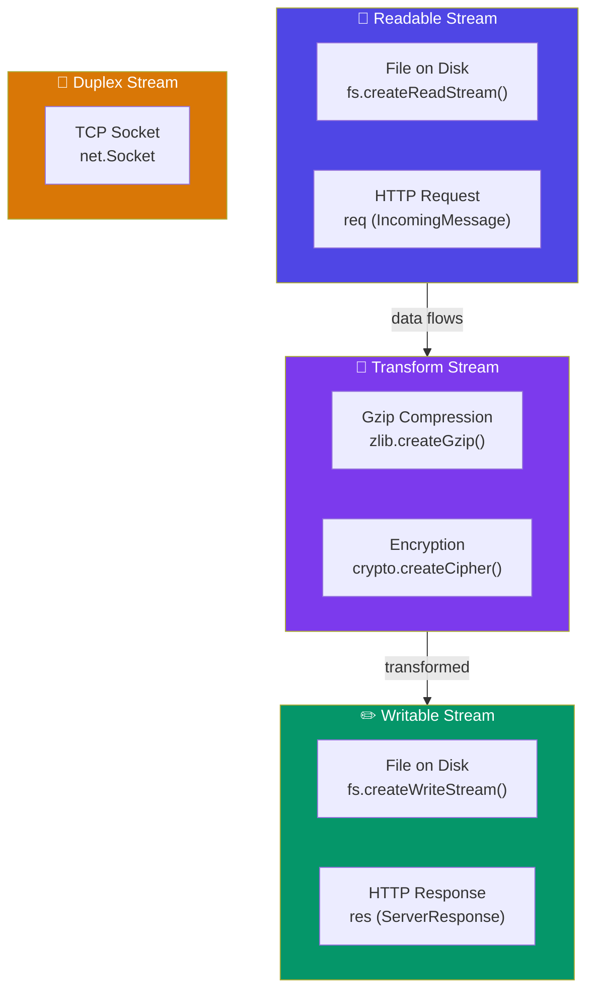
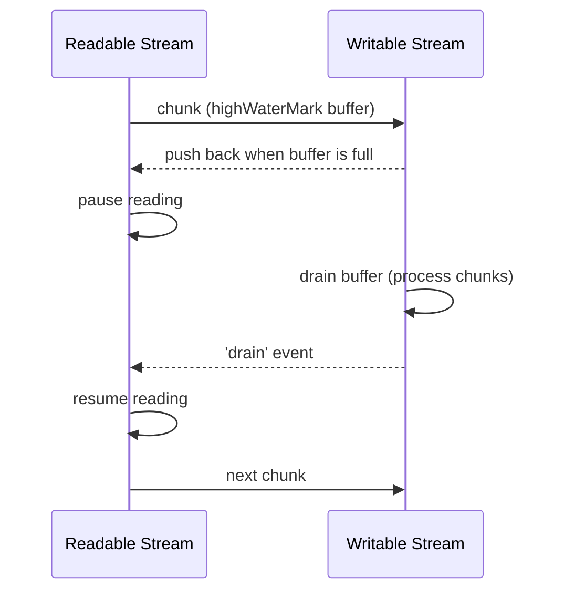

## Streams & Buffers

Streams and Buffers are foundational to Node.js's I/O model. **Streams** process data chunk-by-chunk instead of loading everything into memory. **Buffers** handle raw binary data.

### Buffers

A **Buffer** is a fixed-size chunk of raw binary data. It represents a sequence of bytes in memory.

```javascript
// Creating buffers
const buf1 = Buffer.from('Hello World');            // From string
const buf2 = Buffer.from([72, 101, 108, 108, 111]); // From byte array
const buf3 = Buffer.alloc(10);                      // 10 zero-filled bytes
const buf4 = Buffer.allocUnsafe(10);                // Faster but contains old data

// Reading buffers
console.log(buf1.toString('utf8'));    // 'Hello World'
console.log(buf1.toString('hex'));     // '48656c6c6f20576f726c64'
console.log(buf1.toString('base64'));  // 'SGVsbG8gV29ybGQ='

buf1[0];                               // 72 (byte at index 0)
buf1.length;                           // 11

// Manipulating
buf1.write('Hi', 0);                   // Overwrite first 2 bytes
buf1.slice(0, 5);                      // 'Hello' (no copy)
Buffer.concat([buf1, buf2]);           // Combine buffers
```

**When to use Buffers:** File I/O, network protocols, cryptography, binary data, encoding conversion.

### What Are Streams?

A stream is a sequence of data chunks flowing over time. Instead of reading an entire file into memory, you process it piece by piece.

```javascript
// Without streams ❌ — loads entire file into RAM
const fs = require('fs');
fs.readFile('huge-file.mp4', (err, data) => {
  // data is the ENTIRE file in memory
});

// With streams ✅ — processes chunk by chunk
const readStream = fs.createReadStream('huge-file.mp4');
readStream.on('data', (chunk) => {
  console.log(`Received ${chunk.length} bytes`);
});
```

### The 4 Stream Types

| Type | Description | Example |
|---|---|---|
| **Readable** | You can read data from it | `fs.createReadStream()`, HTTP request |
| **Writable** | You can write data to it | `fs.createWriteStream()`, HTTP response |
| **Duplex** | Both readable and writable | `net.Socket` (TCP), WebSocket |
| **Transform** | Duplex that modifies data in transit | `zlib.createGzip()`, `crypto.createCipher()` |



### `.pipe()` — The Stream Connector

`.pipe()` takes a readable stream and connects it to a writable stream. It handles backpressure automatically.

```javascript
// Pipe a file read stream into an HTTP response
const http = require('http');
const fs = require('fs');

http.createServer((req, res) => {
  const readStream = fs.createReadStream('video.mp4');
  readStream.pipe(res);
  // Data flows: file → HTTP response, chunk by chunk
});

// Chaining pipes — compress and send
const zlib = require('zlib');
http.createServer((req, res) => {
  res.setHeader('Content-Encoding', 'gzip');
  fs.createReadStream('data.json')
    .pipe(zlib.createGzip())  // Transform stream
    .pipe(res);               // Writable stream
});
```

### Backpressure

Backpressure happens when the writable stream can't keep up with the readable stream. Node.js handles this automatically with `.pipe()`.



```javascript
// Manual backpressure handling (without pipe)
const readStream = fs.createReadStream('large-file.txt');
const writeStream = fs.createWriteStream('output.txt');

readStream.on('data', (chunk) => {
  const canWrite = writeStream.write(chunk);
  if (!canWrite) {
    console.log('Backpressure: pausing read');
    readStream.pause();  // Stop reading until drain
  }
});

writeStream.on('drain', () => {
  console.log('Buffer drained: resuming read');
  readStream.resume();
});

// With .pipe() — backpressure is handled automatically!
readStream.pipe(writeStream);
```

### Reading a File Stream

```javascript
const fs = require('fs');

const stream = fs.createReadStream('data.txt', {
  highWaterMark: 64 * 1024, // 64KB chunks (default)
  encoding: 'utf8',
});

stream.on('open', () => console.log('Stream opened'));
stream.on('data', (chunk) => {
  console.log(`Chunk (${chunk.length} bytes):`, chunk);
});
stream.on('end', () => console.log('Stream ended'));
stream.on('error', (err) => console.error('Stream error:', err));
```

### Writing to a Stream

```javascript
const fs = require('fs');

const stream = fs.createWriteStream('output.txt');

stream.write('Hello, ');
stream.write('World!\n');
stream.write('Writing more data...\n');

stream.end('Final chunk');  // Signal that writing is done

stream.on('finish', () => console.log('All data written'));
stream.on('error', (err) => console.error(err));
```

### Custom Transform Stream

```javascript
const { Transform } = require('stream');

const upperCaseTransform = new Transform({
  transform(chunk, encoding, callback) {
    // chunk is a Buffer — convert to string, transform, push
    this.push(chunk.toString().toUpperCase());
    callback();
  }
});

// Usage: file → uppercase → compressed → response
fs.createReadStream('data.txt')
  .pipe(upperCaseTransform)
  .pipe(zlib.createGzip())
  .pipe(fs.createWriteStream('data-upper.txt.gz'));
```

### Practical: HTTP Server with Stream

```javascript
const http = require('http');
const fs = require('fs');
const path = require('path');

http.createServer((req, res) => {
  const filePath = path.join(__dirname, 'public', req.url);
  
  // Check if file exists
  fs.stat(filePath, (err, stats) => {
    if (err || !stats.isFile()) {
      res.statusCode = 404;
      res.end('File not found');
      return;
    }
    
    // Stream the file directly to the response
    res.setHeader('Content-Length', stats.size);
    res.setHeader('Content-Type', 'application/octet-stream');
    
    const readStream = fs.createReadStream(filePath);
    readStream.pipe(res);
    
    readStream.on('error', (err) => {
      res.statusCode = 500;
      res.end('Server error');
    });
  });
}).listen(3000);
```

### 🚨 Common Gotchas

```javascript
// ❌ Forgetting to handle 'error' on streams
readStream.pipe(writeStream); // Unhandled error crashes the process!
readStream.on('error', handleError);
writeStream.on('error', handleError);

// ❌ Not calling .end() on writable streams
const ws = fs.createWriteStream('out.txt');
ws.write('data');
// File never finishes! Need ws.end();

// ❌ Trying to write after .end()
ws.write('more'); // Error: write after end

// ✅ Check writable state
if (ws.writable) ws.write('data');

// ❌ Assuming 'data' event gives strings (default is Buffer!)
const rs = fs.createReadStream('file.txt');
rs.on('data', (chunk) => {
  console.log(typeof chunk); // 'object' (Buffer)
});
// ✅ Specify encoding
const rs2 = fs.createReadStream('file.txt', { encoding: 'utf8' });
rs2.on('data', (chunk) => console.log(typeof chunk)); // 'string'
```

### Key Takeaways

- **Buffers** handle raw binary data — convert with `.toString()`, allocate with `Buffer.alloc()`
- **Streams** process data chunk-by-chunk — memory efficient for large files
- **4 types**: Readable, Writable, Duplex, Transform
- `.pipe()` connects streams and **automatically handles backpressure**
- Backpressure: when a writable stream can't keep up, the readable stream pauses
- Always handle `error` events on streams — unhandled errors crash the process
- Specify `encoding` on readable streams to get strings instead of Buffers
