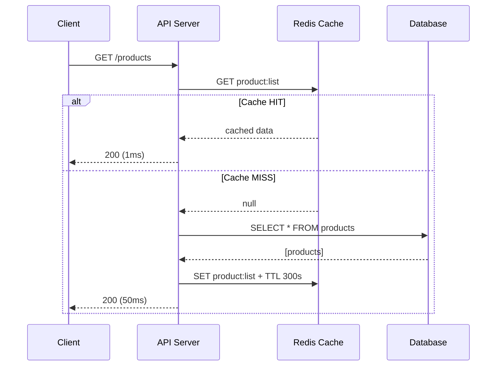
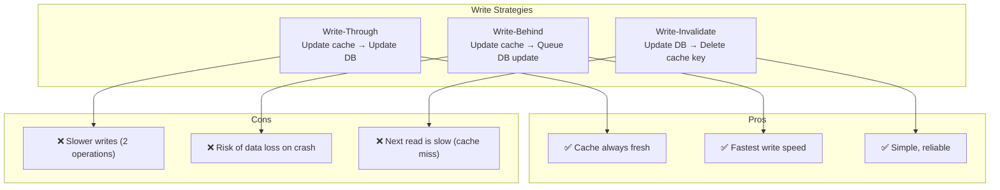
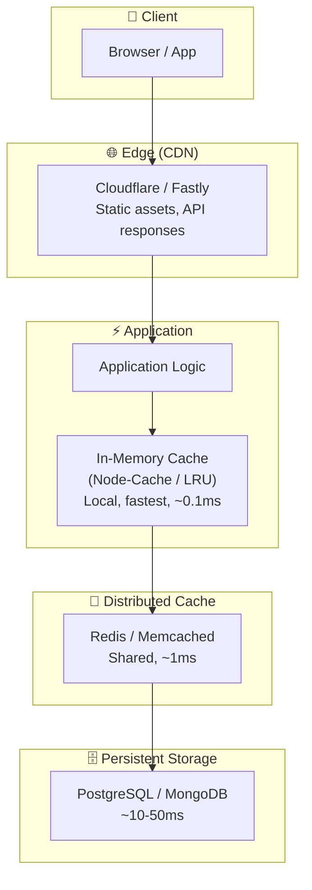
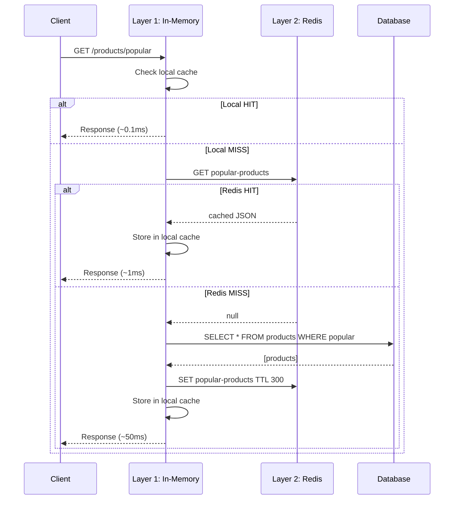

# Caching

## 📖 Introduction

Caching stores frequently accessed data in a **fast, temporary storage layer** to reduce latency and database load. Instead of querying a database (5-50ms) on every request, you store the result in a cache (0.1-1ms) and serve it from there.

In Node.js, caching can happen at multiple levels:
- **In-memory** (Node-Cache, LRU-Cache) — within the process, fastest but not shared across servers
- **Distributed** (Redis, Memcached) — shared across servers, survives restarts
- **HTTP/CDN** (Varnish, Cloudflare) — caches at the network edge

The right caching strategy can reduce database load by 80-90% and cut response times from hundreds of milliseconds to single-digit milliseconds.

## 🤔 Why Do We Need This?

Without caching, every request hits the database:

```javascript
// ❌ Every request → database query → slow under load
app.get('/products', async (req, res) => {
  const products = await Product.find({});  // Database every time!
  res.json(products);
});
```

At 100 requests/second, a database handling 50ms queries is busy 100% of the time. With caching, the same 100 requests/second only results in 1-2 actual database queries per second after the cache warms up.

## ⚠️ Problem Statement

A production caching system must solve:

1. **Cache invalidation** — The hardest problem: how do you know when cached data is stale?
2. **Cache stampede** — When a popular cache key expires, thousands of requests hit the database simultaneously
3. **Memory management** — Caches have finite memory — what gets evicted when full?
4. **Consistency** — How do you keep the cache in sync with the database?
5. **Serialization** — JavaScript objects must be serialized for distributed caches (JSON, MessagePack)
6. **Security** — Caching user-specific data without proper key isolation leaks data between users

## 📚 Real World Story

**Twitter** faced a classic cache stampede problem. When trending topics were cached, the cache would expire at a fixed time. At the next cache miss, thousands of requests would all hit the database simultaneously, causing a thundering herd. Their solution: **probabilistic early expiration** — each request randomly checks if the cache is about to expire and proactively refreshes it, preventing stampedes.

They also implemented **write-through caching** for tweets: when a tweet is posted, it's written to both the database and cache simultaneously, ensuring the cache is never stale for popular tweets.

## 🍕 Real World Analogy

| Caching Concept | Office Analogy |
|----------------|----------------|
| **Database** | The company's central filing cabinet |
| **Cache** | Your desk drawer with frequently used files |
| **Cache Hit** | You find the file in your drawer (seconds) |
| **Cache Miss** | You walk to the filing cabinet (minutes) |
| **TTL (Time-To-Live)** | You clean out your drawer every Friday |
| **Eviction** | More files than drawer space → remove oldest |
| **Cache Stampede** | Everyone rushes to the filing cabinet after cleaning day |
| **Write-Through** | File a document in both your drawer AND the cabinet |
| **Cache-Aside** | Check drawer first, then cabinet, then copy to drawer |

## 👁️ Visual Explanation

```
Cache-Aside (the most common pattern):

Request → Check Cache ──► Hit ──► Return Cached Data (fast!)
                          │
                          ▼ Miss
                     Query Database
                          │
                          ▼
                    Store in Cache (with TTL)
                          │
                          ▼
                    Return Data

Result: First request = slow (~50ms), subsequent = fast (~1ms)
```

## 📊 Mermaid Diagram 1: Cache-Aside Pattern



## ⚙️ Internal Working: How Redis Caches Data

Redis stores data in **memory**, not on disk (for caching purposes). When you call `redis.set(key, value)`:

1. The key is hashed to determine which of Redis's 16,384 hash slots it belongs to
2. The value is serialized in Redis's internal format (or as a string)
3. The key-value pair is stored in a dictionary (hash table) in memory
4. If TTL is set, Redis starts a timer for automatic eviction
5. When memory is full, Redis evicts keys based on the configured policy (LRU, LFU, TTL, etc.)

When you call `redis.get(key)`:
1. Redis hashes the key and looks it up in the hash table (O(1) average)
2. If found and not expired, returns the value
3. If not found or expired, returns `null`

## 🔄 Mermaid Diagram 2: Write Strategies



## 🏗️ Architecture: Multi-Layer Caching



## 👣 Step-by-Step Flow: Cached Product API



## 📝 Syntax

### Redis (ioredis)

```javascript
const Redis = require('ioredis');
const redis = new Redis(process.env.REDIS_URL);

// String operations
await redis.set('key', 'value');
await redis.setEx('key', 3600, 'value');  // With TTL
const val = await redis.get('key');         // null if not found
await redis.del('key');

// Object operations (serialize as JSON)
await redis.setEx('user:1', 3600, JSON.stringify({ name: 'Alice' }));
const user = JSON.parse(await redis.get('user:1'));

// Batch operations
await redis.mset({ 'k1': 'v1', 'k2': 'v2' });
const [v1, v2] = await redis.mget('k1', 'k2');
```

### In-Memory Cache (Node-Cache)

```javascript
const NodeCache = require('node-cache');
const cache = new NodeCache({ stdTTL: 300, checkperiod: 60 });

cache.set('key', { data: 'value' });
const val = cache.get('key');  // undefined if not found
cache.del('key');
cache.flushAll();
const stats = cache.getStats(); // { keys, hits, misses }
```

## 🟢 Basic Example: In-Memory Cache Middleware

```javascript
const express = require('express');
const NodeCache = require('node-cache');

const app = express();
const cache = new NodeCache({ stdTTL: 300 }); // 5 minutes

// Cache middleware
function cacheMiddleware(duration) {
  return (req, res, next) => {
    const key = `cache:${req.originalUrl}`;
    const cached = cache.get(key);

    if (cached) {
      return res.json(cached); // Cache HIT
    }

    // Override res.json to intercept the response
    const originalJson = res.json.bind(res);
    res.json = (data) => {
      cache.set(key, data, duration);
      return originalJson(data);
    };

    next();
  };
}

app.get('/products', cacheMiddleware(300), async (req, res) => {
  // This only runs on cache miss
  const products = await Product.find({}).sort({ createdAt: -1 }).limit(50);
  res.json(products);
});

app.listen(3000);
```

**What's happening:**
- **`cacheMiddleware`** intercepts the response on the first request
- **`res.json` override** captures the response data and stores it in the cache
- **TTL of 300 seconds** means data auto-expires after 5 minutes
- **Cache keys** are based on the full URL, so `/products` and `/products?page=2` have different caches

## 🟡 Intermediate Example: Redis Cache-Aside with Cache Stampede Protection

```javascript
const Redis = require('ioredis');
const redis = new Redis(process.env.REDIS_URL);

class CacheService {
  constructor() {
    this.LOCK_TTL = 10; // seconds
    this.CACHE_TTL = 300; // 5 minutes
  }

  async getOrSet(key, fetchFn, ttl = this.CACHE_TTL) {
    // 1. Try cache
    const cached = await redis.get(key);
    if (cached) {
      return JSON.parse(cached);
    }

    // 2. Try to acquire a lock (prevents stampede)
    const lockKey = `lock:${key}`;
    const lockAcquired = await redis.set(lockKey, '1', 'NX', 'EX', this.LOCK_TTL);

    if (lockAcquired) {
      try {
        // Double-check cache (another process might have filled it)
        const doubleCheck = await redis.get(key);
        if (doubleCheck) {
          await redis.del(lockKey);
          return JSON.parse(doubleCheck);
        }

        // Fetch from source
        const data = await fetchFn();
        await redis.setEx(key, ttl, JSON.stringify(data));
        return data;
      } finally {
        await redis.del(lockKey); // Release lock
      }
    }

    // 3. Lock not acquired — another process is fetching
    // Wait briefly and retry
    await new Promise(resolve => setTimeout(resolve, 100));
    const retry = await redis.get(key);
    if (retry) {
      return JSON.parse(retry);
    }

    // Fallback: fetch directly (rare case)
    return fetchFn();
  }
}

// Usage
const cacheService = new CacheService();

app.get('/products/high-demand', async (req, res) => {
  const products = await cacheService.getOrSet(
    'products:high-demand',
    async () => {
      console.log('Cache miss — fetching from database');
      return await Product.find({ demand: 'high' }).limit(100);
    },
    300
  );
  res.json(products);
});
```

**What's happening:**
- **Lock mechanism** prevents cache stampede — only one request fetches from the database
- **Double-check** ensures no wasted work if another process already filled the cache
- **Wait-and-retry** for non-lock-holders avoids immediate fallback to database
- **`NX` flag** ensures only one lock is created (Redis atomic operation)

## 🔴 Advanced Example: Production Cache Layer with Multi-Tier Eviction

```javascript
const Redis = require('ioredis');
const NodeCache = require('node-cache');
const crypto = require('crypto');

class ProductionCache {
  constructor(redisUrl) {
    // L1: In-memory (fastest, ~0.1ms)
    this.l1 = new NodeCache({
      stdTTL: 60,        // 1 minute
      checkperiod: 10,   // Check expired every 10s
      maxKeys: 1000,     // Max 1000 items in memory
    });

    // L2: Redis (shared, ~1ms)
    this.l2 = new Redis(redisUrl, {
      retryStrategy: (times) => Math.min(times * 50, 2000),
      maxRetriesPerRequest: 3,
    });

    // Stats tracking
    this.stats = { l1Hits: 0, l2Hits: 0, misses: 0 };
  }

  generateKey(prefix, params) {
    const hash = crypto.createHash('md5')
      .update(JSON.stringify(params))
      .digest('hex');
    return `${prefix}:${hash}`;
  }

  async get(key) {
    // L1: In-memory check
    const l1Data = this.l1.get(key);
    if (l1Data !== undefined) {
      this.stats.l1Hits++;
      return l1Data;
    }

    // L2: Redis check
    try {
      const l2Data = await this.l2.get(key);
      if (l2Data) {
        this.stats.l2Hits++;
        const parsed = JSON.parse(l2Data);
        // Populate L1 for future requests
        this.l1.set(key, parsed);
        return parsed;
      }
    } catch (err) {
      console.error('Redis error:', err.message);
      // L2 failure — proceed to fetch from source
    }

    this.stats.misses++;
    return null; // Cache miss
  }

  async set(key, data, ttlSeconds = 300) {
    // Write to both layers
    this.l1.set(key, data, ttlSeconds);
    try {
      await this.l2.setEx(key, ttlSeconds, JSON.stringify(data));
    } catch (err) {
      console.error('Redis set error:', err.message);
    }
  }

  async invalidate(pattern) {
    // Clear L1 (all items — simple approach)
    this.l1.flushAll();

    // Clear L2 by pattern
    const keys = [];
    let cursor = '0';
    do {
      const result = await this.l2.scan(cursor, 'MATCH', pattern);
      cursor = result[0];
      keys.push(...result[1]);
    } while (cursor !== '0');

    if (keys.length > 0) {
      await this.l2.del(...keys);
    }

    console.log(`Invalidated ${keys.length} keys matching ${pattern}`);
  }

  getStats() {
    const total = this.stats.l1Hits + this.stats.l2Hits + this.stats.misses;
    return {
      ...this.stats,
      total,
      hitRate: total > 0 ? ((this.stats.l1Hits + this.stats.l2Hits) / total * 100).toFixed(1) + '%' : 'N/A',
      l1HitRate: total > 0 ? (this.stats.l1Hits / total * 100).toFixed(1) + '%' : 'N/A',
    };
  }
}

// Usage
const cache = new ProductionCache(process.env.REDIS_URL);

app.get('/products/:id', async (req, res) => {
  const key = cache.generateKey('product', { id: req.params.id });
  let product = await cache.get(key);

  if (!product) {
    product = await Product.findById(req.params.id);
    if (!product) return res.status(404).json({ error: 'Not found' });
    await cache.set(key, product, 600); // 10 min TTL
  }

  res.json(product);
});

// Invalidate on update
app.put('/products/:id', async (req, res) => {
  const product = await Product.findByIdAndUpdate(req.params.id, req.body, { new: true });
  const key = cache.generateKey('product', { id: req.params.id });
  await cache.set(key, product, 600);
  res.json(product);
});
```

**What's happening:**
- **Two-tier caching** — L1 (in-memory, ~0.1ms) backed by L2 (Redis, ~1ms)
- **L1 is small** — only 1000 items, auto-evicts least recently used
- **L2 loads L1** — when a redis hit occurs, L1 is populated for subsequent requests
- **Pattern-based invalidation** — clear all keys matching a pattern (e.g., `product:*`)
- **Stats tracking** — monitor hit rates to optimize cache configuration
- **Graceful degradation** — if Redis fails, the system still works (cache misses fall through to DB)

## 🏭 Production Example: Caching Layer for E-Commerce

```javascript
// cache-service.js
const Redis = require('ioredis');
const { RateLimiterRedis } = require('rate-limiter-flexible');

class ECommerceCache {
  constructor() {
    this.redis = new Redis(process.env.REDIS_URL, {
      enableReadyCheck: true,
      maxRetriesPerRequest: 3,
      lazyConnect: true,
    });

    // Rate limiter using Redis
    this.rateLimiter = new RateLimiterRedis({
      storeClient: this.redis,
      points: 100,      // 100 requests
      duration: 60,      // per 60 seconds
      keyPrefix: 'rate:',
    });
  }

  async connect() {
    await this.redis.connect();
  }

  // Product catalog cache (read-heavy)
  async getProductCatalog(category, page = 1) {
    const key = `catalog:${category}:page:${page}`;
    const cached = await this.redis.get(key);
    if (cached) return JSON.parse(cached);

    const products = await Product.find({ category })
      .skip((page - 1) * 20).limit(20)
      .lean();

    // Cache for 5 minutes with random jitter to prevent stampede
    const jitter = Math.floor(Math.random() * 60);
    await this.redis.setEx(key, 300 + jitter, JSON.stringify(products));

    return products;
  }

  // Session cache (user-specific)
  async getSession(sessionId) {
    const key = `session:${sessionId}`;
    const cached = await this.redis.get(key);
    if (cached) {
      // Slide expiration — reset TTL on access
      await this.redis.expire(key, 1800); // 30 min
      return JSON.parse(cached);
    }
    return null;
  }

  // Hot inventory (write-heavy, avoid caching stale stock)
  async getInventory(productId) {
    // Don't cache inventory — it changes too frequently
    // Use Redis for real-time stock counter instead
    const stock = await this.redis.get(`stock:${productId}`);
    if (stock !== null) return parseInt(stock);

    const product = await Product.findById(productId).select('stock');
    await this.redis.setEx(`stock:${productId}`, 30, product.stock);
    return product.stock;
  }

  async decrementStock(productId) {
    // Atomic decrement (optimistic, no lock needed)
    const newStock = await this.redis.decr(`stock:${productId}`);
    if (newStock < 0) {
      await this.redis.incr(`stock:${productId}`);
      return false; // Out of stock
    }
    return true;
  }
}
```

**What's happening:**
- **Jittered TTL** prevents cache stampede for popular catalog pages
- **Sliding expiration** for sessions — extends TTL on each access
- **Separate strategies** per data type: catalog cached long, inventory cached short
- **Atomic stock operations** using `DECR` — no race conditions
- **Lazy connection** avoids startup failures if Redis is temporarily unavailable

## ⚙️ How It Works Internally: Redis Eviction Policies

When Redis runs out of memory, it evicts keys based on the configured policy:

| Policy | Behavior | Use Case |
|--------|----------|----------|
| `noeviction` | Return error on writes | Never lose data |
| `allkeys-lru` | Evict least recently used keys | General purpose caching ✅ |
| `allkeys-lfu` | Evict least frequently used keys | Content serving |
| `volatile-lru` | Evict LRU among keys with TTL set | Mixed cache + persistent |
| `volatile-ttl` | Evict keys with shortest TTL | Time-sensitive data |

## 📦 Performance Notes

| Strategy | Latency | Hit Rate | Complexity | Use Case |
|----------|---------|----------|------------|----------|
| **In-memory** | ~0.1ms | Low per server | Low | Single server, hot data |
| **Redis** | ~1ms | High (shared) | Medium | Distributed systems |
| **Multi-tier** | ~0.1ms L1, ~1ms L2 | Very high | High | High-traffic production |
| **CDN** | ~10-50ms | Regional | Low | Static assets, public API |

### Cache Sizing

```javascript
// Estimate cache size
// 1000 products × 2KB each = ~2MB in memory cache
// 100,000 sessions × 512 bytes = ~50MB in Redis
// Redis should have "maxmemory" set and use allkeys-lru eviction
```

## 🔒 Security Notes

### 1. Cache Key Isolation

```javascript
// ❌ Don't cache user-specific data without user ID in key
app.get('/profile', cacheMiddleware, async (req, res) => {
  const user = await User.findById(req.user.id);
  res.json(user); // All users see the same cached profile!
});

// ✅ Include user identifier
app.get('/profile', async (req, res) => {
  const key = `profile:${req.user.id}`;
  const cached = await cache.get(key);
  // ...
});
```

### 2. Sensitive Data

- Never cache passwords, tokens, or PII in shared caches (Redis)
- Use in-memory cache only for non-sensitive data
- Encrypt cached data if it contains any user info

### 3. Cache Poisoning Prevention

```javascript
// ✅ Don't cache error responses
res.json = (data) => {
  if (res.statusCode >= 400) {
    return originalJson(data); // Skip cache
  }
  cache.set(key, data);
  return originalJson(data);
};
```

## ⚠️ Common Mistakes

1. **❌ No TTL on cached data** — Data cached indefinitely becomes stale. Always set a TTL.

2. **❌ Cache stampede** — Popular key expires, and all requests hit the database. Use locks or jittered TTLs.

3. **❌ Over-caching** — Caching data that changes too frequently hurts performance (paying write + invalidation cost).

4. **❌ No cache warming** — First request after deploy is always slow. Pre-populate the cache on startup.

5. **❌ Ignoring cache failure** — If Redis goes down, your app shouldn't crash. Gracefully fall back to the database.

6. **❌ Caching user-specific data without proper key isolation** — User A sees User B's profile because the cache key is just `/profile`.

## 🚀 Best Practices

```javascript
// ✅ Production caching checklist

// 1. Always set TTL
await redis.setEx(key, 300, data);

// 2. Add jitter to prevent stampede
const ttl = 300 + Math.floor(Math.random() * 60);

// 3. Never cache errors
if (res.statusCode < 400) cache.set(key, data);

// 4. Warm cache on deploy
async function warmCache() {
  const products = await Product.find({ popular: true }).limit(100);
  await cache.set('popular-products', products, 600);
}

// 5. Graceful degradation
let cachedData;
try {
  cachedData = await redis.get(key);
} catch (err) {
  cachedData = null; // Redis down — fall through to DB
}
```

## 🎯 Interview Questions

**Q1: What is cache stampede and how do you prevent it?**

A cache stampede (or thundering herd) happens when a popular cache key expires and thousands of requests simultaneously hit the database. Prevention strategies: (1) **Locking** — only one request fetches from DB, others wait, (2) **Jittered TTL** — randomize expiration times, (3) **Probabilistic early expiration** — proactively refresh cache before it expires.

**Q2: What's the difference between cache-aside and read-through caching?**

In **cache-aside**, the application is responsible for checking cache first, then fetching from the database on miss, and populating the cache. In **read-through**, the cache layer itself loads data from the database when missing — the application only talks to the cache, never directly to the database.

**Q3: How do you invalidate a Redis cache?**

Three strategies: (1) **TTL-based** — data auto-expires after N seconds, (2) **Write-invalidate** — delete the cache key when the underlying data changes, (3) **Write-through** — update cache and database simultaneously. For pattern-based invalidation, use `SCAN` to find matching keys and `DEL` to remove them.

**Q4: When would you use in-memory caching vs Redis?**

In-memory (Node-Cache, LRU-Cache) is faster (~0.1ms) but limited to a single server — data isn't shared. Redis is slower (~1ms) but shared across all server instances. Use in-memory for single-server apps or hot data that changes infrequently. Use Redis for distributed systems, session storage, pub/sub, and data that must survive restarts.

## 📝 MCQs

**1. What is the main purpose of a cache TTL (Time-To-Live)?**
- A) Compress cached data
- B) Auto-expire stale data ✅
- C) Encrypt cached values
- D) Increase cache capacity

**2. Which Redis command sets a key with an expiration time?**
- A) `redis.set()`
- B) `redis.setEx()` ✅
- C) `redis.setTtl()`
- D) `redis.setTimeout()`

**3. What problem does cache stampede cause?**
- A) Cache uses too much memory
- B) Thousands of DB queries hit simultaneously when a key expires ✅
- C) Cache keys are duplicated
- D) Redis server crashes

**4. Which cache eviction policy removes the least recently accessed keys?**
- A) `volatile-ttl`
- B) `allkeys-lru` ✅
- C) `noeviction`
- D) `allkeys-random`

**5. What is the main disadvantage of write-through caching?**
- A) Data can be lost on crash
- B) Writes are slower (cache + DB update) ✅
- C) Cache is always stale
- D) Requires custom invalidation logic

**Answer Key:** 1-B, 2-B, 3-B, 4-B, 5-B

## 💻 Coding Challenge 1: Cache Middleware

Build a Redis cache middleware for Express that:
- Caches GET responses based on the request URL
- Has a configurable TTL (default 5 minutes)
- Only caches responses with status 200-399
- Includes request headers in the cache key for content negotiation
- Returns a response-time header showing `X-Cache: HIT` or `X-Cache: MISS`

## 💻 Coding Challenge 2: Rate Limiter with Redis

Build a sliding window rate limiter using Redis:
- Limits requests to N per minute per IP
- Uses a sorted set with timestamps as scores
- Returns `X-RateLimit-Remaining` and `X-RateLimit-Reset` headers
- Returns 429 when limit exceeded
- Auto-cleans old entries (don't let the sorted set grow unbounded)

## 💻 Coding Challenge 3: Multi-Tier Cache Implementation

Build a two-tier cache (L1: in-memory, L2: Redis) that:
- Checks L1 first, L2 second, database third
- Populates L1 on L2 hits, L2 on database hits
- Has configurable TTL for each tier
- Emits events for cache hits/misses (for monitoring)
- Implements distributed invalidation (clear L2, notify all servers to clear L1)

## 🧪 Mini Exercise: Debugging Cache Bugs

This caching code has bugs. Find and fix them:

```javascript
const Redis = require('ioredis');
const redis = new Redis();

app.get('/user/profile', async (req, res) => {
  // Bug 1: Cache key doesn't include user ID
  // All users see the same profile!
  const cached = await redis.get('user:profile');

  if (cached) {
    return res.json(cached); // Bug 2: cached is a string, not an object!
  }

  const user = await User.findById(req.user.id);

  // Bug 3: No TTL set — data cached forever
  await redis.set('user:profile', JSON.stringify(user));
  res.json(user);
});

// Bug 4: No invalidation on profile update
app.put('/user/profile', async (req, res) => {
  const user = await User.findByIdAndUpdate(req.user.id, req.body, { new: true });
  res.json(user);
  // Stale data still in cache!
});
```

## 🌍 Real World Problem (Interview Coding Challenge)

**Problem:** You're building the caching layer for a news website that serves 10 million daily visitors. Articles are read-heavy (read 1000:1 write ratio) but must be updatable by editors. The homepage changes every few minutes.

**Requirements:**
1. Articles should be cached for 1 hour but instantly invalidated when edited
2. The homepage should be cached for 2 minutes with stampede protection
3. Personalized content (user preferences) must not leak between users
4. If the cache server goes down, the site must still function (degraded)
5. Cache hit rate must be >90%

**Questions:**
1. What caching pattern would you use for articles? For the homepage?
2. How would you implement instant invalidation when an editor updates an article?
3. How would you warm the cache for the most popular articles after a deployment?
4. What happens if Redis goes down? How does the site degrade gracefully?

**Interview Tip:** Discuss a two-tier cache: a CDN edge cache for anonymous traffic + Redis for authenticated users. Use cache tags for group invalidation (invalidate all "sports" articles at once). Implement circuit breaker pattern for cache failures.

## 🏗️ Mini Project: URL Shortener Analytics Cache

Build a caching layer for the URL shortener from the databases module:

**Core features:**
- Cache popular short URLs in Redis for fast redirects (TTL: 1 hour)
- Cache click analytics (daily counts, last 24 hours) with short TTL (TTL: 5 minutes)
- Implement cache warming when a new short URL is created
- Implement cache invalidation when a URL expires or is deleted
- Cache policy: popular URLs (>100 clicks) get longer TTL

**Technical requirements:**
- Use multi-tier caching (in-memory + Redis)
- Add jittered TTLs to prevent stampede
- Track cache hit/miss rates and expose via `/stats` endpoint
- Graceful degradation if Redis is unavailable

**Bonus features:**
- Pre-warm cache for the top 100 URLs on server startup
- Implement rate limiting using the cached data
- Add a cache management dashboard endpoint

## 📖 Summary

| Concept | Key Takeaway |
|---------|-------------|
| **Cache-Aside** | Most common pattern — check cache, fall back to DB, populate cache |
| **TTL** | Always set expiration — never cache data indefinitely |
| **Stampede** | Use locks or jittered TTL to prevent thundering herd |
| **In-Memory** | Fastest (~0.1ms) but not shared — use for hot data |
| **Redis** | Shared across servers (~1ms) — use for distributed caching |
| **Invalidation** | Delete or update cache when underlying data changes |
| **Eviction** | LRU is the most common policy when memory is full |

## 📋 Cheat Sheet

```javascript
// Quick reference: Redis caching patterns

// 1. Connect
const Redis = require('ioredis');
const redis = new Redis(process.env.REDIS_URL);

// 2. Cache-aside pattern
async function getCached(key, fetchFn, ttl = 300) {
  const cached = await redis.get(key);
  if (cached) return JSON.parse(cached);
  const data = await fetchFn();
  await redis.setEx(key, ttl, JSON.stringify(data));
  return data;
}

// 3. In-memory cache
const NodeCache = require('node-cache');
const cache = new NodeCache({ stdTTL: 300 });

// 4. Cache middleware
app.use((req, res, next) => {
  const key = `cache:${req.originalUrl}`;
  const cached = cache.get(key);
  if (cached) return res.json(cached);
  const json = res.json.bind(res);
  res.json = (data) => { cache.set(key, data); return json(data); };
  next();
});

// 5. Invalidate
await redis.del('product:123');
await redis.del(...keys); // Multiple keys
```

## 📚 Further Reading

- [Redis Documentation](https://redis.io/documentation)
- [ioredis GitHub](https://github.com/redis/ioredis)
- [Node-Cache](https://github.com/node-cache/node-cache)
- [Redis Eviction Policies](https://redis.io/docs/reference/eviction/)
- [AWS Elasticache Best Practices](https://aws.amazon.com/caching/best-practices/)

## 🔗 Related Topics

- [Working with Databases](./databases) — What you're caching from
- [Message Queues](./message-queues) — Pub/sub, BullMQ with Redis
- [Performance Optimization](../production/performance) — Caching for performance
- [Monitoring](../production/logging-and-monitoring) — Tracking cache hit rates
