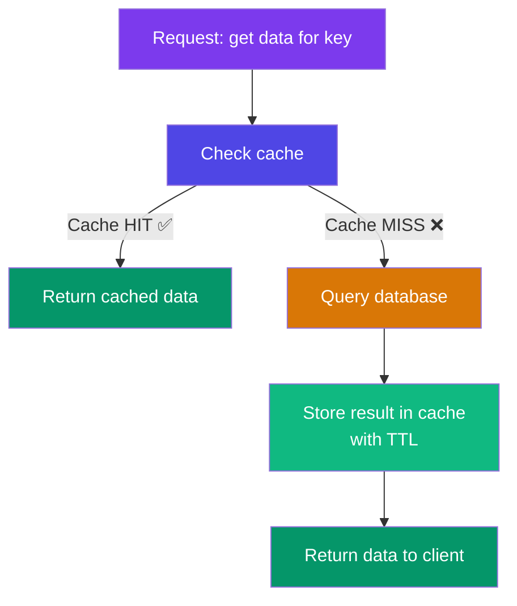

## Caching

Caching stores frequently accessed data in a **fast, temporary storage layer** to reduce latency and database load. In Node.js, caching can be in-memory (within the process) or distributed (Redis, Memcached).

### Why Cache?

```javascript
// ❌ Every request hits the database — slow under load
app.get('/products', async (req, res) => {
  const products = await Product.find({}); // Database query every time!
  res.json(products);
});

// ✅ Cached — first request hits DB, subsequent requests use cache
let cachedProducts = null;
let cacheTimestamp = 0;

app.get('/products', async (req, res) => {
  if (cachedProducts && Date.now() - cacheTimestamp < 300000) {
    return res.json(cachedProducts); // From cache (fast!)
  }
  
  const products = await Product.find({});
  cachedProducts = products;          // Update cache
  cacheTimestamp = Date.now();
  res.json(products);
});
```

### Cache-Aside (Lazy Loading)

The most common pattern — check cache first, fall back to database, then update cache.



```javascript
async function getProduct(id) {
  const cacheKey = `product:${id}`;
  
  // 1. Try cache first
  const cached = await redis.get(cacheKey);
  if (cached) {
    return JSON.parse(cached); // Cache HIT
  }
  
  // 2. Cache MISS — query database
  const product = await Product.findById(id);
  if (!product) return null;
  
  // 3. Store in cache with TTL
  await redis.setEx(cacheKey, 3600, JSON.stringify(product)); // 1 hour
  
  return product;
}
```

### Read-Through Cache

The cache layer is responsible for loading data from the database when it's missing.

```javascript
class ReadThroughCache {
  constructor(redis, loader, ttlSeconds = 3600) {
    this.redis = redis;
    this.loader = loader;  // Function to load data from DB
    this.ttl = ttlSeconds;
  }
  
  async get(key) {
    const cached = await this.redis.get(key);
    if (cached) {
      return JSON.parse(cached);
    }
    
    // Load from database and populate cache
    const data = await this.loader(key);
    if (data) {
      await this.redis.setEx(key, this.ttl, JSON.stringify(data));
    }
    return data;
  }
  
  async invalidate(key) {
    await this.redis.del(key);
  }
}

// Usage
const productCache = new ReadThroughCache(
  redis,
  async (key) => {
    const id = key.replace('product:', '');
    return await Product.findById(id);
  },
  3600
);

const product = await productCache.get('product:123');
```

### Write Strategies

```javascript
// 1. Write-Through — update cache first, then DB
async function updateProduct(id, data) {
  // Update cache immediately
  await redis.setEx(`product:${id}`, 3600, JSON.stringify(data));
  
  // Then update database
  return await Product.findByIdAndUpdate(id, data, { new: true });
}

// 2. Write-Behind (Write-Back) — update cache, queue DB update
async function updateProductAsync(id, data) {
  await redis.setEx(`product:${id}`, 3600, JSON.stringify(data));
  await cacheUpdateQueue.add({ id, data }); // Async DB update
}

// 3. Cache Invalidation — delete cache on write
async function updateProductInvalidate(id, data) {
  const product = await Product.findByIdAndUpdate(id, data, { new: true });
  await redis.del(`product:${id}`); // Invalidate cache
  return product;
}
```

> 🔍 See the dedicated **[Redis section](/DSA-Notes-Problems/redis/)** for a deep-dive on Redis setup, data types, persistence, and commands.

### Redis Implementation

```javascript
const redis = require('redis');

async function setupCache() {
  const client = redis.createClient({
    url: process.env.REDIS_URL || 'redis://localhost:6379',
  });
  
  client.on('error', (err) => console.error('Redis error:', err));
  await client.connect();
  
  return client;
}

// Cache middleware for Express
const cacheMiddleware = (ttlSeconds = 300) => {
  return async (req, res, next) => {
    const key = `cache:${req.originalUrl}`;
    
    try {
      const cached = await redis.get(key);
      if (cached) {
        return res.json(JSON.parse(cached));
      }
      
      // Override res.json to cache the response
      const originalJson = res.json.bind(res);
      res.json = (data) => {
        redis.setEx(key, ttlSeconds, JSON.stringify(data));
        return originalJson(data);
      };
      
      next();
    } catch (err) {
      // If cache fails, proceed without caching
      next();
    }
  };
};

// Usage
app.get('/products', cacheMiddleware(300), async (req, res) => {
  const products = await Product.find({});
  res.json(products);
});
```

### In-Memory Cache (Node-Cache)

```javascript
const NodeCache = require('node-cache');
const cache = new NodeCache({ stdTTL: 300, checkperiod: 60 });

// Simple API
cache.set('key', { data: 'value' }, 3600);
const value = cache.get('key');
cache.del('key');
cache.flushAll();

// Stats
console.log(cache.getStats()); // { keys: 3, hits: 10, misses: 2 }

// Cache middleware with NodeCache
const memoryCache = (ttlSeconds = 300) => {
  const cache = new NodeCache({ stdTTL: ttlSeconds });
  
  return (req, res, next) => {
    const key = req.originalUrl;
    const cached = cache.get(key);
    
    if (cached) {
      return res.json(cached);
    }
    
    const originalJson = res.json.bind(res);
    res.json = (data) => {
      cache.set(key, data);
      return originalJson(data);
    };
    
    next();
  };
};
```

### Cache Invalidation Strategies

| Strategy | How | Best for |
|---|---|---|
| **TTL (Time-To-Live)** | Auto-expire after N seconds | Static data, weather, trends |
| **Write-through** | Update cache on every write | High read/write ratio |
| **Write-invalidate** | Delete cache on write | Medium write frequency |
| **Manual** | Explicit API call to invalidate | Admin actions, content publish |

### 🚨 Common Gotchas

```javascript
// ❌ Caching user-specific data without user ID in the key
app.get('/profile', cacheMiddleware, async (req, res) => {
  const user = await User.findById(req.user.id);
  res.json(user);
  // All users get the same cached profile!
});

// ✅ Include user-specific identifier in the cache key
const key = `cache:${req.user.id}:${req.originalUrl}`;

// ❌ Cache poisoning — caching error responses
res.json = (data) => {
  // Don't cache error responses!
  if (res.statusCode >= 400) {
    return originalJson(data);
  }
  redis.setEx(key, ttl, JSON.stringify(data));
  return originalJson(data);
};
```

### Key Takeaways

- Caching reduces database load and improves response times dramatically
- **Cache-aside** (lazy loading) is the most common pattern — check cache first, fall back to DB
- Use **Redis** for distributed caching across multiple server instances
- Use **Node-Cache** for simple in-memory caching within a single process
- Always set **TTL** (Time-To-Live) — never cache data indefinitely
- **Invalidate** cache on writes to prevent stale data
- Include user-specific identifiers in cache keys when caching personalized data
- Never cache error responses — check `res.statusCode` first
